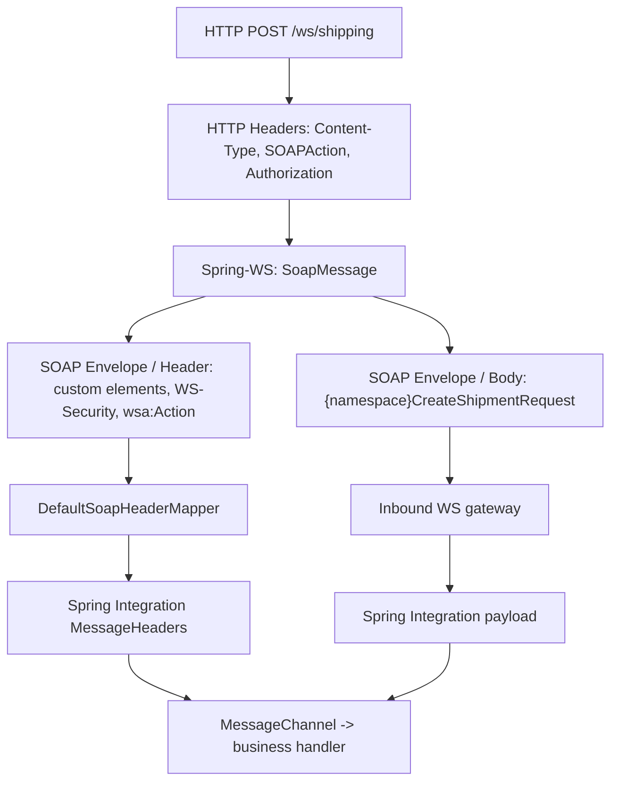
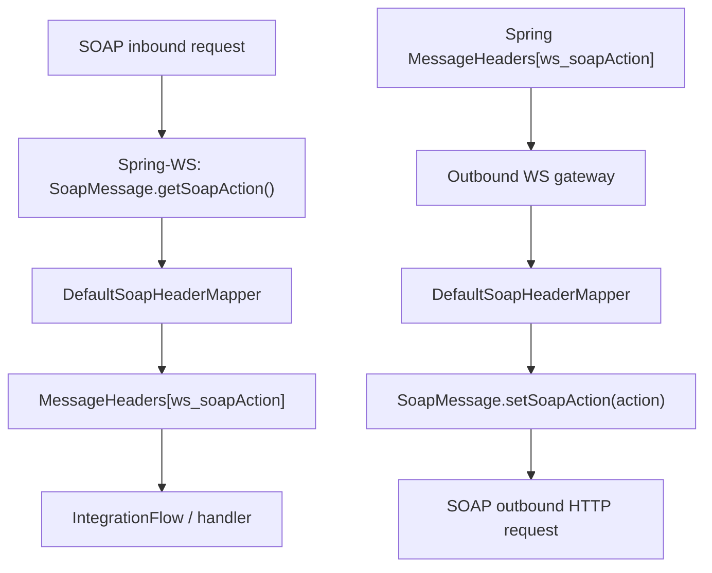
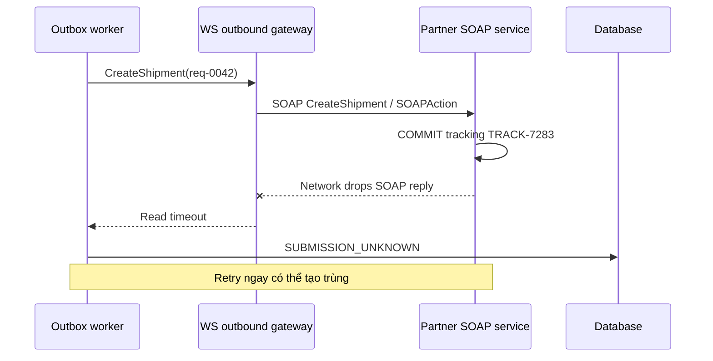

# SOAP action và header

## 1. Bài toán: SOAP request đúng XML nhưng đi sai operation

Một hệ thống Spring Boot nhận yêu cầu tích hợp từ đối tác logistics qua **SOAP 1.1**. Hai operation `CreateShipment` và `CancelShipment` dùng hai phần tử XML khác nhau, được mô tả trong WSDL. Khi nhận `CreateShipmentRequest`, ứng dụng cần đọc correlation ID trong SOAP Header, chuyển request thành Spring Integration `Message<?>`, xử lý nghiệp vụ và trả SOAP response. Ngược lại, khi **gọi outbound** sang SOAP của đối tác, ứng dụng phải gửi đúng `SOAPAction` và header `ClientContext` đã thỏa thuận.

Một sự cố thường gặp: client gửi `SOAPAction: "urn:demo:shipments:v1/CancelShipment"` nhưng SOAP Body lại chứa `CreateShipmentRequest`. Nếu server chỉ tin action để gọi handler hủy vận đơn, hoặc chỉ nhìn local name mà bỏ qua namespace, có thể gọi **sai nghiệp vụ**. Một sự cố khác: nhóm phát triển đặt Spring message header `ClientContext` rồi tin nó tự xuất hiện trong SOAP Envelope; mặc định `DefaultSoapHeaderMapper` **không copy tùy tiện các custom SOAP headers**.

Trong module `SPRING_INTEGRATION_ADAPTERS` — kết nối hệ thống ngoài bằng inbound/outbound adapter, gateway, poller và `MessageChannel`, xử lý hợp đồng message, lỗi và vòng đời kết nối qua file, SFTP, HTTP, JMS, AMQP, Kafka và database — bài **“SOAP action và header”** tập trung vào ranh giới giữa **HTTP transport headers**, **SOAP Envelope Header**, **SOAP Body QName**, **WS-Addressing** và **Spring Integration MessageHeaders**.

### Kết quả học tập

Sau bài này bạn có thể:

1. Phân biệt `SOAPAction` (SOAP 1.1), SOAP 1.2 `action` parameter, `wsa:Action` và QName phần tử đầu SOAP Body.
2. Hiểu `SoapMessage.getSoapAction()/setSoapAction(...)`, `SoapActionCallback`, `ActionCallback`, `SoapHeaderElement` và `mustUnderstand`.
3. Đọc/ghi SOAP Header tùy chỉnh bằng `DefaultSoapHeaderMapper` với `Source` hoặc `SoapHeaderElement` và danh sách allowlist.
4. Tạo outbound flow `Ws.simpleOutboundGateway(...)` với `WebServiceHeaders.SOAP_ACTION` và kiểm thử action/header được gửi.
5. Định tuyến inbound bằng `PayloadRootQNameEndpointMapping` hoặc `SoapActionEndpointMapping` và kiểm tra contract nhất quán.
6. Xử lý header security (WS-Security, mTLS, OAuth, WS-Addressing, replay), SOAP Fault và timeout mà không nhầm metadata với quyền truy cập.
7. Xây dựng test `MockWebServiceServer`/`MockWebServiceClient`, quan sát sự cố và checklist tích hợp production.

> **Phiên bản:** Spring Integration **6.5.x**, Spring Web Services **4.0.x**, Spring Framework 6.x, Java 17+ và Spring Boot tương thích. `javax.xml.transform.Source` vẫn là JAXP hợp lệ trên Java 17; Jakarta SOAP/JAXB dùng `jakarta.xml.soap`/`jakarta.xml.bind`. Các URI `urn:demo:shipments:v1`, domain `example.test` và ID ở đây chỉ là dữ liệu học tập.

## 2. Có bốn lớp “header”/định danh khác nhau



| Khái niệm | Vị trí | Ví dụ | Ai chịu trách nhiệm? |
| --- | --- | --- | --- |
| HTTP Content-Type | HTTP transport | `text/xml; charset=utf-8` | HTTP client/servlet, message factory |
| SOAP 1.1 `SOAPAction` | HTTP header, qua `SoapMessage` | `"urn:demo:shipments:v1/CreateShipment"` | Spring-WS + SOAPAction callback/mapper |
| SOAP 1.2 action | Media-type `application/soap+xml` parameter | `action="urn:demo:shipments:v1/CreateShipment"` | SOAP 1.2 message factory + HTTP transport |
| SOAP Header | `<env:Header>` trong Envelope | `<ctx:ClientContext>`, `<wsse:Security>` | SOAP client/server, interceptors, header mapper |
| WS-Addressing `wsa:Action` | **SOAP Header**, namespace WS-A | `urn:demo:shipments:v1/CreateShipment` | WS-Addressing `ActionCallback`/endpoint mapping |
| SOAP Body root QName | `<env:Body>` | `{urn:demo:shipments:v1}CreateShipmentRequest` | XSD/WSDL + payload mapping/validation |
| Spring Integration header | `MessageHeaders` trong JVM | `WebServiceHeaders.SOAP_ACTION` | Integration gateway + mapper/handler |

**Quan trọng:** chuỗi chữ `CreateShipment` xuất hiện trong action, QName hoặc SOAP Header không làm chúng tương đương. Một header `X-Client-ID` trong HTTP không tự trở thành `ctx:ClientId` của SOAP Header; một Spring header `ClientContext` không tự đi ra HTTP trừ khi mapper hoặc callback đưa nó vào đúng chỗ.

### Spring message khác SOAP message

Spring Integration đưa `Message<Source>` hoặc `Message<POJO>` qua `MessageChannel`; `MessageHeaders` là map immutable của Spring. Spring-WS `SoapMessage` chứa Envelope, Header, Body và transport-specific action. Gateway là **ranh giới mapping** giữa hai biểu diễn. Header từ bên ngoài là dữ liệu chưa tin cậy, không mặc định có quyền điều khiển router hoặc business operation.

## 3. SOAP 1.1: `SOAPAction` không nằm trong SOAP Header

Ví dụ request SOAP 1.1 gồm HTTP transport headers và SOAP envelope:

```http
POST /ws/shipping HTTP/1.1
Host: shipping.example.test
Content-Type: text/xml; charset=utf-8
SOAPAction: "urn:demo:shipments:v1/CreateShipment"
Authorization: Bearer <token-redacted>

<?xml version="1.0" encoding="UTF-8"?>
<soap:Envelope xmlns:soap="http://schemas.xmlsoap.org/soap/envelope/"
               xmlns:ship="urn:demo:shipments:v1"
               xmlns:ctx="urn:demo:shipments:headers:v1">
  <soap:Header>
    <ctx:ClientContext soap:mustUnderstand="0">
      <ctx:RequestId>req-0042</ctx:RequestId>
    </ctx:ClientContext>
  </soap:Header>
  <soap:Body>
    <ship:CreateShipmentRequest>
      <ship:clientRequestId>req-0042</ship:clientRequestId>
      <ship:orderId>O-9001</ship:orderId>
    </ship:CreateShipmentRequest>
  </soap:Body>
</soap:Envelope>
```

Trong mẫu này:

- `SOAPAction` ở **HTTP header**, bên ngoài XML document; trong Spring-WS thường đặt qua `SoapMessage.setSoapAction(...)`.
- `ctx:ClientContext` là **SOAP header block** bên trong Envelope. Namespace URI xác định QName `{urn:demo:shipments:headers:v1}ClientContext`.
- `ship:CreateShipmentRequest` là **SOAP Body payload root**, QName `{urn:demo:shipments:v1}CreateShipmentRequest`, không phải HTTP header.
- `Authorization` là **HTTP authorization**; token phải được xác minh đúng issuer/audience/scope hoặc policy tương ứng. **Không** đặt token thật trong tài liệu/log mẫu.

SOAP 1.1 có thể dùng SOAPAction là URI được trích dẫn, chuỗi rỗng hoặc không hiện diện tùy client/binding; chính **WSDL/policy của đối tác** quyết định giá trị mong đợi. Một URI action **không nhất thiết là URL phải GET**; nó thường là một tên operation mang tính định danh. Không phát HTTP request tới URI action chỉ vì nó trông giống đường dẫn web.

## 4. SOAP 1.2: media type `action` khác với `wsa:Action`

SOAP 1.2 thay namespace Envelope thành `http://www.w3.org/2003/05/soap-envelope`; khi dùng HTTP thường sử dụng media type `application/soap+xml` và `action` parameter theo binding.

```http
POST /ws/shipping HTTP/1.1
Host: shipping.example.test
Content-Type: application/soap+xml; charset=utf-8; action="urn:demo:shipments:v1/CreateShipment"

<env:Envelope xmlns:env="http://www.w3.org/2003/05/soap-envelope"
              xmlns:ship="urn:demo:shipments:v1">
  <env:Body>
    <ship:CreateShipmentRequest>
      <ship:clientRequestId>req-0042</ship:clientRequestId>
      <ship:orderId>O-9001</ship:orderId>
    </ship:CreateShipmentRequest>
  </env:Body>
</env:Envelope>
```

Không tự thêm SOAP 1.1 HTTP `SOAPAction` vào một SOAP 1.2 message rồi giả định đã đáp ứng contract. Với Spring-WS, hãy dùng `SoapVersion.SOAP_11` hoặc `SoapVersion.SOAP_12` của `SaajSoapMessageFactory` tương ứng WSDL binding, và để message factory/transport xử lý content type/action.

### Bảng so sánh

| Thuộc tính | SOAP 1.1 | SOAP 1.2 |
| --- | --- | --- |
| Envelope namespace | `http://schemas.xmlsoap.org/soap/envelope/` | `http://www.w3.org/2003/05/soap-envelope` |
| Media type phổ biến | `text/xml` | `application/soap+xml` |
| Action ở HTTP | `SOAPAction` HTTP header | `action` parameter trong media type |
| SOAP Fault | `faultcode`/`faultstring`/`detail` | `Code`/`Reason`/`Detail`, có thể có `Subcode` |
| mustUnderstand | `0`/`1` | `false`/`true` theo SOAP 1.2 |
| actor/role | `actor` (SOAP 1.1) | `role` (SOAP 1.2), có `relay` semantics |

**Không suy ra version chỉ từ SOAPAction string.** Phải kiểm tra Envelope QName, media type/binding và endpoint thực tế. SOAP 1.1 và 1.2 không thể hoán đổi bằng cách sửa tên XML prefix hoặc Content-Type một mình.

## 5. WS-Addressing: `wsa:Action` là một SOAP Header độc lập

WS-Addressing định nghĩa các **Message Addressing Properties** độc lập với HTTP transport: `Action`, `To`, `MessageID`, `ReplyTo`, `FaultTo` và `RelatesTo`. Các header này giúp route/correlation trong các hệ thống SOAP phức tạp; chúng **không thay thế** transport security hoặc business idempotency.

```xml
<env:Envelope xmlns:env="http://www.w3.org/2003/05/soap-envelope"
              xmlns:wsa="http://www.w3.org/2005/08/addressing"
              xmlns:ship="urn:demo:shipments:v1">
  <env:Header>
    <wsa:Action env:mustUnderstand="true">
      urn:demo:shipments:v1/CreateShipment
    </wsa:Action>
    <wsa:To>https://shipping.example.test/ws/shipping</wsa:To>
    <wsa:MessageID>urn:uuid:6c9ea159-8a63-40b6-9e40-7e97d522af50</wsa:MessageID>
    <wsa:ReplyTo>
      <wsa:Address>http://www.w3.org/2005/08/addressing/anonymous</wsa:Address>
    </wsa:ReplyTo>
  </env:Header>
  <env:Body>
    <ship:CreateShipmentRequest>
      <ship:clientRequestId>req-0042</ship:clientRequestId>
      <ship:orderId>O-9001</ship:orderId>
    </ship:CreateShipmentRequest>
  </env:Body>
</env:Envelope>
```

`wsa:Action` là **XML element trong SOAP Header**; `SOAPAction` của SOAP 1.1 là HTTP header. Chúng có thể chứa **cùng URI hành động** theo policy, nhưng **không phải cùng một header**. Nếu WSDL/policy yêu cầu cả hai, cần cấu hình/kiểm thử tính nhất quán và phiên bản WS-Addressing.

`wsa:MessageID` giúp correlation theo protocol, **không tự bảo đảm chống tạo vận đơn trùng**. Khi client retry sau timeout, business idempotency phải dựa trên `clientRequestId` và cơ chế dedupe đã được partner thỏa thuận. Không lấy `wsa:ReplyTo` từ client không tin cậy rồi gửi callback tự động tới bất kỳ URL nào: nguy cơ SSRF/exfiltration.

## 6. Luồng Spring Integration: SOAPAction đi đâu khi inbound và outbound?

Theo tài liệu **Spring Integration 6.5**, web service gateways tự động ánh xạ SOAP action qua `DefaultSoapHeaderMapper`. Hằng `WebServiceHeaders.SOAP_ACTION` có giá trị `ws_soapAction`.



| Chiều | Dữ liệu vào | Header nội bộ sau mapping | Dữ liệu ra |
| --- | --- | --- | --- |
| **SOAP inbound request** | `SoapMessage` action + SOAP Header | `WebServiceHeaders.SOAP_ACTION` và custom header đã cho phép | Spring message tới request channel |
| **SOAP inbound reply** | Spring reply payload + headers | Header được chọn trong reply message | SOAP Header/Action của response khi cấu hình |
| **SOAP outbound request** | Spring message + `SOAP_ACTION` | `DefaultSoapHeaderMapper` lấy action | SOAP request transport action/headers |
| **SOAP outbound reply** | SOAP reply/header từ provider | `SOAP_ACTION` và custom reply header đã cho phép | Spring reply message về flow |

**Chú ý:** cấu hình `requestHeaderNames`/`replyHeaderNames` của header mapper liên quan **hai hướng request/reply ở boundary** chứ không đồng nghĩa “đọc/ghi HTTP headers”. Custom SOAP headers phải được khai báo theo tên phù hợp, mặc định không tự ánh xạ hết. Action/header là **metadata**, không được tự tin là đã được xác thực hoặc business operation thành công.

## 7. `DefaultSoapHeaderMapper`: whitelist và giá trị thực tế

`org.springframework.integration.ws.DefaultSoapHeaderMapper` thực hiện interface `SoapHeaderMapper`. Hai API cấu hình:

```java
import org.springframework.context.annotation.Bean;
import org.springframework.context.annotation.Configuration;
import org.springframework.integration.ws.DefaultSoapHeaderMapper;
import org.springframework.integration.ws.WebServiceHeaders;

@Configuration
public class ShippingHeaderMappingConfig {

    @Bean
    public DefaultSoapHeaderMapper shippingSoapHeaderMapper() {
        DefaultSoapHeaderMapper mapper = new DefaultSoapHeaderMapper();
        mapper.setRequestHeaderNames(
                WebServiceHeaders.SOAP_ACTION, "ClientContext");
        mapper.setReplyHeaderNames(
                WebServiceHeaders.SOAP_ACTION, "PartnerReceipt");
        return mapper;
    }
}
```

**Đây là allowlist theo tên Spring header tương ứng**, không phải cách bảo vệ riêng lẻ cho SOAP Header QName. `ClientContext` và `PartnerReceipt` là các tên ứng dụng quy định; XML content nằm trong giá trị `Source`/`SoapHeaderElement` và phải được validate QName + namespace trước khi sử dụng. Khi response có SOAP Header `PartnerReceipt` được chọn, gateway thường chuyển nó vào Spring message header dưới dạng `SoapHeaderElement`. Không coi `header.get("PartnerReceipt").toString()` là XML text.

### Cơ chế ánh xạ custom headers

Spring Integration 6.5 hỗ trợ:

- **Từ Spring Message sang SOAP Header:** giá trị custom header có kiểu `javax.xml.transform.Source` được đưa thành phần tử con của `<soap:Header>`. Dùng `StringSource` cho XML đã kiểm tra, hoặc transformer/marshaller an toàn.
- **Từ SOAP Header vào Spring Message:** các custom header được chọn đi vào `MessageHeaders` dưới dạng `SoapHeaderElement`. Đọc qua `SoapHeaderElement.getSource()` hoặc `getText()` theo contract.
- **SOAPAction:** được mapper xử lý tự động như header tiêu chuẩn `WebServiceHeaders.SOAP_ACTION`; vẫn cần cấu hình đúng operation action trong outbound request.

Mapper hỗ trợ pattern như `Client*` và `!ClientSecret`; token `NON_STANDARD_HEADERS` có thể rộng hơn mong muốn. Trong production ưu tiên **liệt kê chính xác tên header** được phép. `*` có nguy cơ làm rò metadata nội bộ, còn patterns tổng quát dễ tạo lỗi khi hệ thống bổ sung header mới.

### Mức độ tin cậy

Không lấy `ClientContext` do caller tự khai báo để quyết định tenant/role nếu chưa kiểm tra signature/certificate/token và business authorization. Không cho giá trị client-provided của `SOAP_ACTION` hoặc custom header quyết định server URI outbound, file path, callback URL hay Spring bean name.

## 8. Dependency, message factory và client `WebServiceTemplate`

Ứng dụng sử dụng Spring Boot BOM tương thích Spring Integration 6.5:

```groovy
dependencies {
    implementation 'org.springframework.boot:spring-boot-starter-integration'
    implementation 'org.springframework.integration:spring-integration-ws'
    implementation 'org.springframework.boot:spring-boot-starter-web-services'
    testImplementation 'org.springframework.boot:spring-boot-starter-test'
    testImplementation 'org.springframework.ws:spring-ws-test'
}
```

`spring-integration-ws` chứa WS gateways, `DefaultSoapHeaderMapper` và `WebServiceHeaders`; Spring-WS chứa `WebServiceTemplate`, `SoapMessage`, `SoapActionCallback`, `ActionCallback`, `MessageDispatcherServlet`. **Chỉ làm outbound SOAP không cần đăng ký servlet server-side**.

```yaml
app:
  shipping:
    endpoint: ${SHIPPING_SOAP_ENDPOINT:https://shipping.example.test/ws/shipping}
    create-action: "urn:demo:shipments:v1/CreateShipment"
    connection-timeout-ms: 5000
    read-timeout-ms: 20000
```

```java
import java.time.Duration;

import org.springframework.beans.factory.annotation.Value;
import org.springframework.context.annotation.Bean;
import org.springframework.context.annotation.Configuration;
import org.springframework.ws.client.core.WebServiceTemplate;
import org.springframework.ws.soap.SoapVersion;
import org.springframework.ws.soap.saaj.SaajSoapMessageFactory;
import org.springframework.ws.transport.http.HttpUrlConnectionMessageSender;

@Configuration
public class ShippingSoapClientConfiguration {

    @Bean
    public SaajSoapMessageFactory shippingSoap11MessageFactory() {
        SaajSoapMessageFactory factory = new SaajSoapMessageFactory();
        factory.setSoapVersion(SoapVersion.SOAP_11);
        // Spring quản lý afterPropertiesSet/lifecycle.
        return factory;
    }

    @Bean
    public WebServiceTemplate shippingSoapTemplate(
            SaajSoapMessageFactory shippingSoap11MessageFactory,
            @Value("${app.shipping.endpoint}") String uri,
            @Value("${app.shipping.connection-timeout-ms:5000}") long connectMs,
            @Value("${app.shipping.read-timeout-ms:20000}") long readMs) {
        HttpUrlConnectionMessageSender sender =
                new HttpUrlConnectionMessageSender();
        sender.setConnectionTimeout(Duration.ofMillis(connectMs));
        sender.setReadTimeout(Duration.ofMillis(readMs));

        WebServiceTemplate template =
                new WebServiceTemplate(shippingSoap11MessageFactory);
        template.setDefaultUri(uri);
        template.setMessageSender(sender);
        return template;
    }
}
```

**Bảo mật URI:** `endpoint` phải đến từ cấu hình đáng tin hoặc registry có allowlist host/port. Không dùng URL do client cung cấp trực tiếp: có thể gây SSRF tới loopback, cloud metadata hoặc mạng nội bộ. TLS phải xác minh certificate chain/hostname; nếu cần mTLS, OAuth hoặc proxy, cung cấp HTTP client phù hợp. `connectionTimeout` và `readTimeout` là giới hạn từng thao tác socket, **không phải tổng deadline** cho toàn request/response. Read timeout sau khi gửi request **không chứng minh** remote side effect chưa xảy ra.

## 9. SOAPAction trực tiếp bằng `SoapActionCallback`

Spring-WS có `org.springframework.ws.soap.client.core.SoapActionCallback` để đặt action qua API SOAP, không cần tự sửa HTTP header:

```java
import org.springframework.beans.factory.annotation.Qualifier;
import org.springframework.stereotype.Service;
import org.springframework.ws.client.core.WebServiceTemplate;
import org.springframework.ws.soap.client.core.SoapActionCallback;
import org.springframework.xml.transform.StringResult;
import org.springframework.xml.transform.StringSource;

@Service
public class ShippingSoapActionClient {
    private final WebServiceTemplate template;

    public ShippingSoapActionClient(
            @Qualifier("shippingSoapTemplate") WebServiceTemplate template) {
        this.template = template;
    }

    public String sendDemo() {
        StringSource request = new StringSource("""
            <ship:CreateShipmentRequest xmlns:ship="urn:demo:shipments:v1">
              <ship:clientRequestId>req-0042</ship:clientRequestId>
              <ship:orderId>O-9001</ship:orderId>
            </ship:CreateShipmentRequest>
            """);
        StringResult response = new StringResult();

        boolean received = template.sendSourceAndReceiveToResult(
                request,
                new SoapActionCallback(
                        "urn:demo:shipments:v1/CreateShipment"),
                response);

        if (!received) {
            throw new IllegalStateException(
                    "Operation yêu cầu reply nhưng không có SOAP response");
        }
        // Mới có XML Body, chưa validate XSD/business.
        return response.toString();
    }
}
```

`SoapActionCallback` chạy sau khi body request được dựng và trước khi transport gửi. Nó gọi `SoapMessage.setSoapAction(...)`; message factory chịu trách nhiệm biểu diễn action đúng SOAP version. Payload `StringSource` ở đây chỉ là **Body root element**; Spring-WS dựng `Envelope`. Không truyền nguyên SOAP Envelope vào body, nếu không có thể tạo Envelope bị lồng.

**Giới hạn ví dụ:** các ID là literal demo; production phải serialize dữ liệu nghiệp vụ an toàn (JAXB/XML builder), validate request/response theo XSD, đối chiếu `clientRequestId` và tracking number. Không nối chuỗi XML từ input không tin cậy.

## 10. Ghi SOAP Header bằng `WebServiceMessageCallback`

Khi contract yêu cầu một custom Header đơn giản, dùng `WebServiceMessageCallback` và `SoapHeaderElement`. `ctx:ClientContext` dưới đây là **text-only header**:

```java
import javax.xml.namespace.QName;

import org.springframework.ws.WebServiceMessage;
import org.springframework.ws.client.core.WebServiceMessageCallback;
import org.springframework.ws.soap.SoapHeaderElement;
import org.springframework.ws.soap.SoapMessage;

public final class ShippingSoapCallbacks {
    public static final String CREATE_ACTION =
            "urn:demo:shipments:v1/CreateShipment";
    public static final QName CLIENT_CONTEXT = new QName(
            "urn:demo:shipments:headers:v1", "ClientContext");

    public static WebServiceMessageCallback withClientContext(
            String verifiedRequestId) {
        if (verifiedRequestId == null || verifiedRequestId.isBlank()
                || verifiedRequestId.length() > 100) {
            throw new IllegalArgumentException("Invalid request ID");
        }
        return (WebServiceMessage message) -> {
            if (!(message instanceof SoapMessage soap)) {
                throw new IllegalStateException(
                        "Client requires a SOAP message factory");
            }
            soap.setSoapAction(CREATE_ACTION);
            SoapHeaderElement context =
                    soap.getSoapHeader().addHeaderElement(CLIENT_CONTEXT);
            context.setText(verifiedRequestId);
            context.setMustUnderstand(false);
        };
    }
}
```

Phần Header được tạo sẽ có dạng:

```xml
<soap:Header xmlns:soap="http://schemas.xmlsoap.org/soap/envelope/"
             xmlns:ctx="urn:demo:shipments:headers:v1">
  <ctx:ClientContext soap:mustUnderstand="0">req-0042</ctx:ClientContext>
</soap:Header>
```

Dùng callback **thay** `SoapActionCallback` của mục 9:

```java
// Trong method có request/response và template:
boolean received = template.sendSourceAndReceiveToResult(
        request,
        ShippingSoapCallbacks.withClientContext("req-0042"),
        response);
```

Với cấu trúc nhiều child elements, `setText(...)` không đủ; dùng `SoapHeaderElement.getResult()` với XML transformer được harden, JAXB hoặc `Source` mapping ở mục 11. **Không tự nối XML từ input không được escape**, không tự gắn WS-Security fake signature vào Header rồi cho rằng nó đã được xác minh.

## 11. Spring Integration outbound: SOAPAction và XML `Source` header

Ví dụ một `Message<Source>` được gửi tới WS outbound gateway; `WebServiceHeaders.SOAP_ACTION` là action còn `ClientContext` chứa một XML `Source` cho SOAP Header:

```java
import org.springframework.beans.factory.annotation.Qualifier;
import org.springframework.beans.factory.annotation.Value;
import org.springframework.context.annotation.Bean;
import org.springframework.context.annotation.Configuration;
import org.springframework.integration.channel.DirectChannel;
import org.springframework.integration.dsl.IntegrationFlow;
import org.springframework.integration.ws.DefaultSoapHeaderMapper;
import org.springframework.integration.ws.dsl.Ws;
import org.springframework.messaging.MessageChannel;
import org.springframework.ws.client.core.WebServiceTemplate;

@Configuration
public class ShippingSoapOutboundFlow {

    @Bean
    public MessageChannel outboundShipmentSoapRequests() {
        return new DirectChannel();
    }

    @Bean
    public IntegrationFlow shippingSoapOutbound(
            @Qualifier("outboundShipmentSoapRequests") MessageChannel channel,
            @Qualifier("shippingSoapTemplate") WebServiceTemplate template,
            DefaultSoapHeaderMapper shippingSoapHeaderMapper,
            @Value("${app.shipping.endpoint}") String endpointUri) {
        return IntegrationFlow.from(channel)
                .handle(Ws.simpleOutboundGateway(template)
                        .uri(endpointUri)
                        .headerMapper(shippingSoapHeaderMapper))
                .get();
    }
}
```

Producer gửi Spring Message:

```java
import javax.xml.transform.Source;

import org.springframework.beans.factory.annotation.Qualifier;
import org.springframework.integration.core.MessagingTemplate;
import org.springframework.integration.ws.WebServiceHeaders;
import org.springframework.messaging.Message;
import org.springframework.messaging.MessageChannel;
import org.springframework.messaging.support.MessageBuilder;
import org.springframework.stereotype.Service;
import org.springframework.xml.transform.StringSource;

@Service
public class ShippingSoapMessageProducer {
    private final MessageChannel outboundChannel;

    public ShippingSoapMessageProducer(
            @Qualifier("outboundShipmentSoapRequests")
            MessageChannel outboundChannel) {
        this.outboundChannel = outboundChannel;
    }

    public Message<?> sendDemo() {
        Source contextHeader = new StringSource("""
            <ctx:ClientContext
                    xmlns:ctx="urn:demo:shipments:headers:v1">
              req-0042
            </ctx:ClientContext>
            """);
        Source body = new StringSource("""
            <ship:CreateShipmentRequest
                    xmlns:ship="urn:demo:shipments:v1">
              <ship:clientRequestId>req-0042</ship:clientRequestId>
              <ship:orderId>O-9001</ship:orderId>
            </ship:CreateShipmentRequest>
            """);

        Message<Source> request = MessageBuilder.withPayload(body)
                .setHeader(WebServiceHeaders.SOAP_ACTION,
                        "urn:demo:shipments:v1/CreateShipment")
                .setHeader("ClientContext", contextHeader)
                .build();
        MessagingTemplate messaging = new MessagingTemplate();
        messaging.setReceiveTimeout(25_000);
        Message<?> reply =
                messaging.sendAndReceive(outboundChannel, request);
        if (reply == null) {
            throw new IllegalStateException("Missing SOAP reply");
        }
        return reply;
    }
}
```

Với `setRequestHeaderNames(WebServiceHeaders.SOAP_ACTION, "ClientContext")`, mapper đưa XML `StringSource` thành child element của SOAP Header. `SOAPAction` được xử lý như action tiêu chuẩn. Phải test **wire message thực**, không chỉ assert Spring message có header. Nếu dùng `ExecutorChannel`/`QueueChannel` trước gateway, `send()` có thể trả true trước khi SOAP được gửi; client `sendAndReceive()` vẫn cần reply channel và timeout.

**Vì sao `Source` quan trọng?** Theo Spring Integration 6.5, custom headers kiểu `Source` được copy vào SOAP Header dưới dạng XML child; một `String` bình thường không tự biến thành cây XML bất kỳ. Đặt quota, validate namespace/QName và escape dữ liệu trước khi tạo `Source`. `Source` dựa trên stream đã đóng không phù hợp cho durable retry.

## 12. Inbound gateway: ánh xạ SOAPAction tới đúng operation

Spring-WS server nhận HTTP/SOAP qua `MessageDispatcherServlet`, sau đó `EndpointMapping` chọn gateway. Spring-WS 4.x có `org.springframework.ws.soap.server.endpoint.mapping.SoapActionEndpointMapping` để chọn endpoint theo SOAP action; Spring Integration inbound gateway là một `MessageEndpoint`:

```java
import java.util.Map;

import org.springframework.beans.factory.annotation.Qualifier;
import org.springframework.boot.web.servlet.ServletRegistrationBean;
import org.springframework.context.ApplicationContext;
import org.springframework.context.annotation.Bean;
import org.springframework.context.annotation.Configuration;
import org.springframework.integration.channel.DirectChannel;
import org.springframework.integration.ws.SimpleWebServiceInboundGateway;
import org.springframework.messaging.MessageChannel;
import org.springframework.ws.soap.server.endpoint.mapping.SoapActionEndpointMapping;
import org.springframework.ws.transport.http.MessageDispatcherServlet;

@Configuration
public class ShippingSoapInboundConfiguration {
    public static final String CREATE_ACTION =
            "urn:demo:shipments:v1/CreateShipment";

    @Bean
    public ServletRegistrationBean<MessageDispatcherServlet> shippingWsServlet(
            ApplicationContext context) {
        MessageDispatcherServlet servlet = new MessageDispatcherServlet();
        servlet.setApplicationContext(context);
        return new ServletRegistrationBean<>(servlet, "/ws/*");
    }

    @Bean
    public MessageChannel inboundShipmentRequests() {
        return new DirectChannel();
    }

    @Bean
    public SimpleWebServiceInboundGateway shippingInboundGateway(
            @Qualifier("inboundShipmentRequests") MessageChannel channel,
            DefaultSoapHeaderMapper shippingSoapHeaderMapper) {
        SimpleWebServiceInboundGateway gateway =
                new SimpleWebServiceInboundGateway();
        gateway.setRequestChannel(channel);
        gateway.setHeaderMapper(shippingSoapHeaderMapper);
        gateway.setReplyTimeout(10_000);
        return gateway;
    }

    @Bean
    public SoapActionEndpointMapping shippingSoapActionMapping(
            SimpleWebServiceInboundGateway shippingInboundGateway) {
        SoapActionEndpointMapping mapping = new SoapActionEndpointMapping();
        mapping.setEndpointMap(
                Map.of(CREATE_ACTION, shippingInboundGateway));
        return mapping;
    }
}
```

**Hai tầng routing:** HTTP POST `/ws` được servlet nhận; `SoapActionEndpointMapping` chọn gateway theo action; gateway chuyển **SOAP Body payload** thành Spring Message trên `inboundShipmentRequests`. Một gateway bean không có EndpointMapping sẽ không tự tiếp nhận SOAP HTTP. Nếu Boot starter đã auto-đăng ký servlet trên cùng path, **không đăng ký servlet thứ hai trùng mapping**. Chọn explicit hoặc Boot auto-config và test route thực.

### Handler kiểm tra action và metadata

```java
import javax.xml.namespace.QName;
import javax.xml.transform.Source;

import org.springframework.beans.factory.annotation.Qualifier;
import org.springframework.context.annotation.Bean;
import org.springframework.context.annotation.Configuration;
import org.springframework.integration.dsl.IntegrationFlow;
import org.springframework.integration.ws.WebServiceHeaders;
import org.springframework.messaging.MessageChannel;
import org.springframework.ws.soap.SoapHeaderElement;
import org.springframework.xml.transform.StringSource;

@Configuration
public class ShippingSoapInboundFlow {
    private static final QName CONTEXT_NAME = new QName(
            "urn:demo:shipments:headers:v1", "ClientContext");

    @Bean
    public IntegrationFlow processInboundShipment(
            @Qualifier("inboundShipmentRequests") MessageChannel channel) {
        return IntegrationFlow.from(channel)
                .handle(Source.class, (payload, headers) -> {
                    String action = (String) headers.get(
                            WebServiceHeaders.SOAP_ACTION);
                    if (!ShippingSoapInboundConfiguration.CREATE_ACTION
                            .equals(action)) {
                        throw new IllegalArgumentException(
                                "SOAPAction không đúng operation");
                    }

                    Object custom = headers.get("ClientContext");
                    if (!(custom instanceof SoapHeaderElement header)
                            || !CONTEXT_NAME.equals(header.getName())) {
                        throw new IllegalArgumentException(
                                "Thiếu ClientContext đúng QName");
                    }
                    // Chỉ dùng header.getText() sau khi validate dữ liệu.
                    // Danh tính tenant phải lấy từ security principal
                    // được xác thực, không lấy từ XML Header tự khai.

                    return new StringSource("""
                        <ship:CreateShipmentResponse
                                xmlns:ship="urn:demo:shipments:v1">
                          <ship:clientRequestId>req-0042</ship:clientRequestId>
                          <ship:trackingNumber>TRACK-DEMO-001</ship:trackingNumber>
                          <ship:status>CREATED</ship:status>
                        </ship:CreateShipmentResponse>
                        """);
                })
                .get();
    }
}
```

Bean `shippingInboundGateway` đã được gắn `shippingSoapHeaderMapper` cho cả request/reply, do đó `ClientContext` được ánh xạ khi QName/tên phù hợp; nếu mapper không có tên này trong `requestHeaderNames` thì handler sẽ từ chối. Response ở handler là **giả lập**, chưa xử lý request `Source` hay lưu DB; production cần schema validation cho `CreateShipmentRequest`, authn/authz, idempotency, business handler và response dựa trên ID thật. Đừng coi match SOAPAction là đủ để thực hiện operation.

## 13. Định tuyến theo Body QName thay vì SOAPAction

Khi hai operation có XSD riêng, có thể chọn `PayloadRootQNameEndpointMapping` làm route chính:

```java
import java.util.Map;

import org.springframework.context.annotation.Bean;
import org.springframework.ws.server.endpoint.mapping.PayloadRootQNameEndpointMapping;

@Bean
public PayloadRootQNameEndpointMapping shippingQNameMapping(
        SimpleWebServiceInboundGateway shippingInboundGateway) {
    PayloadRootQNameEndpointMapping mapping =
            new PayloadRootQNameEndpointMapping();
    mapping.setEndpointMap(Map.of(
            "{urn:demo:shipments:v1}CreateShipmentRequest",
            shippingInboundGateway));
    return mapping;
}
```

Đây là **phương án thay thế** cho `SoapActionEndpointMapping` của mục 12. Không bật cả hai mapping với cùng nghiệp vụ nếu chưa thiết kế `order`/ưu tiên và kiểm thử conflict. Khi route theo Body QName, bạn vẫn cần đối chiếu SOAPAction theo policy WSDL nếu client phải gửi action; khi route theo SOAPAction, vẫn phải validate QName/schema của Body **để chặn action/body mismatch**.

Với server method-based `@Endpoint`, Spring-WS còn hỗ trợ `@SoapAction` qua `SoapActionAnnotationMethodEndpointMapping` và `@PayloadRoot` qua `PayloadRootAnnotationMethodEndpointMapping`. Nhưng một `SimpleWebServiceInboundGateway` là **MessageEndpoint object**, không phải một `@PayloadRoot` method; hãy dùng mapping phù hợp loại endpoint.

### Không dùng action để cấp quyền

Một client có thể tự gửi `SOAPAction: "urn:.../CancelShipment"`; đó không phải bằng chứng `scope=shipment:cancel`. Service phải xác thực mTLS/WS-Security/OAuth principal rồi kiểm tra tenant/order và quyền tương ứng **sau khi route**, trước khi side effect. Không cấu hình default mapping kiểu catch-all tới operation nhạy cảm mà không kiểm tra body và quyền.

## 14. WS-Addressing `ActionCallback`

Nếu WSDL/policy dùng **WS-Addressing 2005/08**, Spring-WS có `org.springframework.ws.soap.addressing.client.ActionCallback` để tạo `wsa:Action` và các addressing headers:

```java
import org.springframework.ws.client.core.WebServiceTemplate;
import org.springframework.ws.soap.addressing.client.ActionCallback;
import org.springframework.xml.transform.StringResult;
import org.springframework.xml.transform.StringSource;

public final class ShippingWsAddressingClient {
    public static boolean sendStatusQuery(WebServiceTemplate template) {
        StringSource xml = new StringSource("""
            <ship:GetShipmentStatusRequest
                    xmlns:ship="urn:demo:shipments:v1">
              <ship:trackingNumber>TRACK-7283</ship:trackingNumber>
            </ship:GetShipmentStatusRequest>
            """);
        StringResult result = new StringResult();
        return template.sendSourceAndReceiveToResult(
                xml,
                new ActionCallback(
                        "urn:demo:shipments:v1/GetShipmentStatus"),
                result);
    }
}
```

`ActionCallback` là callback cho **WS-Addressing SOAP Headers**, không chỉ HTTP SOAPAction. Nó có overload `AddressingVersion`, `To` và một số thuộc tính correlation. Không gọi callback tới URL `wsa:ReplyTo` do caller cung cấp nếu chưa kiểm tra allowlist/SSRF policy. Nếu cần cả action transport và WS-Addressing action, có thể kết hợp hai callbacks trong một `WebServiceMessageCallback` sau khi thống nhất thứ tự với WS-Security:

```java
import org.springframework.ws.client.core.WebServiceMessageCallback;
import org.springframework.ws.soap.addressing.client.ActionCallback;
import org.springframework.ws.soap.client.core.SoapActionCallback;

WebServiceMessageCallback bothActions = message -> {
    new SoapActionCallback("urn:demo:shipments:v1/CreateShipment")
            .doWithMessage(message);
    new ActionCallback("urn:demo:shipments:v1/CreateShipment")
            .doWithMessage(message);
};
```

Đây là **fragment bên trong một method**, không phải Java source file độc lập. Dùng hai callback chỉ khi partner **thực sự yêu cầu** hai semantics; không nhầm `SoapActionCallback` với `ActionCallback` chỉ vì cùng chữ “Action”.

## 15. Đọc custom SOAP Header inbound/reply đúng kiểu

Một custom header nằm trong SOAP XML thường được `DefaultSoapHeaderMapper` ánh xạ thành `SoapHeaderElement`, không phải `String` nội dung. Với Header ví dụ:

```xml
<ctx:PartnerReceipt xmlns:ctx="urn:demo:shipments:headers:v1">
  <ctx:ReceiptId>receipt-7283</ctx:ReceiptId>
  <ctx:Time>2026-11-23T03:00:00Z</ctx:Time>
</ctx:PartnerReceipt>
```

Khi map reply header tên `PartnerReceipt`, downstream có thể nhận `MessageHeaders["PartnerReceipt"]` dưới dạng `SoapHeaderElement`. Có hai mức xử lý:

1. Với **text-only header** đã được contract xác định, `SoapHeaderElement.getText()` có thể đủ, sau khi kiểm tra QName/độ dài/nội dung.
2. Với **complex header** có child elements, dùng `SoapHeaderElement.getSource()` rồi parse bằng XML parser/XPath/JAXB **đã được harden và giới hạn dung lượng**. Đừng dùng `toString()` để lấy XML hoặc cast mặc định sang `DOMSource`; loại `Source` phụ thuộc message factory.

Ví dụ đọc an toàn phần metadata tối thiểu:

```java
import javax.xml.namespace.QName;
import javax.xml.transform.Source;

import org.springframework.messaging.Message;
import org.springframework.ws.soap.SoapHeaderElement;

public final class PartnerReceiptHeaders {
    public static final QName RECEIPT_QNAME = new QName(
            "urn:demo:shipments:headers:v1", "PartnerReceipt");

    public static Source extractReceiptXml(Message<?> springReply) {
        Object candidate = springReply.getHeaders().get("PartnerReceipt");
        if (!(candidate instanceof SoapHeaderElement header)) {
            throw new IllegalArgumentException("Missing PartnerReceipt");
        }
        if (!RECEIPT_QNAME.equals(header.getName())) {
            throw new IllegalArgumentException("Wrong PartnerReceipt QName");
        }
        // Caller phải parse Source trước khi transport/message bị giải phóng.
        return header.getSource();
    }
}
```

`Source` có thể là dữ liệu lazy/stream gắn với lifecycle của SOAP response. **Materialize dữ liệu cần dùng** thành DTO hoặc storage reference trong cùng processing scope; không đưa nguyên `SoapHeaderElement` hoặc raw `WebServiceMessage` vào Kafka/JMS/durable queue rồi truy cập sau khi kết nối đóng. Một header `PartnerReceipt` có thể bị kẻ xấu giả lập nếu request/response chưa được xác thực, nên không dùng nó làm bằng chứng đã giao/đã commit.

### Inbound request vs outbound reply headers

| Vị trí SOAP message | Trong Spring message | Cấu hình cần test |
| --- | --- | --- |
| Request đi **vào** ứng dụng | MessageHeaders tại inbound gateway request | `requestHeaderNames` |
| Reply đi **ra** SOAP client | Headers của Spring reply message | `replyHeaderNames` |
| Request do ứng dụng gọi **ra ngoài** | Headers của Spring outbound request | `requestHeaderNames` |
| Reply từ provider trả **về** | Headers của Spring outbound reply | `replyHeaderNames` |

Tên `request`/`reply` thể hiện **loại thông điệp SOAP ở boundary**; đừng đổi tên logic vì hướng network inbound/outbound. Header mapper nhận diện SOAPAction mặc định; vẫn cần allowlist cho các header tùy biến.

## 16. `mustUnderstand`: một cam kết xử lý, không phải chữ ký số

`mustUnderstand` là thuộc tính của **một SOAP header block**. Nó yêu cầu node ở role/actor tương ứng phải hiểu và xử lý header; nếu không, SOAP Fault `MustUnderstand` có thể được trả về.

```xml
<soap:Header xmlns:soap="http://schemas.xmlsoap.org/soap/envelope/"
             xmlns:ctx="urn:demo:shipments:headers:v1">
  <ctx:Policy soap:mustUnderstand="1">v1</ctx:Policy>
</soap:Header>
```

Với SOAP 1.2:

```xml
<env:Header xmlns:env="http://www.w3.org/2003/05/soap-envelope"
            xmlns:ctx="urn:demo:shipments:headers:v1">
  <ctx:Policy env:mustUnderstand="true"
              env:role="http://www.w3.org/2003/05/soap-envelope/role/ultimateReceiver">
    v1
  </ctx:Policy>
</env:Header>
```

`SoapHeaderElement.setMustUnderstand(true)` được dùng khi tạo header; `getMustUnderstand()` cho phép đọc. `setActorOrRole(...)` gắn SOAP actor/role theo version. Nhưng `mustUnderstand` **không chứng minh** header có chữ ký, được xác thực, đúng tenant hoặc nội dung có quyền quyết định nghiệp vụ.

**Một số quy tắc:**

- Chỉ bật `mustUnderstand` nếu server/partner **đã cam kết xử lý** header; nếu không, có thể gây `MustUnderstand Fault` và phá tương thích.
- Chú ý `role/actor` khi có SOAP intermediaries: header dành cho một node trung gian không nhất thiết dành cho ultimate receiver.
- SOAP 1.2 có thêm semantics về `relay` của các header blocks chưa được xử lý; không bắt mọi SOAP 1.1 intermediary hỗ trợ như 1.2.
- Cần thực thi protocol/header processing đúng Spring-WS/server stack; **chỉ đọc header vào Spring Message không tự là xử lý WS-Security hoặc policy**.
- Nếu ứng dụng thực sự phải thực thi một header bắt buộc, phải validate QName/namespace/version/nội dung, áp policy và trả Fault khi không hỗ trợ, chứ không chỉ bỏ qua sau mapping.

## 17. Header định tuyến khác header xác thực

`SOAPAction`, `wsa:Action`, `ClientContext`, `wsa:MessageID`, `wsa:To` và `ReplyTo` thường trông giống “định danh”. Không header nào tự là **authentication**.

| Giá trị | Công dụng hợp lý | Không được dùng làm |
| --- | --- | --- |
| `SOAPAction` | Chọn SOAP operation khi WSDL yêu cầu | Danh tính người dùng hoặc permission |
| Body QName | Nhận diện request schema/operation | Thông tin tenant đáng tin |
| `ClientContext` | Correlation/business metadata sau validation | Sự thay thế mTLS/WS-Security |
| `wsa:MessageID` | Trace/correlation giữa các SOAP messages | Exactly-once key được provider tự dedupe |
| `wsa:ReplyTo` | Routing reply theo WS-Addressing contract | URL callback mở cho mọi người dùng |
| `wsse:UsernameToken` | Authn **khi security interceptor xác minh hợp lệ** | Một giá trị username để tin ngay |
| `wsu:Timestamp` | Một phần kiểm soát freshness/replay | Bằng chứng chữ ký hợp lệ khi chưa verify |

### Xác thực và ủy quyền theo nhiều lớp

1. **Transport:** HTTPS với certificate chain/hostname validation; mTLS nếu policy đối tác yêu cầu.
2. **Security principal:** OAuth2/JWT, HTTP auth qua TLS hoặc WS-Security/WSS4J; kiểm tra issuer/audience/token expiry/signature/keystore tương ứng.
3. **SOAP XML security:** xác minh chữ ký, tham chiếu ký **đúng Body/Header cần bảo vệ**, timestamp/nonce/replay và algorithm policy.
4. **Business authorization:** principal được quyền gọi Create/Cancel với tenant/order cụ thể hay không.
5. **Idempotency:** request ID nằm trong namespace tenant được xác thực và được DB/provider xử lý theo protocol.

Spring-WS có `org.springframework.ws.soap.security.wss4j2.Wss4jSecurityInterceptor` để thực thi WS-Security, với **inbound validation actions** và **outbound securement actions** được cấu hình tùy policy. Không tự viết một transformer gắn `<wsse:Security>` với chuỗi password rồi coi đó là xác thực. Bảo vệ private key/cert/token bằng secret manager; đừng log raw SOAP Envelope/WS-Security header.

### XML signature wrapping và namespace tricks

Một SOAP message có thể có nhiều elements tên giống nhau ở namespaces khác nhau, hoặc một phần Body được ký nhưng code business lại đọc phần khác. WS-Security implementation cần kiểm tra signature reference đúng element đang xử lý; schema, ID resolution và signature verification phải dùng thư viện được hỗ trợ. **Không** tự kiểm tra chữ ký bằng việc tìm chuỗi `<Signature>` hay XML prefix `ds:`. Phải test tampering, unsigned Body và duplicated IDs.

## 18. SOAP Fault, error channel và reply timeout

Lỗi trong giao thức SOAP có thể xuất hiện ở nhiều tầng:

| Lỗi | Tầng phát sinh | Phản ứng gợi ý |
| --- | --- | --- |
| Không có action mapping | Spring-WS EndpointMapping | Server fault/dispatch error có metric, không gọi business tùy ý |
| Action đúng, Body QName sai | Contract validation | Fault `Client/Sender` hoặc rejection theo WSDL |
| Header `mustUnderstand` không được xử lý | SOAP processor | Fault `MustUnderstand` theo version |
| WS-Security signature/token không hợp lệ | Security interceptor | Fail closed; không đi vào business |
| XML malformed, XXE hoặc size cap | Parser/validation/ingress | Reject an toàn, không parse/retry vô hạn |
| Handler nghiệp vụ ném exception | Spring Integration handler | Fault/business response theo contract |
| Outbound SOAP server trả Fault | WebServiceTemplate/FaultMessageResolver | `SoapFaultClientException`/policy mapping |
| HTTP proxy trả 500 HTML | HTTP transport | Không unmarshal HTML thành SOAP Fault |
| Read timeout sau remote commit | Network | `SUBMISSION_UNKNOWN`, cần reconciliation |

Ví dụ SOAP 1.1 MustUnderstand Fault:

```xml
<soap:Envelope xmlns:soap="http://schemas.xmlsoap.org/soap/envelope/">
  <soap:Body>
    <soap:Fault>
      <faultcode>soap:MustUnderstand</faultcode>
      <faultstring>Required policy header is not understood</faultstring>
    </soap:Fault>
  </soap:Body>
</soap:Envelope>
```

Một Spring Integration `errorChannel` mang `ErrorMessage` **không tự biến thành SOAP Fault response**. Với inbound, cần định nghĩa Spring-WS `EndpointExceptionResolver` hoặc error contract rõ ràng để client nhận Fault đúng SOAP version. Nếu error handler chỉ log rồi nuốt exception, inbound gateway có thể đợi reply tới timeout. Với outbound, `WebServiceTemplate`/`FaultMessageResolver` xử lý SOAP Fault khác với network exceptions; không retry mọi Fault như lỗi mạng.

`MessageChannel.send()` trả true trên async channel có thể chỉ có nghĩa message đã được chấp nhận để dispatch; không chứng minh SOAP operation bên ngoài đã thành công. `replyTimeout` là giới hạn đợi Spring reply, **không tự rollback DB hoặc hủy remote side effect** khi HTTP connection mất.

## 19. Header quotas, bảo mật XML và vòng đời tài nguyên

Khi hệ thống nhận SOAP Header từ client/partner, đừng chỉ validate Body rồi để Header tùy ý lọt qua:

- Giới hạn **HTTP header bytes**, SOAP Envelope/Body/Header bytes, số lượng SOAP header blocks và độ sâu XML.
- Tắt XML DTD/external entity/XInclude ở parser, bật JAXP `FEATURE_SECURE_PROCESSING` và chặn external DTD/schema khi phù hợp.
- Giới hạn độ dài `SOAPAction`, `wsa:Action`, `ClientContext`, `wsa:ReplyTo`, `MessageID`, số lượng XML attributes/namespace declarations.
- SOAP Header `Source`/`SoapHeaderElement` không nên được parse nhiều lần hoặc giữ qua request/transport lifecycle. Extract thành DTO đã validate trong scope hiện tại.
- Không cho user-provided URI trong `wsa:To`/`ReplyTo` hoặc custom Header chọn endpoint outbound tùy ý: áp allowlist, kiểm tra DNS/IP, redirect và egress.
- Không dùng `TransformerFactory.newInstance()` với XSLT từ header chưa tin cậy hoặc external stylesheet access không giới hạn.
- Tránh bật debug logs của toàn SOAP Envelope, nhất là khi header chứa token, chữ ký, certificate, địa chỉ khách hàng.

`DefaultSoapHeaderMapper` giúp giới hạn **tên headers được copy**, nhưng không thay thế XML parser hardening, schema validation, WS-Security hoặc authorization. Việc header tên `ClientContext` xuất hiện không cho biết content đúng QName/namespace hoặc giá trị chưa bị sửa. Phải validate từng custom header theo contract.

### Khi header cần binary/MTOM

SOAP attachments/MTOM do `WebServiceMessageFactory`, `MimeMessage` hoặc JAXB marshaller quản lý, **không** tự hình thành chỉ từ một Spring String header. Nếu một SOAP Header tham chiếu attachment CID, phải kiểm tra media type/size/quota và resource lifecycle. Không giữ raw `MimeMessage`/InputStream qua Kafka/JMS hoặc retry sau restart; lưu vào durable storage rồi gửi reference.

## 20. Timeout, retry và correlation: `Action` không phải idempotency

Một sự cố nguy hiểm là client gửi SOAP Create, server **đã commit**, nhưng HTTP response bị mất:



`SOAPAction` và `wsa:Action` định danh **operation**, không định danh **một lần tạo vận đơn**. `wsa:MessageID` giúp correlation theo protocol nhưng không có đảm bảo SMTP/SOAP remote dedupe mặc định. `clientRequestId` hoặc `IdempotencyKey` theo contract phải **ổn định qua retry** và gắn với tenant/operation.

### Outbox trạng thái bền vững

```text
operation_id: unique(tenant_id, order_id, operation)
client_request_id: stable trên mọi attempt
soap_action, body_qname, contract_version
status: REQUESTED | SENDING | COMPLETED
      | RETRY_PENDING | SUBMISSION_UNKNOWN
      | FAILED_CONFIG | FAILED_PERMANENT
attempt_count, next_retry_at, lease_until
last_error_category, partner_tracking_number
```

Worker phải claim nguyên tử, có lease/fencing, request body repeatable và cấu hình concurrency/quota theo provider. Nếu nhận lỗi rõ **trước khi gửi request**, có thể retry có backoff/budget. Nếu read timeout sau khi remote có thể đã xử lý, đưa job vào `SUBMISSION_UNKNOWN`, tra cứu provider bằng stable ID/logs hoặc manual review trước khi gửi lại.

**Không gắn `RequestHandlerRetryAdvice` mặc định cho mọi SOAP outbound create operation**. Nó có thể phát lại side effect trên mọi exception; chỉ retry mù được khi operation read-only hoặc partner hỗ trợ idempotency đúng contract. HTTP 200 cũng chưa đủ để gọi là `COMPLETED`: phải kiểm tra SOAP Fault, response schema, business status và DB local commit.

## 21. Kiểm thử outbound SOAPAction và custom Header bằng `MockWebServiceServer`

`MockWebServiceServer` của Spring-WS thay transport của `WebServiceTemplate` trong bài kiểm thử. Nó cho phép xác nhận **Body XML**, **QName SOAP Header**, **URI đích**, SOAPAction và response mà không gọi mạng thật.

### Kiểm tra action và Header có mặt trong SOAP request

```java
import javax.xml.namespace.QName;

import org.junit.jupiter.api.Test;
import org.springframework.beans.factory.annotation.Autowired;
import org.springframework.beans.factory.annotation.Qualifier;
import org.springframework.boot.test.context.SpringBootTest;
import org.springframework.ws.client.core.WebServiceTemplate;
import org.springframework.ws.soap.SoapMessage;
import org.springframework.ws.test.client.MockWebServiceServer;
import org.springframework.xml.transform.StringResult;
import org.springframework.xml.transform.StringSource;

import static org.junit.jupiter.api.Assertions.assertEquals;
import static org.junit.jupiter.api.Assertions.assertTrue;
import static org.springframework.ws.test.client.RequestMatchers.*;
import static org.springframework.ws.test.client.ResponseCreators.withPayload;

@SpringBootTest
class ShippingSoapActionClientTest {

    @Autowired
    @Qualifier("shippingSoapTemplate")
    WebServiceTemplate template;

    @Test
    void emitsExpectedActionAndSoapHeader() {
        StringSource request = new StringSource("""
            <ship:CreateShipmentRequest xmlns:ship="urn:demo:shipments:v1">
              <ship:clientRequestId>req-0042</ship:clientRequestId>
              <ship:orderId>O-9001</ship:orderId>
            </ship:CreateShipmentRequest>
            """);
        StringSource response = new StringSource("""
            <ship:CreateShipmentResponse xmlns:ship="urn:demo:shipments:v1">
              <ship:clientRequestId>req-0042</ship:clientRequestId>
              <ship:trackingNumber>TRACK-7283</ship:trackingNumber>
              <ship:status>CREATED</ship:status>
            </ship:CreateShipmentResponse>
            """);

        MockWebServiceServer server =
                MockWebServiceServer.createServer(template);
        server.expect(connectionTo(
                        "https://shipping.example.test/ws/shipping"))
                .andExpect(payload(request))
                .andExpect(soapHeader(new QName(
                        "urn:demo:shipments:headers:v1", "ClientContext")))
                .andExpect((uri, message) -> {
                    assertTrue(message instanceof SoapMessage);
                    assertEquals(
                            "urn:demo:shipments:v1/CreateShipment",
                            ((SoapMessage) message).getSoapAction());
                })
                .andRespond(withPayload(response));

        StringResult result = new StringResult();
        boolean received = template.sendSourceAndReceiveToResult(
                new StringSource("""
                    <ship:CreateShipmentRequest xmlns:ship="urn:demo:shipments:v1">
                      <ship:clientRequestId>req-0042</ship:clientRequestId>
                      <ship:orderId>O-9001</ship:orderId>
                    </ship:CreateShipmentRequest>
                    """),
                ShippingSoapCallbacks.withClientContext("req-0042"),
                result);
        assertTrue(received);
        assertTrue(result.toString().contains("TRACK-7283"));
        server.verify();
    }
}
```

Test này cần Spring Boot test context có `shippingSoapTemplate`, `shippingSoap11MessageFactory` và `app.shipping.endpoint` đúng URL giả. `MockWebServiceServer` thay message sender, **không mở HTTPS thật**. Nó xác minh body, sự tồn tại của Header QName và action qua `SoapMessage.getSoapAction()`; `String.contains(...)` ở cuối chỉ là smoke test, production phải validate reply QName/XSD, `clientRequestId` và tracking number. Với nhiều tests dùng một singleton template, cô lập context/expectations để tránh mock sender bị test khác thay.

### Test riêng mapping của Spring Integration

Test trên dùng **callback trực tiếp**. Để kiểm tra `DefaultSoapHeaderMapper`, gọi `ShippingSoapMessageProducer.sendDemo()` qua flow `ShippingSoapOutboundFlow` với cùng mock template và các expectations tương tự. Mở rộng test để:

1. `MessageHeaders[WebServiceHeaders.SOAP_ACTION]` đúng tạo ra action ở SOAP transport.
2. Custom `ClientContext` kiểu `StringSource` tạo ra SOAP Header QName đúng.
3. Spring header `InternalSecret` không nằm trong allowlist thì **không** xuất hiện trong SOAP Envelope.
4. Header có namespace sai hoặc duplicate QName phải bị policy/contract validator từ chối.
5. SOAP reply có `PartnerReceipt` hợp lệ sẽ được đưa vào Spring reply header khi `replyHeaderNames` cho phép.

Kiểm thử **cả việc header không được map** quan trọng không kém kiểm tra header có mặt; một wildcard `*` có thể làm lộ token hoặc header nội bộ mà test happy path không phát hiện.

## 22. Kiểm thử inbound routing và SOAP Fault

`MockWebServiceClient` dùng cho Spring-WS **server/inbound**, khác `MockWebServiceServer` dành cho **client/outbound**. Khi server route theo `PayloadRootQNameEndpointMapping`, có thể dùng `withPayload(...)`. Khi route theo `SoapActionEndpointMapping`, test phải tạo SOAP message với **SOAPAction tương ứng**, không chỉ Body.

### Kiểm tra qua HTTP thật trong sandbox

Trong môi trường local, lưu SOAP 1.1 Envelope ở mục 3 vào `create-shipment.soap.xml` và gửi:

```bash
curl -i -X POST "http://localhost:8080/ws" \
  -H "Content-Type: text/xml; charset=utf-8" \
  -H 'SOAPAction: "urn:demo:shipments:v1/CreateShipment"' \
  --data-binary @create-shipment.soap.xml
```

Đây là **sandbox HTTP local**, không phải URL production. Production cần HTTPS/mTLS/auth, giới hạn size và rate limit. Để test action/body conflict, thay **chỉ** HTTP SOAPAction bằng `urn:demo:shipments:v1/CancelShipment` nhưng giữ Body `CreateShipmentRequest`. Kết quả đúng là request không được phép thực thi Cancel hoặc Create sai policy; route bằng action phải có kiểm tra **Body QName/XSD**.

### Những loại lỗi inbound cần test

| Case | Kỳ vọng |
| --- | --- |
| Không có `SOAPAction` nhưng contract bắt buộc | Dispatch fail hoặc client fault được chuẩn hóa |
| SOAPAction đúng, Body QName sai | Reject trước business side effect |
| QName đúng nhưng custom Header thiếu | Validation/fault rõ; không chọn tenant mặc định |
| Header `mustUnderstand=true` không được xử lý | `MustUnderstand Fault` |
| Header có role khác ultimate receiver | Role processing đúng SOAP version |
| WS-Security signature invalid | Authn fail closed; không chạy handler |
| SOAP Header hợp lệ, Body invalid XSD | Schema fault, không tạo vận đơn |
| Handler ném business exception | Fault/decline đúng WSDL; không lộ stack trace |
| Handler không trả reply | Timeout có metric/correlation, không treo vô hạn |

`MockWebServiceClient` chủ yếu kiểm thử endpoint mapping/flow/response trong application context; **không thay HTTPS end-to-end test** về client certificate, HTTP headers thực, ingress URL/forwarded headers, proxy hoặc socket timeout.

## 23. Ma trận fault-injection về SOAP Action và Header

| # | Tình huống | Kết quả kỳ vọng |
| --- | --- | --- |
| 1 | SOAP 1.1 action, Body QName và WSDL nhất quán | Route đúng operation |
| 2 | SOAPAction là URI nhưng code cố GET nó | Test phát hiện lỗi thiết kế; action không phải endpoint |
| 3 | SOAPAction missing khi policy bắt buộc | Dispatch/contract fault, không chạy business |
| 4 | SOAPAction là action operation khác | Không thực hiện side effect sai |
| 5 | Body v1 với SOAPAction v2 | Version mismatch rõ |
| 6 | SOAP 1.2 với media-type `action` đúng | Gửi/route đúng SOAP 1.2 binding |
| 7 | Đổi Content-Type thành SOAP 1.2 nhưng giữ Envelope 1.1 | Version mismatch/transport error |
| 8 | Prefix XML đổi nhưng namespace giữ nguyên | QName vẫn hợp lệ |
| 9 | Header có local name giống nhưng namespace khác | Reject hoặc không map nhầm |
| 10 | `DefaultSoapHeaderMapper` không có `ClientContext` trong allowlist | SOAP request không tự có custom header |
| 11 | Allowlist có `ClientContext` kiểu `Source` | Header child XML xuất hiện |
| 12 | Custom header `InternalSecret` không allowlist | Không rò ra wire |
| 13 | `NON_STANDARD_HEADERS` hoặc `*` map quá rộng | Security test phát hiện leak |
| 14 | Response custom `PartnerReceipt` không trong reply allowlist | Không tự xuất hiện trong Spring reply |
| 15 | `PartnerReceipt` đã allowlist | Có `SoapHeaderElement` với QName đúng |
| 16 | `wsa:Action` khác HTTP SOAPAction theo contract | Test phát hiện inconsistency |
| 17 | WS-A `MessageID` trùng trong hai requests | Không tự coi là business idempotency |
| 18 | `wsa:ReplyTo` chỉ định localhost/private IP | Chặn SSRF/callback không được phép |
| 19 | Header `mustUnderstand=true`, receiver không hỗ trợ | MustUnderstand Fault |
| 20 | Header `mustUnderstand=false`, optional theo WSDL | Không tự fail nếu consumer có policy bỏ qua |
| 21 | SOAP 1.2 role/relay khác SOAP 1.1 actor | Test correct SOAP version semantics |
| 22 | WS-Security UsernameToken giả | Không cấp quyền nếu chưa xác thực |
| 23 | XML Signature không bảo vệ đúng Body | Security interceptor fail-closed |
| 24 | Timestamp quá hạn hoặc nonce replay | Chặn theo anti-replay policy |
| 25 | SOAP Header XML có DTD/external entity | Parser không đọc file/URL ngoài |
| 26 | SOAP Header rất lớn/độ sâu cao | Bounded memory/CPU, reject an toàn |
| 27 | SOAP Fault từ partner nhưng HTTP 200 | Fault detection vẫn hoạt động theo policy |
| 28 | HTTP 500 HTML từ proxy | Transport error, không đọc như SOAP Fault |
| 29 | SOAP call read timeout sau partner commit | `SUBMISSION_UNKNOWN`, reconciliation |
| 30 | Client retry với clientRequestId mới | Test chứng minh duplicate risk; policy từ chối |
| 31 | Hai workers xử lý cùng outbox job | Atomic claim/lease/fencing ngăn double-submit đồng thời |
| 32 | Provider rate-limited 429/503 | Budget/backoff/jitter, không connection storm |
| 33 | TLS cert hostname mismatch | Fail closed, không trust-all |
| 34 | Partner đổi SOAPAction trong WSDL v2 | Contract/version test báo lỗi |
| 35 | SOAP response có Header PII/secret | Logging redacts, retention đúng policy |
| 36 | 100 concurrent requests | Không rò stream/headers, bounded thread pool |

## 24. Troubleshooting theo triệu chứng

| Triệu chứng | Chẩn đoán có hệ thống | Không nên |
| --- | --- | --- |
| “No endpoint mapping found” | Servlet registration, `SoapActionEndpointMapping` key, action thực, order mapping | Tin một `@Bean gateway` đủ |
| SOAPAction có trong Spring Message nhưng thiếu trên wire | `DefaultSoapHeaderMapper` và outbound flow có gắn mapper không | Gắn raw HTTP header ở nhiều tầng |
| SOAPAction HTTP đúng nhưng server route sai | Action/Body mismatch, WSDL contract, namespace | Tin action như auth |
| Custom SOAP Header không được gửi | `requestHeaderNames`, kiểu `Source`, QName | Map `*` toàn headers |
| Header bị nhận thành `SoapHeaderElement` thay vì String | Đúng API inbound reply mapping; dùng `getSource/getText` | `toString()` làm XML |
| Header map sai vì local name trùng | So QName đầy đủ và contract namespace | Bỏ namespace |
| `MustUnderstand Fault` | Header bắt buộc/role/actor, partner có xử lý không | Tắt mustUnderstand với header security bắt buộc mà không xét policy |
| WS-Addressing fault | Version/action/To/ReplyTo, endpoint policy | Nhầm `ActionCallback` với `SoapActionCallback` |
| WS-Security fail | Key/trust/cert/signature/timestamp/nonce | Chấp nhận header UsernameToken không verify |
| SOAP 1.1/1.2 version mismatch | Envelope namespace, media type, message factory | Sửa riêng Content-Type |
| XML parser CPU/memory tăng cao | Header/body XML limits, DTD/entity expansion | Chỉ tăng heap |
| Read timeout sau remote create | Side effect có thể đã commit, tra cứu partner | Gửi Create mới ngay |
| Outbound reply không đến caller | `replyChannel`, `ignoreEmptyResponses`, handler timeout | Tăng timeout vô hạn |
| HTTP 200 nhưng nghiệp vụ thất bại | SOAP Fault/body schema/business status | Tự đánh dấu `COMPLETED` |

### Thứ tự kiểm tra khi production có lỗi

1. Xác định **SOAP version và WSDL binding**, không chỉ dựa vào một URI action.
2. Kiểm tra HTTP transport, URI/host/TLS, Content-Type và SOAPAction ở trace metadata đã redact.
3. Xác minh Envelope/Header/Body **QName + namespace**, header mapping allowlist và `mustUnderstand`.
4. Kiểm tra security principal/WS-Security signature, tenant authorization và business policy.
5. Phân loại SOAP Fault, lỗi XML/schema, HTTP/proxy error, timeout và remote outcome không chắc chắn.
6. Với request có side effect, kiểm tra outbox/inbox ledger và provider reconciliation **trước khi gửi lại**.

## 25. Checklist triển khai SOAP Action và Header trong production

1. **Pin contract:** Lưu bản WSDL/XSD và SOAP binding đã được đối tác phê duyệt; kiểm soát thay đổi namespace/QName/action theo version trong CI.
2. **Chọn SOAP version:** `SoapVersion.SOAP_11` hoặc `SOAP_12`, media type, action parameter và SOAP Fault semantics đúng contract.
3. **Chuẩn hóa action:** Định nghĩa một nơi ánh xạ `(operation, contractVersion) → action URI`; không phát sinh action động từ dữ liệu chưa tin cậy.
4. **Định tuyến inbound:** Chọn mapping chính theo `PayloadRootQNameEndpointMapping` hoặc `SoapActionEndpointMapping`, kiểm thử thứ tự khi có nhiều EndpointMappings.
5. **Đối chiếu Body:** Dù route theo action vẫn validate root QName, namespace và XSD trước side effect; đừng bỏ qua mismatch.
6. **Định nghĩa custom Header:** Ghi tên, QName, namespace, kiểu, required/optional, `mustUnderstand`, actor/role và độ dài tối đa.
7. **Header mapper:** `DefaultSoapHeaderMapper.requestHeaderNames/replyHeaderNames` dùng allowlist chính xác, không map wildcard `*` khi không có yêu cầu bảo mật rõ ràng.
8. **Outbound XML header:** Với cấu trúc custom, chuẩn bị `Source` đã validate; dùng `SoapHeaderElement` callback khi cần điều khiển QName/mustUnderstand.
9. **Inbound Header:** Đọc `SoapHeaderElement.getSource()/getText()` đúng kiểu, kiểm tra QName và giới hạn size; không giả định header là `String`.
10. **WS-Addressing:** Nếu dùng WS-A, phân biệt `wsa:Action` với SOAPAction, policy về `To`, `ReplyTo`, `MessageID`, `RelatesTo` và addressing version.
11. **Security:** HTTPS chain/hostname verification, mTLS/OAuth/WS-Security validation, tenant/role authorization riêng, kiểm soát signature references/timestamp.
12. **XML hardening:** Tắt DTD/external entities, hạn chế XML depth/attributes/size/attachments, không tải URL từ Header không tin cậy.
13. **Không leak dữ liệu:** Cấu hình logging/tracing để không ghi Bearer token, UsernameToken, chữ ký, certificate, full SOAP Body/Header hoặc PII.
14. **Fault contract:** Phân biệt `MustUnderstand`, `VersionMismatch`, `Client/Sender`, `Server/Receiver`, HTTP/proxy lỗi và business decline.
15. **Reply routing:** Giữ reply channel đúng hợp đồng, có giới hạn thời gian và xử lý response rỗng hợp lệ; không coi timeout là rollback.
16. **Idempotency:** Với operation có side effect, dùng stable request ID, outbox/inbox ledger, atomic claim/lease và reconciliation khi kết quả không rõ.
17. **Observability:** Metrics phân biệt action mismatch, header missing, auth failure, SOAP Fault, timeout, business commit và duplicate/replay.
18. **Test hai cấp:** `MockWebServiceServer`/`MockWebServiceClient` cho mapping; HTTPS sandbox cho HTTP headers, TLS, proxy, MTOM và fault injection.

### Bộ metric và audit trail gợi ý

| Metric/log field | Nội dung hữu ích |
| --- | --- |
| `soap_action_received_total{operation,version}` | Action inbound sau khi sanitize/map |
| `soap_action_mismatch_total` | Action không tương ứng Body QName/XSD |
| `soap_header_missing_total{header}` | Custom header bắt buộc bị thiếu |
| `soap_header_invalid_total{reason}` | QName, schema, role hoặc kích thước không hợp |
| `soap_ws_addressing_fault_total{reason}` | Action/To/ReplyTo/MessageID policy fault |
| `soap_must_understand_fault_total` | Header bắt buộc không được xử lý |
| `soap_security_rejected_total{reason}` | Authn, XML Signature, timestamp, certificate |
| `soap_fault_total{category}` | Client/Sender, Server/Receiver, version và các code nội bộ |
| `soap_request_duration` | Latency request–reply theo operation/partner |
| `soap_remote_result_unknown` | Calls có side effect nhưng outcome chưa rõ |
| `soap_business_committed_total` | Số business transactions thực sự commit |

Tránh đặt `SOAPAction` tùy ý hoặc giá trị header theo người dùng vào **metric label** có cardinality vô hạn. Map về operation/version đã khai báo; log correlation ID, tenant nội bộ, category, latency và policy decision với retention rõ.

## 26. Câu hỏi tự kiểm tra

1. `SOAPAction` của SOAP 1.1 nằm trong HTTP Header hay XML SOAP Header?
2. SOAP 1.2 dùng media type/action khác SOAP 1.1 như thế nào?
3. QName của SOAP Body root khác action URI ở đâu? Vì sao cùng local name nhưng namespace khác phải được xem là khác contract?
4. `wsa:Action` và SOAP 1.1 `SOAPAction` có phải một header không?
5. WS-Addressing `To`, `ReplyTo`, `MessageID` và `RelatesTo` giải quyết vấn đề nào?
6. `wsa:MessageID` có tự tạo idempotency cho CreateShipment không? Vì sao?
7. `SoapMessage.setSoapAction(...)` và `SoapActionCallback` giúp gì cho outbound client?
8. `ActionCallback` từ `org.springframework.ws.soap.addressing.client` khác `SoapActionCallback` ở trách nhiệm nào?
9. `WebServiceHeaders.SOAP_ACTION` có key thực tế là gì trong Spring Integration?
10. `DefaultSoapHeaderMapper` mặc định map header nào và custom SOAP headers cần cấu hình thêm gì?
11. Tại sao `ClientContext` kiểu `StringSource` có thể tạo một XML SOAP Header child, còn một String thường không tự có cùng semantics?
12. Spring Integration inbound gateway trả custom SOAP header vào `MessageHeaders` dưới kiểu đối tượng nào?
13. Khi đọc `SoapHeaderElement`, vì sao phải kiểm tra QName đầy đủ và giới hạn XML parser?
14. `requestHeaderNames` và `replyHeaderNames` liên quan như thế nào tới inbound/outbound gateway?
15. Vì sao không nên dùng `*` hoặc `NON_STANDARD_HEADERS` tùy tiện trong môi trường có token/tenant metadata?
16. `SoapActionEndpointMapping` và `PayloadRootQNameEndpointMapping` khác nhau ra sao?
17. Khi route theo SOAPAction, vì sao vẫn phải xác minh Body QName/XSD?
18. Vì sao `SOAPAction` hoặc `ClientContext` không phải là authentication/authorization?
19. `mustUnderstand=true` nghĩa gì, và khi nào một SOAP server nên trả `MustUnderstand Fault`?
20. Actor của SOAP 1.1 khác role/relay của SOAP 1.2 thế nào?
21. Với WS-Security, có thể chỉ kiểm tra Header `UsernameToken` hiện diện rồi coi user đã đăng nhập không?
22. XML Signature wrapping gây ra rủi ro gì nếu application xử lý một Body khác với phần được ký?
23. `wsa:ReplyTo` có thể dẫn đến SSRF như thế nào nếu server tự callback?
24. Vì sao SOAP Fault khác HTTP 500 HTML từ reverse proxy và business response `status=REJECTED`?
25. Khi HTTP read timeout sau remote Create, tại sao không thể kết luận business chưa commit?
26. Outbox/`clientRequestId`/reconciliation hỗ trợ recovery ra sao, và vì sao không có exactly-once mặc định?
27. `MockWebServiceServer` kiểm tra được những yếu tố action/header nào mà test chỉ xem Spring Message không thấy?
28. Khi nào cần thêm HTTPS end-to-end sandbox test sau `MockWebServiceClient`?
29. Bạn sẽ thiết kế test action/body mismatch, mustUnderstand, WS-A fault và header allowlist như thế nào?
30. Cần đo và log những gì để phân biệt transport success, SOAP contract success, security success và DB commit?

## 27. Tài liệu tham khảo

- [Spring Integration 6.5 — Web Services Support: WS Message Headers, inbound/outbound và Java DSL](https://docs.spring.io/spring-integration/reference/6.5/ws.html)
- [Spring Integration 6.5 API — DefaultSoapHeaderMapper](https://docs.spring.io/spring-integration/docs/6.5.x/api/org/springframework/integration/ws/DefaultSoapHeaderMapper.html)
- [Spring Integration 6.5 API — SoapHeaderMapper](https://docs.spring.io/spring-integration/docs/6.5.x/api/org/springframework/integration/ws/SoapHeaderMapper.html)
- [Spring Integration 6.5 API — WebServiceHeaders](https://docs.spring.io/spring-integration/docs/6.5.x/api/org/springframework/integration/ws/WebServiceHeaders.html)
- [Spring Integration 6.5 API — Ws Java DSL](https://docs.spring.io/spring-integration/docs/6.5.x/api/org/springframework/integration/ws/dsl/Ws.html)
- [Spring Web Services 4.0 — Reference: client callbacks, WS-Addressing, endpoint mappings và security](https://docs.spring.io/spring-ws/docs/4.0.x/reference/html/)
- [Spring Web Services 4.0 — SoapMessage API](https://docs.spring.io/spring-ws/docs/4.0.13/api/org/springframework/ws/soap/SoapMessage.html)
- [Spring Web Services 4.0 — SoapHeader API](https://docs.spring.io/spring-ws/docs/4.0.13/api/org/springframework/ws/soap/SoapHeader.html)
- [Spring Web Services 4.0 — SoapHeaderElement API](https://docs.spring.io/spring-ws/docs/4.0.13/api/org/springframework/ws/soap/SoapHeaderElement.html)
- [Spring Web Services 4.0 — SoapActionCallback API](https://docs.spring.io/spring-ws/docs/4.0.13/api/org/springframework/ws/soap/client/core/SoapActionCallback.html)
- [Spring Web Services 4.0 — WS-Addressing ActionCallback API](https://docs.spring.io/spring-ws/docs/4.0.9/api/org/springframework/ws/soap/addressing/client/ActionCallback.html)
- [Spring Web Services 4.0 — SoapActionEndpointMapping API](https://docs.spring.io/spring-ws/docs/4.0.13/api/org/springframework/ws/soap/server/endpoint/mapping/SoapActionEndpointMapping.html)
- [Spring Web Services 4.0 — MockWebServiceServer](https://docs.spring.io/spring-ws/docs/4.0.x/api/org/springframework/ws/test/client/MockWebServiceServer.html)
- [Spring Web Services 4.0 — MockWebServiceClient](https://docs.spring.io/spring-ws/docs/4.0.x/api/org/springframework/ws/test/server/MockWebServiceClient.html)
- [W3C — SOAP 1.2 Messaging Framework](https://www.w3.org/TR/soap12-part1/)
- [W3C — WS-Addressing 1.0 Core](https://www.w3.org/TR/ws-addr-core/)
- [W3C — WS-Addressing 1.0 SOAP Binding](https://www.w3.org/TR/ws-addr-soap/)
- [W3C — XML Schema](https://www.w3.org/XML/Schema)

---

**Ghi nhớ:** SOAPAction cho biết *operation intent*, QName cho biết *payload contract*, SOAP Header mang *metadata/policy* và Spring `MessageHeaders` là *hợp đồng nội bộ*. Chỉ cấu hình mapping đúng chưa đủ: hệ thống phải xác thực người gọi, validate XML/header, kiểm soát Fault/timeout và giữ idempotency khi thực hiện remote side effect.


