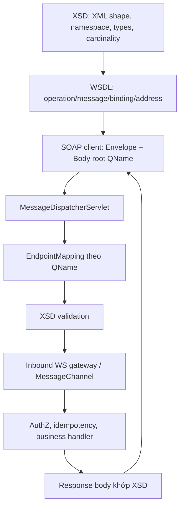
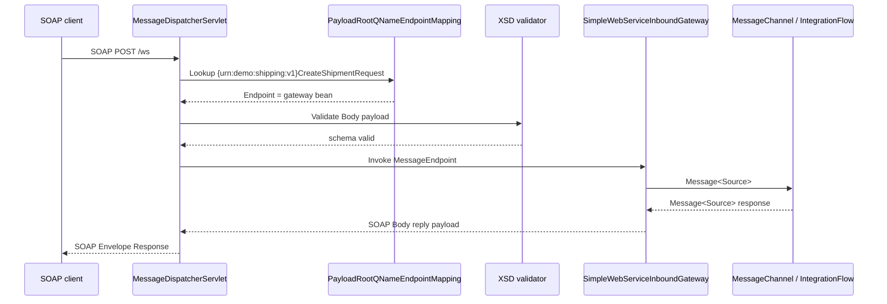
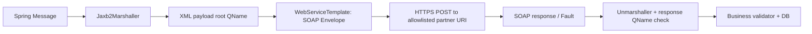
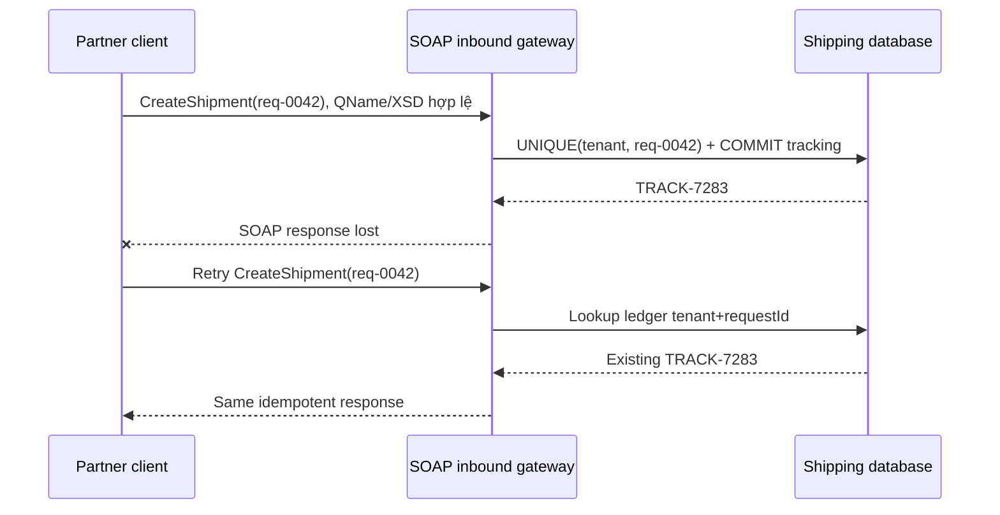

# XSD contract và payload root

## 1. Bài toán: SOAP body đúng cú pháp nhưng sai hợp đồng

Một doanh nghiệp vận chuyển công bố web service SOAP 1.1 để đối tác tạo vận đơn. Đối tác phải gửi `CreateShipmentRequest` có `clientRequestId`, `orderId` và `recipientCountry`; hệ thống trả `CreateShipmentResponse` chứa kết quả và mã tracking khi thành công. Spring Boot nhận request qua **Spring Web Services (Spring-WS)**, chuyển nội dung vào **Spring Integration `MessageChannel`**, xử lý nghiệp vụ và trả SOAP response.

Khi tích hợp, nhóm phát triển gặp ba lỗi khó hiểu:

1. XML có phần tử `CreateShipmentRequest` và đủ dữ liệu nhưng server báo *No endpoint mapping found* vì **namespace URI** của root element không đúng.
2. Request route được vào gateway, nhưng thiếu field bắt buộc hoặc đảo thứ tự field. Nếu không bật **XSD validation**, object handler có thể nhận dữ liệu `null` hoặc cố xử lý request sai hợp đồng.
3. Đối tác phát hành `v2` với phần tử/namespace mới. Ứng dụng v1 dựa vào **local name** thay vì **QName** nên xử lý nhầm phiên bản, tạo side effect sai.

**XSD contract và payload root** giải quyết vấn đề này ở hai lớp khác nhau: **Spring-WS tìm đúng endpoint từ QName của phần tử đầu trong SOAP Body**, còn **XML Schema (XSD) xác nhận toàn bộ cấu trúc payload**. Cả hai đều cần thêm xác thực, phân quyền và kiểm soát idempotency trước thao tác nghiệp vụ.

Trong module `SPRING_INTEGRATION_ADAPTERS`, bài thuộc chương **Adapter Web Services**, tập trung kết nối hệ thống ngoài bằng inbound/outbound adapter, gateway, poller và `MessageChannel`. Các nguyên tắc về hợp đồng message, lỗi, retry và vòng đời kết nối ở SOAP cũng có liên hệ với file, SFTP, HTTP, JMS, AMQP, Kafka và database: **đúng endpoint ≠ đúng dữ liệu ≠ nghiệp vụ đã commit**.

### Mục tiêu học tập

Sau bài này, bạn có thể:

1. Phân biệt **SOAP Envelope**, **SOAP Body payload**, **payload root**, **XML QName**, **SOAPAction** và **WS-Addressing Action**.
2. Thiết kế **contract-first XSD** với namespace, global elements, complex types, sequence, required/optional, nillable, enum và versioning.
3. Giải thích cách Spring-WS `PayloadRootQNameEndpointMapping` hoặc `@PayloadRoot` route SOAP theo root QName.
4. Cấu hình `MessageDispatcherServlet` + `SimpleWebServiceInboundGateway` + `MessageChannel` + `IntegrationFlow` với mapping tường minh.
5. Bật **Spring-WS `PayloadValidatingInterceptor`** cho request/response; so sánh với `Jaxb2Marshaller.setSchema(...)`.
6. Gọi outbound SOAP bằng `Source` hoặc JAXB object, kiểm tra **root QName** của cả request lẫn response.
7. Xử lý schema faults, thiếu reply, XML parser security, thay đổi XSD/WSDL và retry/idempotency.
8. Thực hành test mapping bằng `MockWebServiceClient`, outbound bằng `MockWebServiceServer` và xây ma trận negative cases.

> **Môi trường tham chiếu:** Spring Integration **6.5.x**, Spring Web Services **4.0.x**, Spring Framework 6.x và Java 17+, với Spring Boot BOM tương thích. `javax.xml.transform.Source` là **JAXP** và vẫn dùng package `javax`; JAXB/SAAJ hiện đại thuộc `jakarta.xml.bind`/`jakarta.xml.soap`. Namespace `urn:demo:shipping:v1`, đối tác, port và mã vận đơn trong bài là dữ liệu mô phỏng; không có máy chủ thật cần truy cập.

## 2. Contract-first: XSD, WSDL, SOAP và business rule khác nhau



| Lớp | Quy định điều gì? | Không tự giải quyết |
| --- | --- | --- |
| **XML well-formed** | Cú pháp XML đóng tag, namespace declarations | Field bắt buộc, schema, quyền truy cập |
| **XSD** | QName, kiểu dữ liệu, thứ tự, số lần xuất hiện, enum, nil | SOAPAction, URL, tenant authorization |
| **WSDL** | Operation, input/output messages, binding SOAP 1.1/1.2, endpoint | Remote commit exactly-once, authentication implementation |
| **SOAP** | Envelope, Header, Body, Fault, version | Chọn business tenant hay kiểm tra quyền |
| **EndpointMapping** | Lựa chọn server endpoint dựa trên QName/action/URI | Validate toàn XSD, chống XXE, kiểm tra token |
| **Spring Integration gateway** | Chuyển SOAP payload sang Spring Message, đợi reply | Tự bảo đảm DB commit hoặc side effect một lần |
| **Business service** | Quyền, trạng thái, idempotency, commit | Thay thế schema validation/parser hardening |

**Contract-first** nghĩa là hợp đồng XSD/WSDL được xem như artifact có phiên bản và được đồng thuận **trước** khi viết logic xử lý, thay vì để các DTO Java tự quyết định shape SOAP một cách ngầm định. Khi sửa hợp đồng, cần kiểm thử generated client, service consumers và kế hoạch migration, kể cả nếu HTTP request vẫn trả 200.

### Vì sao payload root là điểm khởi đầu?

Trong kiểu **document/literal wrapped** phổ biến, phần tử đầu của `SOAP Body` chính là tên request wrapper cho operation, ví dụ `CreateShipmentRequest`. Spring-WS có thể route bằng QName đó. Nhưng **đừng suy ra mọi WSDL đều dùng một root per operation**: document/literal bare, RPC và contract legacy có thể có quy tắc mapping khác; khi đó phải chọn mapping strategy khác theo hợp đồng thật.

## 3. Cấu trúc SOAP: payload root **không phải** Envelope root

Ví dụ request SOAP 1.1:

```xml
<?xml version="1.0" encoding="UTF-8"?>
<soap:Envelope xmlns:soap="http://schemas.xmlsoap.org/soap/envelope/"
               xmlns:ship="urn:demo:shipping:v1"
               xmlns:ctx="urn:demo:shipping:headers">
  <soap:Header>
    <ctx:RequestId>req-0042</ctx:RequestId>
  </soap:Header>
  <soap:Body>
    <ship:CreateShipmentRequest>
      <ship:clientRequestId>req-0042</ship:clientRequestId>
      <ship:orderId>O-9001</ship:orderId>
      <ship:recipientCountry>VN</ship:recipientCountry>
    </ship:CreateShipmentRequest>
  </soap:Body>
</soap:Envelope>
```

Có **ba QName riêng biệt**:

- Envelope root: `{http://schemas.xmlsoap.org/soap/envelope/}Envelope`.
- Body container: `{http://schemas.xmlsoap.org/soap/envelope/}Body`.
- **Payload root:** `{urn:demo:shipping:v1}CreateShipmentRequest`.

`PayloadRootQNameEndpointMapping` đọc **payload root** — phần tử đầu trong Body — không phải Envelope và cũng không phải `ctx:RequestId` trong SOAP Header.

Ở inbound **`SimpleWebServiceInboundGateway` mặc định**, message payload thường là `javax.xml.transform.Source` chứa **`<ship:CreateShipmentRequest>...`**, không phải cả SOAP envelope. Handler trả `Source` chứa `<ship:CreateShipmentResponse>...`; Spring-WS tự bọc nó vào SOAP Body response. Khi đặt `extractPayload(false)`, simple gateway có thể chuyển toàn bộ `WebServiceMessage`, làm thay đổi payload contract và resource lifecycle.

### Định danh QName không phụ thuộc prefix

Hai phần tử XML sau **cùng QName**:

```xml
<ship:CreateShipmentRequest xmlns:ship="urn:demo:shipping:v1"/>
<x:CreateShipmentRequest xmlns:x="urn:demo:shipping:v1"/>
```

Nhưng ba ví dụ sau **khác QName**:

```xml
<CreateShipmentRequest/>
<x:CreateShipmentRequest xmlns:x="urn:demo:shipping:v2"/>
<CreateShipmentRequest xmlns="urn:other:shipping:v1"/>
```

Trong trường hợp một phần tử không có prefix và không có default namespace, namespace URI là **chuỗi rỗng**. Khi element có `xmlns="..."`, default namespace áp cho **các element không prefix**, không áp cho attribute không prefix. Vì vậy, so sánh theo `getLocalName()` hoặc `getNodeName().endsWith(...)` mà bỏ namespace có thể route nhầm v1/v2 hoặc chấp nhận XML giả mạo.

**QName** thường được thể hiện thành `{namespaceURI}localPart` trong cấu hình `PayloadRootQNameEndpointMapping`. XML prefix không nằm trong khóa định tuyến: nó chỉ là alias cho namespace tại chỗ khai báo.

## 4. XSD đầy đủ cho `CreateShipmentRequest` và `CreateShipmentResponse`

Lưu mẫu XSD sau thành `src/main/resources/shipping-v1.xsd` **trong một project thực hành riêng** khi muốn chạy code; worker STEP 4 chỉ viết Markdown/YAML được giao, không tạo file trong repo này.

```xml
<?xml version="1.0" encoding="UTF-8"?>
<xs:schema xmlns:xs="http://www.w3.org/2001/XMLSchema"
           xmlns:ship="urn:demo:shipping:v1"
           targetNamespace="urn:demo:shipping:v1"
           elementFormDefault="qualified">

  <xs:simpleType name="ClientRequestIdType">
    <xs:restriction base="xs:token">
      <xs:minLength value="1"/>
      <xs:maxLength value="100"/>
    </xs:restriction>
  </xs:simpleType>

  <xs:simpleType name="CountryCodeType">
    <xs:restriction base="xs:string">
      <xs:pattern value="[A-Z]{2}"/>
    </xs:restriction>
  </xs:simpleType>

  <xs:simpleType name="ShipmentStatusType">
    <xs:restriction base="xs:string">
      <xs:enumeration value="CREATED"/>
      <xs:enumeration value="REJECTED"/>
    </xs:restriction>
  </xs:simpleType>

  <xs:complexType name="CreateShipmentRequestType">
    <xs:sequence>
      <xs:element name="clientRequestId" type="ship:ClientRequestIdType"/>
      <xs:element name="orderId" type="xs:string"/>
      <xs:element name="recipientCountry" type="ship:CountryCodeType"/>
      <xs:element name="notes" type="xs:string" minOccurs="0"/>
    </xs:sequence>
  </xs:complexType>

  <xs:complexType name="CreateShipmentResponseType">
    <xs:sequence>
      <xs:element name="clientRequestId" type="ship:ClientRequestIdType"/>
      <xs:element name="status" type="ship:ShipmentStatusType"/>
      <xs:element name="trackingNumber" type="xs:string" minOccurs="0"/>
    </xs:sequence>
  </xs:complexType>

  <xs:element name="CreateShipmentRequest"
              type="ship:CreateShipmentRequestType"/>
  <xs:element name="CreateShipmentResponse"
              type="ship:CreateShipmentResponseType"/>
</xs:schema>
```

### Global element khác complex type

Hai dòng sau phục vụ **hai vai trò khác nhau**:

```xml
<xs:complexType name="CreateShipmentRequestType"> ... </xs:complexType>
<xs:element name="CreateShipmentRequest" type="ship:CreateShipmentRequestType"/>
```

`CreateShipmentRequestType` là **type declaration**; `CreateShipmentRequest` là **global element declaration** có QName để SOAP Body dùng. Một XML element root có thể có type `CreateShipmentRequestType` nhưng **tên element không nhất thiết trùng tên type**. Spring-WS `PayloadRootQNameEndpointMapping` route theo **element QName**, **không theo tên Java class, complex type hay operation method**.

Khi dùng JAXB/XJC, type và element có thể sinh class + `ObjectFactory`/`JAXBElement<T>` khác nhau. Nếu class không có `@XmlRootElement`, phải dùng wrapper root element được generated factory khai báo; không tự sửa namespace của DTO để “giúp route”.

### Các ràng buộc trong XSD mẫu

| Ràng buộc | Ý nghĩa | Ví dụ sai |
| --- | --- | --- |
| `targetNamespace` | Namespace cho global declarations | Payload root `urn:demo:shipping:v2` gửi vào v1 |
| `elementFormDefault="qualified"` | Local child elements thuộc target namespace | `<clientRequestId xmlns="">...` |
| `xs:sequence` | Thứ tự elements phải đúng | `orderId` đứng trước `clientRequestId` |
| `minOccurs` mặc định 1 | Phần tử bắt buộc một lần | Thiếu `recipientCountry` |
| `minOccurs="0"` | Phần tử có thể không xuất hiện | Không lỗi khi thiếu `notes` |
| `maxOccurs` mặc định 1 | Không được lặp tùy ý | Hai `orderId` |
| `xs:pattern` | Country code gồm hai chữ in hoa | `"vietnam"` |
| `xs:enumeration` | `CREATED` hoặc `REJECTED` | `"ACCEPTED"` không được quy định |
| `xs:token` + length | ID có quy tắc whitespace và độ dài | ID rỗng hoặc quá 100 |
| `nillable` mặc định false | `xsi:nil="true"` không hợp lệ nếu chưa cho phép | `<notes xsi:nil="true"/>` trong XSD này |

XSD mẫu **không** nói “status CREATED bắt buộc trackingNumber”: vì `trackingNumber` đang optional với cả hai trạng thái. Quy tắc có điều kiện đó là **business validation** hoặc phải được mô hình hóa cụ thể hơn trong schema/contract. Tương tự, pattern `[A-Z]{2}` chỉ xác nhận hình dạng ISO-like code, không xác minh đó là country code hiện có hay đối tác hỗ trợ giao hàng.

## 5. `elementFormDefault`, `xmlns` và các bẫy namespace

Nếu XSD đặt `elementFormDefault="qualified"` như mục 4, child elements cũng có namespace `urn:demo:shipping:v1`. Vì vậy, payload hợp lệ có thể viết:

```xml
<CreateShipmentRequest xmlns="urn:demo:shipping:v1">
  <clientRequestId>req-0042</clientRequestId>
  <orderId>O-9001</orderId>
  <recipientCountry>VN</recipientCountry>
</CreateShipmentRequest>
```

Hoặc dùng prefix:

```xml
<ship:CreateShipmentRequest xmlns:ship="urn:demo:shipping:v1">
  <ship:clientRequestId>req-0042</ship:clientRequestId>
  <ship:orderId>O-9001</ship:orderId>
  <ship:recipientCountry>VN</ship:recipientCountry>
</ship:CreateShipmentRequest>
```

Đều đúng vì **expanded name** của từng element là `{urn:demo:shipping:v1}localName`. Payload sau **sai schema** dù root QName vẫn đúng:

```xml
<ship:CreateShipmentRequest xmlns:ship="urn:demo:shipping:v1">
  <clientRequestId>req-0042</clientRequestId>
  <orderId>O-9001</orderId>
  <recipientCountry>VN</recipientCountry>
</ship:CreateShipmentRequest>
```

Ở đây các child elements không có prefix và **không có default namespace** trong scope: chúng thuộc namespace rỗng. `PayloadRootQNameEndpointMapping` **vẫn route** request trên cùng root QName, nhưng XSD validation phải từ chối. Điều này minh họa trực tiếp: **route được không có nghĩa body hợp đồng**.

### Một số bẫy thường gặp

- Ghi `xmlns:ship="urn:demo:shipping:v1"` nhưng lại dùng `<CreateShipmentRequest>` không prefix và không khai báo `xmlns` mặc định.
- Viết tên child fields đúng mắt người nhưng sai namespace, ví dụ `<recipientCountry xmlns="">`.
- Thay prefix `ship` thành `v1` rồi tưởng đã đổi version schema; **URI namespace mới là danh tính**.
- Dùng `String.endsWith("CreateShipmentRequest")` để phân biệt QName, bỏ qua namespace và dạng document.
- Cho rằng `xsi:type` quyết định endpoint mapping. Mapping thường dựa **element QName**; `xsi:type` chỉ ảnh hưởng kiểu thực tế theo schema/JAXB.
- Tin `schemaLocation` trong request làm server tự lấy XSD đúng. Server phải dùng **XSD đã pin, được cấu hình tin cậy**.

### `xsi:nil`, absent và empty element khác nhau

```xml
<!-- Phần tử không xuất hiện: hợp lệ khi minOccurs=0. -->
<!-- <ship:notes> không có trong request -->

<!-- Phần tử xuất hiện, chứa chuỗi rỗng (phụ thuộc XSD facets). -->
<ship:notes xmlns:ship="urn:demo:shipping:v1"></ship:notes>

<!-- Giá trị nil: chỉ hợp lệ khi nillable=true. -->
<ship:notes xmlns:ship="urn:demo:shipping:v1"
            xmlns:xsi="http://www.w3.org/2001/XMLSchema-instance"
            xsi:nil="true"/>
```

Trong XSD mẫu, `notes` có `minOccurs=0` nhưng **không** `nillable=true`: absent có thể hợp lệ; nil được khai báo tường minh như trên **không hợp lệ**. Khi unmarshal JAXB, absent và nil có thể đều thành `null` trong Java nếu binding không bảo toàn metadata; nếu nghiệp vụ cần phân biệt hai trạng thái, phải thiết kế type/`JAXBElement`/validation theo contract.

## 6. WSDL 1.1: từ XSD global elements tới SOAP operation

**XSD không đủ để nói endpoint URL hay SOAPAction.** WSDL 1.1 mô tả messages, `portType`, `binding`, `service` và `port`. Một bản WSDL document/literal có thể tham chiếu các global elements `CreateShipmentRequest` và `CreateShipmentResponse`.

Trích đoạn WSDL **minh họa cấu trúc, không phải WSDL hoàn chỉnh**:

```xml
<wsdl:definitions
    xmlns:wsdl="http://schemas.xmlsoap.org/wsdl/"
    xmlns:soap="http://schemas.xmlsoap.org/wsdl/soap/"
    xmlns:ship="urn:demo:shipping:v1"
    targetNamespace="urn:demo:shipping:v1">

  <!-- types: import XSD shipping-v1.xsd đã được quản lý -->
  <wsdl:message name="CreateShipmentInput">
    <wsdl:part name="parameters" element="ship:CreateShipmentRequest"/>
  </wsdl:message>
  <wsdl:message name="CreateShipmentOutput">
    <wsdl:part name="parameters" element="ship:CreateShipmentResponse"/>
  </wsdl:message>

  <wsdl:portType name="ShippingPort">
    <wsdl:operation name="CreateShipment">
      <wsdl:input message="ship:CreateShipmentInput"/>
      <wsdl:output message="ship:CreateShipmentOutput"/>
    </wsdl:operation>
  </wsdl:portType>

  <wsdl:binding name="ShippingSoapBinding" type="ship:ShippingPort">
    <soap:binding style="document"
                  transport="http://schemas.xmlsoap.org/soap/http"/>
    <wsdl:operation name="CreateShipment">
      <soap:operation
          soapAction="urn:demo:shipping:v1/CreateShipment"/>
      <wsdl:input><soap:body use="literal"/></wsdl:input>
      <wsdl:output><soap:body use="literal"/></wsdl:output>
    </wsdl:operation>
  </wsdl:binding>
</wsdl:definitions>
```

Lược đồ trên cố tình bỏ `wsdl:types`/`wsdl:service` để nhấn vào quan hệ: **global XSD element** được WSDL message tham chiếu, rồi binding quy định **SOAPAction**. Muốn xuất bản thật, cần WSDL đầy đủ với import schema và service port/endpoint hoặc dùng công cụ phát sinh WSDL có kiểm soát.

### `DefaultWsdl11Definition` và WSDL tĩnh

Spring-WS có `DefaultWsdl11Definition` để tạo WSDL 1.1 từ một XSD khi dùng convention request/response suffix:

```java
import org.springframework.context.annotation.Bean;
import org.springframework.context.annotation.Configuration;
import org.springframework.core.io.ClassPathResource;
import org.springframework.ws.wsdl.wsdl11.DefaultWsdl11Definition;
import org.springframework.xml.xsd.SimpleXsdSchema;
import org.springframework.xml.xsd.XsdSchema;

@Configuration
public class ShippingContractDefinition {

    @Bean
    public XsdSchema shippingSchema() {
        return new SimpleXsdSchema(
                new ClassPathResource("shipping-v1.xsd"));
    }

    @Bean(name = "shipping")
    public DefaultWsdl11Definition shippingWsdl(XsdSchema shippingSchema) {
        DefaultWsdl11Definition wsdl = new DefaultWsdl11Definition();
        wsdl.setPortTypeName("ShippingPort");
        wsdl.setTargetNamespace("urn:demo:shipping:v1");
        wsdl.setLocationUri("/ws");
        wsdl.setSchema(shippingSchema);
        return wsdl;
    }
}
```

Với `MessageDispatcherServlet` được cấu hình công bố WSDL, URL thường có dạng `/ws/shipping.wsdl`; **kiểm tra Boot servlet mapping/ingress thực tế**. Đừng tự cho rằng WSDL sinh theo convention sẽ phản ánh đúng mọi SOAPAction, fault binding, policy hay extensions mà đối tác yêu cầu. Với contract phức tạp, dùng **WSDL tĩnh đã kiểm thử/duyệt** để giữ tương thích.

Khi ứng dụng ở sau reverse proxy, `MessageDispatcherServlet.setTransformWsdlLocations(true)` có thể giúp public address trong WSDL phản ánh host/scheme; chỉ tin `Forwarded`/`X-Forwarded-*` từ proxy được cấu hình tin cậy, không chấp nhận tự động các header do Internet client giả.

### WSDL operation name không phải payload root QName

`CreateShipment` là tên operation. `CreateShipmentRequest` là **element QName** ở input message. `ShippingPort` là tên portType. Cả ba là định danh khác nhau. Trong contract wrapped phổ biến, tên root thường có hậu tố `Request`, nhưng đó là convention; không route bằng cách suy tên operation từ chuỗi localName nếu WSDL đã quy định QName chính xác.

## 7. Spring-WS định tuyến request bằng payload-root QName

Spring Web Services có các loại endpoint mapping:

| Cơ chế | Khóa lookup | Khi nên dùng | Rủi ro cần quản lý |
| --- | --- | --- | --- |
| `PayloadRootQNameEndpointMapping` | **QName root element trong SOAP Body** | SOAP document/literal contract-first | Chưa validate sâu nội dung XSD |
| `PayloadRootAnnotationMethodEndpointMapping` | `@PayloadRoot(namespace, localPart)` của method | `@Endpoint` kiểu annotated method | Method mapping khác gateway bean |
| `SoapActionEndpointMapping` | SOAPAction theo SOAP binding | Đối tác bắt buộc action để dispatch | Action có thể do client giả, phải kiểm tra Body |
| `UriEndpointMapping` | Endpoint URI/path | Contract legacy route theo URI | Không thay QName/XSD validation |
| `XPathPayloadEndpointMapping` | Kết quả XPath từ payload | Contract legacy có chung root nhiều trường hợp | Cẩn trọng XPath complexity và namespace |

Với **Spring Integration inbound gateway** (ví dụ `SimpleWebServiceInboundGateway`), Spring-WS gọi object triển khai `MessageEndpoint`. Bạn cần **`PayloadRootQNameEndpointMapping` trỏ tới gateway bean**, không phải chỉ đánh dấu `@PayloadRoot` trên một method bất kỳ.



**Thứ tự quan trọng:** Servlet và mapping chọn đúng endpoint, rồi các interceptors được áp vào endpoint invocation chain trước khi business handler xử lý. Đặt validation interceptor đúng mapping/context để nó **thật sự chạy**; khai báo một bean validator không gắn vào endpoint mapping không tự kiểm tra XML.

### Khóa mapping dùng cú pháp Clark notation

```text
{urn:demo:shipping:v1}CreateShipmentRequest
```

Không dùng `ship:CreateShipmentRequest` làm key: prefix `ship` không phải expanded QName. Không dùng `CreateShipmentRequest` không namespace nếu hợp đồng có namespace. XSD `type="ship:CreateShipmentRequestType"` **không** là khóa mapping.

## 8. Cấu hình Java: servlet + channel + inbound gateway + QName mapping

Ví dụ chọn **bean gateway tường minh** để nhìn rõ đường đi. Chỉ giữ cách này nếu Spring Boot chưa đăng ký một servlet/mapping khác trùng `/ws/*`.

```groovy
dependencies {
    implementation 'org.springframework.boot:spring-boot-starter-integration'
    implementation 'org.springframework.integration:spring-integration-ws'
    implementation 'org.springframework.boot:spring-boot-starter-web-services'
    testImplementation 'org.springframework.boot:spring-boot-starter-test'
    testImplementation 'org.springframework.ws:spring-ws-test'
}
```

```java
import java.util.Map;

import org.springframework.beans.factory.annotation.Qualifier;
import org.springframework.boot.web.servlet.ServletRegistrationBean;
import org.springframework.context.ApplicationContext;
import org.springframework.context.annotation.Bean;
import org.springframework.context.annotation.Configuration;
import org.springframework.integration.channel.DirectChannel;
import org.springframework.integration.ws.SimpleWebServiceInboundGateway;
import org.springframework.messaging.MessageChannel;
import org.springframework.ws.server.endpoint.mapping.PayloadRootQNameEndpointMapping;
import org.springframework.ws.transport.http.MessageDispatcherServlet;

@Configuration
public class ShippingSoapInboundConfig {

    public static final String NS = "urn:demo:shipping:v1";
    public static final String ROOT_KEY =
            "{" + NS + "}CreateShipmentRequest";

    @Bean
    public ServletRegistrationBean<MessageDispatcherServlet> shippingServlet(
            ApplicationContext context) {
        MessageDispatcherServlet servlet = new MessageDispatcherServlet();
        servlet.setApplicationContext(context);
        servlet.setTransformWsdlLocations(true);
        return new ServletRegistrationBean<>(servlet, "/ws/*");
    }

    @Bean
    public MessageChannel shipmentSoapRequests() {
        return new DirectChannel();
    }

    @Bean
    public SimpleWebServiceInboundGateway shippingSoapGateway(
            @Qualifier("shipmentSoapRequests") MessageChannel requests) {
        SimpleWebServiceInboundGateway gateway =
                new SimpleWebServiceInboundGateway();
        gateway.setRequestChannel(requests);
        gateway.setRequestTimeout(5_000L);
        gateway.setReplyTimeout(10_000L);
        return gateway;
    }

    @Bean
    public PayloadRootQNameEndpointMapping shippingPayloadRootMapping(
            SimpleWebServiceInboundGateway shippingSoapGateway) {
        PayloadRootQNameEndpointMapping mapping =
                new PayloadRootQNameEndpointMapping();
        mapping.setEndpointMap(Map.of(ROOT_KEY, shippingSoapGateway));
        return mapping;
    }
}
```

Ở đây:

- HTTP POST vào `/ws` được `MessageDispatcherServlet` nhận; **một mình `@Bean gateway` không mở HTTP endpoint**.
- `PayloadRootQNameEndpointMapping` dùng `ROOT_KEY` chính xác, trả về `SimpleWebServiceInboundGateway`.
- Gateway chuyển body `Source` tới `shipmentSoapRequests`; `DirectChannel` dispatch đồng bộ, phù hợp minh họa request–reply.
- `requestTimeout`/`replyTimeout` áp ở messaging boundary, **không** đồng nghĩa business deadline hoặc database transaction timeout.
- Spring Boot starter có thể auto-config servlet riêng: **đừng bật đồng thời hai registrations trùng path**. Khi dùng Boot auto-config, bỏ bean `shippingServlet` thủ công, giữ đúng endpoint mapping/gateway và kiểm tra route thực tế.

### IntegrationFlow phản hồi XML đúng QName

```java
import javax.xml.transform.Source;

import org.springframework.beans.factory.annotation.Qualifier;
import org.springframework.context.annotation.Bean;
import org.springframework.context.annotation.Configuration;
import org.springframework.integration.dsl.IntegrationFlow;
import org.springframework.messaging.MessageChannel;
import org.springframework.xml.transform.StringSource;

@Configuration
public class ShippingSoapFlow {

    @Bean
    public IntegrationFlow shippingSoapRequestReply(
            @Qualifier("shipmentSoapRequests") MessageChannel channel) {
        return IntegrationFlow.from(channel)
                .handle(Source.class, (source, headers) -> {
                    // DEMO: không đọc orderId và chưa tạo vận đơn thật.
                    // Production phải validate XML + authn/authz + idempotency.
                    String responseBody = """
                        <ship:CreateShipmentResponse
                            xmlns:ship="urn:demo:shipping:v1">
                          <ship:clientRequestId>req-0042</ship:clientRequestId>
                          <ship:status>CREATED</ship:status>
                          <ship:trackingNumber>TRACK-DEMO-001</ship:trackingNumber>
                        </ship:CreateShipmentResponse>
                        """;
                    return new StringSource(responseBody);
                })
                .get();
    }
}
```

Handler trả `Source` nên gateway có Spring reply, và Spring-WS gói nó vào SOAP Envelope. Nếu handler trả nguyên `<soap:Envelope>` thay vì `CreateShipmentResponse`, body sẽ sai contract. Response cố định ở đây chỉ để kiểm thử wiring — **không dùng production**; nghiệp vụ thực cần parse request, check tenant/order, ghi DB idempotent và trả kết quả gắn với ID thật.

## 9. XSD validation bằng server-side `PayloadValidatingInterceptor`

**Định tuyến theo root QName không validate đầy đủ request.** `PayloadRootQNameEndpointMapping` vẫn tìm thấy gateway ngay cả khi `clientRequestId` thiếu hoặc `recipientCountry=Vietnam` sai `xs:pattern`. Để chặn request trước business handler, Spring-WS có:

`org.springframework.ws.soap.server.endpoint.interceptor.PayloadValidatingInterceptor`.

```java
import java.util.Map;

import org.springframework.context.annotation.Bean;
import org.springframework.context.annotation.Configuration;
import org.springframework.core.io.ClassPathResource;
import org.springframework.ws.server.EndpointInterceptor;
import org.springframework.ws.server.endpoint.mapping.PayloadRootQNameEndpointMapping;
import org.springframework.ws.soap.server.endpoint.interceptor.PayloadValidatingInterceptor;

@Configuration
public class ShippingSoapSchemaValidation {

    @Bean
    public PayloadValidatingInterceptor shippingPayloadValidator() {
        PayloadValidatingInterceptor validator =
                new PayloadValidatingInterceptor();
        validator.setSchema(
                new ClassPathResource("shipping-v1.xsd"));
        validator.setValidateRequest(true);
        validator.setValidateResponse(true);
        return validator;
    }

    // Khi ghép vào ShippingSoapInboundConfig, THAY THẾ method
    // shippingPayloadRootMapping bằng method sau; không khai báo
    // thêm mapping thứ hai nhận cùng ROOT_KEY.
    @Bean
    public PayloadRootQNameEndpointMapping shippingMappingWithValidation(
            SimpleWebServiceInboundGateway shippingSoapGateway,
            PayloadValidatingInterceptor shippingPayloadValidator) {
        PayloadRootQNameEndpointMapping mapping =
                new PayloadRootQNameEndpointMapping();
        mapping.setEndpointMap(Map.of(
                ShippingSoapInboundConfig.ROOT_KEY, shippingSoapGateway));
        mapping.setInterceptors(
                new EndpointInterceptor[]{shippingPayloadValidator});
        return mapping;
    }
}
```

**Cách ghép đúng:** chỉ có **một** mapping bean hoạt động cho QName `CreateShipmentRequest`. Trong project thực hành, sửa method mapping mục 8 để nhận interceptor và `setInterceptors(...)`, hoặc dùng method thay thế bên trên rồi bỏ mapping cũ. Không để cả hai mappings cùng match một QName nếu chưa xác định thứ tự ưu tiên và test dispatch.

Với `PayloadValidatingInterceptor` là Spring bean, container quản lý `InitializingBean`/schema initialization. `shipping-v1.xsd` phải tồn tại trong classpath. Spring-WS có thể tạo **SOAP Fault** khi request không hợp schema, thường theo client/sender semantics tùy SOAP version; cần test fault code/detail đúng chính sách và không lộ input/stack trace.

### Request validation và response validation

| Cấu hình | Validation thực hiện | Tác dụng |
| --- | --- | --- |
| `setValidateRequest(true)` | Kiểm tra payload incoming trước handler | Ngăn thiếu required fields/wrong order/wrong enum đi vào business |
| `setValidateResponse(true)` | Kiểm tra payload outgoing trước gửi client | Phát hiện reply sai contract, tránh công bố XML invalid |
| `setSchema(...)` | Xác định XSD tin cậy dùng validate | Không lấy XSD từ URL do client cung cấp |
| `setSchemas(...)` | Dùng nhiều schema resources khi contract cần | Kiểm soát imports/includes và phiên bản |

**Schema validation không thay business validation:** client có thể gửi `recipientCountry=VN` hợp pattern nhưng user không có quyền tạo vận đơn cho order ID đó; hoặc `status=CREATED` với `trackingNumber` trống vẫn có thể hợp XSD mẫu. Những quy tắc này phải được kiểm tra ở service và/hoặc nâng cấp hợp đồng.

**Thứ tự bảo vệ:** request size/TLS/auth có thể cần chặn từ ingress trước khi XML parser tiêu tốn tài nguyên; WS-Security interceptor và XSD validator phải được đặt trong đúng security/mapping chain. Không hiểu “interceptor nằm trước business” thành “interceptor tự xử lý mọi vấn đề parser/transport”.

## 10. `@Endpoint + @PayloadRoot`: cơ chế annotation khác với gateway mapping

Spring Web Services hỗ trợ cách xây **SOAP endpoint method** thuần Spring-WS bằng `@Endpoint` và `@PayloadRoot`. Trong trường hợp này, `PayloadRootAnnotationMethodEndpointMapping` tìm method qua annotation, thay vì `PayloadRootQNameEndpointMapping` tìm một `MessageEndpoint` bean:

```java
import javax.xml.transform.Source;

import org.springframework.ws.server.endpoint.annotation.Endpoint;
import org.springframework.ws.server.endpoint.annotation.PayloadRoot;
import org.springframework.ws.server.endpoint.annotation.RequestPayload;
import org.springframework.ws.server.endpoint.annotation.ResponsePayload;
import org.springframework.xml.transform.StringSource;

@Endpoint
public class ShippingAnnotationEndpoint {

    private static final String NS = "urn:demo:shipping:v1";

    @PayloadRoot(namespace = NS, localPart = "CreateShipmentRequest")
    @ResponsePayload
    public Source createShipment(@RequestPayload Source request) {
        // DEMO: Không gọi nghiệp vụ thật.
        return new StringSource("""
            <ship:CreateShipmentResponse
                xmlns:ship="urn:demo:shipping:v1">
              <ship:clientRequestId>req-0042</ship:clientRequestId>
              <ship:status>CREATED</ship:status>
              <ship:trackingNumber>TRACK-DEMO-001</ship:trackingNumber>
            </ship:CreateShipmentResponse>
            """);
    }
}
```

Với `@EnableWs`/Spring-WS configuration phù hợp, `PayloadRootAnnotationMethodEndpointMapping` có thể tự tìm endpoint method được đánh dấu; cần xác nhận bean scan và servlet. Đoạn trên là **phương án thay thế** cho integration inbound gateway, không bật cùng nó và gateway mapping trùng QName mà không định nghĩa chính sách dispatch.

### Khi muốn `@Endpoint` nhưng vẫn dùng IntegrationFlow?

Có thể viết một `@Endpoint` chỉ gọi một `MessagingTemplate`/service để gửi Spring Message vào flow rồi nhận reply; lúc ấy cần tự map XML/headers, timeout, error contract và làm rõ transaction. Cách đó có ích khi Spring-WS annotation method đã được dự án tiêu chuẩn hóa, nhưng Spring Integration **`Ws.simpleInboundGateway()`** thường gọn hơn cho mục tiêu “SOAP → MessageChannel → reply” và đã giải quyết ranh giới SOAP gateway.

### DSL inbound gateway: vẫn phải map QName

```java
import org.springframework.context.annotation.Bean;
import org.springframework.integration.dsl.IntegrationFlow;
import org.springframework.integration.ws.dsl.Ws;

@Bean
public IntegrationFlow shippingInboundDsl(ShippingBusinessMessageHandler handler) {
    return IntegrationFlow.from(
                    Ws.simpleInboundGateway()
                            .id("shippingInboundDslGateway"))
            .handle(handler)
            .get();
}
```

`ShippingBusinessMessageHandler` là handler do ứng dụng viết. Đây là cấu hình **thay thế** cho bean gateway/flow mục 8. DSL cấp endpoint ID `shippingInboundDslGateway`; Spring-WS **vẫn cần** `EndpointMapping` trỏ tới **bean ID phù hợp**:

```java
@Bean
public PayloadRootQNameEndpointMapping dslPayloadRootMapping() {
    PayloadRootQNameEndpointMapping mapping =
            new PayloadRootQNameEndpointMapping();
    mapping.setEndpointMap(Map.of(
            "{urn:demo:shipping:v1}CreateShipmentRequest",
            "shippingInboundDslGateway"));
    return mapping;
}
```

Fragment giả định import `Map` và `PayloadRootQNameEndpointMapping` như mục 8; hãy xác nhận gateway bean ID do DSL đăng ký trùng tên mapping. Không cấu hình đồng thời **hai gateway** cho một QName mà không giải quyết order/priority trong mapping.

## 11. JAXB `@XmlRootElement` và `JAXBElement<T>` phải theo XSD element QName

Với **`MarshallingWebServiceInboundGateway`**, inbound SOAP Body được **unmarshal** thành object Java, sau đó reply object được **marshal** thành XML response. Lớp Java không quyết định SOAP payload root chỉ bằng tên class; JAXB root metadata phải khớp **global element declaration** trong XSD.

### Java JAXB model tối giản

```java
// src/main/java/com/example/shipping/xml/CreateShipmentRequest.java
package com.example.shipping.xml;

import jakarta.xml.bind.annotation.XmlAccessType;
import jakarta.xml.bind.annotation.XmlAccessorType;
import jakarta.xml.bind.annotation.XmlElement;
import jakarta.xml.bind.annotation.XmlRootElement;
import jakarta.xml.bind.annotation.XmlType;

@XmlRootElement(
        name = "CreateShipmentRequest",
        namespace = "urn:demo:shipping:v1")
@XmlAccessorType(XmlAccessType.FIELD)
@XmlType(propOrder = {
        "clientRequestId", "orderId", "recipientCountry", "notes"
})
public class CreateShipmentRequest {
    @XmlElement(required = true)
    private String clientRequestId;

    @XmlElement(required = true)
    private String orderId;

    @XmlElement(required = true)
    private String recipientCountry;

    @XmlElement
    private String notes;

    public CreateShipmentRequest() { }

    public CreateShipmentRequest(
            String clientRequestId, String orderId, String country) {
        this.clientRequestId = clientRequestId;
        this.orderId = orderId;
        this.recipientCountry = country;
    }

    public String getClientRequestId() { return clientRequestId; }
    public String getOrderId() { return orderId; }
    public String getRecipientCountry() { return recipientCountry; }
}
```

Với `elementFormDefault="qualified"`, khai báo namespace của local elements ở `package-info.java` trong cùng package:

```java
@jakarta.xml.bind.annotation.XmlSchema(
    namespace = "urn:demo:shipping:v1",
    elementFormDefault =
        jakarta.xml.bind.annotation.XmlNsForm.QUALIFIED)
package com.example.shipping.xml;
```

**Không thiếu `@XmlSchema` rồi hy vọng `@XmlRootElement(namespace=...)` tự khiến mọi child element có namespace.** Root và local child element có rules khác. `@XmlType.propOrder` phản ánh `xs:sequence`, nhưng **annotation không thay XSD validation**. Khi generated classes từ XSD, package-level metadata thường được sinh sẵn; không tự viết trùng metadata nếu đã có `package-info.java`.

### Khi JAXB sinh `JAXBElement<T>` thay vì root class

Một số bindings tạo `CreateShipmentRequestType` (class) + `ObjectFactory` có `@XmlElementDecl(namespace="...", name="CreateShipmentRequest")`. Khi đó:

```java
import javax.xml.namespace.QName;

import jakarta.xml.bind.JAXBElement;

// Fragment: giả định có generated CreateShipmentRequestType object.
QName root = new QName(
        "urn:demo:shipping:v1", "CreateShipmentRequest");
JAXBElement<CreateShipmentRequestType> wrapped =
        new JAXBElement<>(
                root, CreateShipmentRequestType.class, null, requestObject);
```

Trong dự án thực, dùng **generated `ObjectFactory.createCreateShipmentRequest(...)`** thay vì tự chế wrapper theo đoạn mẫu. `Unmarshaller.unmarshal(Source)` có thể trả `JAXBElement<T>` — kiểm tra **`getName()`** và **`getValue()`**, không ép kiểu bừa. Nếu partner đổi QName v1→v2 nhưng Java value type vẫn giống, wrapper QName guard giúp tránh coi response v2 là v1.

## 12. `Jaxb2Marshaller` và schema validation cho SOAP payload

Spring Framework OXM cung cấp `org.springframework.oxm.jaxb.Jaxb2Marshaller` triển khai cả `Marshaller` và `Unmarshaller`. Với classes mẫu ở trên và tương ứng `CreateShipmentResponse`:

```java
import com.example.shipping.xml.CreateShipmentRequest;
import com.example.shipping.xml.CreateShipmentResponse;

import org.springframework.context.annotation.Bean;
import org.springframework.context.annotation.Configuration;
import org.springframework.core.io.ClassPathResource;
import org.springframework.oxm.jaxb.Jaxb2Marshaller;

@Configuration
public class ShippingJaxbMappingConfig {

    @Bean
    public Jaxb2Marshaller shippingMarshaller() {
        Jaxb2Marshaller marshaller = new Jaxb2Marshaller();
        marshaller.setClassesToBeBound(
                CreateShipmentRequest.class,
                CreateShipmentResponse.class);
        marshaller.setSchema(new ClassPathResource("shipping-v1.xsd"));
        marshaller.setSupportDtd(false);
        marshaller.setProcessExternalEntities(false);
        marshaller.setMtomEnabled(false);
        return marshaller;
    }
}
```

`CreateShipmentResponse` trong đoạn là JAXB class **do XSD/code generator tạo tương ứng root QName** `{urn:demo:shipping:v1}CreateShipmentResponse`, hoặc class tương tự có `@XmlRootElement`, no-arg constructor và các fields theo `CreateShipmentResponseType`. Không có file Java thật được tạo trong bước soạn Markdown này.

| API | Điều nó làm | Lưu ý |
| --- | --- | --- |
| `setClassesToBeBound(...)` | Đăng ký tập JAXB classes | Ràng buộc types/root cần nhất quán |
| `setContextPath("...")` | JAXBContext theo generated package | Package cần JAXB metadata/ObjectFactory |
| `setPackagesToScan("...")` | Scan JAXB-annotated classes | Hạn chế scope để tránh bind types ngoài contract |
| `setSchema(...)` | Validate XML với XSD | Không thay authz, parser quotas hay business rule |
| `setSupportDtd(false)` | Không hỗ trợ DTD | Mặc định false, nên cấu hình rõ |
| `setProcessExternalEntities(false)` | Không resolve external entities trong các loại `Source` Spring OXM quản lý | Không cứu DOM/StAX đã parse không an toàn |
| `setMtomEnabled(true)` | Bật cơ chế MTOM khi schema/binding hỗ trợ | Không tự biến mọi file thành attachment |

`Jaxb2Marshaller` là bean có thể tái sử dụng để quản lý JAXBContext; **không** chia sẻ trực tiếp một `jakarta.xml.bind.Marshaller` hay `Unmarshaller` mutable giữa nhiều threads tùy tiện. Một JAXB object được tạo thành công **không chứng minh** nó đúng quyền hoặc đúng kết quả business; root QName và XSD cần được kiểm tra, rồi đối chiếu `clientRequestId`/status.

### Kiểm thử round-trip root QName không cần HTTP

```java
import com.example.shipping.xml.CreateShipmentRequest;

import org.springframework.oxm.jaxb.Jaxb2Marshaller;
import org.springframework.xml.transform.StringResult;
import org.springframework.xml.transform.StringSource;

public static Object roundTrip(Jaxb2Marshaller marshaller) throws Exception {
    CreateShipmentRequest request =
            new CreateShipmentRequest("req-0042", "O-9001", "VN");
    StringResult out = new StringResult();
    marshaller.marshal(request, out);
    return marshaller.unmarshal(new StringSource(out.toString()));
}
```

Đây là fragment method; trong JUnit hãy assert **root QName** bằng namespace-aware XML parser/XML matcher, field order, child namespaces và các dữ liệu round-trip. Đừng dùng `xmlString.contains("<ship:CreateShipmentRequest>")` vì JAXB có thể dùng một prefix khác (ví dụ `ns2`) nhưng vẫn đúng QName.

## 13. Marshalling inbound gateway và payload-root mapping

Nếu handler muốn nhận Java object thay vì `Source`, thay bean `SimpleWebServiceInboundGateway` ở mục 8 bằng `MarshallingWebServiceInboundGateway`:

```java
import org.springframework.beans.factory.annotation.Qualifier;
import org.springframework.context.annotation.Bean;
import org.springframework.integration.ws.MarshallingWebServiceInboundGateway;
import org.springframework.messaging.MessageChannel;
import org.springframework.oxm.jaxb.Jaxb2Marshaller;

@Bean
public MarshallingWebServiceInboundGateway shippingObjectInboundGateway(
        @Qualifier("shipmentSoapRequests") MessageChannel requests,
        Jaxb2Marshaller shippingMarshaller) {

    MarshallingWebServiceInboundGateway gateway =
            new MarshallingWebServiceInboundGateway(shippingMarshaller);
    gateway.setRequestChannel(requests);
    gateway.setReplyTimeout(10_000L);
    return gateway;
}
```

Đổi `PayloadRootQNameEndpointMapping` trỏ tới bean `shippingObjectInboundGateway`; vẫn dùng khóa `{urn:demo:shipping:v1}CreateShipmentRequest`. Phía `IntegrationFlow` phải nhận **`CreateShipmentRequest` object hoặc `JAXBElement`** (tuỳ binding), và trả response object phù hợp JAXB/XSD. **Không để hai gateways Simple/Marshalling cùng subscribe request channel và nhận cùng QName**; sử dụng một flow contract rõ.

Trong Spring Integration 6.5, DSL có:

```java
// Phương án thay thế cho explicit bean gateway:
return IntegrationFlow.from(
                Ws.marshallingInboundGateway()
                        .marshaller(shippingMarshaller)
                        .unmarshaller(shippingMarshaller)
                        .id("shippingObjectInboundDsl"))
        .handle(shippingBusinessObjectHandler)
        .get();
```

`shippingBusinessObjectHandler` là handler của ứng dụng. Vẫn cần Spring-WS servlet và `EndpointMapping` trỏ đúng gateway bean ID. **Marshalling/unmarshalling không tự áp XML Schema nếu chưa cấu hình `Jaxb2Marshaller.setSchema`** (hoặc server validator), và cũng không tự map WSDL operation/endpoint URL.

### Hai dạng validation bổ sung, không nên hiểu là một

| Spring-WS `PayloadValidatingInterceptor` | Spring OXM `Jaxb2Marshaller.setSchema` |
| --- | --- |
| Chạy trong Spring-WS endpoint interceptor chain | Chạy khi JAXB marshal/unmarshal |
| Có thể validate **simple Source** và response, không cần JAXB | Validate XML theo schema khi object/XML mapping |
| Với invalid request có thể tạo SOAP Fault trước khi gọi handler | Có thể phát `ValidationFailureException`/OXM exception |
| Gắn vào endpoint mapping; cần cấu hình đúng lifecycle | Gắn vào marshaller bean; dùng trong inbound/outbound marshalling |
| Không giải quyết authentication, authorization và XXE toàn stack | Cũng không thay quota, parser hardening và business rules |

Đừng bật cả hai một cách máy móc khi performance nhạy cảm: có thể bị duplicate validation. Chọn policy theo boundary và mục tiêu kiểm tra **request trước side effect**, response trước gửi/commit; test hiệu quả và chi phí của cả hai nếu dùng đồng thời.

## 14. Outbound gateway: payload root cũng phải đúng khi gọi đối tác

Ở outbound, Spring Integration `Ws.simpleOutboundGateway(...)` nhận `Source`/`String` body payload; `Ws.marshallingOutboundGateway(...)` nhận object JAXB và marshal ra XML. Cả hai **không tự dùng payload root để chọn endpoint URI**: URI được cấu hình hoặc lấy từ `DestinationProvider`/URI template, còn remote SOAP service kiểm tra QName/WSDL.



Ví dụ Java DSL object marshalling:

```java
import java.time.Duration;

import org.springframework.beans.factory.annotation.Value;
import org.springframework.context.annotation.Bean;
import org.springframework.context.annotation.Configuration;
import org.springframework.integration.dsl.IntegrationFlow;
import org.springframework.integration.ws.dsl.Ws;
import org.springframework.oxm.jaxb.Jaxb2Marshaller;
import org.springframework.ws.transport.http.HttpUrlConnectionMessageSender;

@Configuration
public class ShippingOutboundJaxbFlow {

    @Bean
    public IntegrationFlow shippingOutboundObjects(
            Jaxb2Marshaller shippingMarshaller,
            @Value("${app.shipping.partner-endpoint}") String uri) {
        HttpUrlConnectionMessageSender sender =
                new HttpUrlConnectionMessageSender();
        sender.setConnectionTimeout(Duration.ofSeconds(5));
        sender.setReadTimeout(Duration.ofSeconds(20));

        return IntegrationFlow.from("outboundShipmentObjects")
                .handle(Ws.marshallingOutboundGateway()
                        .uri(uri)
                        .marshaller(shippingMarshaller)
                        .unmarshaller(shippingMarshaller)
                        .messageSenders(sender))
                .get();
    }
}
```

`app.shipping.partner-endpoint` phải là endpoint được allowlist và bảo vệ bằng HTTPS/mTLS/auth thích hợp. Thao tác SOAP không có transaction 2PC với DB; khi timeout, **remote side effect có thể đã xảy ra**, nên không retry create operation một cách mù quáng.

Nếu downstream nhận JAXB reply dạng `JAXBElement<?>`, so wrapper `getName()` với `{urn:demo:shipping:v1}CreateShipmentResponse` rồi đọc `getValue()`. Nếu nhận POJO có `@XmlRootElement`, vẫn cần schema validation và kiểm tra business ID. **Không đánh dấu thành công chỉ vì unmarshaller không ném exception**.

## 15. SOAPAction và WS-Addressing Action không thay payload root

Với SOAP 1.1, client có thể gửi:

```http
POST /ws HTTP/1.1
Host: api.example.test
Content-Type: text/xml; charset=utf-8
SOAPAction: "urn:demo:shipping:v1/CreateShipment"

<?xml version="1.0" encoding="UTF-8"?>
<soap:Envelope xmlns:soap="http://schemas.xmlsoap.org/soap/envelope/"
               xmlns:ship="urn:demo:shipping:v1">
  <soap:Body>
    <ship:CreateShipmentRequest>
      <ship:clientRequestId>req-0042</ship:clientRequestId>
      <ship:orderId>O-9001</ship:orderId>
      <ship:recipientCountry>VN</ship:recipientCountry>
    </ship:CreateShipmentRequest>
  </soap:Body>
</soap:Envelope>
```

Ở đây:

- **SOAPAction**: action của binding trên HTTP/SOAP; với SOAP 1.1 thường ở HTTP header.
- **Payload QName**: `{urn:demo:shipping:v1}CreateShipmentRequest` được đọc từ SOAP Body.
- **`wsa:Action`**: nếu dùng WS-Addressing, là một SOAP Header riêng, không đồng nhất SOAPAction.

Các giá trị có thể nhất quán theo WSDL, nhưng server phải kiểm tra chúng theo **contract**. Client có thể cố tình gửi `SOAPAction: ".../CancelShipment"` cùng Body `CreateShipmentRequest`, nên không được dùng SOAPAction thay cho schema validation hoặc business authorization.

| Định tuyến | Dữ liệu quyết định endpoint | Kiểm tra bổ sung bắt buộc |
| --- | --- | --- |
| `PayloadRootQNameEndpointMapping` | Body root QName | XSD + SOAPAction nếu WSDL policy yêu cầu |
| `SoapActionEndpointMapping` | SOAPAction | Body QName + XSD; không tin action là authorization |
| WS-Addressing aware mapping | `wsa:Action`/To khi hỗ trợ | Validate addressing/version, Body QName, WS-Security |

SOAP 1.2 có Envelope namespace `http://www.w3.org/2003/05/soap-envelope` và thường dùng `application/soap+xml` với `action` parameter thay cho SOAP 1.1 HTTP SOAPAction. **Đổi HTTP header không làm XSD payload root đổi theo**, và không tự biến SOAP 1.1 thành 1.2.

## 16. Fault và lỗi: mapping thất bại khác schema validation thất bại

Lỗi SOAP cần được phân loại theo **giai đoạn**, vì chính sách retry và fault response khác nhau:

| Tình huống | Giai đoạn | Biểu hiện thường gặp | Hành vi an toàn |
| --- | --- | --- | --- |
| XML malformed/Envelope sai version | SOAP parser/message factory | Parsing/VersionMismatch error | Reject, không vào business |
| Body không có root mong đợi | EndpointMapping | No endpoint found/dispatch error | Không gọi operation mặc định |
| Root đúng nhưng thiếu required field | XSD interceptor | Validation failure; có thể SOAP Fault Client/Sender | Không vào business |
| Root đúng nhưng child namespace rỗng | XSD interceptor | Wrong element/namespace | Không bỏ qua namespace |
| `status=APPROVED` ngoài enum | Response validation/JAXB | Schema/unmarshal error | Không gửi/ghi success giả |
| SOAPAction đúng nhưng Body QName sai | Routing + policy validation | Contract mismatch | Reject trước side effect |
| Caller không có scope/tenant | Authn/authz layer | Auth rejection/SOAP fault theo policy | Không tin action/header |
| Handler ném business exception | IntegrationFlow | Messaging/handler exception | Business response hoặc SOAP Fault đã chuẩn hóa |
| Inbound flow không trả reply | Gateway | Reply timeout | Giám sát và trả lỗi rõ; không block vô hạn |
| Outbound server trả SOAP Fault | WebServiceTemplate | `SoapFaultClientException`/resolver | Phân loại theo fault code |
| Outbound HTTP 500 HTML | HTTP/proxy | Transport/parse exception | Không coi là SOAP Fault hợp lệ |
| Outbound read timeout sau gửi | Network | Unknown remote outcome | Reconcile trước khi retry side effect |

### SOAP Fault đúng hợp đồng

Một SOAP 1.1 Fault về dữ liệu không hợp XSD có thể mang dạng:

```xml
<soap:Envelope xmlns:soap="http://schemas.xmlsoap.org/soap/envelope/">
  <soap:Body>
    <soap:Fault>
      <faultcode>soap:Client</faultcode>
      <faultstring>Request does not match published schema</faultstring>
    </soap:Fault>
  </soap:Body>
</soap:Envelope>
```

Đây là mẫu **minh họa**, không khẳng định mọi server trả cùng fault code/status/detail. Spring-WS có `SoapFaultMappingExceptionResolver` để ánh xạ exception sang Fault; `PayloadValidatingInterceptor` có thể tạo validation fault theo cấu hình. Hãy test SOAP 1.1/1.2 separately và không lộ stack trace, nội dung SQL hay token của caller trong Fault.

### `errorChannel` không phải SOAP fault serializer

Spring Integration có `ErrorMessage` và `errorChannel`, nhưng một exception được gửi vào messaging error flow **không tự biến thành SOAP Fault** ở HTTP response. Nếu error handler chỉ log rồi nuốt exception, SOAP client có thể đợi tới timeout. Thiết kế ranh giới lỗi minh bạch: handler trả object XML response theo WSDL, hoặc cho exception tới Spring-WS resolver có fault contract rõ.

### Phân biệt lỗi sơ bộ với lỗi sau remote commit

Nếu outbound gateway marshal request sai XSD **trước khi gửi HTTP**, có thể chắc chắn không có side effect từ request đó. Nếu read timeout **sau khi request đã gửi**, client không thể chắc partner chưa xử lý. Đây là lý do phải phân loại theo phase chứ không chỉ bằng `WebServiceIOException` hoặc HTTP status.

## 17. An toàn XML: XSD validation không tự chống XXE

Payload XSD cũng là XML. Trước khi validate, XML parser có thể đã xử lý DTD/external entities hoặc một stylesheet không đáng tin, gây **XXE/SSRF**, đọc file, gửi request nội bộ hoặc entity expansion. XSD schema cũng có thể `xs:import`/`xs:include` tài nguyên ngoài nếu parser/resource resolver bị cấu hình thiếu kiểm soát.

**Bảo vệ theo tầng:**

1. Giới hạn kích thước HTTP body tại ingress/servlet, cùng số attachments/MTOM, XML depth, attribute count và thời gian parse.
2. Dùng **XSD server-side đã pin trong classpath**; không tải `xsi:schemaLocation` URL do caller tự khai báo.
3. Tắt DTD, external general/parameter entities, XInclude trong parser ứng dụng tự tạo.
4. Với `SchemaFactory` và `TransformerFactory`, đặt `FEATURE_SECURE_PROCESSING` và chặn external DTD/schema/stylesheet access khi phù hợp.
5. Không dùng raw XPath/XSLT expressions từ request hoặc schema imports chưa kiểm soát.
6. Không log nguyên SOAP Envelope khi chứa PII, secrets, UsernameToken, certificate hoặc chữ ký.
7. Với SOAP 1.2/WS-Security, kiểm tra parser/SAAJ/JAXB và XML Signature processing thực tế, không chỉ một utility parser.

### Ví dụ validate `Source` với schema local và hạn chế external access

```java
import java.io.InputStream;

import javax.xml.XMLConstants;
import javax.xml.transform.Source;
import javax.xml.transform.stream.StreamSource;
import javax.xml.validation.Schema;
import javax.xml.validation.SchemaFactory;
import javax.xml.validation.Validator;

import org.springframework.core.io.ClassPathResource;

public final class LocalShipmentSchemaValidator {

    public static Schema loadSchema() throws Exception {
        SchemaFactory factory =
                SchemaFactory.newInstance(
                        XMLConstants.W3C_XML_SCHEMA_NS_URI);
        factory.setFeature(XMLConstants.FEATURE_SECURE_PROCESSING, true);
        factory.setProperty(XMLConstants.ACCESS_EXTERNAL_DTD, "");
        factory.setProperty(XMLConstants.ACCESS_EXTERNAL_SCHEMA, "");

        ClassPathResource xsd = new ClassPathResource("shipping-v1.xsd");
        try (InputStream input = xsd.getInputStream()) {
            // Schema ví dụ không có include/import sang XSD khác.
            return factory.newSchema(new StreamSource(input));
        }
    }

    public static void validate(
            Schema schema, Source source) throws Exception {
        Validator validator = schema.newValidator();
        validator.setProperty(XMLConstants.ACCESS_EXTERNAL_DTD, "");
        validator.setProperty(XMLConstants.ACCESS_EXTERNAL_SCHEMA, "");
        validator.validate(source);
    }
}
```

**Đừng gọi lại `loadSchema()` cho mọi request**: schema compile có chi phí. Tạo bean/schema cache từ XSD trusted một lần; tạo `Validator` riêng cho từng validation call, tránh chia sẻ mutable validator giữa threads. Khi XSD thật có `xs:import` local, dùng `LSResourceResolver` được kiểm soát để resolve **chỉ resource được phép**, thay vì mở external schema access tự do.

**Giới hạn của ví dụ:** một `Source` kiểu `DOMSource` hoặc `StAXSource` đã được tạo bởi một parser không an toàn có thể **đã thực hiện XXE** trước `Validator.validate(...)`. Hardening phải áp ở parser tạo `Source`/SOAP factory, không chỉ ở `SchemaFactory`. Nếu JAXP provider không hỗ trợ một bảo vệ bắt buộc, nên **fail configuration** chứ không bỏ qua exception rồi tiếp tục.

### Đừng mở DTD để “sửa” một SOAP request sai schema

SOAP request dựa trên XSD không cần DTD từ Internet. Nếu provider legacy gửi XML có DOCTYPE, xem lại contract và security review; không mặc định bật external entities để nó parse được. Với JAXB `Jaxb2Marshaller`, `setSupportDtd(false)` và `setProcessExternalEntities(false)` là cấu hình nền, nhưng chúng không bảo vệ mọi loại Source đã parse trước khi tới JAXB.

## 18. XSD versioning: v1 và v2 có thể cùng tên localPart

Giả sử đối tác phát hành v2:

```xml
<ship:CreateShipmentRequest
    xmlns:ship="urn:demo:shipping:v2">
  <ship:clientRequestId>req-0042</ship:clientRequestId>
  <ship:orderId>O-9001</ship:orderId>
  <ship:recipientCountry>VN</ship:recipientCountry>
  <ship:serviceLevel>EXPRESS</ship:serviceLevel>
</ship:CreateShipmentRequest>
```

`{urn:demo:shipping:v1}CreateShipmentRequest` và `{urn:demo:shipping:v2}CreateShipmentRequest` là **hai QName khác nhau**, dù local name giống nhau. Nếu server muốn phục vụ đồng thời hai version, cần route và validate **riêng**:

```java
import java.util.Map;

import org.springframework.context.annotation.Bean;
import org.springframework.ws.server.endpoint.mapping.PayloadRootQNameEndpointMapping;

@Bean
public PayloadRootQNameEndpointMapping versionedShipmentMapping(
        SimpleWebServiceInboundGateway shipmentGatewayV1,
        SimpleWebServiceInboundGateway shipmentGatewayV2) {

    PayloadRootQNameEndpointMapping mapping =
            new PayloadRootQNameEndpointMapping();
    mapping.setEndpointMap(Map.of(
            "{urn:demo:shipping:v1}CreateShipmentRequest",
            shipmentGatewayV1,
            "{urn:demo:shipping:v2}CreateShipmentRequest",
            shipmentGatewayV2));
    return mapping;
}
```

Đây là **phương án thay thế** cho mapping đơn ở mục 8–9; giả định hai gateway beans riêng đã được tạo với **request channels, schema validators và response models đúng version**. Chỉ đưa v1/v2 vào cùng một mapping nếu có chủ đích, không tạo thêm mapping duplicate đang hoạt động.

### Bảng quyết định tương thích

| Thay đổi | Khả năng tương thích | Cần làm |
| --- | --- | --- |
| Đổi XML prefix nhưng URI không đổi | Thường tương đương QName | Không cần version mới chỉ vì prefix |
| Thêm optional child `minOccurs=0` | Có thể tương thích một phần | Test client cũ và schema strictness |
| Thêm required child `minOccurs=1` | Dễ phá request v1 | Version mới hoặc migration |
| Đổi namespace URI | QName root/child khác | Mapping/schema/generated bindings riêng |
| Thay `xs:sequence` bằng thứ tự mới | Dễ phá JAXB/contract tests | Kiểm soát migration |
| Thêm enum status | Generated Java enum v1 có thể fail | Nâng schema/code và xử lý unknown |
| Thêm SOAPAction mới nhưng giữ payload QName | Routing theo action có thể khác | WSDL policy + action/body test |
| SOAP 1.1 → SOAP 1.2 | Envelope, media type, Fault khác | Message factory/binding/client tests riêng |
| Đổi semantics `CREATED` | Có thể phá nghiệp vụ dù XSD không đổi | Version hóa **hành vi**, không chỉ schema |

**Không dùng `@XmlAnyElement(lax=true)` hoặc XML wildcard `xs:any processContents="skip"` để “cho qua mọi payload” khi chưa có security/compatibility policy.** Một XML extension đúng cú pháp vẫn có thể chứa dữ liệu gây side effect khi mapping logic sai. Nếu cần extensibility, khoanh vùng namespace/extensions và test backward/forward compatibility.

## 19. JUnit test cho inbound payload-root mapping

`MockWebServiceClient` của Spring-WS gửi SOAP request vào **Spring-WS message dispatcher** trong application context mà không cần mở socket HTTP. Nó giúp xác nhận đúng **QName routing → gateway → integration flow → SOAP response**.

### Happy path: QName và response khớp contract

```java
import org.junit.jupiter.api.Test;
import org.springframework.beans.factory.annotation.Autowired;
import org.springframework.boot.test.context.SpringBootTest;
import org.springframework.context.ApplicationContext;
import org.springframework.ws.test.server.MockWebServiceClient;
import org.springframework.xml.transform.StringSource;

import static org.springframework.ws.test.server.RequestCreators.withPayload;
import static org.springframework.ws.test.server.ResponseMatchers.noFault;
import static org.springframework.ws.test.server.ResponseMatchers.payload;

@SpringBootTest
class ShippingPayloadRootInboundTest {

    @Autowired
    ApplicationContext context;

    @Test
    void requestRoutesByRootQNameAndRepliesWithCorrectRoot() {
        MockWebServiceClient client =
                MockWebServiceClient.createClient(context);

        StringSource request = new StringSource("""
            <ship:CreateShipmentRequest
                xmlns:ship="urn:demo:shipping:v1">
              <ship:clientRequestId>req-0042</ship:clientRequestId>
              <ship:orderId>O-9001</ship:orderId>
              <ship:recipientCountry>VN</ship:recipientCountry>
            </ship:CreateShipmentRequest>
            """);
        StringSource expected = new StringSource("""
            <ship:CreateShipmentResponse
                xmlns:ship="urn:demo:shipping:v1">
              <ship:clientRequestId>req-0042</ship:clientRequestId>
              <ship:status>CREATED</ship:status>
              <ship:trackingNumber>TRACK-DEMO-001</ship:trackingNumber>
            </ship:CreateShipmentResponse>
            """);

        client.sendRequest(withPayload(request))
                .andExpect(noFault())
                .andExpect(payload(expected));
    }
}
```

**Điều kiện test:** application context phải có `MessageDispatcherServlet`/dispatcher infrastructure, **chính xác một** `PayloadRootQNameEndpointMapping` cho v1, gateway, flow và XSD resource nếu validator bật. Bài đưa ra nhiều **phương án thay thế** ở mục 8, 9, 10 và 13; không nạp tất cả cùng lúc mà chọn một topology cho test. `MockWebServiceClient` kiểm tra **payload** và endpoint routing, không kiểm tra TLS certificate, HTTP ingress hoặc proxy thực.

Test trên dùng handler trả response cố định, nên chỉ xác nhận **wiring**. Muốn kiểm chứng business, thay handler bằng fake repository có assertion rằng `orderId`/`clientRequestId` được parse đúng và DB side effect chỉ xảy ra một lần.

### Schema-invalid: root đúng nhưng field không hợp lệ

Với `shippingPayloadValidator` ở mục 9 **đang được gắn vào mapping**, request sau phải bị chặn bởi XSD:

```java
import static org.springframework.ws.test.server.ResponseMatchers.clientOrSenderFault;

StringSource invalid = new StringSource("""
    <ship:CreateShipmentRequest xmlns:ship="urn:demo:shipping:v1">
      <ship:clientRequestId>req-0042</ship:clientRequestId>
      <ship:orderId>O-9001</ship:orderId>
      <ship:recipientCountry>Vietnam</ship:recipientCountry>
    </ship:CreateShipmentRequest>
    """);

MockWebServiceClient.createClient(context)
        .sendRequest(withPayload(invalid))
        .andExpect(clientOrSenderFault());
```

Đoạn là **fragment trong test method** có `context` và import `withPayload` như test trên. Mã quốc gia `Vietnam` sai pattern `[A-Z]{2}`; nó **vẫn có root QName v1 đúng**. Test cần bảo đảm handler/DB **không được gọi** khi validation fail, thay vì chỉ assert fault.

### Unknown QName: không tạo operation “mặc định”

```xml
<ship:CancelShipmentRequest xmlns:ship="urn:demo:shipping:v1">
  <ship:clientRequestId>req-0042</ship:clientRequestId>
</ship:CancelShipmentRequest>
```

Nếu chỉ đăng ký mapping cho `CreateShipmentRequest`, element `CancelShipmentRequest` phải **không route vào Create**. Spring-WS có thể trả dispatch error hoặc fault tùy exception resolvers/servlet configuration; test phải assert “business Create không chạy” và error response theo deployment policy, không chỉ giả định luôn trả HTTP 404 hoặc SOAP Client Fault.

### Unknown namespace: so sánh expanded QName

Thay `xmlns:ship="urn:demo:shipping:v1"` thành `urn:demo:shipping:v2` và giữ local name. Khi mapping chỉ có v1, v2 **không được** gọi v1 handler. Nếu cả hai version đã cấu hình, mỗi request phải route sang handler/XSD/response đúng phiên bản.

## 20. Test outbound XSD contract bằng `MockWebServiceServer`

`MockWebServiceServer` dùng để kiểm thử **SOAP client/outbound**: nó thay message sender trên `WebServiceTemplate`, ghi nhận payload request, rồi trả response/fault giả lập mà **không gọi partner thật**.

```java
import org.junit.jupiter.api.Test;
import org.springframework.ws.client.core.WebServiceTemplate;
import org.springframework.ws.soap.client.core.SoapActionCallback;
import org.springframework.ws.test.client.MockWebServiceServer;
import org.springframework.xml.transform.StringResult;
import org.springframework.xml.transform.StringSource;

import static org.junit.jupiter.api.Assertions.assertTrue;
import static org.springframework.ws.test.client.RequestMatchers.connectionTo;
import static org.springframework.ws.test.client.RequestMatchers.payload;
import static org.springframework.ws.test.client.ResponseCreators.withPayload;

class ShippingPayloadRootOutboundTest {

    @Test
    void sendsExpectedBodyRootNotWholeSoapEnvelope() {
        WebServiceTemplate client = new WebServiceTemplate();
        client.setDefaultUri(
                "https://shipping.example.test/ws/shipping");
        MockWebServiceServer server =
                MockWebServiceServer.createServer(client);

        StringSource request = new StringSource("""
            <ship:CreateShipmentRequest xmlns:ship="urn:demo:shipping:v1">
              <ship:clientRequestId>req-0042</ship:clientRequestId>
              <ship:orderId>O-9001</ship:orderId>
              <ship:recipientCountry>VN</ship:recipientCountry>
            </ship:CreateShipmentRequest>
            """);
        StringSource response = new StringSource("""
            <ship:CreateShipmentResponse xmlns:ship="urn:demo:shipping:v1">
              <ship:clientRequestId>req-0042</ship:clientRequestId>
              <ship:status>CREATED</ship:status>
              <ship:trackingNumber>TRACK-DEMO-001</ship:trackingNumber>
            </ship:CreateShipmentResponse>
            """);

        server.expect(connectionTo(
                        "https://shipping.example.test/ws/shipping"))
                .andExpect(payload(request))
                .andRespond(withPayload(response));

        StringResult result = new StringResult();
        boolean received = client.sendSourceAndReceiveToResult(
                new StringSource("""
                    <ship:CreateShipmentRequest
                        xmlns:ship="urn:demo:shipping:v1">
                      <ship:clientRequestId>req-0042</ship:clientRequestId>
                      <ship:orderId>O-9001</ship:orderId>
                      <ship:recipientCountry>VN</ship:recipientCountry>
                    </ship:CreateShipmentRequest>
                    """),
                new SoapActionCallback(
                        "urn:demo:shipping:v1/CreateShipment"),
                result);

        assertTrue(received);
        server.verify();
        // Production test: parse result XML bằng namespace-aware validator
        // và kiểm tra request ID, status, trackingNumber.
    }
}
```

Test này xác minh **SOAP Body payload** được gửi là `CreateShipmentRequest`; Spring-WS tự tạo Envelope. Để kiểm tra request hợp XSD, có thể thêm matcher:

```java
import org.springframework.core.io.ClassPathResource;
import static org.springframework.ws.test.client.RequestMatchers.validPayload;

// Dùng trong chain MockWebServiceServer.expect(...):
.andExpect(validPayload(new ClassPathResource("shipping-v1.xsd")))
```

Đây là **fragment** và cần resource XSD có thật. Với SOAPAction, có thể thêm request matcher kiểm tra `SoapMessage.getSoapAction()` theo binding; chỉ có matcher payload không chứng minh HTTP/SOAP action đúng. Với SOAP 1.2, xây message factory đúng version và test riêng.

**MockWebServiceServer không kiểm tra được** DNS, TLS handshake, mTLS, HTTP proxy, certificate hostname verification, ingress rate limit hoặc socket timeout thực. Những trường hợp đó phải có HTTPS sandbox/proxy test riêng. Nếu nhiều tests cùng thay sender của một `WebServiceTemplate` singleton, cô lập context/instance để tránh expectations chồng chéo.

## 21. End-to-end HTTP test và SOAP request contract

Lưu toàn SOAP 1.1 envelope ở mục 3 vào file `create-shipment.soap.xml` trong **sandbox test riêng** rồi gọi:

```bash
curl -i -X POST "http://localhost:8080/ws" \
  -H "Content-Type: text/xml; charset=utf-8" \
  -H 'SOAPAction: "urn:demo:shipping:v1/CreateShipment"' \
  --data-binary @create-shipment.soap.xml
```

Đây chỉ là **loopback HTTP** cho môi trường phát triển; production cần HTTPS/mTLS/auth và rate/size limits. Khi kiểm thử, phân biệt:

1. **HTTP/servlet:** request tới đúng `/ws/*`, không bị router HTTP khác chặn.
2. **SOAP message factory:** Envelope namespace/version đúng.
3. **Spring-WS EndpointMapping:** payload root QName được nhận.
4. **XSD validation:** fields/namespace/enum/cardinality hợp schema.
5. **Spring Integration:** handler nhận đúng payload type và có reply.
6. **SOAP response:** body root QName `CreateShipmentResponse`, schema và status hợp lệ.
7. **Business:** nếu dùng DB, xử lý idempotency/correlation/commit đúng.

Đừng chỉ gọi `GET /ws` rồi kết luận gateway không hoạt động. Một SOAP operation thường dùng **POST SOAP envelope**, khác REST GET. `GET /ws/shipping.wsdl` chỉ kiểm tra WSDL exposition nếu đã cấu hình, không chứng minh operation request–reply chạy.

### Ba biến thể request để thực hành

| Request | Thay đổi | Kỳ vọng |
| --- | --- | --- |
| **A: hợp lệ** | Body v1, đủ 3 fields, country `VN` | Vào đúng gateway, trả response hợp XSD |
| **B: root v2** | Giữ field, đổi namespace root thành `urn:demo:shipping:v2` | Không vào gateway v1 |
| **C: root v1, child sai** | Giữ root, bỏ prefix namespace ở các child fields | Mapping v1 match nhưng schema validation chặn |

Biến thể C minh họa rõ vì sao **XSD validation phải đi cùng payload-root mapping**.

## 22. Idempotency: payload root đúng chưa có nghĩa request an toàn để thực hiện

Một SOAP request đúng schema vẫn có thể được **gửi lại** do network timeout. Nếu service tạo vận đơn rồi HTTP response bị mất, client retry request với cùng `clientRequestId`:



XSD chỉ xác nhận `clientRequestId` hợp kiểu; **không tự bảo đảm uniqueness hay dedup**. Với inbound:

- Xác thực caller/tenant trước khi business claim.
- Lưu unique key `(authenticatedTenantId, clientRequestId)`.
- Lưu hash dữ liệu nghiệp vụ đã chuẩn hóa; cùng ID nhưng body khác phải trả conflict/business fault rõ.
- Khi request trùng nội dung và đã `COMPLETED`, trả cùng response đã lưu.
- Khi record `IN_PROGRESS` do crash, reconcile trạng thái DB/thao tác bên ngoài thay vì thực hiện lại mù quáng.

SQL ledger minh họa:

```sql
CREATE TABLE shipment_request_ledger (
    tenant_id       VARCHAR(80) NOT NULL,
    request_id      VARCHAR(100) NOT NULL,
    request_hash    VARCHAR(64) NOT NULL,
    status          VARCHAR(30) NOT NULL,
    tracking_number VARCHAR(100),
    response_ref    VARCHAR(255),
    created_at      TIMESTAMP NOT NULL,
    updated_at      TIMESTAMP NOT NULL,
    PRIMARY KEY (tenant_id, request_id)
);
```

Với outbound create operation, nếu `WebServiceTemplate`/gateway gặp **read timeout sau khi gửi**, remote provider có thể đã commit. Ghi `SUBMISSION_UNKNOWN` vào durable outbox, tra cứu provider bằng stable request ID hoặc reconciliation trước khi retry. `RequestHandlerRetryAdvice` không nên tự động phát lại create operation không có idempotency guarantee. Có thể retry read-only lookup hoặc operations idempotent theo contract với budget/backoff/jitter.

**SOAPAction, Spring `MessageHeaders.ID` và `wsa:MessageID` không tự là business idempotency key.** Action xác định operation, Message-ID xác định một lần phát message; idempotency phải do business contract và datastore/provider hỗ trợ.

## 23. Hiệu năng và observability theo từng boundary

Khi payload root mapping sai, hệ thống có thể trả lỗi trước khi vào integration flow. Khi XSD parse/validation tốn CPU hoặc body lớn, servlet thread có thể cạn trước business. Cần đo **từng ranh giới**:

| Metric hoặc trường log | Ý nghĩa |
| --- | --- |
| `soap_request_total{operation,version}` | Requests theo operation đã normalize |
| `soap_payload_root_unknown_total` | Body QName không được endpoint mapping nhận |
| `soap_payload_schema_rejected_total{schemaVersion}` | Body được route nhưng sai XSD |
| `soap_namespace_mismatch_total` | Local name giống nhưng namespace khác |
| `soap_action_body_mismatch_total` | SOAPAction/WS-A action không nhất quán Body QName |
| `soap_xml_parse_error_total` | XML malformed/DTD/entity/quota reject |
| `soap_auth_failure_total` | Authn/authz/WS-Security failures |
| `soap_fault_total{category}` | Client/Sender, Server/Receiver, MustUnderstand, VersionMismatch |
| `soap_gateway_reply_timeout_total` | Flow không trả reply đúng hạn |
| `soap_request_duration` | Latency từ nhận SOAP tới trả response |
| `soap_validation_duration` | Chi phí XML/XSD parser |
| `soap_business_committed_total` | Side effect đã commit thực sự |
| `soap_idempotent_replay_total` | Request trùng được trả kết quả cũ |
| `soap_outbox_unknown_pending` | Outbound side effect không rõ kết quả |

**Không dùng một QName/URI tùy ý do client nhập làm metric label**, vì cardinality có thể vô hạn. Map về operation/version được biết hoặc label `unknown`; log raw QName có giới hạn/sanitize. Không log SOAP Envelope/headers nguyên bản vì có thể chứa PII, credential, WS-Security signature và attachment.

Về throughput, giới hạn HTTP body size, XML depth, concurrent SOAP requests, parsing time, DB connection pool và async worker capacity. `DirectChannel` dễ theo dõi synchronous reply nhưng handler chậm có thể giữ servlet thread; chuyển sang `ExecutorChannel` vẫn không biến SOAP synchronous contract thành async protocol. Nếu business mất phút, cần contract `ACCEPTED_FOR_PROCESSING` + durable job/query status thay vì giữ HTTP connection vô hạn.

## 24. Ma trận kiểm thử XSD contract, payload root và hệ thống tích hợp

Đây là danh sách **fault-injection và contract tests** cho môi trường test có dữ liệu giả. Mỗi case cần ghi rõ **có vào handler không**, **có side effect DB không**, **response/Fault đúng contract không**. Đừng chỉ assert HTTP status mà bỏ qua SOAP Body/Fault và business state.

| # | Kịch bản | Kỳ vọng |
| --- | --- | --- |
| 1 | SOAP 1.1 + Body QName v1 đúng + đủ fields | Mapping v1, XSD pass, trả `CreateShipmentResponse` |
| 2 | Đổi XML prefix `ship` → `x`, giữ URI | Vẫn route đúng vì QName không đổi |
| 3 | Dùng default namespace `xmlns="urn:demo:shipping:v1"` | Route/validate đúng |
| 4 | Root không prefix và không default namespace | Không match QName v1 |
| 5 | Root local name đúng nhưng namespace v2 | Không đi vào v1; route v2 nếu được khai báo |
| 6 | Root có namespace rỗng nhưng XSD targetNamespace v1 | Dispatch fail, không side effect |
| 7 | Root v1 đúng nhưng child elements không prefix/namespace | Mapping match, XSD fail |
| 8 | Thiếu `clientRequestId` | XSD reject trước handler |
| 9 | Thiếu `orderId` | XSD reject trước handler |
| 10 | Thiếu `recipientCountry` | XSD reject trước handler |
| 11 | `recipientCountry="Vietnam"` | Reject pattern `[A-Z]{2}` |
| 12 | `recipientCountry="VN"` | XSD pass; business vẫn phải kiểm quyền |
| 13 | `orderId` đứng trước `clientRequestId` | Reject `xs:sequence` |
| 14 | Hai `orderId` | Reject `maxOccurs=1` mặc định |
| 15 | Không có `notes` | Pass vì `minOccurs=0` |
| 16 | `notes xsi:nil="true"` nhưng XSD không nillable | XSD reject |
| 17 | SOAP Body chứa element khác `CancelShipmentRequest` | Không route nhầm Create |
| 18 | SOAPAction Create nhưng Body Cancel | Reject theo WSDL/policy, không side effect |
| 19 | SOAPAction Cancel nhưng Body Create | Không thực thi Cancel/Create sai contract |
| 20 | SOAP Envelope version 1.2 ở endpoint 1.1-only | Version/binding mismatch rõ |
| 21 | XML malformed/đóng tag sai | Parser reject; không đi business |
| 22 | SOAP payload root có `xsi:type` lạ | Schema/type allowlist reject khi không cho phép |
| 23 | XML DTD external entity | Parser không đọc file/URL ngoài |
| 24 | XML entity expansion lớn | Quota/secure parser reject; không OOM |
| 25 | XSD `schemaLocation` chỉ đến cloud metadata | Không fetch URL từ request |
| 26 | SOAP body/attachment vượt quota | Reject an toàn, không làm cạn heap |
| 27 | Server `PayloadValidatingInterceptor` không được gắn mapping | Test fail; phát hiện thiếu validation |
| 28 | Response v1 có `status=APPROVED` | Response XSD validation reject |
| 29 | Response `CREATED` nhưng trackingNumber trống | Business validation reject dù XSD có thể pass |
| 30 | JAXB root QName sai do `@XmlRootElement(namespace)` | Marshal/contract test báo lỗi |
| 31 | JAXB child namespace sai do thiếu `@XmlSchema` | XSD reject |
| 32 | JAXB unmarshal trả `JAXBElement<T>` | Check `getName()/getValue()` đúng |
| 33 | Auto-config và explicit servlet cùng `/ws/*` | Detect mapping/registration conflict |
| 34 | Có hai endpoint mappings trùng QName | Test phát hiện nondeterministic/priority conflict |
| 35 | Handler inbound không trả reply | Reply timeout có metric, không treo vô hạn |
| 36 | HTTP reply mất sau DB commit | Client retry cùng ID, chỉ một business side effect |
| 37 | Hai concurrent retries cùng tenant/request ID | Unique constraint + locking trả cùng kết quả |
| 38 | Cùng request ID nhưng body hash khác | Conflict, không ghi đè response cũ |
| 39 | Outbound SOAP read timeout sau remote commit | `SUBMISSION_UNKNOWN` và reconciliation |
| 40 | WSDL/XSD v2 đổi namespace/required field | Contract tests phát hiện breaking change |
| 41 | Client từ tenant A tạo order tenant B | Authz reject dù XML hợp lệ |
| 42 | WS-Security signature không bao phủ đúng Body | Reject, không coi QName hợp lệ là đã xác thực |
| 43 | SOAP response từ proxy là HTTP 500 HTML | Transport error, không unmarshal như SOAP body |
| 44 | 100 SOAP requests đồng thời | Thread/connection/validator bounded, không OOM |

### Ma trận “đúng ở bước nào?”

| Kết quả | Mapping | XSD | Business | Ghi chú |
| --- | --- | --- | --- | --- |
| Root namespace sai | **FAIL** | Chưa cần chạy | Không được gọi | `No endpoint` là lỗi routing |
| Root đúng, field sai | PASS | **FAIL** | Không được gọi | Schema validator chặn |
| Root + fields hợp lệ, tenant sai | PASS | PASS | **FAIL** | Authz vẫn độc lập |
| Root + fields hợp lệ, ID đã xử lý | PASS | PASS | Idempotent replay | Trả response đã lưu |
| Root + fields hợp lệ, create mới thành công | PASS | PASS | Commit | SOAP response cần hợp XSD |
| SOAP response sai XSD sau handler | PASS | Request pass | Handler có thể đã chạy | Không gửi “thành công” giả; cảnh báo reconciliation |

## 25. Troubleshooting theo triệu chứng

| Triệu chứng | Chẩn đoán đầu tiên | Điều không nên làm |
| --- | --- | --- |
| `No endpoint mapping found` | SOAP Body root QName, namespace URI, mapping bean và servlet path | Tạo catch-all endpoint cho operation có side effect |
| `SOAPAction đúng nhưng vẫn không route` | Mapping theo QName hay action? Body root đúng không? | Chỉ sửa action mà bỏ qua Body |
| XML nhìn đúng nhưng `unexpected element` | Prefix/default namespace, `elementFormDefault`, QName | So sánh local name/regex bỏ namespace |
| Child element sai namespace | `@XmlSchema`/`xmlns`, XSD `qualified` | Tắt XSD validation |
| Missing element error | `xs:sequence`, `minOccurs`, case-sensitive tên field | Đặt default null rồi commit |
| `cvc-enumeration-valid` | `status` có giá trị ngoài enum | Bỏ qua lỗi validator để tương thích |
| `xsi:nil` bị reject | `nillable` vs `minOccurs=0` | Coi nil và absent luôn tương đương |
| `MarshalException`/`UnmarshalException` | `@XmlRootElement`, `JAXBElement`, schema version | Cast POJO hoặc đổi namespace tùy tiện |
| WSDL không tải được | Servlet registration, `DefaultWsdl11Definition`, proxy path | Kết luận SOAP POST cũng không hoạt động |
| `@PayloadRoot` không được gọi | `@Endpoint` bean scan, `@EnableWs`, method endpoint mapping | Trộn annotation mapping với gateway bean |
| Gateway bean có nhưng HTTP 404/500 | Servlet + `EndpointMapping` chưa kết nối | Chỉ thêm `@Bean gateway` |
| Có nhiều mappings match cùng QName | Endpoint order/priority và duplicate beans | Để cả DSL/explicit gateway cùng hoạt động |
| `PayloadValidatingInterceptor` không chặn invalid XML | Chưa gắn mapping hoặc schema chưa load | Tự tin validator có vì bean tồn tại |
| `SoapFaultClientException` ở outbound | Fault code/detail theo WSDL | Retry mọi SOAP Fault |
| HTTP 200 nhưng business status REJECTED | Validate response XML + business status | Ghi `COMPLETED` nhờ HTTP success |
| SOAP reply timeout | Handler không trả reply/DB chậm/channel async | Tăng timeout vô hạn |
| TLS `PKIX path building failed` | Certificate chain, SAN, truststore, client mTLS | Trust-all/disable hostname verification |
| Parser CPU/memory tăng | XML size/depth/entity limits, DOM/SAAJ/MTOM | Chỉ tăng heap |
| Remote duplicate after retry | Stable requestId, ledger, partner dedupe/reconcile | Retry với ID mới |

### Quy trình điều tra khi có lỗi

1. **Transport:** kiểm tra URL, HTTPS, Content-Type và SOAP version/Envelope namespace.
2. **Routing:** đọc SOAP Body **root QName dạng `{namespace}localPart`**, so với mapping bean ID/annotation method.
3. **Schema:** kiểm tra targetNamespace, child namespace, `xs:sequence`, mandatory/optional/nil/enumeration và phiên bản XSD đang deploy.
4. **Security:** xác thực caller/WS-Security, tenant authorization, XML parser limits và header trust boundary.
5. **Business:** có handler được gọi không, đã commit/đã tạo side effect chưa, request ID có bị replay không.
6. **Response:** root QName, SOAP Fault, response XSD, HTTP/proxy status và client đã nhận được phản hồi chưa.
7. **Recovery:** nếu outcome có thể đã commit, reconcile trước khi thử lại; không “sửa lỗi” bằng retry mù.

## 26. Bài tập thực hành: tự xây endpoint contract-first

**Mục tiêu:** có một mini SOAP service nhận `CreateShipmentRequest` và trả `CreateShipmentResponse` theo XSD v1, chứng minh routing và validation là **hai tầng khác nhau**.

### Các bước triển khai

1. Tạo project Java 17 + Spring Boot với `spring-integration-ws` và `spring-boot-starter-web-services`; pin BOM tương thích Spring Integration 6.5.
2. Lưu `shipping-v1.xsd` ở mục 4 vào `src/main/resources`. Không tải schema từ HTTP URL do client cung cấp.
3. Đăng ký một `MessageDispatcherServlet` duy nhất ở `/ws/*`, hoặc dùng Boot auto-config và xác nhận servlet path.
4. Đăng ký `SimpleWebServiceInboundGateway` và `PayloadRootQNameEndpointMapping` với key `{urn:demo:shipping:v1}CreateShipmentRequest`.
5. Nối `DirectChannel` vào `IntegrationFlow` trả `StringSource` có root `CreateShipmentResponse`, theo thứ tự fields trong XSD.
6. Gắn `PayloadValidatingInterceptor` vào mapping, bật validate request và response.
7. Viết `MockWebServiceClient` test happy path, wrong namespace, wrong child namespace, country code sai pattern và thiếu orderId.
8. Thay demo handler bằng fake service lưu `(tenant, clientRequestId)` có unique key; test hai lần cùng ID chỉ tạo một vận đơn.
9. Tạo một schema `v2` với namespace `urn:demo:shipping:v2` và required `serviceLevel`; test request v2 không rơi vào v1.
10. Đọc metrics `soap_payload_root_unknown_total`, `soap_payload_schema_rejected_total` và `soap_business_committed_total` để phân biệt nguồn lỗi.

### Tiêu chí chấp nhận

- Request v1 hợp lệ tạo đúng **một** response v1 đúng XSD, có correlation ID.
- Request root v2 hoặc namespace rỗng **không** route vào v1.
- Request root v1 nhưng child sai schema được **từ chối trước** khi gọi business service.
- Response do handler tạo sai schema được phát hiện trước khi báo thành công.
- Duplicate request cùng key và cùng nội dung trả cùng kết quả; cùng key nhưng nội dung khác bị từ chối.
- XML có DTD/external entities và oversized body bị chặn, không truy cập tài nguyên bên ngoài.
- Không có credential hoặc dữ liệu nhạy cảm trong lỗi/metrics/logs.

## 27. Câu hỏi tự kiểm tra

1. XSD contract-first và WSDL khác nhau về những thông tin nào?
2. Vì sao SOAP Envelope root không phải payload root dùng bởi `PayloadRootQNameEndpointMapping`?
3. QName `{urn:demo:shipping:v1}CreateShipmentRequest` có những thành phần gì?
4. Nếu đổi XML prefix `ship` thành `x` nhưng giữ namespace URI, routing có thay đổi không?
5. Vì sao `<CreateShipmentRequest/>` không prefix và không default namespace khác `<ship:CreateShipmentRequest>`?
6. `targetNamespace` và `elementFormDefault="qualified"` tác động khác nhau như thế nào?
7. Global `xs:element` khác `xs:complexType` ở điểm nào?
8. Vì sao Spring-WS endpoint mapping dùng **element QName** chứ không dùng tên Java class hoặc XSD type?
9. `xs:sequence` và `minOccurs/maxOccurs` giúp kiểm tra các lỗi nào?
10. `minOccurs=0` khác `nillable=true` ra sao?
11. Vì sao XML hợp XSD vẫn có thể không hợp business rule, ví dụ `status=CREATED` nhưng trackingNumber trống?
12. `PayloadRootQNameEndpointMapping` và `PayloadRootAnnotationMethodEndpointMapping` khác nhau ở đối tượng được định tuyến nào?
13. `@Endpoint/@PayloadRoot` khác Spring Integration `Ws.simpleInboundGateway()` ở ranh giới messaging nào?
14. Tại sao một inbound gateway bean chưa đủ để nhận SOAP request qua HTTP?
15. `PayloadValidatingInterceptor` có cần được gắn vào mapping hay chỉ khai báo `@Bean` là đủ?
16. Validate request và validate response giải quyết những rủi ro khác nhau như thế nào?
17. `Jaxb2Marshaller.setSchema(...)` và Spring-WS `PayloadValidatingInterceptor` có thể bổ sung nhau ra sao?
18. Khi nào JAXB trả `JAXBElement<T>` thay vì một object có `@XmlRootElement`?
19. Vì sao phải kiểm tra `JAXBElement.getName()` trước khi dùng `getValue()`?
20. SOAPAction và Body QName có thể mâu thuẫn thế nào? Vì sao không thể dùng SOAPAction làm quyền?
21. XSD validation có tự ngăn XXE, remote `schemaLocation` hoặc oversized XML không?
22. Khi dùng XSD `xs:import`, nên tổ chức trusted resource resolution thế nào?
23. Với root QName v1/v2 cùng local name, làm sao routing đúng version mà không cần regex?
24. `MockWebServiceClient` và `MockWebServiceServer` lần lượt kiểm thử hai phía nào?
25. Vì sao một test chỉ assert `noFault()` chưa đủ chứng minh DB đã commit?
26. Khi SOAP client timeout sau DB commit, idempotency ledger giúp phục hồi thế nào?
27. Nếu outbound SOAP Create timeout sau khi gửi, vì sao phải có `SUBMISSION_UNKNOWN`?
28. Những metrics nào phân biệt routing failure, schema failure, business rejection và commit success?
29. Khi triển khai phía sau reverse proxy, WSDL location và HTTP servlet path có thể sai ra sao?
30. Nếu handler trả đúng XML prefix nhưng sai namespace v1/v2, kết quả contract test sẽ thế nào?

## 28. Tài liệu tham khảo

- [Spring Integration 6.5 — Web Services Support: inbound/outbound gateways, EndpointMappings, Java DSL](https://docs.spring.io/spring-integration/reference/6.5/ws.html)
- [Spring Integration 6.5 — XML Support: XML payload handling](https://docs.spring.io/spring-integration/reference/6.5/xml.html)
- [Spring Integration 6.5 API — SimpleWebServiceInboundGateway](https://docs.spring.io/spring-integration/docs/6.5.x/api/org/springframework/integration/ws/SimpleWebServiceInboundGateway.html)
- [Spring Integration 6.5 API — MarshallingWebServiceInboundGateway](https://docs.spring.io/spring-integration/docs/6.5.x/api/org/springframework/integration/ws/MarshallingWebServiceInboundGateway.html)
- [Spring Integration 6.5 API — Ws DSL](https://docs.spring.io/spring-integration/docs/6.5.x/api/org/springframework/integration/ws/dsl/Ws.html)
- [Spring Web Services 4.0 — Reference: creating web services, endpoint mappings and validation](https://docs.spring.io/spring-ws/docs/4.0.13/reference/html/)
- [Spring Web Services 4.0 — PayloadRootQNameEndpointMapping API](https://docs.spring.io/spring-ws/docs/4.0.13/api/org/springframework/ws/server/endpoint/mapping/PayloadRootQNameEndpointMapping.html)
- [Spring Web Services 4.0 — PayloadRoot annotation API](https://docs.spring.io/spring-ws/docs/4.0.13/api/org/springframework/ws/server/endpoint/annotation/PayloadRoot.html)
- [Spring Web Services 4.0 — Server PayloadValidatingInterceptor API](https://docs.spring.io/spring-ws/docs/4.0.13/api/org/springframework/ws/soap/server/endpoint/interceptor/PayloadValidatingInterceptor.html)
- [Spring Web Services 4.0 — MockWebServiceClient API](https://docs.spring.io/spring-ws/docs/4.0.13/api/org/springframework/ws/test/server/MockWebServiceClient.html)
- [Spring Web Services 4.0 — MockWebServiceServer API](https://docs.spring.io/spring-ws/docs/4.0.13/api/org/springframework/ws/test/client/MockWebServiceServer.html)
- [Spring Framework 6.2 — OXM and Jaxb2Marshaller API](https://docs.spring.io/spring-framework/docs/6.2.x/javadoc-api/org/springframework/oxm/jaxb/Jaxb2Marshaller.html)
- [Spring Boot — Web Services](https://docs.spring.io/spring-boot/reference/io/webservices.html)
- [W3C — XML Schema Definition Language](https://www.w3.org/XML/Schema)
- [W3C — SOAP Version 1.2](https://www.w3.org/TR/soap12/)

---

**Ghi nhớ:** **Payload root QName** quyết định *request được định tuyến tới endpoint nào*; **XSD contract** quyết định *toàn bộ request có đúng hình dạng XML đã cam kết hay không*. Cả hai vẫn cần **authentication, authorization, XML parser hardening, idempotency và business validation** để một SOAP operation an toàn và đáng tin cậy.


