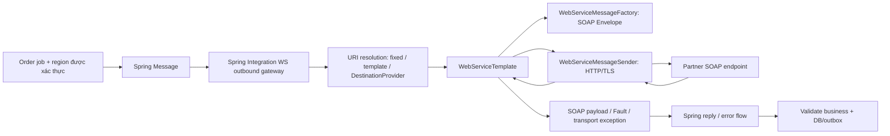
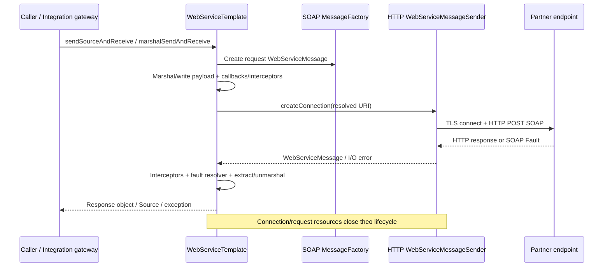
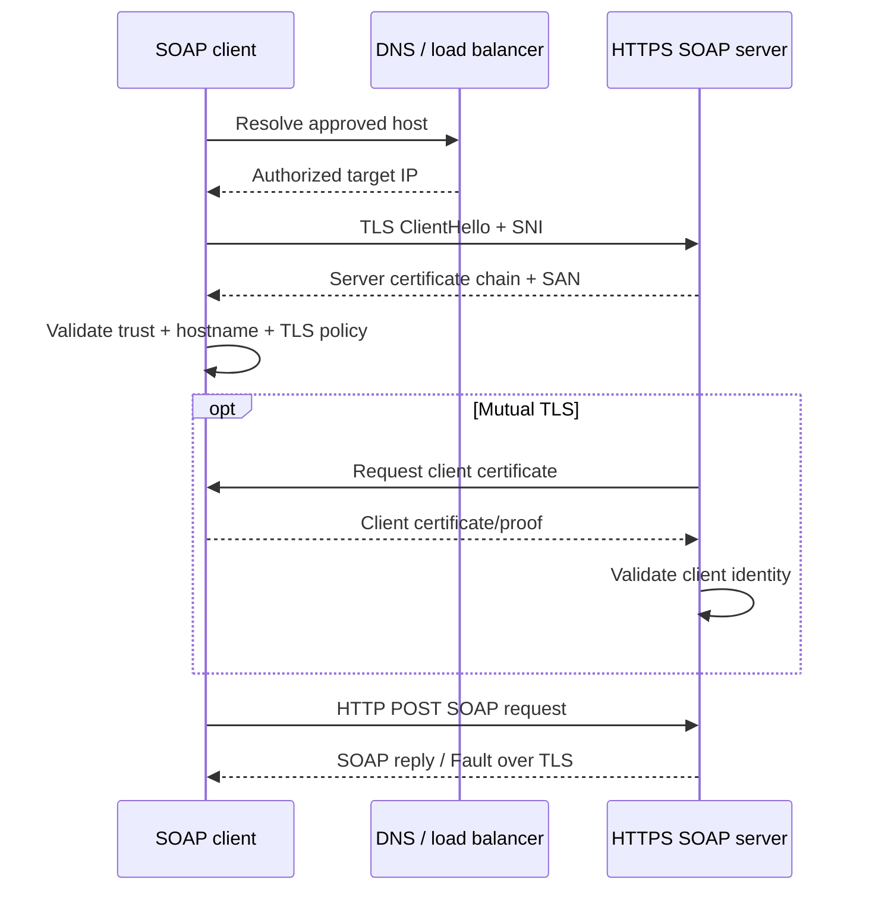
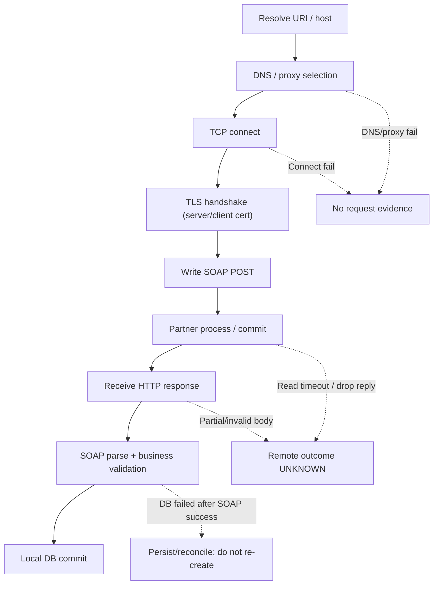
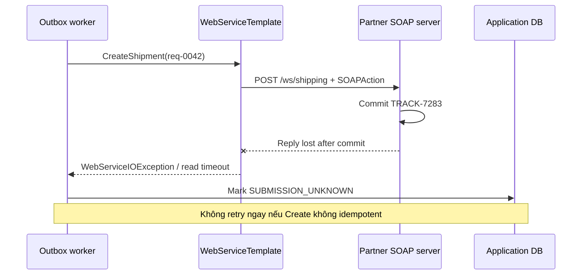
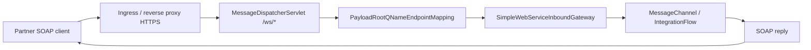

# HTTP transport và endpoint URI

## 1. Bài toán: SOAP đúng nội dung nhưng không đến đúng máy chủ

Ứng dụng xử lý đơn hàng sử dụng **Spring Integration** để gửi `CreateShipmentRequest` sang đối tác vận chuyển qua SOAP over HTTPS. Đối tác triển khai hai vùng `VN` và `SG`, mỗi vùng có endpoint riêng, yêu cầu TLS và giới hạn số kết nối. Lúc triển khai có các sự cố tưởng chừng không liên quan:

- Một job gọi nhầm `https://partner.example.test/shipping?wsdl` thay vì **SOAP service endpoint** mà WSDL công bố.
- Một worker tạo URI từ header `targetUrl` do client gửi, vô tình mở kết nối vào mạng nội bộ (**SSRF**).
- Một tệp PDF lớn làm nhiều thread chờ read timeout; dù caller báo lỗi, đối tác **có thể đã tạo vận đơn**.
- Client kết nối HTTPS thất bại do CA/truststore; nhóm phát triển định tắt certificate verification để “sửa nhanh”.
- Trong môi trường nhiều replica, cùng một job được retry với URL/region mới và tạo **hai vận đơn**.

Muốn xử lý đúng cần phân biệt ba trách nhiệm: **endpoint URI** xác định *gọi đến đâu*; **HTTP transport** quyết định *kết nối, gửi và nhận bằng cách nào*; **SOAP/WSDL** quyết định *request có nghĩa gì*. Spring Integration WS outbound gateway kết nối ba lớp đó với `MessageChannel` và routing của ứng dụng.

### Mục tiêu

Sau bài này, bạn sẽ có khả năng:

1. Phân biệt **WSDL discovery URL**, **SOAP endpoint URI**, **SOAPAction**, Body QName và `wsa:To`.
2. Mô tả vòng đời lời gọi `WebServiceTemplate` và `WebServiceMessageSender`, HTTP POST, response, SOAP Fault, close connection.
3. Cấu hình `HttpUrlConnectionMessageSender` với `Duration` timeout trong Spring-WS 4.x, biết khi nào chọn `HttpComponents5MessageSender`.
4. Tạo Java DSL `Ws.simpleOutboundGateway(...)`/`Ws.marshallingOutboundGateway(...)` với URI tĩnh hoặc template URI.
5. Dùng `DestinationProvider` với registry đáng tin; hiểu vì sao **không kết hợp** với URI-variable substitution.
6. Xử lý mã hóa URI bằng `DefaultUriBuilderFactory.EncodingMode`, tránh double-encoding/đổi host ngoài ý muốn.
7. Bảo vệ TLS, mTLS, proxy, redirect, SSRF; phân loại connect/read timeout và retry.
8. Kiểm thử routing URI với `MockWebServiceServer`, HTTP/TLS sandbox, fault injection và metrics.

> **Phạm vi:** Spring Integration **6.5.x**, Spring Web Services **4.x**, Spring Framework 6.x và Java 17+; Spring Boot dùng BOM tương thích. URI `*.example.test`, order/tenant/region/secret và số liệu trong bài đều giả lập. `SPECIAL_NOTE` không có yêu cầu bổ sung. HTTP transport được phân tích trong bối cảnh module `SPRING_INTEGRATION_ADAPTERS`: kết nối hệ thống ngoài bằng adapter/gateway, poller và `MessageChannel`, với cùng yêu cầu về hợp đồng message, lỗi và vòng đời kết nối như File/SFTP/HTTP/JMS/AMQP/Kafka/database.
> **Phạm vi:** Spring Integration **6.5.x**, Spring Web Services **4.x**, Spring Framework 6.x và Java 17+; Spring Boot dùng BOM tương thích. URI `*.example.test`, order/tenant/region/secret và số liệu trong bài đều giả lập. HTTP transport được phân tích trong bối cảnh module `SPRING_INTEGRATION_ADAPTERS`: kết nối hệ thống ngoài bằng adapter/gateway, poller và `MessageChannel`, với cùng yêu cầu về hợp đồng message, lỗi và vòng đời kết nối như File/SFTP/HTTP/JMS/AMQP/Kafka/database.

## 2. Sơ đồ kiến trúc: message, URI, transport, SOAP contract



| Tầng | Spring API / hợp đồng | Trách nhiệm | Không tự bảo đảm |
| --- | --- | --- | --- |
| Messaging | `Message<?>`, `MessageChannel`, `MessagingTemplate` | Routing, request–reply, headers, handler | SOAP đã được gửi chỉ vì async channel nhận message |
| Integration WS gateway | `SimpleWebServiceOutboundGateway`, `MarshallingWebServiceOutboundGateway` | Bridge Spring Message ↔ Spring-WS call | Transport security, remote exactly-once |
| Endpoint resolution | `.uri(...)`, URI template, `DestinationProvider` | Chọn destination URI | Bảo vệ SSRF nếu URI lấy từ input tùy ý |
| Client orchestration | `WebServiceTemplate` | Callback, send, receive, fault resolver, extractor | Tự hiểu WSDL để sinh Java classes |
| SOAP factory | `SaajSoapMessageFactory`, `SoapMessage` | Envelope, Body, Header, SOAP version, MIME | Host/TLS, permission |
| HTTP sender | `HttpUrlConnectionMessageSender`/`HttpComponents5MessageSender` | Kết nối HTTP(S), timeout, pool/proxy theo cấu hình | XSD/business validation |
| Domain adapter | Schema validator, authz, outbox | Contract, business result, idempotency | Tự thay thế transport SOAP |

### Cùng là outbound nhưng khác `Http.outboundGateway`

Spring Integration có `Http.outboundGateway(...)` cho **HTTP message exchanges** nói chung, thường dùng JSON/REST. `Ws.simpleOutboundGateway(...)`/`Ws.marshallingOutboundGateway(...)` dùng **Spring Web Services**, biết SOAP Envelope, SOAPAction và SOAP Fault. Cả hai có thể dùng HTTP làm transport, nhưng **không phải cùng một abstraction**.

## 3. URI nào để gọi: endpoint, WSDL, namespace, SOAPAction?

Ví dụ một hợp đồng đối tác:

```text
WSDL document (để đọc hợp đồng):
  https://shipping.example.test/ws/shipping.wsdl

SOAP service endpoint (để HTTP POST):
  https://shipping.example.test/ws/shipping

SOAPAction của SOAP 1.1 (operation identifier):
  urn:demo:shipping:v1/CreateShipment

XSD target namespace (XML QName identity):
  urn:demo:shipping:v1

Body root QName:
  {urn:demo:shipping:v1}CreateShipmentRequest
```

Một **WSDL URL** có thể công bố các `wsdl:service/wsdl:port/soap:address` trỏ tới endpoint. Trong cấu hình thực tế URL WSDL cũng có thể là `https://shipping.example.test/ws/shipping?wsdl`; điều đó **không nghĩa** mọi SOAP HTTP POST phải gửi đến `?wsdl`. Địa chỉ đúng là **SOAP address theo WSDL/đối tác**, có thể được override bằng cấu hình triển khai đã kiểm chứng.

| Thứ cần đọc | Ví dụ | Dùng vào đâu? |
| --- | --- | --- |
| WSDL location | `.../shipping.wsdl` hoặc `...?wsdl` | Khám phá/kiểm thử hợp đồng, không tự động là request endpoint |
| SOAP 1.1 service address | `https://.../ws/shipping` | `WebServiceTemplate.defaultUri` hoặc gateway `.uri(...)` |
| SOAPAction | `urn:demo:shipping:v1/CreateShipment` | `SoapActionCallback`/`WebServiceHeaders.SOAP_ACTION` |
| Body QName | `{urn:demo:shipping:v1}CreateShipmentRequest` | XSD/root validation, inbound `EndpointMapping` |
| WS-Addressing `wsa:To` | URI destination theo WS-A policy | SOAP Header, cần nhất quán với transport route |
| Callback `wsa:ReplyTo` | Địa chỉ reply nếu contract hỗ trợ | Bảo vệ SSRF, không tự gọi URL do client quyết định |

**URI action thường là tên định danh**, không phải URL để tải về bằng HTTP GET. **XSD namespace cũng không phải endpoint**: `urn:demo:shipping:v1` không phải một web server. Khi triển khai, phải pin WSDL/XSD version và xác minh endpoint theo đúng environment/region.

### Endpoint thay đổi theo môi trường

| Môi trường | Endpoint minh họa | Quy tắc |
| --- | --- | --- |
| Sandbox | `https://sandbox-shipping.example.test/ws/shipping` | Fake dữ liệu, certificate sandbox, không dùng production credentials |
| Staging | `https://staging-shipping.example.test/ws/shipping` | Contract/chaos tests, test mTLS/certificate |
| Production VN | `https://vn-shipping.example.test/ws/shipping` | Tenant/region allowlist, strict TLS |
| Production SG | `https://sg-shipping.example.test/ws/shipping` | Route theo dữ liệu đã xác thực, không lấy raw URL từ message |

Không cho một Spring Message bên ngoài tự đưa `targetUri` trỏ vào `127.0.0.1`, `localhost`, địa chỉ `169.254.169.254` hoặc mạng private/cloud metadata; xem mục bảo mật.

## 4. SOAP over HTTP thực sự gửi dữ liệu gì?

Với SOAP 1.1 document/literal, HTTP request điển hình:

```http
POST /ws/shipping HTTP/1.1
Host: vn-shipping.example.test
Content-Type: text/xml; charset=utf-8
SOAPAction: "urn:demo:shipping:v1/CreateShipment"
Accept: text/xml
Authorization: Bearer <redacted>

<?xml version="1.0" encoding="UTF-8"?>
<env:Envelope xmlns:env="http://schemas.xmlsoap.org/soap/envelope/"
              xmlns:ship="urn:demo:shipping:v1">
  <env:Body>
    <ship:CreateShipmentRequest>
      <ship:clientRequestId>req-0042</ship:clientRequestId>
      <ship:orderId>O-9001</ship:orderId>
    </ship:CreateShipmentRequest>
  </env:Body>
</env:Envelope>
```

HTTP response thành công về giao thức có thể là:

```http
HTTP/1.1 200 OK
Content-Type: text/xml; charset=utf-8

<env:Envelope xmlns:env="http://schemas.xmlsoap.org/soap/envelope/"
              xmlns:ship="urn:demo:shipping:v1">
  <env:Body>
    <ship:CreateShipmentResponse>
      <ship:clientRequestId>req-0042</ship:clientRequestId>
      <ship:trackingNumber>TRACK-7283</ship:trackingNumber>
      <ship:status>CREATED</ship:status>
    </ship:CreateShipmentResponse>
  </env:Body>
</env:Envelope>
```

**HTTP 200 không phải business success**: SOAP Body có thể chứa trạng thái `REJECTED` hoặc một SOAP Fault nếu provider không chuẩn. SOAP 1.1 thường dùng `text/xml` và `SOAPAction`, còn SOAP 1.2 thường dùng `application/soap+xml` và `action` media-type parameter với Envelope namespace khác. Không chỉ đổi Content-Type của SOAP 1.1 để “tương thích SOAP 1.2”.

HTTP sender thường thực hiện **POST** cho SOAP over HTTP. Content-Length/Transfer-Encoding/Connection/Gzip là trách nhiệm transport, không nên tự gán header HTTP ngẫu nhiên rồi giả định SOAP serializer vẫn tính đúng bytes/signature.

## 5. Một lời gọi `WebServiceTemplate` qua những giai đoạn nào?



Các bước có thể thay đổi chi tiết theo overload/interceptor và provider; điều quan trọng là **URI resolution và transport connection** khác với **XML/SOAP serialization**. Một `WebServiceTemplate` bean có thể được tái sử dụng nhiều request; `WebServiceMessage`, payload `Source` dạng stream, transport response và MIME attachment thường có **lifecycle từng request**, không phải một object có thể để trong queue lâu dài.

**Hai điểm thất bại cần phân biệt:**

1. **Trước khi gửi:** marshal/schema validation lỗi, endpoint URI không hợp lệ hoặc TLS handshake chưa gửi request — sửa config/dữ liệu và xác định có remote side effect không.
2. **Sau khi gửi:** read timeout, mất response, XML reply sai schema — remote có thể **đã xử lý và commit**, vì vậy không tự động retry operation có side effect.

### Không nhầm message reply timeout với HTTP read timeout

`MessagingTemplate.setReceiveTimeout(...)` giới hạn **thời gian đợi Spring reply**. `HttpUrlConnectionMessageSender.setReadTimeout(...)` giới hạn **chờ dữ liệu từ socket**. Cả hai khác business SLA/end-to-end deadline; một messaging timeout không đảm bảo hủy HTTP request đang chạy hoặc rollback side effect trên đối tác.

## 6. Dependencies và cấu hình endpoint qua application properties

Ví dụ Gradle cho Spring Boot + Spring Integration WS:

```groovy
dependencies {
    implementation 'org.springframework.boot:spring-boot-starter-integration'
    implementation 'org.springframework.integration:spring-integration-ws'
    implementation 'org.springframework.boot:spring-boot-starter-web-services'
    testImplementation 'org.springframework.boot:spring-boot-starter-test'
    testImplementation 'org.springframework.ws:spring-ws-test'
}
```

Quản lý version bằng **Spring Boot BOM tương thích Spring Integration 6.5**. Không trộn Spring-WS 4/Jakarta với các SOAP/JAXB `javax.*` runtime cũ; riêng `javax.xml.transform.Source/Result` vẫn thuộc JAXP trên Java 17 và dùng bình thường.

```yaml
app:
  shipping:
    endpoint: ${SHIPPING_SOAP_ENDPOINT:https://vn-shipping.example.test/ws/shipping}
    soap-action: "urn:demo:shipping:v1/CreateShipment"
    connect-timeout-ms: 5000
    read-timeout-ms: 20000
```

Giá trị ở đây **chỉ là ví dụ**; không đưa private key, JWT, password hay truststore password trực tiếp vào repository. Với môi trường production, dùng configuration management/secret manager và validator ở startup để bảo đảm URI an toàn, HTTPS, host/path/region được phép.

## 7. `HttpUrlConnectionMessageSender`: transport tối giản với timeout

Spring Web Services 4.x có `org.springframework.ws.transport.http.HttpUrlConnectionMessageSender` dùng Java `HttpURLConnection`/`HttpsURLConnection` để gửi SOAP HTTP POST. Hai setter thời gian dùng **`java.time.Duration`**:

```java
import java.time.Duration;

import org.springframework.beans.factory.annotation.Value;
import org.springframework.context.annotation.Bean;
import org.springframework.context.annotation.Configuration;
import org.springframework.ws.client.core.WebServiceTemplate;
import org.springframework.ws.soap.SoapVersion;
import org.springframework.ws.soap.saaj.SaajSoapMessageFactory;
import org.springframework.ws.transport.http.HttpUrlConnectionMessageSender;

@Configuration
public class ShippingSoapTransportConfig {

    @Bean
    public SaajSoapMessageFactory shippingSoap11Factory() {
        SaajSoapMessageFactory factory = new SaajSoapMessageFactory();
        factory.setSoapVersion(SoapVersion.SOAP_11);
        return factory;  // Spring khởi tạo lifecycle.
    }

    @Bean
    public WebServiceTemplate shippingWebServiceTemplate(
            SaajSoapMessageFactory shippingSoap11Factory,
            @Value("${app.shipping.endpoint}") String endpoint,
            @Value("${app.shipping.connect-timeout-ms:5000}") long connectMs,
            @Value("${app.shipping.read-timeout-ms:20000}") long readMs) {

        if (connectMs <= 0 || readMs <= 0) {
            throw new IllegalArgumentException("Timeout phải dương");
        }

        HttpUrlConnectionMessageSender sender =
                new HttpUrlConnectionMessageSender();
        sender.setConnectionTimeout(Duration.ofMillis(connectMs));
        sender.setReadTimeout(Duration.ofMillis(readMs));

        WebServiceTemplate template =
                new WebServiceTemplate(shippingSoap11Factory);
        template.setDefaultUri(endpoint);
        template.setMessageSender(sender);
        return template;
    }
}
```

Đây là **client outbound**, không cần `MessageDispatcherServlet`. `setDefaultUri` áp dụng cho các overload `WebServiceTemplate` **không truyền URI explicit**. Đừng coi mẫu timeout 5s/20s là khuyến nghị cố định: phải chọn theo SLO, p99 latency, kích thước SOAP/MTOM và giới hạn của provider.

| Thuộc tính | Thực sự giới hạn | Không giới hạn |
| --- | --- | --- |
| `connectionTimeout` | Thời gian thiết lập TCP connection ở Java URLConnection | Tổng thời gian DNS + mọi proxy/TLS/parse/business |
| `readTimeout` | Thời gian socket chờ đọc dữ liệu | Toàn end-to-end deadline, remote commit |
| `MessagingTemplate.receiveTimeout` | Thời gian caller chờ Spring reply | Hủy side effect của SOAP server |
| `HTTP pool acquisition timeout` | Chờ lấy connection từ pool (nếu có) | Network read timeout và business SLA |
| `Provider operation SLA` | Cam kết của bên ngoài | Tự enforce timeout ở mọi tầng client |

Một giá trị `0` trong nhiều HTTP APIs có nghĩa **đợi vô hạn**, vì vậy nên validate timeout dương và thiết kế deadline/budget ở cấp ứng dụng. Đối với tải cao, sender dựa trên `HttpURLConnection` có những hạn chế quan sát/pooling riêng; dùng `HttpComponents5MessageSender` với client được quản lý khi cần connection pool, proxy, mTLS và policy chi tiết.

## 8. Gửi SOAP với `WebServiceTemplate` trước khi dùng IntegrationFlow

Để học transport, nên thử lời gọi Spring-WS client **không có integration gateway** trước. `sendSourceAndReceiveToResult(...)` gửi XML **Body payload** (không phải cả SOAP Envelope) tới `defaultUri` của bean cấu hình ở mục 7:

```java
import org.springframework.beans.factory.annotation.Qualifier;
import org.springframework.stereotype.Service;
import org.springframework.ws.client.core.WebServiceTemplate;
import org.springframework.ws.soap.client.core.SoapActionCallback;
import org.springframework.xml.transform.StringResult;
import org.springframework.xml.transform.StringSource;

@Service
public class ShippingSoapClient {

    private final WebServiceTemplate webServiceTemplate;

    public ShippingSoapClient(
            @Qualifier("shippingWebServiceTemplate")
            WebServiceTemplate webServiceTemplate) {
        this.webServiceTemplate = webServiceTemplate;
    }

    public String createDemoShipment() {
        StringSource requestBody = new StringSource("""
            <ship:CreateShipmentRequest xmlns:ship="urn:demo:shipping:v1">
              <ship:clientRequestId>req-0042</ship:clientRequestId>
              <ship:orderId>O-9001</ship:orderId>
            </ship:CreateShipmentRequest>
            """);

        StringResult result = new StringResult();
        boolean received = webServiceTemplate.sendSourceAndReceiveToResult(
                requestBody,
                new SoapActionCallback(
                        "urn:demo:shipping:v1/CreateShipment"),
                result);

        if (!received) {
            throw new IllegalStateException(
                    "CreateShipment yêu cầu SOAP reply, nhưng response rỗng");
        }

        // XML của SOAP Body reply; vẫn cần XSD/business validation.
        return result.toString();
    }
}
```

Trong ví dụ này:

- `shippingWebServiceTemplate` chọn **URI** từ `defaultUri` và dùng `HttpUrlConnectionMessageSender`.
- `SoapActionCallback` đặt action theo WSDL; nó **không thay đổi URI**.
- `StringSource` chỉ chứa XML phần tử `CreateShipmentRequest`; `SaajSoapMessageFactory` tạo SOAP Envelope.
- `StringResult` nhận response body payload; **không** bảo đảm HTTP 200 hoặc `status=CREATED` nếu chưa validate.
- Nếu operation là **one-way**, cần thiết kế hợp đồng trả về khác; không tự đợi tracking number từ một operation không có response.

### Overload truyền endpoint URI tường minh

```java
// Trích đoạn trong method, dùng URI đã được kiểm tra/allowlist:
boolean gotReply = webServiceTemplate.sendSourceAndReceiveToResult(
        "https://vn-shipping.example.test/ws/shipping",
        requestBody,
        new SoapActionCallback(
                "urn:demo:shipping:v1/CreateShipment"),
        result);
```

Overload có URI này dùng đích **của invocation** thay cho default destination. Vì vậy, đừng tự đặt `template.setDefaultUri(productionUri)` rồi lại truyền URI do caller gửi mà nghĩ defaultUri sẽ bảo vệ đích. **Cần validate chính URI đang được sử dụng**.

### SOAP header khác HTTP transport header

`WebServiceHeaders.SOAP_ACTION` của Spring Integration được map sang SOAP action, không phải một Spring `HttpHeaders` object được tự động chuyển ra mọi HTTP header. Với HTTP auth/proxy, cấu hình sender/client và interceptor đúng cấp. Đừng cố đặt `Authorization` bằng custom SOAP Header nếu đối tác yêu cầu HTTP Bearer token, hoặc ngược lại.

## 9. Spring Integration Java DSL: gateway + channel + HTTP sender

Khi cần phối hợp transformer/filter/router/error flow, dùng **WS outbound gateway**. Spring Integration 6.5 cho phép `Ws.simpleOutboundGateway()` nhận `String` hoặc `javax.xml.transform.Source` trong Spring Message, và dùng sender được cấu hình:

```java
import java.time.Duration;

import org.springframework.beans.factory.annotation.Value;
import org.springframework.context.annotation.Bean;
import org.springframework.context.annotation.Configuration;
import org.springframework.integration.channel.DirectChannel;
import org.springframework.integration.dsl.IntegrationFlow;
import org.springframework.integration.ws.dsl.Ws;
import org.springframework.messaging.MessageChannel;
import org.springframework.ws.transport.http.HttpUrlConnectionMessageSender;

@Configuration
public class ShippingSoapOutboundFlow {

    @Bean
    public MessageChannel shippingOutboundRequests() {
        return new DirectChannel();
    }

    @Bean
    public IntegrationFlow shipViaPartner(
            MessageChannel shippingOutboundRequests,
            @Value("${app.shipping.endpoint}") String endpoint) {

        HttpUrlConnectionMessageSender sender =
                new HttpUrlConnectionMessageSender();
        sender.setConnectionTimeout(Duration.ofSeconds(5));
        sender.setReadTimeout(Duration.ofSeconds(20));

        return IntegrationFlow.from(shippingOutboundRequests)
                .handle(Ws.simpleOutboundGateway()
                        .uri(endpoint)
                        .messageSenders(sender))
                .get();
    }
}
```

Producer có thể dùng `MessagingTemplate` chờ reply:

```java
import org.springframework.beans.factory.annotation.Qualifier;
import org.springframework.integration.core.MessagingTemplate;
import org.springframework.integration.ws.WebServiceHeaders;
import org.springframework.messaging.Message;
import org.springframework.messaging.MessageChannel;
import org.springframework.messaging.support.MessageBuilder;
import org.springframework.stereotype.Service;
import org.springframework.xml.transform.StringSource;

@Service
public class ShipmentFlowCaller {

    private final MessageChannel requests;

    public ShipmentFlowCaller(
            @Qualifier("shippingOutboundRequests") MessageChannel requests) {
        this.requests = requests;
    }

    public Message<?> invokeDemo() {
        Message<StringSource> message = MessageBuilder
                .withPayload(new StringSource("""
                    <ship:CreateShipmentRequest
                        xmlns:ship="urn:demo:shipping:v1">
                      <ship:clientRequestId>req-0042</ship:clientRequestId>
                      <ship:orderId>O-9001</ship:orderId>
                    </ship:CreateShipmentRequest>
                    """))
                .setHeader(WebServiceHeaders.SOAP_ACTION,
                        "urn:demo:shipping:v1/CreateShipment")
                .build();

        MessagingTemplate messaging = new MessagingTemplate();
        messaging.setReceiveTimeout(25_000);
        Message<?> reply = messaging.sendAndReceive(requests, message);
        if (reply == null) {
            throw new IllegalStateException(
                    "Spring reply timeout hoặc SOAP response rỗng");
        }
        return reply;
    }
}
```

`DirectChannel` dispatch đồng bộ. `MessagingTemplate.receiveTimeout` đợi **Spring reply**; nó không hủy remote SOAP transaction. Khi chuyển request channel sang `ExecutorChannel`/`QueueChannel`, `send() == true` thường chỉ chứng minh message được accepted/queued, **không** chứng minh HTTP POST tới đối tác đã thành công.

### Nếu cần JAXB object

`Ws.marshallingOutboundGateway()` yêu cầu `Marshaller`/`Unmarshaller` phù hợp SOAP XSD; có thể truyền một `Jaxb2Marshaller` bean cho cả hai:

```java
// Trích đoạn trong IntegrationFlow bean, khi có shippingMarshaller:
.handle(Ws.marshallingOutboundGateway()
        .uri(endpoint)
        .marshaller(shippingMarshaller)
        .unmarshaller(shippingMarshaller)
        .messageSenders(sender))
```

Với marshalling gateway, payload là **JAXB object theo contract**, không phải một `String` chứa SOAP Envelope. Cả simple và marshalling đều dùng cơ chế URI/HTTP transport của Spring-WS, nên không thay đổi chính sách TLS/SSRF chỉ vì thay payload type.

## 10. External `WebServiceTemplate`: nơi tập trung cấu hình transport

Spring Integration từ 5.0 hỗ trợ dùng một `WebServiceTemplate` đã cấu hình bên ngoài, hữu ích khi cần proxy, mTLS, pooling, fault resolver hoặc SOAP interceptors.

```java
import org.springframework.beans.factory.annotation.Qualifier;
import org.springframework.beans.factory.annotation.Value;
import org.springframework.context.annotation.Bean;
import org.springframework.context.annotation.Configuration;
import org.springframework.integration.dsl.IntegrationFlow;
import org.springframework.integration.ws.dsl.Ws;
import org.springframework.messaging.MessageChannel;
import org.springframework.ws.client.core.WebServiceTemplate;

@Configuration
public class ShippingWithExternalTemplateFlow {

    @Bean
    public IntegrationFlow shippingWithSharedTemplate(
            MessageChannel shippingOutboundRequests,
            @Qualifier("shippingWebServiceTemplate")
            WebServiceTemplate template,
            @Value("${app.shipping.endpoint}") String endpoint) {
        return IntegrationFlow.from(shippingOutboundRequests)
                .handle(Ws.simpleOutboundGateway(template)
                        .uri(endpoint))
                .get();
    }
}
```

**Đây là phương án thay thế cho flow mục 9**, không đăng ký cả hai `IntegrationFlow` cùng subscribe một `DirectChannel` trừ khi chủ đích là fanout (rất nguy hiểm với CreateShipment). Khi sử dụng external template, các thông số như `WebServiceMessageFactory`, `WebServiceMessageSender`, `ClientInterceptor`, `FaultMessageResolver` và security thường cấu hình **trên chính template**. Spec external-template tập trung vào URI, header mapper, callback/encoding; không giả định mọi setter của no-template spec sẽ tự điều chỉnh một HTTP client đã được tạo sẵn.

Nếu template có `defaultUri` và gateway còn có `.uri(endpoint)`, nên **chỉ định một điểm cấu hình đích rõ ràng** và kiểm thử `connectionTo(expectedUri)`; không dựa vào suy luận mơ hồ về precedence khi refactor. Trong `WebServiceTemplate` trực tiếp, overload có URI được áp cho invocation đó; `setDefaultUri` dành cho các overload không có URI.

## 11. Ba chiến lược chọn endpoint URI

| Chiến lược | API chính | Phù hợp | Rủi ro |
| --- | --- | --- | --- |
| **URI cố định** | `Ws.simpleOutboundGateway().uri("https://...")` | Một partner/region, URL cấu hình lúc startup | Sai môi trường, certificate/host drift |
| **URI template** | `.uri("https://.../{region}/ws")` và `.uriVariableExpressions(...)` | Đường dẫn/query theo biến đã kiểm soát | Encoding, path injection, SSRF nếu cho sửa host |
| **`DestinationProvider`** | `.destinationProvider(provider)` | Runtime registry/tenant endpoint đã cho phép, failover có chủ đích | Registry poisoning, DNS rebinding, policy ngoài code |

**Không kết hợp `DestinationProvider` và URI-variable substitution.** Spring Integration 6.5 quy định dùng cả hai gây configuration error. Khi chọn `DestinationProvider`, `encodingMode` của gateway bị bỏ qua; provider phải trả **`URI` đã hợp lệ/encoded đúng chính sách**.

### Một URI cố định trong YAML không có nghĩa không cần validation

Giá trị `app.shipping.endpoint` thường do operator/deployment platform cung cấp. Vẫn cần xác nhận `scheme=https`, host/port/path và môi trường, vì lỗi cấu hình có thể gửi dữ liệu khách hàng sang sandbox hoặc tài khoản đối tác khác. Không cho secret chứa endpoint tùy ý vượt khỏi danh sách partner đã onboard.

### Phân biệt runtime reconfiguration với message-time routing

- **Startup config:** bean URI tĩnh và credentials cho một provider. Đơn giản, dễ audit.
- **Message-time routing:** chỉ lấy **routing key hợp lệ** từ event/order/tenant, chọn từ một registry **đã tin cậy**. Không lấy raw URL bên trong SOAP payload hoặc user headers.
- **Hot reload registry:** phiên bản cấu hình phải có audit, change approval và atomic publication; ghi metadata route version vào outbox để job retry không bất ngờ chuyển partner.

Nếu có nhiều partner dùng certificate/credentials khác nhau, tốt hơn nên có **mỗi partner một template/sender** hoặc một factory tách biệt danh tính/credentials, không trộn chung một mutable singleton mà thay TLS/auth trên từng thread.

## 12. URI template: thay biến trong **path** mà không thay host

Giả sử đối tác có URL cố định host nhưng phân vùng theo path:

```text
https://shipping.example.test/{region}/ws/shipping
```

Ứng dụng chỉ cho `region=vn` hoặc `region=sg` sau khi kiểm tra với một enum/allowlist, còn **scheme/host/port cố định**. Spring Integration 6.5 Java DSL có `uriVariableExpressions(Map<String, Expression>)`; biểu thức được tính theo outbound `Message<?>`.

```java
import java.util.Map;

import org.springframework.beans.factory.annotation.Bean;
import org.springframework.context.annotation.Configuration;
import org.springframework.expression.Expression;
import org.springframework.expression.spel.standard.SpelExpressionParser;
import org.springframework.integration.dsl.IntegrationFlow;
import org.springframework.integration.ws.dsl.Ws;

@Configuration
public class ShippingUriTemplateFlow {

    @Bean
    public IntegrationFlow routeShippingByRegion() {
        Expression regionExpression = new SpelExpressionParser()
                .parseExpression("headers['approvedRegion']");
        Map<String, Expression> variables =
                Map.of("region", regionExpression);

        return IntegrationFlow.from("shippingRegionRequests")
                .handle(Ws.simpleOutboundGateway()
                        .uri("https://shipping.example.test/{region}/ws/shipping")
                        .uriVariableExpressions(variables))
                .get();
    }
}
```

**Điều kiện bảo mật:** `approvedRegion` là header **nội bộ** do bộ chọn region đã validate tạo ra, không copy nguyên `headers['region']` từ HTTP caller. Ví dụ helper:

```java
import java.util.Locale;
import java.util.Set;

public final class RegionPolicy {
    private static final Set<String> ALLOWED = Set.of("vn", "sg");

    public static String approve(String candidate) {
        if (candidate == null) {
            throw new IllegalArgumentException("Missing region");
        }
        String normalized = candidate.toLowerCase(Locale.ROOT);
        if (!ALLOWED.contains(normalized)) {
            throw new IllegalArgumentException("Unsupported region");
        }
        return normalized;
    }
}
```

Producer phải gọi `RegionPolicy.approve(...)` rồi set `approvedRegion` trước khi vào `shippingRegionRequests`. Đoạn này không tự chặn một actor có quyền ghi headers nội bộ; trong production cần **trust boundary** rõ và re-validate tại endpoint nếu message đi qua broker/connector không tin cậy.

**Đừng template hóa scheme/hostname từ input** như `"https://{tenantHost}/ws"` rồi chỉ kiểm tra string không rỗng: có thể dẫn tới SSRF, gọi nhầm môi trường, IP trực tiếp hoặc tên miền do kẻ tấn công kiểm soát. Chọn host từ map cấu hình được phê duyệt thay vì tính từ payload.

### URI variable khác SOAP Body variable

`{region}` trong URI template chỉ quyết định **đường dẫn transport**, không tự đổi SOAP payload QName, tenant authorization hay WSDL operation. Nếu đối tác ở `sg` yêu cầu SOAPAction/XML namespace khác `vn`, cần route cả **template + marshaller/contract version** tương ứng, không chỉ thay path.

## 13. Encoding URI: mặc định `TEMPLATE_AND_VALUES`

Spring Integration WS dùng URI builder để encode string URI. Từ Spring Integration 5.3, `AbstractWebServiceOutboundGateway` có `setEncodingMode(DefaultUriBuilderFactory.EncodingMode)`; DSL tương ứng `.encodingMode(...)`. Mặc định là **`TEMPLATE_AND_VALUES`**:

```java
import org.springframework.web.util.DefaultUriBuilderFactory;

// Trích đoạn của WS gateway DSL:
.handle(Ws.simpleOutboundGateway()
        .uri("https://shipping.example.test/{region}/ws/shipping")
        .uriVariableExpressions(variables)
        .encodingMode(
            DefaultUriBuilderFactory.EncodingMode.TEMPLATE_AND_VALUES))
```

| Chế độ | Nguyên tắc | Dùng khi |
| --- | --- | --- |
| `TEMPLATE_AND_VALUES` (mặc định) | Mã hóa template và giá trị biến theo chính sách URI builder | Trường hợp phổ biến, có giá trị biến động |
| `VALUES_ONLY` | Mã hóa các giá trị biến trước khi expand | Template chứa ký tự dành riêng đã được kiểm soát |
| `URI_COMPONENT` | Mã hóa thành phần sau expand, giữ một số reserved semantics | Contract URL đặc thù, cần test cụ thể |
| `NONE` | Bỏ encoding của URI builder | **Rất hiếm**: URI đã được build/encode đúng và được kiểm soát |

Ví dụ lý do phải test: order external code `"A/B 100%"` nếu đưa vào path segment có thể bị hiểu thành **hai segment** hoặc tạo chuỗi `%` không hợp lệ, tùy encoding. Cần xác định provider muốn path segment, query param hay SOAP Body field. Thường **business order ID nên nằm trong SOAP Body**, không phải tự ghép vào URL path.

### Double encoding

Nếu giá trị đã được encode `A%2FB` rồi URI builder encode `%` thêm lần nữa, có thể gửi `A%252FB` thay vì `A%2FB`. Ngược lại đặt `NONE` với raw input chứa `/`, `?` hoặc `#` có thể làm thay đổi structure/route. **Không dùng `NONE` để “sửa lỗi” một cách mù quáng**; test URI **đã gửi thực tế**, có Unicode, dấu cách, percent, slash và query delimiters.

Với `DestinationProvider`, `encodingMode` không được áp; provider trả `URI` cuối cùng và chịu trách nhiệm canonicalization. Không tự thay đổi encoding tại interceptor sau khi TLS signature/action đã được cấu hình và tin nó an toàn.

## 14. `DestinationProvider`: chọn URI từ registry được kiểm soát

Spring-WS có `org.springframework.ws.client.support.destination.DestinationProvider`; interface cốt lõi cung cấp `URI getDestination()`. Nó phù hợp khi cần **runtime discovery** hoặc chuyển endpoint theo chính sách/operator, thay vì nhận một URL tự do từ client.

Ví dụ đơn giản: route **một gateway** tới endpoint production hiện được operator phê duyệt trong allowlist, có thể thay đổi từ VN sang endpoint dự phòng **cùng contract/cùng business identity**.

```java
import java.net.URI;
import java.util.Map;
import java.util.concurrent.atomic.AtomicReference;

import org.springframework.ws.client.support.destination.DestinationProvider;

public final class ApprovedShippingDestinationProvider
        implements DestinationProvider {

    private static final Map<String, URI> APPROVED_ENDPOINTS = Map.of(
            "vn-primary",
            URI.create("https://vn-shipping.example.test/ws/shipping"),
            "vn-secondary",
            URI.create("https://backup-vn-shipping.example.test/ws/shipping"));

    private final AtomicReference<URI> current =
            new AtomicReference<>(APPROVED_ENDPOINTS.get("vn-primary"));

    @Override
    public URI getDestination() {
        return current.get();
    }

    public void activateApprovedEndpoint(String configuredKey) {
        URI target = APPROVED_ENDPOINTS.get(configuredKey);
        if (target == null) {
            throw new IllegalArgumentException("Destination not approved");
        }
        current.set(target);
    }
}
```

Provider ở trên chỉ là ví dụ về **chọn từ một danh sách URI đã biết**, không xử lý registry thật, mTLS/certificate rotation hay multi-tenant. Một policy thực tế còn phải kiểm tra sức khỏe endpoint, phạm vi contract, region, quyền operator, audit thay đổi và khả năng **idempotency** khi chuyển sang endpoint dự phòng.

Sử dụng trong Java DSL:

```java
import org.springframework.context.annotation.Bean;
import org.springframework.integration.dsl.IntegrationFlow;
import org.springframework.integration.ws.dsl.Ws;

@Bean
public IntegrationFlow shippingWithDestinationProvider(
        ApprovedShippingDestinationProvider destinationProvider) {
    return IntegrationFlow.from("shippingProviderRequests")
            .handle(Ws.simpleOutboundGateway()
                    .destinationProvider(destinationProvider))
            .get();
}
```

**Đây là flow thay thế** cho các flow URI cố định hoặc URI template trước đó. **Không thêm `.uri(...)` hoặc `.uriVariableExpressions(...)`** cho spec dùng provider. Đặc biệt, `DestinationProvider.getDestination()` **không nhận Spring `Message<?>` làm tham số**: một provider mutable dùng chung **không thể tự chọn region cho từng message một cách an toàn** bằng `ThreadLocal` hay set một property ngay trước khi gửi (race condition). Với message-time routing, nên chọn **flow/template riêng theo partner/region** hoặc URI template có biến đã validate, không đổi global destination đồng thời.

### Khi muốn service discovery

Registry nên lưu `partnerId`, `contractVersion`, `approvedScheme/host/port/path`, `credentialProfile` và `healthStatus`. Operator chỉ được publish endpoint sau xác minh TLS/policy/contract, không chỉ lấy kết quả DNS SRV hoặc database row rồi tin hoàn toàn. Nếu endpoint v1 và v2 khác QName/SOAP version, **route contract cùng endpoint**, không chỉ đổi host.

### `WebServiceTemplate` cũng có `setDestinationProvider`

`WebServiceTemplate#setDefaultUri(String)` và `setDestinationProvider(DestinationProvider)` là **hai lựa chọn cho default destination** khi gọi overload không truyền URI. Không cần (và không nên) set cả hai rồi dựa vào setter chạy sau cùng để ghi đè ngầm.

```java
// Trích đoạn cấu hình Spring-WS client:
template.setDestinationProvider(destinationProvider);
// Sau đó dùng các overload không truyền URI:
// template.sendSourceAndReceiveToResult(source, callback, result);
```

Nếu gọi overload có URI explicit, endpoint của invocation đó cần được kiểm soát riêng; provider không phải một **SSRF firewall** cho bất kỳ URL bên ngoài được truyền vào API.

## 15. `HttpComponents5MessageSender`: pooling và timeout cho lưu lượng lớn

Khi có nhiều SOAP requests đồng thời và yêu cầu quản lý connection pool rõ ràng, Spring-WS 4.0.5+ có `org.springframework.ws.transport.http.HttpComponents5MessageSender` dùng **Apache HttpClient 5**.

Trong Gradle, bảo đảm có dependency tương ứng khi project/BOM chưa cung cấp:

```groovy
dependencies {
    implementation 'org.apache.httpcomponents.client5:httpclient5'
}
```

Ví dụ dùng sender do Spring quản lý:

```java
import java.time.Duration;

import org.springframework.context.annotation.Bean;
import org.springframework.context.annotation.Configuration;
import org.springframework.ws.transport.http.HttpComponents5MessageSender;

@Configuration
public class PooledSoapSenderConfiguration {

    @Bean
    public HttpComponents5MessageSender pooledSoapSender() {
        HttpComponents5MessageSender sender =
                new HttpComponents5MessageSender();
        sender.setConnectionTimeout(Duration.ofSeconds(5));
        sender.setReadTimeout(Duration.ofSeconds(20));
        sender.setMaxTotalConnections(64);
        return sender;
    }
}
```

`new HttpComponents5MessageSender()` tạo một client với connection manager mặc định do sender quản lý, có lifecycle `InitializingBean/DisposableBean`; Spring gọi initialize/destroy. `setMaxTotalConnections(64)` chỉ là **giá trị minh họa**, không thay kiểm soát per-route concurrency, pool acquisition timeout, keep-alive/idle eviction và provider quotas.

Đặt sender lên `WebServiceTemplate` hoặc no-template WS gateway:

```java
// Trong @Bean WebServiceTemplate nhận pooledSoapSender:
template.setMessageSender(pooledSoapSender);

// Hoặc trong Java DSL tạo WS outbound gateway:
.handle(Ws.simpleOutboundGateway()
        .uri(endpoint)
        .messageSenders(pooledSoapSender))
```

Hai fragment là **hai lựa chọn cấu hình**, không áp cả hai lần cho cùng một flow mà không biết instance nào được dùng. Nếu tự truyền **custom Apache `HttpClient`** vào constructor/setter của `HttpComponents5MessageSender`, Spring-WS 4.0 **không tự thay đổi timeout hoặc cài `RemoveSoapHeadersInterceptor` cho client đó**. Bạn phải cấu hình pool, timeout, proxy, redirects, SSL và request interceptors trên custom client, test tương thích SOAP transport. Đừng suy các setter sender sẽ override mọi thứ đã dựng bên ngoài.

### Pool khác concurrency/bulkhead

| Giới hạn | Mục đích | Triệu chứng khi thiếu |
| --- | --- | --- |
| Max total connections | Không mở quá nhiều sockets | Cạn file descriptors/connection |
| Per-route/host connection policy | Không để một host chiếm hết pool | Provider A làm provider B đói kết nối |
| Pool acquisition timeout | Không chờ connection vô hạn | Thread buildup trước khi mở socket |
| Worker bulkhead | Giới hạn số SOAP calls đồng thời | Cạn servlet/executor threads |
| Rate limit theo partner/tenant | Không vượt quota đối tác | HTTP 429/503, retry storm |
| Overall call budget | Giới hạn tổng thời gian một job dành cho network | Một job giữ lease quá lâu |

**Connection pooling không giảm semantic timeout risk**: khi request đã tới partner, mất response vẫn là một **remote outcome không chắc chắn**, dù transport dùng pool hiện đại.

## 16. HTTPS và mTLS: xác minh đúng đích và danh tính

SOAP payload có thể chứa địa chỉ giao hàng, dữ liệu hợp đồng hoặc thông tin thanh toán. **HTTPS là bắt buộc** với dữ liệu nhạy cảm; mTLS khi đối tác yêu cầu client certificate.



### TLS server authentication

- Kiểm tra certificate chain về CA/truststore được tin cậy và hostname nằm trong SAN. **Không** dùng trust-all hoặc tắt hostname verification để vượt `PKIX path building failed`.
- Không chỉ kiểm tra DNS host string rồi bỏ qua địa chỉ IP thực. Nếu một host ngoài allowlist bị redirect hoặc DNS rebinding sang mạng nội bộ, policy egress cần phát hiện/chặn.
- TLS termination sau load balancer phải có cấu hình đúng giữa proxy và upstream; nếu là mTLS, identity của caller cần được truyền qua **kênh tin cậy**, không tin header `X-Client-Cert` từ Internet.
- Kiểm tra TLS versions/cipher policies theo tiêu chuẩn tổ chức, không tự chấp nhận chứng chỉ hết hạn.

### mTLS client identity

Client cần keypair/certificate riêng, được lưu trong key/secret store. HTTP client phải load **keystore/truststore** đúng đối tác và hostname; kiểm soát thời hạn/rotation, khi partner thu hồi cert và khi chuyển dự phòng. Không dùng cùng private key cho mọi tenant nếu không có hợp đồng chấp thuận.

**Tránh cấu hình JVM-global `javax.net.ssl.trustStore` hoặc `javax.net.ssl.keyStore` bừa bãi** cho một partner duy nhất: chúng có thể ảnh hưởng tất cả HTTPS outbound trong cùng JVM. Với nhiều partner, nên tạo transport client riêng với `SSLContext`/socket factory tương ứng, cấu hình hostname verifier đúng và test với endpoint sandbox mTLS.

### WS-Security khác mTLS

WS-Security qua `Wss4jSecurityInterceptor` có thể bảo vệ/định danh **SOAP message** (chữ ký, timestamp, UsernameToken, encryption). TLS/mTLS bảo vệ **kênh** và danh tính connection. Hai lớp có thể đồng thời cần thiết; chúng **không thay** business authorization cho một tenant/order. Một `SOAPAction` hoặc `wsa:To` đúng cũng không chứng minh principal có quyền thực hiện operation.

## 17. Proxy, redirect, HTTP authentication và an toàn URI

Trong doanh nghiệp, đường HTTP có thể qua forward proxy, API gateway hoặc ingress reverse proxy. Những cấu hình này ảnh hưởng TLS, DNS, authentication, HTTP status và URI nhìn thấy ở hai phía.

| Thành phần | Điều cần kiểm tra | Rủi ro |
| --- | --- | --- |
| Forward proxy | Endpoint được phép, proxy auth, CONNECT/mTLS | Proxy nhìn thấy metadata; bypass egress |
| API gateway | Host/path rewrite, SOAPAction, request size, fault mapping | Trả HTML 500 thay vì SOAP Fault |
| Reverse proxy | `X-Forwarded-*`, target WSDL address, HTTPS termination | WSDL công bố sai URL/protocol |
| Redirect 301/302/307/308 | Policy có theo redirect không; có resend POST/credentials không | Credential leak, chuyển tới host lạ, duplicate side effect |
| HTTP Bearer/Basic auth | Token scope/expiry, dùng TLS, header transport đúng | Đặt secret sai vào SOAP Header/log |
| Connection keep-alive | Pool reuse, idle stale connections | Unexpected EOF/Connection reset |

**Không tự động follow redirect sang host/scheme/port chưa được phê duyệt**. Với SOAP POST có side effect, redirect/replay ở transport có thể tạo request lặp hoặc rò credential. Đặc biệt không forward `Authorization`/client certificate identity tới target mới chỉ vì server trả 302/307.

### SSRF qua endpoint URI

SSRF không chỉ đến từ URL HTTP request; nó có thể xuất hiện khi route URI bằng Spring Message headers hoặc XPath/SpEL trên payload:

```text
headers.targetUrl = http://127.0.0.1:8080/admin
headers.targetUrl = http://169.254.169.254/latest/meta-data/
headers.targetUrl = https://attacker.example.test/capture
```

Tuyệt đối không dùng `headers.targetUrl` làm nguyên vẹn `.uri(...)`/explicit `WebServiceTemplate` call. Phải nhận **partnerId/region** hợp lệ và chọn endpoint từ allowlist. Nếu bắt buộc cho phép partner URL cấu hình theo tenant (onboarding), cần kiểm soát:

1. Scheme `https` và port được phép; chặn userinfo, fragment và URL parser ambiguities.
2. Hostname chính xác trong allowlist, kiểm tra IDN/punycode, canonicalization và URL encoding.
3. DNS answers/IP thực không trỏ loopback/link-local/private/metadata ngoài chính sách; xử lý rebinding, IPv4/IPv6.
4. Redirect được tắt hoặc re-validate **mỗi hop**; outbound egress firewall là lớp bảo vệ thứ hai.
5. Credentials và certificate chỉ gắn với đúng profile/host; không cross-tenant/cross-environment.
6. Audit thay đổi endpoint, owner, version, lịch sử failover; retry không tự chuyển nơi nhận side effect.

### Selector chỉ trả URI từ danh sách được phê duyệt

```java
import java.net.URI;
import java.util.Map;

public final class PartnerEndpointCatalog {

    private static final Map<String, URI> ENDPOINTS = Map.of(
            "vn", URI.create("https://vn-shipping.example.test/ws/shipping"),
            "sg", URI.create("https://sg-shipping.example.test/ws/shipping"));

    public static URI forRegion(String approvedRegion) {
        URI result = ENDPOINTS.get(approvedRegion);
        if (result == null) {
            throw new IllegalArgumentException("Region not onboarded");
        }
        return result;
    }
}
```

Danh sách hardcode trên minh họa **không có raw URL concatenation**. Với production, catalog lấy từ signed/approved configuration và phải có authz để người dùng VN không được tùy ý chọn partner SG. Nếu cần route theo host khác nhau từng message, hãy dùng **router sang các flow/template riêng**; không mutate một `WebServiceTemplate.defaultUri` singleton khi nhiều threads cùng gọi.

## 18. HTTP status, SOAP Fault và `WebServiceTemplate` error policy

HTTP và SOAP là **hai lớp**. Một HTTP 500 có thể chứa SOAP Fault đúng chuẩn, hoặc chỉ là trang HTML lỗi của gateway/proxy. Một HTTP 200 có thể chứa SOAP Body báo `REJECTED`, hoặc thậm chí SOAP Fault từ provider không tuân thủ chuẩn.

| Tín hiệu | Ý nghĩa ở lớp transport | Xử lý SOAP/business |
| --- | --- | --- |
| HTTP 200 + SOAP response hợp lệ | Có HTTP response | Parse/XSD, kiểm status/requestId/tracking trước commit |
| HTTP 202 hoặc response trống theo contract | Transport chấp nhận/operation one-way | Không tự suy tracking đã được tạo |
| HTTP 500 + SOAP Fault | HTTP error nhưng SOAP protocol fault hợp lệ | Dùng `SoapFaultMessageResolver`, map fault code/detail |
| HTTP 500 + HTML reverse proxy | Không có SOAP Envelope hợp lệ | `WebServiceTransportException`/parse policy; kiểm ingress/proxy |
| HTTP 401/403 | HTTP auth/authorization bị từ chối | Sửa token/cert/scope, không retry storm |
| HTTP 404 | URI/path hoặc ingress mapping sai | Kiểm WSDL soap:address và deployment route |
| HTTP 405 | Method/route sai | SOAP HTTP client thường POST; kiểm proxy/server |
| HTTP 415 | Content-Type hoặc SOAP version sai | Sửa message factory/binding, không chỉ gắn header mới |
| HTTP 429/503 | Rate limit/outage/transient transport | Backoff có quota, phải xét idempotency |
| Read timeout/EOF | Không nhận trọn response | Remote outcome có thể đã commit |

`WebServiceTemplate` mặc định có `SoapFaultMessageResolver` và **hai cơ chế kiểm tra riêng**:

```java
import org.springframework.ws.client.core.WebServiceTemplate;
import org.springframework.ws.soap.client.core.SoapFaultMessageResolver;

public final class SoapFaultPolicy {
    public static void configureStandard(WebServiceTemplate template) {
        template.setFaultMessageResolver(new SoapFaultMessageResolver());
        template.setCheckConnectionForError(true);
        template.setCheckConnectionForFault(true);
    }
}
```

- `checkConnectionForError=true`: coi HTTP status ngoài 2xx là có dấu hiệu transport error, nhưng Spring-WS vẫn phân biệt SOAP Fault.
- `checkConnectionForFault=true`: dùng thông tin connection (thường HTTP 500) khi phát hiện Fault, sau đó kiểm response SOAP message.
- Chỉ với provider **không chuẩn** gửi SOAP Fault qua HTTP 200 mới cân nhắc `setCheckConnectionForFault(false)` để dựa vào SOAP response message, **sau khi có contract test** cho hành vi đó.
- Đừng đặt `setCheckConnectionForError(false)` chỉ để HTTP 403/500 “không còn exception”; như vậy có thể làm lỗi thật bị nuốt hoặc parse HTML như SOAP.

`SoapFaultClientException` khác `WebServiceTransportException`/`WebServiceIOException`: một bên là SOAP protocol fault, bên kia thường transport/I/O. Spring Integration có thể bọc các exception trong `MessageHandlingException`, nên cần inspect cause chain có kiểm soát và phân loại **remote side effect có thể đã xảy ra hay chưa**.

### Reply rỗng không phải luôn là lỗi mạng

Với `WebServiceTemplate.sendSourceAndReceiveToResult(...)`, `false` nghĩa không nhận response theo hợp đồng API. Với **Spring Integration simple outbound gateway**, khi request payload là `String` và response rỗng, mặc định `ignoreEmptyResponses=true` nên **không gửi Spring reply message**. Đổi `ignoreEmptyResponses(false)` có thể khiến empty String response trở thành reply; nhưng với `Source`/`Document` request, response extractor có thể trả null nên **không đảm bảo reply**. Nếu WSDL operation yêu cầu response, đây là lỗi contract cần fail/reconcile, không ghi `COMPLETED`.

## 19. Phân loại timeout theo pha kết nối



| Thất bại | Đặc điểm | Chính sách |
| --- | --- | --- |
| URI malformed | Lỗi config trước network | `FAILED_CONFIG`, sửa URI/encoding |
| DNS NXDOMAIN | Không resolve host | Kiểm endpoint, TTL/DNS/egress; retry có budget nếu transient |
| Connection refused | Không có kết nối tới target | Kiểm host/port/upstream; chưa kết luận về các attempt trước |
| TLS handshake fail | Cert/trust/mTLS mismatch | Fail closed; rotate/repair, không trust-all |
| Proxy 407 | Proxy authentication cần thiết | Sửa proxy credentials; không gửi token client tới proxy sai |
| Connect timeout | Chưa establish TCP thành công | Retry khi operation safe/không có request gửi |
| Write/connection reset trong lúc upload | Không biết server nhận bao nhiêu bytes | **Có thể UNKNOWN**, không khẳng định chưa xử lý |
| Read timeout sau POST | Server có thể đã commit | `SUBMISSION_UNKNOWN`, reconciliation |
| SOAP Fault | Server có reply protocol | Map fault contract; không retry mọi fault |
| XML response sai schema | Transport có thể thành công | Không commit dữ liệu invalid, lưu evidence phù hợp |
| Local DB fail sau SOAP success | Remote side effect đã xảy ra | Retry persistence/reconcile, không gọi Create lần nữa |

**Không đồng nhất connect timeout với end-to-end deadline.** Với proxy/TLS/pool, trình tự và timeout thực tế phụ thuộc HTTP client implementation. Hãy test trong sandbox các pha DNS, connect, handshake, pool acquisition, upload, server delay và response body streaming. Các giới hạn ở tầng Java/kết nối không tự hủy operation đang thực thi bên ngoài.

### Timeout budget và lease

Giả sử tổng SLA nội bộ cho một job là **30 giây** (ví dụ, không phải giá trị cố định):

```text
totalBudget = 30 s
  upstream queue/claim = bounded
  pool acquisition   = bounded
  TCP connect        = 5 s max
  HTTP read          = 20 s max
  XML validation     = bounded
  local commit       = bounded
```

Không cộng máy móc 5 + 20 rồi cho rằng toàn lời gọi tối đa 25 giây: một số pha/redirect/retry có thể xảy ra nhiều lần. Nếu job lease 15s nhưng read timeout 20s, worker khác có thể claim trước khi lời gọi đầu tiên kết thúc. **Thiết kế lease/fencing và concurrency control** theo worst-case work duration, và quan sát `in_flight`/`oldest_pending_age`.

## 20. Remote commit sau HTTP timeout: cần durable outbox

Ví dụ đối tác nhận SOAP create operation, đã tạo tracking number, nhưng network làm mất response:



Nếu request có side effect, `WebServiceIOException`/`SocketTimeoutException` **không chứng minh** partner chưa xử lý. Dùng stable `clientRequestId` và provider lookup (ví dụ `GetShipmentByClientRequestId`) hoặc một idempotency key được provider **xác nhận contract**.

| Operation | Side effect | Policy retry |
| --- | --- | --- |
| `GetShipmentStatus` | Read-only theo contract | Capped exponential backoff + jitter + rate limit |
| `CreateShipment` có provider idempotency key | Có, nhưng dedupe được | Retry cùng key trong TTL/quy tắc đã test |
| `CreateShipment` không có idempotency | Có, có thể tạo trùng | `SUBMISSION_UNKNOWN` và reconciliation/manual review |
| `CancelShipment` | Có thể phát sinh phí/trạng thái không đảo ngược | Status check và authorization trước retry |
| SOAP Fault INVALID_ORDER | Request invalid | Không retry nguyên trạng |
| HTTP 401/403 hoặc TLS cert expired | Lỗi cấu hình/quyền | Sửa secret/cert/scope; không retry storm |

### Trạng thái outbox (gợi ý)

```text
operation_id: unique(tenant_id, order_id, operation)
partner_id, endpoint_profile_id, contract_version
client_request_id: STABLE qua mọi retry
payload_reference, payload_hash
status: REQUESTED | SENDING | COMPLETED
      | RETRY_PENDING | SUBMISSION_UNKNOWN
      | FAILED_CONFIG | FAILED_PERMANENT
attempt_count, next_retry_at, lease_until
last_error_code, partner_tracking_number
```

Worker phải **claim atomic**, có lease/fencing, lưu routing profile và request hash. Gửi HTTP **bên ngoài DB transaction dài**, rồi update DB bằng transaction ngắn; khi worker crash sau remote commit nhưng trước local update, dùng reconciliation. Không có transaction 2PC mặc định giữa Spring Integration và SOAP server. **Exactly-once remote side effect không thể được đảm bảo chỉ bằng một unique outbox row**.

### Lưu endpoint profile để tránh retry sai nơi

Khi một job được tạo với `partnerId=shipping-vn`, `endpointProfile=vn-primary` và `contractVersion=v1`, một operator đổi global `DestinationProvider` sang endpoint khác có thể làm **cùng một clientRequestId** được gửi tới một hệ thống không có chung idempotency ledger. Chỉ failover nếu endpoint dự phòng **chia sẻ business identity/dedup contract**, hoặc cần reconciliation trước khi thử. **Đừng retry bằng một URI mới chỉ vì mạng lỗi**.

### Circuit breaker và retry advice

Spring Integration có `RequestHandlerRetryAdvice`, circuit-breaker/rate-limiter patterns cho message handler. Chúng cải thiện availability/capacity, **không thay idempotency**. Nếu gắn retry advice trực tiếp lên WS create gateway, nó có thể phát lại toàn bộ HTTP POST sau read timeout. Chỉ retry handler trực tiếp cho read-only/idempotent operations, hoặc khi provider hỗ trợ dedupe chắc chắn; với create operation nên để **outbox state machine** quyết định lịch retry sau khi đối soát.

## 21. Inbound SOAP HTTP: servlet URI và URL công bố trong WSDL

Ở chiều inbound, Spring Integration `SimpleWebServiceInboundGateway`/`MarshallingWebServiceInboundGateway` thường nằm sau Spring-WS `MessageDispatcherServlet`. HTTP request vào `/ws/*` được servlet nhận, rồi `EndpointMapping` chọn gateway dựa trên payload QName/SOAPAction; khác với outbound nơi `WebServiceTemplate` chủ động mở HTTP connection.



### Ba địa chỉ dễ bị lẫn

| Loại | Ví dụ | Vai trò |
| --- | --- | --- |
| Public ingress SOAP URL | `https://api.example.test/ws/shipping` | Client bên ngoài gửi SOAP POST |
| Internal servlet/backend URL | `http://service:8080/ws/shipping` | Proxy gọi vào ứng dụng nội bộ |
| Public WSDL document URL | `https://api.example.test/ws/shipping.wsdl` | Client tải mô tả service; `soap:address` cần đúng public endpoint |

`MessageDispatcherServlet.setTransformWsdlLocations(true)` có thể giúp sửa location công bố theo request khi có proxy, nhưng phải cấu hình forwarded headers **chỉ từ proxy tin cậy**. Nếu một client Internet tự gửi `X-Forwarded-Host: attacker.example.test` và ứng dụng coi đó là nguồn tin, WSDL có thể công bố endpoint giả.

Spring Boot có thể auto-config `MessageDispatcherServlet`; nếu bạn tự đăng ký thêm `ServletRegistrationBean` ở cùng path, có thể conflict. Chỉ có `@Bean SimpleWebServiceInboundGateway` **không tự mở HTTP listener**. Inbound gateway cần endpoint mapping có QName/action key đúng WSDL.

### HTTP security đối với inbound

- TLS termination/mTLS xác định client/principal; bảo vệ header identity qua trusted proxy.
- Giới hạn request bytes, concurrency và SOAP/MTOM attachment sizes trước khi parser tạo DOM lớn.
- Server kiểm tra SOAP Body QName, schema, WS-Security và business authorization; không tin SOAPAction là quyền.
- Phân biệt HTTP request timeout và Spring reply timeout; nếu handler đã commit rồi client mất kết nối, **inbound idempotency ledger** phải trả cùng kết quả khi retry.

## 22. Gzip, streaming SOAP/MTOM và HTTP resource lifetime

HTTP sender có thể hỗ trợ gzip/Accept-Encoding; Spring-WS `HttpUrlConnectionMessageSender` có `setAcceptGzipEncoding(...)` qua lớp cha. Tuy nhiên điều đó **không đồng nghĩa** partner luôn gửi gzip, cũng không bảo vệ khỏi response nén quá lớn.

| Dữ liệu | Mối nguy | Kiểm soát |
| --- | --- | --- |
| XML Body nhỏ | Charset, SOAP version, wrong namespace | XSD/QName validation |
| SOAP XML lớn | DOM/SAAJ heap, entity expansion | Max HTTP bytes, depth, parse time |
| Gzip-compressed SOAP response | Decompressed size nhiều lần compressed size | Giới hạn **sau giải nén**, không chỉ Content-Length |
| MTOM/XOP | MIME multipart, Content-ID, stream một lần | Quota parts/bytes, Media-Type và CID validation |
| PDF/XML attachment | Malware, traversal filename, PII | Quarantine, scan, safe storage |
| Retry payload bằng InputStream | Stream đã đọc/đóng | Storage-backed repeatable resource |

`SOAP message factory`, HTTP sender và MIME layer quản lý bytes/lifetime theo từng request. Không đưa nguyên `WebServiceMessage`, `SoapHeaderElement`, `DataHandler` hay một `InputStream` còn phụ thuộc connection vào Kafka/JMS/durable queue để đọc sau restart. Hãy lưu attachment vào durable object storage và chỉ gửi reference/idempotency metadata.

**Content-Length không phải quotas tuyệt đối**: có transfer chunked, gzip, proxy buffering và payload chưa hoàn chỉnh. Giới hạn streaming/bytes thực ở từng boundary, tránh heap OOM hoặc giữ socket vô hạn.

## 23. Observability: đo URI resolution và transport riêng

Với SOAP outbound, chỉ log “gọi `CreateShipment` thất bại” không đủ. Cần phân tách endpoint resolution, pool wait, DNS/TLS/connect/read, SOAP Fault, schema và business commit.

| Metric/field | Cách dùng |
| --- | --- |
| `ws_outbound_request_total{partner,operation,region}` | Số lời gọi chuẩn hóa theo partner/operation/region |
| `ws_outbound_uri_policy_rejected_total` | URI/template/profile bị SSRF/allowlist chặn |
| `ws_outbound_connect_timeout_total` | Lỗi kết nối tới endpoint |
| `ws_outbound_read_timeout_total` | Lỗi chờ response sau request |
| `ws_outbound_tls_failure_total{reason}` | Certificate/hostname/mTLS failures |
| `ws_outbound_proxy_error_total{status_class}` | Proxy 407/502/503/504 |
| `ws_outbound_http_error_total{status_class}` | HTTP transport failures |
| `ws_outbound_soap_fault_total{code}` | SOAP Fault theo code được chuẩn hóa |
| `ws_outbound_request_duration` | Thời gian thực hiện SOAP call |
| `ws_outbound_in_flight` | Thread/connection đang chờ provider |
| `ws_outbound_pool_wait_duration` | Chờ lấy connection (nếu client hỗ trợ metric) |
| `ws_outbound_reply_empty_total` | Response trống theo operation |
| `ws_outbox_unknown_pending` | Số job `SUBMISSION_UNKNOWN` |
| `ws_outbox_oldest_pending_age` | Tuổi job chưa hoàn tất lâu nhất |
| `ws_partner_business_accepted_total` | Provider xác nhận nghiệp vụ |
| `ws_local_commit_total` | Kết quả đã ghi DB local |

Không đặt **raw URI, customer ID, token, IP hoặc SOAPAction tùy ý** làm metric label: cardinality có thể vô hạn và rò dữ liệu. Nên dùng `endpointProfileId` như `vn-primary`, `partnerId`, `contractVersion` và operation đã định nghĩa. Khi log HTTP status hoặc SOAP Fault, redact Authorization, WS-Security UsernameToken, private key, cookie, toàn SOAP Envelope và attachment. Với PII, áp encryption at rest, retention và role-based access.

### Correlation xuyên hệ thống

```text
operationId=ship-create-O-9001
clientRequestId=req-0042
partnerId=shipping-vn
endpointProfile=vn-primary
contractVersion=shipping-v1
stage=URI_RESOLUTION | CONNECT | SOAP_SEND | SOAP_REPLY
    | CONTRACT_VALIDATION | PARTNER_ACCEPTED | LOCAL_COMMIT
status=REQUESTED | SENDING | COMPLETED | SUBMISSION_UNKNOWN
```

**Trace ID không phải idempotency key**. Hai HTTP attempts có thể có trace IDs khác nhau nhưng phải giữ cùng `clientRequestId` nếu provider bảo đảm dedupe. Tránh log raw `URI` khi chứa sensitive query parameters, dù transport SOAP tốt nhất không nên đưa secret vào URI.

## 24. Unit/integration test: xác minh URI bằng `MockWebServiceServer`

`MockWebServiceServer` của Spring-WS tạo một **HTTP/SOAP transport giả** cho `WebServiceTemplate`. Bạn có thể kiểm tra **URI đích**, SOAP Body payload và response mà không thực sự kết nối DNS/HTTPS.

### Test `WebServiceTemplate` dùng URI cố định

```java
import org.junit.jupiter.api.Test;
import org.springframework.ws.client.core.WebServiceTemplate;
import org.springframework.ws.soap.client.core.SoapActionCallback;
import org.springframework.ws.test.client.MockWebServiceServer;
import org.springframework.xml.transform.StringResult;
import org.springframework.xml.transform.StringSource;

import static org.junit.jupiter.api.Assertions.assertTrue;
import static org.springframework.ws.test.client.RequestMatchers.connectionTo;
import static org.springframework.ws.test.client.RequestMatchers.payload;
import static org.springframework.ws.test.client.ResponseCreators.withPayload;

class ShippingSoapUriTest {

    @Test
    void sendsSoapBodyToApprovedEndpoint() {
        WebServiceTemplate template = new WebServiceTemplate();
        template.setDefaultUri(
                "https://vn-shipping.example.test/ws/shipping");

        MockWebServiceServer mock =
                MockWebServiceServer.createServer(template);

        StringSource request = new StringSource("""
            <ship:GetShipmentStatusRequest xmlns:ship="urn:demo:shipping:v1">
              <ship:trackingNumber>TRACK-7283</ship:trackingNumber>
            </ship:GetShipmentStatusRequest>
            """);
        StringSource response = new StringSource("""
            <ship:GetShipmentStatusResponse xmlns:ship="urn:demo:shipping:v1">
              <ship:status>IN_TRANSIT</ship:status>
            </ship:GetShipmentStatusResponse>
            """);

        mock.expect(connectionTo(
                        "https://vn-shipping.example.test/ws/shipping"))
                .andExpect(payload(request))
                .andRespond(withPayload(response));

        StringResult result = new StringResult();
        boolean received = template.sendSourceAndReceiveToResult(
                new StringSource("""
                    <ship:GetShipmentStatusRequest
                        xmlns:ship="urn:demo:shipping:v1">
                      <ship:trackingNumber>TRACK-7283</ship:trackingNumber>
                    </ship:GetShipmentStatusRequest>
                    """),
                new SoapActionCallback(
                        "urn:demo:shipping:v1/GetShipmentStatus"),
                result);

        assertTrue(received);
        mock.verify();
        // Production: validate QName/schema và business status của reply.
    }
}
```

`connectionTo(...)` kiểm tra URI do template thực sự chọn; `payload(...)` so XML Body payload, **không phải toàn SOAP Envelope**. Khi test SOAPAction cần bổ sung matcher/inspection `SoapMessage.getSoapAction()`, vì `payload` chỉ kiểm Body. Nếu template đã gắn custom sender, `MockWebServiceServer.createServer(template)` thay transport của template trong test: **không kiểm tra** TLS, socket timeout, proxy hoặc connection pooling.

### Test URI template ở **integration gateway** không gọi mạng

Muốn xác minh `.uriVariableExpressions(...)` của **Spring Integration** (không phải chỉ WebServiceTemplate), test context phải có flow dùng **chính template được mock**. Ví dụ khung JUnit:

```java
import java.util.Map;

import org.junit.jupiter.api.Test;
import org.springframework.beans.factory.annotation.Autowired;
import org.springframework.context.annotation.Bean;
import org.springframework.context.annotation.Configuration;
import org.springframework.expression.spel.standard.SpelExpressionParser;
import org.springframework.integration.config.EnableIntegration;
import org.springframework.integration.core.MessagingTemplate;
import org.springframework.integration.dsl.IntegrationFlow;
import org.springframework.integration.ws.dsl.Ws;
import org.springframework.messaging.MessageChannel;
import org.springframework.messaging.support.MessageBuilder;
import org.springframework.test.context.junit.jupiter.SpringJUnitConfig;
import org.springframework.ws.client.core.WebServiceTemplate;
import org.springframework.ws.test.client.MockWebServiceServer;
import org.springframework.xml.transform.StringSource;

import static org.junit.jupiter.api.Assertions.assertNotNull;
import static org.springframework.ws.test.client.RequestMatchers.connectionTo;
import static org.springframework.ws.test.client.ResponseCreators.withPayload;

@SpringJUnitConfig(ShippingRegionUriIntegrationTest.Config.class)
class ShippingRegionUriIntegrationTest {

    @Configuration
    @EnableIntegration
    static class Config {
        @Bean
        WebServiceTemplate regionTemplate() {
            return new WebServiceTemplate();
        }

        @Bean
        IntegrationFlow testRegionFlow(WebServiceTemplate regionTemplate) {
            var region = new SpelExpressionParser()
                    .parseExpression("headers['approvedRegion']");
            return IntegrationFlow.from("testShippingRegionRequests")
                    .handle(Ws.simpleOutboundGateway(regionTemplate)
                            .uri("https://shipping.example.test/{region}/ws/shipping")
                            .uriVariableExpressions(
                                    Map.of("region", region)))
                    .get();
        }
    }

    @Autowired
    WebServiceTemplate regionTemplate;

    @Autowired
    MessageChannel testShippingRegionRequests;

    @Test
    void approvedRegionResolvesToCorrectPath() {
        MockWebServiceServer mock =
                MockWebServiceServer.createServer(regionTemplate);
        mock.expect(connectionTo(
                        "https://shipping.example.test/vn/ws/shipping"))
                .andRespond(withPayload(new StringSource("""
                    <ship:StatusReply xmlns:ship="urn:demo:shipping:v1">
                      OK
                    </ship:StatusReply>
                    """)));

        var request = MessageBuilder
                .withPayload(new StringSource("""
                    <ship:Ping xmlns:ship="urn:demo:shipping:v1"/>
                    """))
                .setHeader("approvedRegion", RegionPolicy.approve("VN"))
                .build();

        MessagingTemplate messaging = new MessagingTemplate();
        messaging.setReceiveTimeout(2_000);
        assertNotNull(
                messaging.sendAndReceive(testShippingRegionRequests, request));
        mock.verify();
    }
}
```

Test dùng `@EnableIntegration` để nạp Spring Integration Java DSL infrastructure; một dự án Spring Boot đầy đủ có thể thay `@SpringJUnitConfig` bằng `@SpringBootTest` cùng auto-configuration và giới hạn test context. **Matcher phải đặt trên đúng `regionTemplate` được flow sử dụng**. `RegionPolicy` ở mục 12 là helper cho dữ liệu region đã duyệt. Trong một test riêng, `RegionPolicy.approve("http://127.0.0.1")` phải ném exception trước khi `MessageChannel` nhận request.

### Test `DestinationProvider`

Với `ApprovedShippingDestinationProvider` ở mục 14:

```java
var provider = new ApprovedShippingDestinationProvider();
assertEquals(
        URI.create("https://vn-shipping.example.test/ws/shipping"),
        provider.getDestination());
provider.activateApprovedEndpoint("vn-secondary");
assertEquals(
        URI.create("https://backup-vn-shipping.example.test/ws/shipping"),
        provider.getDestination());
assertThrows(IllegalArgumentException.class,
        () -> provider.activateApprovedEndpoint("http://localhost"));
```

Đây là **test fragment** dùng JUnit `assertEquals/assertThrows` và import `java.net.URI`. Để kiểm tra toàn bộ WS gateway với provider, nạp flow `.destinationProvider(provider)`, mock template/sender tương ứng và assert `connectionTo(backupUri)`. Không dùng mutating provider shared singleton làm cách định tuyến **từng message** trong một test concurrent.

## 25. HTTPS sandbox và fault injection: điều mock SOAP không thay thế

Test `MockWebServiceServer` kiểm tra URI/marshalling logic nhưng không có **TLS handshake, DNS, TCP, proxy, SNI, client certificate hay byte-stream timing**. Cần một HTTPS sandbox/proxy fault harness đã kiểm soát để kiểm tra toàn bộ đường đi.

### Các bước kiểm thử end-to-end

1. Dựng SOAP sandbox với WSDL/XSD contract pin version; tạo endpoint HTTPS có CA test và hostname đúng.
2. Dùng truststore test chứa CA được phép, **không** disable hostname verification hoặc `curl -k`.
3. Nếu mTLS, dùng client certificate test có identity/expiry rõ; kiểm tra đúng/sai/thu hồi cert.
4. Cho proxy trả HTTP 401/403/404/415/429/500/502/503/504, bao gồm **HTML error body** và **SOAP Fault XML** ở HTTP 500.
5. Giả lập connect timeout, TLS handshake failure, upload reset, read timeout **sau khi sandbox commit**, delayed/partial response và redirect sang host không được phép.
6. Giới hạn pool threads/connections, SOAP Body bytes, gzip-decompressed bytes và MTOM quotas.
7. Đối chiếu **số side effects trên sandbox** với **số attempts** và trạng thái outbox, không chỉ số HTTP 200.

Ví dụ gọi sandbox bằng `curl` với CA và client certificate test:

```bash
curl --request POST \
  --url "https://shipping-sandbox.example.test/ws/shipping" \
  --cacert "./certs/sandbox-ca.pem" \
  --cert "./certs/client-test.pem" \
  --key "./certs/client-test.key" \
  --header "Content-Type: text/xml; charset=utf-8" \
  --header 'SOAPAction: "urn:demo:shipping:v1/CreateShipment"' \
  --data-binary @"./requests/create-shipment.soap.xml"
```

Đây là **lệnh minh họa**, chỉ chạy nếu người học đã tự tạo sandbox và file test; không trỏ tới dịch vụ thật và không lưu private key production vào repository. Không dùng HTTP 200 từ `curl` làm business assertion: phải parse SOAP Fault, Body QName và tracking number.

### Ma trận thử nghiệm HTTP/TLS

| Test | Kỳ vọng |
| --- | --- |
| Endpoint từ WSDL hợp lệ | HTTPS POST tới đúng host/path, SOAPAction và Body |
| Gửi nhầm `?wsdl` bằng POST | Contract test báo sai endpoint/response |
| HTTPS certificate chain sai | TLS fail-closed, không gửi business data |
| SAN hostname mismatch | TLS hostname verification từ chối |
| Client mTLS certificate hết hạn | Auth/TLS lỗi, cần rotation |
| Bearer token sai audience/scope | HTTP 401/403 hoặc SOAP Fault theo policy |
| Proxy trả 407 | Fail config/auth, không gửi secret cho proxy lạ |
| Redirect 307 tới host không allowlist | Không follow/forward Authorization |
| Redirect 301/302 đổi POST thành GET | Không silently thay SOAP operation |
| DNS trả private/link-local IP ngoài policy | Egress policy từ chối |
| Read timeout **sau sandbox commit** | `SUBMISSION_UNKNOWN`, không gửi trùng |
| HTTP 500 + SOAP Fault | Fault resolver phân loại đúng |
| HTTP 500 + HTML | Transport error, không unmarshal HTML |
| SOAP 1.2 response với 1.1-only factory | Version mismatch có metric |
| XML/gzip/MTOM oversized | Bounded resource, reject/cleanup |
| 100 concurrent SOAP calls | Pool/worker bulkhead và queue bounded |

## 26. Ma trận fault-injection cho toàn bộ bài

| # | Kịch bản | Kết quả mong đợi |
| --- | --- | --- |
| 1 | URI tĩnh `https://.../ws/shipping` đúng | `connectionTo` đúng endpoint |
| 2 | Nhầm WSDL URL `...?wsdl` với SOAP POST endpoint | Detect contract/path mismatch |
| 3 | SOAPAction đúng nhưng target URI sai region | Test routing + authz reject |
| 4 | SOAPAction khác WSDL operation | Fault/contract reject, không side effect sai |
| 5 | SOAP 1.1 Content-Type nhưng SOAP 1.2 Envelope | Version mismatch |
| 6 | Endpoint profile thiếu trong config | Fail startup hoặc `FAILED_CONFIG`, không gọi default lạ |
| 7 | Tenant VN cố route sang SG | Region policy/authz từ chối |
| 8 | Header `targetUrl=http://127.0.0.1` | SSRF guard từ chối |
| 9 | URL có userinfo `user:pass@host` | Reject hoặc canonicalize theo strict policy |
| 10 | Host punycode/Unicode giống allowlisted host | Strict normalization/allowlist |
| 11 | DNS rebinding sang private IP | Egress policy chặn |
| 12 | Redirect sang host ngoài allowlist | Không follow hoặc re-validate mỗi hop |
| 13 | Redirect SOAP POST và gửi lại side effect | Không replay trái contract |
| 14 | URI template region=`vn` | Resolve path đúng |
| 15 | URI template region=`sg` | Resolve path đúng |
| 16 | URI template region chứa `/../` | RegionPolicy chặn |
| 17 | Giá trị URI variable chứa dấu cách/Unicode | Encoding đúng theo contract |
| 18 | Path value chứa `%2F` đã encode | Detect double-encoding `%252F` |
| 19 | `encodingMode(NONE)` với raw query delimiters | Test chỉ ra nguy cơ đổi cấu trúc URL |
| 20 | DestinationProvider + URI variables | Configuration error, không cho chạy |
| 21 | DestinationProvider trả URL đã phê duyệt | Gọi đúng URI |
| 22 | DestinationProvider đổi profile giữa requests | Test audit/version/reconciliation policy |
| 23 | Nhiều threads mutate một defaultUri singleton | Test phát hiện cross-tenant misrouting; thiết kế phải tránh |
| 24 | Connect refused | Bounded retry/circuit breaker |
| 25 | DNS lookup failure | Error taxonomy đúng, không log secret |
| 26 | TLS chain không tin cậy | Fail closed, không trust-all |
| 27 | TLS hostname mismatch | Fail closed |
| 28 | mTLS cert expired/wrong tenant | Authentication failure |
| 29 | Proxy 407/502/504 | Phân loại riêng proxy transport |
| 30 | HTTP 401/403 | Cảnh báo credentials/scope, không retry storm |
| 31 | HTTP 404 | Kiểm URI/ingress path, không retry tạo mới |
| 32 | HTTP 415 | SOAP version/Content-Type mismatch |
| 33 | HTTP 429/503 | Rate limit/backoff/jitter, bounded attempts |
| 34 | HTTP 500 chứa SOAP Fault hợp lệ | `SoapFaultClientException`/fault mapping |
| 35 | HTTP 500 chứa HTML | Transport error, không parse như SOAP XML |
| 36 | HTTP 200 chứa SOAP Fault do vendor không chuẩn | Check fault handling theo policy đã test |
| 37 | Empty reply cho operation có output bắt buộc | Không commit business success |
| 38 | Connect timeout khi chưa gửi request | Retry có budget khi an toàn |
| 39 | HTTP request write reset giữa chừng | Remote outcome có thể UNKNOWN |
| 40 | Read timeout sau sandbox commit | `SUBMISSION_UNKNOWN` + reconcile |
| 41 | Job retry đổi endpoint nơi dedupe không shared | Không retry tự động; cần đối soát |
| 42 | Worker crash sau SOAP success trước DB commit | Recover local state không double-create |
| 43 | Two replicas claim cùng outbox | Atomic claim/fencing tránh duplicate |
| 44 | Gzip response nén nhỏ nhưng giải nén rất lớn | Decompressed-size cap |
| 45 | MTOM/PDF stream đã đóng khi retry | Rehydrate repeatable resource |
| 46 | Pool exhausted trong burst 100 calls | Pool wait budget, bulkhead, metrics |
| 47 | HTTP 200 với business status REJECTED | Không ghi `COMPLETED` |
| 48 | Proxy sửa `X-Forwarded-Host` do user nhập | Không công bố WSDL fake endpoint |

## 27. Troubleshooting theo triệu chứng

| Triệu chứng | Kiểm tra trước | Không nên |
| --- | --- | --- |
| `No URI specified`/destination null | `WebServiceTemplate.defaultUri`, gateway `.uri(...)` hoặc `DestinationProvider` | Ghép URI từ header user mà chưa kiểm soát |
| 404 từ provider | `soap:address` WSDL vs `?wsdl`, path/port/ingress rewrite | Retry CreateShipment liên tục |
| 405 Method Not Allowed | SOAP HTTP POST endpoint, proxy route | Thay SOAP POST bằng GET để thử side effect |
| 415 Unsupported Media Type | SOAP 1.1 vs 1.2 MessageFactory/Content-Type | Chỉ ép Content-Type mà không đổi Envelope |
| URI template không thay biến | `uriVariableExpressions` map key, SpEL, message header có thật | Set `DestinationProvider` thêm vào template cùng variables |
| URI bị double-encode `%252F` | Value đã encode? `EncodingMode` nào? | Đặt NONE cho mọi request |
| URI chứa ký tự `#` bị cắt ở fragment | UriBuilder/encoding/query string | Nối chuỗi raw URL từ user input |
| Thấy HTTP gọi tới localhost/private IP | Routing key và egress SSRF policy | Chỉ kiểm `uri.getScheme()` là đủ |
| `PKIX path building failed` | CA/truststore/intermediate, certificate chain | Trust-all/disable hostname verification |
| `No subject alternative name` | Target host/SAN, SNI, certificate deployment | Tắt hostname verifier |
| TLS handshake failed với mTLS | Client cert/keypair/trust, expiry, authorization | Đổi sang plain HTTP |
| Proxy 407 | Proxy credentials và trusted proxy config | Gửi partner Bearer token làm proxy password |
| 502/504 ở ingress | Upstream health, path, gateway timeout vs client timeout | Chỉ tăng client read timeout vô hạn |
| `Connection pool shut down` | Lifecycle sender/HttpClient singleton, context shutdown | Tạo/đóng HttpClient per message không kiểm soát |
| Pool exhausted/timeout chờ slot | Max connections, per-route, concurrent workers, lease | Tăng max pool mà không giới hạn QPS |
| `Read timed out` sau gửi | Server có thể đã commit, requestId/outbox/reconcile | Retry Create với ID khác |
| HTTP 500 có HTML | Proxy/ingress, không có SOAP Fault Envelope | Parse HTML thành SOAP Fault |
| HTTP 200 nhưng `status=REJECTED` | SOAP Body schema và business status | Đánh dấu completed nhờ HTTP 200 |
| `SoapFaultClientException` | SOAP fault code/detail namespace | Retry mọi Fault |
| Không có Spring reply | `ignoreEmptyResponses`, replyChannel, messaging timeout, Source extractor | Tăng timeout bất tận |
| SOAP header `Authorization` bị thiếu | HTTP auth config, token supplier, proxy behavior | Tự thêm SOAP `<Authorization>` không theo WSDL |
| WSDL công bố host `http://internal:8080` | `transformWsdlLocations`, trusted forwarded headers | Tin `X-Forwarded-Host` từ client bất kỳ |
| Các attempts vào region khác nhau | Outbox endpoint profile, registry changes, routing key | Cho failover tự động khi dedupe không shared |

### Quy trình điều tra 7 bước

1. **Contract:** WSDL `soap:address`, SOAPAction, SOAP version và Body QName đúng đối tác/environment chưa?
2. **URI resolution:** Endpoint cố định, template variables hay `DestinationProvider`? Có audit `endpointProfileId` và normalized URI?
3. **Network:** DNS, proxy, TLS/CA/SAN/mTLS, pool acquisition, connect và read timeout có phân biệt không?
4. **HTTP/SOAP:** HTTP code/content type, SOAP Fault, nonempty reply và XSD/business status có hợp đồng không?
5. **Message channel:** `DirectChannel`/executor/queue, replyChannel, messaging timeout và error flow có đúng request–reply contract không?
6. **Side effect:** Partner đã tạo vận đơn chưa? `clientRequestId`/idempotency ledger/outbox đang ở trạng thái nào?
7. **Recovery:** Nếu remote outcome chưa chắc, tra cứu provider/manual review trước retry; ghi audit và metric thay vì mất dấu attempt.

## 28. Bài tập thực hành: định tuyến SOAP theo region an toàn

**Bối cảnh:** Build một Spring Boot + Spring Integration 6.5 demo nhận command tạo vận đơn, chọn region VN/SG, gửi SOAP mock và ghi trạng thái. **Không dùng endpoint/credential thật**.

### Yêu cầu

1. Tạo cấu hình `app.shipping.endpoint` cố định ở môi trường test, `HttpUrlConnectionMessageSender` timeout 5s/20s để làm baseline.
2. Viết client `ShippingSoapClient` gửi `StringSource` Body payload với `SoapActionCallback`, kiểm tra SOAP Body response hợp schema.
3. Thêm WS outbound Java DSL với `DirectChannel` và `MessagingTemplate.sendAndReceive(...)`. Assert có Spring reply khi SOAP response không rỗng.
4. Định tuyến VN/SG **chỉ** từ `RegionPolicy.approve(...)` và cố định hostname bằng URI template path `/{region}/ws/shipping`.
5. Tạo `MockWebServiceServer` test `connectionTo(vnUri)`/`connectionTo(sgUri)`, SOAPAction và payload QName. Test input không hợp lệ bị chặn trước transport.
6. Thay URI template bằng `DestinationProvider` cho **một profile failover được operator phê duyệt**, không thêm `uriVariableExpressions` nữa; test current destination/unknown profile.
7. Dùng `HttpComponents5MessageSender` với pool bounded; tạo 20 concurrent read-only status requests trong sandbox và đo `in_flight`/latency.
8. Mô phỏng HTTP 500 SOAP Fault, HTTP 503 HTML, TLS fail, connect/read timeout và redirect sang host lạ; phân loại đúng.
9. Với `CreateShipment`, giả lập sandbox commit rồi drop reply; kiểm tra outbox lưu `SUBMISSION_UNKNOWN` và **không tự gửi Create lần hai**.
10. Viết tình huống worker crash sau SOAP success trước DB commit; phục hồi bằng lookup/reconciliation không tạo vận đơn mới.

### Tiêu chí chấp nhận

- Không có **raw URI từ client input** trực tiếp làm destination; region chỉ có giá trị approved và host nằm trong allowlist.
- URI template không bị double-encoding khi có dấu cách, percent, slash; tests xác minh URI gửi ra.
- `DestinationProvider` không dùng đồng thời URI variables; không mutating singleton để route per-message.
- SOAP over HTTPS xác minh certificate/hostname, không trust-all, credentials được giữ ngoài log/repository.
- Pool/worker limit và timeout đều bounded; có metrics cho connect/read/proxy/soap fault riêng.
- Test phân biệt SOAP Fault, HTML proxy error và business status REJECTED.
- Sau timeout **remote commit có thể xảy ra**, ledger giữ stable `clientRequestId`, không duplicate Create.

## 29. Câu hỏi tự kiểm tra

1. Vì sao `https://partner.example.test/ws?wsdl` không nhất thiết là SOAP POST endpoint?
2. `SOAPAction`, WSDL `soap:address` và XSD namespace giải quyết những nhiệm vụ khác nhau nào?
3. Spring Integration `Ws.simpleOutboundGateway` khác `Http.outboundGateway` ở đâu?
4. Trong `WebServiceTemplate`, component nào chịu trách nhiệm HTTP connection và component nào tạo SOAP Envelope?
5. Vì sao Spring `Message<?>` và Spring-WS `WebServiceMessage` có resource lifecycle khác nhau?
6. `HttpUrlConnectionMessageSender#setConnectionTimeout` và `setReadTimeout` dùng Java type nào ở Spring-WS 4.x?
7. Connect timeout, read timeout và `MessagingTemplate.receiveTimeout` khác nhau ở đâu?
8. `WebServiceTemplate.setDefaultUri` có tác dụng với overload truyền URI explicit không?
9. Vì sao một external `WebServiceTemplate` giúp gom TLS/proxy/WS-Security/fault resolver cho nhiều lời gọi?
10. Ba cách cấu hình endpoint (URI tĩnh, URI template, `DestinationProvider`) nên dùng trong trường hợp nào?
11. Vì sao không thể dùng `DestinationProvider` cùng `uriVariableExpressions`?
12. Khi dùng `DestinationProvider`, vì sao `encodingMode` bị bỏ qua?
13. `uriVariableExpressions(Map<String, Expression>)` đánh giá biến theo đối tượng gì?
14. Vì sao không nên template hóa `host` từ raw `headers.targetUrl`?
15. Các chế độ `TEMPLATE_AND_VALUES`, `VALUES_ONLY`, `URI_COMPONENT`, `NONE` khác nhau về encoding thế nào?
16. Vì sao chuỗi `%2F` có thể thành `%252F`? Làm sao test lỗi đó?
17. `HttpComponents5MessageSender` hỗ trợ những nhu cầu gì mà sender dùng `HttpURLConnection` không cung cấp dễ dàng?
18. Khi truyền custom Apache `HttpClient` cho sender, cần tự cấu hình những gì?
19. Vì sao pool max connections không thay worker bulkhead, provider rate limit và call budget?
20. HTTPS certificate verification và mTLS client authentication bảo vệ các phía nào?
21. Vì sao tắt hostname verification để vượt PKIX error là lựa chọn không an toàn?
22. WS-Security và TLS/mTLS khác business authorization thế nào?
23. Một HTTP 307 redirect có thể gây rủi ro gì khi SOAP POST có side effect và token?
24. Nếu DNS host ban đầu đúng allowlist nhưng resolve ra metadata/private IP, policy cần làm gì?
25. Vì sao HTTP 500 không luôn là SOAP Fault, và HTTP 200 không luôn là business success?
26. `checkConnectionForFault(false)` có tác dụng gì với provider trả SOAP Fault qua HTTP 200?
27. `ignoreEmptyResponses(false)` có bảo đảm reply cho mọi payload `Source` không?
28. Vì sao read timeout sau POST có thể dẫn tới `SUBMISSION_UNKNOWN`?
29. Outbox unique key có tự bảo đảm exactly-once ở server đối tác không? Cần bổ sung gì?
30. Tại sao retry sang backup endpoint không an toàn nếu dedup state không shared?
31. Khi SOAP inbound chạy sau reverse proxy, WSDL public URL có thể sai ra sao?
32. `MockWebServiceServer` kiểm thử được URI resolution nào mà sandbox HTTPS mới kiểm tra được transport gì?
33. Những metric nào giúp phân biệt DNS/TLS/connect/read timeout, SOAP Fault và local commit?
34. Khi SOAP có MTOM/gzip attachment lớn, phải giới hạn ở những boundary nào?
35. Nếu hai replica cùng lấy outbox job, cần DB claim/lease/fencing ra sao?

## 30. Tài liệu tham khảo

- [Spring Integration 6.5 — Web Services Support: Outbound URI Configuration, encoding, DestinationProvider, WS DSL](https://docs.spring.io/spring-integration/reference/6.5/ws.html)
- [Spring Integration 6.5 API — AbstractWebServiceOutboundGateway: URI variables, encoding mode, callbacks](https://docs.spring.io/spring-integration/docs/6.5.x/api/org/springframework/integration/ws/AbstractWebServiceOutboundGateway.html)
- [Spring Integration 6.5 API — BaseWsOutboundGatewaySpec](https://docs.spring.io/spring-integration/docs/6.5.x/api/org/springframework/integration/ws/dsl/BaseWsOutboundGatewaySpec.html)
- [Spring Integration 6.5 API — Ws Java DSL](https://docs.spring.io/spring-integration/docs/6.5.x/api/org/springframework/integration/ws/dsl/Ws.html)
- [Spring Integration 6.5 API — SimpleWebServiceOutboundGateway](https://docs.spring.io/spring-integration/docs/6.5.x/api/org/springframework/integration/ws/SimpleWebServiceOutboundGateway.html)
- [Spring Integration 6.5 API — MarshallingWebServiceOutboundGateway](https://docs.spring.io/spring-integration/docs/6.5.x/api/org/springframework/integration/ws/MarshallingWebServiceOutboundGateway.html)
- [Spring Web Services 4.0 — WebServiceTemplate API: defaultUri, DestinationProvider, fault/error handling](https://docs.spring.io/spring-ws/docs/4.0.x/api/org/springframework/ws/client/core/WebServiceTemplate.html)
- [Spring Web Services 4.0 — DestinationProvider](https://docs.spring.io/spring-ws/docs/4.0.x/api/org/springframework/ws/client/support/destination/DestinationProvider.html)
- [Spring Web Services 4.0 — HttpUrlConnectionMessageSender](https://docs.spring.io/spring-ws/docs/4.0.x/api/org/springframework/ws/transport/http/HttpUrlConnectionMessageSender.html)
- [Spring Web Services 4.0 — HttpComponents5MessageSender](https://docs.spring.io/spring-ws/docs/4.0.x/api/org/springframework/ws/transport/http/HttpComponents5MessageSender.html)
- [Spring Web Services 4.0 — SOAP client access/reference](https://docs.spring.io/spring-ws/docs/4.0.x/reference/html/)
- [Spring Web Services 4.0 — MockWebServiceServer](https://docs.spring.io/spring-ws/docs/4.0.x/api/org/springframework/ws/test/client/MockWebServiceServer.html)
- [Spring Framework 6.2 — DefaultUriBuilderFactory.EncodingMode](https://docs.spring.io/spring-framework/docs/6.2.x/javadoc-api/org/springframework/web/util/DefaultUriBuilderFactory.EncodingMode.html)
- [Spring Boot — Web Services client/server configuration](https://docs.spring.io/spring-boot/reference/io/webservices.html)
- [W3C — SOAP Version 1.2](https://www.w3.org/TR/soap12/)
- [OWASP — Server Side Request Forgery Prevention Cheat Sheet](https://cheatsheetseries.owasp.org/cheatsheets/Server_Side_Request_Forgery_Prevention_Cheat_Sheet.html)

---

**Ghi nhớ:** Trong Spring Integration WS, **endpoint URI** quyết định *hệ thống nhận HTTP/SOAP request*, **message sender** quyết định *transport/TLS/timeout/pooling*, còn **SOAP/WSDL/XSD** quyết định *operation và payload contract*. Cần kiểm soát đủ cả ba, bảo vệ URI khỏi SSRF và thiết kế **idempotency + reconciliation** cho mọi lời gọi có side effect khi response có thể bị mất.


