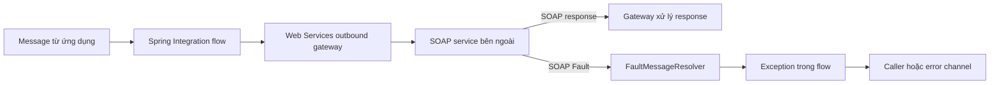
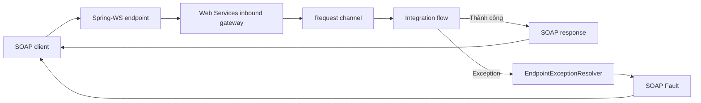

# Fault message và lỗi SOAP

Trong tích hợp Web Services, một lời gọi SOAP có thể thất bại theo hai cách khác nhau: dịch vụ trả về một **SOAP Fault** theo hợp đồng SOAP, hoặc quá trình trao đổi gặp lỗi ở tầng vận chuyển hay tầng xử lý message. Spring Integration kết nối các lỗi đó với luồng message để ứng dụng có thể phân loại, ghi nhận, chuyển tiếp hoặc trả lỗi về cho bên gọi.

Bài này tập trung vào hai chiều của adapter Web Services:

- **Outbound gateway:** ứng dụng gửi SOAP request tới hệ thống ngoài và tiếp nhận SOAP Fault trong response.
- **Inbound gateway:** hệ thống ngoài gửi SOAP request vào ứng dụng; lỗi phát sinh trong flow có thể được ánh xạ thành SOAP Fault trả về cho caller.

Sau bài học, bạn có thể phân biệt SOAP Fault với lỗi transport, hiểu cách Spring-WS chuyển fault thành exception, cấu hình cách ánh xạ exception thành fault và thiết kế xử lý lỗi phù hợp với tính chất của từng message.

## 1. SOAP Fault nằm ở đâu trong luồng tích hợp?

SOAP Fault là một response có cấu trúc theo chuẩn SOAP. Nó nằm trong SOAP Body và mô tả lỗi mà endpoint muốn thông báo cho caller. Vì vậy, một SOAP Fault khác với việc không kết nối được tới máy chủ, timeout, lỗi TLS hoặc response không đọc được.

Luồng outbound thường có dạng:



Với chiều inbound, Spring-WS nhận SOAP request, chuyển request qua inbound gateway vào Spring Integration flow. Nếu flow xử lý thành công, gateway tạo SOAP response. Nếu flow ném exception, cơ chế `EndpointExceptionResolver` của Spring-WS có thể ánh xạ exception đó thành SOAP Fault.



Gateway giúp chuyển đổi giữa giao thức SOAP và message của Spring Integration. Nó không làm cho mọi lỗi trở thành SOAP Fault: lỗi ở tầng HTTP, mạng hoặc cấu hình vẫn cần được nhận diện riêng.

## 2. Cấu trúc và ý nghĩa của SOAP Fault

SOAP 1.1 và SOAP 1.2 dùng cấu trúc khác nhau, nhưng đều truyền đạt mã lỗi, mô tả lỗi và thông tin chi tiết tùy chọn.

| Thành phần SOAP 1.1 | Ý nghĩa | Thành phần tương ứng trong SOAP 1.2 |
|---|---|---|
| `faultcode` | Nhóm lỗi theo giao thức | `Code` và có thể có `Subcode` |
| `faultstring` | Mô tả dễ đọc cho con người | `Reason` |
| `faultactor` | Thành phần gây ra lỗi | `Node` hoặc `Role` |
| `detail` | Thông tin lỗi theo hợp đồng ứng dụng | `Detail` |

Các nhóm fault phổ biến gồm:

- **Client / Sender:** request không hợp lệ, thiếu dữ liệu bắt buộc hoặc vi phạm hợp đồng. Caller cần sửa request trước khi gửi lại.
- **Server / Receiver:** endpoint không thể xử lý request do lỗi phía server. Lỗi có thể tạm thời, nhưng cần xem mã chi tiết trước khi retry.
- **MustUnderstand:** endpoint không hiểu hoặc không xử lý được một SOAP header được đánh dấu bắt buộc.
- **VersionMismatch:** SOAP envelope dùng phiên bản không tương thích với endpoint.

Ví dụ SOAP 1.1 Fault:

```xml
<soap:Envelope xmlns:soap="http://schemas.xmlsoap.org/soap/envelope/"
               xmlns:app="https://example.com/contracts/errors">
  <soap:Body>
    <soap:Fault>
      <faultcode>soap:Client</faultcode>
      <faultstring>Order identifier is required</faultstring>
      <detail>
        <app:ValidationError>
          <app:code>ORDER_ID_REQUIRED</app:code>
          <app:field>orderId</app:field>
        </app:ValidationError>
      </detail>
    </soap:Fault>
  </soap:Body>
</soap:Envelope>
```

Trong ví dụ này, `faultcode` cho biết caller gửi request không hợp lệ. Phần `detail` mang mã lỗi và trường dữ liệu liên quan để chương trình có thể xử lý ổn định. Ứng dụng không nên phân tích nội dung `faultstring` để quyết định logic nghiệp vụ vì câu mô tả có thể thay đổi hoặc được bản địa hóa.

## 3. Xử lý SOAP Fault ở outbound gateway

Spring Integration Web Services sử dụng Spring-WS để gửi và nhận SOAP message. Khi response chứa SOAP Fault, `WebServiceTemplate` gọi `FaultMessageResolver`. Resolver mặc định `SoapFaultMessageResolver` chuyển fault thành `SoapFaultClientException`.

Vì vậy, với outbound gateway, SOAP Fault thường xuất hiện trong flow dưới dạng exception. Khi flow chạy đồng bộ, exception có thể truyền ngược về thành phần gọi gateway. Với xử lý bất đồng bộ hoặc poller, exception có thể được gửi dưới dạng `ErrorMessage` tới error channel đã cấu hình.

### 3.1. Dùng resolver mặc định

Nếu ứng dụng chỉ cần phân biệt lời gọi SOAP thành công và thất bại, resolver mặc định thường là đủ. Có thể bắt `SoapFaultClientException` ở ranh giới của adapter hoặc để exception đi tới cơ chế xử lý lỗi chung của flow.

Ví dụ một thành phần ứng dụng gọi gateway và phân loại SOAP Fault:

```java
try {
    OrderReply reply = partnerSoapClient.submit(orderRequest);
    // Xử lý response thành công.
}
catch (SoapFaultClientException ex) {
    // Ghi nhận SOAP Fault và chuyển thành lỗi ở miền nghiệp vụ.
    // Có thể đọc fault code và reason từ exception.
}
```

Tên phương thức và kiểu dữ liệu của `partnerSoapClient` phụ thuộc vào gateway interface của ứng dụng. Điểm quan trọng là caller cần xử lý exception SOAP ở đúng ranh giới tích hợp, thay vì để mọi tầng phía trên phải hiểu chi tiết của Spring-WS.

### 3.2. Chuẩn hóa fault bằng FaultMessageResolver riêng

Khi tích hợp nhiều đối tác, mỗi hệ thống có thể trả về mã fault và nội dung `detail` khác nhau. Một resolver riêng giúp chuyển các fault đó thành exception thống nhất của ứng dụng.

Ví dụ dưới đây lấy mã fault và reason từ SOAP message rồi ném exception miền tích hợp:

```java
import javax.xml.namespace.QName;

import org.springframework.ws.client.core.FaultMessageResolver;
import org.springframework.ws.soap.SoapFault;
import org.springframework.ws.soap.SoapMessage;

public class PartnerFaultMessageResolver implements FaultMessageResolver {

    @Override
    public void resolveFault(org.springframework.ws.WebServiceMessage message) {
        SoapMessage soapMessage = (SoapMessage) message;
        SoapFault fault = soapMessage.getSoapBody().getFault();

        QName faultCode = fault.getFaultCode();
        String reason = fault.getFaultStringOrReason();

        throw new PartnerSoapFaultException(faultCode, reason);
    }
}
```

Exception của ứng dụng có thể giữ lại mã fault để các bước sau phân loại mà không phải phụ thuộc vào SOAP API:

```java
import javax.xml.namespace.QName;

public class PartnerSoapFaultException extends RuntimeException {

    private final QName faultCode;

    public PartnerSoapFaultException(QName faultCode, String reason) {
        super("Partner SOAP fault: " + reason);
        this.faultCode = faultCode;
    }

    public QName getFaultCode() {
        return faultCode;
    }
}
```

Đăng ký resolver trên `WebServiceTemplate` được outbound gateway sử dụng:

```java
@Bean
WebServiceTemplate partnerWebServiceTemplate(
        Marshaller marshaller,
        Unmarshaller unmarshaller,
        FaultMessageResolver partnerFaultMessageResolver) {

    WebServiceTemplate template = new WebServiceTemplate();
    template.setMarshaller(marshaller);
    template.setUnmarshaller(unmarshaller);
    template.setDefaultUri("https://partner.example.com/soap");
    template.setFaultMessageResolver(partnerFaultMessageResolver);
    return template;
}

@Bean
@ServiceActivator(inputChannel = "partnerSoapRequests")
MessageHandler partnerSoapOutboundGateway(
        WebServiceTemplate partnerWebServiceTemplate) {

    return new MarshallingWebServiceOutboundGateway(
            partnerWebServiceTemplate);
}
```

Các bean marshaller và unmarshaller phải được cấu hình theo XML contract của đối tác. URI trong ví dụ là địa chỉ minh họa; môi trường triển khai nên lấy endpoint từ cấu hình bên ngoài. Nếu resolver ném `PartnerSoapFaultException`, flow có thể xử lý exception đó như một lỗi tích hợp có kiểu rõ ràng.

`FaultMessageResolver` có trách nhiệm phân tích fault và quyết định cách biểu diễn lỗi. Không nên âm thầm bỏ qua fault bằng một resolver rỗng: khi đó caller có thể nhận kết quả rỗng hoặc thiếu thông tin lỗi, khiến trạng thái nghiệp vụ trở nên khó xác định.

### 3.3. Đưa lỗi vào error channel

Spring Integration có cơ chế `errorChannel` để xử lý lỗi của luồng bất đồng bộ. Một gateway interface có thể chỉ định error channel mặc định:

```java
@MessagingGateway(
        defaultRequestChannel = "partnerSoapRequests",
        errorChannel = "partnerSoapErrors")
public interface PartnerSoapClient {

    OrderReply submit(OrderRequest request);
}
```

Error flow có thể nhận `ErrorMessage`, kiểm tra exception gốc rồi chuyển lỗi tới nhánh xử lý phù hợp:

```java
@Bean
IntegrationFlow partnerSoapErrorFlow() {
    return IntegrationFlow.from("partnerSoapErrors")
            .handle(ErrorMessage.class, (error, headers) -> {
                Throwable cause = error.getPayload();

                if (cause instanceof PartnerSoapFaultException) {
                    // Phân loại fault theo mã lỗi của đối tác.
                    // Ghi nhận correlation ID và chuyển tới xử lý nghiệp vụ.
                }
                else {
                    // Xử lý lỗi transport hoặc lỗi kỹ thuật khác.
                }
                return null;
            })
            .get();
}
```

Đoạn xử lý trên minh họa việc phân loại lỗi; ứng dụng cần quyết định rõ kết quả trả về cho caller, trạng thái của message và nơi lưu lỗi. Nếu caller cần nhận một response lỗi có cấu trúc, error flow phải tạo response theo hợp đồng ứng dụng. Nếu xử lý bất đồng bộ, cần bảo đảm message lỗi được lưu hoặc chuyển tới nơi có thể theo dõi, thay vì chỉ ghi log.

Với flow đồng bộ, exception thường truyền ngược theo lời gọi. Với flow dùng executor, poller hoặc thành phần bất đồng bộ, hãy kiểm tra cấu hình error channel tại đúng điểm phát sinh lỗi. Không giả định mọi exception đều tự động xuất hiện trên một error channel chỉ vì ứng dụng có bean tên `errorChannel`.

## 4. Chuyển exception thành SOAP Fault ở inbound gateway

Ở chiều inbound, hệ thống bên ngoài gửi request tới endpoint SOAP của ứng dụng. Spring Integration inbound gateway chuyển payload vào request channel. Nếu một handler trong flow ném exception, Spring-WS có thể dùng `EndpointExceptionResolver` để tạo SOAP Fault.

Một cách cấu hình phổ biến là dùng `SoapFaultMappingExceptionResolver` để ánh xạ loại exception sang fault code và reason:

```java
@Bean
SoapFaultMappingExceptionResolver soapFaultExceptionResolver() {
    SoapFaultMappingExceptionResolver resolver =
            new SoapFaultMappingExceptionResolver();

    Properties mappings = new Properties();
    mappings.setProperty(
            InvalidOrderException.class.getName(),
            "CLIENT,Invalid order");
    mappings.setProperty(
            OrderProcessingException.class.getName(),
            "SERVER,Unable to process order");

    resolver.setExceptionMappings(mappings);
    resolver.setOrder(1);
    return resolver;
}
```

Resolver cần được đăng ký trong application context mà Spring-WS `MessageDispatcherServlet` sử dụng. `CLIENT` phù hợp với request sai hoặc không đáp ứng hợp đồng; `SERVER` phù hợp với lỗi xử lý phía ứng dụng. Với SOAP 1.2, Spring-WS ánh xạ các nhóm lỗi tương ứng theo phiên bản SOAP đang được sử dụng.

Ví dụ: flow kiểm tra đơn hàng phát hiện thiếu mã đơn và ném `InvalidOrderException`. Exception resolver ánh xạ lỗi đó thành SOAP Fault thuộc nhóm Client. Caller nhận được fault có thể sửa request. Nếu flow gặp lỗi cơ sở dữ liệu hoặc lỗi dịch vụ nội bộ, ứng dụng có thể trả fault thuộc nhóm Server với mô tả an toàn, đồng thời ghi chi tiết kỹ thuật ở phía server.

Một số điểm cần kiểm tra khi triển khai inbound gateway:

1. Endpoint mapping phải chuyển request tới đúng inbound gateway.
2. Request và response phải dùng đúng marshaller/unmarshaller hoặc kiểu payload mà flow mong đợi.
3. Exception resolver phải nằm trong context được `MessageDispatcherServlet` sử dụng và có thứ tự phù hợp.
4. Flow cần hoàn tất request-reply trong thời hạn mà SOAP client chờ đợi. Nếu chuyển xử lý sang kênh bất đồng bộ, phải thiết kế cơ chế phản hồi riêng.
5. Lỗi xảy ra trước khi request vào flow, chẳng hạn XML không hợp lệ hoặc lỗi giải mã payload, cũng cần được xem xét trong chính sách SOAP Fault.

## 5. Phân loại lỗi và quyết định retry

Không phải lỗi nào cũng nên retry. Quyết định retry cần dựa trên nhóm lỗi, mã chi tiết của đối tác, trạng thái nghiệp vụ và tính idempotent của request.

| Loại lỗi | Ví dụ | Hướng xử lý thường dùng |
|---|---|---|
| SOAP Client / Sender | Thiếu trường bắt buộc, dữ liệu sai định dạng | Không retry tự động; sửa dữ liệu hoặc trả lỗi cho caller |
| SOAP Server / Receiver | Đối tác tạm thời không xử lý được | Có thể retry có giới hạn nếu thao tác an toàn và có backoff |
| MustUnderstand / VersionMismatch | Header bắt buộc không được hỗ trợ, sai phiên bản SOAP | Kiểm tra contract, header và cấu hình; không retry lặp lại cùng request |
| Timeout hoặc lỗi kết nối | Không kết nối được, kết nối bị ngắt, hết thời gian chờ | Retry có giới hạn nếu thao tác idempotent; ghi nhận kết quả chưa xác định khi không biết server đã xử lý hay chưa |
| Lỗi marshal/unmarshal | Payload không khớp schema hoặc không chuyển đổi được | Kiểm tra XML contract, namespace và cấu hình marshaller; thường không retry nguyên trạng |

Một SOAP Server Fault không mặc nhiên là lỗi tạm thời. `detail` có thể chứa mã nghiệp vụ cho biết request bị từ chối vĩnh viễn. Ngược lại, timeout không chứng minh rằng server chưa thực hiện thao tác: server có thể đã ghi dữ liệu nhưng response bị mất trên đường truyền. Với thao tác tạo đơn, thanh toán hoặc cập nhật trạng thái, cần có idempotency key hoặc cơ chế tra cứu kết quả trước khi gửi lại.

Một chính sách retry an toàn thường có các đặc điểm:

- Chỉ retry các lỗi đã được xác định là có khả năng phục hồi.
- Giới hạn số lần retry và dùng exponential backoff có jitter.
- Không retry lỗi contract, lỗi xác thực hoặc lỗi dữ liệu không hợp lệ.
- Giữ correlation ID và idempotency key xuyên suốt các lần thử.
- Sau khi vượt giới hạn, chuyển message tới nơi xử lý lỗi hoặc dead-letter channel để điều tra.

## 6. Thiết kế hợp đồng lỗi có thể vận hành

Một SOAP Fault hữu ích cho cả caller và đội vận hành cần có hợp đồng rõ ràng.

**Dùng mã ổn định cho máy đọc.** Đặt mã như `ORDER_ID_REQUIRED`, `PARTNER_TEMPORARILY_UNAVAILABLE` hoặc `INVALID_CUSTOMER_STATE` trong phần `detail`. Không dùng chuỗi `faultstring` làm khóa định tuyến.

**Giữ reason ngắn và an toàn.** Reason nên giải thích lỗi ở mức caller cần biết. Không trả stack trace, câu SQL, tên máy chủ nội bộ, token, mật khẩu hoặc dữ liệu nhạy cảm trong SOAP Fault.

**Giữ correlation ID.** Truyền một mã tương quan qua message header hoặc metadata theo hợp đồng. Ghi mã đó cùng mã fault, endpoint, thời điểm và kết quả xử lý để có thể nối log giữa ứng dụng và hệ thống đối tác.

**Giữ nguyên nguyên nhân kỹ thuật ở phía nội bộ.** Khi chuyển SOAP Fault thành exception miền tích hợp, lưu fault code và exception gốc nếu cần. Khi tạo SOAP Fault cho caller, chỉ đưa ra thông tin được phép công khai.

**Tách lỗi giao thức khỏi kết quả nghiệp vụ.** Nếu một request hợp lệ nhưng nghiệp vụ từ chối, hãy quyết định rõ đó là response nghiệp vụ bình thường hay SOAP Fault theo contract của dịch vụ. Không dùng SOAP Fault cho mọi trường hợp như hết hàng hoặc không đủ hạn mức nếu hợp đồng định nghĩa các trạng thái đó trong response thông thường.

## 7. Kiểm tra và xử lý sự cố

Khi một lời gọi SOAP thất bại, hãy kiểm tra theo thứ tự sau:

1. **Xác định có SOAP Fault hay không.** Kiểm tra SOAP Body của response. Nếu không có Fault, tìm lỗi transport, timeout hoặc lỗi đọc response.
2. **Kiểm tra phiên bản SOAP.** Đối chiếu SOAP 1.1/1.2, namespace envelope và Content-Type mà client/server sử dụng.
3. **Kiểm tra fault code và detail.** Dùng mã ổn định trong `detail` để xác định lỗi contract, nghiệp vụ hay kỹ thuật.
4. **Kiểm tra resolver.** Với outbound, xác nhận `FaultMessageResolver` được gắn vào đúng `WebServiceTemplate`. Với inbound, xác nhận exception resolver được Spring-WS phát hiện và có mapping cho exception cần xử lý.
5. **Kiểm tra message context.** Ghi nhận channel, correlation ID, endpoint và loại exception. Với `ErrorMessage`, xem exception gốc trong payload.
6. **Kiểm tra chính sách retry.** Xác định thao tác đã có thể được thực hiện ở server hay chưa trước khi gửi lại.

Không nên chỉ dựa vào HTTP status để kết luận nguyên nhân. Cần kiểm tra SOAP envelope và exception cụ thể, vì lỗi HTTP, lỗi SOAP và lỗi chuyển đổi payload có cách khắc phục khác nhau.

## 8. Bài tập thực hành

Giả sử ứng dụng gửi `CreateOrderRequest` tới một đối tác SOAP. Đối tác có thể trả về thành công, SOAP Fault do thiếu `orderId`, SOAP Fault do dịch vụ tạm ngừng hoặc timeout.

Hãy hoàn thành các yêu cầu sau:

1. Cấu hình outbound gateway với `WebServiceTemplate` và marshaller/unmarshaller phù hợp.
2. Tạo `FaultMessageResolver` chuyển SOAP Fault thành `PartnerSoapFaultException`, giữ lại fault code và reason.
3. Thiết kế error flow để phân biệt lỗi request không hợp lệ, lỗi phía đối tác và lỗi transport.
4. Chỉ retry lỗi tạm thời với số lần giới hạn. Bảo đảm request tạo đơn có idempotency key.
5. Với inbound gateway nhận `CreateOrderRequest`, ánh xạ `InvalidOrderException` thành SOAP Client Fault và lỗi xử lý nội bộ thành SOAP Server Fault.
6. Kiểm tra response SOAP thực tế để xác nhận fault code, reason và detail đúng hợp đồng, đồng thời không để lộ thông tin nội bộ.

## 9. Checklist trước khi đưa vào vận hành

- [ ] SOAP version, namespace và contract của hai phía đã thống nhất.
- [ ] Outbound gateway dùng đúng `WebServiceTemplate` và `FaultMessageResolver`.
- [ ] Inbound gateway có exception resolver phù hợp cho các lỗi cần trả về caller.
- [ ] Mã fault trong `detail` ổn định và có tài liệu.
- [ ] Lỗi Client/Sender được tách khỏi lỗi Server/Receiver và lỗi transport.
- [ ] Retry có giới hạn, backoff và bảo vệ idempotency.
- [ ] Error flow ghi nhận correlation ID và có nơi xử lý message thất bại.
- [ ] SOAP Fault không chứa stack trace, thông tin xác thực hoặc dữ liệu nhạy cảm.

Khi các điểm trên được thiết kế rõ ràng, SOAP Fault trở thành một phần có thể dự đoán của hợp đồng tích hợp. Spring Integration đảm nhiệm việc đưa exception vào luồng message, còn ứng dụng quyết định lỗi nào cần trả về caller, lỗi nào có thể retry và lỗi nào cần chuyển sang quy trình xử lý thủ công.
