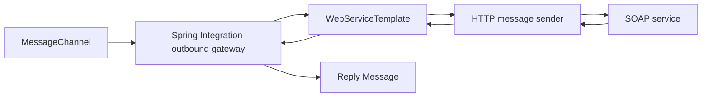

# Retry timeout và correlation

Khi tích hợp SOAP bằng Spring Integration, một lời gọi tới dịch vụ ngoài có thể chậm, mất kết nối hoặc trả lỗi sau khi phía server đã xử lý xong nghiệp vụ. Để luồng message hoạt động ổn định, cần phối hợp ba cơ chế: timeout để giới hạn thời gian chờ, retry để thử lại những lỗi có khả năng phục hồi và correlation để ghép đúng request với response. Cấu hình riêng lẻ từng cơ chế mà không tính đến hai cơ chế còn lại có thể làm request kéo dài quá SLA hoặc thực hiện nghiệp vụ nhiều lần.

Trong module `SPRING_INTEGRATION_ADAPTERS`, Web Services adapter kết nối luồng message của Spring Integration với dịch vụ SOAP thông qua inbound gateway và outbound gateway. `SERVICE_NAME_DESCRIBE` đặt phần thực hành trong bối cảnh trao đổi với hệ thống ngoài qua adapter, gateway, MessageChannel và xử lý lỗi. Bài này tập trung vào vòng đời của một lời gọi SOAP: đặt giới hạn thời gian, quyết định khi nào được retry và duy trì định danh xuyên suốt các lần thử.

## Vị trí của timeout, retry và correlation trong luồng SOAP

Với outbound gateway, luồng điển hình là:



Outbound gateway nhận một Spring `Message`, chuyển payload thành SOAP request, gọi dịch vụ và chuyển SOAP response thành reply message. Với lời gọi đồng bộ, gateway giữ quan hệ request-response trong cùng một lần xử lý. Timeout ở tầng HTTP giới hạn thời gian chờ dịch vụ từ xa; retry advice có thể gọi lại handler khi lần gọi thất bại; correlation ID giúp nhận diện cùng một nghiệp vụ qua các lần thử và qua các luồng bất đồng bộ.

Inbound gateway hoạt động theo chiều ngược lại: nhận SOAP request từ client, chuyển thành message để đưa vào Integration flow và tạo SOAP response từ kết quả xử lý. Nếu client hết thời gian chờ, server có thể vẫn đang xử lý request. Vì thế, client retry không có nghĩa là lần xử lý trước đã bị hủy.

## Phân biệt các loại timeout

Không có một timeout duy nhất bao phủ mọi giai đoạn của lời gọi. Hãy cấu hình và quan sát riêng từng giới hạn.

| Loại timeout | Giới hạn điều gì? | Nơi thường cấu hình hoặc kiểm tra |
|---|---|---|
| Connection timeout | Thời gian thiết lập kết nối tới dịch vụ | HTTP message sender được `WebServiceTemplate` sử dụng |
| Read/response timeout | Thời gian chờ dữ liệu phản hồi sau khi gửi request | HTTP message sender; thường là giới hạn quan trọng khi SOAP service xử lý lâu |
| Connection-pool acquisition timeout | Thời gian chờ lấy một kết nối từ pool khi dùng HTTP client có connection pool | Cấu hình connection manager/client tương ứng |
| MessageChannel send timeout | Thời gian chờ gửi message vào channel khi thao tác gửi bị chặn | Cấu hình channel hoặc thao tác gửi message |
| Gateway reply timeout | Thời gian gateway chờ reply message trong luồng Spring Integration | Cấu hình endpoint gateway tương ứng |
| Business deadline | Tổng thời gian nghiệp vụ được phép tiêu thụ, gồm xử lý nội bộ, các lần gọi từ xa và backoff | Quy ước ở tầng ứng dụng hoặc orchestration |

Connection timeout không giới hạn thời gian xử lý SOAP. Read timeout không nhất thiết bao gồm thời gian chờ lấy connection từ pool. Gateway reply timeout cũng không thay thế timeout của socket. Nếu một timeout bên trong lớn hơn deadline của nghiệp vụ, caller có thể từ bỏ request trong khi thread hoặc server vẫn tiếp tục xử lý.

Ví dụ, cấu hình `WebServiceTemplate` với HTTP URL connection sender trong Spring Web Services:

```java
import org.springframework.context.annotation.Bean;
import org.springframework.context.annotation.Configuration;
import org.springframework.ws.transport.http.HttpUrlConnectionMessageSender;
import org.springframework.ws.client.core.WebServiceTemplate;
import org.springframework.oxm.Marshaller;
import org.springframework.oxm.Unmarshaller;

@Configuration
class SoapClientConfiguration {

    @Bean
    WebServiceTemplate webServiceTemplate(
            Marshaller marshaller,
            Unmarshaller unmarshaller) {

        var template = new WebServiceTemplate();
        template.setMarshaller(marshaller);
        template.setUnmarshaller(unmarshaller);

        var sender = new HttpUrlConnectionMessageSender();
        sender.setConnectionTimeout(2_000);
        sender.setReadTimeout(5_000);
        template.setMessageSender(sender);
        return template;
    }
}
```

Các giá trị trong ví dụ tính bằng mili giây. Gateway phải sử dụng `WebServiceTemplate` đã được cấu hình sender này; nếu gateway tạo template khác thì các timeout trên không có tác dụng với lời gọi đó. Khi dùng Apache HttpComponents hoặc client có connection pool, cấu hình timeout trên message sender và connection manager tương ứng thay vì sao chép nguyên cấu hình của `HttpUrlConnectionMessageSender`.

Chọn timeout theo SLA và phân bố độ trễ thực tế của dịch vụ. Timeout quá ngắn tạo retry không cần thiết khi hệ thống chỉ đang tải cao; timeout quá dài giữ thread và connection trong thời gian dài, làm giảm khả năng phục vụ request mới. Nên đo latency theo percentile, chẳng hạn p95 và p99, rồi đặt timeout có khoảng dự phòng phù hợp với deadline của nghiệp vụ.

## Thiết kế retry có giới hạn

Retry phù hợp với lỗi tạm thời mà một lần gọi sau có khả năng thành công. Các tình huống thường được cân nhắc gồm lỗi kết nối ngắn hạn, socket timeout, DNS hoặc network chập chờn, và một số lỗi HTTP phía server như 502, 503 hoặc 504. Chính sách cụ thể phải dựa trên hợp đồng của dịch vụ SOAP và cách Spring Web Services biểu diễn lỗi.

Không nên retry mặc định mọi exception. SOAP Fault thể hiện lỗi nghiệp vụ hoặc lỗi hợp đồng thường không tự biến mất khi gửi lại cùng request. Ví dụ, lỗi xác thực, request sai schema, dữ liệu không hợp lệ hoặc nghiệp vụ bị từ chối cần được đưa về luồng xử lý lỗi. Một số fault phía server có thể tạm thời; chỉ retry chúng khi mã fault và tài liệu dịch vụ xác nhận đó là lỗi có thể phục hồi.

Một retry policy nên xác định rõ:

- **Số lần thử tối đa:** giới hạn tổng số lần gọi, tính cả lần đầu. Tránh retry vô hạn.
- **Nhóm exception được retry:** cho phép một danh sách lỗi transport hoặc lỗi server đã được xác định; mặc định từ chối retry lỗi không rõ loại.
- **Backoff:** tăng khoảng nghỉ giữa các lần thử để tránh dồn request vào dịch vụ đang quá tải.
- **Jitter:** thêm độ ngẫu nhiên vào backoff khi có nhiều instance, tránh tất cả cùng retry tại một thời điểm.
- **Recovery:** khi hết lượt thử, chuyển lỗi tới error channel hoặc luồng xử lý thất bại có giám sát.
- **Deadline:** tổng thời gian retry phải nằm trong giới hạn nghiệp vụ và không vượt quá thời gian caller còn chờ.

Spring Integration cung cấp `RequestHandlerRetryAdvice` để áp dụng retry cho request handler của endpoint. Spring Retry cung cấp `RetryTemplate` và các policy/backoff để quyết định cách thử lại. Ví dụ dưới đây chỉ retry lỗi I/O của Spring Web Services, tối đa ba lần thử và dùng exponential backoff:

```java
import java.util.Map;

import org.springframework.context.annotation.Bean;
import org.springframework.integration.handler.advice.RequestHandlerRetryAdvice;
import org.springframework.retry.backoff.ExponentialBackOffPolicy;
import org.springframework.retry.policy.SimpleRetryPolicy;
import org.springframework.retry.support.RetryTemplate;
import org.springframework.ws.client.WebServiceIOException;

@Bean
RequestHandlerRetryAdvice soapRetryAdvice() {
    var retryable = Map.<Class<? extends Throwable>, Boolean>of(
            WebServiceIOException.class, true
    );

    var retryPolicy = new SimpleRetryPolicy(3, retryable, true);

    var backOff = new ExponentialBackOffPolicy();
    backOff.setInitialInterval(200L);
    backOff.setMultiplier(2.0);
    backOff.setMaxInterval(2_000L);

    var retryTemplate = new RetryTemplate();
    retryTemplate.setRetryPolicy(retryPolicy);
    retryTemplate.setBackOffPolicy(backOff);

    var advice = new RequestHandlerRetryAdvice();
    advice.setRetryTemplate(retryTemplate);
    return advice;
}
```

Gắn advice vào endpoint outbound gateway cần retry. Với Java DSL, endpoint handler spec hỗ trợ khai báo advice, ví dụ:

```java
.handle(soapOutboundGateway,
        endpoint -> endpoint.advice(soapRetryAdvice))
```

Ở đây `soapOutboundGateway` là gateway handler/spec đã được cấu hình với URI, marshaller, unmarshaller và `WebServiceTemplate` phù hợp. Cách tạo gateway spec phụ thuộc phiên bản Spring Integration WS đang dùng. Hãy bảo đảm advice được gắn đúng outbound endpoint; nếu gắn ở một service activator hoặc toàn bộ flow phía trước, một lần retry có thể chạy lại cả những bước nội bộ không cần thiết.

Policy minh họa có chủ ý hẹp: các exception không nằm trong danh sách sẽ không được retry. `WebServiceIOException` thường đại diện lỗi I/O khi gọi dịch vụ; khi dùng message sender khác, exception thực tế có thể khác. Hãy kiểm tra exception và cause trong phiên bản thư viện của ứng dụng rồi bổ sung đúng nhóm lỗi tạm thời. Nếu cần retry một số SOAP Fault hoặc status HTTP cụ thể, dùng classifier/policy có điều kiện dựa trên fault code hoặc status; không bật retry cho toàn bộ `WebServiceException`.

Exponential backoff trong ví dụ tạo khoảng nghỉ xấp xỉ 200 ms rồi 400 ms trước các lần thử tiếp theo, tối đa theo cấu hình 2 giây. Backoff policy cơ bản không nhất thiết thêm jitter; ở hệ thống nhiều instance, cân nhắc policy có randomization hoặc cơ chế jitter riêng. Có thể phối hợp circuit breaker để tạm ngừng gọi dịch vụ khi tỷ lệ lỗi tăng cao, thay vì để mọi request tiếp tục tiêu thụ retry.

## Tính deadline cho toàn bộ lời gọi

Timeout của một lần thử và deadline của nghiệp vụ là hai đại lượng khác nhau. Giả sử mỗi lần gọi có connection timeout 2 giây và read timeout 5 giây, tối đa ba lần thử, với backoff 200 ms và 400 ms. Trong trường hợp xấu, thời gian dự kiến có thể xấp xỉ:

```text
3 x (2 giây + 5 giây) + 0,2 giây + 0,4 giây = 21,6 giây
```

Đây chỉ là phép ước lượng từ hai timeout đã nêu; DNS, lấy connection từ pool, serialization, xử lý nội bộ, overhead và các timeout ở tầng khác có thể làm tổng thời gian thay đổi. Nếu SLA của nghiệp vụ chỉ cho phép 10 giây, cấu hình trên không phù hợp dù mỗi lần gọi riêng lẻ có vẻ hợp lý.

Hãy dành ngân sách thời gian cho toàn bộ flow. Khi một request đã tiêu thụ phần lớn deadline, có thể bỏ qua lần retry tiếp theo và chuyển sang recovery. Nếu có nhiều tầng cùng retry (ví dụ client, Integration flow, API gateway và dịch vụ đích), số lần gọi thực tế có thể nhân lên. Chỉ định rõ tầng nào chịu trách nhiệm retry và tránh lồng nhiều chính sách không phối hợp.

## Correlation ID và quan hệ request-response

Correlation là cách nhận diện các message thuộc cùng một nghiệp vụ hoặc cùng một chuỗi xử lý. Trong luồng SOAP, cần phân biệt ba phạm vi:

| Phạm vi | Ví dụ | Mục đích |
|---|---|---|
| Spring Integration message header | `correlationId` | Liên kết message trong nội bộ flow, router hoặc aggregator |
| SOAP header | WS-Addressing `MessageID` và `RelatesTo`, hoặc header XML riêng | Truyền định danh qua ranh giới dịch vụ SOAP |
| Business request ID | `orderRequestId`, `paymentRequestId` trong hợp đồng nghiệp vụ | Nhận diện một thao tác nghiệp vụ và hỗ trợ idempotency/audit |

Các giá trị này có thể dùng cùng một định danh theo thỏa thuận hệ thống, nhưng ý nghĩa của chúng không tự động đồng nhất. Message header của Spring Integration không mặc nhiên trở thành SOAP header hoặc HTTP header. Cần cấu hình header mapper, callback, interceptor hoặc logic marshal/unmarshal để chuyển định danh qua wire theo đúng hợp đồng. Nếu dịch vụ đối tác hỗ trợ WS-Addressing, có thể dùng `MessageID` ở request và `RelatesTo` ở response. Nếu dùng header XML riêng, hai bên phải thống nhất namespace, tên phần tử, định dạng và quy tắc phản hồi.

Ví dụ một request SOAP dùng WS-Addressing:

```xml
<soap:Header>
    <wsa:MessageID>urn:uuid:7c6a5a1e-7d4c-4a9f-9c11-0b3e5f2a1001</wsa:MessageID>
</soap:Header>
```

Response tương ứng có thể tham chiếu request:

```xml
<soap:Header>
    <wsa:RelatesTo>urn:uuid:7c6a5a1e-7d4c-4a9f-9c11-0b3e5f2a1001</wsa:RelatesTo>
</soap:Header>
```

Đây là ví dụ cấu trúc header; việc tạo và xử lý WS-Addressing phải được bật và hỗ trợ bởi message factory, interceptor hoặc cấu hình Spring-WS của ứng dụng. Không tự thêm header tùy ý nếu dịch vụ đối tác không chấp nhận nó.

Với request-response đồng bộ, lời gọi gateway giữ response trong cùng lần xử lý nên framework có thể ghép reply với request nội bộ. Correlation ID vẫn hữu ích cho log, tracing và đối chiếu với log của dịch vụ từ xa. Với luồng bất đồng bộ, callback hoặc xử lý nhiều response, cần lưu correlation ID và tra cứu nó khi response quay về; không dựa vào thứ tự message đến.

Nếu một nghiệp vụ được chia thành nhiều request con, mỗi request con có thể dùng cùng correlation ID của nghiệp vụ và có sequence number riêng. Aggregator dùng correlation strategy để nhóm các message thuộc cùng nhóm, release strategy để quyết định khi nào nhóm hoàn tất và group timeout để xử lý nhóm không nhận đủ response. Group timeout của aggregator là thời hạn chờ message con; nó khác với HTTP read timeout của từng lời gọi SOAP.

## Retry an toàn: idempotency và kết quả không xác định

Timeout không chứng minh server chưa xử lý request. Ví dụ, server nhận request, ghi đơn hàng vào cơ sở dữ liệu rồi gửi response; response bị mất trên mạng. Client hết read timeout và retry. Nếu server không nhận diện request trùng, đơn hàng có thể được tạo hai lần.

Vì vậy, với thao tác có tác dụng phụ, hãy dùng một business request ID ổn định và cơ chế idempotency ở phía server. Cùng một nghiệp vụ phải giữ nguyên ID qua tất cả lần retry; không tạo ID mới cho từng lần thử. Server lưu kết quả theo ID hoặc dùng ràng buộc duy nhất để nhận ra request đã xử lý, sau đó trả lại kết quả trước đó thay vì thực hiện tác dụng phụ lần nữa.

Phân biệt rõ:

- **Idempotent operation:** gửi cùng một request nhiều lần tạo ra cùng trạng thái cuối, chẳng hạn truy vấn hoặc cập nhật trạng thái theo giá trị đích.
- **Non-idempotent operation:** mỗi lần gửi có thể tạo thêm tác dụng phụ, chẳng hạn tạo giao dịch, trừ tiền hoặc phát hành lệnh mới.
- **Unknown outcome:** client mất kết nối hoặc timeout sau khi gửi; không biết server đã commit hay chưa.

Với unknown outcome của thao tác non-idempotent, không retry mù quáng. Hãy truy vấn trạng thái bằng business request ID, dùng API kiểm tra kết quả, hoặc chuyển sang hàng đợi xử lý đối soát. Nếu hợp đồng dịch vụ không hỗ trợ idempotency hay truy vấn trạng thái, cần quy định rõ cách xử lý thủ công hoặc quy trình bù trừ.

Correlation ID và idempotency key có thể cùng dựa trên một business request ID, nhưng không nên mặc định chúng là một khái niệm. Correlation giúp ghép các message; idempotency giúp server nhận biết yêu cầu nghiệp vụ lặp lại. Một hệ thống có thể cần cả hai ID riêng biệt.

## Đưa lỗi hết retry vào luồng xử lý

Khi retry hết lượt, lỗi cần đi vào một đường xử lý có thể quan sát và phục hồi. Tùy thiết kế flow, có thể dùng recovery callback của retry advice, error channel hoặc error flow để:

1. Ghi nhận request ID, correlation ID, endpoint, số lần thử và loại lỗi.
2. Đưa message vào retry queue hoặc dead-letter queue nếu nghiệp vụ cho phép xử lý lại sau.
3. Đánh dấu trạng thái nghiệp vụ là chưa xác định nếu request có thể đã được server xử lý.
4. Phát cảnh báo khi lỗi vượt ngưỡng hoặc khi circuit breaker chuyển trạng thái.
5. Bảo đảm thao tác replay dùng lại business request ID ban đầu và có kiểm tra idempotency.

Không ghi toàn bộ SOAP envelope vào log theo mặc định. Payload có thể chứa thông tin cá nhân, token hoặc dữ liệu nghiệp vụ nhạy cảm. Chỉ log những trường cần thiết, che dữ liệu nhạy cảm và kiểm soát quyền truy cập log.

## Ví dụ một chính sách vận hành

Giả sử ứng dụng gửi yêu cầu tra cứu trạng thái vận đơn tới SOAP service. Mỗi nghiệp vụ có `trackingRequestId` duy nhất. Luồng có thể triển khai như sau:

1. Tạo `trackingRequestId` một lần khi nhận yêu cầu từ hệ thống nội bộ và lưu nó trong message header cùng payload nghiệp vụ.
2. Outbound gateway chuyển định danh sang SOAP header theo hợp đồng WS-Addressing hoặc header riêng của đối tác.
3. HTTP sender đặt connection timeout 2 giây và read timeout 5 giây; deadline toàn flow được đặt lớn hơn ngân sách cho tối đa ba lần thử và backoff.
4. Retry advice chỉ thử lại lỗi transport tạm thời. SOAP Fault thể hiện dữ liệu không hợp lệ hoặc không được phép đi thẳng tới error flow.
5. Response phải tham chiếu đúng request ID. Flow kiểm tra correlation trước khi đưa kết quả về channel hoặc aggregator.
6. Nếu hết retry, error flow lưu trạng thái và ID để có thể đối soát hoặc replay an toàn.

Tra cứu thường là thao tác idempotent nên phù hợp với retry có giới hạn. Nếu thay ví dụ bằng lệnh tạo giao dịch hoặc thanh toán, cần thêm idempotency ở server và cơ chế kiểm tra kết quả trước khi gửi lại khi timeout.

## Checklist kiểm thử

| Tình huống | Kết quả mong đợi |
|---|---|
| Dịch vụ phản hồi trong giới hạn timeout | Gateway nhận reply và giữ correlation ID để trace |
| Không thiết lập được kết nối | Lỗi được phân loại là transport; retry trong giới hạn cấu hình |
| Dịch vụ xử lý quá lâu | Read timeout xảy ra; flow không chờ vô hạn và xử lý unknown outcome theo chính sách |
| SOAP Fault do request không hợp lệ | Không retry request giống hệt; chuyển lỗi về nhánh xử lý nghiệp vụ |
| Lỗi transport tạm thời rồi dịch vụ phục hồi | Retry có backoff; request thành công trong deadline |
| Hết số lần thử | Recovery/error flow nhận lỗi cùng request ID, correlation ID và thông tin số lần thử |
| Response đến sai correlation ID | Không ghép response vào request khác; ghi nhận lỗi giao thức hoặc correlation |
| Response bất đồng bộ đến trễ | Response được đối chiếu với trạng thái request; message hết hạn được xử lý theo chính sách |
| Client timeout nhưng server đã commit | Retry với cùng idempotency key không tạo tác dụng phụ lần hai |
| Nhiều instance cùng retry | Backoff/jitter và circuit breaker giúp hạn chế retry đồng loạt |

Trong môi trường kiểm thử, mô phỏng cả trường hợp server nhận request rồi cố ý trì hoãn hoặc làm mất response. Đây là cách kiểm tra quan trọng để phát hiện duplicate side effect mà bài kiểm tra chỉ ngắt kết nối trước khi server nhận request sẽ bỏ sót.

## Nguyên tắc cần nhớ

Timeout giới hạn thời gian chờ ở một tầng cụ thể; hãy kết hợp các timeout thành deadline tổng thể cho nghiệp vụ. Retry chỉ áp dụng cho lỗi có khả năng phục hồi, phải có giới hạn, backoff và recovery. Correlation ID giúp theo dõi và ghép message xuyên suốt các luồng; muốn đi qua ranh giới SOAP cần ánh xạ nó vào header hoặc hợp đồng phù hợp. Với thao tác có tác dụng phụ, luôn xem timeout là kết quả chưa xác định và dùng idempotency hoặc đối soát trước khi gửi lại. Ba cơ chế này phối hợp đúng sẽ giúp Web Services adapter xử lý lỗi mạng và phản hồi trễ mà vẫn giữ được tính nhất quán của nghiệp vụ.
