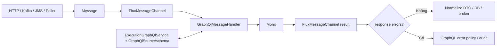
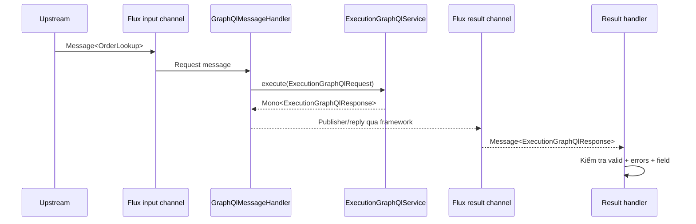
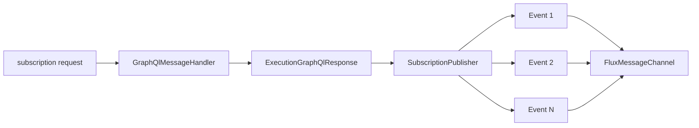
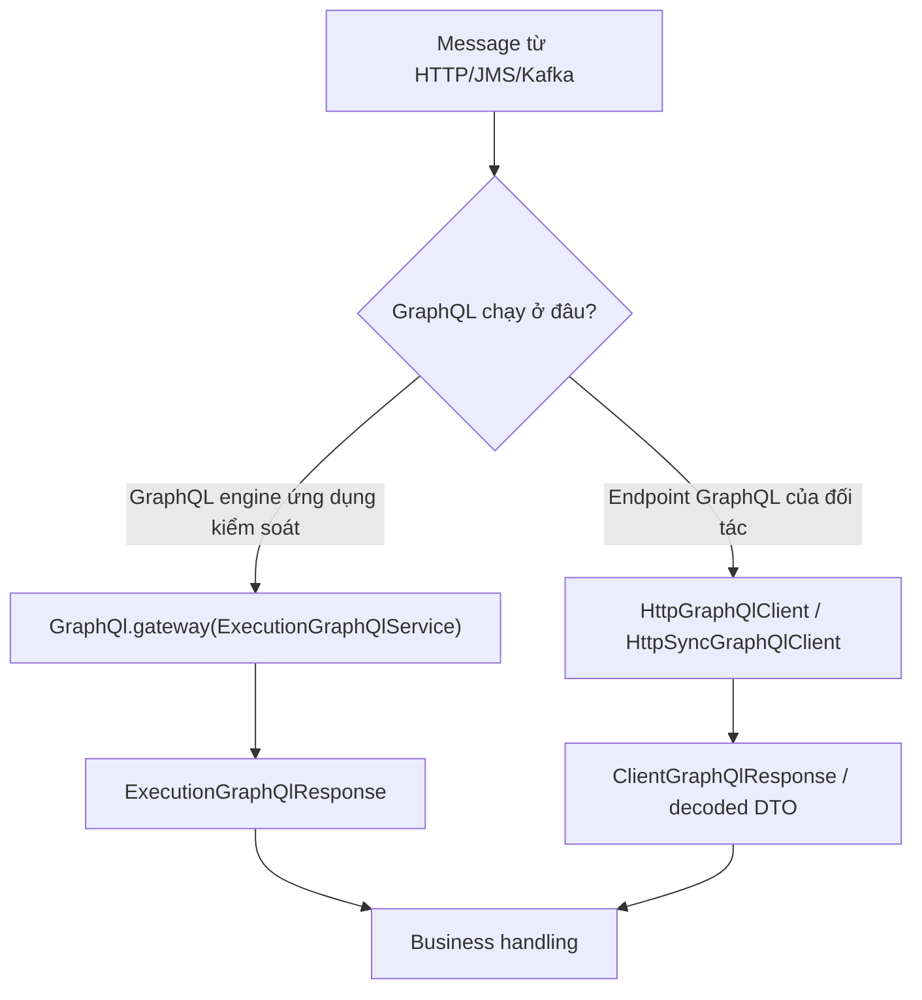
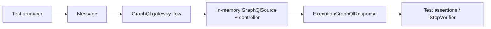

# GraphQL outbound gateway trong Spring Integration

## 1. Bài toán: đưa một GraphQL operation vào luồng message

Một hệ thống Spring Boot nhận yêu cầu tra cứu đơn hàng từ HTTP, Kafka hoặc JMS. Thay vì cho từng inbound endpoint gọi trực tiếp bộ xử lý GraphQL, ứng dụng muốn thống nhất:

- Cách diễn đạt `query`, `mutation` và `subscription` dưới dạng message.
- Cách truyền `operationName` và `variables` mà không nối chuỗi GraphQL bằng dữ liệu người dùng.
- Cách nhận `GraphQL response`, bao gồm `data` và `errors`.
- Cách nối kết quả sang các `MessageChannel`, transformer, router, outbound adapter và database.
- Cách giữ correlation ID, timeout, backpressure, audit và bảo mật.

Ví dụ một message chứa:

```text
payload = OrderLookup(orderId="ORD-1001")
headers:
  correlationKey = workflow-123
  sourceSystem   = order-events
```

Gateway thực thi một GraphQL operation được cấu hình:

```graphql
query FindOrder($id: ID!) {
  order(id: $id) {
    id
    status
    amountCents
  }
}
```

với `variables = {"id": "ORD-1001"}`, rồi trả phản hồi cho luồng Spring Integration để consumer có thể kiểm tra dữ liệu và lỗi trước khi quyết định bước tiếp theo.

Bài **“GraphQL outbound gateway”** nằm trong chương **Adapter GraphQL** của module `SPRING_INTEGRATION_ADAPTERS`. Mục tiêu toàn module là kết nối các hệ thống bên ngoài bằng inbound/outbound adapter, gateway, poller và `MessageChannel`; thực hành luồng file, SFTP, HTTP, JMS, AMQP, Kafka, cơ sở dữ liệu, hợp đồng message, lỗi và vòng đời kết nối. Trong chương này, GraphQL là một **giao thức truy vấn/mutation dựa trên schema**, còn Spring Integration đóng vai trò điều phối message qua gateway.

### Sau bài, bạn có thể

1. Phân biệt **GraphQL outbound gateway của Spring Integration** với **GraphQL HTTP client tới một server ở xa**.
2. Hiểu `GraphQlMessageHandler`, `GraphQlMessageHandlerSpec`, `ExecutionGraphQlService` và `GraphQlSource`.
3. Dùng `GraphQl.gateway(graphQlService)` để cấu hình query, operation name, variables và execution ID.
4. Ghép gateway với `IntegrationFlow` và `FluxMessageChannel`; xử lý `ExecutionGraphQlResponse` đúng cách.
5. Giữ payload, headers và correlation context có kiểm soát.
6. Phân biệt lỗi transport/framework với lỗi GraphQL trong `response.getErrors()`, kể cả partial data.
7. Xử lý mutation idempotently và subscription dưới dạng stream, không coi subscription là một reply đơn lẻ.
8. Chọn `HttpGraphQlClient`/`HttpSyncGraphQlClient` khi thật sự muốn truy cập GraphQL endpoint từ xa.
9. Thiết kế test, timeout, retry, authorization, telemetry và bài thực hành production-oriented.

## 2. Chính xác “outbound gateway” đang nói tới điều gì?

**Spring Integration 6.5 có module `spring-integration-graphql`**. Thành phần outbound gateway là:

```text
org.springframework.integration.graphql.outbound.GraphQlMessageHandler
org.springframework.integration.graphql.dsl.GraphQl
org.springframework.integration.graphql.dsl.GraphQlMessageHandlerSpec
```

`GraphQlMessageHandler` kế thừa `AbstractReplyProducingMessageHandler`. Nó nhận message, tạo hoặc sử dụng một `ExecutionGraphQlRequest`, gọi **`ExecutionGraphQlService.execute(...)`** và xuất phản hồi.

**Phân biệt rất quan trọng:**

- `GraphQl.gateway(executionGraphQlService)` là gateway tới **GraphQL execution service** (thường là GraphQL engine/schema đang được ứng dụng cấu hình), **không tự sinh HTTP POST ra một GraphQL URL từ xa**.
- Nếu mục tiêu là gọi `https://partner.example/graphql` qua mạng, hãy dùng **Spring for GraphQL `HttpGraphQlClient`/`HttpSyncGraphQlClient`** trong một service activator hoặc một HTTP outbound gateway phù hợp. Đừng gán URL giả vào `GraphQl.gateway(...)` và kỳ vọng có remote transport.

Tài liệu Spring Integration 6.5 mô tả GraphQL outbound gateway có thể được kích hoạt bởi bất kỳ nguồn message nào, không riêng HTTP inbound. Đây là lợi thế của Enterprise Integration Patterns: cùng một operation có thể được gọi từ file event, Kafka message, JMS command hay scheduled pipeline.

### 2.1. Sơ đồ luồng



### 2.2. Bảng thành phần

| Thành phần | Vai trò | Không nên nhầm với |
|---|---|---|
| `Message<?>` | Payload + headers đầu vào gateway | Raw HTTP GraphQL request body |
| `GraphQlMessageHandler` | Reply-producing handler, thực thi GraphQL operation | HTTP client tự quản lý endpoint URL |
| `GraphQlMessageHandlerSpec` | Fluent Java DSL cho operation/variables/locale/execution ID | GraphQL schema |
| `ExecutionGraphQlService` | Dịch vụ thực thi GraphQL Java request | `HttpGraphQlClient` tới remote server |
| `GraphQlSource` | Engine/schema/data fetchers của ứng dụng | Một file RSS hay REST resource |
| `ExecutionGraphQlRequest` | Hợp đồng request đã được chuẩn bị để thực thi | `MessageHeaders` tự định nghĩa |
| `ExecutionGraphQlResponse` | GraphQL result: data/errors/extensions | DTO domain đã được validate |
| `FluxMessageChannel` | Kênh hỗ trợ Reactive Streams | Durable queue/broker mặc định |

## 3. GraphQL request và response: các khái niệm cần nắm

GraphQL operation gồm **document** có schema field, loại operation, có thể có tên operation và biến.

### 3.1. Query và variables

```graphql
query FindOrder($id: ID!) {
  order(id: $id) {
    id
    status
    amountCents
  }
}
```

Request có thể diễn đạt theo chuẩn GraphQL over HTTP:

```json
{
  "query": "query FindOrder($id: ID!) { order(id: $id) { id status amountCents } }",
  "operationName": "FindOrder",
  "variables": {
    "id": "ORD-1001"
  }
}
```

Nhưng với `GraphQlMessageHandler`, không cần tự tạo JSON HTTP như trên: spec cấu hình operation và variables để tạo yêu cầu cho `ExecutionGraphQlService`.

**Đừng nối chuỗi từ dữ liệu người dùng:**

```java
// KHÔNG NÊN: tự chèn ID vào GraphQL document.
String query = "{ order(id: \"" + userInput + "\") { id } }";
```

Thay vào đó, giữ document tĩnh/persisted và truyền `variables` riêng. Điều này giảm lỗi escaping và nguy cơ thao túng cú pháp GraphQL; đồng thời vẫn phải kiểm tra authorization và input validation.

### 3.2. Query khác mutation

| Operation | Mục tiêu | Retry/idempotency |
|---|---|---|
| `query` | Đọc dữ liệu theo schema | Có thể retry một số lỗi tạm thời khi an toàn |
| `mutation` | Thay đổi dữ liệu/trạng thái | Cần idempotency key, transaction và kiểm soát side effect |
| `subscription` | Duy trì dòng event | Cần subscriber, cancellation, backpressure và reconnect policy |

Không coi tên `query` là một phép HTTP GET tự động: trong `ExecutionGraphQlService`, operation được thực thi bởi GraphQL engine; HTTP method chỉ xuất hiện nếu bạn dùng một transport thực sự.

### 3.3. Response có thể chứa data *và* errors

GraphQL response hợp lệ có thể có:

```json
{
  "data": {
    "order": {
      "id": "ORD-1001",
      "status": null,
      "amountCents": 12500
    }
  },
  "errors": [
    {
      "message": "Access to status denied",
      "path": ["order", "status"]
    }
  ]
}
```

Ngược lại, một request sai schema có thể không có data hữu ích:

```json
{
  "errors": [
    {
      "message": "Validation error ..."
    }
  ]
}
```

**Quy tắc:** không chỉ gọi `getData()` rồi coi message đã thành công. Với `ExecutionGraphQlResponse`, cần kiểm tra:

1. `response.isValid()` — response có dữ liệu đúng cấu trúc/không bị lỗi toàn request hay không.
2. `response.getErrors()` — có lỗi GraphQL không, kể cả khi `isValid() == true`.
3. `response.field("order")` — trường cụ thể có null, errors hoặc có thể decode không.
4. Quy tắc nghiệp vụ: chấp nhận partial data, retry, quarantine hay trả lỗi cho caller.

Một lỗi GraphQL **không nhất thiết** là Java exception và không nhất thiết đi vào Spring Integration `errorChannel`. Phân biệt lỗi **in-band** (GraphQL `errors`) với lỗi **out-of-band** (exception/timeout/handler failure).

## 4. Cấu hình dependency và schema dùng cho thực hành

Ví dụ chủ đạo dùng **Spring Boot 3.x / Spring Integration 6.5.x tương thích, Java 17**. Để tránh xung đột phiên bản, chọn một Spring Boot release có dependency management phù hợp thay vì ép Spring Integration và Spring for GraphQL từ nhiều dòng khác nhau.

### 4.1. Dependencies

**`build.gradle`:**

```gradle
dependencies {
    implementation 'org.springframework.boot:spring-boot-starter-integration'
    implementation 'org.springframework.integration:spring-integration-graphql'
    implementation 'org.springframework.boot:spring-boot-starter-graphql'
}
```

`spring-integration-graphql` cung cấp `GraphQlMessageHandler` và Java DSL. `spring-boot-starter-graphql` cung cấp các thành phần Spring for GraphQL và tiện ích auto-configuration cho ứng dụng có schema/controller.

Nếu ứng dụng **chỉ** muốn sử dụng local GraphQL engine, không nhất thiết cần exposed HTTP endpoint; cấu hình bean `ExecutionGraphQlService`/`GraphQlSource` đủ cho trường hợp gateway. Với remote GraphQL API, cần transport client phù hợp thay vì chỉ dependency này.

### 4.2. Schema GraphQL đơn giản

**Ví dụ file trong dự án thực hành:** `src/main/resources/graphql/order-schema.graphqls`

```graphql
type Query {
  order(id: ID!): Order
}

type Order {
  id: ID!
  status: String!
  amountCents: Int!
}
```

Schema trên quy định `order` trả null nếu không tìm thấy; nếu tìm thấy, các field của `Order` không được null. Đây là ví dụ có chủ đích: khi data fetcher trả field null trái với dấu `!`, GraphQL Java có thể tạo field error và thực hiện null propagation.

### 4.3. Domain record và QueryMapping

**`Order.java`:**

```java
public record Order(String id, String status, int amountCents) {
}
```

**`OrderGraphQlController.java`:**

```java
import org.springframework.graphql.data.method.annotation.Argument;
import org.springframework.graphql.data.method.annotation.QueryMapping;
import org.springframework.stereotype.Controller;

@Controller
public class OrderGraphQlController {

    @QueryMapping
    public Order order(@Argument String id) {
        // Chỉ là fixture in-memory; production gọi service/repository.
        if ("ORD-1001".equals(id)) {
            return new Order("ORD-1001", "READY", 12_500);
        }
        return null;
    }
}
```

Các tên `order` và `id` phải khớp schema. `@QueryMapping` dùng để gắn phương thức vào field của loại `Query`; `@Argument` nhận biến đã bind cho field.

### 4.4. GraphQlSource và ExecutionGraphQlService

Để minh bạch cơ chế, có thể khai báo bean theo mô hình trong tài liệu Spring Integration:

```java
import org.springframework.context.annotation.Bean;
import org.springframework.context.annotation.Configuration;
import org.springframework.core.io.ClassPathResource;
import org.springframework.graphql.ExecutionGraphQlService;
import org.springframework.graphql.execution.DefaultExecutionGraphQlService;
import org.springframework.graphql.execution.GraphQlSource;
import org.springframework.graphql.data.method.annotation.support.AnnotatedControllerConfigurer;

@Configuration
public class OrderGraphQlEngineConfig {

    @Bean
    AnnotatedControllerConfigurer annotatedControllerConfigurer() {
        return new AnnotatedControllerConfigurer();
    }

    @Bean
    GraphQlSource orderGraphQlSource(
            AnnotatedControllerConfigurer configurer) {
        return GraphQlSource.builder()
                .schemaResources(
                        new ClassPathResource(
                                "graphql/order-schema.graphqls"))
                .configureRuntimeWiring(configurer)
                .build();
    }

    @Bean
    ExecutionGraphQlService executionGraphQlService(
            GraphQlSource source) {
        return new DefaultExecutionGraphQlService(source);
    }
}
```

Đây là một cấu hình **tường minh** để người học thấy gateway gọi service nào. Trong ứng dụng Spring Boot thực tế, starter GraphQL có thể đã auto-configure `GraphQlSource`/`ExecutionGraphQlService`. **Chọn một cơ chế sở hữu bean**, không khai báo song song bản thủ công và auto-configured mà không xem điều kiện bean, tránh xung đột hoặc dùng nhầm schema. Nếu có nhiều schema/GraphQlSource, dùng bean name và `@Qualifier`.

## 5. Java DSL: GraphQL outbound gateway thực thi query

### 5.1. Request payload

**`OrderLookup.java`:**

```java
public record OrderLookup(String orderId) {
    public OrderLookup {
        if (orderId == null || orderId.isBlank()) {
            throw new IllegalArgumentException(
                    "orderId không được rỗng");
        }
    }
}
```

Một message yêu cầu có payload là `OrderLookup`, không phải GraphQL document tùy ý lấy từ người dùng.

### 5.2. IntegrationFlow và GraphQl.gateway

**`OrderGraphQlGatewayConfig.java`:**

```java
import java.util.Map;

import org.springframework.context.annotation.Bean;
import org.springframework.context.annotation.Configuration;
import org.springframework.graphql.ExecutionGraphQlService;
import org.springframework.integration.config.EnableIntegration;
import org.springframework.integration.dsl.IntegrationFlow;
import org.springframework.integration.dsl.MessageChannels;
import org.springframework.integration.graphql.dsl.GraphQl;

@Configuration
@EnableIntegration
public class OrderGraphQlGatewayConfig {

    private static final String FIND_ORDER = """
            query FindOrder($id: ID!) {
              order(id: $id) {
                id
                status
                amountCents
              }
            }
            """;

    @Bean
    IntegrationFlow orderGraphQlFlow(
            ExecutionGraphQlService graphQlService) {

        return IntegrationFlow
                .from(MessageChannels.flux("orderGraphQlRequests"))
                .handle(GraphQl.gateway(graphQlService)
                        .operation(FIND_ORDER)
                        .operationName("FindOrder")
                        .variables(message -> {
                            OrderLookup lookup =
                                    (OrderLookup) message.getPayload();
                            return Map.of("id", lookup.orderId());
                        })
                        .executionId(message -> message.getHeaders()
                                .getId().toString()))
                .channel(c -> c.flux("orderGraphQlResults"))
                .get();
    }
}
```

**Ý nghĩa:**

1. `MessageChannels.flux("orderGraphQlRequests")` tạo điểm vào dạng reactive stream channel theo pattern tài liệu Spring Integration.
2. `GraphQl.gateway(graphQlService)` tạo `GraphQlMessageHandlerSpec` cho outbound gateway.
3. `.operation(FIND_ORDER)` thiết lập GraphQL query tĩnh đã được duyệt.
4. `.operationName("FindOrder")` chọn operation theo tên. Nếu document chỉ có một operation, trường này có thể không cần; nếu document có nhiều operation, phải chỉ rõ cái cần thực thi.
5. `.variables(message -> Map.of(...))` lấy argument từ payload và tạo GraphQL variables. Không nối `orderId` trực tiếp vào document.
6. `.executionId(...)` đặt GraphQL execution ID theo message ID để trace. ID này khác business correlation key; production có thể lấy từ một custom header đã validate.
7. `.channel(c -> c.flux("orderGraphQlResults"))` giữ reply trong luồng reactive, để bước xử lý tiếp theo nhận `ExecutionGraphQlResponse`.

Nếu dùng `.variablesExpression("payload.variables")` hay `.operationExpression(...)`, cần biết đó là **SpEL evaluated against request message**; tên property phải khớp payload thật. Lambda Java mạnh về type/refactoring khi contract rõ. Không cho client bên ngoài tùy ý chỉ định operation document hoặc SpEL expression.

### 5.3. Cách gửi message vào flow

Một inbound adapter hoặc một service khác chỉ cần gửi message vào input channel:

```java
import org.springframework.beans.factory.annotation.Qualifier;
import org.springframework.integration.support.MessageBuilder;
import org.springframework.messaging.MessageChannel;
import org.springframework.stereotype.Component;

@Component
public class OrderLookupPublisher {
    private final MessageChannel requests;

    public OrderLookupPublisher(
            @Qualifier("orderGraphQlRequests")
            MessageChannel requests) {
        this.requests = requests;
    }

    public void request(String orderId, String correlationKey) {
        boolean accepted = requests.send(
                MessageBuilder.withPayload(new OrderLookup(orderId))
                    .setHeader("correlationKey", correlationKey)
                    .build());

        if (!accepted) {
            throw new IllegalStateException(
                    "Không gửi được message vào input channel");
        }
    }
}
```

Việc `send()` trả true chỉ xác nhận message được channel chấp nhận theo contract, **không phải GraphQL đã thực thi hoặc business handler đã commit**. Với `FluxMessageChannel`, kết quả đến **bất đồng bộ** và cần subscriber/endpoint tiêu thụ. Không kỳ vọng phương thức `request(...)` ở trên trả về dữ liệu order đồng bộ.

### 5.4. Consumer xử lý ExecutionGraphQlResponse

**`OrderGraphQlResultHandler.java`:**

```java
import org.springframework.graphql.ExecutionGraphQlResponse;
import org.springframework.integration.annotation.ServiceActivator;
import org.springframework.stereotype.Component;

@Component
public class OrderGraphQlResultHandler {

    @ServiceActivator(inputChannel = "orderGraphQlResults")
    public void onGraphQlResult(ExecutionGraphQlResponse response) {
        if (!response.isValid()) {
            System.err.println("GraphQL request không hợp lệ; errors="
                    + response.getErrors().size());
            return;
        }

        if (!response.getErrors().isEmpty()) {
            // Partial data có thể hợp lệ về cấu trúc nhưng có field errors.
            System.err.println("GraphQL partial errors="
                    + response.getErrors().size());
            return; // Policy demo: không chấp nhận partial data.
        }

        Order order = response.field("order").toEntity(Order.class);
        if (order == null) {
            // Query hợp lệ, nhưng không có đơn hàng theo ID.
            System.out.println("Order không tồn tại");
            return;
        }

        System.out.println("GraphQL order status=" + order.status());
        // Production: chuyển sang DTO, ghi DB hoặc gửi outbound message.
    }
}
```

Phương thức này chạy khi **reply message** đến `orderGraphQlResults`. Nó nhận payload `ExecutionGraphQlResponse`, không phải `Mono<ExecutionGraphQlResponse>`: gateway và channel reactive xử lý publisher như mô tả trong tài liệu.

Đây chỉ là policy demo “có bất kỳ GraphQL error nào thì không nhận partial data”. Nghiệp vụ có thể chấp nhận một số partial data; nếu vậy phải kiểm tra `field("order")`/field errors và xác định có đủ dữ liệu cần thiết để commit hay không. Không log raw GraphQL errors chứa dữ liệu nhạy cảm.

## 6. Cấu hình operation, variables và context đúng cách

### 6.1. Các cách đặt operation

`GraphQlMessageHandlerSpec` hỗ trợ cả cấu hình tĩnh và động theo message:

| Java DSL | Mục đích | Khi nên dùng |
|---|---|---|
| `operation(String)` | Query/mutation/subscription cố định | Tốt cho operation đã duyệt |
| `operation(Function<Message<?>, String>)` | Tạo document từ một message | Chỉ với registry/document whitelist đáng tin |
| `operationExpression(String/Expression)` | Đọc document qua SpEL | Khi contract message rõ |
| `operationName(String)` | Chọn operation có tên | Document nhiều operation |
| `operationName(Function<...>)` | Tên operation theo message | Có allowlist |
| `variables(Function<..., Map<String,Object>>)` | Build variables typed | Dữ liệu input động, operation tĩnh |
| `variablesExpression(...)` | Map variables qua SpEL | Payload chứa property/map phù hợp |
| `executionId(...)` / `executionIdExpression(...)` | GraphQL execution ID | Correlation/debug |
| `locale(Locale)` | Locale trong execution context | Khi resolver dùng locale |

Các API được liệt kê trong Javadoc `GraphQlMessageHandlerSpec` của Spring Integration 6.5. Cần bảo đảm function trả kiểu mà phương thức yêu cầu, đặc biệt variables phải là `Map<String,Object>`, không phải một string JSON chưa parse.

### 6.2. Chỉ dùng operation đã được duyệt

Không để một event Kafka không tin cậy mang arbitrary GraphQL document và gọi `operationExpression("payload")` mà thiếu kiểm soát. Người dùng có thể thử introspection, truy vấn lồng sâu, alias fan-out, field nhạy cảm hoặc mutation không được cấp quyền.

Một cách an toàn hơn:

```text
payload.commandType = FIND_ORDER
payload.id          = ORD-1001
             |
             v
whitelisted query document: FindOrder
variables["id"] = "ORD-1001"
```

Whitelist operation, validate variables, giới hạn document complexity/depth và đặt authorization ở **GraphQL field/data fetcher**. Không tin rằng chỉ vì operation là constant thì mọi người gửi message đều có quyền đọc order đó.

### 6.3. Execution ID và correlation header

Theo Spring Integration 6.5, execution ID mặc định lấy từ **`id` của request message**; nó cũng có thể được cấu hình qua expression. Phân biệt:

```text
message.headers.id         = UUID do Spring tạo
message.headers.correlationKey = workflow-123
graphql executionId        = ví dụ UUID đó
domain orderId             = ORD-1001
```

ID nghiệp vụ dùng để tránh duplicate thường là `orderId + operation/version` hoặc idempotency key theo mutation. Message UUID chỉ định danh một lần trao đổi, không thay được key nghiệp vụ.

### 6.4. Locale và GraphQLContext

`.locale(Locale.forLanguageTag("vi-VN"))` đặt locale cho execution context nếu resolver cần format/định vị. Locale không phải một cơ chế bảo mật và không nên được dùng làm tenant identity. Nếu cần truyền principal/tenant, phải có context propagation/trust boundary được thiết kế rõ, không chỉ nhận một header `tenantId` tùy ý từ người gọi rồi tin tưởng.

### 6.5. Payload đã là `ExecutionGraphQlRequest`

Một trường hợp đặc biệt được Spring Integration 6.5 ghi rõ: nếu **payload của request message đã là một `ExecutionGraphQlRequest`**, `GraphQlMessageHandler` sử dụng đối tượng đó **nguyên trạng** để gọi `ExecutionGraphQlService.execute(...)`. Các bước tạo request từ `operation`, `operationName`, `variables` và `executionId` của handler **không được áp dụng lại**.

Điều này hữu ích khi upstream đã là một GraphQL-aware component tạo request đầy đủ. Tuy nhiên, nó cũng là một **ranh giới tin cậy**: nếu một input bên ngoài có thể tạo tùy ý `ExecutionGraphQlRequest`, cấu hình operation tĩnh trong gateway sẽ **không ngăn** người đó đổi document. Khi cần allowlist, phải validate payload từ upstream và quyền truy cập tại schema/resolver.

Đối với các integration flow phổ thông, đưa **DTO nghiệp vụ** vào message và để `GraphQl.gateway(...)` chọn document tĩnh là cách đơn giản hơn. Không tự tạo `ExecutionGraphQlRequest` chỉ để gửi một `orderId`.

## 7. Reply reactive và lựa chọn channel

### 7.1. Vì sao GraphQlMessageHandler làm việc với Mono?

Theo tài liệu, `GraphQlMessageHandler` gọi `ExecutionGraphQlService.execute(request)` để nhận `Mono<ExecutionGraphQlResponse>`. Framework hỗ trợ subscribe publisher trên `ReactiveStreamsSubscribableChannel` hoặc bằng cơ chế async của message-producing handler khi output channel không reactive.



Không gọi `.block()` trong pipeline reactive chỉ để lấy kết quả “cho dễ”, nhất là trong non-blocking event loop. Nếu bắt buộc kết nối code legacy đồng bộ, cần một boundary có timeout và thread model phù hợp, không làm nghẽn Reactor scheduler.

### 7.2. Channel nào cho mục tiêu nào?

| Channel/kiến trúc | Điểm mạnh | Điều cần lưu ý |
|---|---|---|
| `FluxMessageChannel` | Tự nhiên với `Mono/Flux` và reactive pipeline | Cần subscriber, cancellation/backpressure và error handling |
| `DirectChannel` | Điều phối đồng bộ đơn giản | GraphQL execution vẫn là async `Mono`; đừng suy send=completed |
| `ExecutorChannel` | Tách xử lý khỏi thread upstream | Error có thể đi đường khác; giới hạn queue/concurrency |
| `QueueChannel` | Buffer trong process | Không mặc nhiên durable qua restart |
| Kafka/JMS/AMQP | Durable transport tùy cấu hình | Serialize DTO, idempotency, DLQ và offset/ack |

Với ví dụ đầu tiên, dùng `FluxMessageChannel` theo tài liệu chính thức của Spring Integration vì nó thể hiện rõ reply reactive.

### 7.3. Backpressure và concurrency

Khi 5.000 request đến cùng lúc, việc dùng `FluxMessageChannel` không tự bảo đảm DB/DataFetcher xử lý được 5.000 yêu cầu đồng thời. Cần giới hạn producer rate, số subscription, concurrency của resolver, thread pool, database pool, request timeout và quota. Nếu dùng Kafka/JMS upstream, ack/offset phải gắn với **kết quả xử lý bền vững**, không chỉ với việc đưa message vào Flux channel.

### 7.4. Đừng tự tạo reply Mono lồng nhiều lớp

Gateway đã trả publisher theo contract. Không tự dùng một transformer trả `Mono<Mono<...>>` hoặc bọc `ExecutionGraphQlResponse` thành string JSON trước khi kiểm tra `errors`. Nếu cần JSON sau gateway, chuyển `ExecutionGraphQlResponse` sang DTO/Map đã được validation rồi mới serialize.

## 8. Mutation: outbound gateway có thể tạo side effect

### 8.1. GraphQL mutation cũng đi qua GraphQlMessageHandler

Theo tài liệu, `GraphQlMessageHandler` thực hiện được GraphQL `query`, `mutation` lẫn `subscription`. Ví dụ muốn cập nhật trạng thái đơn hàng:

```graphql
mutation MarkOrderReady($id: ID!, $requestKey: ID!) {
  markOrderReady(id: $id, requestKey: $requestKey) {
    id
    status
    amountCents
  }
}
```

Schema lab sẽ cần **bổ sung**:

```graphql
type Mutation {
  markOrderReady(id: ID!, requestKey: ID!): Order!
}
```

Các snippet này là **phần mở rộng** của schema Query trước đó, không thay thế phần `type Query`. Data fetcher/mutation controller phía execution service phải được triển khai tương ứng.

Một Java DSL tương tự:

```java
// Đoạn minh họa cho một IntegrationFlow khác.
.handle(GraphQl.gateway(graphQlService)
        .operation("""
            mutation MarkOrderReady($id: ID!, $requestKey: ID!) {
              markOrderReady(id: $id, requestKey: $requestKey) {
                id status amountCents
              }
            }
            """)
        .operationName("MarkOrderReady")
        .variables(message -> {
            MarkOrderCommand command =
                    (MarkOrderCommand) message.getPayload();
            return Map.of(
                    "id", command.orderId(),
                    "requestKey", command.requestKey());
        }))
```

`MarkOrderCommand` là record nghiệp vụ do ứng dụng xây dựng với hai trường `orderId` và `requestKey`; đoạn trên là **một phần DSL**, không phải class độc lập. Có thể gắn header correlation nhưng ID nghiệp vụ và key idempotency phải ở contract message/DB.

### 8.2. Vì sao mutation không được retry tùy tiện?

Giả sử một message yêu cầu chuyển trạng thái/thu phí và execution service thực hiện transaction thành công, nhưng luồng trả kết quả timeout trước khi consumer nhận được:

```text
mutation executed --> database COMMITTED
                 --> reply timeout
                 --> upstream retries
                 --> mutation may execute again
```

Nếu mutation tạo side effect (đơn hàng, thanh toán, gửi thông báo), retry có thể nhân đôi tác động. Cần:

- `requestKey` ổn định từ nguồn, không phải UUID mới sinh khi retry.
- Unique constraint hoặc bảng idempotency ở service thực thi mutation.
- Transaction bao gồm trạng thái và event/outbox liên quan.
- Quy tắc trả lại kết quả cho request lặp.
- Audit và phân loại lỗi duplicate/version conflict.

**GraphQL operation tên `mutation` không tự bảo đảm transaction/idempotency.** Đó là trách nhiệm của data fetcher/service nghiệp vụ và các adapter upstream/downstream.

### 8.3. Lỗi mutation được thể hiện như thế nào?

Nếu resolver ném exception mà GraphQL Java/Spring GraphQL chuyển thành GraphQL `errors`, gateway vẫn có thể trả một `ExecutionGraphQlResponse` với `getErrors()` không rỗng. Không suy rằng handler đã ném Java exception chỉ vì mutation không thành công.

Ngược lại, một network failure thực sự của HTTP client từ xa hoặc một exception trong Spring Integration flow sẽ đi theo cơ chế lỗi tương ứng. Phải phân loại để tránh tự retry lại một mutation đã commit.

## 9. Subscription không phải một reply đơn

### 9.1. GraphQL subscription sinh dòng sự kiện

```graphql
subscription OnOrderStatus($id: ID!) {
  orderStatusChanged(id: $id) {
    id
    status
  }
}
```

Theo Spring Integration 6.5, với `subscription`, `ExecutionGraphQlResponse.getData()` chứa một **SubscriptionPublisher**, cần subscriber xử lý stream hoặc đưa vào `FluxMessageChannel`.



Không cast `getData()` của subscription thành `List<Map<...>>` rồi coi là response hoàn tất. Trong subscription, dữ liệu có thể tới liên tục cho tới khi subscriber hủy, nguồn kết thúc hoặc stream lỗi.

### 9.2. Cách chuyển subscription publisher sang kênh khác

Tài liệu Spring Integration minh họa một service activator lấy publisher từ response và đưa sang output channel kiểu `FluxMessageChannel`:

```java
// Pseudocode bám theo tài liệu; cần cấu hình
// subscription source/schema và output FluxMessageChannel.
@ServiceActivator(
        inputChannel = "graphQlSubscriptionResponses",
        outputChannel = "graphQlSubscriptionEvents")
public Object toSubscriptionStream(
        ExecutionGraphQlResponse response) {
    if (!response.getErrors().isEmpty()) {
        throw new IllegalStateException(
                "GraphQL subscription setup failed");
    }
    return response.getData(); // SubscriptionPublisher
}
```

Ví dụ dùng `Object` ở signature để không ràng buộc vào một type publisher cụ thể khi diễn giải ý tưởng; production nên dùng type chính xác và kiểm tra cách framework flatten publisher theo Spring Integration version. Cần có **subscriber thực sự** ở output channel, hạn chế concurrency, cancellation, backpressure và subscription lifecycle.

### 9.3. Lỗi sau khi subscription đã được tạo

Có hai đường lỗi:

- **Setup/validation error:** ngay trong response khi GraphQL document hoặc field không hợp lệ.
- **Streaming error:** `onError` hoặc event lỗi trong publisher sau khi subscription đã bắt đầu.

Handler chỉ nhìn response lần đầu **không bắt được mọi lỗi của stream về sau**. Dùng subscriber error handling, reconnect có backoff, resume/cursor nếu publisher cung cấp và idempotency khi stream được nối lại. Không có cursor/resume contract thì không thể hứa “không mất sự kiện” khi kết nối gián đoạn.

### 9.4. Subscription từ server bên ngoài là trường hợp khác

Nếu cần subscribe tới một GraphQL server từ xa, dùng Spring for GraphQL `WebSocketGraphQlClient`, client RSocket hoặc SSE nếu transport hỗ trợ; `GraphQl.gateway(ExecutionGraphQlService)` **không tự mở kết nối WebSocket tới URL bên ngoài**.

## 10. Khi mục tiêu thật sự là GraphQL API từ xa

### 10.1. So sánh hai kiến trúc



| Nhu cầu | Thành phần nên chọn | Vì sao |
|---|---|---|
| Thực thi query trong GraphQL engine đã cấu hình trong app | `GraphQlMessageHandler` | Gọi `ExecutionGraphQlService` |
| Kết hợp inbound Kafka/JMS với GraphQL schema nội bộ | `GraphQl.gateway(...)` trong `IntegrationFlow` | Độc lập upstream transport |
| Query endpoint `https://api.partner/graphql` | `HttpGraphQlClient` hoặc `HttpSyncGraphQlClient` | Có HTTP transport thật |
| Subscription remote liên tục | `WebSocketGraphQlClient`/RSocket/SSE client | Có kết nối streaming |
| Gửi raw GraphQL JSON POST với mapping HTTP tường minh | Spring Integration HTTP outbound gateway | Chủ động HTTP headers/status/body |

### 10.2. Ví dụ HttpGraphQlClient gọi từ xa

Spring for GraphQL cung cấp `HttpGraphQlClient` dựa trên `WebClient`. Một snippet **không sử dụng `GraphQlMessageHandler`**:

```java
import org.springframework.graphql.client.HttpGraphQlClient;
import org.springframework.web.reactive.function.client.WebClient;
import reactor.core.publisher.Mono;

WebClient webClient = WebClient.builder()
        .baseUrl("https://api.partner.example/graphql")
        .build();
HttpGraphQlClient remote = HttpGraphQlClient.create(webClient);

Mono<Order> orderResult = remote
        .document("""
            query FindOrder($id: ID!) {
              order(id: $id) {
                id status amountCents
              }
            }
            """)
        .variable("id", "ORD-1001")
        .retrieve("order")
        .toEntity(Order.class);
```

`api.partner.example` chỉ là địa chỉ minh họa; cần thay bằng endpoint có thật. `Order` trong snippet là DTO phía client (record của phần 4), không yêu cầu có GraphQL schema local trong ứng dụng gọi.

Nếu tích hợp snippet này vào Spring Integration flow, có thể bọc logic trong **service activator** trả `Mono<Order>` vào reactive channel, hoặc dùng HTTP outbound gateway để gửi JSON request; cả hai đều khác với `GraphQl.gateway(...)` local. Không trộn lẫn `ExecutionGraphQlService` và `HttpGraphQlClient` như thể chúng là cùng một interface.

### 10.3. Bảo mật khi gọi remote GraphQL

- Giữ URL nguồn trong cấu hình/allowlist, không nhận URL GraphQL tùy ý từ payload chưa tin cậy.
- Sử dụng TLS certificate verification, timeout, rate limit, proxy và DNS/redirect policy phù hợp.
- Dùng OAuth2/Bearer token hoặc mTLS qua client configuration/secret manager; không ghi token vào logs.
- Chuyển authentication per-request một cách có kiểm soát, không dùng một global token khi hệ thống multi-tenant nếu không phù hợp.
- GraphQL có thể trả HTTP 200 với `errors`; không chỉ kiểm tra HTTP status.
- Không tự gửi retry mutation khi không biết side effect trước đó đã commit hay chưa.
- Với subscription, quản lý reconnection/backpressure/cancel và stream errors.

### 10.4. Tối ưu truy vấn và tránh N+1

GraphQL cho phép một request lấy nhiều field và nested object. Nhưng mỗi field có thể kích hoạt data fetcher/database query. DataLoader/batching, query depth/complexity limits, pagination, caching và per-tenant quota rất quan trọng. Gateway không làm tối ưu N+1 thay cho resolver.

## 11. Xử lý lỗi: GraphQL errors, Java exception và message channels

### 11.1. Hai lớp lỗi phải xử lý riêng

```text
Message -> GraphQlMessageHandler -> ExecutionGraphQlService
                    |
                    +-- Mono emits ExecutionGraphQlResponse
                    |       +-- isValid() / getErrors()
                    |       +-- data hoặc partial data
                    |
                    +-- Mono onError / framework exception
                            +-- reactive onError / errorChannel policy
```

| Tình huống | Quan sát | Hành động đề xuất |
|---|---|---|
| Query field tồn tại, dữ liệu đầy đủ | `isValid=true`, errors trống | Decode DTO, tiếp tục |
| Order không tồn tại | `data.order=null`, errors có thể trống | Business NOT_FOUND, không retry mù |
| GraphQL validation lỗi | `isValid=false` hoặc request errors | Sửa operation/schema, không retry ngay |
| Resolver trả partial data | `isValid=true`, `getErrors()` không rỗng | Field-level policy, không coi success toàn phần |
| Field không nullable nhưng resolver trả null | GraphQL null propagation và errors | Kiểm tra schema/handler |
| Authorization bị từ chối | `errors` hoặc exception tùy lớp | Phân loại UNAUTHORIZED/FORBIDDEN |
| Engine/service ném lỗi bất ngờ | `Mono.onError` hoặc error response | Logging, alert, retry nếu thực sự transient |
| Mutation commit xong nhưng reply bị lỗi | Không chắc kết quả mutation | Kiểm tra idempotency key/ledger |
| Subscription stream lỗi sau khi bắt đầu | Publisher `onError` | Reconnect/resume/backoff, ghi metric |
| Remote HTTP 401/429/503 | Transport exception hoặc status | Xử lý tại remote client, không lẫn GraphQL validation |

### 11.2. Mẫu kiểm tra errors trước khi map domain DTO

```java
import org.springframework.graphql.ExecutionGraphQlResponse;

public final class GraphQlResponsePolicy {

    public Order requireOrder(ExecutionGraphQlResponse response) {
        if (!response.isValid()) {
            throw new IllegalArgumentException(
                    "GraphQL request invalid; errorCount="
                    + response.getErrors().size());
        }

        if (!response.getErrors().isEmpty()) {
            // Nghiệp vụ này yêu cầu tất cả field không lỗi.
            throw new IllegalStateException(
                    "GraphQL partial data; errorCount="
                    + response.getErrors().size());
        }

        Order order = response.field("order").toEntity(Order.class);
        if (order == null) {
            throw new OrderNotFoundException();
        }
        return order;
    }
}

// Exception domain do ứng dụng khai báo, không phải Spring GraphQL.
class OrderNotFoundException extends RuntimeException {
}
```

Đây là **một chính sách strict** dùng cho demo: không nhận partial data, không log full GraphQL error messages. Production có thể cho phép partial data với field optional, nhưng phải phân biệt trường nào bắt buộc cho nghiệp vụ. Một trường null vì dữ liệu không tồn tại không đồng nghĩa null do resolver error.

### 11.3. Error channel của Spring Integration có bắt mọi GraphQL errors không?

**Không.** Một `ExecutionGraphQlResponse` chứa `errors` vẫn là một **reply value** hợp lệ theo GraphQL, không tự biến thành `ErrorMessage`. Nếu muốn chuyển một số response thành failure branch, đặt classifier/router sau gateway để nhìn `isValid/getErrors`.

Với Reactor error signal, lỗi có thể đi theo reactive subscription/error handling; nếu output không reactive, `AbstractMessageProducingHandler` có cơ chế async error message theo ngữ cảnh. Cần kiểm tra pipeline thực tế: global `errorChannel`, message-specific `errorChannel`, reactor error handling và broker DLQ đều có phạm vi khác nhau.

### 11.4. Retry có an toàn không?

| Operation | Gợi ý retry |
|---|---|
 Query | Chỉ retry transient exception/transport; áp dụng backoff và giới hạn |
 Mutation | Không retry tự động nếu không có idempotency/reconciliation |
 Subscription | Retry/reconnect stream, có resume/offset nếu server hỗ trợ |
 GraphQL schema validation error | Không retry trước khi sửa document/schema |
 Authorization failure | Sửa quyền/token, không retry storm |

Không dùng `RequestHandlerRetryAdvice` rồi tin rằng retry của một mutation là an toàn trong mọi tình huống. Hãy thiết kế idempotency ở service thực thi operation và quản lý outbox nếu có side effect ngoài DB.

## 12. Hợp đồng message, headers và correlation

### 12.1. Payload và headers có trách nhiệm khác nhau

Đầu vào gateway:

```text
payload: OrderLookup("ORD-1001")
headers:
  id             = UUID (Spring Message ID)
  correlationKey = workflow-123
  sourceSystem   = order-events
```

Đầu ra gateway:

```text
payload: ExecutionGraphQlResponse
  data   = {order:{...}}
  errors = [...]
headers:
  correlationKey = workflow-123 (nếu propagated)
  id             = UUID theo lifecycle message
```

Message-producing handler thường có cơ chế propagate headers, nhưng **không phải mọi header đều được phép đưa xuyên trust boundary**. Khi gửi sang HTTP/Kafka/JMS, whitelist header types/keys và kiểm tra header mapper của adapter.

Không đặt nguyên `GraphQlSource`, `ExecutionGraphQlResponse` hoặc `Mono` vào broker mà không có wire schema. Thay vào đó, normalize thành DTO như:

```java
public record OrderReadResult(
        String orderId,
        String status,
        int amountCents,
        String correlationKey) {
}
```

### 12.2. Không dùng message UUID làm business key

Một message retry có UUID mới. Khóa domain nên dựa vào `orderId` và request key cho mutation, còn `correlationKey` dùng trace workflow. Với GraphQL execution ID mặc định từ message UUID, tránh nhầm nó với một định danh nghiệp vụ bền.

### 12.3. Schema version và lỗi khi gửi downstream

GraphQL schema có thể đổi field, enum, nullability. Một DTO gửi ra broker cần có version và compatibility policy. Nếu downstream đã xử lý message nhưng ACK bị mất, side effect phải idempotent theo domain key. Không serialize nguyên GraphQL errors/stack trace vào message công khai.

### 12.4. OperationName và context trong môi trường đa tenant

Một GraphQL document có thể chứa hai operations:

```graphql
query FindOrder($id: ID!) { order(id: $id) { id } }
query FindOrderStatus($id: ID!) { order(id: $id) { status } }
```

Khi đó phải đặt `operationName` đúng để chọn operation. Chọn operationName từ một **allowlist**; không lấy arbitrary operation document hoặc tenant context từ headers ngoài không tin cậy. Data fetcher vẫn phải kiểm tra quyền đọc field/row trên cơ sở authenticated principal.

## 13. Kiểm thử GraphQL gateway mà không phụ thuộc HTTP

### 13.1. Ưu điểm của local ExecutionGraphQlService

Vì GraphQL outbound gateway 6.5 nhận `ExecutionGraphQlService`, ta có thể kiểm thử schema, data fetcher và message flow **trong cùng ứng dụng** mà không cần gọi REST/HTTP endpoint:



Một bộ test tốt có hai tầng:

1. **GraphQL engine test:** schema/data fetcher trả đúng dữ liệu, lỗi và nullability.
2. **Integration flow test:** message variables/operation/header được map đúng, output channel nhận đúng response, lỗi/race và backpressure được xử lý.

Hai tầng độc lập giúp phân biệt bug GraphQL schema với bug ở Spring Integration routing/headers.

### 13.2. Test schema/query với GraphQlTester

Spring for GraphQL có công cụ `GraphQlTester` cho integration test. Với service local, có thể dùng `ExecutionGraphQlServiceTester` khi dependency test phù hợp.

Ví dụ ý tưởng:

```java
// Test code minh họa với spring-graphql-test và JUnit 5.
import org.junit.jupiter.api.Test;
import org.springframework.beans.factory.annotation.Autowired;
import org.springframework.boot.test.context.SpringBootTest;
import org.springframework.graphql.ExecutionGraphQlService;
import org.springframework.graphql.test.tester.ExecutionGraphQlServiceTester;

@SpringBootTest
class GraphQlSchemaTest {

    private final ExecutionGraphQlServiceTester tester;

    GraphQlSchemaTest(@Autowired ExecutionGraphQlService service) {
        this.tester = ExecutionGraphQlServiceTester.create(service);
    }

    @Test
    void findsOrder() {
        tester.document("""
                query FindOrder($id: ID!) {
                  order(id: $id) { id status amountCents }
                }
                """)
                .variable("id", "ORD-1001")
                .execute()
                .path("order.status")
                .entity(String.class)
                .isEqualTo("READY");
    }
}
```

Để chạy test trong project thực hành, khai báo dependency `spring-boot-starter-test` và `org.springframework.graphql:spring-graphql-test` tương thích, sau đó đảm bảo `@SpringBootTest` thấy `ExecutionGraphQlService` và các fixture schema/controller. Nếu test trực tiếp GraphQL schema đã fail, không nên debug channel/gateway trước khi sửa query/field resolver.

### 13.3. Kiểm thử mapping variables của gateway

Một test integration cần:

1. Gửi `OrderLookup("ORD-1001")` vào input channel.
2. Xác minh `operationName=FindOrder` và variables chứa `id=ORD-1001`.
3. Chờ response bằng subscriber/StepVerifier hoặc test handler trong `FluxMessageChannel`.
4. Assert `response.isValid()` và `response.getErrors().isEmpty()`.
5. Assert `field("order.id")` và `field("order.amountCents")`.
6. Kiểm tra các custom headers được propagate theo hợp đồng.

**Lưu ý timing:** output reactive thường đến sau `send()`. Test không nên assert ngay sau gửi mà chưa có synchronization/subscription. Dùng test timeout rõ để tránh treo vô hạn.

### 13.4. Kiểm thử lỗi GraphQL và partial data

| Case | Tình huống | Điều phải kiểm chứng |
|---|---|---|
| Query đúng | Schema và ID tồn tại | `isValid=true`, errors trống |
| Order không tồn tại | Resolver trả null cho field nullable | `data.order=null` và không bắt buộc có error |
| Field không có trong schema | GraphQL validation error | Request invalid, error được trả trong GraphQL response |
| Sai kiểu variable | `id` truyền giá trị không hợp lệ | Validation/coercion error |
| Resolver exception | Data fetcher lỗi | `getErrors()` có field error, policy partial/null |
| Unauthorized field | User không được đọc status | Error/field policy, không lộ nội dung |
| Null field vi phạm `!` | Resolver trả null cho non-null field | Null propagation, error |
| Handler Java exception | Logic bên ngoài GraphQL ném lỗi | Reactive/error-channel policy, không chỉ `getErrors` |
| Slow resolver | DataFetcher chờ DB lâu | Timeout, capacity, retry budget |
| Mutation retry | Gửi cùng requestKey hai lần | Chỉ một side effect tại DB |
| Subscription cancellation | Subscriber hủy | Luồng được cancel, không leak resource |

Không assert cố định raw error message hoàn chỉnh: GraphQL Java/Spring GraphQL có thể thay đổi thông điệp, error resolver hoặc extension theo phiên bản. Kiểm tra error category, path và policy ứng dụng.

### 13.5. Test remote client là bài toán khác

Với `HttpGraphQlClient`, dùng mock GraphQL HTTP server có thể trả `200 + errors`, `401/403`, `429`, `503`, timeout, malformed JSON và partial data. Nếu dùng GraphQL over WebSocket, test reconnect/cancellation. Các test đó thuộc **remote transport**, không nên ép vào kiểm thử `GraphQl.gateway(ExecutionGraphQlService)` như thể nó là HTTP client.

## 14. Vận hành: timeout, backpressure, retry và quan sát

### 14.1. Metric và trace nên có

| Metric gợi ý | Mục đích |
|---|---|
| `graphql_gateway_requests_total{operation}` | Tần suất query/mutation/subscription |
| `graphql_gateway_duration_ms{operation}` | Độ trễ end-to-end gateway |
| `graphql_gateway_invalid_total` | Request sai document/schema |
| `graphql_gateway_partial_error_total` | Có data nhưng một số field lỗi |
| `graphql_gateway_handler_failure_total` | Java/Reactive execution failure |
| `graphql_gateway_inflight` | Số operation đang xử lý |
| `graphql_gateway_timeout_total` | Operation vượt SLA |
| `graphql_gateway_mutation_duplicate_total` | RequestKey bị nhận là duplicate |
| `graphql_gateway_subscription_active` | Số subscription còn sống |
| `graphql_gateway_subscription_error_total` | Subscription stream lỗi |
| `graphql_remote_http_status_total` | Nếu dùng remote client, status HTTP |
| `graphql_downstream_delivery_pending` | Outbox/broker chưa giao |

Đây là **tên metric gợi ý do ứng dụng thiết kế**, không phải tất cả được Spring Integration tự sinh. Tránh dùng query document, variables, orderId hoặc executionId làm metric label vì cardinality cao và có thể lộ dữ liệu.

### 14.2. Log tối thiểu

```text
event=graphql_gateway_completed
operationName=FindOrder
operationType=query
correlationKeyHash=71bf...90ac
executionId=8c2a...1d7e
result=GRAPHQL_PARTIAL_ERROR
graphQlErrorCount=1
durationMs=43
```

Không log raw GraphQL variables chứa PII, token, query có dữ liệu nhạy cảm hoặc stack trace đầy đủ ra hệ thống phân tích công khai. Đối với errors, ưu tiên category/field path đã được chuẩn hóa.

### 14.3. Timeout không chỉ là HTTP timeout

| Loại | Tầng liên quan | Giới hạn |
|---|---|---|
| GraphQL execution deadline | Local GraphQlService/resolvers | Cần cơ chế timeout/cancellation phù hợp |
| DB query/transaction timeout | Resolver/backend | Không tự bị giới hạn bởi channel send timeout |
| Reactive timeout | `Mono/Flux` pipeline | Phải xử lý `onError`, cancel và cleanup |
| HTTP connect/read/response timeout | Chỉ khi gọi remote API | Không bao gồm mọi side effect nghiệp vụ |
| Broker poll/ack timeout | Kafka/JMS upstream | Không chứng minh GraphQL đã hoàn thành |
| Subscription idle/heartbeat timeout | Stream lâu dài | Cần reconnect/keepalive policy |

`MessageChannel.sendTimeout` hay timeout khi nhận từ `QueueChannel` **không phải** thời hạn thực thi GraphQL engine. Khi dùng remote HTTP client, chọn timeout tầng transport và tổng operation riêng. Khi reactive timeout xảy ra, data fetcher blocking không nhất thiết dừng tức thì: cần bounded resources và cancellation-aware code.

### 14.4. Giới hạn query complexity

GraphQL document có thể lồng nhiều field, nhiều alias và pagination lớn. Để bảo vệ backend:

- Chỉ cho phép operation đã duyệt ở gateway.
- Giới hạn depth/complexity/field cost theo schema.
- Giới hạn page size, batch count, DataLoader cache và thời gian truy vấn.
- Đặt authorization trên resolver/field và row-level ACL.
- Dùng pre-parsed query cache khi phù hợp, nhưng không coi cache là authorization.
- Theo dõi concurrency, queue, thread/DB connection pools và subscriber count.

### 14.5. Nhiều instance và durability

`FluxMessageChannel` là cơ chế điều phối trong JVM và reactive flow, **không phải durable queue**. Nếu ứng dụng restart trước khi business handler commit, message có thể mất trừ khi upstream có cơ chế redelivery hoặc đã ghi durable inbox. Với mutation, kết hợp idempotency key/outbox; với subscription, cần resume/reconciliation nếu publisher hỗ trợ. Với Kafka/JMS, chọn mốc ack/offset khi xử lý nghiệp vụ đã bền vững thay vì khi `send()` vào Flux channel vừa return.

## 15. Bài thực hành theo tình huống

Các bài tập mô tả **file ví dụ trong một dự án thực hành**. Bước biên soạn Knowledge này chỉ chỉnh Markdown và YAML được giao, không tạo source hoặc chạy build.

### Lab A — Query tĩnh, variable động

1. Tạo schema `Order`/`Query.order` như phần 4.
2. Tạo `OrderGraphQlController` với fixture đơn hàng.
3. Cấu hình `GraphQl.gateway(service).operation(FIND_ORDER)`.
4. Gửi `OrderLookup("ORD-1001")` vào `orderGraphQlRequests`.
5. Kiểm tra `orderGraphQlResults` có response `order.id/status/amountCents` đúng.

**Kết quả:** GraphQL gateway nhận payload và thực thi operation đã duyệt, truyền ID qua variables.

### Lab B — OperationName

1. Tạo document có hai operation `FindOrder` và `FindOrderStatus`.
2. Thử bỏ `operationName`.
3. Ghi response validation error theo GraphQL spec khi document cần chọn một operation.
4. Đặt `operationName("FindOrderStatus")`.
5. Kiểm tra response chỉ có các field được query.

**Kết quả:** operationName chọn operation trong document, không phải tên method Java.

### Lab C — Header correlation

1. Gửi message có custom header `correlationKey=workflow-123`.
2. Dùng `.executionId(message -> message.getHeaders().getId().toString())`.
3. Kiểm tra execution ID khác business order ID.
4. Quan sát reply headers phù hợp với propagation.
5. Tạo DTO downstream có correlation key đã validate.

**Kết quả:** message ID, execution ID, correlation và domain ID có trách nhiệm riêng.

### Lab D — Query không tìm thấy đối tượng

1. Gửi `OrderLookup("UNKNOWN")`.
2. Controller trả null.
3. Kiểm tra response `data.order = null` (schema khai báo field `order` nullable).
4. Phân biệt `NOT_FOUND` với một Java exception.
5. Không retry vô hạn một ID không tồn tại.

**Kết quả:** null hợp lệ theo schema không nhất thiết là GraphQL error.

### Lab E — GraphQL validation error

1. Cố ý query một field không tồn tại trong schema.
2. Quan sát `response.isValid()` và `getErrors()`.
3. Xác minh reply có thể đến gateway result channel thay vì tự vào `errorChannel`.
4. Đưa response invalid sang error policy hoặc dead-letter theo nghiệp vụ.
5. Sửa document và thử lại.

**Kết quả:** GraphQL request errors là dữ liệu trong response, không đồng nghĩa Java exception.

### Lab F — Partial data và field error

1. Tạo data fetcher cố ý lỗi khi resolve field `status`.
2. Chọn schema/nullability phù hợp để thấy partial data hoặc null propagation.
3. Kiểm tra `getErrors()`, `field("order.status")` và `isValid()`.
4. Thử policy strict từ `GraphQlResponsePolicy`.
5. Thảo luận khi nào business consumer có thể nhận partial data.

**Kết quả:** `isValid() == true` không có nghĩa `getErrors().isEmpty()`.

### Lab G — Mutation idempotency

1. Bổ sung `Mutation.markOrderReady` vào schema và controller.
2. Tạo `MarkOrderCommand(orderId, requestKey)`.
3. Gửi mutation với requestKey cố định hai lần.
4. Service/DB chỉ tạo một side effect theo unique constraint.
5. Thử crash sau commit trước reply, replay cùng key và xác minh kết quả.

**Kết quả:** mutation cần business idempotency, không chỉ retry advice.

### Lab H — Subscription và hủy stream

1. Bổ sung `Subscription.orderStatusChanged` và resolver trả stream hợp lệ.
2. Gọi gateway với subscription document.
3. Kiểm tra `getData()` là subscription publisher, không phải một list hoàn chỉnh.
4. Đưa publisher qua subscriber/Flux channel, nhận nhiều event.
5. Hủy subscription và xác minh stream/resource được dừng.

**Kết quả:** subscription có vòng đời dài, cancellation và backpressure.

### Lab I — Gọi GraphQL remote

1. Tạo mock HTTP GraphQL endpoint riêng.
2. Dùng `HttpGraphQlClient` và `WebClient` gửi document/variables.
3. Thử `200 + data`, `200 + errors` và `503`.
4. So sánh với GraphQl.gateway chạy qua local ExecutionGraphQlService.
5. Ghi lại transport-specific auth/timeout/rate-limit policy.

**Kết quả:** phân biệt outbound GraphQL execution gateway với remote HTTP GraphQL client.

### Lab J — Rate limit và query complexity

1. Gửi đồng thời nhiều `OrderLookup` vào Flux channel.
2. Giới hạn concurrency của nguồn/consumer.
3. Tạo query có nhiều nested fields hoặc pagination quá lớn.
4. Áp dụng complexity/cost/paging rule và đo latency.
5. Kiểm tra GraphQL engine không làm cạn DB connections.

**Kết quả:** reactive channel không tự giải quyết resource exhaustion.

### Lab K — Retry lỗi và message redelivery

1. Cho resolver ném transient exception hoặc GraphQL error có mã định nghĩa.
2. Phân biệt `response.getErrors()` với Reactor `onError`.
3. Chỉ retry query khi category cho phép, có backoff/jitter/budget.
4. Với mutation, dùng requestKey/idempotency, không retry mù.
5. Nếu upstream là Kafka/JMS, kiểm tra ack sau mốc nghiệp vụ đã hoàn tất.

**Kết quả:** retry an toàn phụ thuộc loại operation và mốc commit.

### Lab L — Mapping DTO ra Kafka/JMS

1. Sau gateway, kiểm tra response hợp lệ và errors.
2. Chuyển `ExecutionGraphQlResponse` thành `OrderReadResult`.
3. Thêm schemaVersion và correlation key hợp lệ.
4. Serialize JSON/Avro phù hợp adapter; whitelist headers.
5. Consumer downstream không phải biết `ExecutionGraphQlResponse` hoặc GraphQL Java classes.

**Kết quả:** giữ contract message độc lập với implementation của GraphQL engine.

### Câu hỏi tự kiểm tra

1. `GraphQl.gateway(...)` nhận `ExecutionGraphQlService` hay GraphQL HTTP URL?
2. `GraphQlMessageHandler` có phải một `AbstractReplyProducingMessageHandler` không?
3. Vì sao query document nên tĩnh trong khi variables được truyền riêng?
4. `operationName` dùng khi document có nhiều operations như thế nào?
5. Tại sao `MessageChannel.send()` thành công chưa chứng minh GraphQL đã thực thi?
6. `ExecutionGraphQlResponse.isValid()` và `getErrors()` có thể cho các kết quả khác nhau không?
7. Vì sao `GraphQL errors` không tự chuyển thành Spring Integration `ErrorMessage`?
8. Với mutation bị timeout sau commit, cần làm gì để retry an toàn?
9. GraphQL subscription khác query reply ở điểm nào?
10. Khi nào dùng `HttpGraphQlClient` thay cho `GraphQlMessageHandler`?
11. Có nên dùng raw GraphQL document lấy từ Kafka header làm operation không?
12. `FluxMessageChannel` có durable khi JVM restart không?
13. Nếu một resolver trả null cho field có kiểu `String!`, chuyện gì xảy ra?
14. Đưa `ExecutionGraphQlResponse` nguyên vào JMS có nên không?
15. Cần kiểm soát những gì để chống query quá sâu/N+1?

## 16. Những nhầm lẫn thường gặp

| Nhầm lẫn | Cách hiểu đúng |
|---|---|
| GraphQL outbound gateway của Spring Integration luôn gửi HTTP POST | Nó gọi `ExecutionGraphQlService`, không tự mở remote HTTP connection |
| `GraphQl.gateway("https://...")` là cách cấu hình endpoint | Java DSL nhận `ExecutionGraphQlService`, không nhận URL ở overload đó |
| GraphQL client và GraphQL execution service là một | `GraphQlClient` phục vụ remote transport; `ExecutionGraphQlService` thực thi GraphQL Java |
| Query variables được ghép vào string bằng concat | Dùng `variables(Map)` tách khỏi document |
| Một GraphQL response chỉ có `data` hoặc `errors` | Có thể có **cả hai** |
| `response.isValid()` true nghĩa không có lỗi | Có thể có partial field errors |
| HTTP 200 nghĩa mutation thành công | Remote GraphQL có thể trả 200 và `errors` |
| GraphQL `errors` tự kích hoạt Spring Integration error channel | GraphQL errors có thể là reply payload bình thường |
| Message ID là domain order ID hoặc requestKey | UUID của message có thể đổi khi retry |
| Send vào Flux channel nghĩa execution đã xong | Kết quả reactive đến sau khi có subscriber |
| FluxMessageChannel là durable queue | Không mặc định bền qua restart |
| Query method tự tạo dữ liệu GraphQL đúng schema | Phải có mapping/data fetcher và nullability phù hợp |
| Mutation được GraphQL engine bảo đảm exactly-once | Cần DB idempotency và transaction riêng |
| Retry mọi GraphQL errors sẽ tự sửa | Validation/permission errors thường không transient |
| Subscription trả List đã có mọi event | Nó trả Publisher cần subscriber và cancellation |
| Subscriptions từ xa tự động dùng WebSocket qua GraphQl.gateway | Cần transport client có streaming |
| Không cần giới hạn query vì GraphQL có schema | Cần depth/complexity/paging/authorization |
| Chỉ có timeout ở poller là giới hạn cả GraphQL execution | Poller/channel/engine/HTTP timeouts khác nhau |
| Cứ serialize ExecutionGraphQlResponse gửi broker | Nên chuyển thành DTO/wire schema rõ |
| Header tenantId do nguồn ngoài gửi là quyền truy cập hợp lệ | Phải xác thực principal/tenant trong service |
| Có DataLoader là mọi N+1 sẽ biến mất | Cần thiết kế batch/cache/query cost và quan sát |
| Spring Boot tự luôn tạo một ExecutionGraphQlService đúng ý | Có thể có auto-configuration; kiểm tra schema/bean ownership |
| Không cần đọc GraphQL errors nếu field order có value | Có thể có errors ở field khác ảnh hưởng nghiệp vụ |

## 17. Tài liệu tham khảo

- [Spring Integration 6.5 — GraphQL Support](https://docs.spring.io/spring-integration/reference/6.5/graphql.html): `GraphQlMessageHandler`, outbound gateway, `ExecutionGraphQlService`, `Mono<ExecutionGraphQlResponse>`, subscription publisher và Java DSL.
- [GraphQlMessageHandler Javadoc — Spring Integration 6.5](https://docs.spring.io/spring-integration/docs/6.5.0/api/org/springframework/integration/graphql/outbound/GraphQlMessageHandler.html): constructor, `setOperation`, `setOperationExpression`, variables, locale, execution ID.
- [GraphQlMessageHandlerSpec Javadoc — Spring Integration 6.5](https://docs.spring.io/spring-integration/docs/6.5.0/api/org/springframework/integration/graphql/dsl/GraphQlMessageHandlerSpec.html): `operation`, `operationName`, `variables`, `variablesExpression` và `executionId`.
- [Spring for GraphQL — Request Execution](https://docs.spring.io/spring-graphql/reference/request-execution.html): `GraphQlSource`, data fetchers, request errors, partial data, subscriptions và GraphQL execution.
- [Spring for GraphQL — Client](https://docs.spring.io/spring-graphql/reference/client.html): `HttpGraphQlClient`, `HttpSyncGraphQlClient`, `WebSocketGraphQlClient`, `GraphQlClient` và remote subscription.
- [Spring for GraphQL — Server Transports](https://docs.spring.io/spring-graphql/reference/transports.html): GraphQL over HTTP/WebSocket/RSocket, HTTP status và operation restrictions.
- [ExecutionGraphQlResponse Javadoc](https://docs.spring.io/spring-graphql/docs/1.4.3/api/org/springframework/graphql/ExecutionGraphQlResponse.html): response object sau GraphQL Java execution.
- [GraphQlResponse Javadoc](https://docs.spring.io/spring-graphql/docs/1.4.3/api/org/springframework/graphql/GraphQlResponse.html): `isValid`, `getData`, `getErrors`, `field` và `toMap`.
- [Spring Integration — Messaging Channels](https://docs.spring.io/spring-integration/reference/6.5/channel.html): channel semantics, publish/subscribe và reactive channels.
- [Spring Integration — Error Handling](https://docs.spring.io/spring-integration/reference/6.5/error-handling.html): error channel, `ErrorMessage` và xử lý exception.
- [GraphQL Specification](https://spec.graphql.org/): operation documents, variable coercion, response data/errors, validation, null propagation và subscriptions.

**Ghi nhớ:** GraphQL outbound gateway của Spring Integration 6.5 là **`GraphQlMessageHandler`**, được cấu hình bằng **`GraphQl.gateway(ExecutionGraphQlService)`** để thực thi GraphQL operation từ một request message và trả **`ExecutionGraphQlResponse`** theo mô hình reactive. Payload nên chứa dữ liệu nghiệp vụ, variables truyền riêng, response cần kiểm tra **cả `isValid()` và `getErrors()`**. Mutation cần idempotency, subscription cần quản lý stream, còn **GraphQL HTTP endpoint từ xa** cần `HttpGraphQlClient` hoặc một HTTP transport riêng, không được đánh đồng với local execution gateway.
