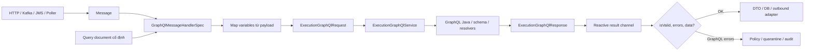
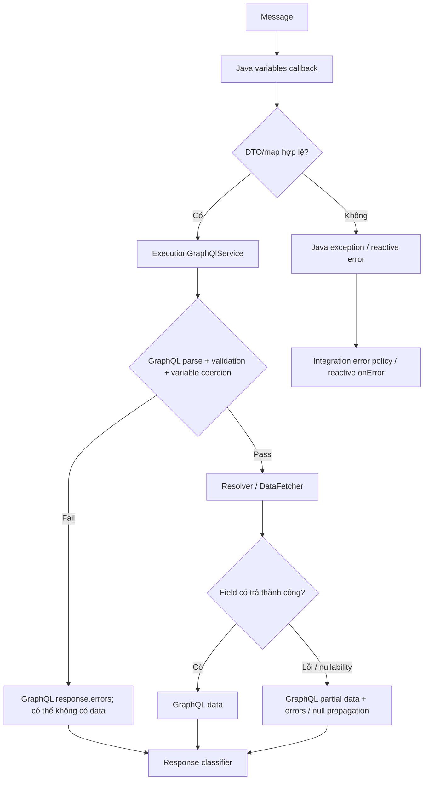

# GraphQL query và variables trong Spring Integration

## 1. Bài toán: một GraphQL document, nhiều request message

Một nền tảng xử lý đơn hàng có các sự kiện đến từ HTTP, Kafka hoặc JMS. Mỗi sự kiện cần tra cứu danh sách đơn hàng theo trạng thái, giá trị tối thiểu và số lượng tối đa. Ta có thể viết riêng một GraphQL query cho từng message:

```graphql
{ orders(status: PAID, minTotalCents: 10000, first: 10) {
    id status totalCents
} }
```

Nhưng nếu ghép trực tiếp dữ liệu đầu vào vào văn bản GraphQL, code vừa khó kiểm tra, vừa có nguy cơ sai escaping và thao túng cấu trúc query. Cách đúng là **giữ GraphQL document có định nghĩa variable** và cung cấp các giá trị của chúng qua một `Map<String,Object>` được tạo từ request message.

```graphql
query FindOrders(
  $status: OrderStatus
  $minimum: Int
  $first: Int = 10
) {
  orders(status: $status, minTotalCents: $minimum, first: $first) {
    id
    status
    totalCents
  }
}
```

```json
{
  "operationName": "FindOrders",
  "variables": {
    "status": "PAID",
    "minimum": 10000,
    "first": 10
  }
}
```

Trong Spring Integration, một inbound adapter hoặc handler tạo `Message<OrderSearch>`. **GraphQL outbound gateway** đọc message, tính variables, gọi `ExecutionGraphQlService`, nhận `ExecutionGraphQlResponse` và đưa kết quả về channel tiếp theo. Một operation được dùng lại cho nhiều yêu cầu mà không cần sửa văn bản query.

Bài **“GraphQL query và variables”** thuộc chương **Adapter GraphQL** của module `SPRING_INTEGRATION_ADAPTERS`. Module hướng dẫn kết nối các hệ thống ngoài bằng inbound/outbound adapter, gateway, poller, `MessageChannel`; thực hành file, SFTP, HTTP, JMS, AMQP, Kafka, database, hợp đồng message, xử lý lỗi và vòng đời kết nối. Trong phạm vi bài, trọng tâm là **hợp đồng GraphQL document–variable–message**, cách map kiểu và cách xử lý kết quả; việc gọi một GraphQL server từ xa sẽ được phân biệt rõ với gateway dùng local execution service.

### Kết quả học tập

Sau bài, bạn có thể:

1. Phân biệt GraphQL field argument, variable definition, variable value, operation name, alias và fragment.
2. Khai báo biến kiểu `ID!`, `Int`, `String`, enum, list và input object; biết tác dụng của `!` và dấu `=`.
3. Hiểu **omitted variable khác explicit null**, biết default được áp dụng ở variable definition và schema argument.
4. Dùng `GraphQl.gateway(executionGraphQlService)`, `operation(...)`, `operationName(...)`, `variables(...)` và `variablesExpression(...)`.
5. Map payload/headers đáng tin thành `Map<String,Object>`, không ghép dữ liệu ngoài vào query string.
6. Xử lý `ExecutionGraphQlResponse`: `data`, `errors`, `isValid()`, null/partial data và conversion sang DTO.
7. Phân biệt validation error, coercion error, resolver error, exception của reactive pipeline và timeout.
8. Kiểm tra security, authorization, query complexity, pagination, trace và retry/idempotency.
9. Viết unit/integration test với GraphQL schema fixture, Java DSL và mock client.

## 2. Kiến trúc và các ranh giới dữ liệu



**API chính của Spring Integration 6.5:**

| Thành phần | Đúng trách nhiệm | Không làm thay bạn |
|---|---|---|
| `GraphQl.gateway(ExecutionGraphQlService)` | Tạo spec cho GraphQL outbound gateway | Không tự gọi một HTTP GraphQL URL |
| `GraphQlMessageHandler` | Tạo request, thực thi GraphQL và tạo reply | Không định nghĩa schema hoặc business permission |
| `operation(String)` | Cung cấp GraphQL document cố định | Không validate dữ liệu payload trước khi gửi |
| `operationName(String)` | Chọn một operation có tên | Không thay cho document |
| `variables(Function<Message<?>, Map<String,Object>>)` | Tính map từ request message | Không tự biết tên biến hay domain validation |
| `variablesExpression(String)` | Đánh giá SpEL để lấy map | Không nên dùng cho SpEL do người ngoài cung cấp |
| `ExecutionGraphQlService` | Gọi GraphQL Java engine/schema | Không phải HTTP client tự kết nối đối tác |
| `ExecutionGraphQlResponse` | Chứa data, errors, extensions | Không phải DTO đã xác nhận nghiệp vụ |
| `FluxMessageChannel` | Nối các bước reactive | Không phải persistent queue khi JVM restart |

Với Spring Integration 6.5, handler trả một publisher `Mono<ExecutionGraphQlResponse>`. Framework thực hiện subscription qua reactive output channel hoặc cơ chế asynchronous của reply-producing handler. Việc gọi `MessageChannel.send(...)` thành công **không có nghĩa** GraphQL query đã hoàn tất hay DB downstream đã commit.

### 2.1. Local execution khác gọi GraphQL HTTP từ xa

```text
Spring Integration GraphQL gateway:
  Message<OrderSearch> -> GraphQlMessageHandler
      -> ExecutionGraphQlService -> GraphQL Java schema/resolver

Remote GraphQL client:
  Message<OrderSearch> -> service activator
      -> HttpGraphQlClient / WebClient -> HTTPS partner /graphql
```

Không có overload `GraphQl.gateway("https://partner.example/graphql")` cho việc cấu hình remote endpoint. Muốn gọi qua mạng, dùng Spring for GraphQL `HttpGraphQlClient` (hoặc HTTP outbound gateway có request/response contract rõ). Phần 12 sẽ đối chiếu chi tiết.

### 2.2. Hợp đồng message đầu vào

```text
payload: OrderSearch(
  status=PAID,
  minTotalCents=10000,
  first=10
)
headers:
  id             = một UUID của message
  correlationKey = workflow-123
  tenantAlias    = tenant đã xác thực ở upstream
```

Query document, variables và authorization phải có **nguồn tin cậy khác nhau**: operation từ code/registry được duyệt; biến từ payload đã validate; quyền truy cập từ authenticated principal hoặc security context đáng tin. Không tin một `tenantAlias` do người gửi không xác thực tự đặt vào header.

## 3. Cú pháp GraphQL query, arguments và variables

### 3.1. Trường, đối số và selection set

```graphql
{
  order(id: "ORD-1001") {
    id
    status
    totalCents
  }
}
```

Ở đây:

- `order` là một **field** của root `Query`.
- `id` trong `order(id: ...)` là **field argument**.
- `"ORD-1001"` là một **literal** của document.
- `{ id status totalCents }` là **selection set** — những trường mà client yêu cầu trả về.

Literal phù hợp khi cố định giá trị trong fixture, nhưng không thích hợp cho tham số thay đổi theo message.

### 3.2. Định nghĩa variable và vị trí sử dụng

```graphql
query FindOrder($id: ID!) {
  order(id: $id) {
    id
    status
  }
}
```

`$id: ID!` là **variable definition** trên operation, còn `order(id: $id)` là nơi biến được dùng để cung cấp giá trị cho **argument `id`**. Tên biến có dấu `$` trong văn bản GraphQL, nhưng key trong JSON/Java map là **`"id"`**, không có dấu `$`:

```json
{"variables":{"id":"ORD-1001"}}
```

Java:

```java
Map<String, Object> variables =
        Map.of("id", "ORD-1001");
```

Không dùng `Map.of("$id", "...")`; key đó sẽ không khớp với variable `$id`. Không nhầm variable definition với `@Argument` trong Spring GraphQL controller: annotation nhận field argument sau khi GraphQL Java đã coercion variable.

### 3.3. Một document có nhiều operation

```graphql
query FindOrder($id: ID!) {
  order(id: $id) { id status }
}

query FindOrderValue($id: ID!) {
  order(id: $id) { id totalCents }
}
```

Document có nhiều operation thì request phải chọn bằng `operationName`, ví dụ `"FindOrderValue"`. Giá trị này là tên **GraphQL operation**, không phải tên bean Java hay field schema. Một operation duy nhất có thể không cần tên, nhưng đặt tên vẫn tốt cho logging, persisted documents và phân tích metrics.

### 3.4. Alias và fragment

```graphql
query CompareOrders($a: ID!, $b: ID!) {
  firstOrder: order(id: $a) { ...OrderPreview }
  secondOrder: order(id: $b) { ...OrderPreview }
}

fragment OrderPreview on Order {
  id
  status
  totalCents
}
```

`firstOrder`/`secondOrder` là **aliases của response fields**, không phải biến. Variables vẫn là `$a` và `$b`. Fragment giúp tái sử dụng selection set nhưng không tự biến các field thành lazily fetched objects phía Java; GraphQL engine chỉ resolve những trường được selection yêu cầu.

## 4. Kiểu biến GraphQL và coercion

### 4.1. Scalar, enum, list, input object

| GraphQL type | Giá trị variables thường dùng | Lưu ý |
|---|---|---|
| `ID!` | `"ORD-1001"` | ID là định danh, có thể nhận string hoặc integer theo coercion; nên dùng string cho identity ổn định |
| `String` | `"urgent"` hoặc null | Không coi null giống chuỗi rỗng |
| `Int` | `10000` | GraphQL Int là số nguyên **signed 32-bit** |
| `Float` | `12.5` | Floating point; không nên dùng cho giá tiền chính xác |
| `Boolean` | `true`/`false` | Không dùng chuỗi `"true"` để giả làm Boolean |
| `OrderStatus` | `"PAID"` trong JSON/map | Enum value phải nằm trong schema enum |
| `[ID!]` | `["A","B"]` | List nullable, mỗi phần tử non-null |
| `[ID!]!` | `["A","B"]` hoặc `[]` | Bản thân list không được null |
| `OrderFilterInput` | `{"statuses":["PAID"],"minTotalCents":10000}` | Map dữ liệu lồng nhau đúng tên input fields |

`ID` không mang ý nghĩa quyền truy cập. Resolver vẫn phải kiểm tra người gọi có quyền xem đơn `ORD-1001` hay không.

### 4.2. `!` đặt ở đâu?

Giả sử schema còn có một field giả định `inspect(a: ID, b: ID!, c: [ID], d: [ID!], e: [ID!]!): String` để minh họa **cú pháp** tất cả các loại list/non-null:

```graphql
query Examples(
  $a: ID
  $b: ID!
  $c: [ID]
  $d: [ID!]
  $e: [ID!]!
) {
  inspect(a: $a, b: $b, c: $c, d: $d, e: $e)
}
```

| Type | Có thể bỏ biến/null? | Phần tử list có thể null? |
|---|---|---|
| `ID` | Có | Không áp dụng |
| `ID!` | Không: biến bắt buộc có value khác null | Không áp dụng |
| `[ID]` | Có | Có |
| `[ID!]` | Có | Không |
| `[ID!]!` | Không | Không; nhưng `[]` vẫn hợp lệ |

Ví dụ `$b: ID!` sẽ phát sinh request error nếu variable bị bỏ hoặc có value null, dù schema argument đang cần non-null ID. GraphQL không tự chuyển chuỗi trống thành ID thiếu, nên ứng dụng vẫn cần validate `""`/whitespace theo nghiệp vụ.

### 4.3. Biến bị bỏ qua khác biến null

Xem operation:

```graphql
query Search($status: OrderStatus, $first: Int = 10) {
  orders(status: $status, first: $first) {
    id
    status
  }
}
```

Ba map variables có ý nghĩa khác nhau:

```json
{}
```

```json
{"status":null}
```

```json
{"status":"PAID"}
```

- **Omitted**: biến `status` không có key trong map. Nếu operation hoặc schema có default, GraphQL có thể áp default theo thứ tự quy định.
- **Explicit null**: key tồn tại và value là `null`. Với type nullable, resolver có thể phân biệt việc người gọi chủ động đưa null; default của variable thường **không** được áp dụng như lúc omitted.
- **Có giá trị**: GraphQL coercion kiểm tra input type; `"PAID"` hợp lệ nếu schema định nghĩa enum value này.

Đặc biệt với mutation PATCH, **“bỏ qua trường” khác “xóa trường bằng null”**. Một `Map.of("status", null)` còn **ném NullPointerException trong Java**, nên để biểu diễn explicit null phải dùng `HashMap`/map implementation hỗ trợ null:

```java
Map<String, Object> omitted = Map.of();

Map<String, Object> explicitNull = new HashMap<>();
explicitNull.put("status", null);

Map<String, Object> withValue = Map.of("status", "PAID");
```

### 4.4. Default của variable và default của argument

```graphql
query FindOrders($first: Int = 10) {
  orders(first: $first) { id }
}
```

Trong schema:

```graphql
type Query {
  orders(first: Int = 20): [Order!]!
}
```

Nếu `first` bị bỏ, **variable default `10`** được áp dụng trước, nên argument nhận 10, không phải 20. Nếu operation không có default và không cung cấp value, **argument default `20`** có thể được áp dụng. Nếu variable có giá trị explicit null và argument nullable, default không thay thế null.

Đây là ví dụ để hiểu thứ tự ưu tiên; trong flow chính, schema và operation sẽ thống nhất default là 10. Không ghi trùng default khác nhau rồi giả định framework sẽ “chọn giá trị tốt nhất”.

### 4.5. Coercion trước resolver

GraphQL Java kiểm tra variable value trước khi gọi data fetcher. Ví dụ:

```json
{"variables":{"first":"ten","status":"NOT_A_STATUS"}}
```

Với `$first: Int` và `$status: OrderStatus`, những value này không hợp lệ; request có thể trả **GraphQL errors** mà không gọi resolver chính. Không giả định mọi lỗi coercion sẽ ném Java exception tới Spring Integration error channel.

Với `Int`, số ngoài phạm vi 32-bit signed cũng không hợp lệ. Nếu bài toán cần giá trị tiền lớn, dùng scalar riêng đã được khai báo như `Long`/`BigDecimal` bằng GraphQL Java custom scalar hoặc thiết kế wire `String`/minor-unit có validation; không dùng `Float` để biểu diễn số tiền chính xác.

## 5. Hợp đồng mẫu: schema và resolver

Để nội dung có thể tự thực hành, dùng một GraphQL schema nhỏ. Mẫu nhắm tới **Java 17, Spring Boot 3.x và Spring Integration 6.5.x tương thích**, với các phiên bản do BOM/dependency management chọn. Khi chạy thực tế, không trộn major version của Spring for GraphQL với Spring Integration.

### 5.1. Dependencies

**`build.gradle`:**

```gradle
dependencies {
    implementation 'org.springframework.boot:spring-boot-starter-integration'
    implementation 'org.springframework.integration:spring-integration-graphql'
    implementation 'org.springframework.boot:spring-boot-starter-graphql'
    testImplementation 'org.springframework.boot:spring-boot-starter-test'
    testImplementation 'org.springframework.graphql:spring-graphql-test'
}
```

`spring-integration-graphql` cung cấp gateway; `spring-boot-starter-graphql` có thể tự tạo `GraphQlSource` và `ExecutionGraphQlService` theo schema/controller đã được cấu hình. Nếu muốn cấu hình engine thủ công, phải chọn **một nguồn sở hữu bean** và tránh tạo bean trùng với Boot auto-configuration.

### 5.2. GraphQL schema

Ví dụ **`src/main/resources/graphql/orders.graphqls`** trong dự án thực hành:

```graphql
enum OrderStatus {
  NEW
  PAID
  SHIPPED
  CANCELLED
}

type Order {
  id: ID!
  status: OrderStatus!
  totalCents: Int!
}

type Query {
  order(id: ID!): Order
  orders(
    status: OrderStatus
    minTotalCents: Int
    first: Int = 10
  ): [Order!]!
}
```

Schema này quy định một số invariant:

- `order(id: ID!)` bắt buộc có ID; kết quả có thể null nếu không tìm thấy.
- `orders(...)` trả list non-null, các phần tử non-null, nhưng list có thể rỗng.
- `first` nullable, default 10 khi omitted, còn explicit null vẫn cần policy resolver.
- `totalCents` là `Int!`, vì demo chỉ có số nhỏ trong khoảng 32-bit. Hệ thống tiền tệ lớn thực tế cần thiết kế scalar/wire khác.

### 5.3. DTO và in-memory QueryMapping

**`OrdersGraphQlController.java`**:

```java
import java.util.List;

import org.springframework.graphql.data.method.annotation.Argument;
import org.springframework.graphql.data.method.annotation.QueryMapping;
import org.springframework.stereotype.Controller;

enum OrderStatus { NEW, PAID, SHIPPED, CANCELLED }

record OrderView(String id, OrderStatus status, int totalCents) {}

@Controller
public class OrdersGraphQlController {

    private static final List<OrderView> DATA = List.of(
            new OrderView("ORD-1001", OrderStatus.PAID, 12_500),
            new OrderView("ORD-1002", OrderStatus.NEW, 3_000),
            new OrderView("ORD-1003", OrderStatus.PAID, 48_000),
            new OrderView("ORD-1004", OrderStatus.SHIPPED, 9_000));

    @QueryMapping
    public OrderView order(@Argument String id) {
        return DATA.stream()
                .filter(row -> row.id().equals(id))
                .findFirst().orElse(null);
    }

    @QueryMapping
    public List<OrderView> orders(
            @Argument OrderStatus status,
            @Argument Integer minTotalCents,
            @Argument Integer first) {

        int limit = first == null ? 10 : first;
        if (limit < 1 || limit > 50) {
            throw new IllegalArgumentException(
                    "first phải nằm trong khoảng [1,50]");
        }
        if (minTotalCents != null && minTotalCents < 0) {
            throw new IllegalArgumentException(
                    "minTotalCents phải không âm");
        }

        return DATA.stream()
                .filter(row -> status == null
                        || row.status() == status)
                .filter(row -> minTotalCents == null
                        || row.totalCents() >= minTotalCents)
                .limit(limit)
                .toList();
    }
}
```

`@QueryMapping` ánh xạ method sang field `Query.order` hoặc `Query.orders`, còn `@Argument` nhận argument sau khi GraphQL Java đã validate/coerce theo schema. `OrderStatus` là enum Java tương ứng với enum GraphQL; các field Java record có tên khớp với schema.

**Giới hạn demo:** bộ lọc ở memory không có pagination thực, không có ACL/tenant filter, không có snapshot consistency hay database. Production phải dùng query có giới hạn, sorting/cursor, row-level authorization và service/repository phù hợp.

## 6. Message payload và mapping variables trong Java DSL

### 6.1. Payload rõ kiểu

**`OrderSearch.java`:**

```java
public record OrderSearch(
        OrderStatus status,
        Integer minTotalCents,
        Integer first) {

    public OrderSearch {
        if (minTotalCents != null && minTotalCents < 0) {
            throw new IllegalArgumentException(
                    "minimum không được âm");
        }
        if (first != null && (first < 1 || first > 50)) {
            throw new IllegalArgumentException(
                    "first phải trong khoảng 1..50");
        }
    }
}
```

Giá trị `null` trong record này có nghĩa **không cung cấp filter/limit**, chứ chưa mang ngữ nghĩa explicit null. Mapping sẽ **bỏ key** tương ứng. Nếu nghiệp vụ thực sự cần phân biệt omitted với explicit null, dùng một wrapper có trạng thái `present/value` hoặc `ArgumentValue` ở controller khi thích hợp, không dùng mỗi một `null` Java.

### 6.2. Document query cố định

```java
private static final String FIND_ORDERS = """
        query FindOrders(
          $status: OrderStatus
          $minimum: Int
          $first: Int = 10
        ) {
          orders(
            status: $status
            minTotalCents: $minimum
            first: $first
          ) {
            id
            status
            totalCents
          }
        }
        """;
```

Lưu ý **tên biến không nhất thiết trùng tên argument**: `$minimum` được truyền vào argument `minTotalCents`. Trong variables map, key phải là `"minimum"`. Tên biến được GraphQL parser kiểm tra theo tài liệu operation, còn binding vào field argument do cú pháp `minTotalCents: $minimum` quyết định.

### 6.3. IntegrationFlow với callback variables

**`OrdersQueryIntegrationConfig.java`:**

```java
import java.util.HashMap;
import java.util.Map;

import org.springframework.context.annotation.Bean;
import org.springframework.context.annotation.Configuration;
import org.springframework.graphql.ExecutionGraphQlService;
import org.springframework.integration.config.EnableIntegration;
import org.springframework.integration.dsl.IntegrationFlow;
import org.springframework.integration.dsl.MessageChannels;
import org.springframework.integration.graphql.dsl.GraphQl;

@Configuration
@EnableIntegration
public class OrdersQueryIntegrationConfig {

    private static final String FIND_ORDERS = """
            query FindOrders(
              $status: OrderStatus
              $minimum: Int
              $first: Int = 10
            ) {
              orders(
                status: $status
                minTotalCents: $minimum
                first: $first
              ) {
                id status totalCents
              }
            }
            """;

    @Bean
    IntegrationFlow ordersGraphQlFlow(
            ExecutionGraphQlService graphQlService) {

        return IntegrationFlow
                .from(MessageChannels.flux("ordersQueryRequests"))
                .handle(GraphQl.gateway(graphQlService)
                        .operation(FIND_ORDERS)
                        .operationName("FindOrders")
                        .variables(message -> {
                            OrderSearch request =
                                    (OrderSearch) message.getPayload();

                            Map<String, Object> vars = new HashMap<>();
                            if (request.status() != null) {
                                vars.put("status",
                                        request.status().name());
                            }
                            if (request.minTotalCents() != null) {
                                vars.put("minimum",
                                        request.minTotalCents());
                            }
                            if (request.first() != null) {
                                vars.put("first", request.first());
                            }
                            return vars;
                        }))
                .channel(c -> c.flux("ordersQueryResults"))
                .get();
    }
}
```

**Đọc flow từ trái sang phải:**

1. Source tạo `Message<OrderSearch>` vào `ordersQueryRequests`.
2. `GraphQl.gateway(graphQlService)` dùng **`ExecutionGraphQlService`** đang có trong Spring context (schema/QueryMapping ở phần 5).
3. `operation(FIND_ORDERS)` giữ document không đổi giữa các request.
4. `operationName("FindOrders")` chọn operation này; hữu ích cả khi sau này document có nhiều operation.
5. `variables(message -> {...})` nhận **request message**, lấy `OrderSearch`, trả một `Map<String,Object>`.
6. `status` được chuyển bằng `enum.name()` → ví dụ `"PAID"`; GraphQL Java coercion enum theo schema.
7. `minimum` và `first` là Java `Integer` phù hợp GraphQL `Int`, sau khi đã validate business constraints.
8. Khi `first==null`, callback bỏ key để GraphQL áp variable default `10`.
9. `ordersQueryResults` nhận reply `Message<ExecutionGraphQlResponse>` theo cơ chế reactive.

**Vì sao không dùng `Map.of(...)` ở đây?** Callback cần **bỏ key optional**. `Map.of` không chấp nhận null và không thuận tiện khi số field thay đổi. Dùng `HashMap` để chỉ thêm field có giá trị; với input cần explicit null thì có thể đưa `key -> null` một cách chủ đích.

### 6.4. Gửi message vào channel

```java
import org.springframework.beans.factory.annotation.Qualifier;
import org.springframework.integration.support.MessageBuilder;
import org.springframework.messaging.MessageChannel;
import org.springframework.stereotype.Component;

@Component
public class OrderQueryPublisher {
    private final MessageChannel channel;

    public OrderQueryPublisher(
            @Qualifier("ordersQueryRequests") MessageChannel channel) {
        this.channel = channel;
    }

    public void submit(OrderSearch search, String correlationKey) {
        boolean sent = channel.send(
                MessageBuilder.withPayload(search)
                        .setHeader("correlationKey", correlationKey)
                        .build());
        if (!sent) {
            throw new IllegalStateException(
                    "Message không được input channel chấp nhận");
        }
    }
}
```

`channel.send(...)` là bước **đưa message vào channel**, không phải lời đảm bảo query đã kết thúc. Với `FluxMessageChannel`, cần output subscriber/endpoint; upstream ack/offset của Kafka/JMS không nên dựa duy nhất vào kết quả `send()` nếu nghiệp vụ đòi commit bền vững.

## 7. Result: GraphQL data và errors

### 7.1. Response hợp lệ

Một query có status PAID và minimum 10.000 có thể trả:

```json
{
  "data": {
    "orders": [
      {"id":"ORD-1001","status":"PAID","totalCents":12500},
      {"id":"ORD-1003","status":"PAID","totalCents":48000}
    ]
  }
}
```

Một query hợp lệ nhưng không có bản ghi:

```json
{"data":{"orders":[]}}
```

Không coi list rỗng là một exception. Đây là kết quả hợp lệ vì `[Order!]!` cho phép `[]`.

### 7.2. GraphQL errors có thể xuất hiện cùng data

```json
{
  "data": {
    "order": {
      "id": "ORD-1001",
      "status": null
    }
  },
  "errors": [
    {
      "message": "Access denied",
      "path": ["order","status"]
    }
  ]
}
```

Response có `data` **không chắc đã hoàn tất**. Tùy schema nullability, field error có thể làm null một subtree hoặc toàn bộ data; không giả định mọi error luôn cho partial object như JSON mẫu. `ExecutionGraphQlResponse.isValid()` dùng để nhận biết lỗi request/response structure; vẫn phải kiểm tra `getErrors()` ngay cả khi `isValid() == true`.

### 7.3. Consumer đọc kết quả an toàn

**`OrderQueryResultHandler.java`:**

```java
import java.util.List;
import java.util.Map;

import org.springframework.graphql.ExecutionGraphQlResponse;
import org.springframework.integration.annotation.ServiceActivator;
import org.springframework.stereotype.Component;

@Component
public class OrderQueryResultHandler {

    @ServiceActivator(inputChannel = "ordersQueryResults")
    public void handle(ExecutionGraphQlResponse response) {
        if (!response.isValid()) {
            System.err.println(
                    "GraphQL request invalid, error count="
                    + response.getErrors().size());
            return;
        }
        if (!response.getErrors().isEmpty()) {
            // Strict policy của demo: không chấp nhận partial data.
            System.err.println(
                    "GraphQL field errors="
                    + response.getErrors().size());
            return;
        }

        List<?> rawOrders = response.field("orders").getValue();
        if (rawOrders == null) {
            throw new IllegalStateException(
                    "Query result không có orders list");
        }

        for (Object item : rawOrders) {
            if (!(item instanceof Map<?, ?> row)) {
                throw new IllegalArgumentException(
                        "GraphQL order không phải object map");
            }
            String id = (String) row.get("id");
            String status = (String) row.get("status");
            Number total = (Number) row.get("totalCents");
            OrderView order = new OrderView(
                    id, OrderStatus.valueOf(status),
                    total.intValue());
            System.out.println(order.id() + " / " + order.status());
        }
        // Production: chuyển thành contract DTO và ghi bền nếu cần.
    }
}
```

Snippet này dùng strict policy cho ví dụ. Ở **server-side \`ExecutionGraphQlResponse\`**, \`field("orders")\` trả \`ResponseField\`, có \`getValue()\` nhưng **không** có \`toEntityList(Class)\`. Ví dụ tự lấy \`List\` và kiểm tra từng \`Map\`; production nên dùng mapper DTO có schema validation thay vì ép kiểu thô. \`toEntityList(Class)\` là tiện ích ở \`ClientResponseField\`/GraphQL client API. Business consumer thực tế có thể chấp nhận một số partial data nếu các field bị lỗi là optional và được xác thực; khi đó phải kiểm tra errors theo path, loại lỗi và field requirements. Với message qua Kafka/JMS/HTTP, nên normalize thành DTO không chứa toàn bộ graph GraphQL Java/response object.

### 7.4. Lỗi coercion và validation không luôn là Java exception

Ví dụ status không có trong enum:

```json
{"variables":{"status":"UNKNOWN","first":10}}
```

GraphQL Java có thể trả GraphQL request error do coercion, khiến resolver `orders(...)` không chạy. Response lỗi đó vẫn có thể đến result channel như một `ExecutionGraphQlResponse`. Chỉ cấu hình Spring Integration `errorChannel` không tự xử lý tất cả GraphQL errors **in-band**. Muốn route, đặt classifier sau gateway: invalid request, field error/partial, success.

## 8. Những cách cấu hình variables trong GraphQlMessageHandlerSpec

### 8.1. Callback Java: `variables(Function<Message<?>,Map<...>>)`

Đây là cách đã dùng trong phần 6. Ưu điểm: kiểu rõ, dùng compiler/test để phát hiện lỗi, dễ validate/canonicalize, dễ chặn field ngoài whitelist. Có thể lấy từ payload hoặc header đã xác thực:

```java
.variables(message -> {
    OrderSearch search = (OrderSearch) message.getPayload();
    Map<String, Object> values = new HashMap<>();
    if (search.status() != null) {
        values.put("status", search.status().name());
    }
    if (search.first() != null) {
        values.put("first", search.first());
    }
    return values;
})
```

Đoạn này là **một thành phần** của DSL, không phải một Java class chạy độc lập; với operation cần thêm `minimum`, phải map đủ theo hợp đồng query.

### 8.2. SpEL: `variablesExpression(String)`

Spring Integration docs dùng cách:

```java
.handle(GraphQl.gateway(graphQlService)
        .operation("""
                query FindOrder($id: ID!) {
                  order(id: $id) { id status }
                }
                """)
        .variablesExpression("{id: payload.orderId}"))
```

Biểu thức SpEL trả về một map dựa trên request message. **Điều kiện:** payload phải có property `orderId` (ví dụ `record OrderLookup(String orderId)`), và SpEL evaluator có thể truy cập getter/record accessor theo cấu hình. Nếu biểu thức trả string JSON thay vì map, không đúng contract `variablesExpression` mà handler mong đợi.

Ưu điểm: gọn trong flow đơn giản. Nhược điểm: phụ thuộc property path string, lỗi có thể chỉ xuất hiện runtime; khi map có nhiều tùy chọn và quy tắc, callback Java dễ bảo trì hơn.

### 8.3. Không dùng SpEL từ dữ liệu ngoài

Sai:

```text
headers.variablesExpression = do người dùng nhập
=> app evaluate tùy ý như một SpEL expression
```

Không được đánh giá SpEL expression do một sự kiện Kafka/HTTP bên ngoài cung cấp. Một expression không tin cậy có thể truy cập object/method không mong muốn. Hãy **định nghĩa expression trong code/config được duyệt**, chỉ cho dữ liệu bên ngoài trở thành value sau validation.

### 8.4. Variables từ một DTO nested

Khi payload có filter lồng nhau:

```java
record OrderFilter(List<String> statuses, Integer minTotalCents) {}
record SearchOrdersCommand(OrderFilter filter, Integer first) {}
```

GraphQL document:

```graphql
query SearchOrders($filter: OrderFilterInput, $first: Int = 10) {
  searchOrders(filter: $filter, first: $first) {
    id
    status
  }
}
```

Schema mở rộng **ngoài ví dụ phần 5**:

```graphql
input OrderFilterInput {
  statuses: [OrderStatus!]
  minTotalCents: Int
}

extend type Query {
  searchOrders(filter: OrderFilterInput, first: Int = 10): [Order!]!
}
```

Lúc đó callback nên tạo map nested rõ:

```java
Map<String, Object> variables = new HashMap<>();
Map<String, Object> filter = new HashMap<>();

if (command.filter() != null) {
    if (command.filter().statuses() != null) {
        filter.put("statuses", command.filter().statuses());
    }
    if (command.filter().minTotalCents() != null) {
        filter.put("minTotalCents",
                command.filter().minTotalCents());
    }
    variables.put("filter", filter);
}
if (command.first() != null) {
    variables.put("first", command.first());
}
```

Snippet này là **logic bên trong callback**, `command` là `SearchOrdersCommand`. Phải bổ sung resolver `searchOrders` trong dự án nếu chạy schema mở rộng; field chỉ có schema mà không có data fetcher phù hợp sẽ không trả dữ liệu như kỳ vọng. Với list enum từ bên ngoài, validate/convert từng value, kiểm tra max list size, reject unknown enum, tránh cho người dùng tạo filter quá lớn.

### 8.5. Payload đã là ExecutionGraphQlRequest

Có một ngoại lệ được ghi rõ trong Spring Integration 6.5: nếu payload đầu vào đã là **`ExecutionGraphQlRequest`**, `GraphQlMessageHandler` **dùng nguyên request đó**; những cấu hình `operation`, `operationName`, `variables`, `executionId` trên handler **không được áp lại**.

Điều này phù hợp khi upstream đã được tin cậy và tự xây request hoàn chỉnh, nhưng **nguy hiểm** nếu nghĩ một constant `operation(...)` sẽ giới hạn query của một `ExecutionGraphQlRequest` do bên ngoài cung cấp. Không cho người gọi không tin cậy tạo request tùy ý rồi bỏ qua operation allowlist.

## 9. OperationName, fragments, aliases và conditional fields

### 9.1. OperationName không phải field name

```graphql
query ReadOne($id: ID!) {
  order(id: $id) { id }
}
query ReadMany($first: Int = 10) {
  orders(first: $first) { id }
}
```

Trong Java:

```java
.operationName("ReadMany")
.variables(message -> Map.of("first", 5))
```

Nếu document có nhiều operations mà không chỉ `operationName`, GraphQL có thể từ chối request vì không xác định operation phải thực thi. Không lấy operationName tùy ý từ user rồi chạy dynamic document nếu chưa có allowlist.

### 9.2. Fragments giúp tái sử dụng selection set

```graphql
query FindOrders($first: Int = 10) {
  orders(first: $first) { ...OrderPreview }
}
fragment OrderPreview on Order {
  id
  status
  totalCents
}
```

Fragment không tự thay đổi variables và không tạo thêm server endpoint. Khi mapping response, vẫn dùng path `"orders"` và schema fields của `Order`.

### 9.3. `@include` và `@skip` dùng biến Boolean

```graphql
query FindOrders($first: Int = 10, $withValue: Boolean! = false) {
  orders(first: $first) {
    id
    status
    totalCents @include(if: $withValue)
  }
}
```

Nếu `withValue=false`, response **không có trường `totalCents` trong object**, khác với `totalCents:null`. Một DTO Java có `int totalCents` không thích hợp để decode data từ query conditionally omitted trường đó nếu business consumer cần phân biệt absent/null/default. Tạo DTO response theo selection set hoặc dùng `Integer` optional/Map.

### 9.4. Alias đổi response path

```graphql
query Compare($idA: ID!, $idB: ID!) {
  left: order(id: $idA) { id }
  right: order(id: $idB) { id }
}
```

Result path là `left` và `right`, không phải `order`. Kiểm thử `response.field("left")`/`response.field("right")` thay vì hard-code `response.field("order")` từ query khác.

## 10. GraphQL validation, coercion và exception trong flow

### 10.1. Phân loại lỗi theo thời điểm



| Loại lỗi | Ví dụ | Kênh quan sát chính | Retry? |
|---|---|---|---|
| DTO validation | `first=-1` bị record constructor từ chối | Exception trước gateway | Không retry trước khi sửa input |
| Java callback exception | Cast payload sai kiểu, lỗi map | Spring Integration / reactive error path | Sửa contract |
| GraphQL parse | Document thiếu dấu đóng, syntax sai | `ExecutionGraphQlResponse.errors` | Sửa document |
| GraphQL schema validation | Query field không tồn tại | `errors`, request không hợp lệ | Sửa query/schema |
| Variable coercion | `first="ten"`, enum không tồn tại | `errors`, resolver không chạy | Sửa variables |
| Resolver exception | Database fail, business exception | Có thể được GraphQL xử lý thành field error | Phân loại transient/permanent |
| Non-null propagation | Field `Order.status!` trả null | GraphQL `errors` và null hóa ancestor | Sửa resolver/contract |
| Timeout trong reactive flow | Execution quá SLA | `Mono.onError` hoặc timeout policy | Chỉ retry khi an toàn |
| Remote HTTP 401/429/503 | Chỉ xảy ra khi dùng HTTP client | Transport/client status/exception | Theo status và quota |

**Không đánh đồng `errorChannel` của Spring Integration với `getErrors()` của GraphQL.** Nếu `ExecutionGraphQlService` trả `ExecutionGraphQlResponse` chứa `errors`, gateway vẫn có thể coi đó là reply payload thành công ở cấp reactive transport. Để phân loại, đặt classifier/router sau result channel, hoặc xử lý rõ trong consumer.

### 10.2. Nullability và partial result

Trong schema mẫu:

```graphql
type Query {
  order(id: ID!): Order
}

type Order {
  id: ID!
  status: OrderStatus!
  totalCents: Int!
}
```

Nếu resolver của `status: OrderStatus!` lỗi hoặc trả null, `status` không được phép null; GraphQL Java có thể **null-propagate** từ Order ra field `order` vì `Query.order` là nullable:

```json
{
  "data": {"order": null},
  "errors": [
    {"message":"Status resolver failed","path":["order","status"]}
  ]
}
```

Nếu field này thuộc list `[Order!]!`, một lỗi non-null ở một phần tử có thể khiến toàn bộ list/ancestor bị null hóa theo schema. Vì vậy selection và nullability cần được thiết kế có chủ đích, không đọc `data` rồi đoán thiếu row.

### 10.3. Thêm response classifier khi đi nhiều nhánh

Pseudocode business policy:

```java
// POLICY MINH HỌA; các type do dự án định nghĩa.
GraphQlQueryOutcome classify(
        ExecutionGraphQlResponse response) {
    if (!response.isValid()) {
        return GraphQlQueryOutcome.INVALID_REQUEST;
    }
    if (!response.getErrors().isEmpty()) {
        return GraphQlQueryOutcome.PARTIAL_OR_FIELD_ERROR;
    }
    return GraphQlQueryOutcome.SUCCESS;
}
```

Một ứng dụng chỉ cần strict policy có thể log/alert như phần 7. Nghiệp vụ phức tạp nên có DTO `GraphQlQueryOutcome` với status, operationName, correlation, sanitized error codes và optional data reference. Không đưa raw stack trace hoặc nguyên `GraphQlError.message` không được lọc vào Kafka/JMS/HTTP response.

### 10.4. Retry query nhưng vẫn phải thận trọng

GraphQL **query** thường biểu thị thao tác đọc, song implementation có thể gọi dịch vụ ngoài hoặc tính toán tốn kém. Retry nên chỉ áp dụng lỗi transient được xác định, có exponential backoff, jitter, time budget và concurrency limit. Query validation/coercion error thường không tự sửa khi gửi lại cùng input.

GraphQL **mutation** có side effect; nếu cần retry phải dùng idempotency key/transaction/ledger ở nơi thực thi. Không dùng `MessageHeaders.ID` mới sinh khi retry làm unique key domain.

## 11. Bảo mật khi nhận variables từ bên ngoài

### 11.1. Variables tránh string concatenation, không thay authorization

Ví dụ không an toàn:

```java
// KHÔNG NÊN: ghép input không tin cậy vào GraphQL source.
String document = "query { order(id: " + userSuppliedId
        + ") { id status } }";
```

Thay bằng:

```graphql
query FindOrder($id: ID!) {
  order(id: $id) { id status }
}
```

```java
Map<String, Object> vars =
        Map.of("id", userSuppliedId);
```

GraphQL parser giờ đọc **document tĩnh**, còn input được coercion thành variable. Điều này tránh một nhóm lỗi ghép chuỗi, nhưng **không tự cấp quyền đọc order**. DataFetcher/service phải kiểm tra authenticated principal và row/tenant ownership. Một `id` đúng cú pháp vẫn có thể trỏ tới tài nguyên người gọi không được đọc.

### 11.2. Không cho người dùng truyền document/SpEL tùy ý

Điều không nên làm:

```text
message.headers.operation = input từ HTTP/JMS/Kafka không tin cậy
gateway.operationExpression("headers.operation")
=> người ngoài chọn query/mutation tùy ý
```

Và không bao giờ lấy SpEL expression text từ một header rồi đánh giá như code. Một cách an toàn hơn là:

```text
commandType = FIND_ORDER | FIND_ORDERS
      |
      v
operation whitelist trong code/registry
      |
      v
variables đã validate
```

Nếu cần GraphQL persisted queries/document registry, áp dụng version, checksum và authorization theo operation ID; không đánh đồng query hash với business permission.

### 11.3. Đặt giới hạn dữ liệu đầu vào

| Input | Rule minh họa | Lý do |
|---|---|---|
| `orderId` | Nonblank, giới hạn length và format | Tránh ID quá lớn/đáng ngờ |
| `status` | Enum thuộc schema | Tránh invalid coercion |
| `first` | 1–50 cho yêu cầu thực tế | Bảo vệ DB và memory |
| `minimum` | Không âm, trong int32 | Phù hợp GraphQL Int |
| List IDs/statuses | Giới hạn tối đa số phần tử | Tránh list quá lớn |
| Nested input | Giới hạn depth và tổng số field | Bảo vệ parser và resolver |
| String filter | Giới hạn bytes, validate Unicode | Bảo vệ search/DB |
| Tenant/filter quyền | Lấy từ security context đã xác thực | Không tin dữ liệu ngoài |

Kiểm tra ở DTO/edge giúp có thông báo lỗi rõ và giảm request vô ích; GraphQL schema/coercion vẫn là lớp bắt buộc tiếp theo; resolver/service là nơi áp dụng authorization. Không dùng SQL string concatenation dựa trên filter dù input đã qua GraphQL variable coercion; dùng truy vấn tham số.

### 11.4. Query depth, alias fan-out và N+1

Một query với hàng trăm aliases hoặc nested fields có thể khiến backend thực hiện nhiều lần data fetch. `variables` tách khỏi document **không giới hạn chi phí GraphQL query**. Cần:

- Persisted/allowlisted operations và giới hạn depth/complexity.
- Pagination/cursor, max page size và timeouts.
- DataLoader/batching khi resolver truy cập DB theo quan hệ.
- Per-tenant rate limit/concurrency và quota upstream adapters.
- Observability theo **operationName** (cardinality thấp), không theo raw document/variables.

### 11.5. Tracing và dữ liệu nhạy cảm

```text
event=graphql_query_completed
operationName=FindOrders
sourceSystem=order-events
correlationKeyHash=3e42...a19f
variableNames=status,minimum,first
variableCount=3
result=SUCCESS
durationMs=36
```

Log ví dụ **không** ghi nguyên order ID, token, tên khách hàng, query params nhạy cảm hoặc full GraphQL errors. Với các field có PII, áp dụng data classification, masking, retention và access controls. GraphQL execution ID và message ID là các giá trị hỗ trợ trace, không nên đưa tất cả vào metric labels có cardinality cao.

## 12. Nếu query nằm trên server GraphQL ở xa

### 12.1. GraphQl.gateway không phải remote HTTP client

Spring Integration 6.5 định nghĩa:

```java
GraphQl.gateway(executionGraphQlService)
```

Overload này nhận `ExecutionGraphQlService`, thực thi GraphQL Java schema/resolvers do ứng dụng cấu hình. Nó **không tự thực hiện HTTP POST tới một endpoint URL**.

Nếu nhiệm vụ là gọi `https://partner.example/graphql`, hãy dùng Spring for GraphQL `HttpGraphQlClient` hoặc HTTP outbound gateway có mapping status, headers, request body và response:

```java
import org.springframework.graphql.client.HttpGraphQlClient;
import org.springframework.web.reactive.function.client.WebClient;
import reactor.core.publisher.Mono;

WebClient webClient = WebClient.builder()
        .baseUrl("https://partner.example/graphql")
        .build();

HttpGraphQlClient client = HttpGraphQlClient.create(webClient);

Mono<java.util.List<OrderView>> result = client
        .document("""
            query FindOrders($first: Int = 10) {
              orders(first: $first) { id status totalCents }
            }
            """)
        .variable("first", 5)
        .retrieve("orders")
        .toEntityList(OrderView.class);
```

Địa chỉ trên là **placeholder**, không phải endpoint xác minh tồn tại. `OrderView` là DTO do ứng dụng định nghĩa, không bắt buộc dùng class nội bộ phía server của đối tác. Đối với HTTP client, cần thêm Spring WebFlux/GraphQL client dependencies tương thích với project.

### 12.2. Lưu ý vận hành remote query

| Vấn đề | Local ExecutionGraphQlService | Remote HttpGraphQlClient |
|---|---|---|
| Kết nối mạng HTTP | Không phải ranh giới của gateway | Có, cần HTTPS/TLS/proxy |
| Variables | Map/SpEL trong GraphQlMessageHandlerSpec | `.variable(name,value)` hoặc `.variables(map)` |
| Schema | GraphQlSource/resolver local | Do publisher quản lý |
| Timeout | Execution/resolver/reactive deadline | Thêm connect/read/response timeout |
| HTTP status 401/429/503 | Không phải lỗi GraphQL gateway local | Transport error cần phân loại |
| HTTP 200 + GraphQL errors | Không áp dụng HTTP như bước trong gateway | Vẫn phải kiểm tra GraphQL error response |
| Authorization | Principal tại local resolvers | Auth token/mTLS + quyền phía remote |

Khi nhúng remote client vào Spring Integration, service activator có thể trả `Mono<OrderView>` hoặc `Mono<List<OrderView>>` tới reactive channel, nhưng cần thiết kế status/error handling và tránh gọi `.block()` trong non-blocking event loop. Chọn client synchronous chỉ khi thread model thực sự cho phép blocking.

### 12.3. Không trộn các response API

`GraphQlMessageHandler` trả `ExecutionGraphQlResponse` của server execution API. `HttpGraphQlClient` dùng các type/client response của **Spring for GraphQL client API**; cách decode bằng `retrieve(...).toEntity(...)` không giống hệt cách lấy `ExecutionGraphQlResponse.field(...)`. Đừng copy nhầm method của client vào server response hoặc ngược lại.

## 13. Unit test mapping và coercion

### 13.1. Test variables callback không cần HTTP

Để dễ kiểm tra, trong dự án thực hành có thể tách logic tạo variables thành một hàm thuần (thay vì chỉ nhúng lambda trong DSL). Ví dụ:

```java
import java.util.HashMap;
import java.util.Map;

final class OrderVariables {
    private OrderVariables() {}

    static Map<String, Object> from(OrderSearch request) {
        Map<String, Object> vars = new HashMap<>();
        if (request.status() != null) {
            vars.put("status", request.status().name());
        }
        if (request.minTotalCents() != null) {
            vars.put("minimum", request.minTotalCents());
        }
        if (request.first() != null) {
            vars.put("first", request.first());
        }
        return vars;
    }
}
```

Trong flow chính, có thể viết:

```java
.variables(message ->
        OrderVariables.from((OrderSearch) message.getPayload()))
```

### 13.2. JUnit 5: omitted và enum

```java
import static org.junit.jupiter.api.Assertions.*;

import java.util.Map;
import org.junit.jupiter.api.Test;

class OrderVariablesTest {

    @Test
    void omitsOptionalVariables() {
        Map<String, Object> vars =
                OrderVariables.from(new OrderSearch(null, null, null));

        assertFalse(vars.containsKey("status"));
        assertFalse(vars.containsKey("minimum"));
        assertFalse(vars.containsKey("first"));
    }

    @Test
    void mapsEnumAndInt() {
        Map<String, Object> vars =
                OrderVariables.from(
                        new OrderSearch(OrderStatus.PAID, 10_000, 5));

        assertEquals("PAID", vars.get("status"));
        assertEquals(10_000, vars.get("minimum"));
        assertEquals(5, vars.get("first"));
    }

    @Test
    void rejectsOutOfRangePageSize() {
        assertThrows(IllegalArgumentException.class,
                () -> new OrderSearch(null, null, 500));
    }
}
```

Test thuần trên không cần GraphQL engine, nhưng **không kiểm tra được GraphQL coercion/default**. Cần integration test thật với schema để xác minh variable maps tương thích với operation.

### 13.3. Integration test với ExecutionGraphQlServiceTester

Một test ví dụ:

```java
import org.junit.jupiter.api.Test;
import org.springframework.beans.factory.annotation.Autowired;
import org.springframework.boot.test.context.SpringBootTest;
import org.springframework.graphql.ExecutionGraphQlService;
import org.springframework.graphql.test.tester.ExecutionGraphQlServiceTester;

@SpringBootTest
class OrdersGraphQlVariableTest {

    @Autowired
    ExecutionGraphQlService executionGraphQlService;

    @Test
    void filtersOrdersFromVariables() {
        var tester = ExecutionGraphQlServiceTester
                .create(executionGraphQlService);

        tester.document("""
                query FindOrders($status: OrderStatus, $first: Int = 10) {
                  orders(status: $status, first: $first) {
                    id status
                  }
                }
                """)
                .operationName("FindOrders")
                .variable("status", "PAID")
                .variable("first", 1)
                .execute()
                .path("orders[0].id")
                .entity(String.class)
                .isEqualTo("ORD-1001");
    }
}
```

Trong project test cần dependency `spring-graphql-test` và bean service/schema/controller được Boot tạo như phần 5. Nếu schema có authorization hoặc dataset khác, test phải seed dữ liệu phù hợp. Test này kiểm tra GraphQL resolver/variables, **chưa** xác minh hai `FluxMessageChannel` và Java DSL gateway.

### 13.4. Integration test của Spring Integration flow

Một test đầy đủ cần:

1. Khởi động context có `OrdersQueryIntegrationConfig`, schema và controller.
2. Subscribe đầu ra `ordersQueryResults` hoặc gắn một test consumer/handler.
3. Gửi `OrderSearch(PAID,10000,2)` đến input channel.
4. Chờ nhận `ExecutionGraphQlResponse` với timeout ở test.
5. Assert `isValid()`, `getErrors().isEmpty()`, số item và IDs.
6. Kiểm tra custom `correlationKey` theo header propagation contract.
7. Gửi lần hai với status `NEW`, xác minh cùng document nhưng variables khác.

**Quan trọng:** `MessageChannel.send()` có thể hoàn tất trước khi reply reactive tới consumer; không assert kết quả ngay khi `send()` trả về. Dùng cơ chế đồng bộ test phù hợp như StepVerifier, `BlockingQueue` trong test handler hoặc CountDownLatch có timeout.

### 13.5. Negative tests

| Test | Input | Kỳ vọng |
|---|---|---|
| Non-null ID omitted | Không có key `id` cho `$id: ID!` | Request error, resolver không chạy |
| Explicit null cho non-null | `id=null` | Coercion error |
| Invalid enum | `status="ARCHIVED"` | Coercion error |
| Wrong Int type | `first="five"` | Coercion error |
| Out-of-range Int | `first=2147483648` | Coercion error |
| Optional omitted | Không có `first` | Operation default 10 |
| Explicit null | `first=null` | Resolver nhận null theo contract, không tự dùng default của variable |
| Unknown GraphQL field | `orders{unknown}` | Validation error |
| Undefined variable | Query dùng `$missing` không định nghĩa | Validation error |
| Variable type mismatch | `$id: String` đưa vào `id: ID!` | Validation error theo compatibility rule |
| Multiple operations không operationName | Hai query trong một document | Validation/selection error |
| Aliased field | `left:order(...)` | Response có key `left` |
| Resolver exception | Data fetcher ném lỗi | GraphQL field error, tùy nullability |
| DTO validation | `first=500` | Edge Java error trước gateway |

Nên assert **error category, path, validity** thay vì nguyên text error message vì GraphQL Java/Spring for GraphQL có thể thay đổi wording qua phiên bản. Khi kiểm thử explicit null khác omitted, tránh dùng `Map.of(..., null)` vì Java sẽ ném NPE trước khi request tới GraphQL.

## 14. Vận hành query/variables trong luồng Spring Integration

### 14.1. Metrics và telemetry

| Metric đề xuất | Ý nghĩa |
|---|---|
| `graphql_query_received_total{operation}` | Số request message tới gateway |
| `graphql_query_completed_total{operation,result}` | Số request có reply đã được phân loại |
| `graphql_query_duration_ms{operation}` | Thời gian thực thi end-to-end |
| `graphql_variable_validation_failure_total{operation,reason}` | Input fail trước gateway |
| `graphql_variable_coercion_error_total{operation}` | GraphQL variable không đúng schema |
| `graphql_query_partial_error_total{operation}` | Data có lỗi ở một số field |
| `graphql_query_inflight{operation}` | Số truy vấn chưa có kết quả |
| `graphql_query_timeout_total{operation}` | Query vượt deadline |
| `graphql_query_result_rows{operation}` | Kích thước danh sách kết quả |
| `graphql_query_result_bytes{operation}` | Kích thước payload serialized |
| `graphql_query_retry_total{reason}` | Retry sau lỗi được phân loại |
| `graphql_query_downstream_failure_total{adapter}` | Lỗi sau gateway ở DB/HTTP/JMS/Kafka |

Đây là **các metric gợi ý**, không phải toàn bộ được framework tự sinh. Tránh đưa `orderId`, raw query document, JSON variables, full error message hoặc correlation UUID vào metric labels; dùng `operationName` và reason/category có tập giá trị nhỏ.

### 14.2. Nhịp upstream không thay đổi hành vi GraphQL

```text
HTTP inbound gateway -> MessageChannel -> GraphQL query
Kafka inbound adapter -> MessageChannel -> GraphQL query
JMS inbound adapter  -> MessageChannel -> GraphQL query
Poller               -> MessageChannel -> GraphQL query
```

GraphQL document/variables có thể dùng chung, nhưng **ngữ nghĩa ACK/commit** của mỗi nguồn khác nhau:

- Với HTTP inbound gateway, caller có thể cần synchronous reply/timeout contract; nếu query trả reactive, phải nối đúng reply channel, không block event loop tùy tiện.
- Với Kafka, offset commit/ack phải theo chính sách durability, không chỉ dựa vào `send()` đã chấp nhận message.
- Với JMS/AMQP, redelivery có thể làm query chạy lại; tránh log/DB side effect trùng.
- Với poller, `maxMessagesPerPoll` giới hạn số message từ source trong một lượt, không giới hạn query complexity hoặc kết quả trả về.

### 14.3. Timeout và backpressure

| Tầng | Ví dụ giới hạn | Điều không được suy ra |
|---|---|---|
| Input channel | Bounded producer rate/queue | Không bảo đảm resolver đã hoàn thành |
| Reactive pipeline | `Mono.timeout` với error policy | Không luôn hủy được ngay một DB call blocking |
| Execution service | Resolver deadline / GraphQL instrumentation | Không tự áp transport timeout cho remote HTTP |
| Database | Query/transaction timeout, connection pool | Không kiểm soát số request từ Kafka |
| Remote HTTP client | Connect/response timeout, TLS, redirect | Không bảo đảm GraphQL response không có `errors` |
| Result channel | Bounded concurrency/subscriber | Không phải persistent broker |

Khi dùng `FluxMessageChannel`, cần subscriber thực sự và kiểm soát backpressure. Đừng tạo hàng chục nghìn GraphQL operations chỉ vì message channel reactive có thể nhận data. Query nặng có thể tiêu thụ DB connections, bộ nhớ DataLoader và CPU GraphQL Java.

### 14.4. Tracing: bốn loại ID

```text
sourceMessageId = UUID từ Spring Messaging
executionId     = GraphQL Java execution ID
correlationKey  = workflow-123 do upstream tin cậy tạo
businessId      = ORD-1001 trong variable id
```

Spring Integration GraphQL outbound handler mặc định dùng `id` của request message cho `executionId` khi không cấu hình khác. Có thể chọn custom execution ID qua `.executionId(message -> ...)`, nhưng không dùng business ID hoặc token không được bảo vệ làm trace public. Message ID có thể thay đổi sau replay/transform; correlation ID nên do hệ thống tin cậy cấp.

### 14.5. Runbook khi query trả lỗi

1. Xác định operationName, nguồn message, phiên bản schema và thời điểm lỗi.
2. Kiểm tra input DTO/variables map: key **không có dấu `$`**, enum đúng giá trị, Int đúng kiểu/phạm vi.
3. Nếu `isValid=false`, kiểm tra cú pháp document, operationName, field schema, variable definitions.
4. Nếu `getErrors()` không rỗng nhưng `isValid=true`, kiểm tra field path, resolver, nullability và policy partial data.
5. Nếu không có reply, kiểm tra subscriber của Flux channel, Java callback exception, Reactor `onError`, timeout, concurrency.
6. Nếu gọi GraphQL remote, kiểm tra TLS, DNS, HTTP status, token/quota/redirect riêng.
7. Nếu dữ liệu bất thường, đối chiếu data fetcher, ACL, sorting/pagination và DB snapshot.
8. Nếu cần retry, phân loại transient/permanent; dùng idempotency cho mọi downstream side effect và ghi audit.

Không log toàn bộ request variables để debug production, đặc biệt khi có user ID, địa chỉ, access token hoặc thông tin cá nhân.

## 15. Bài thực hành theo tình huống

Các lab giả định bạn có một dự án Spring Boot, GraphQL schema/resolver mẫu và Spring Integration Java DSL như các phần trước. Trong nhiệm vụ viết Knowledge hiện tại, **không** chạy build hoặc tạo thêm source file ngoài hai file được giao; các bước sau là hướng dẫn cho người học tự thực hành.

### Lab A — Query với ID!

1. Dùng `order(id: ID!): Order` trong schema.
2. Tạo document `query FindOrder($id: ID!) { order(id: $id) { id status } }`.
3. Cung cấp `Map.of("id","ORD-1001")` trong variables callback.
4. Chạy qua GraphQL gateway, kiểm tra data.order.id đúng.
5. Đổi ID thành một mã không tồn tại; phân biệt null hợp lệ và request error.

**Kết quả:** variable definition dùng dấu `$`, còn map key chỉ là `"id"`.

### Lab B — Lọc enum

1. Tạo `OrderSearch(OrderStatus.PAID,null,null)`.
2. Ghi map variables mà callback tạo.
3. Xác minh `status="PAID"` được GraphQL coercion chấp nhận.
4. Thử giá trị `"ARCHIVED"` qua test GraphQL Java, quan sát errors.
5. Không catch lỗi để tự âm thầm đổi enum thành `NEW`.

**Kết quả:** schema enum là hợp đồng input type, không phải chuỗi tùy ý.

### Lab C — Omitted và explicit null

1. Khởi tạo map **không có key** `first`.
2. Gọi operation `$first: Int = 10`, quan sát default 10.
3. Tạo `HashMap` chứa `first -> null`.
4. Quan sát GraphQL không dùng variable default như khi omitted; resolver demo có policy riêng cho null.
5. Thử `Map.of("first", null)` và ghi lại lỗi Java trước GraphQL.

**Kết quả:** omitted, null và default là ba trạng thái khác nhau.

### Lab D — Variable và argument default

1. Đặt schema argument `first: Int = 20`.
2. Giữ operation `$first: Int = 10`.
3. Không truyền `first`; xác minh giá trị nhận được là 10.
4. Bỏ default của operation, giữ schema argument default.
5. Thử explicit null và so sánh.

**Kết quả:** thứ tự áp default phải theo GraphQL spec, không được đoán.

### Lab E — Int32, Boolean và list non-null

1. Thử `first=1`, `first=50` và các giới hạn DTO.
2. Truyền `first="five"` ở test trực tiếp GraphQL, kiểm tra coercion error.
3. Truyền giá trị lớn hơn 2.147.483.647, kiểm tra int32 boundary.
4. Tạo query có `$withValue: Boolean! = false`, dùng `@include`.
5. Tạo input list `[ID!]!`: thử list rỗng, list chứa null và omitted.

**Kết quả:** `!`, list và scalar type có quy tắc riêng.

### Lab F — OperationName và nhiều query

1. Tạo document có hai operations `ReadOne` và `ReadMany`.
2. Không cung cấp operationName, quan sát error.
3. Chọn `ReadMany`, truyền `first=2`.
4. Kiểm tra response orders đúng.
5. Đưa operationName vào allowlist thay vì nhận tự do từ headers.

**Kết quả:** operationName chọn operation, không chọn schema field tùy ý.

### Lab G — VariablesExpression SpEL

1. Tạo payload `OrderLookup(String orderId)`.
2. Đặt `variablesExpression("{id: payload.orderId}")`.
3. Gửi message có `orderId="ORD-1001"`.
4. So sánh với callback `variables(message -> Map.of("id", ...))`.
5. Đổi property name không còn tồn tại, quan sát lỗi runtime của SpEL.

**Kết quả:** Java callback và SpEL đều tạo map nhưng có trade-off maintainability.

### Lab H — Nested input object

1. Mở rộng schema với `OrderFilterInput`.
2. Tạo variables map có filter nested, statuses list và minimum.
3. Đảm bảo list enum chứa các string hợp lệ và giới hạn kích thước.
4. Bổ sung resolver `searchOrders` với `@Argument OrderFilterInput` record hoặc type binding tương ứng.
5. Kiểm tra khi bỏ nested field, khi explicit null và khi unknown input field.

**Kết quả:** input object phải theo schema, không phải mọi Java map đều được chấp nhận.

### Lab I — Alias và fragment

1. Tạo `query Compare($idA:ID!,$idB:ID!)` có aliases `left/right`.
2. Cung cấp `idA`/`idB` qua map.
3. Dùng fragment để tái sử dụng selection fields.
4. Kiểm tra response path `left.id` và `right.id`.
5. Quan sát vì sao `response.field("order")` không tương ứng với aliases.

**Kết quả:** response path phản ánh aliases, variables là data bindings riêng.

### Lab J — GraphQL errors trong reply

1. Thử query field không tồn tại và biến sai enum.
2. Nhận `ExecutionGraphQlResponse` tại result channel.
3. Kiểm tra `isValid()`, `getErrors()`, data.
4. Thử resolver error với null propagation đúng schema.
5. Viết strict classifier từ chối partial data và một policy có kiểm soát nhận partial.

**Kết quả:** GraphQL errors không tự là Spring Integration exceptions.

### Lab K — Reactive result channel

1. Gửi `OrderSearch` vào `ordersQueryRequests`.
2. Gắn một test subscriber/ServiceActivator vào `ordersQueryResults`.
3. Kiểm tra `send()` và thời điểm response thực sự đến.
4. Mô phỏng resolver chậm, giới hạn test timeout.
5. Kiểm tra cancellation/timeout và không dùng `.block()` trên event loop.

**Kết quả:** FluxMessageChannel điều phối reactive stream, không phải durable queue.

### Lab L — Remote GraphQL client

1. Tạo mock GraphQL HTTP server.
2. Dùng `HttpGraphQlClient.create(WebClient)` gọi query với `.variable("first",5)`.
3. Trả HTTP 200 có data, sau đó HTTP 200 có `errors`.
4. Trả HTTP 401/429/503 và quan sát transport-level handling.
5. So sánh với `GraphQl.gateway(ExecutionGraphQlService)` local.

**Kết quả:** remote transport và local GraphQL execution là hai kiến trúc khác nhau.

### Lab M — Quyền truy cập theo tenant

1. Gửi `orderId` của tenant khác dưới danh nghĩa một người dùng đã xác thực.
2. Kiểm tra resolver/service từ chối dù `ID!` hợp lệ.
3. Thử thay header `tenantAlias` từ nguồn không tin cậy.
4. Xác minh quyền dựa trên principal/security context được xác thực, không dựa vào một header tùy ý.
5. Log category `FORBIDDEN` và không xuất dữ liệu nhạy cảm.

**Kết quả:** GraphQL variable coercion và authorization bảo vệ hai mối nguy khác nhau.

### Lab N — Query complexity và pagination

1. Thử first từ 1 đến 50.
2. Thử first=10.000 và kiểm tra edge DTO hoặc resolver từ chối.
3. Tạo operation có nhiều aliases và nested selections.
4. Áp query depth/complexity policy và monitor duration/DB load.
5. Dùng DataLoader hoặc batching khi field fetch tạo N+1 queries.

**Kết quả:** giới hạn variables và giới hạn query complexity phải kết hợp.

### Lab O — Tích hợp Kafka/JMS và lỗi sau gateway

1. Giả lập message từ broker chứa `OrderSearch` với correlation key.
2. Gateway query, transformer chuyển response hợp lệ sang DTO.
3. Giả lập DB/outbound adapter lỗi sau khi query đã thành công.
4. Xem xét ack/offset/redelivery theo mốc commit nghiệp vụ.
5. Dùng unique key/outbox để tránh duplicate side effect khi message được giao lại.

**Kết quả:** kết quả GraphQL query và sự hoàn tất của workflow downstream là hai mốc khác nhau.

### Lab P — ExecutionGraphQlRequest passthrough

1. Với upstream được tin cậy, dựng một `ExecutionGraphQlRequest` hoàn chỉnh chứa query và variables.
2. Truyền object này làm payload qua `GraphQlMessageHandler`.
3. Kiểm tra handler không áp lại `operation/variables` của spec.
4. So sánh với input DTO thông thường dùng operation tĩnh.
5. Thảo luận vì sao passthrough không nên mở cho document tùy ý từ user.

**Kết quả:** hiểu ngoại lệ quan trọng của GraphQL outbound gateway.

### Câu hỏi tự kiểm tra

1. `$id: ID!` khác `order(id: $id)` ở điểm nào?
2. Vì sao variables map dùng key `"id"` thay vì `"$id"`?
3. Sự khác nhau giữa omitted và explicit null là gì?
4. Default của operation variable và schema argument có thứ tự thế nào?
5. GraphQL `Int` có phạm vi bao nhiêu bit?
6. `[ID!]!` cho phép list rỗng hoặc null item không?
7. Vì sao `Map.of("status", null)` không hoạt động?
8. Khi nào phải cấu hình `operationName`?
9. Vì sao enum truyền từ JSON thường là string như `"PAID"`?
10. GraphQL parser/coercion lỗi có chắc ném Java exception tới errorChannel không?
11. `isValid()` true có chứng minh `getErrors()` trống không?
12. Server-side `ResponseField` và client-side `ClientResponseField` khác nhau thế nào?
13. Vì sao variables tránh query concatenation nhưng không thay authorization?
14. Khi nào `GraphQl.gateway(...)` không sử dụng operation/variables spec?
15. `FluxMessageChannel.send()` có bảo đảm GraphQL query đã hoàn thành không?
16. Muốn gọi một URL GraphQL đối tác, nên dùng thành phần nào?
17. Vì sao GraphQL query cần depth/complexity limit dù dùng variables?
18. Retry sau khi query thành công nhưng gửi downstream thất bại cần chú ý điều gì?

## 16. Những nhầm lẫn thường gặp

| Nhầm lẫn | Cách hiểu đúng |
|---|---|
| GraphQL query và variables là một chuỗi hoàn chỉnh | Query document giữ placeholder `$variable`; giá trị được gửi riêng |
| Key JSON/map phải có `$` | Không; key là tên không có `$` |
| VariableName phải giống FieldArgumentName | Có thể khác, như `$minimum -> minTotalCents` |
| GraphQL `ID` luôn là HTTP URL | ID là định danh opaque, không phải resource URL |
| GraphQL `Int` giống Java `Long` vô giới hạn | GraphQL Int chuẩn là 32-bit signed |
| Enum nhận bất kỳ string nào | Chỉ nhận các enum values khai báo trong schema |
| `[ID!]!` có nghĩa list phải có ít nhất một ID | List rỗng vẫn hợp lệ; list và item không được null |
| Optional omitted giống explicit null | Default/coercion và mutation semantics có thể khác |
| `Map.of("x", null)` hợp lệ | Java Map.of không nhận null |
| Variable default luôn giống schema argument default | Variable default được áp dụng trước khi argument default phù hợp |
| `@Argument` tự cấp quyền truy cập dữ liệu | Nó bind input; resolver/service phải authorize |
| Query ghép dữ liệu trực tiếp vào string là cách tối ưu | Dùng variable binding và operation allowlist |
| Variables giúp query không thể quá sâu | Complexity/depth đến từ document/selection, phải giới hạn riêng |
| `GraphQl.gateway("https://...")` gọi remote endpoint | Gateway Spring Integration nhận `ExecutionGraphQlService` |
| `variablesExpression` nhận JSON string | Nó phải đánh giá thành map variables |
| SpEL expression do user gửi là an toàn | Không được đánh giá SpEL không tin cậy |
| Input đã là `ExecutionGraphQlRequest` vẫn bị cấu hình operation tĩnh áp lại | Handler dùng request đó nguyên trạng |
| Một response có data thì không có errors | GraphQL hỗ trợ partial data cùng errors |
| `isValid()` true luôn nghĩa không có lỗi | Phải kiểm tra `getErrors()` |
| `ExecutionGraphQlResponse.field(...).toEntityList(...)` là server API | Server trả `ResponseField.getValue()`; decode list tiện ích là ở client API |
| GraphQL errors tự động tới Spring Integration errorChannel | Errors có thể là response payload bình thường |
| Null field là luôn query not found | Có thể do null propagation từ non-null field error |
| `send()` vào FluxMessageChannel nghĩa đã commit | Chỉ là bước giao message vào channel |
| `FluxMessageChannel` bền sau JVM restart | Không mặc nhiên durable |
| HTTP 200 từ remote GraphQL nghĩa query hoàn tất không lỗi | Body vẫn có thể chứa `errors` |
| Query luôn có thể retry vô hạn | Cần timeout, backoff, cost limit và context |
| Mutation cũng an toàn khi retry như query | Mutation cần idempotency/reconciliation trước khi retry |
| Logging variables đầy đủ là cách debug tốt nhất | Có thể làm lộ PII/token và tăng cardinality |
| Schema là đủ để chống IDOR/tenant leak | Data fetcher phải kiểm tra authenticated principal và row-level ACL |

## 17. Tài liệu tham khảo

- [Spring Integration 6.5 — GraphQL Support](https://docs.spring.io/spring-integration/reference/6.5/graphql.html): `GraphQlMessageHandler`, `ExecutionGraphQlService`, variables, operationName và reactive reply.
- [GraphQlMessageHandlerSpec API 6.5](https://docs.spring.io/spring-integration/docs/6.5.0/api/org/springframework/integration/graphql/dsl/GraphQlMessageHandlerSpec.html): signature chính xác của `operation`, `operationName`, `variables` và `variablesExpression`.
- [GraphQl Java DSL Factory API 6.5](https://docs.spring.io/spring-integration/docs/6.5.0/api/org/springframework/integration/graphql/dsl/GraphQl.html): `GraphQl.gateway(ExecutionGraphQlService)`.
- [GraphQlMessageHandler API 6.5](https://docs.spring.io/spring-integration/docs/6.5.0/api/org/springframework/integration/graphql/outbound/GraphQlMessageHandler.html): handler implementation và request/response.
- [Spring for GraphQL — Request Execution](https://docs.spring.io/spring-graphql/reference/request-execution.html): `GraphQlSource`, GraphQL Java, resolver/field/data fetchers và errors.
- [Spring for GraphQL — Annotated Controllers](https://docs.spring.io/spring-graphql/reference/controllers.html): `@QueryMapping`, `@Argument`, input object binding và `ArgumentValue`.
- [Spring for GraphQL — Client](https://docs.spring.io/spring-graphql/reference/client.html): `HttpGraphQlClient`, `WebClient` và cách truyền variables tới remote GraphQL.
- [Spring for GraphQL — Testing](https://docs.spring.io/spring-graphql/reference/testing.html): `GraphQlTester` và `ExecutionGraphQlServiceTester`.
- [GraphQlResponse API — Spring for GraphQL 1.4](https://docs.spring.io/spring-graphql/docs/1.4.3/api/org/springframework/graphql/GraphQlResponse.html): `field/getData/getErrors/isValid`.
- [ResponseField API — Spring for GraphQL 1.4](https://docs.spring.io/spring-graphql/docs/1.4.x/api/org/springframework/graphql/ResponseField.html): server response field/getValue.
- [ClientResponseField API — Spring for GraphQL 1.4](https://docs.spring.io/spring-graphql/docs/1.4.x/api/org/springframework/graphql/client/ClientResponseField.html): client-side entity conversion.
- [GraphQL Specification, September 2026](https://spec.graphql.org/September2026/): operation selection, variable definitions/coercion/defaults, enum/list/non-null, partial data, errors và validation.
- [Spring Integration 6.5 — Message Channels](https://docs.spring.io/spring-integration/reference/6.5/channel.html): channel semantics và reactive flow.
- [Spring Integration 6.5 — Error Handling](https://docs.spring.io/spring-integration/reference/6.5/error-handling.html): error channel và exception handling.

**Ghi nhớ:** `GraphQl.gateway(ExecutionGraphQlService)` chuyển **request message** thành một GraphQL operation được cấu hình. Hãy giữ document ở code/registry đáng tin, map variables thành `Map<String,Object>` đúng tên và đúng schema, phân biệt omitted/null/default, và kiểm tra **cả** `response.isValid()` lẫn `response.getErrors()`. Variables giúp không ghép input vào cú pháp query, nhưng **không thay validation, authorization, query cost limits, reactive error handling hoặc business idempotency**. Nếu mục tiêu là GraphQL API ở xa, dùng client có HTTP/WebSocket transport phù hợp thay vì nhầm local execution gateway với một HTTP adapter.
