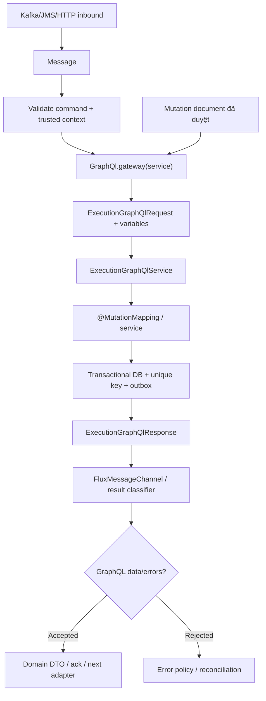
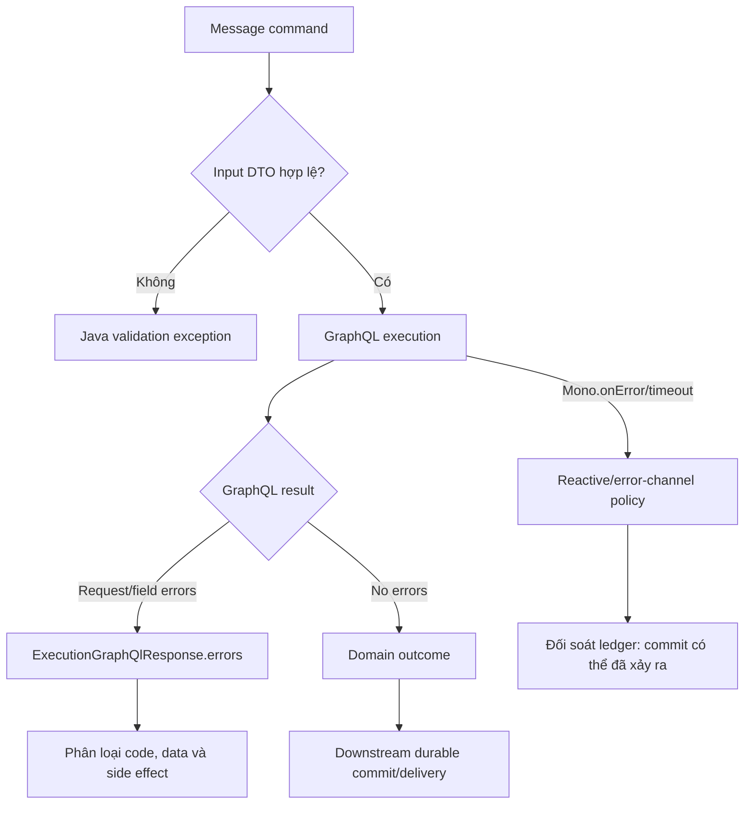
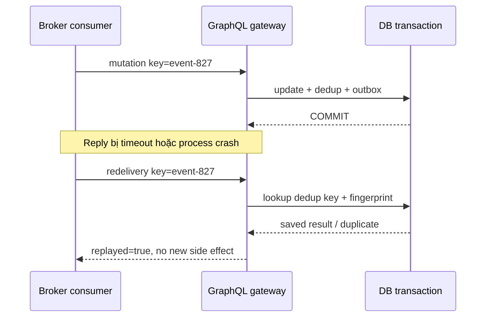
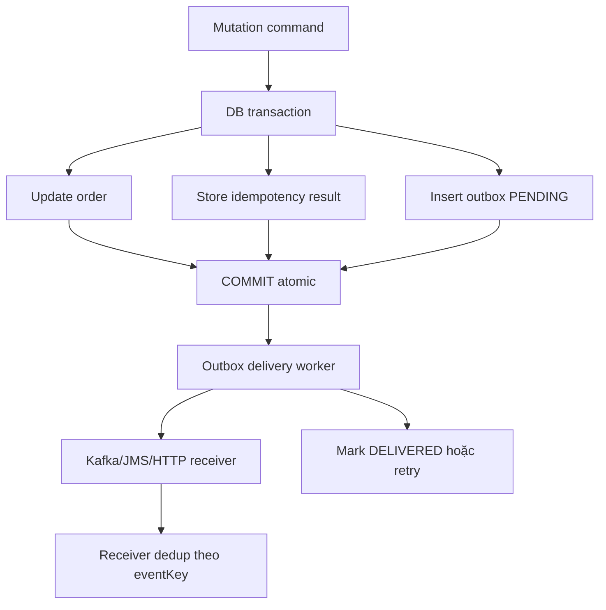

# GraphQL mutation từ message trong Spring Integration

## 1. Bài toán: nhận một command qua MessageChannel và thay đổi dữ liệu bằng GraphQL

Giả sử hệ thống quản lý đơn hàng nhận một message từ Kafka hoặc JMS:

```text
payload:
  orderId         = ORD-1001
  targetStatus    = PAID
  expectedVersion = 0
  idempotencyKey  = payment-confirmed:event-827

headers:
  correlationKey  = workflow-2026-827
  sourceSystem    = payment-events
```

Ứng dụng cần biến command này thành **GraphQL mutation** để cập nhật trạng thái đơn hàng trong GraphQL engine, trả lại kết quả có cấu trúc và chuyển sang các bước tiếp theo trong Spring Integration. Điều quan trọng là một message có thể được **giao lại** khi broker retry, JVM restart, transaction rollback hoặc reply bị mất, trong khi mutation **có side effect**. Nếu chỉ biến message thành request GraphQL rồi retry bất kỳ exception nào, hệ thống có thể cập nhật hai lần hoặc gửi hai sự kiện thông báo.

Ví dụ GraphQL operation:

```graphql
mutation ChangeOrderStatus($input: ChangeOrderStatusInput!) {
  changeOrderStatus(input: $input) {
    replayed
    order {
      id
      status
      version
    }
  }
}
```

Variables:

```json
{
  "input": {
    "orderId": "ORD-1001",
    "newStatus": "PAID",
    "expectedVersion": 0,
    "idempotencyKey": "payment-confirmed:event-827"
  }
}
```

Sau thành công, một response có thể là:

```json
{
  "data": {
    "changeOrderStatus": {
      "replayed": false,
      "order": {
        "id": "ORD-1001",
        "status": "PAID",
        "version": 1
      }
    }
  }
}
```

Nếu cùng command được gửi lại với **cùng idempotency key**, hệ thống có thể trả kết quả trước đó với `replayed=true` mà **không lặp lại side effect**.

Bài **“GraphQL mutation từ message”** thuộc chương **Adapter GraphQL** của module `SPRING_INTEGRATION_ADAPTERS`, module kết nối các hệ thống ngoài bằng inbound/outbound adapter, gateway, poller và `MessageChannel`; thực hành file, SFTP, HTTP, JMS, AMQP, Kafka, database, hợp đồng message, xử lý lỗi và vòng đời kết nối. Trọng tâm của bài này là biến **command message** thành GraphQL mutation, xử lý reply và xây dựng hợp đồng an toàn cho nghiệp vụ ghi.

### Sau bài học, bạn có thể

1. Phân biệt GraphQL `query`, `mutation` và subscription, hiểu vì sao mutation không tự có transaction/idempotency.
2. Biết chính xác `GraphQl.gateway(ExecutionGraphQlService)` thực thi GraphQL **engine được cấu hình**, không tự gọi remote HTTP endpoint.
3. Khai báo GraphQL schema `Mutation`, input object và response fields; map DTO từ `Message<?>` sang `variables(Map)`.
4. Viết Java DSL outbound gateway với `operation`, `operationName`, `variables`, `FluxMessageChannel`.
5. Dùng `@MutationMapping`, service và transaction boundary phía GraphQL execution.
6. Phân loại `ExecutionGraphQlResponse.isValid()`/`getErrors()`/partial data và reactive exception.
7. Thiết kế `idempotencyKey`, command fingerprint, optimistic locking, transaction và outbox để chống side effect trùng.
8. Xử lý JMS/Kafka redelivery, acknowledgment và crash-after-commit-before-reply.
9. Áp dụng authorization, query allowlist, quota, timeout, tracing và kiểm thử các lỗi khó.
10. Phân biệt local GraphQL outbound gateway với `HttpGraphQlClient` cho API GraphQL bên ngoài.

## 2. GraphQL outbound gateway và luồng xử lý mutation

Spring Integration **6.5** cung cấp module `spring-integration-graphql`:

```text
org.springframework.integration.graphql.outbound.GraphQlMessageHandler
org.springframework.integration.graphql.dsl.GraphQl
org.springframework.integration.graphql.dsl.GraphQlMessageHandlerSpec
```

`GraphQlMessageHandler` là một `AbstractReplyProducingMessageHandler`, nhận `Message<?>`, tạo `ExecutionGraphQlRequest` và gọi `ExecutionGraphQlService.execute(...)`. Kết quả được thể hiện dưới dạng `Mono<ExecutionGraphQlResponse>`.



### 2.1. Đúng API, đúng transport

| Nhu cầu | Thành phần | Ý nghĩa |
|---|---|---|
| Thực thi mutation trên GraphQL engine/schema do ứng dụng cấu hình | `GraphQl.gateway(executionGraphQlService)` | Gọi GraphQL execution service, **không** tự gửi HTTP |
| Gọi một GraphQL endpoint đối tác qua HTTPS | `HttpGraphQlClient` hoặc `HttpSyncGraphQlClient` | Cần WebClient/transport, auth, timeout |
| Dùng một HTTP POST GraphQL JSON với tùy chỉnh HTTP rõ ràng | Spring Integration HTTP outbound gateway | Tự kiểm soát JSON, headers, status |
| Nhận command từ Kafka/JMS | Inbound adapter + `MessageChannel` | Có redelivery/ack policy riêng |
| Xử lý kết quả mutation | `ExecutionGraphQlResponse`, router/handler | Phân biệt data/errors và exception |

Không tồn tại cách cấu hình `GraphQl.gateway("https://api.partner/graphql")` thay cho một HTTP client. Một **remote GraphQL mutation** là nhu cầu khác: cùng quy tắc idempotency nhưng có thêm rủi ro transport/HTTP status và reply không chắc chắn. Phần 12 trình bày riêng.

### 2.2. Ba trạng thái không được đánh đồng

```text
1. MessageChannel chấp nhận command
2. GraphQL mutation resolver + database đã commit
3. Downstream notification đã được giao và xác nhận
```

Một `send()` trả `true` chỉ cho biết channel **chấp nhận** message, không phải DB đã commit. `ExecutionGraphQlResponse` có `data` không đảm bảo side effect tiếp theo (Kafka/JMS/HTTP outbound) đã xong. Nếu gửi event sau DB commit mà timeout, phía nhận **có thể đã xử lý** dù sender chưa thấy ACK.

### 2.3. Vì sao tên mutation không đồng nghĩa “exactly-once”

GraphQL specification yêu cầu các **top-level fields của cùng một mutation operation** được thực thi **tuần tự**. Nhưng:

- Hai mutation requests khác nhau vẫn có thể chạy **đồng thời**.
- Hai pod cùng nhận lại một broker message có thể cùng gọi resolver.
- GraphQL không tự tạo một database transaction xuyên nhiều root mutation fields.
- Một root field lỗi không tự rollback side effect của root field trước đó.
- Nested response fields không phải tất cả các command side effects; những field đó thường chỉ đọc dữ liệu.

Do đó, bảo vệ nghiệp vụ phải nằm trong **database transaction, unique constraint/optimistic locking và idempotency ledger**, không dựa vào thứ tự resolve của GraphQL.

## 3. Schema GraphQL: input object và mutation result

### 3.1. Schema tự chứa cho lab

Ví dụ **`src/main/resources/graphql/order-mutation.graphqls`** trong dự án thực hành:

```graphql
enum OrderStatus {
  CREATED
  PAID
  SHIPPED
  CANCELLED
}

type Order {
  id: ID!
  status: OrderStatus!
  version: Int!
}

input ChangeOrderStatusInput {
  orderId: ID!
  newStatus: OrderStatus!
  expectedVersion: Int!
  idempotencyKey: ID!
}

type ChangeOrderStatusResult {
  order: Order!
  replayed: Boolean!
}

type Query {
  order(id: ID!): Order
}

type Mutation {
  changeOrderStatus(input: ChangeOrderStatusInput!):
    ChangeOrderStatusResult!
}
```

**Phân tích:**

- `Mutation.changeOrderStatus` là root field có side effect; `Query.order` là field đọc.
- `ChangeOrderStatusInput` là **input type**, dùng truyền nhiều trường cùng một argument `input`.
- `ID!` đại diện identity string/ID; không phải URL và không tự là authorization key.
- `Int!` theo GraphQL là **signed 32-bit**, phù hợp version nhỏ trong lab.
- `expectedVersion` hỗ trợ optimistic concurrency; nó không phải version của GraphQL schema.
- `idempotencyKey` là key **bắt buộc** do phía gửi command tạo và giữ ổn định khi retry.
- `replayed` giúp người gọi phân biệt request mới với lần gửi lặp mà không tạo side effect lần nữa.
- Dấu `!` ràng buộc non-null ở GraphQL schema, nhưng **không kiểm tra nghiệp vụ** như ID blank, trạng thái chuyển không hợp lệ, tài khoản không có quyền.

### 3.2. Document mutation có tên và variables

```graphql
mutation ChangeOrderStatus($input: ChangeOrderStatusInput!) {
  changeOrderStatus(input: $input) {
    replayed
    order {
      id
      status
      version
    }
  }
}
```

Trong document, `$input` có dấu `$`. Trong Java `Map<String,Object>`, key tương ứng là **`"input"`**, không phải `"$input"`. Object nested phải dùng đúng key schema: `orderId`, `newStatus`, `expectedVersion`, `idempotencyKey`.

```java
Map<String, Object> input = Map.of(
        "orderId", "ORD-1001",
        "newStatus", "PAID",
        "expectedVersion", 0,
        "idempotencyKey", "payment-confirmed:event-827");

Map<String, Object> variables = Map.of("input", input);
```

Không nối `orderId`, status hoặc key lấy từ message vào một GraphQL document bằng string concatenation. Variable binding xử lý input coercion và escaping ở ranh giới GraphQL. Tuy nhiên, nó không thay thế **authentication/authorization/validation**, vì một orderId đúng cú pháp vẫn có thể thuộc về tenant khác.

### 3.3. Biến optional, omitted và explicit null trong mutation

Lúc làm PATCH, ba trường hợp sau **khác nhau**:

| Dữ liệu | Ý nghĩa có thể có |
|---|---|
| Không có key `comment` | Giữ nguyên comment cũ |
| Key `comment -> null` | Chủ động xóa comment |
| Key `comment -> "Ready"` | Cập nhật comment |

Ví dụ nếu sau này thêm `comment: String` vào `ChangeOrderStatusInput`, cần một kiểu input phía Java lưu được trạng thái omitted khác null. Spring for GraphQL có `ArgumentValue<T>` và hỗ trợ đặt ở nested input object cho trường hợp này. Không chỉ dùng `String comment` null rồi mặc định “null tức là không cập nhật” nếu API cho phép xóa bằng null.

`Map.of(...)` không cho phép value null. Khi cần explicit null, dùng `HashMap` có key chủ động đặt null; khi omitted, **không đưa key vào map**.

### 3.4. Nullability không bảo đảm có transaction

Khi mutation resolver đã commit nhưng lỗi xảy ra lúc resolve một output field có kiểu `Order!`, GraphQL có thể trả `errors` và null propagation. **Không suy** rằng GraphQL errors nghĩa là transaction đã rollback. Dữ liệu thực tế ở DB và idempotency ledger mới là cơ sở xác định command đã được áp dụng hay chưa.

## 4. Java 17 domain contract: message command, input và result

Ví dụ này sử dụng **Spring Boot 3.x, Spring Integration 6.5.x tương thích và Java 17**. Những class dưới đây là **class do ứng dụng định nghĩa**, không phải API tích hợp sẵn.

### 4.1. Command ở message

**`ChangeOrderStatusCommand.java`:**

```java
import java.util.Objects;

enum OrderStatus {
    CREATED, PAID, SHIPPED, CANCELLED
}

public record ChangeOrderStatusCommand(
        String orderId,
        OrderStatus targetStatus,
        int expectedVersion,
        String idempotencyKey) {

    public ChangeOrderStatusCommand {
        if (orderId == null || orderId.isBlank()
                || orderId.length() > 128) {
            throw new IllegalArgumentException("orderId không hợp lệ");
        }
        Objects.requireNonNull(targetStatus, "targetStatus");
        if (expectedVersion < 0) {
            throw new IllegalArgumentException(
                    "expectedVersion phải không âm");
        }
        if (idempotencyKey == null || idempotencyKey.isBlank()
                || idempotencyKey.length() > 256) {
            throw new IllegalArgumentException(
                    "idempotencyKey không hợp lệ");
        }
    }
}
```

Một command hợp lệ về kiểu chưa được phép thực thi cho tới khi được kiểm tra **principal/tenant/authorization** ở service phù hợp. Một custom header do message producer gửi không tự chứng minh quyền truy cập order.

### 4.2. Record bind cho GraphQL resolver

**`OrderMutationTypes.java`:**

```java
record ChangeOrderStatusInput(
        String orderId,
        OrderStatus newStatus,
        Integer expectedVersion,
        String idempotencyKey) {
}

record OrderView(
        String id,
        OrderStatus status,
        int version) {
}

record ChangeOrderStatusResult(
        OrderView order,
        boolean replayed) {
}
```

`@Argument("input") ChangeOrderStatusInput input` được Spring for GraphQL bind từ một input object có cùng tên trường. `Integer` phù hợp GraphQL `Int` và cho phép kiểm tra null trước nghiệp vụ (schema khai báo `Int!` sẽ từ chối null/omitted). Các record được giả định ở **cùng package** với controller/service trong demo; khi dùng nhiều package, đặt visibility/import theo cấu trúc dự án.

## 5. GraphQL resolver và service minh họa

### 5.1. Resolver được gọi bởi ExecutionGraphQlService

**`OrderMutationController.java`:**

```java
import org.springframework.graphql.data.method.annotation.Argument;
import org.springframework.graphql.data.method.annotation.MutationMapping;
import org.springframework.graphql.data.method.annotation.QueryMapping;
import org.springframework.stereotype.Controller;

@Controller
public class OrderMutationController {

    private final DemoOrderMutationService service;

    public OrderMutationController(DemoOrderMutationService service) {
        this.service = service;
    }

    @MutationMapping
    public ChangeOrderStatusResult changeOrderStatus(
            @Argument("input") ChangeOrderStatusInput input) {
        return service.changeStatus(input);
    }

    @QueryMapping
    public OrderView order(@Argument String id) {
        return service.getOrder(id);
    }
}
```

`@MutationMapping` gắn method với field `Mutation.changeOrderStatus`; `@QueryMapping` gắn method với `Query.order`. Tên method/mapping và schema phải khớp. `@Argument` bind theo field arguments của GraphQL, không phải Spring Message headers. Handler có thể trả `Mono<T>` nếu dùng reactive service, nhưng không nên block event loop bằng JDBC sync call mà không có boundary thread phù hợp.

### 5.2. Service in-memory dành riêng cho lab

Để có ví dụ tự chứa mà không yêu cầu PostgreSQL, service dưới đây dùng lock JVM qua `synchronized` và một in-memory ledger. Nó minh họa **thứ tự kiểm tra duplicate trước optimistic version**; **không an toàn cho production đa pod, không bền qua restart**.

**`DemoOrderMutationService.java`:**

```java
import java.util.HashMap;
import java.util.Map;

import org.springframework.stereotype.Service;

@Service
public class DemoOrderMutationService {

    private final Map<String, OrderView> orders = new HashMap<>();
    private final Map<String, SavedResult> resultsByKey = new HashMap<>();

    public DemoOrderMutationService() {
        orders.put("ORD-1001",
                new OrderView("ORD-1001", OrderStatus.CREATED, 0));
    }

    public synchronized OrderView getOrder(String orderId) {
        return orders.get(orderId);
    }

    public synchronized ChangeOrderStatusResult changeStatus(
            ChangeOrderStatusInput input) {

        if (input == null
                || input.orderId() == null
                || input.orderId().isBlank()
                || input.newStatus() == null
                || input.expectedVersion() == null
                || input.expectedVersion() < 0
                || input.idempotencyKey() == null
                || input.idempotencyKey().isBlank()) {
            throw new IllegalArgumentException(
                    "Mutation input không hợp lệ");
        }

        // Fingerprint của intent, KHÔNG chứa message UUID.
        String fingerprint = input.orderId()
                + "|" + input.newStatus().name()
                + "|" + input.expectedVersion();

        SavedResult previous = resultsByKey.get(input.idempotencyKey());
        if (previous != null) {
            if (!previous.fingerprint().equals(fingerprint)) {
                throw new IllegalArgumentException(
                        "Idempotency key bị tái sử dụng cho command khác");
            }
            return new ChangeOrderStatusResult(
                    previous.result().order(), true);
        }

        OrderView current = orders.get(input.orderId());
        if (current == null) {
            throw new IllegalArgumentException("Order không tồn tại");
        }
        if (current.version() != input.expectedVersion()) {
            throw new IllegalStateException(
                    "Version conflict; cần đối soát");
        }
        if (!allowedTransition(current.status(), input.newStatus())) {
            throw new IllegalStateException(
                    "Chuyển trạng thái không hợp lệ");
        }

        OrderView next = new OrderView(
                current.id(), input.newStatus(), current.version() + 1);
        orders.put(current.id(), next);
        ChangeOrderStatusResult result =
                new ChangeOrderStatusResult(next, false);
        resultsByKey.put(input.idempotencyKey(),
                new SavedResult(fingerprint, result));
        return result;
    }

    private static boolean allowedTransition(
            OrderStatus current, OrderStatus target) {
        return switch (current) {
            case CREATED -> target == OrderStatus.PAID
                    || target == OrderStatus.CANCELLED;
            case PAID -> target == OrderStatus.SHIPPED;
            case SHIPPED, CANCELLED -> false;
        };
    }

    private record SavedResult(
            String fingerprint,
            ChangeOrderStatusResult result) {
    }
}
```

**Bản chất ví dụ:**

- Với `idempotencyKey` mới, service kiểm tra phiên bản/trạng thái, cập nhật order và lưu kết quả.
- Nếu **cùng key + cùng fingerprint** được gửi lại, trả trạng thái đã lưu với `replayed=true` mà không cập nhật `version` nữa.
- Nếu **cùng key nhưng command khác**, reject để tránh idempotency key collision/reuse.
- Nếu key mới nhưng `expectedVersion` cũ, trả conflict thay vì âm thầm ghi đè.
- `synchronized` bảo vệ một instance demo; không bao giờ bảo đảm atomicity giữa nhiều pod, không giữ dữ liệu sau restart và không đồng bộ với một broker hay database thực.
- Fingerprint nối chuỗi đơn giản phù hợp demo; production nên canonical-serialize/sha256 có version, bao gồm tenant/source/operation/command payload theo hợp đồng để tránh ambiguity.

**Quy tắc nghiệp vụ do lab chọn:** `CREATED -> PAID/CANCELLED`, `PAID -> SHIPPED`; các chuyển khác bị từ chối. Người học có thể mở rộng state machine, nhưng phải cập nhật tests và giữ transition policy ở service/domain, không rải trong nhiều adapter.

### 5.3. Vì sao service phải có transaction ở production?

Một quy trình production cần commit **cùng một transaction**: claim idempotency key, kiểm tra fingerprint, cập nhật row theo version và lưu outbox event. Nếu tách thành ba thao tác độc lập:

```text
INSERT idempotency record -> DB success
UPDATE order             -> process crash
INSERT outbox             -> không chạy
```

thì dù idempotency ledger nói “đã thấy command”, order có thể chưa cập nhật hoặc event chưa được tạo. Cần transaction, atomic compare-and-set và recovery. Phần 9 phân tích database design chi tiết.

## 6. Java DSL: từ Message<Command> tới GraphQL mutation

### 6.1. Dependencies và lựa chọn bean

**`build.gradle`:**

```gradle
dependencies {
    implementation 'org.springframework.boot:spring-boot-starter-integration'
    implementation 'org.springframework.integration:spring-integration-graphql'
    implementation 'org.springframework.boot:spring-boot-starter-graphql'

    testImplementation 'org.springframework.boot:spring-boot-starter-test'
    testImplementation 'org.springframework.graphql:spring-graphql-test'
}
```

Spring Boot GraphQL starter thường auto-configure `GraphQlSource`/`ExecutionGraphQlService` từ schema và `@Controller`. Nếu tự tạo `GraphQlSource.builder()` và `DefaultExecutionGraphQlService` theo tài liệu Spring Integration, **không đồng thời tạo bản thủ công và bản Boot auto-configured một cách vô ý**. Chọn một service/schema nhất quán; nếu có nhiều bean, dùng `@Qualifier`.

### 6.2. Flow Java DSL

**`OrderMutationIntegrationConfig.java`:**

```java
import java.util.Map;

import org.springframework.context.annotation.Bean;
import org.springframework.context.annotation.Configuration;
import org.springframework.graphql.ExecutionGraphQlService;
import org.springframework.integration.config.EnableIntegration;
import org.springframework.integration.dsl.IntegrationFlow;
import org.springframework.integration.dsl.MessageChannels;
import org.springframework.integration.graphql.dsl.GraphQl;

@Configuration
@EnableIntegration
public class OrderMutationIntegrationConfig {

    private static final String CHANGE_ORDER_STATUS = """
            mutation ChangeOrderStatus($input: ChangeOrderStatusInput!) {
              changeOrderStatus(input: $input) {
                replayed
                order {
                  id
                  status
                  version
                }
              }
            }
            """;

    @Bean
    IntegrationFlow orderMutationFlow(
            ExecutionGraphQlService graphQlService) {

        return IntegrationFlow
                .from(MessageChannels.flux("orderMutationRequests"))
                .handle(GraphQl.gateway(graphQlService)
                        .operation(CHANGE_ORDER_STATUS)
                        .operationName("ChangeOrderStatus")
                        .variables(message -> {
                            ChangeOrderStatusCommand command =
                                    (ChangeOrderStatusCommand)
                                            message.getPayload();
                            Map<String, Object> input = Map.of(
                                    "orderId", command.orderId(),
                                    "newStatus", command.targetStatus().name(),
                                    "expectedVersion",
                                            command.expectedVersion(),
                                    "idempotencyKey",
                                            command.idempotencyKey());
                            return Map.of("input", input);
                        })
                        .executionId(message ->
                                message.getHeaders().getId().toString()))
                .channel(c -> c.flux("orderMutationResults"))
                .get();
    }
}
```

**Giải thích theo bước:**

1. `MessageChannels.flux("orderMutationRequests")` tạo input channel reactive, thuận tiện cho gateway trả `Mono<ExecutionGraphQlResponse>`.
2. `GraphQl.gateway(graphQlService)` tạo `GraphQlMessageHandlerSpec`; đây **không** phải remote HTTP client.
3. `operation(CHANGE_ORDER_STATUS)` lưu mutation document tĩnh và có tên. Không lấy operation document tùy ý từ Kafka/HTTP header.
4. `operationName("ChangeOrderStatus")` chọn tên operation trong document.
5. `variables(message -> {...})` đọc `ChangeOrderStatusCommand` và tạo nested map chính xác theo `ChangeOrderStatusInput` của GraphQL.
6. `targetStatus().name()` chuyển enum Java thành string GraphQL enum value (ví dụ `"PAID"`).
7. `expectedVersion` là `int` phù hợp GraphQL `Int!`; một version ngoài phạm vi int32 cần custom scalar/hợp đồng khác.
8. `executionId(...)` phục vụ trace GraphQL execution theo message UUID, **không** thay `idempotencyKey`.
9. `orderMutationResults` nhận reply `ExecutionGraphQlResponse`. Consumer phải kiểm tra `errors` và kết quả nghiệp vụ.

### 6.3. Gửi message đến gateway

**`OrderMutationPublisher.java`:**

```java
import org.springframework.beans.factory.annotation.Qualifier;
import org.springframework.integration.support.MessageBuilder;
import org.springframework.messaging.MessageChannel;
import org.springframework.stereotype.Component;

@Component
public class OrderMutationPublisher {

    private final MessageChannel input;

    public OrderMutationPublisher(
            @Qualifier("orderMutationRequests") MessageChannel input) {
        this.input = input;
    }

    public void publish(ChangeOrderStatusCommand command,
            String correlationKey) {
        boolean accepted = input.send(
                MessageBuilder.withPayload(command)
                        .setHeader("correlationKey", correlationKey)
                        .setHeader("sourceSystem", "payment-events")
                        .build());
        if (!accepted) {
            throw new IllegalStateException(
                    "Input channel không nhận command");
        }
    }
}
```

Ví dụ chạy:

```java
publisher.publish(
        new ChangeOrderStatusCommand(
                "ORD-1001",
                OrderStatus.PAID,
                0,
                "payment-confirmed:event-827"),
        "workflow-2026-827");
```

`publisher` là instance `OrderMutationPublisher` từ Spring context trong một runner/test, không phải biến có sẵn ở scope của class. Phương thức `publish()` này **chỉ gửi message**; không dùng giá trị boolean của `send()` để xác nhận mutation đã commit.

### 6.4. Java DSL cho command đến từ nhiều nguồn

```text
Kafka inbound adapter -> Message<?> -> validate/transform -> orderMutationRequests
JMS inbound adapter   -> Message<?> -> validate/transform -> orderMutationRequests
HTTP inbound gateway -> Message<?> -> validate/transform -> orderMutationRequests
Poller               -> Message<?> -> validate/transform -> orderMutationRequests
```

Một JSON event từ Kafka cần được deserialize và validate thành `ChangeOrderStatusCommand` trước khi đưa vào channel. Không tự cast `String` hoặc `Map` thô sang command như thể Spring Integration đã thực hiện chuyển đổi đó.

**Về ACK/offset:** Kafka/JMS message được đánh dấu hoàn tất theo **processing/transaction policy** của consumer. Đưa message vào `FluxMessageChannel` không tự tạo mối liên kết bền giữa broker offset và GraphQL mutation commit. Cần orchestration để chỉ ACK sau khi kết quả durable được xác minh hoặc đã lưu command vào durable inbox, tránh mất event nếu JVM dừng trước khi result tới.

## 7. Xử lý reply: ExecutionGraphQlResponse và dữ liệu nghiệp vụ

### 7.1. Một mutation có thể tạo response hợp lệ nhưng chứa errors

GraphQL quy định response có thể chứa `data` và `errors` đồng thời:

```json
{
  "data": {
    "changeOrderStatus": null
  },
  "errors": [
    {
      "message": "Version conflict",
      "path": ["changeOrderStatus"]
    }
  ]
}
```

**Lưu ý về schema ví dụ:** vì `changeOrderStatus` được khai báo non-null, một lỗi ở resolver có thể **null-propagate** tới toàn bộ `data`. JSON trên chỉ minh họa ý tưởng lỗi có path; response thực tế có thể là `"data": null`. Hãy kiểm thử theo đúng nullability, không giả định `data.changeOrderStatus` luôn có mặt khi có `errors`.

Một lỗi GraphQL **in-band** không nhất thiết làm `Mono` thất bại và không tự chuyển thành Spring Integration `ErrorMessage`. Vì vậy downstream phải kiểm tra:

- `response.isValid()`: request/response có hợp lệ về mặt execution/GraphQL contract không.
- `response.getErrors()`: các lỗi ở cấp request/field/resolver.
- `response.field("changeOrderStatus").getValue()`: dữ liệu trường chính, có thể null.
- `replayed` và `order.version`: kết quả nghiệp vụ có ý nghĩa gì.
- Đối chiếu idempotency ledger trong trường hợp reply không rõ ràng hoặc bị mất.

### 7.2. Consumer đọc dữ liệu và header

**`OrderMutationResultConsumer.java`:**

```java
import java.util.Map;

import org.springframework.graphql.ExecutionGraphQlResponse;
import org.springframework.integration.annotation.ServiceActivator;
import org.springframework.messaging.Message;
import org.springframework.stereotype.Component;

@Component
public class OrderMutationResultConsumer {

    @ServiceActivator(inputChannel = "orderMutationResults")
    public void consume(Message<ExecutionGraphQlResponse> reply) {
        ExecutionGraphQlResponse response = reply.getPayload();
        String correlation = reply.getHeaders()
                .get("correlationKey", String.class);

        if (!response.isValid()) {
            System.err.println("Mutation request không hợp lệ");
            return;
        }
        if (!response.getErrors().isEmpty()) {
            // Không coi mọi lỗi là transient hoặc rollback.
            System.err.println("Mutation GraphQL error count="
                    + response.getErrors().size());
            return;
        }

        Map<String, Object> root =
                response.field("changeOrderStatus").getValue();
        if (root == null
                || !(root.get("order") instanceof Map<?, ?> order)
                || !(root.get("replayed") instanceof Boolean replayed)) {
            throw new IllegalStateException(
                    "Mutation response thiếu trường bắt buộc");
        }

        String orderId = (String) order.get("id");
        String status = (String) order.get("status");
        int version = ((Number) order.get("version")).intValue();

        System.out.printf(
                "correlation=%s order=%s status=%s version=%d replayed=%s%n",
                correlation, orderId, status, version, replayed);

        // Production: ghi kết quả vào durable workflow/outbox.
        // Không đánh dấu broker ACK chỉ vì dòng log này chạy.
    }
}
```

Ví dụ được thiết kế để minh họa ranh giới: **server-side** `ExecutionGraphQlResponse.field(...)` trả `ResponseField` có `getValue()`, thường là `Map/List/scalar`. Nó **không** có `toEntity(Class)` như `ClientResponseField` ở Spring GraphQL client. Trong production, dùng một DTO mapper với validation schema, không ép kiểu thô khi nhận dữ liệu không tin cậy.

Với một `FluxMessageChannel` đã được subscribe qua endpoint `@ServiceActivator`, reply đi qua reactive channel tới consumer. Header `correlationKey` có thể được propagate trong flow message-producing handler theo cấu hình; phải kiểm thử cụ thể, không giả định mọi custom header đi qua mọi HTTP/broker bridge.

### 7.3. Khi nào coi mutation thật sự thành công?

| Tín hiệu | Ý nghĩa | Chưa đủ để kết luận |
|---|---|---|
| `MessageChannel.send() == true` | Input channel chấp nhận message | Mutation đã chạy |
| `Mono` có reply | Execution service phát kết quả | GraphQL response không có errors |
| `response.isValid()` | Request/response hợp lệ | Business side effect hoàn tất không lỗi |
| `getErrors().isEmpty()` | Không có GraphQL error được báo | Notification downstream đã giao |
| `data.order.version = 1` | GraphQL resolver trả version 1 | Broker ACK đã commit |
| Transaction DB commit | Domain state đã bền ở một DB | Outbox đã được consumer gửi |
| Outbox event ACK/mark delivered | Delivery đã tiến theo contract | Bên nhận không tạo duplicate nếu reply timeout |

Trong flow thực, định nghĩa **điểm hoàn thành nghiệp vụ** rõ: ví dụ “order update transaction và outbox commit”, hoặc “consumer đích xác nhận idempotently”. Khi kiểm tra retry sau timeout, dùng ledger/version để biết side effect đã được áp dụng hay chưa.

### 7.4. Header và execution ID

```text
message.headers.id       = UUID của message instance
headers.correlationKey   = workflow-2026-827
payload.idempotencyKey   = payment-confirmed:event-827
graphql.executionId      = UUID hoặc custom trace ID
domain.orderId           = ORD-1001
```

**Không lấy `MessageHeaders.ID` làm idempotency key**: một redelivery/rebuild message có thể có UUID mới. Tương tự, correlation key chủ yếu phục vụ observability và workflow routing, không mặc nhiên xác nhận cùng command. Key chống trùng phải được tạo **ổn định tại nguồn** và lưu cùng các dữ liệu xác minh tính tương đương.

## 8. Phân loại lỗi: GraphQL errors, Java exception và trạng thái không chắc chắn

### 8.1. Ba loại thất bại



| Nhóm lỗi | Ví dụ | Đường biểu diễn phổ biến | Retry? |
|---|---|---|---|
| Message contract | `orderId` blank, version âm | Java constructor/transformer exception | Không retry cùng payload |
| GraphQL syntax/schema | Mutation field không có trong schema | GraphQL response errors | Sửa document/schema |
| GraphQL variable coercion | `newStatus="UNKNOWN"`, thiếu `input` | GraphQL response errors | Sửa variables |
| Business reject | Order không tồn tại, transition sai | Resolver exception -> GraphQL field errors | Không retry mù |
| Optimistic conflict | expectedVersion cũ | Business/GraphQL error | Reload state, reconcile |
| Reused key, different command | Fingerprint mismatch | Conflict/quarantine/security alert | Không ghi đè |
| DB deadlock/transient | Transaction rollback | Có thể được resolver chuyển thành GraphQL error | Có thể retry **cùng key** sau rollback |
| Timeout sau commit | Reply lost | Java/reactive timeout hoặc caller không nhận | **Unknown outcome**; tra ledger trước |
| Outbound broker failure | DB commit rồi Kafka/JMS timeout | Delivery/outbox error | Retry outbox cùng event key |
| Remote HTTP 401/429/503 | Khi dùng GraphQL HTTP client từ xa | Client transport error/status | Theo auth/quota/backoff |

### 8.2. GraphQL request error và field error

Một document sai cú pháp hoặc variable thiếu cho type `ChangeOrderStatusInput!` có thể bị GraphQL Java từ chối **trước khi gọi resolver**. Trong khi đó, nếu `@MutationMapping` được gọi và ném exception, Spring for GraphQL có thể chuyển lỗi thành một hoặc nhiều `GraphQLError` ở field path. Không suy một GraphQL error luôn là Java exception thoát ra Spring Integration.

Spring for GraphQL hỗ trợ `@GraphQlExceptionHandler`/`DataFetcherExceptionResolver` để chuyển exception thành GraphQL errors có category phù hợp, ví dụ `BAD_REQUEST`, `FORBIDDEN`, `NOT_FOUND` hoặc `INTERNAL_ERROR`. **Không lộ SQL, stack trace, thông tin thanh toán hoặc token** trong `message/extensions` công khai.

Ví dụ một handler domain:

```java
import graphql.GraphQLError;
import graphql.GraphqlErrorBuilder;

import org.springframework.graphql.data.method.annotation.GraphQlExceptionHandler;
import org.springframework.graphql.execution.ErrorType;
import org.springframework.web.bind.annotation.ControllerAdvice;

@ControllerAdvice
public class OrderGraphQlErrorAdvice {

    @GraphQlExceptionHandler
    public GraphQLError handleConflict(
            GraphqlErrorBuilder<?> errorBuilder,
            IllegalStateException ex) {
        // Chỉ minh họa một policy: không đưa ex.getMessage()
        // chứa nội bộ hệ thống ra GraphQL response.
        return errorBuilder
                .errorType(ErrorType.BAD_REQUEST)
                .message("Không thể thực hiện chuyển trạng thái")
                .build();
    }
}
```

Ở production, nên dùng **exception type chuyên biệt** như `VersionConflictException`, `IdempotencyKeyConflictException`, `ForbiddenOrderException` để map category có chủ đích; đừng dùng mọi `IllegalStateException` như một lỗi business. `@ControllerAdvice` giúp áp dụng cho các GraphQL annotated controllers; nếu đặt `@GraphQlExceptionHandler` trực tiếp trên một `@Controller` thì handler chỉ áp dụng cho controller đó. Cách nhận `GraphqlErrorBuilder<?>` từ Spring for GraphQL giúp giữ field path/execution context và tránh tự lắp lỗi thiếu metadata.

### 8.3. Lỗi GraphQL không mặc định đi vào errorChannel

`ExecutionGraphQlResponse` chứa `getErrors()` là **reply có thông tin lỗi**, vẫn có thể đi qua output channel bình thường. Nếu muốn route:

```text
GraphQL result channel
   |
   +-- INVALID_REQUEST -> log category, báo schema/client
   +-- BUSINESS_REJECTED -> workflow failure / quarantine
   +-- UNKNOWN_OUTCOME -> reconciliation
   +-- SUCCESS -> next durable stage
```

Ngược lại, khi Reactor publisher ném `onError`, pipeline cần reactive error handling/async error channel phù hợp. `errorChannel` được cấu hình trên message/poller **không thay thế** việc kiểm tra `getErrors()`. Không tự retry cả một mutation chỉ vì một `ErrorMessage` xuất hiện mà chưa biết DB đã commit hay chưa.

### 8.4. Partial data sau side effect là trường hợp nguy hiểm

Một mutation có thể:

1. Thực hiện update thành công.
2. Commit transaction.
3. Resolver của response field `order.status` phát lỗi.
4. GraphQL trả `data=null` (do non-null propagation) kèm `errors`.

Nhìn vào `data=null` rồi kết luận “chưa cập nhật” là sai. Với mutation, **GraphQL errors không tương đương rollback**. Cách quyết định retry là hỏi command ledger/DB state theo key, không phải chỉ dựa vào response body.

### 8.5. Timeout không xác định kết quả



Không dùng một retry vô hạn trong thread của consumer. Thiết kế phải có retry budget, backoff, dead-letter/reconciliation và idempotency phía server. Với một GraphQL remote service không hỗ trợ idempotency, đôi khi lựa chọn an toàn là **pause + manual reconciliation**, không tự gửi lại lệnh có tính thanh toán.

## 9. Idempotency và optimistic locking ở tầng database

### 9.1. Idempotency key: danh tính *command*, không phải message

Một source event có identity ổn định:

```text
source = payment-events
eventId = 827
operation = ChangeOrderStatus
tenant = tenant-acme
idempotencyKey = payment-events:827:ChangeOrderStatus
```

Phạm vi unique key nên bao gồm tenant/source khi domain đa tenant. Nếu một key được tái sử dụng với nội dung khác, trả **conflict** thay vì áp command mới. Nếu cùng command gửi lại, trả kết quả lưu trước; không update version và không ghi thêm outbox event.

| Tình huống | Cùng key? | Cùng fingerprint? | Kết quả |
|---|---|---|---|
| Lần đầu gửi | Mới | — | Claim, validate, commit side effect |
| Broker gửi lại nguyên command | Có | Có | Trả kết quả cũ, không lặp side effect |
| Producer vô tình tái dùng key cho command khác | Có | Không | Conflict, audit |
| Command mới hợp lệ cho cùng order | Khác | Khác | Xử lý theo version/state |
| Hai worker cùng claim một key | Có | Có | Database unique/lock quyết định một chủ |
| Same order, hai key khác, cùng expectedVersion | Khác | Khác | Một update thắng; cái còn lại version conflict |

**Fingerprint** nên dựa trên bản canonical của `tenant/source/operation/orderId/newStatus/expectedVersion` và một phiên bản schema. Không đưa `MessageHeaders.ID`, thời điểm poll/retry, correlation trace hay header không ổn định vào fingerprint. Có thể băm SHA-256 một serialization canonical, nhưng phải version hóa quy tắc serialization.

### 9.2. Database schema minh họa

**PostgreSQL DDL minh họa**, không phải bảng Spring Integration dựng sẵn:

```sql
CREATE TABLE orders (
    tenant_id    VARCHAR(128) NOT NULL,
    order_id     VARCHAR(128) NOT NULL,
    status       VARCHAR(32) NOT NULL,
    version      INTEGER NOT NULL,
    updated_at   TIMESTAMPTZ NOT NULL DEFAULT now(),
    PRIMARY KEY (tenant_id, order_id)
);

CREATE TABLE mutation_idempotency (
    tenant_id        VARCHAR(128) NOT NULL,
    idempotency_key  VARCHAR(256) NOT NULL,
    operation_name   VARCHAR(128) NOT NULL,
    request_hash     CHAR(64) NOT NULL,
    result_json      JSONB NOT NULL,
    created_at       TIMESTAMPTZ NOT NULL DEFAULT now(),
    PRIMARY KEY (tenant_id, idempotency_key)
);

CREATE TABLE mutation_outbox (
    event_key       VARCHAR(512) PRIMARY KEY,
    tenant_id       VARCHAR(128) NOT NULL,
    event_type      VARCHAR(128) NOT NULL,
    payload_json    JSONB NOT NULL,
    delivery_state  VARCHAR(32) NOT NULL,
    created_at      TIMESTAMPTZ NOT NULL DEFAULT now()
);
```

Schema dùng `result_json NOT NULL` vì yêu cầu **idempotency row chỉ commit cùng kết quả thành công**. Nếu cần trạng thái `PROCESSING/FAILED_RETRYABLE` qua các transaction tách biệt, thiết kế thêm lease/owner/status/result nullable, timeout và state machine; không dùng mẫu trên nguyên xi cho workflow đa transaction.

### 9.3. Một transaction gồm cả ba việc

Pseudocode đúng ý tưởng:

```text
@Transactional changeStatus(tenant, command):
  fingerprint = hashCanonical(command)

  claim idempotency row bằng UNIQUE (tenant,key)
  nếu key đã tồn tại:
      đọc hash/result của row đã COMMIT
      hash khác -> IDEMPOTENCY_CONFLICT
      hash giống -> return saved result (replayed=true)

  kiểm tra order thuộc tenant, principal được quyền sửa
  UPDATE orders
     SET status = target, version = version + 1
     WHERE tenant_id = :tenant
       AND order_id = :id
       AND version = :expectedVersion
       AND status = :expectedStatusOrPolicy

  nếu updated rows = 0 -> VERSION/STATE_CONFLICT, rollback
  INSERT mutation_outbox(event_key, type, payload, PENDING)
  ghi result vào idempotency row
  COMMIT
  return saved result (replayed=false)
```

Trong implementation thực, nếu phải lưu result ngay khi claim, có thể sử dụng một transaction với deferred hoặc staged row; schema `result_json NOT NULL` đòi result được gán khi thực sự INSERT. Cách triển khai ví dụ là **tính/khóa trạng thái dưới transaction, xây result, rồi INSERT idempotency row + outbox + UPDATE trước COMMIT**, giải quyết race bằng unique key và cơ chế retry/lock của DB. Không copy pseudocode thành SQL chạy được nếu chưa thiết kế chi tiết ordering, isolation và conflict blocking.

**Hai quy tắc bất biến:**

- **Atomicity:** order state, idempotency result và outbox event cùng thành công hoặc cùng rollback.
- **Uniqueness/concurrency:** DB unique constraint, row lock hoặc conditional update chống hai instance nhận cùng command. `synchronized` Java trong một instance không thay thế DB constraint.

### 9.4. Optimistic locking để chống lost update

```sql
UPDATE orders
SET status = :target_status,
    version = version + 1,
    updated_at = now()
WHERE tenant_id = :tenant_id
  AND order_id = :order_id
  AND version = :expected_version;
```

Nếu updated row count là 0, cần đọc lại trạng thái và phân loại: order không tồn tại, tenant không có quyền, version đã thay đổi hoặc transition conflict. **Không tự cập nhật với version mới hơn mà chưa thẩm định command** vì điều đó có thể đảo một business transition hợp lệ khác.

Ví dụ:

```text
T0: order version=3, status=PAID
Worker A: command SHIPPED expectedVersion=3
Worker B: command CANCELLED expectedVersion=3
A UPDATE -> version=4 thành công
B UPDATE -> 0 rows, conflict
```

Nếu API không có expectedVersion, dùng state transition CAS theo current status hoặc lock row trong transaction. Dù GraphQL root fields của một mutation operation chạy tuần tự, **hai requests khác nhau vẫn đua nhau** trên row.

### 9.5. Outbox khép kín khoảng trống DB → broker



Nếu business cần phát event `OrderStatusChanged`, đừng gọi Kafka/HTTP trực tiếp **bên trong** mutation DB transaction mà không có recovery semantics. Viết outbox row trong cùng transaction với order rồi gửi sau. Delivery có thể **at-least-once**, nên receiver vẫn cần dedup theo `eventKey` ổn định.

Một event key minh họa:

```text
eventKey = tenant + ":" + orderId + ":v" + newVersion + ":OrderStatusChanged"
```

Nên đảm bảo key unique và bất biến, không chứa token/PII nhạy cảm nếu log hoặc header có thể lộ. Trạng thái delivered phải theo contract ACK phía đích; timeout có thể nghĩa là bên nhận đã xử lý nhưng reply bị mất.

### 9.6. Một transaction không trải dài giữa các hệ thống

Một PostgreSQL transaction **không bao gồm** tự động: Kafka offset, JMS ACK, GraphQL reply qua network, HTTP request tới đối tác. Nếu hệ thống cần nhất quán xuyên các ranh giới này, dùng inbox/outbox/saga/reconciliation thay vì tuyên bố một GraphQL mutation là distributed ACID transaction.

## 10. Retry, redelivery và xác nhận hoàn tất

### 10.1. Ma trận quyết định

| Lỗi/điều kiện | Retry mutation ngay? | Hành động nên làm |
|---|---|---|
| GraphQL document sai syntax | Không | Sửa operation/schema |
| Variable thiếu required field | Không | Sửa producer/DTO |
| Unauthorized/Forbidden | Không | Điều tra principal/tenant |
| Invalid state transition | Không | Business reject, audit |
| Version conflict | Không retry mù | Reload state, business reconciliation |
| Duplicate key + same fingerprint | Không thực hiện lại side effect | Trả stored result |
| Duplicate key + different fingerprint | Không | Conflict / security alert |
| DB deadlock, transaction rollback chắc chắn | Có, giới hạn và cùng key | Backoff, unique constraints |
| Reply timeout sau có thể commit | **Chưa** | Lookup idempotency result/DB state |
| Broker redelivery | Gửi cùng key qua idempotent path | Không sinh key mới |
| Outbox delivery timeout | Có, ở outbox stage | Retry cùng event key, receiver dedup |
| Remote GraphQL 429 | Theo quota | Tôn trọng Retry-After / rate limit |
| Remote GraphQL 503 | Cẩn trọng với mutation | Tra remote operation status trước retry nếu có |

### 10.2. Khi nào ACK Kafka/JMS?

Một broker message có thể được giao lại. Chính sách ack phụ thuộc kiến trúc:

| Cách triển khai | Mốc ACK hợp lý | Điều phải có |
|---|---|---|
| Đồng bộ chờ mutation hoàn tất | Sau khi ledger/DB outcome được xác nhận | Timeout, idempotency, controlled retry |
| Chuyển command sang durable inbox | Sau khi inbox commit thành công | Inbox worker + DLQ/replay |
| Chỉ gửi vào in-memory Flux channel rồi ACK | **Không đủ** cho durability | Có thể mất message nếu JVM dừng |
| Chấp nhận business failure không retry | Sau khi đã lưu failure outcome/quarantine bền | Audit và remediation workflow |

Với Kafka, offset commit của consumer và DB commit thường là hai hệ thống độc lập; phải chịu được redelivery sau khi DB đã commit. Với JMS transactional session/broker ACK, thiết kế vẫn cần đối soát giữa broker và DB khi không có một transaction chung được thẩm định.

### 10.3. Không chặn event loop khi phải chờ kết quả

Vì `GraphQlMessageHandler` trả `Mono<ExecutionGraphQlResponse>`, callback không nên gọi `.block()` trong reactive event loop. Nếu upstream yêu cầu một reply sync, cần một request-reply boundary chuyên dụng với timeout, thread model và correlation rõ ràng. Nếu downstream chưa bền vững, không ACK command chỉ vì reply được emit.

### 10.4. Sau crash, trạng thái phải tự giải thích được

Mỗi command nên có audit:

```text
sourceEventId         = event-827
tenantAlias           = tenant-acme
idempotencyKey        = payment-confirmed:event-827
commandFingerprint    = sha256:...
businessState         = COMPLETED | REJECTED | UNKNOWN
domainVersion         = 1
outboxDeliveryState   = PENDING | DELIVERED
firstSeenAt           = UTC timestamp
lastSeenAt            = UTC timestamp
attemptCount          = bounded integer
```

Một `UNKNOWN` có nghĩa **client không biết outcome**, không tự động có nghĩa DB failure. Reconciliation query theo key/tenant xác định đã commit chưa; chỉ sau đó mới quyết định retry hay đóng case.

## 11. Security: mutation là quyền sửa dữ liệu

### 11.1. Không tin header của message từ bên ngoài

Một Kafka producer không được xác thực có thể cố gửi:

```text
headers.tenantId = another-tenant
payload.orderId  = ORD-1001
payload.targetStatus = SHIPPED
```

Nếu resolver dùng trực tiếp tenantId từ header để sửa row, đó là rủi ro **cross-tenant modification**. Xác thực producer/actor tại inbound boundary, ánh xạ ra trusted principal hoặc trusted security context, kiểm tra quyền trên order **ở service/domain trước khi commit**.

Khi GraphQL engine được gọi từ message gateway thay vì một GraphQL HTTP endpoint, bạn **không thể giả định** đã chạy HTTP authentication filter hoặc đã có một `SecurityContextHolder` đúng trong mọi reactive thread. Thiết kế context propagation có chủ đích hoặc gọi service với một trusted identity đã được validate. Nếu không có principal đáng tin thì fail closed.

### 11.2. Operation allowlist và variables

Giữ mutation document ở code/registry đã duyệt:

```text
commandType = CHANGE_ORDER_STATUS
           |
           v
approved GraphQL mutation document
           |
           v
variables từ DTO đã validate
```

**Không lấy GraphQL document tùy ý từ payload/header** của người gửi message chưa tin cậy. Đặc biệt, Spring Integration 6.5 có ngoại lệ: khi payload đã là `ExecutionGraphQlRequest`, `GraphQlMessageHandler` **dùng nguyên request này**, bỏ qua các bước tạo `operation`/`variables` từ spec. Một producer có thể lợi dụng điều đó để thực thi mutation khác nếu hệ thống cho phép payload tùy ý và không bảo vệ schema/resolver.

### 11.3. Variables không thay thế authorization

GraphQL variables giúp truyền type-safe values và giảm lỗi nối chuỗi query. Chúng không kiểm tra:

- Người gọi có quyền sửa đơn hàng không?
- Trạng thái chuyển có hợp lệ theo workflow không?
- Đã đủ điều kiện thanh toán/giao hàng chưa?
- Một order có thuộc tenant đang thao tác không?
- Có cần approval/four-eyes control không?
- Command có bị replay sau khi quyền của người gọi thay đổi không?

Các kiểm tra đó phải nằm trong service/domain và thực thi nhất quán khi replay.

### 11.4. Giới hạn độ phức tạp và tài nguyên

Với GraphQL nói chung, áp dụng allowlist, query depth/complexity limits, max input size, max list/batch items, execution timeout, rate limit và bounded concurrency. Với mutation, đặc biệt giới hạn **số root fields** và khả năng một request gom nhiều side effects. Nếu cần một transaction cho nhiều thay đổi liên quan, định nghĩa **một mutation field nghiệp vụ** làm việc trong transaction, không dựa vào nhiều root fields được GraphQL chạy tuần tự.

### 11.5. Logging, tokens và dữ liệu nhạy cảm

Không log nguyên GraphQL variables, token, principal raw, exception stack trace có PII, dữ liệu thanh toán, nội dung JWT hay HTTP authorization headers. Metric label nên dùng operationName, source alias, outcome/error category (cardinality thấp); correlation/key có thể hash hoặc mask trong log.

## 12. Mutation tới GraphQL endpoint từ xa

### 12.1. Khi phải dùng HttpGraphQlClient

Nếu hệ thống cần đổi trạng thái qua `https://partner.example/graphql`, `GraphQl.gateway(ExecutionGraphQlService)` **không tự kết nối** URL đó. Dùng Spring for GraphQL `HttpGraphQlClient`, hoặc HTTP outbound gateway với GraphQL JSON request/response contract tường minh.

Ví dụ **Spring for GraphQL client**:

```java
import java.util.Map;

import org.springframework.graphql.client.HttpGraphQlClient;
import org.springframework.web.reactive.function.client.WebClient;
import reactor.core.publisher.Mono;

WebClient webClient = WebClient.builder()
        .baseUrl("https://partner.example/graphql")
        .build();

HttpGraphQlClient client = HttpGraphQlClient.create(webClient);

Mono<ChangeOrderStatusResult> result = client
        .document("""
            mutation ChangeOrderStatus($input: ChangeOrderStatusInput!) {
              changeOrderStatus(input: $input) {
                replayed
                order { id status version }
              }
            }
            """)
        .variable("input", Map.of(
                "orderId", "ORD-1001",
                "newStatus", "PAID",
                "expectedVersion", 0,
                "idempotencyKey", "payment-confirmed:event-827"))
        .retrieve("changeOrderStatus")
        .toEntity(ChangeOrderStatusResult.class);
```

`partner.example` là địa chỉ **placeholder**; không có giả định endpoint tồn tại. `ChangeOrderStatusResult` ở đây là **DTO phía client**, phải tương thích JSON/schema remote; không nhất thiết dùng cùng package với server. Với Spring for GraphQL client, `retrieve(...).toEntity(...)` làm việc qua `ClientResponseField`, khác server-side `ExecutionGraphQlResponse.field(...).getValue()`.

### 12.2. HTTP 200 vẫn có thể là mutation lỗi

GraphQL over HTTP có thể trả HTTP 200 cùng `errors`. HTTP 503/429 có thể bị client chuyển thành transport exception. **Không** chỉ kiểm tra HTTP status hay chỉ `onError` rồi kết luận mutation đã thất bại ở domain.

Nếu cần inspect cả GraphQL data/errors theo policy, dùng client `.execute()` để đọc `ClientGraphQlResponse` trước khi decode; `retrieve(...)` có chính sách field errors riêng. Xử lý cả response errors và transport failures.

### 12.3. Timeout của HTTP mutation là unknown outcome

```text
remote server commits mutation
    -> HTTP response mất
    -> client timeout
    -> không biết kết quả
```

Nếu remote service hỗ trợ idempotency key và **query status by key**, hãy tra cứu trước retry. Nếu không, có thể phải pause/manual reconciliation hoặc một workflow compensation đã thỏa thuận; gửi lại mù có thể tạo phí/đơn/giao dịch trùng.

### 12.4. Bảo vệ remote transport

- URL endpoint từ cấu hình/allowlist, không nhận URL tùy ý từ command.
- TLS certificate verification, DNS/IP/redirect policy, outbound firewall, SSRF prevention.
- OAuth2/mTLS/token trong secret manager, không copy Authorization qua host khác khi redirect.
- Connect/read/response timeout, bounded retry, circuit breaker, quota/backoff, `Retry-After`.
- Per-tenant scoping và field-level permissions ở remote server.
- Rate limit thay đổi trạng thái, idempotency key và request fingerprint theo contract.
- Không phát lại mutation khi schema đã đổi/variables không còn tương thích mà chưa đối soát.

## 13. Vận hành: observability, backpressure và runbook

### 13.1. Những metric nên có

| Metric gợi ý | Mục đích |
|---|---|
| `graphql_mutation_received_total{operation,source}` | Tần suất nhận command |
| `graphql_mutation_outcome_total{result}` | Success/rejected/unknown |
| `graphql_mutation_duration_ms{operation}` | End-to-end latency |
| `graphql_mutation_graphql_error_total{category}` | Validation/field/business errors |
| `graphql_mutation_reactive_error_total{category}` | Reactive execution failures |
| `graphql_mutation_idempotency_hit_total` | Duplicate được nhận biết |
| `graphql_mutation_key_conflict_total` | Key reuse với fingerprint khác |
| `graphql_mutation_version_conflict_total` | Optimistic concurrency conflicts |
| `graphql_mutation_unknown_outcome_total` | Cần reconciliation |
| `graphql_mutation_inflight` | Số mutation đang chạy |
| `graphql_mutation_outbox_pending_total` | Event chưa được giao |
| `graphql_mutation_outbox_retry_total` | Số lần retry delivery |
| `graphql_mutation_broker_redelivery_total` | Nhận lại cùng command từ broker |
| `graphql_mutation_reconciliation_lag_seconds` | Độ trễ xử lý unknown outcomes |

Đây là **tên metric đề xuất**, không phải toàn bộ framework tự tạo. Tránh đưa `orderId`, `idempotencyKey`, message UUID hoặc raw mutation variables vào metric labels.

### 13.2. Log mẫu tối thiểu

```text
event=graphql_mutation_committed
operation=ChangeOrderStatus
sourceSystem=payment-events
tenantAlias=tenant-acme
idempotencyKeyHash=bb4c...ca09
correlationKeyHash=91fa...8dc1
domainVersion=1
outcome=SUCCESS
replayed=false
durationMs=38
```

Không log secret/token, thông tin thanh toán hay nguyên record GraphQL response chứa dữ liệu nhạy cảm. Cần có trace ID từ inbound adapter tới DB transaction/outbox worker nhưng giữ dữ liệu bảo mật theo quyền/retention.

### 13.3. Backpressure

`FluxMessageChannel` hỗ trợ reactive coordination nhưng **không mặc định là durable queue**, và cũng không tự hạn chế số mutation đồng thời trên DB. Cần bounded concurrency/rate limit, queue, DB connection pool, query complexity, timeout và circuit-breaker phù hợp.

Với command có side effect, một producer gửi 1.000 message trong giây có thể khiến DB rows tranh chấp. Tách theo business key, sử dụng broker partition/key khi phù hợp, nhưng vẫn giữ DB atomicity. Không xem việc cùng partition là bảo đảm exactly-once giữa crash và side effect.

### 13.4. Runbook khi mutation bị kẹt

1. Xác định source event, trusted tenant, operation, idempotency key (dạng hash trong log) và correlation.
2. Phân loại: input invalid, GraphQL request error, business reject, reactive/timeout hay outbound delivery error.
3. Tra idempotency ledger theo tenant/key, kiểm tra fingerprint và trạng thái commit.
4. Đọc order version/transition hiện tại; không reset version để “cho chạy lại”.
5. Kiểm tra outbox có `PENDING` không, receiver có dedup event key không.
6. Với unknown outcome, đối soát ledger/DB/remote server trước khi retry.
7. Chỉ replay có mục tiêu với **cùng key, cùng fingerprint**, có audit và quyền hợp lệ.
8. Theo dõi broker redelivery, DLQ/quarantine, retry rate và DB conflicts.
9. Xác nhận không còn side effect lặp hoặc event bị thiếu trước khi đóng sự cố.

**Không xóa idempotency ledger để buộc mutation chạy lại** nếu chưa biết đơn hàng đã được cập nhật hay chưa. Điều đó làm mất hàng rào chống duplicate và có thể phá workflow.

## 14. Kiểm thử: domain service, GraphQL execution và IntegrationFlow

### 14.1. Unit test cơ chế idempotency

Kiểm thử service trong phần 5 không cần khởi động Spring context. Ví dụ JUnit 5:

**`DemoOrderMutationServiceTest.java`:**

```java
import static org.junit.jupiter.api.Assertions.*;

import org.junit.jupiter.api.Test;

class DemoOrderMutationServiceTest {

    @Test
    void sameKeyAndCommandOnlyUpdatesOnce() {
        DemoOrderMutationService service =
                new DemoOrderMutationService();
        ChangeOrderStatusInput command =
                new ChangeOrderStatusInput(
                        "ORD-1001", OrderStatus.PAID, 0,
                        "payment-confirmed:event-827");

        ChangeOrderStatusResult first =
                service.changeStatus(command);
        ChangeOrderStatusResult again =
                service.changeStatus(command);

        assertFalse(first.replayed());
        assertTrue(again.replayed());
        assertEquals(1, first.order().version());
        assertEquals(1, again.order().version());
        assertEquals(OrderStatus.PAID,
                service.getOrder("ORD-1001").status());
    }

    @Test
    void reusedKeyWithDifferentCommandIsRejected() {
        DemoOrderMutationService service =
                new DemoOrderMutationService();

        service.changeStatus(new ChangeOrderStatusInput(
                "ORD-1001", OrderStatus.PAID, 0, "event-827"));

        assertThrows(IllegalArgumentException.class, () ->
                service.changeStatus(new ChangeOrderStatusInput(
                        "ORD-1001", OrderStatus.SHIPPED, 1,
                        "event-827")));
    }

    @Test
    void differentKeyWithStaleVersionIsRejected() {
        DemoOrderMutationService service =
                new DemoOrderMutationService();

        service.changeStatus(new ChangeOrderStatusInput(
                "ORD-1001", OrderStatus.PAID, 0, "event-827"));

        assertThrows(IllegalStateException.class, () ->
                service.changeStatus(new ChangeOrderStatusInput(
                        "ORD-1001", OrderStatus.SHIPPED, 0,
                        "event-828")));
    }
}
```

Những test này chứng minh hành vi trong **một JVM có lock synchronized**; chưa chứng minh database atomicity trong hai pod, crash recovery, transaction isolation hoặc broker redelivery. Cần integration test riêng cho các ranh giới đó.

### 14.2. Kiểm thử GraphQL schema bằng ExecutionGraphQlServiceTester

Spring for GraphQL cung cấp `ExecutionGraphQlServiceTester` để thực thi document trực tiếp trên `ExecutionGraphQlService`, không cần HTTP:

```java
import static org.junit.jupiter.api.Assertions.*;

import java.util.Map;

import org.junit.jupiter.api.Test;
import org.springframework.beans.factory.annotation.Autowired;
import org.springframework.boot.test.context.SpringBootTest;
import org.springframework.graphql.ExecutionGraphQlService;
import org.springframework.graphql.test.tester.ExecutionGraphQlServiceTester;

@SpringBootTest
class OrderGraphQlMutationTest {

    @Autowired
    ExecutionGraphQlService graphQlService;

    @Test
    void mutationBindsInputObjectAndReturnsVersion() {
        var tester =
                ExecutionGraphQlServiceTester.create(graphQlService);

        String document = """
                mutation ChangeOrderStatus($input: ChangeOrderStatusInput!) {
                  changeOrderStatus(input: $input) {
                    replayed
                    order { id status version }
                  }
                }
                """;

        Map<String, Object> input = Map.of(
                "orderId", "ORD-1001",
                "newStatus", "PAID",
                "expectedVersion", 0,
                "idempotencyKey", "graphql-test:827");

        tester.document(document)
                .operationName("ChangeOrderStatus")
                .variable("input", input)
                .execute()
                .path("changeOrderStatus.order.version")
                .entity(Integer.class)
                .isEqualTo(1);

        tester.document(document)
                .operationName("ChangeOrderStatus")
                .variable("input", input)
                .execute()
                .path("changeOrderStatus.replayed")
                .entity(Boolean.class)
                .isEqualTo(true);
    }
}
```

Đây là **một test trong context riêng**; cần tránh chạy cùng DB/in-memory service bị mutate bởi test khác mà không reset fixture (ví dụ tạo ApplicationContext riêng hoặc `@DirtiesContext` theo nhu cầu). Khi GraphQL tester thực thi cùng document hai lần, nó kiểm tra cả binding của `@Argument("input")` và logic duplicate của service. Nó **chưa** kiểm tra GraphQl gateway Java DSL/channel.

### 14.3. Integration test gateway flow

Để kiểm tra đoạn `Message<?> -> GraphQlMessageHandler -> FluxMessageChannel`, thực hiện:

1. Tạo Spring context có bean `ExecutionGraphQlService`, schema, controller, service, integration flow.
2. Gắn subscriber hoặc test `@ServiceActivator` vào `orderMutationResults`; dùng CountDownLatch/StepVerifier với timeout phù hợp.
3. Gửi `Message<ChangeOrderStatusCommand>` vào `orderMutationRequests`.
4. Assert result payload là `ExecutionGraphQlResponse`, `isValid()` và `getErrors().isEmpty()`.
5. Assert `field("changeOrderStatus.order.version").getValue() == 1` và `replayed=false`.
6. Gửi lại **cùng idempotencyKey** nhưng tạo message UUID khác; assert `replayed=true` và version vẫn là 1.
7. Gửi command khác cùng key; assert business reject được trả qua GraphQL response error policy.
8. Kiểm tra custom `correlationKey` có được propagate theo flow thực tế.

Không assert kết quả ngay sau `inputChannel.send()` nếu chưa có subscriber/await. Reactive gateway có thể chưa thực thi xong khi `send()` return.

### 14.4. Database integration tests bắt buộc cho production

Với PostgreSQL/Testcontainers hoặc môi trường DB cô lập, cần kiểm chứng:

| Tình huống | Cần assert |
|---|---|
| Duplicate same key same request | Một order update; một outbox event |
| Duplicate key khác fingerprint | Không update; conflict |
| Hai transactions claim cùng key đồng thời | Unique key/lock tạo một winner |
| Hai keys khác với cùng expectedVersion | Một CAS update thắng; một conflict |
| DB rollback sau update trước outbox | Không có partial committed result |
| Crash sau commit trước reply | Retry cùng key trả stored result |
| Outbox delivery thất bại | Order giữ version mới; outbox vẫn PENDING |
| Duplicate delivery tới receiver | Receiver chỉ áp side effect một lần |
| Tenant khác cùng textual idempotency key | Cô lập theo unique namespace tenant |
| Retention hoặc purge dedup row | Không replay command cũ gây side effect |

Đừng chạy hai worker cùng trên một in-memory `DemoOrderMutationService` rồi cho đó là bằng chứng database được khóa phân tán. Mục tiêu production là **transaction/unique constraint ở DB thực**, không phải khóa Java.

### 14.5. GraphQL error và reactive failure tests

| Case | Đầu vào/hành vi | Kỳ vọng |
|---|---|---|
| Variable missing | Không có `input` với `$input: ...!` | Request error, resolver không chạy |
| Enum sai | `newStatus="UNKNOWN"` | Coercion error |
| Blank order ID | `orderId=" "` | Business validation reject |
| Version âm | `expectedVersion=-1` | Business validation reject |
| Order không tồn tại | `orderId="UNKNOWN"` | GraphQL field error hoặc domain rejection DTO |
| Invalid transition | `CREATED -> SHIPPED` | Business reject; không update |
| Duplicate cùng key | Repeat | Reply replayed, không side effect |
| Reused key khác payload | Collision | Conflict, audit |
| Resolver exception | Bị chuyển thành `GraphQLError` | Result handler phân loại errors |
| Response field mapping exception | Lỗi sau commit ở output field | DB đã commit dù response có errors |
| Reactor timeout | Timeout sau execution start | Unknown outcome, reconcile |
| Kafka/JMS redelivery | Cùng event, message UUID khác | Cùng idempotency result |

**Đừng assert nguyên văn error message/stack trace** vì GraphQL Java/Spring for GraphQL thay đổi wording và exception resolver có thể làm mờ chi tiết. Assert error category/path và invariants của database/ledger/outbox.

## 15. Thực hành theo tình huống

Các lab mô tả **thao tác người học thực hiện trong dự án Spring Boot**, không yêu cầu worker tạo source hay chạy Gradle trong bước viết bài Knowledge này.

### Lab A — Từ Message tới mutation

1. Dựng schema và controller ở phần 3–5.
2. Tạo command `ChangeOrderStatusCommand("ORD-1001",PAID,0,"event-827")`.
3. Gửi vào `orderMutationRequests` qua `MessageChannel`.
4. Kiểm tra `orderMutationResults` có GraphQL response chứa status PAID, version 1.
5. Đối chiếu `MessageHeaders.ID` với domain `idempotencyKey`.

**Kết quả:** hiểu GraphQL mutation được tạo từ dữ liệu trong payload, không phải raw GraphQL string do upstream gửi.

### Lab B — Variables nested và enum

1. Dùng mutation document tĩnh `$input: ChangeOrderStatusInput!`.
2. Ghi nhận map variables do callback Java trả về.
3. Xác minh key ngoài là `input`, key nested là `newStatus`, value là `"PAID"`.
4. Thử key sai `targetStatus` và enum `"DONE"`.
5. Quan sát GraphQL coercion/schema error không thực thi resolver.

**Kết quả:** key variables phải khớp schema, không ghép string bằng dữ liệu ngoài.

### Lab C — OperationName

1. Tạo document gồm mutation `ChangeOrderStatus` và một mutation khác trong lab.
2. Bỏ `operationName`, ghi request error vì nhiều operations.
3. Đặt `operationName("ChangeOrderStatus")`.
4. Chỉ cho phép tên operation từ whitelist.
5. Không nhận arbitrary operation document/header từ producer ngoài.

**Kết quả:** operationName là lựa chọn trong GraphQL document; không phải tên method Spring Java.

### Lab D — Redelivery cùng command

1. Gửi command lần đầu với `idempotencyKey="event-827"`.
2. Gửi lần hai cùng command nhưng tạo `MessageHeaders.ID` mới.
3. Assert version không tăng thêm và `replayed=true`.
4. Thảo luận vì sao dùng message UUID làm dedup key sẽ thất bại.
5. Chuyển sang DB ledger khi thử đa pod.

**Kết quả:** same key + same fingerprint chỉ có một side effect.

### Lab E — Key collision

1. Gửi command cập nhật từ CREATED sang PAID với key `event-827`.
2. Dùng lại key đó để chuyển sang SHIPPED với expectedVersion 1.
3. Quan sát conflict, không có update mới.
4. Kiểm tra order vẫn PAID/version 1.
5. Ghi metric/key conflict mà không log raw PII.

**Kết quả:** idempotency key là identity của command intent, không phải khóa order tổng quát.

### Lab F — Optimistic locking

1. Tạo hai commands khác key, cùng `expectedVersion=0` cho ORD-1001.
2. Cho hai worker chạy gần đồng thời.
3. Test với DB thật: chỉ một conditional UPDATE thắng.
4. Worker thua phải reload state và thực hiện reconciliation thay vì ghi đè.
5. Không dựa vào tính tuần tự của GraphQL root mutation fields để khóa hai requests.

**Kết quả:** update version có điều kiện tránh lost update.

### Lab G — Transition state machine

1. Thử CREATED → PAID → SHIPPED qua hai commands khác key.
2. Cố chuyển CREATED → SHIPPED trực tiếp ở fixture mới.
3. Cố chuyển CANCELLED → PAID.
4. Kiểm tra business reject và GraphQL error classification.
5. Không gọi lỗi transition là transient DB error.

**Kết quả:** validation business phải được thực thi ở domain/service, không ở adapter riêng lẻ.

### Lab H — GraphQL errors và partial data

1. Tạo resolver ném exception với một command không hợp lệ.
2. Quan sát `response.isValid()`, `getErrors()` và data.
3. Thêm `@GraphQlExceptionHandler`/`@ControllerAdvice` có thông điệp đã được sanitize.
4. Tạo thử một response field resolver lỗi sau khi business transaction commit.
5. Kiểm tra DB trước khi quyết định retry.

**Kết quả:** response GraphQL có lỗi không chứng minh mutation chưa có side effect.

### Lab I — Crash-after-commit-before-reply

1. Cho mutation commit order + idempotency + outbox vào DB.
2. Mô phỏng JVM disconnect trước khi caller nhận reply.
3. Gửi lại cùng command/key.
4. Ledger trả stored result, không update version, không thêm outbox.
5. Ghi nhận hoàn tất với `replayed=true`.

**Kết quả:** unknown outcome phải được xử lý qua ledger, không gửi lại mù.

### Lab J — Transaction rollback

1. Mô phỏng exception sau khi UPDATE order nhưng trước INSERT outbox.
2. Với transaction DB đúng, kiểm tra **không** có order update, dedup result hoặc outbox được commit.
3. Retry cùng key sau lỗi rollback đã xác nhận.
4. So sánh với implementation thiếu transaction.
5. Chỉ đưa bản thiếu transaction vào môi trường lab, không dùng production.

**Kết quả:** atomic transaction bảo vệ trạng thái nghiệp vụ và event.

### Lab K — Transactional outbox

1. Commit một mutation và outbox event PENDING.
2. Làm Kafka/JMS outbound fail khi worker gửi.
3. Kiểm tra order vẫn có status/version mới.
4. Retry gửi **cùng eventKey**; bên nhận dedup.
5. Mark DELIVERED theo chính sách ACK của destination.

**Kết quả:** lỗi giao event không phải lý do chạy lại GraphQL mutation.

### Lab L — Kafka/JMS acknowledgment

1. Cho Kafka/JMS inbound nhận command.
2. Thử ACK ngay sau `FluxMessageChannel.send()`, sau đó mô phỏng crash.
3. Phân tích nguy cơ mất lệnh.
4. Chuyển sang durable inbox hoặc chờ durable mutation outcome rồi ACK.
5. Kiểm tra redelivery sau crash không tạo side effect trùng.

**Kết quả:** ACK của broker cần gắn với durable boundary được thiết kế.

### Lab M — Mutation remote qua HTTP

1. Dùng mock GraphQL HTTP endpoint.
2. Tạo `HttpGraphQlClient` gửi operation và nested variables.
3. Thử HTTP 200 có `data`, HTTP 200 có `errors`.
4. Mô phỏng timeout sau server commit.
5. Chỉ retry có mục tiêu khi mock server hỗ trợ query status/idempotency key.

**Kết quả:** local GraphQL execution gateway khác remote HTTP client và timeout không xác nhận rollback.

### Lab N — Authorization đa tenant

1. Tạo order có tenant `A`; gửi mutation dưới principal tenant `B`.
2. Kiểm tra permission ở service trước update.
3. Thử giả mạo custom header `tenantId=A` từ event không tin cậy.
4. Xác nhận header không thay authenticated context.
5. Ghi sanitized GraphQL `FORBIDDEN` error, không lộ order detail.

**Kết quả:** GraphQL variables không tự có authorization.

### Lab O — Nhiều mutation fields trong một operation

1. Tạo document có hai root mutation fields hợp lệ.
2. Kiểm tra GraphQL Java thực thi chúng tuần tự trong cùng operation.
3. Cho field thứ nhất thành công, field thứ hai lỗi.
4. Kiểm tra side effect field thứ nhất không tự rollback vì GraphQL errors.
5. Gộp thành một mutation nghiệp vụ/DB transaction nếu muốn all-or-nothing.

**Kết quả:** serial execution không phải database transaction.

### Lab P — Performance và backpressure

1. Gửi hàng trăm command vào `FluxMessageChannel`.
2. Theo dõi inflight mutation, DB connection pool và latency.
3. Giới hạn concurrency/rate per tenant/order key.
4. Mô phỏng input lớn và query document có nhiều aliases.
5. Áp operation allowlist, size/complexity limits, timeout và alert.

**Kết quả:** reactive channel không tự đảm bảo bounded resource.

### Lab Q — GraphQL error channel vs business outcome

1. Gửi invalid variables làm GraphQL Java trả request error.
2. Kiểm tra reply nhận qua result channel.
3. Mô phỏng Java callback ném exception trước GraphQL execution.
4. Quan sát reactive/error-channel handling của Spring Integration.
5. Thiết kế router phân biệt INVALID_REQUEST/BUSINESS_REJECTED/UNKNOWN/SUCCESS.

**Kết quả:** `getErrors()` và `ErrorMessage` là hai cơ chế khác nhau.

### Lab R — Ledger retention và replay cũ

1. Đánh dấu một command đã COMPLETED.
2. Chờ giả lập vượt thời gian retention của ledger.
3. Tạo lại event cũ từ broker/backfill.
4. Kiểm tra chính sách retention/long-term tombstone giúp tránh side effect trùng.
5. Không xóa idempotency state trước khi đảm bảo nguồn không replay nữa.

**Kết quả:** idempotency chỉ có hiệu lực trong thời gian/hợp đồng mà server còn giữ bằng chứng.

### Câu hỏi tự kiểm tra

1. `GraphQl.gateway(...)` nhận `ExecutionGraphQlService` hay một HTTP URL?
2. GraphQL mutation có đảm bảo DB transaction hay exactly-once không?
3. Vì sao cần `idempotencyKey` từ nguồn event thay vì `MessageHeaders.ID`?
4. `newStatus` trong GraphQL input object được tạo từ enum Java như thế nào?
5. `$input` trong document khác key `"input"` trong variables map ra sao?
6. Khi nào `@MutationMapping` được gọi, khi nào GraphQL từ chối trước resolver?
7. Thứ tự root mutation fields trong cùng operation có ngăn hai requests cạnh tranh không?
8. `send() == true` có chứng minh mutation đã commit không?
9. Khi nào `ExecutionGraphQlResponse` có `getErrors()` nhưng reactive publisher không lỗi?
10. Vì sao `data=null` sau mutation không chứng minh side effect chưa xảy ra?
11. Same key/same fingerprint và same key/different fingerprint cần khác nhau thế nào?
12. Optimistic locking ngăn loại race condition nào?
13. Vì sao outbox phải commit cùng domain state?
14. Khi nào consumer Kafka/JMS mới nên ACK?
15. `@ControllerAdvice`/`@GraphQlExceptionHandler` khác gì xử lý Java exception qua Spring Integration?
16. Vì sao Spring Security context từ HTTP không thể được mặc định tin cậy trong message-originated execution?
17. Khi nào dùng `HttpGraphQlClient` thay vì Spring Integration GraphQl gateway?
18. Unknown outcome sau timeout nên tra cứu ở đâu?

## 16. Các nhầm lẫn phổ biến

| Nhầm lẫn | Cách hiểu đúng |
|---|---|
| Mutation là một HTTP POST do GraphQl.gateway tự gửi | Gateway gọi `ExecutionGraphQlService`; remote cần HTTP client |
| Tên GraphQL mutation nghĩa là transaction | GraphQL không tự bao trùm DB transaction |
| Root mutation fields tuần tự nên hai requests không race | Chỉ tuần tự trong cùng operation |
| HTTP/MessageChannel accepted nghĩa command đã commit | Chỉ là transport/channel acceptance |
| `Mono` emit GraphQL response nghĩa không có business error | Phải kiểm tra `getErrors()` và data |
| `isValid()` true nghĩa `errors` trống | Có thể có field errors/partial data |
| GraphQL errors tự tới Spring Integration `errorChannel` | Chúng có thể nằm trong reply payload |
| Error response nghĩa mutation chưa từng commit | Có thể lỗi sau side effect |
| Message UUID là idempotency key | UUID có thể đổi khi redelivery |
| Correlation ID là một idempotency key | Correlation phục vụ trace, có thể khác command identity |
| Cùng key có thể dùng lại cho command khác | Phải reject fingerprint mismatch |
| Cùng order là cùng command | Một order có thể có nhiều mutation hợp lệ |
| Retry mutation luôn an toàn nếu lỗi timeout | Timeout sau commit tạo unknown outcome |
| Optimistic locking tự tránh lặp event | Cần cả unique idempotency key + outbox |
| synchronized trong Java bảo vệ nhiều pod | Chỉ khóa bên trong một JVM |
| GraphQL execution ID là domain orderId | Đây là execution trace identifier |
| Unique constraint trên order_id đủ để biết command đã chạy | Cần ledger theo command key/fingerprint |
| DB commit cũng là Kafka/JMS ACK | Hai hệ thống có mốc commit khác nhau |
| Trả result rồi gửi broker ngoài DB transaction là atomic | Có crash gap, dùng transactional outbox |
| Outbox bảo đảm receiver xử lý đúng một lần | Receiver vẫn phải idempotent/deduplicate |
| GraphQL variables tự kiểm tra quyền tenant | Coercion không thay authorization |
| Header `tenantId` từ Kafka là trusted principal | Cần xác thực nguồn và context propagation |
| `ExecutionGraphQlRequest` input vẫn bị operation static override | Handler dùng request đó nguyên trạng |
| Server `ResponseField` có `toEntity(Class)` | Đó là client API; server dùng `getValue()` |
| FluxMessageChannel mặc định durable | Không giữ message khi JVM restart |
| Một retry policy chung đủ cho 401, 503, DB conflict | Phải phân loại permanent/transient/unknown |
| Không cần retention của idempotency ledger | Replay cũ sau purge có thể tạo side effect mới |
| Xóa ledger là cách reset lệnh lỗi an toàn | Có thể tạo cập nhật/notification trùng |
| GraphQL error message là log an toàn | Có thể chứa dữ liệu nhạy cảm, cần sanitize |

## 17. Tài liệu tham khảo

- [Spring Integration 6.5 — GraphQL Support](https://docs.spring.io/spring-integration/reference/6.5/graphql.html): `GraphQlMessageHandler`, `ExecutionGraphQlService`, operation/variables, reply reactive và exception `ExecutionGraphQlRequest`.
- [GraphQlMessageHandlerSpec — Spring Integration 6.5 API](https://docs.spring.io/spring-integration/docs/6.5.0/api/org/springframework/integration/graphql/dsl/GraphQlMessageHandlerSpec.html): signatures của `operation`, `operationName`, `variables` và `executionId`.
- [GraphQlMessageHandler — Spring Integration 6.5 API](https://docs.spring.io/spring-integration/docs/6.5.0/api/org/springframework/integration/graphql/outbound/GraphQlMessageHandler.html): implementation gateway, request/reply.
- [Spring for GraphQL — Annotated Controllers](https://docs.spring.io/spring-graphql/reference/controllers.html): `@MutationMapping`, `@Argument`, nested input binding, `@GraphQlExceptionHandler` và `@ControllerAdvice`.
- [Spring for GraphQL — Request Execution](https://docs.spring.io/spring-graphql/reference/request-execution.html): GraphQlSource, ExecutionGraphQlService, field errors, exception resolvers và execution strategy.
- [Spring for GraphQL — Testing](https://docs.spring.io/spring-graphql/reference/testing.html): `ExecutionGraphQlServiceTester` và GraphQlTester.
- [Spring for GraphQL — Client](https://docs.spring.io/spring-graphql/reference/client.html): `HttpGraphQlClient`, client response và mutations từ xa.
- [ResponseField — Spring for GraphQL API 1.4.3](https://docs.spring.io/spring-graphql/docs/1.4.3/api/org/springframework/graphql/ResponseField.html): `getValue()` và field errors.
- [Spring Integration 6.5 — Message Channels](https://docs.spring.io/spring-integration/reference/6.5/channel.html): `FluxMessageChannel`, message delivery và channel semantics.
- [Spring Integration 6.5 — Error Handling](https://docs.spring.io/spring-integration/reference/6.5/error-handling.html): `ErrorMessage`, reactive/asynchronous exception handling.
- [GraphQL — Mutations](https://graphql.org/learn/mutations/): root mutation fields được thực thi tuần tự, khác database transaction.
- [GraphQL Specification — Execution](https://spec.graphql.org/September2026/#sec-Executing-Mutations): execution order, mutation root fields, data/errors và null propagation.
- [GraphQL Specification — Values of Correct Type](https://spec.graphql.org/September2026/#sec-Values-of-Correct-Type): input object, scalar/enum, non-null và variable coercion.

**Ghi nhớ:** đưa GraphQL mutation vào Spring Integration không chỉ là gọi `GraphQl.gateway(service).operation(...).variables(...)`. Vì mutation có side effect, cần **command identity ổn định, validation/authorization, idempotency key + fingerprint, optimistic locking, transaction và outbox**. Phân biệt rõ GraphQL errors trong `ExecutionGraphQlResponse` với Java/reactive errors, coi timeout sau khả năng commit là **unknown outcome**, và chỉ ACK/retry theo durable boundary. `FluxMessageChannel` điều phối message nhưng không thay transactional inbox/outbox hoặc một broker bền vững. Khi mutation chạy ở server từ xa, dùng GraphQL HTTP client có auth/timeout rõ thay vì giả định local `ExecutionGraphQlService` tự tạo HTTP request.
