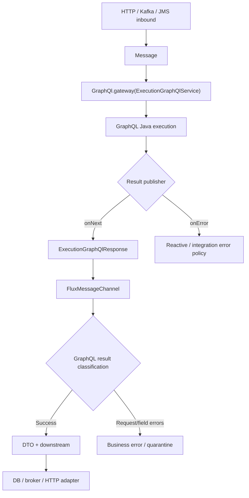
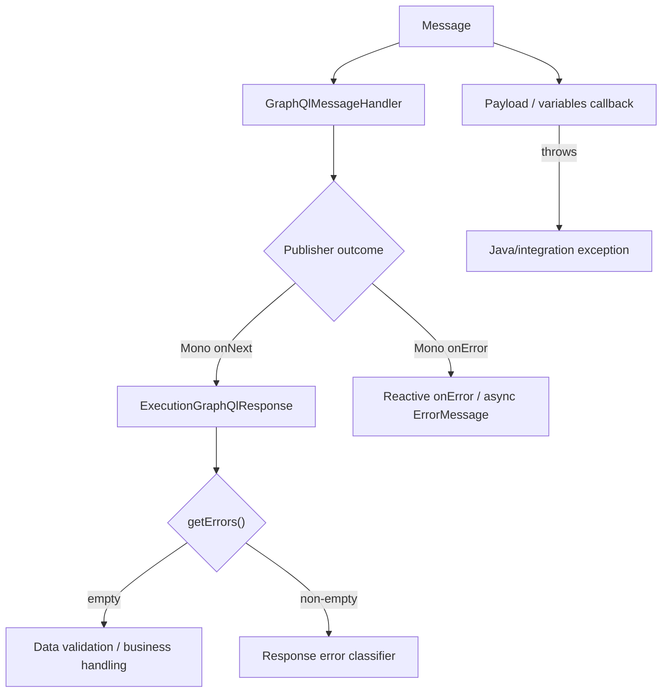
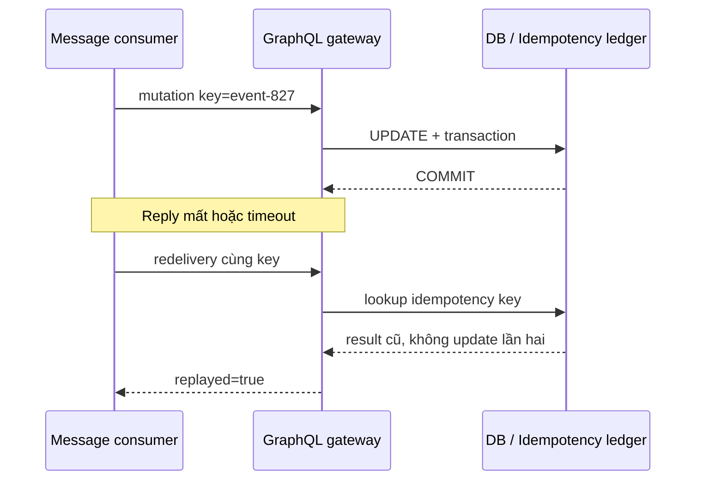

# GraphQL response và errors trong Spring Integration

## 1. Bài toán: HTTP thành công, nhưng GraphQL operation có thật sự thành công?

Một ứng dụng Spring Integration nhận `Message<OrderLookup>` từ Kafka/JMS/HTTP, gọi GraphQL outbound gateway để tra cứu trạng thái đơn hàng và chuyển kết quả sang database hoặc outbound adapter. Trong log, không có Java exception và gateway vẫn tạo reply. Tuy nhiên, consumer đôi khi thấy:

- `data.order = null` vì không tìm thấy đơn hàng — **kết quả hợp lệ**, không nhất thiết có lỗi.
- `data.order.status = null` và `errors` có path `order.status` — **partial result**, một field không được resolve.
- `data = null` khi lỗi ở một non-null field bị lan tới root — dù resolver đã bắt đầu chạy.
- `errors` do document sai syntax, field không tồn tại hoặc variables không khớp schema — resolver có thể **chưa được gọi**.
- Reactive publisher ném exception hoặc timeout — **không có `ExecutionGraphQlResponse`** để đọc.
- Một GraphQL mutation đã commit DB nhưng output field resolve lỗi — nếu retry mù có thể lặp side effect.

Trong GraphQL, **GraphQL error** thường là một phần của **response payload**. Trong Spring Integration, **ErrorMessage/errorChannel** lại là cơ chế xử lý exception của integration flow. Hai cơ chế này không tương đương, và quy tắc ra quyết định phải phân biệt chúng.

```text
Message<OrderLookup>
   -> GraphQlMessageHandler
   -> ExecutionGraphQlService
   -> Mono<ExecutionGraphQlResponse>
         |
         +-- response.data / errors     (lỗi trong GraphQL response)
         |
         +-- reactive onError           (lỗi Java/reactive, không có reply bình thường)
   -> FluxMessageChannel
   -> classify / transform / route
   -> DB, JMS, AMQP, Kafka, HTTP...
```

Bài **“GraphQL response và errors”** nằm trong chương **Adapter GraphQL**, thuộc module `SPRING_INTEGRATION_ADAPTERS`. Module hướng dẫn kết nối hệ thống ngoài bằng inbound/outbound adapter, gateway, poller, `MessageChannel`; thực hành tích hợp file, SFTP, HTTP, JMS, AMQP, Kafka, cơ sở dữ liệu, hợp đồng message, lỗi và vòng đời kết nối. Ở bài này, trọng tâm là **đọc, phân loại và xử lý kết quả GraphQL đúng hợp đồng**, không đánh đồng “có reply” với “toàn bộ nghiệp vụ đã commit”.

### Kết quả học tập

Sau bài, bạn có thể:

1. Mô tả các phần `data`, `errors` và `extensions` trong response GraphQL.
2. Phân biệt **request errors**, **field errors**, nullable `null`, partial data và non-null propagation.
3. Dùng đúng API `ExecutionGraphQlResponse`, `GraphQlResponse.isValid()`, `getErrors()`, `field(path).getValue()`, `ResponseField.getErrors()` và `ResponseError.getParsedPath()`.
4. Hiểu GraphQL error có thể đi trên **reply channel**, trong khi Java/reactive exception đi theo **error handling** khác.
5. Cấu hình Java DSL `GraphQl.gateway(executionGraphQlService)` và xử lý reply từ `FluxMessageChannel`.
6. Tạo classifier chuyển GraphQL reply thành DTO kết quả có kiểu, thay vì đưa raw GraphQL response vào broker.
7. Sử dụng `@GraphQlExceptionHandler` hoặc `DataFetcherExceptionResolver` để thiết kế mã lỗi và che chi tiết nội bộ.
8. Phân biệt API server `ResponseField` với API client `ClientResponseField` khi gọi GraphQL endpoint từ xa.
9. Chọn retry/backoff, reconciliation và idempotency phù hợp cho query, mutation và subscription.
10. Kiểm thử response success, not found, invalid request, partial result, null bubbling, timeout và lỗi sau commit.

## 2. Ranh giới: GraphQL execution response khác Spring Message và HTTP response

Spring Integration **6.5** có `GraphQlMessageHandler`, một outbound reply-producing gateway thực thi operation qua `ExecutionGraphQlService`. Handler trả `Mono<ExecutionGraphQlResponse>`, và framework phát reply qua message channel theo cơ chế reactive/async.



| Khái niệm | Là gì? | Không phải là gì? |
|---|---|---|
| `MessageHeaders.ID` | ID của **message instance** Spring | ID của GraphQL field, order, hay idempotency key |
| `GraphQL executionId` | Trace identity cho một lần chạy GraphQL | Xác nhận domain commit |
| `ExecutionGraphQlResponse` | Object bao `ExecutionResult` của GraphQL Java | HTTP response object |
| `GraphQlResponse.getErrors()` | Các GraphQL request/field errors | Reactor `onError` hay Spring `ErrorMessage` |
| `FluxMessageChannel` | Reactive stream channel trong JVM | Durable queue tự giữ dữ liệu qua restart |
| `HttpGraphQlClient` | Spring for GraphQL client tới HTTP server từ xa | `ExecutionGraphQlService` của local gateway |
| HTTP status `200` | Transport request được trả theo HTTP protocol | Bảo đảm GraphQL không có `errors` |
| Spring `errorChannel` | Kênh xử lý exception trong messaging flow | Tự động nhận mọi `GraphQLError` trong reply |

**Điểm dễ nhầm:** `GraphQl.gateway(executionGraphQlService)` không tự gọi URL `https://partner.example/graphql`. Nó thực thi một GraphQL service/schema mà ứng dụng cung cấp. Khi dùng `HttpGraphQlClient` tới server bên ngoài mới có transport HTTP với HTTP status, TLS, proxy và network timeouts. Cả hai có thể mang GraphQL errors nhưng cách xử lý transport khác nhau.

### 2.1. Payload đi vào và đi ra

```text
Input:
  Message<OrderLookup>
    payload = OrderLookup("ORD-1001")
    headers.correlationKey = workflow-123

GraphQL execution result:
  ExecutionGraphQlResponse
    data = { order: { id: "ORD-1001", status: "PAID" } }
    errors = []

Spring Integration output:
  Message<ExecutionGraphQlResponse>
    payload = GraphQL response object
    headers.correlationKey = workflow-123 (nếu propagation đúng)
```

GraphQL result là **payload** của một message reply; Spring Integration không tự tạo business DTO `OrderSummary` và không mặc nhiên route response có `errors` sang `errorChannel`. Ứng dụng phải thêm bước classifier/transformer.

## 3. Các dạng GraphQL response cần phân biệt

GraphQL response định dạng theo GraphQL spec, thường có `data`, `errors` và `extensions` (tùy trường hợp). Không mọi response đều có đủ ba trường.

### 3.1. Thành công đầy đủ — data có giá trị, không có errors

```json
{
  "data": {
    "order": {
      "id": "ORD-1001",
      "status": "PAID",
      "totalCents": 12500
    }
  }
}
```

Kỳ vọng với Spring `GraphQlResponse`:

```text
isValid()                 -> true
getErrors().isEmpty()     -> true
field("order").getValue() -> Map chứa order
```

Đây là trường hợp đơn giản, nhưng việc phát reply **không xác nhận** database/outbound consumer đã commit hoặc broker đã ACK.

### 3.2. Nullable field không tìm thấy — null không có error

Schema:

```graphql
type Query {
  order(id: ID!): Order
}
```

Query một order không có trong dữ liệu:

```json
{
  "data": {
    "order": null
  }
}
```

`isValid() = true`, `getErrors()` rỗng và `field("order").getValue() == null`. Đây thường là trạng thái **NOT_FOUND** theo nghiệp vụ, không phải request invalid hay exception.

### 3.3. Request error — GraphQL chưa thể thực thi operation

Ví dụ query gọi field không tồn tại:

```graphql
query FindOrder($id: ID!) {
  order(id: $id) {
    id
    fieldDoesNotExist
  }
}
```

Response minh họa:

```json
{
  "errors": [
    {
      "message": "Validation error: fieldDoesNotExist ...",
      "locations": [{ "line": 4, "column": 5 }]
    }
  ]
}
```

Một số execution API có thể biểu diễn request error với `"data": null` thay vì bỏ hẳn key data. Theo Spring GraphQL 1.4, cả trường hợp không có data hoặc data null làm `isValid() = false`. **Không dựa duy nhất vào HTTP status hoặc `isValid` để quyết định resolver đã được gọi hay chưa**; lỗi request-level thường **không có field path**.

Những nguyên nhân điển hình:

- GraphQL document sai cú pháp.
- Field hoặc argument không tồn tại trong schema.
- Variable có type không phù hợp vị trí sử dụng.
- Variable bắt buộc `ID!` bị bỏ, có `null` hoặc sai kiểu.
- Value enum không nằm trong schema.
- Document có nhiều operations nhưng thiếu `operationName`.

`DataFetcherExceptionResolver` không xử lý các lỗi request-level xảy ra **trước khi DataFetcher chạy**.

### 3.4. Field error với partial data

Ví dụ schema cho phép `status` nullable:

```graphql
type Order {
  id: ID!
  status: String
  totalCents: Int!
}
```

Một status resolver không thể cung cấp giá trị:

```json
{
  "data": {
    "order": {
      "id": "ORD-1001",
      "status": null,
      "totalCents": 12500
    }
  },
  "errors": [
    {
      "message": "Status unavailable",
      "path": ["order", "status"]
    }
  ]
}
```

`isValid()` có thể **true** vì `data` là một object non-null, trong khi `getErrors()` **không rỗng**. `field("order.id")` có giá trị; `field("order.status")` có value null và error liên quan. Đây là **partial success** ở cấp GraphQL, không tự là “business success hoàn toàn”.

### 3.5. Null propagation — field non-null lỗi có thể làm data null

Nếu đổi schema thành:

```graphql
type Order {
  id: ID!
  status: String!
}

type Query {
  order(id: ID!): Order!
}
```

Và `status` không thể resolve, GraphQL phải tuân thủ non-null propagation. Bởi vì cả `status`, `order` đều được đánh dấu non-null, lỗi có thể lan tới root:

```json
{
  "data": null,
  "errors": [
    {
      "message": "Cannot return null for non-nullable field",
      "path": ["order", "status"]
    }
  ]
}
```

Với Spring `GraphQlResponse.isValid()`, trường hợp `data = null` được coi là **invalid**, nhưng error path `["order","status"]` là **field path**, không phải lỗi request trước execution. Một ứng dụng **không được** kết luận “resolver chưa chạy” chỉ vì `isValid() = false`; nó có thể đã chạy, và với mutation thậm chí đã có side effect.

### 3.6. Errors ở list và alias

Query:

```graphql
query FindOrders {
  recent: orders {
    id
    status
  }
}
```

Một lỗi ở item thứ ba có path:

```json
{
  "path": ["recent", 2, "status"]
}
```

Index **bắt đầu từ 0**. Path sử dụng **alias trong response** (`recent`), không phải tên field schema gốc (`orders`). Với server API:

```java
ResponseField status = response.field("recent[2].status");
Object value = status.getValue();
var fieldErrors = status.getErrors();
```

Khi một field bị null-bubbled, `ResponseField.getErrors()` có thể chứa lỗi **tại, phía trên hoặc phía dưới path**. Đừng chỉ so lỗi có path bằng đúng chuỗi của field đang đọc.

### 3.7. Extensions — metadata chứ không phải thành công/thất bại

```json
{
  "data": {"order": {"id": "ORD-1001"}},
  "extensions": {
    "traceId": "trace-123",
    "cost": 3
  }
}
```

`extensions` là nơi triển khai có thể đưa metadata theo thỏa thuận. Nó **không thay thế** `data/errors` và có thể khác nhau giữa các GraphQL server. Không phụ thuộc một key extension chưa được version hóa, và không log hoặc phát lại các extension chứa dữ liệu nhạy cảm.

### 3.8. Bảng tổng hợp quyết định

| Data | Errors | `isValid()` | Ý nghĩa thường gặp | Cần làm |
|---|---|---|---|---|
| Object non-null | Rỗng | True | Execution thành công ở cấp GraphQL | Validate DTO và nghiệp vụ |
| Object, field nullable null | Rỗng | True | Không có dữ liệu tại field | NOT_FOUND/optional null |
| Object non-null | Có field paths | True | Partial data, field errors | Field-level policy |
| Không có data | Có request errors | False | Parse/validation/coercion | Sửa query/input |
| `data: null` | Có field paths | False | Non-null propagation sau execution | Kiểm tra side effect trước retry |
| Không có GraphQL response | Reactor onError | Không áp dụng | Exception/cancellation/timeout | Error handling + reconcile |

Lưu ý: đây là **ma trận chẩn đoán**, không thể suy trạng thái transaction DB chỉ từ ba cột đầu.

## 4. Đọc đúng API Spring for GraphQL server-side

### 4.1. ExecutionGraphQlResponse kế thừa GraphQlResponse

Trong Spring for GraphQL 1.4:

```text
GraphQlResponse
  + isValid(): boolean
  + getData(): <T> T
  + getErrors(): List<ResponseError>
  + getExtensions(): Map<Object,Object>
  + field(String path): ResponseField
  + toMap(): Map<String,Object>

ExecutionGraphQlResponse extends GraphQlResponse
  + getExecutionInput(): graphql.ExecutionInput
  + getExecutionResult(): graphql.ExecutionResult
```

Hai method bổ sung cho phép xử lý sâu hơn ở engine/instrumentation, nhưng có thể chứa query/variables/context nhạy cảm. **Không serialize trực tiếp `ExecutionGraphQlResponse` hoặc `ExecutionInput`** sang broker làm wire contract.

### 4.2. isValid() phải được hiểu chính xác

Theo Javadoc, `isValid() == false` nếu response map **không có `data`** hoặc có `data = null`. Với `data` non-null, response hợp lệ dù **một số nested fields null vì errors**. Vì thế:

```java
if (response.isValid()) {
    // KHÔNG đủ để kết luận "không có lỗi".
}

if (response.getErrors().isEmpty()) {
    // KHÔNG đủ để kết luận downstream đã commit.
}
```

Đọc cả **validity + error paths + dữ liệu cần thiết + domain state**.

### 4.3. ResponseField: getValue() và getErrors()

```java
import java.util.Map;
import org.springframework.graphql.ExecutionGraphQlResponse;
import org.springframework.graphql.ResponseField;

ResponseField field = response.field("order");
Map<String, Object> order = field.getValue();

if (order == null) {
    if (field.getErrors().isEmpty()) {
        // Nullable null, có thể NOT_FOUND.
    }
    else {
        // Null do error của field/ancestor/descendant.
    }
}
```

`ResponseField.getValue()` trả giá trị raw, thường là Map/List/scalar. Khi field null mà có errors, không tự fallback sang default business status mà chưa hiểu lỗi.

### 4.4. ResponseError chứa thông tin gì?

```java
for (var error : response.getErrors()) {
    String category =
            String.valueOf(error.getErrorType());
    String path = error.getPath();          // ví dụ order.status
    var segments = error.getParsedPath();  // ["order", "status"]
    var locations = error.getLocations();
    var extensions = error.getExtensions();
    // error.getMessage() có thể chứa chi tiết nhạy cảm.
}
```

| API | Ý nghĩa |
|---|---|
| `getErrorType()` | GraphQL Java classification/loại lỗi |
| `getMessage()` | Mô tả lỗi phục vụ chẩn đoán; cần sanitize/masking |
| `getPath()` | Dạng string của field path; rỗng với global error |
| `getParsedPath()` | List field names và zero-based indices |
| `getLocations()` | Vị trí source GraphQL document, nếu có |
| `getExtensions()` | Metadata có thể chứa classification/code tùy implementation |

Không dùng `error.getMessage().contains("timeout")` làm nền tảng retry: thông điệp có thể đổi, bị dịch hoặc bị làm mờ. Ưu tiên **error category/code do service định nghĩa có contract**, kết hợp transaction knowledge để chọn policy.

### 4.5. Server ResponseField khác ClientResponseField

Spring GraphQL có hai tầng response API:

| Tầng | Object | Cách lấy value |
|---|---|---|
| Gateway local dùng `ExecutionGraphQlService` | `ExecutionGraphQlResponse` / `ResponseField` | `field("order").getValue()` |
| Remote HTTP/WebSocket/RSocket client | `ClientGraphQlResponse` / `ClientResponseField` | `field("order").toEntity(Order.class)` / `retrieve("order").toEntity(...)` |

**Không gọi `response.field("order").toEntity(Order.class)` trên server-side `ExecutionGraphQlResponse`.** `toEntity` là tiện ích giải mã của **client response field**. Khi xử lý local gateway, ứng dụng nên map rõ từ Map/List sang domain DTO, có validation và phân loại lỗi.

## 5. Schema và resolver để tái hiện success, null và field errors

Ví dụ dùng **Java 17 + Spring Boot 3.x + Spring Integration 6.5.x tương thích**, với Spring for GraphQL được quản lý phiên bản thống nhất qua BOM. Các file Java/GraphQL bên dưới là **mẫu người học tạo trong project thực hành**, không phải file cần ghi ngoài nhiệm vụ Knowledge này.

### 5.1. Dependencies

**`build.gradle`:**

```gradle
dependencies {
    implementation 'org.springframework.boot:spring-boot-starter-integration'
    implementation 'org.springframework.integration:spring-integration-graphql'
    implementation 'org.springframework.boot:spring-boot-starter-graphql'

    testImplementation 'org.springframework.boot:spring-boot-starter-test'
    testImplementation 'org.springframework.graphql:spring-graphql-test'
}
```

`spring-integration-graphql` cung cấp gateway, `spring-boot-starter-graphql` cung cấp GraphQL execution engine/schema/resolver configuration. Trong ứng dụng Spring Boot, bean `GraphQlSource`/`ExecutionGraphQlService` có thể được auto-configured từ schema và `@Controller`. Nếu bạn tự khai báo bean theo cách thủ công, cần chọn một cơ chế sở hữu, tránh hai bean trùng khiến gateway nhận sai execution service.

### 5.2. Schema GraphQL

**`src/main/resources/graphql/order-response.graphqls`:**

```graphql
type Query {
  order(id: ID!): Order
}

type Order {
  id: ID!
  status: String
  totalCents: Int!
}
```

Với schema này:

- `order` nullable → một ID không tồn tại được trả bằng `order: null` mà không bắt buộc có `errors`.
- `status` nullable → resolver lỗi có thể tạo `status: null` và vẫn giữ `id/totalCents` thành partial data.
- `id/totalCents` non-null → nếu resolver trả null/lỗi ở các field này, GraphQL có thể null-bubble tới `order`.
- `Int` theo GraphQL là signed 32-bit; demo dùng số tiền nhỏ tính bằng đơn vị cents. Production dùng scalar/encoding phù hợp nếu cần phạm vi số lớn.

### 5.3. Resolver tạo ba kết quả có chủ đích

**`OrderGraphQlController.java`:**

```java
import org.springframework.graphql.data.method.annotation.Argument;
import org.springframework.graphql.data.method.annotation.QueryMapping;
import org.springframework.graphql.data.method.annotation.SchemaMapping;
import org.springframework.stereotype.Controller;

record DemoOrder(String id, String status, int totalCents) {
}

class StatusUnavailableException extends RuntimeException {
}

@Controller
public class OrderGraphQlController {

    @QueryMapping
    public DemoOrder order(@Argument String id) {
        return switch (id) {
            case "ORD-1001" ->
                    new DemoOrder("ORD-1001", "PAID", 12_500);
            case "ORD-FAIL" ->
                    new DemoOrder("ORD-FAIL", "PENDING", 9_000);
            default -> null;
        };
    }

    @SchemaMapping(typeName = "Order", field = "status")
    public String status(DemoOrder order) {
        if ("ORD-FAIL".equals(order.id())) {
            throw new StatusUnavailableException();
        }
        return order.status();
    }
}
```

Với `ORD-1001`, GraphQL response có data đầy đủ. Với ID không tồn tại, `Query.order` trả null hợp lệ. Với `ORD-FAIL`, `@SchemaMapping` của `status` ném exception; Spring for GraphQL xử lý thành GraphQL error, và do `status` nullable nên phần còn lại của `order` có thể vẫn giữ được.

**Quan trọng:** exception không nhất thiết được truyền ra gateway dưới dạng Java exception. Nó có thể được `DataFetcherExceptionResolver` chuyển thành `GraphQLError` nằm trong `ExecutionGraphQlResponse.getErrors()`.

### 5.4. Resolver lỗi ở non-null field

Muốn quan sát **null bubbling lên root**, trong một fixture/test riêng thay schema thành:

```graphql
type Query {
  order(id: ID!): Order!
}

type Order {
  id: ID!
  status: String!
  totalCents: Int!
}
```

Khi `ORD-FAIL` làm field `status!` lỗi, `data` có thể thành null và `isValid()` là false. **Không** coi đó là query validation error trước resolver: kiểm tra `getErrors().getParsedPath()` để nhận ra error path `["order","status"]`. Khi test, tạo schema/GraphQlSource riêng hoặc reload test context có chủ đích; không sửa schema production chỉ để thử lỗi.

## 6. Java DSL: GraphQL outbound gateway trả ExecutionGraphQlResponse

### 6.1. Request payload có kiểu

**`OrderLookup.java`:**

```java
public record OrderLookup(String orderId) {

    public OrderLookup {
        if (orderId == null || orderId.isBlank()
                || orderId.length() > 128) {
            throw new IllegalArgumentException(
                    "orderId phải có giá trị hợp lệ");
        }
    }
}
```

`OrderLookup` là domain DTO, không phải `ExecutionGraphQlRequest`. Điều này hữu ích: gateway sẽ áp dụng operation tĩnh và variables theo cấu hình, không cho upstream quyết định một query document tùy ý.

### 6.2. IntegrationFlow

**`OrderGraphQlFlow.java`:**

```java
import java.util.Map;

import org.springframework.context.annotation.Bean;
import org.springframework.context.annotation.Configuration;
import org.springframework.graphql.ExecutionGraphQlService;
import org.springframework.integration.config.EnableIntegration;
import org.springframework.integration.dsl.IntegrationFlow;
import org.springframework.integration.dsl.MessageChannels;
import org.springframework.integration.graphql.dsl.GraphQl;

@Configuration
@EnableIntegration
public class OrderGraphQlFlow {

    private static final String LOOKUP_ORDER = """
            query LookupOrder($id: ID!) {
              order(id: $id) {
                id
                status
                totalCents
              }
            }
            """;

    @Bean
    IntegrationFlow lookupOrderFlow(
            ExecutionGraphQlService graphQlService) {
        return IntegrationFlow
                .from(MessageChannels.flux("orderLookupRequests"))
                .handle(GraphQl.gateway(graphQlService)
                        .operation(LOOKUP_ORDER)
                        .operationName("LookupOrder")
                        .variables(message -> Map.of(
                                "id",
                                ((OrderLookup) message.getPayload())
                                        .orderId())))
                .channel(c -> c.flux("orderLookupResponses"))
                .get();
    }
}
```

**Giải thích:**

1. Input `orderLookupRequests` nhận `Message<OrderLookup>` từ inbound adapter hoặc producer nội bộ.
2. `GraphQl.gateway(graphQlService)` dùng local `ExecutionGraphQlService`; không tự gửi HTTP POST.
3. `.operation(...)` giữ GraphQL document không đổi; `.operationName(...)` chọn operation.
4. `.variables(...)` tạo `Map<String,Object>` từ **payload**. Không ghép `orderId` vào query text.
5. Service trả `Mono<ExecutionGraphQlResponse>`; framework truyền reply qua `FluxMessageChannel`.
6. Consumer của `orderLookupResponses` kiểm tra data/errors thay vì coi mọi reply là thành công.

**Giới hạn của kênh reactive:** `MessageChannel.send()` trả true có nghĩa message được chấp nhận theo contract, **không có nghĩa** GraphQL query hoặc downstream transaction đã hoàn tất. Cần subscriber/consumer thực sự và timeout/backpressure nếu nguồn nhận quá nhanh.

### 6.3. Gửi request message

**`OrderLookupPublisher.java`:**

```java
import org.springframework.beans.factory.annotation.Qualifier;
import org.springframework.integration.support.MessageBuilder;
import org.springframework.messaging.MessageChannel;
import org.springframework.stereotype.Component;

@Component
public class OrderLookupPublisher {

    private final MessageChannel input;

    public OrderLookupPublisher(
            @Qualifier("orderLookupRequests") MessageChannel input) {
        this.input = input;
    }

    public void request(String orderId, String correlationKey) {
        boolean accepted = input.send(
                MessageBuilder.withPayload(new OrderLookup(orderId))
                        .setHeader("correlationKey", correlationKey)
                        .build());
        if (!accepted) {
            throw new IllegalStateException(
                    "Input channel chưa chấp nhận message");
        }
    }
}
```

Gọi `request("ORD-1001", "workflow-123")` để nhận response đầy đủ; `request("ORD-NONE", ...)` để nhận `order:null`; `request("ORD-FAIL", ...)` để nhận partial data + field error.

### 6.4. Headers và response ID

Một message có `headers.correlationKey` trước gateway có thể giữ custom header sau gateway theo cơ chế header propagation của message-producing handler. Tuy nhiên, **không** đồng nhất `MessageHeaders.ID`, `GraphQL execution ID` và domain order ID. Message UUID có thể được tạo lại khi transform/replay, còn domain ID/correlation phải theo hợp đồng riêng.

Nếu upstream là Kafka/JMS, đừng commit offset/ACK chỉ vì đã đưa message tới `FluxMessageChannel`. Với yêu cầu durability, phải đợi kết quả nghiệp vụ đã được ghi bền hoặc có durable inbox lưu command để xử lý sau.

## 7. Phân loại response thành DTO nghiệp vụ có kiểu

### 7.1. Định nghĩa domain outcome

Thay vì để consumer khác phụ thuộc toàn bộ GraphQL Java object, chuẩn hóa thành một trong ba kết quả:

```java
public sealed interface OrderQueryOutcome
        permits OrderQueryOutcome.Found,
                OrderQueryOutcome.NotFound,
                OrderQueryOutcome.Rejected {

    record Found(OrderSummary order)
            implements OrderQueryOutcome {
    }

    record NotFound() implements OrderQueryOutcome {
    }

    record Rejected(String category, int errorCount)
            implements OrderQueryOutcome {
    }
}

record OrderSummary(
        String id, String status, int totalCents) {
}
```

Đây là contract nghiệp vụ demo. `Rejected.category` chỉ được chọn từ enum/code **cố định do ứng dụng quyết định**, không sao chép nguyên `GraphQLError.message`/extensions chưa kiểm soát.

### 7.2. Classifier strict nhưng phân biệt request error và null bubbling

**`OrderGraphQlResponseClassifier.java`:**

```java
import java.util.Map;

import org.springframework.graphql.ExecutionGraphQlResponse;
import org.springframework.graphql.ResponseError;

public final class OrderGraphQlResponseClassifier {

    public OrderQueryOutcome classify(
            ExecutionGraphQlResponse response) {

        if (!response.isValid()) {
            boolean anyFieldPath = response.getErrors().stream()
                    .map(ResponseError::getParsedPath)
                    .anyMatch(path -> !path.isEmpty());

            // Cùng isValid=false, nguyên nhân có thể khác:
            // request invalid hoặc non-null field error bubble tới root.
            return new OrderQueryOutcome.Rejected(
                    anyFieldPath
                            ? "BUBBLED_FIELD_ERROR"
                            : "REQUEST_ERROR",
                    response.getErrors().size());
        }

        if (!response.getErrors().isEmpty()) {
            // Strict policy: không chấp nhận partial data.
            return new OrderQueryOutcome.Rejected(
                    "FIELD_ERROR",
                    response.getErrors().size());
        }

        Map<String, Object> data = response.getData();
        if (data == null || !data.containsKey("order")) {
            return new OrderQueryOutcome.Rejected(
                    "MISSING_EXPECTED_FIELD", 0);
        }

        Object rawOrder =
                response.field("order").getValue();
        if (rawOrder == null) {
            return new OrderQueryOutcome.NotFound();
        }
        if (!(rawOrder instanceof Map<?, ?> order)) {
            return new OrderQueryOutcome.Rejected(
                    "INVALID_DATA_CONTRACT", 0);
        }

        Object id = order.get("id");
        Object status = order.get("status");
        Object total = order.get("totalCents");

        if (!(id instanceof String orderId)
                || orderId.isBlank()
                || !(status instanceof String state)
                || state.isBlank()
                || !(total instanceof Integer cents)) {
            return new OrderQueryOutcome.Rejected(
                    "INVALID_DATA_CONTRACT", 0);
        }

        return new OrderQueryOutcome.Found(
                new OrderSummary(
                        orderId, state, cents));
    }
}
```

**Điều được bảo vệ:**

- Request errors thường không có field path, trong khi non-null error bubbled vẫn có path; classifier không gộp hai tình huống chỉ vì `isValid=false`.
- Partial data với errors bị từ chối theo **strict policy**. Nghiệp vụ khác có thể chấp nhận field optional, nhưng phải định nghĩa rõ.
- `order:null` không có errors được coi `NotFound` khi field `order` xuất hiện trong data.
- `order` bị **thiếu khỏi data** khác với field có mặt nhưng null; classifier báo contract mismatch.
- Không đưa raw GraphQL error message hoặc `ExecutionGraphQlResponse` ra boundary Kafka/JMS/HTTP.

Ví dụ này giả định response của query `LookupOrder` có đúng các trường trên và GraphQL `Int` được GraphQL Java biểu diễn thành `Integer`. Mapper kiểm tra `Map` và kiểu dữ liệu trước khi tạo DTO để không ép nhầm response sai hợp đồng. Nếu cần kiểm soát tiền tệ/số lớn, dùng `BigDecimal`/scalar custom và type validation thay vì ép ngầm qua `Number.intValue()`.

### 7.3. Consumer của reply channel

**`OrderGraphQlResultConsumer.java`:**

```java
import org.springframework.graphql.ExecutionGraphQlResponse;
import org.springframework.integration.annotation.ServiceActivator;
import org.springframework.messaging.Message;
import org.springframework.stereotype.Component;

@Component
public class OrderGraphQlResultConsumer {

    private final OrderGraphQlResponseClassifier classifier =
            new OrderGraphQlResponseClassifier();

    @ServiceActivator(inputChannel = "orderLookupResponses")
    public void consume(Message<ExecutionGraphQlResponse> message) {

        OrderQueryOutcome outcome =
                classifier.classify(message.getPayload());

        String correlation = message.getHeaders()
                .get("correlationKey", String.class);

        if (outcome instanceof OrderQueryOutcome.Found found) {
            OrderSummary order = found.order();
            System.out.printf(
                    "corr=%s order=%s state=%s%n",
                    correlation, order.id(), order.status());
            // Production: gửi DTO qua channel/broker hoặc ghi DB.
        }
        else if (outcome instanceof OrderQueryOutcome.NotFound) {
            System.out.println("Không có đơn hàng");
        }
        else if (outcome instanceof OrderQueryOutcome.Rejected error) {
            System.err.println(
                    "GraphQL category=" + error.category());
            // Production: sanitized metrics, audit, remediation.
        }
    }
}
```

Consumer trong demo chỉ log kết quả, **không phải durable handler**. Nếu Kafka/JMS cần chỉ ACK sau DB commit, cần chuyển `OrderQueryOutcome` sang một workflow có state/transaction rõ; không dựa vào một log line hoặc boolean `send()` để xác nhận processing thành công.

### 7.4. Có nên chấp nhận partial data?

Không có một chính sách chung phù hợp mọi schema:

| Trường lỗi | Có thể nhận partial? | Cần xác định |
|---|---|---|
| Avatar URL của user trong trang xem | Có thể | Có fallback UI, không ảnh hưởng nghiệp vụ |
| Một field optional mô tả đơn hàng | Có thể | Không dùng nó trong quyết định quan trọng |
| Trạng thái thanh toán `status` | Thường không | Không thực hiện giao hàng dựa trên status thiếu |
| `totalCents` dùng đối soát | Thường không | Giá trị tiền bắt buộc |
| Một item trong danh sách gợi ý | Có thể | Có policy bỏ item/cảnh báo |
| Mutation response sau DB commit | Không thể quyết định qua partial alone | Cần idempotency ledger/version/reconciliation |

Nếu chấp nhận partial, xây classifier **theo field requirements và `getErrors()` path**, không chỉ `if (response.isValid()) accept;`. Với dữ liệu quan trọng, nên trả trạng thái `PARTIAL_DEGRADED` để downstream biết hạn chế, thay vì âm thầm coi như hoàn chỉnh.

## 8. Tạo GraphQL errors bằng @GraphQlExceptionHandler

### 8.1. Resolver exception được chuyển thành field error

Spring for GraphQL có `DataFetcherExceptionResolver` để chuyển exception từ DataFetcher thành `GraphQLError`. Nếu không được resolver xử lý, lỗi thường được làm mờ dưới category `INTERNAL_ERROR` để tránh lộ implementation details. Ứng dụng có thể định nghĩa mapping có chủ đích:

```java
import graphql.GraphQLError;
import graphql.GraphqlErrorBuilder;

import org.springframework.graphql.data.method.annotation.GraphQlExceptionHandler;
import org.springframework.graphql.execution.ErrorType;
import org.springframework.web.bind.annotation.ControllerAdvice;

@ControllerAdvice
public class OrderGraphQlErrorAdvice {

    @GraphQlExceptionHandler
    public GraphQLError statusUnavailable(
            GraphqlErrorBuilder<?> builder,
            StatusUnavailableException ex) {

        return builder
                .errorType(ErrorType.INTERNAL_ERROR)
                .message("Không thể lấy trạng thái đơn hàng")
                .build();
    }
}
```

Ở đây:

- `@ControllerAdvice` áp dụng exception mapping cho các GraphQL annotated controllers theo Spring GraphQL.
- `GraphqlErrorBuilder<?>` đã được chuẩn bị với thông tin `DataFetchingEnvironment` như path/locations, giúp tạo GraphQL error đúng context.
- `ex.getMessage()` **không** được đưa vào response; thông điệp công khai đã được kiểm soát.
- Error category INTERNAL_ERROR không có nghĩa ứng dụng phải retry mọi request. Retry policy cần xét operation, transiency và side effect.

Với custom `DataFetcher` **không thuộc annotated controller**, cần đăng ký `DataFetcherExceptionResolver` vào `GraphQlSource.Builder` hoặc cấu hình phù hợp thay vì giả định mọi `@ControllerAdvice` tự bắt tất cả exceptions.

### 8.2. Phân loại errors theo error type

Spring for GraphQL có các category thường dùng:

| Category | Ý nghĩa thường gặp | Xử lý đề xuất |
|---|---|---|
| `BAD_REQUEST` | Business/input không hợp lệ | Sửa dữ liệu/contract |
| `UNAUTHORIZED` | Thiếu thông tin xác thực | Sửa auth; không retry storm |
| `FORBIDDEN` | Không có quyền truy cập | Fail closed và audit |
| `NOT_FOUND` | Domain resource không tồn tại, nếu service chọn báo lỗi | Trả not-found theo contract |
| `INTERNAL_ERROR` | Lỗi nội bộ hoặc chưa có mapping | Alert, phân loại trước retry |

Các giá trị trên là **phân loại do Spring GraphQL hỗ trợ**, không phải một hệ thống HTTP status tự động. Một HTTP response `200` có thể chứa `INTERNAL_ERROR` trong GraphQL errors. Một mutation có thể đã commit trước khi một output resolver lỗi; không retry chỉ vì thấy `INTERNAL_ERROR`.

### 8.3. Request errors không vào @GraphQlExceptionHandler của DataFetcher

GraphQL document parse error, schema validation error hoặc variable coercion error có thể xảy ra **trước khi DataFetcher chạy**. `DataFetcherExceptionResolver`/`@GraphQlExceptionHandler` không phải nơi xử lý loại lỗi đó. Tùy transport, có thể dùng interceptor phù hợp để quan sát request failures, nhưng cần giữ hợp đồng GraphQL response và không biến lỗi người dùng thành thông tin nội bộ bị rò rỉ.

### 8.4. Subscription stream errors đến sau response ban đầu

GraphQL subscription tạo một publisher, và lỗi có thể phát sinh sau khi stream đã bắt đầu. Lỗi `Publisher.onError` **không nhất thiết** được một `DataFetcherExceptionResolver` của setup phase xử lý; Spring for GraphQL có cơ chế `SubscriptionExceptionResolver` tại transport phù hợp. Với Spring Integration local gateway, cần subscribe/cancel/monitor publisher riêng, không coi reply đầu tiên là “toàn bộ subscription đã thành công”.

## 9. ErrorMessage, reactive onError và GraphQL errors: ba đường cần nối đúng

### 9.1. Phân biệt khi một request thất bại



| Lỗi | Trạng thái message | Ai xử lý? |
|---|---|---|
| GraphQL validation/coercion | Có `ExecutionGraphQlResponse` với `errors` | Result channel classifier |
| Resolver exception được map thành GraphQLError | Có `ExecutionGraphQlResponse` với field errors | Result channel classifier |
| Java exception trong transformer/variables callback | Có thể không có reply | Error channel / failure handling tại endpoint |
| Reactor onError từ `execute()` | Không có GraphQL response bình thường | Reactive error handler / async error channel theo cấu hình |
| Kafka/JMS downstream failure | Sau GraphQL response | Retry/ack/DLQ của downstream adapter |
| Publisher subscription lỗi sau setup | Stream đã chạy | Subscription subscriber/error handling |

**Không có một error channel toàn năng:** cần biết nguồn là synchronous DirectChannel, FluxMessageChannel, ExecutorChannel, poller, gateway hay broker listener. Các endpoint xử lý async có thể ném lỗi **sau** thread gửi message, nên đường catch/retry của upstream không tự bao phủ chúng.

### 9.2. Có nên biến GraphQL errors thành Java exception?

Có thể, nhưng chỉ khi business policy yêu cầu fail-fast và có recovery tương ứng. Ví dụ, consumer thấy `FORBIDDEN` và chọn trả một domain rejection DTO cho caller — không nên ném exception khiến broker redelivery vô hạn. Với một database failure có thể retry an toàn, có thể ném exception đã phân loại để recovery advice xử lý.

Tốt hơn là định nghĩa rõ các trạng thái:

```text
SUCCESS
NOT_FOUND
PARTIAL_DEGRADED
INVALID_REQUEST
BUSINESS_REJECTED
TRANSIENT_FAILURE
UNKNOWN_OUTCOME
```

Với mutation hoặc một downstream side effect đã có thể commit, trạng thái `UNKNOWN_OUTCOME` phải đưa tới **reconciliation** theo key trước khi retry. Không coi `GraphQL.errors không rỗng` là tương đương “transaction rollback”.

### 9.3. Spring Integration errorChannel không tự phân tích GraphQL response

Ví dụ có result channel nhận:

```text
Message<ExecutionGraphQlResponse>
  payload.isValid() = true
  payload.errors = [ field error ]
```

Thì message này vẫn là một reply. Không tự xuất hiện `ErrorMessage` chỉ vì `errors` có phần tử. Khi muốn gửi lỗi GraphQL sang một error channel nghiệp vụ, nên **route bằng mã trạng thái** hoặc gửi một message contract rõ. Nếu tự chuyển thành exception, cần ghi nhận đó là **quyết định của application**, không phải default GraphQL outbound gateway.

## 10. Gọi GraphQL qua HTTP: client response và transport status

### 10.1. Vì sao cần phân biệt local và remote?

Một pipeline có thể có hai cấu trúc:

```text
Local GraphQL engine:
  Message -> GraphQl.gateway(ExecutionGraphQlService)
          -> Mono<ExecutionGraphQlResponse>

Remote GraphQL service:
  Message -> HttpGraphQlClient(WebClient)
          -> HTTPS endpoint /graphql
          -> Mono<ClientGraphQlResponse>
```

`GraphQlMessageHandler` của Spring Integration dùng local `ExecutionGraphQlService`. Nó **không mở HTTP connection** chỉ vì operation tên GraphQL. Nếu GraphQL server ở hệ thống đối tác, cần `HttpGraphQlClient`/`HttpSyncGraphQlClient` hoặc HTTP outbound gateway.

### 10.2. HttpGraphQlClient.execute() để tự phân tích GraphQL errors

**Ví dụ Spring for GraphQL client**:

```java
import org.springframework.graphql.client.ClientGraphQlResponse;
import org.springframework.graphql.client.ClientResponseField;
import org.springframework.graphql.client.HttpGraphQlClient;
import org.springframework.web.reactive.function.client.WebClient;
import reactor.core.publisher.Mono;

WebClient webClient = WebClient.builder()
        .baseUrl("https://partner.example/graphql")
        .build();

HttpGraphQlClient graphQlClient =
        HttpGraphQlClient.create(webClient);

Mono<ClientGraphQlResponse> result = graphQlClient
        .document("""
            query LookupOrder($id: ID!) {
              order(id: $id) { id status totalCents }
            }
            """)
        .variable("id", "ORD-1001")
        .execute();

Mono<String> state = result.map(response -> {
    if (!response.isValid()) {
        return "REQUEST_OR_NULL_BUBBLING_ERROR";
    }
    ClientResponseField field = response.field("order");
    if (!response.getErrors().isEmpty()) {
        return "GRAPHQL_FIELD_ERROR";
    }
    if (field.getValue() == null) {
        return "NOT_FOUND";
    }
    return "FOUND";
});
```

Địa chỉ `partner.example` chỉ là **placeholder**, không khẳng định endpoint tồn tại. Với remote client, `ClientResponseField` có thêm phương thức `toEntity(Class)`. Khi cần quyết định dựa trên nhiều paths/errors, `execute()` cho phép lấy toàn response trước khi decode.

Đoạn này minh họa phân loại cơ bản; nếu muốn phân biệt request error với non-null-bubbled field error khi `isValid=false`, vẫn phải đọc `response.getErrors().getParsedPath()`, giống logic phần 7.

### 10.3. retrieve() khác execute()

```java
Mono<OrderSummary> order = graphQlClient
        .document("""
            query LookupOrder($id: ID!) {
              order(id: $id) { id status totalCents }
            }
            """)
        .variable("id", "ORD-1001")
        .retrieve("order")
        .toEntity(OrderSummary.class);
```

`retrieve("order")` là shortcut để decode một field. Khi field không tồn tại hoặc null kèm error, client có thể tạo `FieldAccessException`; khi dữ liệu không decode được, có thể tạo `GraphQlClientException`. Vì vậy với nghiệp vụ cần phân biệt nullable null, partial data, error path và business rejection, hãy dùng `execute()` và kiểm tra response/field tường minh.

**Không copy** `.retrieve().toEntity()` sang `ExecutionGraphQlResponse` của server-side gateway — đây là API dành cho GraphQL client.

### 10.4. HTTP 200 không đủ chứng minh thành công

GraphQL over HTTP có thể trả HTTP 200 mà response JSON vẫn chứa `errors`. Một HTTP status không thể thay thế GraphQL error policy. Ngược lại:

- HTTP `401/403` có thể do authentication/authorization transport.
- HTTP `429` có thể do quota; cần giới hạn retry theo `Retry-After`.
- HTTP `502/503/504` có thể do proxy/server/network tạm thời.
- Kết nối timeout/connection reset có thể xảy ra **sau khi mutation đã commit**.
- GraphQL response JSON sai định dạng có thể gây lỗi decode client.

Một số triển khai/phiên bản GraphQL over HTTP dùng media type/status conventions khác nhau cho request errors. Đừng kết luận trạng thái mutation chỉ dựa vào HTTP 200 hay HTTP 4xx. Trước retry mutation, hỏi ledger/status endpoint theo idempotency key nếu contract hỗ trợ.

### 10.5. Lỗi subscription đến sau setup

Với subscription, response setup có thể chứa một `SubscriptionPublisher` thay vì một object đơn giản. Các event sau đó có thể được gửi qua WebSocket/RSocket hoặc transport streaming. Xử lý:

- Setup errors trong GraphQL initial response.
- Publisher `onError` sau khi stream đã bắt đầu.
- Cancellation, backpressure, reconnect và resume/cursor.
- Field errors trong các event responses.

Với remote GraphQL, chọn transport client hỗ trợ subscription (WebSocket, RSocket, hoặc SSE nếu server hỗ trợ). Local `GraphQl.gateway(...)` không tự mở WebSocket tới URL đối tác.

## 11. Quy tắc retry và recovery phụ thuộc operation

### 11.1. Query: transient error mới đáng retry

Với query đọc dữ liệu, một số lỗi backend tạm thời có thể retry. Nhưng phải:

1. Xác định error category/code ổn định, không suy từ chuỗi message.
2. Áp exponential backoff, jitter, max attempts và deadline tổng.
3. Giới hạn concurrency, tránh tạo thác request khi backend yếu.
4. Không retry GraphQL syntax/validation/coercion error.
5. Nếu chỉ một field optional lỗi, cân nhắc partial degraded response thay vì retry cả query tốn chi phí.
6. Đảm bảo downstream không gửi trùng notification nếu query được chạy lại.

`RequestHandlerRetryAdvice` gắn tại handler có thể xử lý **exception của message handler**, nhưng không tự nhìn một `ExecutionGraphQlResponse.getErrors()` để quyết định retry. Nếu muốn retry từ GraphQL errors, ứng dụng cần classifier/map error sang chính sách riêng.

### 11.2. Mutation: timeout sau commit là unknown outcome

Giả sử:



Một GraphQL response có error hoặc một timeout không chứng minh transaction rollback. Muốn retry an toàn:

- Producer tạo **idempotency key bền** từ source event/command.
- Service giữ unique key, request fingerprint và stored result trong durable ledger.
- Optimistic locking/CAS tránh hai commands khác nhau cùng update row.
- Domain update và outbox event commit cùng DB transaction.
- Khi reply mất, kiểm tra ledger/DB version trước retry.
- Kafka/JMS ACK theo durable boundary, không theo `MessageChannel.send()`.

Với service từ xa không cung cấp idempotency/status lookup, có thể cần manual reconciliation hoặc workflow compensation; không tự gửi lại mutation thanh toán vô hạn.

### 11.3. Bảng retry theo trường hợp

| Tình huống | Có tự retry không? | Lý do |
|---|---|---|
| Query với transient DB timeout | Có giới hạn | Thường không có domain side effect |
| Query có unknown field | Không | Sửa schema/document |
| Query variables sai enum/Int | Không | Sửa input/coercion |
| `NOT_FOUND` hợp lệ | Không | Không phải transient error |
| `FORBIDDEN`/`UNAUTHORIZED` | Không retry dồn dập | Sửa auth/permissions |
| Query partial field optional | Tùy contract | Có thể degrade |
| Mutation version conflict | Không tự retry như cũ | Reconcile trạng thái mới |
| Mutation cùng key/same fingerprint | Không tái tạo side effect | Trả stored result |
| Mutation key reuse/different fingerprint | Không | Conflict/security alert |
| Mutation timeout outcome không rõ | Chưa | Kiểm tra commit/ledger |
| Outbox delivery timeout | Retry ở outbox | Cùng event key, receiver dedup |
| Subscription stream bị ngắt | Reconnect có kiểm soát | Cần resume/cursor để tránh gap |

### 11.4. Chọn cách biểu diễn lỗi downstream

Với một hệ thống gửi kết quả qua Kafka/JMS/HTTP:

```json
{
  "schemaVersion": "1",
  "operation": "LookupOrder",
  "status": "REJECTED",
  "errorCode": "GRAPHQL_FIELD_ERROR",
  "correlationKey": "workflow-123",
  "retryable": false
}
```

Đây là **DTO ứng dụng đề xuất**, không phải format do GraphQL hoặc Spring Integration tự sinh. `retryable` cần dựa trên policy đã xác thực; không tự set `true` cho tất cả `INTERNAL_ERROR`. Không đưa stack trace, GraphQL document hoặc raw variables vào event công khai.

## 12. Bảo mật response và error reporting

### 12.1. Chống lộ thông tin qua message và extensions

GraphQL error message có thể chứa nội dung do DataFetcher hoặc ngoại lệ phát ra, đôi khi vô tình lộ SQL, user IDs, token hoặc dữ liệu tenant. Bảo vệ:

- `@GraphQlExceptionHandler` trả thông điệp công khai được kiểm soát.
- Lỗi không được map mặc định nên được làm mờ, lưu chi tiết ở log nội bộ phân quyền.
- Hạn chế `extensions`, không chuyển exception object, auth token, raw principal hoặc SQL vào response.
- Whitelist fields khi transform thành DTO để đi qua broker/HTTP.
- Áp structured logging masking/hashing và retention.
- Metric labels chỉ dùng operationName, error category, source alias; tránh full path có dynamic IDs nếu không kiểm soát.

### 12.2. Error path cũng là dữ liệu cần phân loại

`ResponseError.getParsedPath()` có thể chứa tên GraphQL fields, aliases và list index. Dù nó hữu ích để xác định field lỗi, không phải mọi path đều an toàn để xuất công khai không giới hạn. Tránh dùng path từ query arbitrary làm tên metric label nếu client có thể tạo hàng nghìn aliases khác nhau.

### 12.3. Query shape, authorization và error policy

GraphQL variables không thay authorization. Một response `order:null` có thể được server **cố ý** dùng để không tiết lộ order của tenant khác; không tự tạo thông báo “Order X thuộc tenant Y” khi client không có quyền.

Kiểm soát:

- Principal được xác thực tại inbound boundary.
- Authorization tại resolver/service/row level.
- Operation allowlist, depth/complexity limits, max pagination.
- Field-level access và nullability phù hợp với chính sách tiết lộ thông tin.
- Query cost/timeouts và bounded concurrency.
- Với event Kafka/JMS, không coi header `tenantId` tự do do producer gửi là authenticated context.

### 12.4. Không biến error into stack trace qua HTTP

Nếu HTTP inbound gateway cuối flow trả lỗi GraphQL cho caller, nên map sang **hợp đồng response công khai** có status, stable error code và correlation ID đã sanitize. HTTP status lựa chọn tùy API contract/GraphQL over HTTP transport; không để một exception của service activator mặc nhiên lộ stack trace SQL trong HTTP body.

## 13. Observability: đo response và lỗi một cách có ý nghĩa

### 13.1. Metric đề xuất

| Metric | Ý nghĩa |
|---|---|
| `graphql_gateway_request_total{operation}` | Số message yêu cầu qua gateway |
| `graphql_gateway_reply_total{operation,outcome}` | Số response đã được phân loại |
| `graphql_gateway_request_error_total{operation}` | Parse/validation/coercion errors |
| `graphql_gateway_field_error_total{operation,category}` | Lỗi resolve fields |
| `graphql_gateway_partial_total{operation}` | Có data và errors |
| `graphql_gateway_null_bubbling_total{operation}` | Field error làm data null |
| `graphql_gateway_not_found_total{operation}` | Domain nullable null không có error |
| `graphql_gateway_reactive_error_total{operation}` | `onError`/Java exception |
| `graphql_gateway_timeout_total{operation}` | Quá deadline |
| `graphql_gateway_inflight{operation}` | Số request đang xử lý |
| `graphql_gateway_duration_ms{operation}` | Latency end-to-end |
| `graphql_gateway_response_bytes{operation}` | Serialized size |
| `graphql_mutation_unknown_outcome_total` | Lỗi sau có thể commit cần đối soát |
| `graphql_downstream_delivery_pending_total` | Outbox/notification chưa giao |

Đây là **metric do ứng dụng đề xuất**, không khẳng định Spring Integration tự tạo đủ. Label giữ cardinality thấp. Đừng gắn UUID message, full GraphQL document, orderId hoặc raw error message làm label.

### 13.2. Structured log đề xuất

```text
event=graphql_response_classified
operationName=LookupOrder
sourceSystem=order-events
correlationKeyHash=4a72...fe1b
executionIdHash=b916...09c1
outcome=FIELD_ERROR
isValid=true
errorCount=1
fieldCategory=INTERNAL_ERROR
durationMs=42
```

Nếu có error path, ghi dạng chuẩn hóa/whitelist, không log raw variables. Ghi chi tiết nhạy cảm tại internal diagnostics có ACL/retention, không đưa vào client-visible response.

### 13.3. Runbook: GraphQL gateway trả lỗi liên tục

1. Xác định operationName, phiên bản schema, nguồn message và thời điểm lỗi đầu tiên.
2. Kiểm tra có GraphQL response không; nếu không, phân loại Java exception/Reactive onError/transport timeout.
3. Nếu có response, đọc `isValid`, `getErrors().size()`, `getParsedPath()`, field nullability.
4. Với path rỗng, kiểm tra syntax/schema/variables/operationName trước DataFetcher.
5. Với path không rỗng, kiểm tra resolver/authorization/data source/null propagation.
6. Với `data:null`, xác minh đó là request error hay non-null bubble, không tự suy resolver chưa chạy.
7. Với mutation, đối soát idempotency ledger/DB/outbox trước khi retry.
8. Kiểm tra subscriber/backpressure/timeout của Flux channel và downstream adapters.
9. Kiểm tra rate limit, query complexity, DataLoader/N+1 và backend capacity.
10. Chạy test fixture lỗi tương đương, áp remediation và xác minh không mất/nhân đôi business event.

### 13.4. Khi nhiều nguồn cùng gọi một GraphQL operation

```text
Kafka inbound adapter -> GraphQL query -> Classifier -> DB
JMS inbound gateway  -> GraphQL query -> Classifier -> HTTP reply
HTTP inbound gateway -> GraphQL query -> Classifier -> Kafka event
Scheduled poller     -> GraphQL query -> Classifier -> File/SFTP output
```

Một classifier có thể dùng chung nếu schema/operation/contract như nhau, nhưng **mốc ACK và retry** của từng nguồn khác nhau. Không để một consumer từ Kafka ACK trước khi kết quả xử lý bền, cũng không coi lỗi remote HTTP là giống lỗi resolver local.

## 14. Kiểm thử response và errors

### 14.1. Test schema trực tiếp, không cần HTTP

Spring for GraphQL cung cấp `ExecutionGraphQlServiceTester`. Ví dụ JUnit 5/Spring Boot:

```java
import org.junit.jupiter.api.Test;
import org.springframework.beans.factory.annotation.Autowired;
import org.springframework.boot.test.context.SpringBootTest;
import org.springframework.graphql.ExecutionGraphQlService;
import org.springframework.graphql.test.tester.ExecutionGraphQlServiceTester;

@SpringBootTest
class GraphQlResponseIntegrationTest {

    @Autowired
    ExecutionGraphQlService executionService;

    @Test
    void completeResponseContainsStatus() {
        ExecutionGraphQlServiceTester tester =
                ExecutionGraphQlServiceTester.create(executionService);

        tester.document("""
                query LookupOrder($id: ID!) {
                  order(id: $id) { id status totalCents }
                }
                """)
                .variable("id", "ORD-1001")
                .execute()
                .path("order.status")
                .entity(String.class)
                .isEqualTo("PAID");
    }
}
```

Trong project thực hành cần schema/controller ở phần 5, `spring-graphql-test` và Spring Boot test context đúng. Test này xác minh GraphQL schema/resolver, **chưa kiểm tra Spring Integration flow/channel**.

### 14.2. Test invalid request và field error

Với `ExecutionGraphQlServiceTester`:

- Gửi query có `fieldDoesNotExist`, xác minh response errors mà resolver không được gọi.
- Gửi `$id: ID!` nhưng không cung cấp variable `id`, xác minh coercion error.
- Gửi `id="ORD-FAIL"`, xác minh field error có path `order.status`.
- Gửi order không tồn tại, xác minh `order:null` hợp lệ không error.
- Dùng schema `status: String!` và `order: Order!`, xác minh null propagation đến root.
- Khi test errors, dùng GraphQlTester `.errors().satisfy(...)` hoặc đọc `ExecutionGraphQlResponse` trực tiếp; không assert nguyên văn message exception vốn thay đổi theo phiên bản.

### 14.3. Unit test classifier

Có thể dùng Mockito mô phỏng `ExecutionGraphQlResponse`/`ResponseField` và xác minh các policy:

| Test | `isValid` | Errors | Data | Kỳ vọng |
|---|---|---|---|---|
| Complete | True | Empty | order đầy đủ | `Found` |
| Missing ID | True | Empty | order null | `NotFound` |
| Missing field in response | True | Empty | data không có order | `MISSING_EXPECTED_FIELD` |
| Bad query | False | Request error path rỗng | null | `REQUEST_ERROR` |
| Root null bubble | False | Field path không rỗng | null | `BUBBLED_FIELD_ERROR` |
| Partial status error | True | Field error | order partly present | `FIELD_ERROR` |
| Invalid data type | True | Empty | totalCents không phải Number | `INVALID_DATA_CONTRACT` |

Kiểm thử classifier **không thay thế** integration test GraphQL engine: mocks không chứng minh GraphQL Java tạo đúng error paths/null bubbling. Tốt nhất có cả hai loại.

### 14.4. Kiểm thử end-to-end Spring Integration

Một test flow cần:

1. Khởi tạo `ExecutionGraphQlService` cùng schema/resolver.
2. Gắn subscriber hoặc test service activator vào `orderLookupResponses`.
3. Gửi `OrderLookup("ORD-1001")` với `correlationKey`.
4. Đợi response bằng latch/StepVerifier/test consumer có timeout, **không assert ngay sau send**.
5. Assert `Message<ExecutionGraphQlResponse>` có đúng type và headers cần thiết.
6. Phân loại thành `Found/NotFound/Rejected`, assert code và order fields.
7. Với `ORD-FAIL`, assert error path và strict policy.
8. Với lỗi Java ở callback/publisher, xác minh reactive error handling riêng với GraphQL errors.
9. Với downstream database/broker failure, test ACK/retry/idempotency theo kiến trúc thật.

### 14.5. Test remote client và transport

Dùng mock HTTP GraphQL server để trả:

| HTTP / Body | Kỳ vọng |
|---|---|
| `200 + data` | Client decode đúng |
| `200 + data + errors` | `execute()` cho thấy partial response |
| `200 + errors` | Phân loại GraphQL request failure |
| `401/403` | Authentication/authorization transport handling |
| `429 + Retry-After` | Rate-limit/backoff policy |
| `503` hoặc timeout | Transport exception; phân biệt query và mutation retry |
| JSON malformed | Decode error, không giả `NOT_FOUND` |
| HTTP 200 nhưng HTML login | Content-type/parse error, không là GraphQL success |

Một GraphQL response ở client và một HTTP status là **hai lớp hợp đồng**. Đừng viết test chỉ có HTTP 200 rồi kết luận logic error đã đúng.

## 15. Bài thực hành theo tình huống

Các lab sau dành cho một project thực hành Spring Boot/Spring Integration. Mỗi lab có mục tiêu độc lập; không yêu cầu bài Knowledge này tạo thêm source file hoặc chạy Gradle.

### Lab A — Một response thành công hoàn chỉnh

1. Khai báo schema `Query.order` và `Order` như phần 5.
2. Tạo resolver trả `ORD-1001` đầy đủ các field.
3. Gửi `OrderLookup("ORD-1001")` vào `orderLookupRequests`.
4. Đợi reply từ `orderLookupResponses` bằng test consumer.
5. Kiểm tra `isValid=true`, `getErrors().isEmpty()`, `field("order").getValue()` và classifier trả `Found`.

**Kết quả:** phân biệt thành công ở cấp GraphQL với việc gửi message, đồng thời biết cách đọc raw response fields.

### Lab B — Nullable null và NOT_FOUND

1. Gửi một order ID không tồn tại.
2. Giữ schema `order(id: ID!): Order` nullable.
3. Xác minh `data={"order":null}` và không có GraphQL errors.
4. Kiểm tra `field("order").getErrors()` rỗng.
5. Đảm bảo classifier trả `NotFound`, không gọi retry/backoff.

**Kết quả:** null từ business domain không tự là exception.

### Lab C — GraphQL syntax/schema validation error

1. Cố ý viết query thiếu dấu `}` hoặc field không tồn tại.
2. Gửi document này qua test `ExecutionGraphQlServiceTester`.
3. Kiểm tra response invalid, có request errors và path rỗng.
4. Dùng counter/spy xác minh resolver `order` không được gọi.
5. Sửa document, chạy lại và xác nhận request hợp lệ.

**Kết quả:** request error trước execution phải được sửa ở query/contract, không retry như lỗi DB tạm thời.

### Lab D — Variable coercion error

1. Tạo query `LookupOrder($id: ID!)`.
2. Không cung cấp biến `id`, rồi thử `id=null`.
3. Thử variable sai loại với schema có `Int!`/enum.
4. Quan sát lỗi GraphQL không nhất thiết chuyển thành Java exception.
5. Assert error path rỗng và resolver không chạy trong các case request không hợp lệ.

**Kết quả:** validation/coercion là một giai đoạn trước DataFetcher.

### Lab E — Partial data do status resolver fail

1. Giữ `status: String` nullable.
2. Với `ORD-FAIL`, cho `@SchemaMapping` ném `StatusUnavailableException`.
3. Kiểm tra `data.order.id` và `totalCents` vẫn có giá trị.
4. Kiểm tra `errors.path = ["order","status"]`; `isValid=true`.
5. Classifier strict trả `FIELD_ERROR`, không coi response là success chỉ vì có order ID.

**Kết quả:** `isValid=true` không bảo đảm mọi field thành công.

### Lab F — Null bubbling tới root

1. Dùng fixture schema có `status: String!` và `order: Order!`.
2. Gọi `ORD-FAIL` để làm status resolver fail.
3. Quan sát GraphQL trả `data:null` cùng field error path `["order","status"]`.
4. Kiểm tra `isValid=false` trong Spring GraphQlResponse.
5. Đảm bảo classifier trả `BUBBLED_FIELD_ERROR`, không phải `REQUEST_ERROR`.

**Kết quả:** `data:null` không chứng minh execution chưa bắt đầu.

### Lab G — Field path với alias và list index

1. Tạo query có alias `recent: orders` với danh sách nhiều items.
2. Làm field `status` của phần tử thứ ba lỗi.
3. Xem `ResponseError.getParsedPath()`.
4. Kiểm tra segment list index là số `2`, alias là `recent`.
5. Dùng `response.field("recent[2].status").getErrors()` để kiểm tra lỗi theo path.

**Kết quả:** path thuộc **response shape**, không chỉ schema field name.

### Lab H — Exception mapping có kiểm soát

1. Đặt `@GraphQlExceptionHandler` trong `@ControllerAdvice`.
2. Map `StatusUnavailableException` sang `INTERNAL_ERROR` với message sanitized.
3. Kiểm tra path/locations của GraphQL error.
4. Đảm bảo stack trace/SQL/token không xuất hiện trong payload trả về.
5. Thử một `DataFetcher` không thuộc annotated controller; đăng ký `DataFetcherExceptionResolver` khi cần.

**Kết quả:** error resolver có phạm vi cụ thể và phải giữ thông tin nội bộ an toàn.

### Lab I — GraphQL errors khác ErrorMessage

1. Tạo resolver exception được map thành GraphQL response error.
2. Quan sát message reply vẫn đi vào `orderLookupResponses`.
3. Cho Java variables callback ném exception trước GraphQL execution.
4. Quan sát pipeline reactive/error channel tương ứng.
5. Viết hai nhánh xử lý khác nhau cho `getErrors()` và `onError`.

**Kết quả:** Spring Integration errorChannel không tự giải mã GraphQL errors.

### Lab J — Client retrieve() và execute()

1. Dùng mock HTTP GraphQL server.
2. Trả `200 + data`, gọi `retrieve("order").toEntity(...)`.
3. Trả `200 + partial data + errors`, dùng `execute()` và kiểm tra fields.
4. Với field null kèm error, thử bắt `FieldAccessException` khi dùng retrieve.
5. Phân biệt `ClientResponseField.toEntity(...)` và `ResponseField.getValue()` phía local gateway.

**Kết quả:** API client/server và chính sách xử lý field error khác nhau.

### Lab K — HTTP transport failure

1. Mock remote server trả 401, 429, 503, timeout và malformed JSON.
2. Đo error/exception ở tầng `HttpGraphQlClient`.
3. So sánh với một response HTTP 200 có GraphQL `errors`.
4. Chỉ retry query với lỗi transient và có backoff/jitter/budget.
5. Không để HTTP status tự biến thành GraphQL field error giả.

**Kết quả:** cần hai lớp phân loại HTTP transport và GraphQL execution.

### Lab L — Mutation đã commit nhưng response lỗi

1. Dựng mutation cập nhật order + idempotency ledger trong DB transaction.
2. Cho mutation commit thành công.
3. Mô phỏng lỗi ở output field non-null hoặc mất reply.
4. Quan sát GraphQL errors/timeout **không chứng minh rollback**.
5. Gửi lại cùng key qua idempotency ledger, đảm bảo version/notification không nhân đôi.

**Kết quả:** mutation có side effect phải reconcile trước retry.

### Lab M — Kafka/JMS redelivery và downstream failure

1. Nhận command từ Kafka/JMS, gọi GraphQL gateway.
2. Cho downstream DB/broker lỗi sau response GraphQL thành công.
3. Thử ACK ngay sau `MessageChannel.send()` để thấy nguy cơ mất command.
4. Đưa command vào durable inbox hoặc chỉ ACK sau business outcome đã bền.
5. Dùng unique key/outbox để ngăn side effect trùng khi message được giao lại.

**Kết quả:** reply GraphQL thành công khác mốc hoàn tất toàn workflow.

### Lab N — Subscription error sau setup

1. Dựng GraphQL subscription phát ba event.
2. Cho publisher ném lỗi sau event thứ hai.
3. Phân biệt initial response/errors và stream `onError`.
4. Quan sát subscriber và cancellation/cleanup.
5. Thử reconnect có backoff/resume cursor nếu nguồn hỗ trợ.

**Kết quả:** một subscription có nhiều event, không phải một reply đơn.

### Lab O — Observability và privacy

1. Instrument operationName, result category, latency và số field errors.
2. Log correlation hash thay vì raw IDs, không ghi variables/authorization token.
3. Kiểm tra raw exception messages không lộ trong GraphQL `extensions`.
4. Giới hạn cardinality metrics khi client dùng aliases động.
5. Dùng runbook phần 13 để xử lý ba sự cố giả: request invalid, partial data và unknown mutation outcome.

**Kết quả:** observability đủ để điều tra nhưng không biến error payload thành nguồn lộ dữ liệu.

### Câu hỏi tự kiểm tra

1. `ExecutionGraphQlResponse` khác `Message<ExecutionGraphQlResponse>` như thế nào?
2. `GraphQl.gateway(...)` dùng local execution service hay trực tiếp gọi GraphQL HTTP URL?
3. Vì sao `isValid() = true` vẫn có thể có `getErrors()`?
4. Vì sao `isValid() = false` chưa chứng minh DataFetcher không chạy?
5. Phân biệt `data.order = null` không có errors với `status = null` kèm error path.
6. Non-null propagation ảnh hưởng response `data` thế nào?
7. Vì sao field error path có thể dùng alias và list index?
8. `ResponseField.getErrors()` có thể chứa lỗi ở những cấp path nào?
9. `ResponseError.getParsedPath()` khác `getPath()` ở điểm gì?
10. Vì sao `DataFetcherExceptionResolver` không xử lý được GraphQL document parse error?
11. `GraphQL errors` có tự kích hoạt Spring Integration errorChannel không?
12. `ResponseField.getValue()` phía server khác `ClientResponseField.toEntity()` ra sao?
13. Khi nào cần `HttpGraphQlClient.execute()` thay cho `retrieve()`?
14. HTTP 200 có bảo đảm GraphQL query thành công không?
15. Vì sao mutation timeout sau commit cần idempotency ledger?
16. `FluxMessageChannel.send()` thành công có chứng minh DB downstream đã commit không?
17. Khi subscription stream lỗi sau khi bắt đầu, error resolver nào/phần nào phải xử lý?
18. Vì sao không nên đưa nguyên GraphQL `error.message/extensions` vào Kafka/JMS?

## 16. Những nhầm lẫn thường gặp

| Nhầm lẫn | Cách hiểu đúng |
|---|---|
| GraphQL response không có Java exception nghĩa là thành công | Response vẫn có thể chứa `errors` |
| `isValid=true` nghĩa `errors` rỗng | Có thể có partial field errors |
| `isValid=false` nghĩa resolver chưa chạy | Non-null bubbling có thể xảy ra **sau execution** |
| `data.order=null` luôn là lỗi | Có thể là nullable null bình thường |
| GraphQL `data:null` luôn là request syntax error | Có thể là field error lan đến root |
| Error path dùng schema field name ngay cả khi alias | Path dùng response alias và list indexes |
| Path của list bắt đầu từ 1 | GraphQL error indexes bắt đầu từ 0 |
| `ResponseField.getErrors()` chỉ trả lỗi đúng path | Có thể trả lỗi ở/above/below field path |
| `ResponseError.getMessage()` là retry classification bền vững | Cần category/code ổn định |
| `extensions` luôn an toàn/chuẩn hóa | Extensions tùy implementation, có thể nhạy cảm |
| HTTP 200 nghĩa không có GraphQL errors | GraphQL errors có thể nằm trong HTTP 200 body |
| `GraphQl.gateway("https://...")` là remote HTTP gateway | Spring Integration gateway nhận `ExecutionGraphQlService` |
| HTTP client `retrieve()` và `execute()` cho cùng mức kiểm soát | Execute cho phép inspect full response |
| Server `ResponseField` có `toEntity(Class)` | Đó là ClientResponseField API |
| `GraphQL errors` tự biến thành `ErrorMessage` | Chúng thường là dữ liệu trong reply |
| Có `ErrorMessage` nghĩa GraphQL response có errors | Có thể là Java/Reactive exception trước response |
| Một `errorChannel` bắt được mọi lỗi async | Tùy channel/handler/thread/publisher |
| Lỗi resolver luôn phá toàn bộ `data` | Với nullable fields có thể còn partial data |
| GraphQL non-null tự rollback DB transaction | Non-null chỉ là schema/execution contract |
| `@GraphQlExceptionHandler` xử lý được mọi request parse error | Nó xử lý DataFetcher errors, không phải pre-execution request errors |
| Một `@ControllerAdvice` tự động xử lý mọi non-controller DataFetcher | Có thể cần đăng ký `DataFetcherExceptionResolver` riêng |
| Query trả `NOT_FOUND` nên retry mãi | Not found thường là domain result |
| Mutation trả `data:null` nghĩa chưa commit | Có thể commit rồi output field lỗi |
| `MessageHeaders.ID` là idempotency key ổn định | UUID có thể thay đổi sau replay |
| Spring Integration FluxMessageChannel là durable broker | Không mặc định bền qua restart |
| ACK Kafka/JMS ngay sau gửi vào Flux là an toàn | ACK cần durable boundary |
| Subscription trả một response là đã xong | Còn event stream, onError/cancel/reconnect |
| Raw GraphQL errors nên được log đầy đủ ở mọi nơi | Có thể lộ dữ liệu cá nhân, SQL, token |
| Dùng error path làm metric label luôn an toàn | Alias/path có thể tạo cardinality cao |
| Mọi `INTERNAL_ERROR` nên retry tự động | Cần xét transient/side effect/operation |

## 17. Tài liệu tham khảo

- [Spring Integration 6.5 — GraphQL Support](https://docs.spring.io/spring-integration/reference/6.5/graphql.html): `GraphQlMessageHandler`, `ExecutionGraphQlService`, `Mono<ExecutionGraphQlResponse>`, subscription publisher và Java DSL.
- [GraphQlMessageHandlerSpec — Spring Integration 6.5 API](https://docs.spring.io/spring-integration/docs/6.5.0/api/org/springframework/integration/graphql/dsl/GraphQlMessageHandlerSpec.html): `operation`, `operationName`, `variables`, `executionId`.
- [GraphQlResponse — Spring GraphQL 1.4.3 API](https://docs.spring.io/spring-graphql/docs/1.4.3/api/org/springframework/graphql/GraphQlResponse.html): `isValid`, `getData`, `getErrors`, `getExtensions`, `field`, `toMap`.
- [ExecutionGraphQlResponse — Spring GraphQL 1.4.3 API](https://docs.spring.io/spring-graphql/docs/1.4.3/api/org/springframework/graphql/ExecutionGraphQlResponse.html): `getExecutionInput`, `getExecutionResult`.
- [ResponseField — Spring GraphQL 1.4.x API](https://docs.spring.io/spring-graphql/docs/1.4.x/api/org/springframework/graphql/ResponseField.html): `getValue`, `getErrors`, field paths và error propagation.
- [ResponseError — Spring GraphQL 1.4.3 API](https://docs.spring.io/spring-graphql/docs/1.4.3/api/org/springframework/graphql/ResponseError.html): `getErrorType`, `getParsedPath`, `getPath`, `getLocations`, `getExtensions`.
- [Spring for GraphQL — Request Execution](https://docs.spring.io/spring-graphql/reference/request-execution.html): GraphQL Java execution, request errors, DataFetcherExceptionResolver, subscription errors.
- [Spring for GraphQL — Annotated Controllers](https://docs.spring.io/spring-graphql/reference/controllers.html): `@QueryMapping`, `@SchemaMapping`, `@GraphQlExceptionHandler`, `@ControllerAdvice`.
- [Spring for GraphQL — Client](https://docs.spring.io/spring-graphql/reference/client.html): `HttpGraphQlClient`, `execute`/`retrieve`, `ClientResponseField`, `FieldAccessException`.
- [Spring for GraphQL — Testing](https://docs.spring.io/spring-graphql/reference/testing.html): `GraphQlTester` và `ExecutionGraphQlServiceTester`.
- [Spring Integration 6.5 — Error Handling](https://docs.spring.io/spring-integration/reference/6.5/error-handling.html): `ErrorMessage`, error channel và exceptions trong integration flow.
- [Spring Integration 6.5 — Message Channels](https://docs.spring.io/spring-integration/reference/6.5/channel.html): message channel semantics và reactive delivery.
- [GraphQL Specification](https://spec.graphql.org/): response format, request/field errors, aliases, null bubbling và execution semantics.
- [GraphQL over HTTP Working Draft](https://graphql.github.io/graphql-over-http/draft/): HTTP transport, media types và status behavior; cần đối chiếu triển khai thực tế.

**Ghi nhớ:** một GraphQL gateway có thể trả `ExecutionGraphQlResponse` chứa lỗi **mà không hề có Java exception**. Cần xem **`isValid()` + `getErrors()` + error paths + field values** theo schema; `isValid=false` không tự chứng minh execution chưa diễn ra vì non-null propagation có thể làm `data=null` sau khi resolver chạy. Phân biệt lỗi GraphQL **in-band** với reactive/Java exception **out-of-band**, không nhầm API server/client, và không retry mutation theo response lỗi khi chưa xác minh side effect/transaction. Chuẩn hóa kết quả thành DTO có contract, kết hợp authorization, observability, durable ACK/idempotency và reconciliation để luồng tích hợp an toàn.
