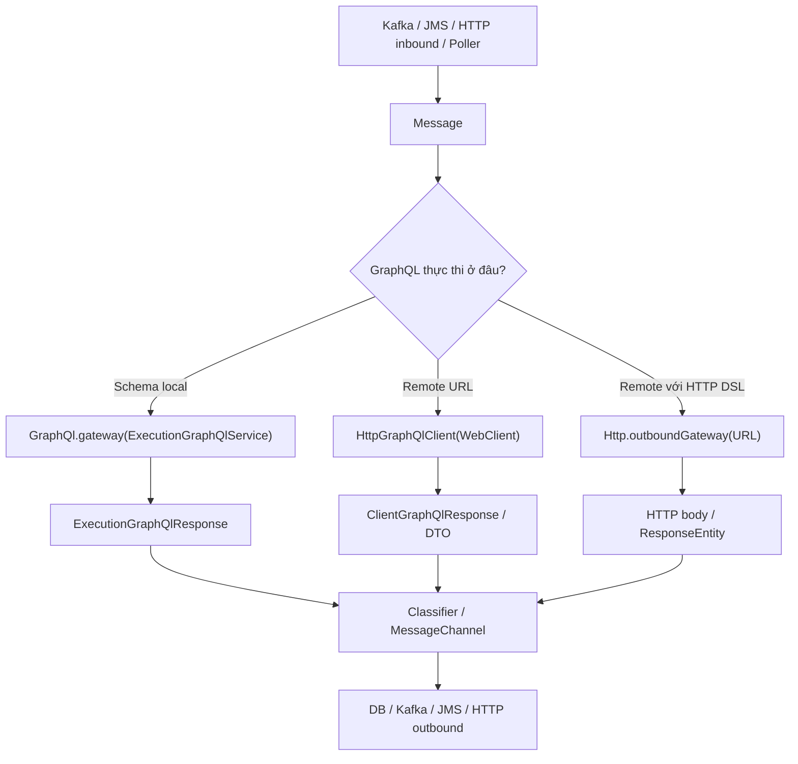
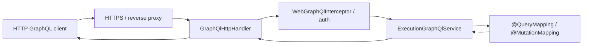
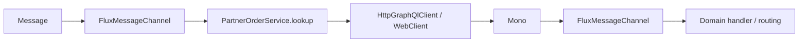
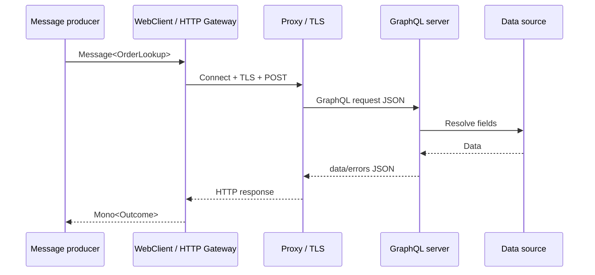

# HTTP transport cho GraphQL trong Spring Integration

## 1. Bài toán: chuyển GraphQL operation qua HTTP mà không đánh mất hợp đồng message

Một nền tảng điều phối đơn hàng nhận `Message<OrderLookup>` từ Kafka/JMS hoặc HTTP inbound gateway. Đối tác cung cấp GraphQL API tại `https://partner.example/graphql` để tra cứu đơn. Ứng dụng cần gửi **GraphQL query qua HTTPS**, nhận phản hồi, phân loại lỗi, rồi chuyển kết quả sang database, Kafka hoặc một bước xử lý khác.

Ở đây có **hai hợp đồng** phải xử lý song song:

1. **GraphQL:** document, operation name, variables, schema, data/errors/extensions, nullable fields và mutation side effects.
2. **HTTP:** method, URL, `Content-Type`, `Accept`, status, authentication, TLS, proxy, timeout, redirect và giới hạn payload.

Ví dụ GraphQL query:

```graphql
query FindOrder($id: ID!) {
  order(id: $id) {
    id
    status
    totalCents
  }
}
```

Request HTTP được biểu diễn bằng JSON:

```http
POST /graphql HTTP/1.1
Host: partner.example
Content-Type: application/json
Accept: application/graphql-response+json, application/json;q=0.9
Authorization: Bearer <access-token>

{
  "query": "query FindOrder($id: ID!) { order(id: $id) { id status totalCents } }",
  "operationName": "FindOrder",
  "variables": { "id": "ORD-1001" }
}
```

Response khi thành công:

```http
HTTP/1.1 200 OK
Content-Type: application/graphql-response+json

{
  "data": {
    "order": {
      "id": "ORD-1001",
      "status": "PAID",
      "totalCents": 12500
    }
  }
}
```

**Mục tiêu không chỉ là “gửi POST nhận JSON”.** Một HTTP `200` vẫn có thể chứa GraphQL `errors`, còn một HTTP `4xx` từ server theo chuẩn mới có thể chứa một GraphQL response hợp lệ mà client cần đọc. Với mutation, timeout sau khi server đã commit dẫn tới **unknown outcome** và không được tự retry mù.

Bài **“HTTP transport cho GraphQL”** thuộc chương **Adapter GraphQL** của module `SPRING_INTEGRATION_ADAPTERS`. Module hướng dẫn kết nối hệ thống ngoài bằng inbound/outbound adapter, gateway, poller, `MessageChannel`; thực hành file, SFTP, HTTP, JMS, AMQP, Kafka, database, hợp đồng message, lỗi và vòng đời kết nối. Bài này đặt trọng tâm ở **transport HTTP của GraphQL** và cách ghép đúng vào Spring Integration; không dùng local GraphQL gateway như một HTTP client giả.

### Mục tiêu học tập

Sau bài, bạn có thể:

1. Phân biệt `GraphQl.gateway(ExecutionGraphQlService)` của Spring Integration với `HttpGraphQlClient` và HTTP outbound gateway.
2. Chọn HTTP `POST` hoặc `GET` đúng GraphQL over HTTP, biết vì sao **mutation không được thực thi qua GET**.
3. Mã hóa `query`, `operationName`, `variables`, `extensions` trong request JSON hoặc URL-encoded GET.
4. Dùng đúng `Content-Type: application/json` của POST và `Accept: application/graphql-response+json` của response.
5. Đọc HTTP status **cùng với** GraphQL `data/errors/extensions`, kể cả `200 + errors` và `4xx + GraphQL error body`.
6. Cấu hình `HttpGraphQlClient` với `WebClient`, timeout, bearer authentication và `execute()`/`retrieve()`.
7. Gọi GraphQL qua Spring Integration `ServiceActivator`/reactive channel hoặc qua `Http.outboundGateway(...)`, nắm khác biệt về error handling.
8. Bảo vệ token, URL/redirect/DNS, hạn chế request cost/body size, concurrency và tenant isolation.
9. Thiết kế retry/idempotency cho query và mutation, phân biệt transport error với GraphQL request/field error.
10. Kiểm thử với mock HTTP server, contract test, status/media type matrix và các tình huống vận hành.

## 2. Ba cách tích hợp GraphQL không được đánh đồng

### 2.1. Bảng chọn công nghệ

| Nhu cầu | Thành phần | Ranh giới | Đầu ra |
|---|---|---|---|
| Thực thi GraphQL schema trong ứng dụng hiện tại | Spring Integration `GraphQl.gateway(ExecutionGraphQlService)` | GraphQL engine local | `ExecutionGraphQlResponse` |
| Gọi GraphQL API ngoài qua HTTPS, non-blocking | Spring for GraphQL `HttpGraphQlClient` + `WebClient` | HTTP client/server | `ClientGraphQlResponse` hoặc DTO |
| Gọi GraphQL API ngoài qua HTTPS, blocking | `HttpSyncGraphQlClient` + `RestClient` | HTTP client/server | Client response hoặc DTO đồng bộ |
| Muốn dùng EIP HTTP outbound gateway và tự quản JSON/header/status | Spring Integration `Http.outboundGateway(url)` | HTTP client/server | Response HTTP body/`ResponseEntity` theo cấu hình |
| Cung cấp GraphQL endpoint HTTP cho client khác | Spring for GraphQL `GraphQlHttpHandler`, Boot web starter | Server HTTP | Response theo GraphQL over HTTP |
| Cung cấp HTTP endpoint tùy ý để nhận message | Spring Integration `Http.inboundGateway(...)` | HTTP-to-message | Không tự parse/execute GraphQL |

**Cảnh báo API:** `GraphQl.gateway(...)` của Spring Integration **6.5** nhận một `ExecutionGraphQlService`. Nó không có nghĩa “gọi `https://partner.example/graphql`”. Chỉ `HttpGraphQlClient`, `HttpSyncGraphQlClient` hay HTTP outbound gateway mới tạo remote HTTP transport. Việc này quyết định dependency, timeout, bảo mật và loại response.

### 2.2. Sơ đồ tổng quát



Ba nhánh có thể cùng đích nghiệp vụ nhưng **không có chung API response**. Local `ResponseField.getValue()` không phải client `ClientResponseField.toEntity(...)`; HTTP DSL nhận text/Map mà bạn phải tự parse/validate.

## 3. Chuẩn GraphQL over HTTP: URL, method và HTTP semantics

Tính tới **23/11/2026**, bản chuẩn **GraphQL over HTTP — September 2026 Edition** đã được công bố. Nó bổ sung hợp đồng transport cho GraphQL Specification; không thay thế quy tắc execution/schema của GraphQL. Khi tích hợp hệ thống có phiên bản cũ, vẫn cần **kiểm tra những media type/status mà từng server thực sự hỗ trợ**.

### 3.1. Endpoint thường là một URL

```text
https://partner.example/graphql
```

GraphQL thường sử dụng **một endpoint** cho nhiều operations; tên `query FindOrder` hay `mutation ChangeOrderStatus` không tương đương URL REST như `/orders/{id}`. Document và variables quyết định field/operation, không phải đổi path URL theo từng field.

Một đối tác có thể dùng path khác hoặc versioned endpoint; URL phải lấy từ cấu hình/registry được duyệt, không do một message payload chưa tin cậy tự quyết định.

### 3.2. POST: phương thức chính cho query và mutation

GraphQL over HTTP yêu cầu server hỗ trợ **POST**. POST body chuẩn JSON chứa:

| Property | Loại | Ý nghĩa |
|---|---|---|
| `query` | String bắt buộc | GraphQL document, gồm một hoặc nhiều operations |
| `operationName` | String tùy chọn | Chọn operation khi document có nhiều operations |
| `variables` | Object/map tùy chọn | Map giá trị variables, key **không có dấu `$`** |
| `extensions` | Object/map tùy chọn | Phần mở rộng có hợp đồng riêng, ví dụ persisted query |

Ví dụ request hợp lệ:

```json
{
  "query": "query FindOrder($id: ID!) { order(id: $id) { id status totalCents } }",
  "operationName": "FindOrder",
  "variables": {
    "id": "ORD-1001"
  }
}
```

Với mutation:

```graphql
mutation UpdateOrderStatus($input: UpdateOrderInput!) {
  updateOrderStatus(input: $input) {
    id
    status
    version
  }
}
```

```json
{
  "query": "mutation UpdateOrderStatus($input: UpdateOrderInput!) { updateOrderStatus(input: $input) { id status version } }",
  "operationName": "UpdateOrderStatus",
  "variables": {
    "input": {
      "orderId": "ORD-1001",
      "status": "PAID",
      "idempotencyKey": "payment-event-827"
    }
  }
}
```

Schema `UpdateOrderInput` là ví dụ, cần được đối tác định nghĩa thật. Không gửi tên field/enum khác contract rồi kỳ vọng server tự chuyển đổi.

### 3.3. GET: chỉ dành cho query, khi server cho phép

GET **có thể** được server hỗ trợ để thực hiện **query**. Các request parameters phải ở **query string URL**, URL-encoded theo quy tắc `application/x-www-form-urlencoded`/URLSearchParams:

```text
GET /graphql?query=query%20FindOrder%28%24id%3A%20ID%21%29%20%7B%20order%28id%3A%24id%29%20%7B%20id%20%7D%20%7D&operationName=FindOrder&variables=%7B%22id%22%3A%22ORD-1001%22%7D
```

Đây là một chuỗi URL minh họa cách encode; production nên dùng **URI builder** thay vì tự nối ký tự `&`/`%`. `variables` trong GET là **JSON object được stringify rồi URL-encode**, không phải nhiều field như `id=...` tự phát minh.

**Tuyệt đối không dùng GET cho GraphQL mutation**, kể cả nếu muốn cache/debug. Theo HTTP semantics, GET là safe method; GraphQL over HTTP yêu cầu từ chối mutation qua GET (khuyến nghị HTTP `405 Method Not Allowed`). Không coi chỉ đổi keyword thành `query` là hợp thức hóa một resolver có side effect.

| HTTP method | Query | Mutation | Lưu ý |
|---|---|---|---|
| POST | Được hỗ trợ | Được hỗ trợ | Request JSON, nên dùng mặc định |
| GET | Chỉ khi server bật hỗ trợ | **Không được** | URL length, caching, log/referrer, PII |
| PUT/PATCH/DELETE | Không phải chuẩn thông thường | Không phải chuẩn thông thường | Server có thể trả 405 |

**Spring for GraphQL server:** HTTP handler thường nhận POST mặc định. Khả năng GET tùy phiên bản và cấu hình; không được giả định một Spring Boot GraphQL server bất kỳ đã bật GET. Nếu triển khai GET, phải xác minh GraphQlHttpHandler/route của đúng phiên bản hỗ trợ và thực sự cấm mutation.

### 3.4. GET có thể cache, nhưng không miễn phí

GET giúp một số CDN/intermediary cache theo URL, nhưng lại khiến query và variables lộ trong access logs, browser history, reverse proxy logs hoặc `Referer`. Với GraphQL chứa PII, authorization-dependent results, dữ liệu giao dịch hoặc document dài, **ưu tiên POST** với token/body handling được bảo vệ. Nếu có cache, phải cấu hình `Cache-Control`, `Vary`, authorization scope, tenant partitioning và key theo toàn bộ query+variables; không để cache công khai trả dữ liệu của tenant A cho tenant B.

### 3.5. Tại sao không dùng GET cho “mutation idempotent”?

Một mutation idempotent về business vẫn là một **GraphQL mutation operation**. Việc server có idempotency key không biến mutation thành một safe HTTP read. GET bị browser/crawler/cache/prefetch gọi lại, vì vậy chuẩn vẫn cấm thực thi mutation qua GET.

## 4. Headers và content negotiation

### 4.1. Content-Type và Accept là hai chiều khác nhau

```http
POST /graphql HTTP/1.1
Content-Type: application/json
Accept: application/graphql-response+json, application/json;q=0.9
```

- **Request `Content-Type: application/json`** cho biết body gửi lên được mã hóa JSON.
- **Request `Accept: application/graphql-response+json`** cho biết client muốn nhận GraphQL response theo media type chuyên biệt.
- Có thể đưa thêm `application/json;q=0.9` để tương thích với server cũ chưa hỗ trợ media type mới.
- Response server cần có `Content-Type` đúng với loại dữ liệu thực sự trả: `application/graphql-response+json` hoặc legacy `application/json`.
- UTF-8 là mặc định của các GraphQL media types khi không khai charset; nên gửi Unicode chuẩn và kiểm soát JSON codec.

**Không đặt `Content-Type: application/graphql-response+json` cho một POST body JSON thông thường**. Media type đó định danh **GraphQL response**, không phải request JSON envelope. Một số GraphQL server hỗ trợ thêm request media types tùy quy ước; chuẩn tương thích nhất vẫn là `application/json`.

### 4.2. Lý do có media type riêng

Giả sử reverse proxy gửi HTML error page hoặc một JSON lỗi không theo GraphQL:

```http
HTTP/1.1 502 Bad Gateway
Content-Type: text/html

<html>Bad Gateway</html>
```

Đây **không** phải GraphQL `errors`. `application/graphql-response+json` giúp client phân biệt body GraphQL chuẩn với lỗi mạng/proxy. Nhưng không có gì thay được TLS/trust boundary: client vẫn phải kiểm tra HTTP status, response `Content-Type` và body theo policy.

### 4.3. Auth, tracing và idempotency headers

Các HTTP headers thường gặp:

| Header | Công dụng | Quy tắc |
|---|---|---|
| `Authorization: Bearer ...` | Xác thực API | Lấy từ secure credential provider, không log |
| `Accept` | Chọn response media type | Ưu tiên GraphQL response JSON |
| `Content-Type` | Encoding của POST body | JSON chuẩn |
| `traceparent` | Distributed tracing theo W3C | Context đã validate, không suy thành permission |
| `X-Request-ID` | Correlation theo contract đối tác | Không dùng thay domain idempotency key |
| `Idempotency-Key` | Chống trùng mutation **nếu server hỗ trợ** | Giữ nguyên khi retry, dùng cùng fingerprint |
| `Cache-Control` | Cache/privacy policy | Không cho cache công khai dữ liệu auth |
| `Retry-After` (response) | Retry timing khi rate-limited | Diễn giải theo status/contract |

`Idempotency-Key` không tự là header chuẩn bắt buộc của GraphQL over HTTP. Một số server nhận key ở GraphQL `input`, một số qua HTTP header; **chỉ dùng theo hợp đồng đã được đối tác xác nhận**. Không cho người gửi tùy ý đặt `Authorization` hoặc URL hostname thông qua Spring Message headers.

## 5. HTTP status và GraphQL response: hai lớp kiểm tra

### 5.1. Một response có thể có data và errors

GraphQL response hợp lệ thường chứa:

```json
{
  "data": {
    "order": {
      "id": "ORD-1001",
      "status": null
    }
  },
  "errors": [
    {
      "message": "Status unavailable",
      "path": ["order", "status"],
      "locations": [{"line": 1, "column": 48}]
    }
  ],
  "extensions": {
    "traceId": "trace-abc"
  }
}
```

`data` có thể null do GraphQL non-null propagation; `errors` là danh sách GraphQL errors (request hoặc execution). `extensions` tùy implementation, không phải nơi lưu dữ liệu nghiệp vụ bắt buộc. Không suy HTTP 200 nghĩa có đủ field hoặc permission hợp lệ.

### 5.2. Ma trận status theo chuẩn và thực tế

| Tình huống | HTTP status thường gặp / chuẩn 2026 | Body & cách hiểu |
|---|---|---|
| Query thành công | `200` | `data`, không có `errors` |
| Query có partial data + field errors | `2xx`, thường `200` | Có `data` + `errors`; phải phân loại |
| GraphQL document parse fail | Thường `400` theo media type mới | Request errors, không chạy resolvers |
| Schema validation/coercion fail | Chuẩn gợi ý `422`; legacy có thể `200` | Request errors |
| Mutation gửi qua GET | Khuyến nghị `405` | Không được thực thi mutation |
| Method không được hỗ trợ | `405` | Cần kiểm tra `Allow` |
| Client Accept không có media type server hỗ trợ | `406` | Content negotiation error |
| Request Content-Type không được hỗ trợ | `415` | Không parse request JSON |
| URL quá dài | `414` | Chuyển query sang POST |
| Body quá lớn | `413` | Giảm payload / policy |
| Header quá lớn | `431` | Giảm headers/tracing data |
| Thiếu hoặc sai credentials | `401`/`403` | Auth boundary hoặc GraphQL field-level error theo policy |
| Rate limit/overload | `429`/`503` | Backoff + quota, phân biệt mutation outcome |
| Proxy/network failure | `502`/`504`/timeout | Có thể không phải GraphQL response |

**Bản September 2026:** chuẩn có khuyến nghị HTTP **`294 Partial Success`** khi result chứa **cả `data` và `errors`**, kể cả `data:null`. Tuy nhiên, `294` **chưa được đăng ký với IANA** và nhiều client/proxy hiện hữu vẫn dùng/hiểu **`200`** cho partial GraphQL results. Đây không phải status mặc định có thể giả định của Spring GraphQL; nếu dự án muốn áp dụng, phải **kiểm tra tương thích client, proxy, caching, logging, monitoring và response handling** trước. Client vẫn phải đọc `data/errors` thay vì dựa vào một status số.

Với một số server dùng `application/json` legacy, lỗi GraphQL document validation vẫn có thể được gửi như HTTP `200 + errors`; với response media type `application/graphql-response+json`, request errors thường đi cùng HTTP `4xx`. Hãy kiểm chứng cụ thể server/phiên bản, không hard-code giả định “GraphQL luôn 200” hoặc “có 4xx thì body không thể là GraphQL”.

### 5.3. Phân biệt lỗi trước execution và lỗi khi resolve field

**Request error:**

```json
{
  "errors": [
    {"message": "Cannot query field 'unknownField' on type 'Query'."}
  ]
}
```

**Execution field error với partial data:**

```json
{
  "data": {
    "order": {
      "id": "ORD-1001",
      "status": null
    }
  },
  "errors": [
    {
      "message": "Status unavailable",
      "path": ["order", "status"]
    }
  ]
}
```

Điểm chung: không nên retry chỉ vì `errors` không rỗng. Request syntax/schema/coercion errors là lỗi cố định, cần sửa document/variables. Field error có thể do quyền, dữ liệu nullability hoặc backend. Với **mutation**, một field error có thể xảy ra **sau DB commit**.

### 5.4. Không parse body HTML thành GraphQL error

HTTP status `502` với `Content-Type: text/html` hoặc một login redirect tới trang HTML phải được phân loại là **transport/proxy/auth anomaly**; không xử lý bằng GraphQL `errors` parser. Chỉ decode body khi media type và response shape phù hợp; đặt giới hạn bytes trước khi parse.

### 5.5. Ví dụ curl để quan sát hai tầng

```bash
curl --fail-with-body --silent --show-error \
  --request POST 'https://partner.example/graphql' \
  --header 'Content-Type: application/json' \
  --header 'Accept: application/graphql-response+json, application/json;q=0.9' \
  --header "Authorization: Bearer $ACCESS_TOKEN" \
  --data '{"query":"query FindOrder($id: ID!) { order(id: $id) { id status totalCents } }","operationName":"FindOrder","variables":{"id":"ORD-1001"}}'
```

Lệnh là **ví dụ**; `partner.example` không khẳng định có server thật và biến môi trường `ACCESS_TOKEN` phải được cung cấp an toàn. `--fail-with-body` vẫn giữ response body nhưng trả exit code khác 0 với HTTP 4xx/5xx; không dùng một mình exit code để suy GraphQL `errors`. Với hệ thống chạy trên Windows PowerShell, `curl` có thể là alias khác; dùng `curl.exe` hoặc một HTTP client phù hợp.

## 6. Spring for GraphQL HTTP server: endpoint từ GraphQlHttpHandler

### 6.1. Server và client có quyền sở hữu khác nhau

Nếu ứng dụng **cung cấp GraphQL API**, Spring for GraphQL dùng `GraphQlHttpHandler` (MVC hoặc WebFlux) để nhận HTTP request, chạy interception chain, gọi `ExecutionGraphQlService` và ghi HTTP response. Một Spring Boot starter có thể auto-configure endpoint này từ schema và annotated controllers.



Với một Spring Integration application, có thể vừa có **GraphQlHttpHandler** để nhận request trực tiếp từ các hệ thống bên ngoài, vừa có các IntegrationFlows gọi GraphQL engine local. Đây là hai điểm vào khác nhau; không tự động định tuyến mọi POST GraphQL qua `Http.inboundGateway`.

### 6.2. Dependencies và schema mẫu

**`build.gradle`** (phần server thực hành):

```gradle
dependencies {
    implementation 'org.springframework.boot:spring-boot-starter-graphql'
    implementation 'org.springframework.boot:spring-boot-starter-web'
    testImplementation 'org.springframework.boot:spring-boot-starter-test'
    testImplementation 'org.springframework.graphql:spring-graphql-test'
}
```

Nếu chọn WebFlux thay Spring MVC, dùng `spring-boot-starter-webflux` tương ứng; không thêm cả hai rồi mặc định loại server đang chạy mà chưa kiểm tra auto-configuration.

**`src/main/resources/graphql/schema.graphqls`:**

```graphql
type Query {
  order(id: ID!): Order
}

type Order {
  id: ID!
  status: String!
  totalCents: Int!
}
```

**`OrderGraphQlController.java`:**

```java
import org.springframework.graphql.data.method.annotation.Argument;
import org.springframework.graphql.data.method.annotation.QueryMapping;
import org.springframework.stereotype.Controller;

record OrderView(String id, String status, int totalCents) {}

@Controller
public class OrderGraphQlController {
    @QueryMapping
    public OrderView order(@Argument String id) {
        if ("ORD-1001".equals(id)) {
            return new OrderView("ORD-1001", "PAID", 12_500);
        }
        return null;
    }
}
```

**`application.yml`:**

```yaml
spring:
  graphql:
    path: /graphql
```

Các class/schema này là ví dụ cho **server**. Không copy vào ứng dụng chỉ cần gọi GraphQL server đối tác nếu không cần tự công bố schema.

### 6.3. Dùng HTTP GET với Spring GraphQL Server

Theo các bản Spring for GraphQL, HTTP POST với JSON là điểm vào mặc định; **HTTP GET có thể là tính năng tùy phiên bản/tùy cấu hình**. Tài liệu phiên bản mới hướng dẫn bật GET trên `GraphQlHttpHandler` **và route predicate**. Trong một project gắn Spring Integration 6.5 với Spring GraphQL 1.4, cần kiểm tra chính xác API version trước khi sao chép code GET opt-in của 2.x. Không giả định chỉ sửa property `spring.graphql.path` là đã bật GET.

GET dù được bật vẫn **không cho mutation** và phải kiểm tra authorization/caching như POST.

### 6.4. Interceptor và API security

Xác thực HTTP (Bearer/OAuth2/mTLS) nên thực hiện **trước GraphQL execution** tại security chain/reverse proxy tin cậy; authorization cho từng field/order cần được thực thi ở resolver/service. `WebGraphQlInterceptor` cho phép ứng dụng kiểm soát metadata/request context và quan sát execution, nhưng không thay thế security policy.

Không trả stack trace, SQL exception, token hoặc nội dung tenant khác trong GraphQL `errors/extensions`. Với introspection/complexity, cần quyết định theo trust level và operation allowlist.

## 7. HttpGraphQlClient: gọi GraphQL HTTPS bằng WebClient

Đây là **lựa chọn ưu tiên** khi ứng dụng Java/Spring Integration cần gọi GraphQL server ở xa và muốn sử dụng đúng GraphQL client API thay vì tự xử lý request JSON.

### 7.1. Dependency và cấu hình

**`build.gradle`** cho ứng dụng **GraphQL client + Spring Integration**:

```gradle
dependencies {
    implementation 'org.springframework.boot:spring-boot-starter-integration'
    implementation 'org.springframework.graphql:spring-graphql'
    implementation 'org.springframework.boot:spring-boot-starter-webflux'

    testImplementation 'org.springframework.boot:spring-boot-starter-test'
}
```

`spring-graphql` cung cấp `HttpGraphQlClient`; `spring-boot-starter-webflux` cung cấp `WebClient` và Reactor HTTP client. Không cần `spring-integration-graphql` chỉ để gửi một GraphQL HTTP request, vì module đó cung cấp **local execution gateway**.

**`application.yml`:**

```yaml
partner:
  graphql:
    url: ${PARTNER_GRAPHQL_URL:https://partner.example/graphql}
    bearer-token: ${PARTNER_GRAPHQL_BEARER_TOKEN:}
```

Địa chỉ `partner.example` là placeholder cho bài học. Trong production, cấu hình phải chỉ tới endpoint được duyệt; secret nên lấy từ secure configuration/secret manager và xoay vòng, không hard-code token vào source hoặc log.

### 7.2. WebClient với connect/response timeout và headers

**`PartnerGraphQlClientConfig.java`:**

```java
import java.time.Duration;

import io.netty.channel.ChannelOption;
import reactor.netty.http.client.HttpClient;

import org.springframework.beans.factory.annotation.Value;
import org.springframework.context.annotation.Bean;
import org.springframework.context.annotation.Configuration;
import org.springframework.graphql.client.HttpGraphQlClient;
import org.springframework.http.HttpHeaders;
import org.springframework.http.MediaType;
import org.springframework.http.client.reactive.ReactorClientHttpConnector;
import org.springframework.web.reactive.function.client.WebClient;

@Configuration
public class PartnerGraphQlClientConfig {

    @Bean
    HttpGraphQlClient partnerGraphQlClient(
            @Value("${partner.graphql.url}") String url,
            @Value("${partner.graphql.bearer-token}") String token) {

        HttpClient netty = HttpClient.create()
                .option(ChannelOption.CONNECT_TIMEOUT_MILLIS, 3_000)
                .responseTimeout(Duration.ofSeconds(10));

        WebClient.Builder builder = WebClient.builder()
                .baseUrl(url)
                .clientConnector(new ReactorClientHttpConnector(netty))
                .defaultHeader(
                        HttpHeaders.ACCEPT,
                        "application/graphql-response+json, " +
                        "application/json;q=0.9")
                .defaultHeader(
                        HttpHeaders.CONTENT_TYPE,
                        MediaType.APPLICATION_JSON_VALUE);

        if (!token.isBlank()) {
            builder.defaultHeaders(h -> h.setBearerAuth(token));
        }

        return HttpGraphQlClient.create(builder.build());
    }
}
```

**Ba loại timeout không giống nhau:**

- `CONNECT_TIMEOUT_MILLIS` là ngân sách tạo kết nối TCP.
- `responseTimeout` kiểm soát chờ response theo Reactor Netty, **không** bảo đảm mọi bước của operation sẽ kết thúc trong tổng deadline.
- Một **end-to-end deadline** của workflow (nếu cần) phải được áp ở reactive flow phù hợp, kết hợp cancellation/backpressure và DB/remote operation policy.

Trong lab, token rỗng có thể phù hợp với mock HTTP server không cần auth; production có authentication bắt buộc nên fail-fast nếu secret bị thiếu. Ví dụ static Bearer token đơn giản; ứng dụng thực cần OAuth2 authorized client/refresh token, per-tenant credentials hoặc mTLS theo thiết kế, không dùng một token static cho nhiều tenant khi không được phép.

**Kích thước response:** giới hạn response bytes/codec memory qua WebClient/HTTP client configuration và proxy. Không nghĩ GraphQL selection nhỏ nghĩa upstream không thể gửi JSON quá lớn hoặc HTML bất thường.

### 7.3. Query document và DTO

**`OrderLookup.java`:**

```java
public record OrderLookup(String orderId) {
    public OrderLookup {
        if (orderId == null || orderId.isBlank()
                || orderId.length() > 128) {
            throw new IllegalArgumentException("orderId không hợp lệ");
        }
    }
}
```

**`PartnerOrderDto.java`:**

```java
public record PartnerOrderDto(
        String id,
        String status,
        int totalCents) {
}
```

**`RemoteOrderOutcome.java`:**

```java
public sealed interface RemoteOrderOutcome
        permits RemoteOrderOutcome.Found,
                RemoteOrderOutcome.NotFound,
                RemoteOrderOutcome.Rejected {

    record Found(PartnerOrderDto order)
            implements RemoteOrderOutcome {
    }

    record NotFound() implements RemoteOrderOutcome {
    }

    record Rejected(String category, int errorCount)
            implements RemoteOrderOutcome {
    }
}
```

DTO/`sealed interface` là **hợp đồng ứng dụng**, không phải class của Spring GraphQL. Mục tiêu là giữ GraphQL client objects/HTTP transport ra khỏi business database/broker contract.

### 7.4. Gọi execute() để đọc toàn bộ GraphQL response

**`PartnerOrderService.java`:**

```java
import org.springframework.graphql.client.ClientGraphQlResponse;
import org.springframework.graphql.client.ClientResponseField;
import org.springframework.graphql.client.HttpGraphQlClient;
import org.springframework.stereotype.Service;

import reactor.core.publisher.Mono;

@Service
public class PartnerOrderService {

    private static final String FIND_ORDER = """
            query FindOrder($id: ID!) {
              order(id: $id) {
                id
                status
                totalCents
              }
            }
            """;

    private final HttpGraphQlClient client;

    public PartnerOrderService(HttpGraphQlClient client) {
        this.client = client;
    }

    public Mono<RemoteOrderOutcome> lookup(OrderLookup command) {
        return client.document(FIND_ORDER)
                .operationName("FindOrder")
                .variable("id", command.orderId())
                .execute()
                .map(this::classify);
    }

    private RemoteOrderOutcome classify(
            ClientGraphQlResponse response) {

        if (!response.isValid()) {
            // Có thể là request error hoặc null bubbling;
            // phân biệt sâu bằng error paths nếu cần.
            return new RemoteOrderOutcome.Rejected(
                    "INVALID_GRAPHQL_RESULT",
                    response.getErrors().size());
        }

        if (!response.getErrors().isEmpty()) {
            // Demo dùng strict policy: không nhận partial data.
            return new RemoteOrderOutcome.Rejected(
                    "GRAPHQL_FIELD_ERROR",
                    response.getErrors().size());
        }

        ClientResponseField field = response.field("order");
        if (field.getValue() == null) {
            return new RemoteOrderOutcome.NotFound();
        }

        PartnerOrderDto dto =
                field.toEntity(PartnerOrderDto.class);
        if (dto == null || dto.id() == null) {
            return new RemoteOrderOutcome.Rejected(
                    "INVALID_DATA_CONTRACT", 0);
        }

        return new RemoteOrderOutcome.Found(dto);
    }
}
```

**Chú ý các lớp lỗi:**

1. `ClientGraphQlResponse.getErrors()` là **GraphQL response errors**. Chúng có thể xuất hiện cùng data mà không có Java exception.
2. HTTP/network/proxy/timeout có thể làm publisher `onError` **trước khi có GraphQL response**; ví dụ không bắt hết lỗi trong `classify`.
3. `ClientResponseField.toEntity(...)` có thể ném lỗi decode nếu JSON không phù hợp DTO.
4. Khi `field("order").getValue() == null` và `getErrors()` trống, demo chọn `NotFound`. Nghiệp vụ khác có thể phân biệt field omitted với field null.

Ví dụ cố ý **không** biến mọi `onError` thành `Rejected("RETRYABLE")`. Dịch vụ gọi remote có thể không rõ request đã được server thực hiện; với mutation, việc tự che exception rồi retry là nguy hiểm. Query-only flow có thể áp một policy riêng có backoff/metrics, như phần 11.

### 7.5. retrieve() là shortcut cho một field

Khi chỉ cần một field mà không cần quyết định theo toàn bộ `errors`:

```java
Mono<PartnerOrderDto> order = client
        .document("""
            query FindOrder($id: ID!) {
              order(id: $id) { id status totalCents }
            }
            """)
        .variable("id", "ORD-1001")
        .retrieve("order")
        .toEntity(PartnerOrderDto.class);
```

`retrieve("order")` dùng `ClientResponseField` để decode. Nó có thể trả lỗi `FieldAccessException` khi field không có hoặc field null kèm lỗi; decode không phù hợp kiểu có thể ném `GraphQlClientException`. Khi cần xử lý `null`/partial/error path rõ, ưu tiên `execute()` như trên.

**Không copy `.toEntity(...)` của client vào local `ExecutionGraphQlResponse.field(...)`**. Server-side `ResponseField` chỉ có `getValue()`/`getErrors()` ở API tương ứng; điều này là khác biệt thường gây lỗi compile.

### 7.6. Đồng bộ với HttpSyncGraphQlClient

Khi ứng dụng cố ý chạy ở một **thread blocking** (không phải Reactor event loop), Spring GraphQL 1.4 đã có `HttpSyncGraphQlClient` dựa trên `RestClient`:

```java
import org.springframework.graphql.client.ClientGraphQlResponse;
import org.springframework.graphql.client.HttpSyncGraphQlClient;
import org.springframework.web.client.RestClient;

RestClient restClient =
        RestClient.create("https://partner.example/graphql");
HttpSyncGraphQlClient syncClient =
        HttpSyncGraphQlClient.create(restClient);

ClientGraphQlResponse response = syncClient
        .document("""
            query FindOrder($id: ID!) {
              order(id: $id) { id status totalCents }
            }
            """)
        .variable("id", "ORD-1001")
        .executeSync();
```

Đây là ví dụ mức API; production cần thêm auth, timeout, TLS/tracing và exception policy. Không dùng client sync trong một non-blocking event loop. Với Spring Integration HTTP sync gateway, blocking thread/worker pool, request-reply timeout và backpressure phải được thiết kế minh bạch.

## 8. Đưa HttpGraphQlClient vào Spring Integration flow

### 8.1. Dùng service activator trả Mono<T>

Một phương án tự nhiên là giữ GraphQL HTTP client trong một service, rồi để Spring Integration điều phối message:



**`PartnerOrderFlow.java`:**

```java
import org.springframework.context.annotation.Bean;
import org.springframework.context.annotation.Configuration;
import org.springframework.integration.config.EnableIntegration;
import org.springframework.integration.dsl.IntegrationFlow;
import org.springframework.integration.dsl.MessageChannels;

@Configuration
@EnableIntegration
public class PartnerOrderFlow {

    @Bean
    IntegrationFlow partnerOrderFlow(
            PartnerOrderService service) {
        return IntegrationFlow
                .from(MessageChannels.flux("partnerGraphQlRequests"))
                .handle(service, "lookup")
                .channel(c -> c.flux("partnerGraphQlOutcomes"))
                .get();
    }
}
```

Trong flow trên:

- Payload đầu vào là `OrderLookup`.
- `lookup(...)` trả `Mono<RemoteOrderOutcome>`, không block chờ HTTP response.
- Spring Integration hỗ trợ reactive publisher qua `FluxMessageChannel` và endpoint reply; consumer phía sau nhận kết quả khi publisher được subscribe.
- Output payload không còn chứa `ClientGraphQlResponse`, thuận tiện để ghi DB/gửi broker.

**Cần kiểm tra** việc subscribe/reply mapping và propagating headers trong integration test với đúng Spring Integration 6.5. Không giả định việc gửi vào input channel đồng nghĩa request đã hoàn thành. Khi downstream chạy bất đồng bộ, lỗi không luôn đi về thread/`errorChannel` của producer ban đầu.

### 8.2. Producer gửi message

```java
import org.springframework.beans.factory.annotation.Qualifier;
import org.springframework.integration.support.MessageBuilder;
import org.springframework.messaging.MessageChannel;
import org.springframework.stereotype.Component;

@Component
public class PartnerOrderPublisher {

    private final MessageChannel input;

    public PartnerOrderPublisher(
            @Qualifier("partnerGraphQlRequests")
            MessageChannel input) {
        this.input = input;
    }

    public void submit(String orderId, String correlationKey) {
        boolean accepted = input.send(
                MessageBuilder
                        .withPayload(new OrderLookup(orderId))
                        .setHeader("correlationKey", correlationKey)
                        .build());
        if (!accepted) {
            throw new IllegalStateException(
                    "Không gửi được message vào channel");
        }
    }
}
```

`send()` trả true chứng minh **channel accepted**, không phải HTTP status 200, GraphQL success hay DB đã commit.

### 8.3. Consumer xử lý outcome, không nhận raw response

```java
import org.springframework.integration.annotation.ServiceActivator;
import org.springframework.messaging.Message;
import org.springframework.stereotype.Component;

@Component
public class PartnerOrderOutcomeConsumer {

    @ServiceActivator(inputChannel = "partnerGraphQlOutcomes")
    public void accept(Message<RemoteOrderOutcome> message) {
        RemoteOrderOutcome outcome = message.getPayload();

        if (outcome instanceof RemoteOrderOutcome.Found found) {
            System.out.println(
                    "Order state=" + found.order().status());
        }
        else if (outcome instanceof RemoteOrderOutcome.NotFound) {
            System.out.println("Order không tồn tại");
        }
        else if (outcome instanceof RemoteOrderOutcome.Rejected rejected) {
            System.err.println(
                    "GraphQL result=" + rejected.category());
        }
    }
}
```

Đây là consumer demo chỉ in log. Production phải gắn mốc **durable processing** nếu upstream Kafka/JMS yêu cầu ACK sau xử lý; nếu cần chuyển kết quả sang Kafka/JMS, áp schema version, serialization và idempotency ở downstream. Đừng log order ID/token hoặc raw GraphQL variables nhạy cảm.

### 8.4. Reactive transport failure nằm ngoài GraphQL errors

Khi WebClient bị `connect timeout` hoặc HTTP 503, `PartnerOrderService.lookup()` có thể phát `Mono.onError` thay vì trả `RemoteOrderOutcome.Rejected`. Pipeline phải có một trong các chính sách:

1. Xử lý `onError` tại service bằng một **typed transport failure** khi hợp đồng muốn lưu/công bố failure DTO.
2. Để reactive error handler/recovery advice xử lý nếu cần retry query theo policy.
3. Đưa lỗi vào durable DLQ/quarantine khi nguồn là broker và retry budget đã hết.

Không áp `onErrorResume(ex -> Mono.empty())` để “bỏ qua” HTTP failure: không phát reply có thể làm workflow lặng lẽ mất lệnh. Với mutation, lỗi transport có thể mang **unknown outcome** phải đối soát.

### 8.5. HTTP client không tự cung cấp request-reply của broker

Một `Mono<RemoteOrderOutcome>` không tự ràng buộc Kafka offset hay JMS acknowledgment với DB transaction. Nếu muốn durable ack, có thể:

- Tách inbound consumer và durable inbox: nhận message, lưu command trong DB, ACK broker; inbox worker gọi GraphQL, lưu outcome/outbox.
- Hoặc chờ workflow hoàn tất theo một request-reply boundary được thiết kế/kiểm thử và chỉ ACK sau mốc durable.

Không dùng in-memory `FluxMessageChannel` như một durable queue dù nó hỗ trợ Reactor backpressure.

## 9. Spring Integration HTTP outbound gateway: tự quản GraphQL JSON

### 9.1. Khi nào chọn HTTP DSL thay HttpGraphQlClient?

`Http.outboundGateway(...)` hợp lý khi:

- Bạn cần áp dụng chung các EIP advice, router và message channels cho **HTTP request/response thuần**.
- Muốn kiểm soát request `HttpEntity/MessageHeaders`, status, converters, URL template hoặc HTTP-specific filters.
- Đối tác dùng GraphQL với một số yêu cầu HTTP không được GraphQL client sẵn có biểu đạt tốt.

Nhược điểm: **bạn phải tự đóng gói GraphQL request**, parse response, kiểm tra `data/errors`, phân biệt `4xx` có GraphQL body với HTTP error và tự định nghĩa DTO.

### 9.2. Dependencies

**`build.gradle`:**

```gradle
dependencies {
    implementation 'org.springframework.boot:spring-boot-starter-integration'
    implementation 'org.springframework.integration:spring-integration-http'
    implementation 'org.springframework.boot:spring-boot-starter-web'
}
```

Khi dùng Jackson để chuyển `Map` thành JSON, xác minh `MappingJackson2HttpMessageConverter` hoặc converter phù hợp có trên classpath và được đăng ký cho HTTP handler. Một project web starter thường có Jackson, nhưng không nên mặc định adapter đã gửi đúng HTTP body nếu chưa kiểm tra integration test.

### 9.3. Tạo request envelope từ payload

**`GraphQlHttpEnvelope.java`:**

```java
import java.util.Map;

public record GraphQlHttpEnvelope(
        String query,
        String operationName,
        Map<String, Object> variables) {
}
```

**`RawGraphQlHttpFlow.java`:**

```java
import java.util.Map;

import org.springframework.beans.factory.annotation.Value;
import org.springframework.context.annotation.Bean;
import org.springframework.context.annotation.Configuration;
import org.springframework.http.HttpHeaders;
import org.springframework.http.HttpMethod;
import org.springframework.integration.config.EnableIntegration;
import org.springframework.integration.dsl.IntegrationFlow;
import org.springframework.integration.http.dsl.Http;
import org.springframework.messaging.MessageHeaders;

@Configuration
@EnableIntegration
public class RawGraphQlHttpFlow {

    private static final String FIND_ORDER = """
            query FindOrder($id: ID!) {
              order(id: $id) {
                id status totalCents
              }
            }
            """;

    @Bean
    IntegrationFlow rawGraphQlHttpFlow(
            @Value("${partner.graphql.url}") String url) {

        return IntegrationFlow.from("rawGraphQlHttpRequests")
                .transform(OrderLookup.class, lookup ->
                        new GraphQlHttpEnvelope(
                                FIND_ORDER,
                                "FindOrder",
                                Map.of("id", lookup.orderId())))
                .enrichHeaders(h -> h
                        .header(
                                MessageHeaders.CONTENT_TYPE,
                                "application/json")
                        .header(
                                HttpHeaders.ACCEPT,
                                "application/graphql-response+json, " +
                                "application/json;q=0.9"))
                .handle(Http.outboundGateway(url)
                        .httpMethod(HttpMethod.POST)
                        .expectedResponseType(String.class))
                .channel("rawGraphQlHttpReplies")
                .get();
    }
}
```

**Đọc flow:**

1. Source nhận `Message<OrderLookup>`.
2. Transformer tạo một JSON-serializable `GraphQlHttpEnvelope` (record) gồm document, operationName và variables, không nối ID vào document.
3. Header enricher đặt `contentType`/`Accept` cho HTTP request.
4. `Http.outboundGateway(url)` thực hiện POST qua HTTP (Spring Integration 6.5 HTTP DSL).
5. `expectedResponseType(String.class)` yêu cầu HTTP converter đọc response body thành `String`.
6. Reply đi vào `rawGraphQlHttpReplies`; ứng dụng phải parse JSON, kiểm tra GraphQL `data/errors` và tạo DTO nghiệp vụ.

**Quan trọng với HTTP headers:** `MessageHeaders.CONTENT_TYPE` là message header được HTTP mapper chuyển thành HTTP Content-Type; mapping của `Accept`/authorization tùy `DefaultHttpHeaderMapper` và cấu hình adapter. Test thực tế bằng mock server để xác minh request HTTP cuối cùng. Nếu tùy chỉnh header mapper, whitelist các tên cần thiết thay vì chuyển bừa tất cả Spring headers ra Internet.

### 9.4. Một response HTTP 4xx có GraphQL body có thể bị throw

HTTP outbound gateway dựa trên HTTP client/`RestTemplate` trong dòng Spring Integration 6.5. Với default error handler, một status non-2xx thường gây **exception** thay vì tạo reply bình thường. Khi server dùng `application/graphql-response+json` và trả `422 + errors`, code xử lý tại `rawGraphQlHttpReplies` có thể **không nhận được body**.

Nếu cần tuân thủ GraphQL-over-HTTP đầy đủ:

- Ưu tiên dùng `HttpGraphQlClient.execute()` với một policy nhận diện GraphQL response vs transport.
- Hoặc tùy chỉnh RestTemplate/error handler và HTTP outbound gateway để giữ status + body của các response có GraphQL media type, đồng thời vẫn reject 4xx/5xx proxy JSON/HTML không hợp lệ.
- Khi custom handler, đặt giới hạn body, xác thực content type và chính sách parse errors theo status.

**Không** sửa mọi HTTP error thành “200 GraphQL success” chỉ để tránh exception, vì cách đó giấu thông tin transport và có thể khiến retry/monitoring sai.

### 9.5. Giữ status và body khi cần

Spring Integration HTTP outbound handler có các tùy chọn:

```java
.handle(Http.outboundGateway(url)
        .httpMethod(HttpMethod.POST)
        .expectedResponseType(String.class)
        .extractResponseBody(false))
```

Với các **HTTP responses được client xử lý là thành công**, `extractResponseBody(false)` có thể đưa `ResponseEntity<String>` vào payload reply thay vì chỉ body string; từ đó đọc status, headers và body. Tuy nhiên, **nó không tự vô hiệu hóa RestTemplate error handler cho 4xx/5xx**. Cần response error policy riêng nếu muốn nhận body GraphQL từ HTTP 422.

Chỉ dùng `.expectedResponseType(String.class)` sẽ thiếu ngữ nghĩa response status/headers ở payload; có thể còn mapped HTTP status header tùy cấu hình. Kiểm tra contract của adapter, không dựa vào một giả định ngầm.

### 9.6. Không đưa Authorization từ headers ngoài qua mạng tùy ý

Nếu inbound Kafka/HTTP message có custom header `Authorization`, việc forward thẳng sang đối tác có thể làm lộ token của nguồn hoặc token nội bộ. Http outbound client phải chọn credential theo **đích đã được duyệt và trusted identity**, không copy mọi request headers theo mặc định. Với tenant-specific credentials, áp per-tenant authorized client và kiểm tra hostname/redirect.

## 10. Khi nào cần HTTP inbound gateway trong Spring Integration?

### 10.1. Phân biệt hai cách nhận request

**Nhận GraphQL HTTP public:** dùng `GraphQlHttpHandler`, vì nó hiểu GraphQL envelope, operation/variables, schema, errors và media type.

**Nhận một HTTP event/command thông thường:** dùng `Http.inboundGateway(...)` để chuyển request sang Spring `Message<?>` rồi thực hiện các integration steps, có thể gọi GraphQL client tới server khác.

```text
POST /graphql          -> GraphQlHttpHandler -> ExecutionGraphQlService
POST /internal/lookup  -> Http.inboundGateway -> MessageChannel
                           -> HttpGraphQlClient -> Partner GraphQL URL
```

### 10.2. DSL HTTP inbound dùng cho REST-style command

```java
import org.springframework.context.annotation.Bean;
import org.springframework.context.annotation.Configuration;
import org.springframework.http.HttpMethod;
import org.springframework.integration.dsl.IntegrationFlow;
import org.springframework.integration.http.dsl.Http;

@Configuration
public class LookupHttpIngressConfig {

    @Bean
    IntegrationFlow lookupIngressFlow() {
        return IntegrationFlow
                .from(Http.inboundGateway("/internal/lookup")
                        .requestMapping(m -> m.methods(HttpMethod.POST))
                        .requestPayloadType(String.class))
                .channel("incomingLookupCommands")
                .get();
    }
}
```

Đây chỉ là phần **inbound gateway** cho một request string; nó **không** tự parse JSON thành `OrderLookup`, không gọi GraphQL, không quản lý reply contract. Bạn phải bổ sung transformer/validator để tạo domain command, kết nối tới remote GraphQL flow và phản hồi HTTP phù hợp; nếu không có reply trước timeout, caller sẽ thấy HTTP error/timeout.

### 10.3. Cẩn thận vòng lặp gateway

Một request:

```text
HTTP /internal/lookup -> Spring Integration HTTP inbound gateway
                      -> GraphQL HTTP outbound client
                      -> HTTP /graphql của cùng ứng dụng
                      -> resolver gọi lại /internal/lookup
```

có thể tạo vòng lặp, deadlock hoặc load amplification. Tách rõ **external partner host**, **inbound application endpoint** và **local execution service**; có correlation trace và circuit breaker để tránh vòng lặp.

## 11. Bảo mật GraphQL over HTTP ở cả hai phía

### 11.1. TLS và xác minh đích

GraphQL variables có thể chứa ID, thông tin khách hàng, trạng thái thanh toán hoặc dữ liệu tenant. Mọi giao dịch qua môi trường không tin cậy phải dùng **HTTPS** với kiểm tra certificate/hostname đúng. Không tắt TLS certificate verification khi gặp lỗi PKIX, kể cả trong demo production-like.

Kiểm soát outbound:

- URL GraphQL endpoint từ cấu hình/registry được duyệt; không nhận arbitrary URL từ user hoặc Kafka payload.
- Chỉ cho phép `https` trong production, trừ các ngoại lệ loopback lab được kiểm soát.
- Allowlist host và port, egress firewall/proxy theo kiến trúc, không chỉ validate URI syntax.
- Chống SSRF/DNS rebinding: kiểm tra DNS/IP thực, redirect destination và private/link-local/metadata addresses theo policy.
- Không tự động forward Bearer token qua redirect sang hostname khác.
- Giới hạn tổng số redirects và timeout; cân nhắc disable redirects cho integration nhạy cảm.
- Với mTLS, quản lý client certificate/key rotation và truststore chứ không để private key trong repo.

**SSRF không hết chỉ vì `new URI(url)` parse thành công.** Một HTTP GraphQL client có khả năng request tới host phải được quản trị như bất kỳ outbound HTTP adapter nào.

### 11.2. Authentication trước execution, authorization ở resolver

Ở GraphQL HTTP server:

1. HTTP security chain xác thực caller trước khi GraphQL operation được thực thi.
2. GraphQL schema/data fetcher/service kiểm tra quyền đến object/field/tenant; không chỉ dựa vào việc token hợp lệ.
3. Header tenant alias phải được xác nhận qua principal đáng tin, không chấp nhận tùy ý từ nguồn ngoài.
4. Lỗi từ chối quyền không làm lộ domain object tồn tại hay thuộc tenant nào.
5. Nếu caller có quyền đọc một số field nhưng không có quyền đọc field khác, GraphQL có thể trả **partial data + field errors** theo schema/policy.

HTTP `401/403` và GraphQL `errors` loại `UNAUTHORIZED/FORBIDDEN` có thể xuất hiện ở những tầng khác nhau. Không quy tất cả thành cùng một Java exception rồi retry.

### 11.3. CORS và CSRF

CORS điều khiển quyền JavaScript trên browser được gửi/đọc cross-origin HTTP response; **CORS không phải cơ chế xác thực**. Nếu GraphQL endpoint dùng cookie/session authentication, cần bảo vệ CSRF cho mutation và các operation có side effect.

Sử dụng request `Content-Type: application/json` thường dẫn đến browser CORS preflight trong các trường hợp cross-origin; tuy nhiên **không coi preflight là đủ thay cho CSRF token/SameSite/origin validation**. Các vendor hỗ trợ `multipart/form-data` hoặc `application/x-www-form-urlencoded` cần đánh giá nguy cơ “simple request” và CSRF bổ sung.

GET không được phép thực thi mutation; nếu một resolver tên query vẫn thay đổi dữ liệu, GET caching/crawler/prefetch có thể kích hoạt side effect ngoài ý muốn — **vi phạm thiết kế safe method**.

### 11.4. Giới hạn document/variables và query cost

| Rủi ro | Biện pháp |
|---|---|
| Query quá sâu | Query depth/complexity cost |
| Alias fan-out hàng trăm field | Alias/cost budget, operation allowlist |
| List IDs hoặc pagination rất lớn | Max list length, max page size |
| JSON document quá lớn | HTTP body size limit, max token count |
| JSON input nested sâu | Input depth và parser limits |
| Response object rất lớn | Max response bytes, bounded codec memory |
| N+1 database requests | DataLoader/batching + DB query limits |
| Request burst | Per-tenant rate limit, bounded concurrency, circuit breaker |
| Error messages quá nhiều | Giới hạn errors và log sanitization |
| Một operation chứa nhiều mutation root fields | Cho phép operation duyệt, transaction/side-effect policy |

**Variables binding tránh string concatenation nhưng không bảo vệ query cost và authorization.** Một query tĩnh vẫn có thể tốn tài nguyên nếu `first=100000` hoặc một nested input list lớn được cho phép.

### 11.5. Không để header mapping làm lộ credential

Khi chuyển từ inbound HTTP/JMS/Kafka sang GraphQL HTTP outbound, chỉ forward **tracing headers đã sanitize** và thêm Authorization bằng outbound credential provider đáng tin. Không copy tất cả inbound headers (cookie, secret, `replyChannel`, `errorChannel`, tenant alias chưa xác thực, internal IP/client IP...) qua Internet.

Khi downstream nhận kết quả, normalize sang DTO và whitelist headers; không phát raw GraphQL `extensions` hay entire HTTP response sang broker.

### 11.6. Bảo vệ logs/observability

Không log nguyên GraphQL document có nhúng literals nhạy cảm, raw variables, Bearer tokens, proxy credentials, authorization headers, full `errors.message`/stack trace hoặc cookie. Ưu tiên:

```text
operationName   = FindOrder
destination     = partner-orders
method          = POST
httpStatus      = 200
graphqlOutcome  = FIELD_ERROR
errorCategory   = FORBIDDEN
correlationHash = 85c1...d2f0
durationMs      = 74
```

Không lấy order ID hoặc raw query string làm metric labels vì vừa có thể lộ dữ liệu vừa gây cardinality cao.

## 12. Retry, timeout, idempotency và vòng đời HTTP connection

### 12.1. HTTP timeout có thể xảy ra ở nhiều tầng



| Timeout | Phạm vi | Điều không bảo đảm |
|---|---|---|
| DNS resolution | Tìm địa chỉ host | Không giới hạn toàn operation |
| Connect timeout | Mở TCP | Không giới hạn TLS/DB |
| TLS handshake timeout | Thiết lập secure connection | Không giới hạn response |
| Response/read timeout | Chờ dữ liệu HTTP | Không phải DB transaction deadline |
| Mono/reactive overall timeout | Tổng pipeline theo operator | Không chắc rollback mutation |
| GraphQL resolver/DB timeout | Execution/transaction | Không tự hủy HTTP retries |
| Kafka/JMS ack timeout | Nhận message upstream | Không đồng nghĩa GraphQL đã hoàn tất |

Với reactive transport, không dùng `.block()` trên Reactor event loop. Nếu hệ thống cần sync reply, dùng thread boundary có timeout và giới hạn concurrency, hoặc lưu command vào durable inbox.

### 12.2. Query và mutation có retry khác nhau

**Query đọc dữ liệu:** có thể retry lỗi transient như 429/503, connection failure hoặc một số timeout với backoff/jitter, max attempts và tổng deadline. Nhưng không retry schema validation/coercion errors, 401/403, NOT_FOUND hoặc error business permanent.

**Mutation:** ngay cả khi HTTP client thấy timeout/connection reset, server có thể **đã commit side effect**. Khi retry phải:

- Giữ ổn định cùng `idempotencyKey` từ source event/domain command.
- Lưu request fingerprint/ledger ở server để nhận duplicate an toàn.
- Nếu partner hỗ trợ operation status lookup, tra cứu trước retry sau unknown outcome.
- Dùng optimistic locking, transaction/outbox ở nơi tạo side effect.
- Nếu đối tác không hỗ trợ idempotency và nghiệp vụ rủi ro cao, chuyển sang manual reconciliation/compensation theo contract thay vì retry mù.

### 12.3. Ma trận xử lý lỗi

| Điều kiện | Với query | Với mutation |
|---|---|---|
| `200 + data` không errors | Đọc DTO, tiếp tục | Xác minh domain outcome |
| `200/294 + partial data + errors` | Có thể degrade theo field | Có thể side effect đã xảy ra; reconcile |
| `400/422 + request errors` | Sửa document/variables | Không retry cùng input |
| `401/403` | Sửa token/quyền | Không retry storm |
| `404` URL HTTP | Kiểm tra endpoint/path/version | Kiểm tra config, không retry mù |
| `413/414/415/406` | Sửa body/URL/media type | Sửa protocol |
| `429` | Backoff theo quota/Retry-After | Backoff sau khi biết operation chưa commit/đã idempotent |
| `503` | Có thể retry có ngân sách | Unknown outcome; key+ledger |
| `502/504` hoặc connection reset | Thường transient | Có thể commit; đối soát |
| JSON malformed/HTML response | Transport/codec failure | Unknown outcome nếu request đã đến server |
| Network error trước khi kết nối được xác nhận | Retry query có budget | Nếu chắc chắn chưa gửi body thì rủi ro thấp hơn, nhưng phải dựa trên bằng chứng transport |

**Không lập một retry rule “mọi exception đều retry 3 lần”.** Điều kiện xảy ra *trước* khi request tới server khác với lỗi xảy ra *sau* khi server có thể đã nhận mutation.

### 12.4. Ví dụ retry chỉ cho query

Với một query thuần đọc, có thể áp chính sách Reactor:

```java
import java.time.Duration;
import java.util.concurrent.TimeoutException;

import reactor.core.publisher.Mono;
import reactor.util.retry.Retry;

Mono<RemoteOrderOutcome> lookupWithBoundedRetry(
        PartnerOrderService service, OrderLookup lookup) {

    return service.lookup(lookup)
            .timeout(Duration.ofSeconds(12))
            .retryWhen(Retry.backoff(2, Duration.ofMillis(250))
                    .maxBackoff(Duration.ofSeconds(2))
                    .filter(error ->
                            error instanceof TimeoutException));
}
```

Đây **chỉ là ví dụ cơ chế**, không phải retry policy production hoàn chỉnh: `TimeoutException` này đến từ Reactor operator, còn HTTP timeout có thể là một exception khác được wrap. Với `429`, cần đọc `Retry-After` và phân loại header/status; với `503`, cần circuit breaker. Đặc biệt **không copy** logic này vào mutation có side effect khi chưa có idempotency.

Nếu muốn áp deadline tổng thay vì cho mỗi attempt, vị trí của `timeout(...)` so với `retryWhen(...)` rất quan trọng: ví dụ trên đặt timeout ở mỗi lần subscribe/attempt; khi yêu cầu tổng deadline, đặt operator/budget phù hợp ngoài retry và đo thời gian toàn workflow.

### 12.5. Connection pooling và rate limit

Một `WebClient`/Reactor Netty client được tái sử dụng có thể dùng connection pool. Không tạo client mới cho từng message; làm vậy tốn TCP/TLS handshake và gây cạn sockets. Quản lý pool size, pending acquire timeout, idle eviction, DNS TTL, TLS rotation, response body memory và proxy settings.

Rate limiter/circuit breaker phải xét từng **remote service + tenant + operation cost**, tránh để một lỗi đối tác làm nghẽn mọi luồng nội bộ. Với Kafka/JMS, tránh ACK quá sớm rồi mất command nếu HTTP request vẫn đang pending.

### 12.6. Transactional outbox và mốc ACK

```text
Inbound Kafka/JMS message
  -> durable inbox hoặc chờ workflow có xác nhận
  -> remote GraphQL query/mutation
  -> normalize outcome
  -> domain transaction / outbox
  -> commit, rồi ACK theo contract
```

Khi caller nhận `200` hoặc `RemoteOrderOutcome.Found`, điều đó **không** xác nhận event downstream đã được giao. Với một mutation, nên có server-side idempotency ledger; với outbound notification, nên có outbox + receiver dedup để tránh khoảng trống “DB commit rồi broker send timeout”.

## 13. Streaming, subscription và incremental responses không phải JSON reply đơn

### 13.1. Phạm vi của chuẩn HTTP 2026

GraphQL over HTTP — September 2026 Edition tập trung vào **query/mutation dạng request-response**; **subscription chưa nằm trong phạm vi chuẩn này**. Vì vậy không mặc định POST JSON + `Accept: application/graphql-response+json` có thể trả mọi sự kiện subscription liên tục.

GraphQL subscription thường cần một transport **streaming**:

| Transport | Ví dụ | Điều cần lưu ý |
|---|---|---|
| WebSocket | GraphQL-over-WebSocket protocol | Reconnect, ping/pong, auth refresh, multiplex |
| Server-Sent Events (SSE) qua HTTP | `Accept: text/event-stream`, event stream | Long-lived HTTP response, backpressure, client cancel |
| RSocket | Reactive bidirectional stream | Broker/network setup riêng |
| Multipart HTTP streaming | `multipart/mixed` ở một số vendor | Protocol/part boundary cần client hỗ trợ |

Spring for GraphQL ở các phiên bản mới có `GraphQlSseHandler` phía server và client hỗ trợ HTTP SSE ở nơi được cấu hình. **Kiểm tra version và server capability**; không coi HTTP client `.execute()` cho một query là phương án nhận vô hạn subscription events.

### 13.2. Ví dụ SSE request

```http
POST /graphql/stream HTTP/1.1
Content-Type: application/json
Accept: text/event-stream

{
  "query": "subscription OnOrderStatus($id: ID!) { orderStatusChanged(id: $id) { id status } }",
  "variables": { "id": "ORD-1001" }
}
```

Path `/graphql/stream` là **ví dụ vendor/application-configured**, không phải đường dẫn chuẩn bắt buộc; SSE server có thể dùng một URL khác hoặc dùng chung `/graphql` tùy thiết kế. Phải xác minh transport/route thực tế.

SSE response là các event chunks, không phải một JSON envelope duy nhất. Client phải xử lý event boundaries, stream termination, heartbeat, retry/reconnect, cursor/last-event-ID nếu được hỗ trợ, auth rotation và cancellation.

### 13.3. Incremental delivery với @defer/@stream

Một số GraphQL servers hỗ trợ incremental responses/multipart cho `@defer` hoặc `@stream`. Đây là **khả năng tùy implementation/protocol**, không tự được chuẩn single-response GraphQL HTTP 2026 hay mọi `HttpGraphQlClient.execute()` hỗ trợ theo cùng cách.

Không đưa `multipart/mixed` response vào một HTTP adapter đặt `expectedResponseType(String.class)` rồi parse như một JSON object duy nhất. Cần decoder có hiểu streaming chunks, multipart boundary, sequencing/completion và lỗi giữa chừng.

### 13.4. Streaming errors

Có thể xảy ra:

1. Lỗi setup (operation/schema/auth) trước khi có event.
2. Lỗi khi resolve một event, có event-level GraphQL errors.
3. Transport ngắt giữa stream, có `onError`/reconnect.
4. Subscriber cancel, server/client phải giải phóng resource.

Không để một subscription không bao giờ kết thúc giữ mãi Kafka/JMS transaction hoặc HTTP request-reply gateway chờ response theo sync contract. Thiết kế một streaming consumer và durable checkpoints/reconciliation riêng.

## 14. Quan sát và vận hành HTTP GraphQL

### 14.1. Các metric nên đo

| Metric đề xuất | Ý nghĩa |
|---|---|
| `graphql_http_requests_total{operation,method}` | Số request gửi đi |
| `graphql_http_status_total{status_class}` | HTTP 2xx/4xx/5xx/transport failure |
| `graphql_http_duration_ms{operation}` | Latency tới HTTP response |
| `graphql_http_connect_timeout_total` | Kết nối không thành công đúng hạn |
| `graphql_http_response_timeout_total` | Server/proxy phản hồi chậm |
| `graphql_http_graphql_error_total{category}` | GraphQL request/field errors |
| `graphql_http_partial_total{operation}` | Response có data và errors |
| `graphql_http_invalid_content_type_total` | Body không phải expected media type |
| `graphql_http_retry_total{reason}` | Số attempt được retry |
| `graphql_http_inflight{partner}` | Số request đang xử lý |
| `graphql_http_request_bytes` | Kích thước request envelope |
| `graphql_http_response_bytes` | Kích thước body response |
| `graphql_http_rate_limited_total` | Bị 429/quota |
| `graphql_mutation_unknown_outcome_total` | Mutation cần reconciliation |
| `graphql_http_sse_active` | Số stream SSE sống |
| `graphql_http_sse_reconnect_total` | Số lần reconnect |

Các tên trên là **gợi ý metric của ứng dụng**, không phải toàn bộ Spring Integration/Spring GraphQL tự tạo. Giữ labels ít giá trị; tuyệt đối không dùng raw GraphQL variables, message UUID, query document hoặc bearer token làm metric label.

### 14.2. Log một lần gọi

```text
event=graphql_http_completed
partner=partner-orders
operationName=FindOrder
httpMethod=POST
httpStatus=200
mediaType=application/graphql-response+json
graphqlOutcome=PARTIAL_ERROR
graphqlErrorCount=1
traceIdHash=982c...fa3d
durationMs=87
```

Nếu xảy ra HTTP transport failure, `httpStatus` có thể không tồn tại. Dùng `transportOutcome=CONNECT_TIMEOUT/RESPONSE_TIMEOUT/TLS_FAILURE`, không tự ghi `500` khi không nhận được HTTP response.

### 14.3. Runbook cho lỗi khó

1. Xác định operationName, partner, endpoint alias, HTTP method, media types và lúc request được gửi.
2. Có HTTP response không? Nếu không, kiểm tra DNS/TLS/connect/proxy/read timeout và egress network.
3. Nếu có response, kiểm tra status **và** `Content-Type`; không parse proxy HTML thành GraphQL `errors`.
4. Nếu body là GraphQL, phân loại `data`, `errors`, error paths và nullable fields.
5. Nếu `400/422`, kiểm tra JSON shape, schema, operationName và variables coercion.
6. Nếu `405`, kiểm tra GET mutation hoặc method không được server hỗ trợ.
7. Nếu `406/415`, so `Accept`/`Content-Type` với server capability.
8. Nếu `401/403`, xác minh credential/tenant/ACL; không log bearer token.
9. Nếu `429`, kiểm tra quota, Retry-After, backoff và request burst.
10. Nếu `502/503/504` hoặc timeout, với **mutation** kiểm tra idempotency/ledger trước retry.
11. Xem result channel có subscriber và downstream ACK/DB transaction đã hoàn tất chưa.
12. So sánh lỗi qua mock HTTP server để xác định lỗi nằm ở HTTP transport, GraphQL engine hay Spring Integration header mapping.

### 14.4. Bảng chọn điểm quan sát

| Tầng | Tool/khả năng | Câu hỏi |
|---|---|---|
| TLS/Network | Client HTTP metrics/trace | Có kết nối và handshake không? |
| Reverse proxy/API gateway | Access log, status, rate limit | Server nào nhận request? |
| GraphQL HTTP handler | Interceptor/operation metrics | Parse/validation có thành công? |
| GraphQL Java resolver | DataFetcher metrics, field errors | Lỗi ở field nào? |
| Spring Integration | Channel/handler metrics, ErrorMessage | Message được route/subscribe chưa? |
| DB/Broker | Commit/outbox/ack metrics | Side effect và downstream đã bền chưa? |

Không gom mọi lỗi vào một counter `http_500` hoặc `graphql_failed`; đó là cách đánh mất thông tin quyết định retry/triage.

## 15. Kiểm thử HTTP GraphQL transport

### 15.1. Nên tách ba tầng kiểm thử

| Tầng test | Xác minh | Không thể chứng minh |
|---|---|---|
| GraphQL schema/resolver với `ExecutionGraphQlServiceTester` | Query/variables/field errors/permissions | Header/HTTP status/transport thực |
| HTTP client với mock server | Method/path, headers, JSON, status, media type, decode/timeout | Business DB thực sự commit |
| Spring Integration end-to-end | `MessageChannel`, reactive subscribe, transformer, retry, ack | Distributed exactly-once nếu không dùng DB/broker thật |

Để kiểm tra WebClient/HttpGraphQlClient đúng transport, dùng **mock HTTP server chạy ở loopback**. Không gọi đối tác production trong unit test, không đưa access token thật vào test logs.

### 15.2. Test HTTP 200 + data với server loopback của JDK

Một test JUnit 5 có thể dùng `com.sun.net.httpserver.HttpServer` của JDK (trong module `jdk.httpserver`), không phụ thuộc external GraphQL server. Đoạn dưới giả định đã có Spring WebFlux/GraphQL client dependencies từ phần 7:

```java
import static org.junit.jupiter.api.Assertions.*;

import java.net.InetSocketAddress;
import java.nio.charset.StandardCharsets;
import java.time.Duration;
import java.util.concurrent.atomic.AtomicReference;

import com.sun.net.httpserver.HttpServer;
import org.junit.jupiter.api.Test;
import org.springframework.graphql.client.ClientGraphQlResponse;
import org.springframework.graphql.client.HttpGraphQlClient;
import org.springframework.web.reactive.function.client.WebClient;

class PartnerGraphQlHttpContractTest {

    @Test
    void postSendsGraphQlEnvelopeAndReadsData()
            throws Exception {

        AtomicReference<String> method = new AtomicReference<>();
        AtomicReference<String> contentType =
                new AtomicReference<>();
        AtomicReference<String> bodySeen = new AtomicReference<>();

        HttpServer server = HttpServer.create(
                new InetSocketAddress("127.0.0.1", 0), 0);

        server.createContext("/graphql", exchange -> {
            try {
                method.set(exchange.getRequestMethod());
                contentType.set(exchange.getRequestHeaders()
                        .getFirst("Content-Type"));
                bodySeen.set(new String(
                        exchange.getRequestBody().readAllBytes(),
                        StandardCharsets.UTF_8));

                byte[] body = """
                        {"data":{"order":{"id":"ORD-1001",
                        "status":"PAID","totalCents":12500}}}
                        """.getBytes(StandardCharsets.UTF_8);

                exchange.getResponseHeaders().set(
                        "Content-Type",
                        "application/graphql-response+json");
                exchange.sendResponseHeaders(200, body.length);
                try (var output = exchange.getResponseBody()) {
                    output.write(body);
                }
            }
            finally {
                exchange.close();
            }
        });

        server.start();
        try {
            String url = "http://127.0.0.1:"
                    + server.getAddress().getPort() + "/graphql";
            HttpGraphQlClient client = HttpGraphQlClient.create(
                    WebClient.create(url));

            ClientGraphQlResponse result = client
                    .document("""
                        query FindOrder($id: ID!) {
                          order(id: $id) { id status totalCents }
                        }
                        """)
                    .variable("id", "ORD-1001")
                    .execute()
                    .block(Duration.ofSeconds(5));

            assertNotNull(result);
            assertTrue(result.isValid());
            assertTrue(result.getErrors().isEmpty());
            assertEquals("ORD-1001",
                    result.field("order.id").getValue());
            assertEquals("POST", method.get());
            assertTrue(contentType.get().startsWith(
                    "application/json"));
            assertTrue(bodySeen.get().contains(
                    "\"variables\""));
            assertTrue(bodySeen.get().contains("ORD-1001"));
        }
        finally {
            server.stop(0);
        }
    }
}
```

Trong bài kiểm thử, `.block(Duration...)` được dùng **trên JUnit test thread** để chờ kết quả; đây không phải lời khuyên dùng `block()` trong Reactor event loop production. Response từ mock server do bạn kiểm soát, không cần credentials. Tên host loopback không có nghĩa đây là test SSRF đầy đủ.

Để kiểm tra JSON chính xác, production test nên dùng Jackson `ObjectMapper.readTree(...)` và assert `query`/`operationName`/`variables.id` thay vì chỉ `String.contains(...)`. Ví dụ trên tối giản để hiển thị request body đã được gửi qua HTTP thật.

### 15.3. Kiểm tra Accept và media type negotiation

Mock server ghi `Accept` từ request và trả các trường hợp:

1. `Accept: application/graphql-response+json`, response cùng media type.
2. `Accept: application/graphql-response+json, application/json;q=0.9`, server chọn loại mới.
3. Server cũ chỉ trả `application/json` — client vẫn đọc theo hợp đồng tương thích.
4. Client yêu cầu media type không được hỗ trợ — kiểm tra `406` nếu server chọn policy đó.
5. Server trả `text/html` với 502 — không decode thành GraphQL response.
6. Server trả `application/graphql-response+json` nhưng body JSON không có hình dạng `data/errors` — phải coi protocol anomaly.

**Tiêu chí:** không gộp response media type với request `Content-Type`. Khi gửi JSON POST, request Content-Type vẫn là `application/json` dù response kỳ vọng `application/graphql-response+json`.

### 15.4. Ma trận HTTP status + GraphQL body

| Test | Status | Content-Type | Body | Điều cần assert |
|---|---|---|---|---|
| Success | 200 | GraphQL response JSON | data | Decode thành DTO |
| Nullable not found | 200 | GraphQL response JSON | order=null | NotFound, không retry |
| Partial data | 200 | GraphQL response JSON | data+errors | Strict policy reject/partial |
| Partial theo chuẩn mới nếu server hỗ trợ | 294 | GraphQL response JSON | data+errors | Client/intermediary tương thích |
| GraphQL parse error | 400 | GraphQL response JSON | errors | Request error, không chạy resolver |
| Validation/coercion error | 422 | GraphQL response JSON | errors | Có thể parse body, không retry |
| Legacy request error | 200 | application/json | errors | Không coi 200 = success |
| Mutation qua GET | 405 | Tùy | Có thể lỗi method | Không thực thi mutation |
| Unsupported Accept | 406 | Tùy | Error | Đàm phán lại media |
| Unsupported request type | 415 | Tùy | Error | Sửa Content-Type |
| Unauthorized | 401/403 | Tùy | Auth error | Không leak token |
| Rate limit | 429 | Tùy | Retry-After | Backoff, quota |
| Proxy failure | 502 | text/html | HTML | Transport failure, không parse GraphQL |
| Timeout | Không có response | Không có | Không có | Exception, deadline, reconcile mutation |

Không ép tất cả rows trên qua một test assertion “HTTP 200”. Với `HttpGraphQlClient`, cách client chuyển non-2xx thành GraphQL response hay transport exception phụ thuộc client/version và response media type. Viết **contract tests đúng phiên bản** thay vì giả định hành vi từ bảng lý thuyết.

### 15.5. Kiểm thử Spring Integration HTTP outbound gateway

Với `RawGraphQlHttpFlow` ở phần 9:

1. Gửi một `OrderLookup` vào `rawGraphQlHttpRequests`.
2. Mock server ghi method/path/headers/body.
3. Assert `POST /graphql`, `Content-Type: application/json`, `Accept` như cấu hình.
4. Assert body `query` là GraphQL document, `variables.id=ORD-1001`, không chứa token.
5. Trả HTTP 200 + GraphQL errors, xác minh result handler parse errors chứ không gọi success.
6. Trả HTTP 422 + `application/graphql-response+json`, xác minh default error handler có thể ném exception và body không vào channel bình thường.
7. Nếu cần nhận 422 body, cấu hình custom HTTP response error policy và kiểm chứng lại **cả 422 GraphQL body lẫn 502 HTML proxy**.
8. Với `extractResponseBody(false)`, assert reply payload có status/body khi response đi qua thành công.

Đừng bật global “ignore all HTTP errors” chỉ để pass test 422: nó có thể khiến proxy 401/503/HTML login được đọc như GraphQL thành công.

### 15.6. Integration test với broker và database

Một test đầy đủ cần:

- Gửi message vào Spring Integration input channel.
- Đợi kết quả từ reactive output channel bằng subscriber/CountDownLatch/StepVerifier với timeout.
- Assert custom headers được propagate theo trust policy.
- Mô phỏng HTTP failure trước/sau khi server xử lý.
- Với mutation, gửi lại cùng stable idempotency key qua message mới có UUID mới; DB side effect chỉ xảy ra một lần.
- Mô phỏng fail khi chuyển kết quả sang Kafka/JMS; đừng coi GraphQL HTTP success là downstream ACK.
- Xác nhận bounded queue/concurrency và không có in-memory data loss khi producer ACK quá sớm.

## 16. Bài thực hành theo tình huống

Các lab sau dành cho một project Spring Boot/Spring Integration minh họa. Trong bước Knowledge này worker **không tạo source file/test file hoặc chạy build**, mà chỉ viết nội dung hướng dẫn.

### Lab A — POST query chuẩn

1. Tạo mock GraphQL HTTP endpoint tại loopback.
2. Dùng POST với `Content-Type: application/json` và request JSON gồm `query/variables`.
3. Đặt `Accept: application/graphql-response+json, application/json;q=0.9`.
4. Nhận response 200 có data; đọc bằng `HttpGraphQlClient.execute()`.
5. Assert request method/path/content type/variables.

**Kết quả:** nắm contract request-response GraphQL qua HTTP.

### Lab B — Query variables và operationName

1. Tạo GraphQL document gồm hai named queries.
2. Bỏ operationName và quan sát GraphQL request error.
3. Chọn `FindOrder` qua operationName.
4. Truyền ID bằng `variables` thay vì nối vào document.
5. Thử ID có dấu quote/ký tự đặc biệt và xác minh JSON escaping đúng.

**Kết quả:** operation selection và variable binding độc lập HTTP URL.

### Lab C — GET cho query khi server hỗ trợ

1. Bật GET trên mock GraphQL endpoint.
2. Tạo `query`, `variables`, `operationName` trong URL bằng URI builder.
3. Kiểm tra URL-encoded JSON variables.
4. Thử URL quá dài, quan sát policy `414`.
5. Tắt GET và xác nhận client chuyển sang POST.

**Kết quả:** GET chỉ là lựa chọn có điều kiện, cần cân nhắc caching/PII/URL length.

### Lab D — Mutation qua GET phải bị từ chối

1. Tạo document `mutation UpdateOrderStatus`.
2. Gửi bằng GET tới mock server/GraphQL handler có enforce spec.
3. Kiểm tra `405` (hoặc 4xx đúng hợp đồng) và không gọi resolver.
4. Gửi lại bằng POST đúng JSON.
5. Dùng stable idempotency key ở mutation và kiểm tra side effect.

**Kết quả:** GET không được dùng để thực thi mutation, dù mutation được thiết kế idempotent.

### Lab E — Content-Type và Accept

1. Gửi POST body JSON với `Content-Type: application/json`.
2. Thử bỏ `Content-Type`, quan sát server có thể từ chối.
3. Thử đặt nhầm `Content-Type: application/graphql-response+json` cho body request.
4. Thử `Accept` chỉ có loại không được server hỗ trợ.
5. Kiểm tra xử lý `406/415` thay vì retry vô hạn.

**Kết quả:** content negotiation yêu cầu hiểu chiều request và response.

### Lab F — GraphQL errors dù HTTP 200

1. Mock server trả `200 + application/json + errors`.
2. Kiểm tra `HttpGraphQlClient.execute()` nhận response errors.
3. So sánh với một `200 + data + errors`.
4. Dùng strict classifier từ chối partial data.
5. Không chỉ kiểm tra HTTP status để quyết định thành công.

**Kết quả:** GraphQL execution errors là dữ liệu trong body, không chỉ HTTP failure.

### Lab G — GraphQL response 422

1. Mock server trả `422` với `Content-Type: application/graphql-response+json` và errors.
2. Dùng `HttpGraphQlClient.execute()`, ghi cách client/version xử lý (response vs exception).
3. Dùng Spring Integration `Http.outboundGateway` với default error handler.
4. Quan sát body GraphQL có thể không đi vào result channel của HTTP DSL.
5. Thử custom HTTP status/error policy có kiểm soát.

**Kết quả:** non-2xx với GraphQL response media type cần được xử lý đúng, không giống proxy error.

### Lab H — Mã 294 Partial Success

1. Cấu hình mock server trả `294` + `application/graphql-response+json` + data/errors.
2. Kiểm tra WebClient/GraphQL client/proxy thực tế xử lý mã này.
3. So sánh với `200 + data/errors`.
4. Ghi nhận rủi ro caching, observability, compatibility của mã chưa đăng ký rộng rãi.
5. Quyết định có dùng hay không dựa trên contract đối tác, không áp mặc định.

**Kết quả:** biết khuyến nghị mới của spec nhưng không phụ thuộc mù vào HTTP 294.

### Lab I — Cấu hình WebClient timeout

1. Mock server trì hoãn response.
2. Dùng `CONNECT_TIMEOUT_MILLIS` và `responseTimeout`.
3. Gắn overall deadline cho workflow.
4. Phân biệt connect failure, response timeout và GraphQL field error.
5. Kiểm tra timeout không tự rollback một mutation đã được server commit.

**Kết quả:** timeout có phạm vi và outcome khác nhau.

### Lab J — Authentication và token rotation

1. Cấu hình mock GraphQL endpoint yêu cầu Bearer token.
2. Lấy token từ secure environment/secret manager của lab, không hard-code trong tài liệu nguồn.
3. Thử 401/403 và token hết hạn.
4. Thiết kế token refresh/retry giới hạn ở auth layer.
5. Thử redirect sang hostname khác, đảm bảo không forward Authorization.

**Kết quả:** quyền, credential lifecycle và HTTP redirect policy là phần của transport security.

### Lab K — SSRF và egress allowlist

1. Tạo danh sách host GraphQL được phép.
2. Cố đưa `http://127.0.0.1`/metadata IP làm URL từ một payload ngoài.
3. Đảm bảo client không request nếu không có trusted configuration.
4. Thử DNS/redirect thay đổi đích; policy phải kiểm tra target sau redirect.
5. Kiểm tra không tắt TLS certificate verification để “chạy cho được”.

**Kết quả:** GraphQL endpoint URL phải được kiểm soát như mọi outbound HTTP adapter.

### Lab L — Spring Integration HTTP outbound gateway

1. Gửi `Message<OrderLookup>` vào `rawGraphQlHttpRequests`.
2. Transformer tạo `GraphQlHttpEnvelope`.
3. Header enricher đặt Content-Type/Accept; HTTP DSL gửi POST.
4. Nhận body với `expectedResponseType(String.class)`.
5. Parse thành DTO, so sánh với HttpGraphQlClient.

**Kết quả:** HTTP DSL linh hoạt nhưng bạn tự chịu trách nhiệm GraphQL envelope và errors.

### Lab M — extractResponseBody(false)

1. Tạo HTTP outbound gateway trả `ResponseEntity<String>`.
2. Trả 200, kiểm tra status, headers và body.
3. Trả 204/empty body và xem reply payload/header.
4. Trả 422, xác minh default HTTP error handler vẫn ném exception.
5. Chỉ custom RestTemplate/error policy sau khi đã có test phân biệt GraphQL body và proxy HTML.

**Kết quả:** giữ HTTP status không đồng nghĩa tự đọc mọi 4xx GraphQL error.

### Lab N — Query retry có ngân sách

1. Mock server trả 503 hai lần rồi 200.
2. Áp backoff có max attempts/time budget cho query.
3. Ghi metric attempts và total latency.
4. Thử lỗi validation 422, bảo đảm không retry.
5. Thử 429 kèm Retry-After, áp quota-aware policy.

**Kết quả:** chỉ retry lỗi transient được phân loại, không retry mọi failure.

### Lab O — Mutation timeout sau commit

1. Mock mutation service ghi một transaction có idempotency ledger.
2. Sau khi commit, làm HTTP response bị mất.
3. Client nhận timeout và trạng thái UNKNOWN_OUTCOME.
4. Query ledger theo stable idempotency key trước khi gửi lại.
5. Replay cùng key, xác minh chỉ một side effect và outbox event.

**Kết quả:** mutation timeout không chứng minh rollback.

### Lab P — Spring Integration reactive pipeline

1. Gửi `OrderLookup` vào `partnerGraphQlRequests`.
2. Service activator trả `Mono<RemoteOrderOutcome>`.
3. Consumer ở `partnerGraphQlOutcomes` nhận kết quả.
4. Dùng test subscriber/CountDownLatch để đợi asynchronous reply.
5. Mô phỏng downstream DB failure, thử broker ACK/redelivery theo durable boundary.

**Kết quả:** kênh reactive không thay broker durability, ACK hay transaction.

### Lab Q — SSE subscription

1. Dựng mock SSE endpoint trả hai event GraphQL.
2. Gửi request với `Accept: text/event-stream` theo contract endpoint.
3. Dùng streaming-capable client, nhận từng event; không parse response như JSON object đơn.
4. Hủy stream giữa chừng, kiểm tra resource cleanup.
5. Mô phỏng disconnect/reconnect và chỉ resume khi có cursor contract.

**Kết quả:** subscription/streaming không phải HTTP request-response một lần.

### Lab R — Quan sát đa tầng

1. Instrument HTTP status, latency, response Content-Type.
2. Thêm GraphQL error category/path và operationName.
3. Ghi correlation hash mà không lưu raw variables/credentials.
4. Tạo ba lỗi: proxy HTML 502, GraphQL validation 422 và partial data 200.
5. Dùng runbook phần 14, tìm đúng lỗi ở transport, GraphQL engine hay integration flow.

**Kết quả:** triage chính xác hơn chỉ nhìn một cột HTTP status.

### Câu hỏi tự kiểm tra

1. `GraphQl.gateway(ExecutionGraphQlService)` có tự mở HTTPS connection không?
2. Khi nào dùng `HttpGraphQlClient`, khi nào dùng Spring Integration HTTP outbound gateway?
3. `query`, `operationName`, `variables` trong GraphQL HTTP request khác nhau thế nào?
4. Vì sao tên property map là `id` chứ không phải `$id`?
5. GraphQL HTTP bắt buộc hỗ trợ POST cho những operation nào?
6. Có thể thực thi mutation qua GET khi có idempotency key không?
7. GET variables được encode thế nào và vì sao có rủi ro PII/caching?
8. `Content-Type` request và `Accept` response khác nhau như thế nào?
9. Vì sao `application/graphql-response+json` hữu ích khi status 4xx?
10. HTTP 200 có chứng minh GraphQL `getErrors().isEmpty()` không?
11. Vì sao `294 Partial Success` chưa thể coi là status mặc định tương thích?
12. Vì sao HTTP DSL có thể ném exception ở 422 dù body chứa GraphQL errors?
13. `extractResponseBody(false)` có làm RestTemplate bỏ qua HTTP 4xx không?
14. `ClientGraphQlResponse` khác `ExecutionGraphQlResponse` về API nào?
15. Vì sao không nên forward header Authorization của inbound message tới partner?
16. Một HTTP timeout sau mutation commit cần xử lý ra sao?
17. `FluxMessageChannel.send()` có xác nhận DB downstream đã commit không?
18. Khi nào cần dùng SSE hoặc WebSocket thay vì một HTTP JSON response?
19. GraphQL HTTP 2026 có chuẩn hóa subscription trực tiếp không?
20. Vì sao query variables không thay authorization và query complexity limits?

## 17. Những nhầm lẫn thường gặp

| Nhầm lẫn | Cách hiểu đúng |
|---|---|
| GraphQL chỉ là REST POST có body khác | Có schema/operation/variables/data/errors riêng bên cạnh HTTP |
| `GraphQl.gateway(...)` của Spring Integration tự gọi URL đối tác | Nó nhận `ExecutionGraphQlService` để execute local GraphQL engine |
| Muốn gọi remote GraphQL phải dùng `spring-integration-graphql` | `HttpGraphQlClient` và `WebClient` có thể đủ |
| `HttpGraphQlClient` và `Http.outboundGateway` trả cùng response class | Client dùng `ClientGraphQlResponse`, HTTP DSL trả body/ResponseEntity |
| Query và mutation dùng HTTP method theo tên operation | POST dùng cả query/mutation, GET chỉ khi server hỗ trợ query |
| Mutation an toàn qua GET nếu có idempotency key | GET **không được** thực thi mutation |
| GET GraphQL luôn được Spring server bật sẵn | GET có thể cần bật và tùy phiên bản |
| GET variables là nhiều query params thường như `id=...` | `variables` là JSON object đã URL-encode |
| GET không lộ input vì HTTPS | Query string có thể xuất hiện trong logs/history/referrers |
| POST GraphQL request Content-Type phải là `application/graphql-response+json` | POST JSON body dùng `application/json` |
| `Accept` và `Content-Type` là một | Accept chọn response, Content-Type mô tả request body |
| Legacy `application/json` và media type mới luôn giống status codes | Request error status có thể khác |
| GraphQL luôn trả HTTP 200 | Chuẩn mới dùng 4xx/5xx cho request/transport failures |
| HTTP 200 nghĩa GraphQL thành công | `errors` có thể xuất hiện cùng `data` |
| HTTP 4xx nghĩa chắc chắn không có GraphQL body | Có thể có GraphQL error response với media type chuyên biệt |
| Mọi GraphQL partial response phải dùng HTTP 294 | 294 là khuyến nghị mới, chưa phổ biến/đăng ký rộng rãi |
| `ResponseField.toEntity(...)` hoạt động trong local server API | Đó là client field API |
| `retrieve()` luôn đủ cho error-aware workflow | `execute()` cho phép xem full response/errors |
| Không có Java exception nghĩa GraphQL không có lỗi | GraphQL errors có thể là reply payload |
| GraphQL errors tự kích hoạt Spring Integration errorChannel | Phải classify response riêng |
| `Http.outboundGateway` tự hiểu GraphQL response | HTTP DSL không tự parse/route `data/errors` |
| `expectedResponseType(String)` luôn giữ status cùng body | Có thể chỉ lấy body; cần xem extractResponseBody |
| `extractResponseBody(false)` tự cho phép 4xx body | Default HTTP error handler vẫn có thể throw |
| Map-to-JSON qua HTTP DSL luôn tự hoạt động | Cần converter và content type đúng |
| HTTP 502 HTML là GraphQL error | Là transport/proxy response không phải GraphQL |
| Một string JSON bất kỳ có `errors` là GraphQL response đáng tin | Cần status, content type, shape và trusted endpoint |
| HTTP timeout xác nhận server chưa xử lý | Có thể timeout sau DB commit |
| Retry mọi mutation 3 lần là an toàn | Cần idempotency/ledger và reconciliation |
| Message UUID là idempotency key tốt | UUID thay đổi khi replay/rebuild |
| HTTP response success nghĩa Kafka/JMS đã ACK | ACK thuộc bước downstream và broker |
| FluxMessageChannel tự giữ message sau restart | Không mặc nhiên durable |
| Có WebClient là SSRF được ngăn | Phải kiểm soát URL, DNS/IP, redirect và egress |
| TLS đã bật nên có thể tắt hostname verification | Mất xác minh đích, không an toàn |
| Header inbound Authorization nên tự forward | Phải chọn outbound credential đáng tin |
| CORS giải quyết authentication/CSRF | CORS là browser policy, không thay bảo mật ứng dụng |
| GraphQL variables chặn query quá sâu | Complexity nằm ở document/selection, phải giới hạn riêng |
| Subscription luôn dùng POST/JSON một lần | Cần SSE/WebSocket/RSocket/multipart streaming |
| HTTP 2026 đã chuẩn hóa mọi streaming subscription | Subscription ngoài phạm vi bản GraphQL over HTTP nêu ở bài |
| Chỉ cần HTTP status metric để debug | Cần media type, GraphQL errors, latency và business outcome |

## 18. Tài liệu tham khảo

- [GraphQL over HTTP — September 2026 Edition](https://http-spec.graphql.org/September2026/): tài liệu transport chính thức về POST/GET, request JSON, `Content-Type`/`Accept`, status/media types; phần subscription nằm ngoài phạm vi.
- [GraphQL TSC — Announcing the GraphQL over HTTP specification (12/11/2026)](https://graphql.org/blog/2026-11-12-announcing-the-graphql-over-http-spec/): lý do ra đời của `application/graphql-response+json`, xử lý request errors và khuyến nghị 294.
- [GraphQL.org — Serving over HTTP](https://graphql.org/learn/serving-over-http/): hướng dẫn thực hành POST/GET, headers, response errors, legacy compatibility.
- [GraphQL.org — HTTP Errors and Debugging](https://graphql.org/learn/debug-errors/): HTTP 200 + GraphQL errors, các lỗi transport phổ biến.
- [GraphQL Specification](https://spec.graphql.org/): operation, variable coercion, data/errors, nullable và execution semantics.
- [Spring Integration 6.5 — GraphQL Support](https://docs.spring.io/spring-integration/reference/6.5/graphql.html): `GraphQlMessageHandler`, `GraphQl.gateway(ExecutionGraphQlService)`, local execution và reactive result.
- [Spring Integration 6.5 — HTTP Java DSL](https://docs.spring.io/spring-integration/reference/6.5/http/java-config.html): `Http.inboundGateway`, `Http.outboundGateway`, HTTP method và expected response type.
- [Spring Integration 6.5 — HTTP Outbound Components](https://docs.spring.io/spring-integration/reference/6.5/http/outbound.html): `ResponseEntity`, non-2xx behavior, response extraction/header mapping.
- [Spring Integration 6.5 — BaseHttpMessageHandlerSpec API](https://docs.spring.io/spring-integration/docs/6.5.0/api/org/springframework/integration/http/dsl/BaseHttpMessageHandlerSpec.html): `httpMethod`, `expectedResponseType`, `extractResponseBody`, header mapper.
- [Spring for GraphQL — Client](https://docs.spring.io/spring-graphql/reference/client.html): `HttpGraphQlClient`, `HttpSyncGraphQlClient`, `WebClient`, `execute/retrieve`, subscription-capable clients.
- [Spring for GraphQL 1.4.3 — HttpSyncGraphQlClient API](https://docs.spring.io/spring-graphql/docs/1.4.3/api/org/springframework/graphql/client/HttpSyncGraphQlClient.html): client blocking trên `RestClient`.
- [Spring for GraphQL — Server Transports](https://docs.spring.io/spring-graphql/reference/transports.html): `GraphQlHttpHandler`, POST/GET, status/media type và SSE theo phiên bản.
- [Spring for GraphQL — Request Execution](https://docs.spring.io/spring-graphql/reference/request-execution.html): GraphQL Java engine, operation restrictions, request/field errors và security.
- [Spring for GraphQL — Testing](https://docs.spring.io/spring-graphql/reference/testing.html): `GraphQlTester` và HTTP/GraphQL test workflows.
- [Spring Integration 6.5 — Error Handling](https://docs.spring.io/spring-integration/reference/6.5/error-handling.html): `ErrorMessage`, error channels và lỗi async/reactive.
- [Spring Integration 6.5 — Message Channels](https://docs.spring.io/spring-integration/reference/6.5/channel.html): channel delivery, `FluxMessageChannel` và request/reply semantics.
- [RFC 9110 — HTTP Semantics](https://www.rfc-editor.org/rfc/rfc9110): safe methods, status codes, headers, content negotiation và caching.

**Ghi nhớ:** GraphQL qua HTTP là **GraphQL execution contract đặt trên HTTP transport contract**. Với remote API, ưu tiên `HttpGraphQlClient`/`WebClient` hoặc cố ý dùng Spring Integration `Http.outboundGateway` nếu cần tự kiểm soát JSON/status/headers. POST JSON là lựa chọn chính; GET chỉ dành cho query khi server hỗ trợ và **không bao giờ thực thi mutation**. Phân biệt request `Content-Type: application/json` với response `Accept: application/graphql-response+json`, đọc **HTTP status + response media type + GraphQL data/errors**, và biết rằng mã 294 mới không thể giả định mọi hệ thống hỗ trợ. Khi có timeout/retry, đặc biệt mutation, kiểm tra idempotency/ledger và mốc commit trước khi gửi lại. Giữ TLS, credential, URL allowlist, query cost, body size, backpressure và durable ACK rõ ràng tại mỗi ranh giới.
