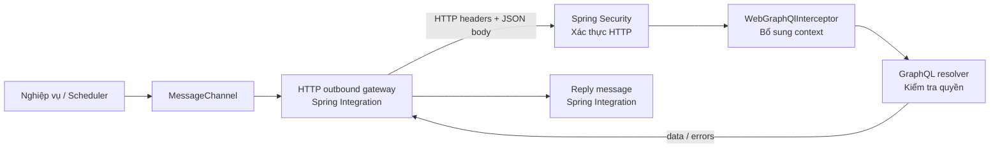

# Headers, authentication và context trong Adapter GraphQL

## Mục tiêu bài học

Khi kết nối một ứng dụng Spring Integration với GraphQL API, nội dung `query` hoặc `mutation` chỉ là một phần của yêu cầu. Ứng dụng còn phải gửi đúng HTTP headers, xác thực danh tính bên gọi, truyền thông tin quan sát luồng xử lý và bảo đảm phía GraphQL chỉ sử dụng context đáng tin cậy.

Sau bài học, bạn có thể:

- Phân biệt **HTTP headers**, **Spring Integration `MessageHeaders`**, **GraphQL variables** và **GraphQLContext**.
- Gửi Bearer token, `Content-Type`, `Accept` và correlation ID qua HTTP outbound gateway.
- Chọn cách truyền danh tính phù hợp giữa hai hệ thống, tránh chuyển tiếp token ngoài phạm vi được phép.
- Đưa metadata đã kiểm tra vào `GraphQLContext` trên GraphQL server.
- Phân biệt lỗi xác thực ở tầng HTTP với lỗi thực thi GraphQL trong trường `errors`, đồng thời thiết kế log và kiểm thử an toàn.

> **Phạm vi:** Spring Integration tổ chức luồng message và có HTTP inbound/outbound gateway để gọi GraphQL qua HTTP. Spring for GraphQL xử lý truy vấn ở phía GraphQL server, bao gồm `WebGraphQlInterceptor` và `GraphQLContext`. Hai thành phần này có vai trò khác nhau; các ví dụ dưới đây dùng HTTP outbound gateway của Spring Integration để kết nối GraphQL API.

## 1. Bài toán: gọi GraphQL thay mặt một yêu cầu nghiệp vụ

Giả sử dịch vụ `order-orchestrator` nhận yêu cầu tra cứu đơn hàng. Luồng Spring Integration tạo một GraphQL operation để hỏi dịch vụ `order-graphql`. Hệ thống cần:

1. Gửi truy vấn lấy đơn hàng `O-1024`.
2. Chứng minh danh tính của dịch vụ hoặc người dùng được đại diện.
3. Liên kết các log của hai bên bằng một correlation ID.
4. Đảm bảo dữ liệu chỉ thuộc tenant mà danh tính đã xác thực có quyền truy cập.

Một yêu cầu HTTP minh họa:

```http
POST /graphql HTTP/1.1
Host: orders.example.test
Authorization: Bearer <access-token>
Content-Type: application/json
Accept: application/graphql-response+json, application/json
X-Correlation-Id: req-7f83

{
  "operationName": "GetOrder",
  "query": "query GetOrder($id: ID!) { order(id: $id) { id status } }",
  "variables": { "id": "O-1024" }
}
```

Trong đó:

- `Authorization` dùng để truyền thông tin xác thực cho HTTP server.
- `Content-Type` cho biết body là JSON; `Accept` thể hiện kiểu phản hồi client có thể xử lý.
- `X-Correlation-Id` dùng để theo dõi một yêu cầu qua các hệ thống, **không phải** bằng chứng người gọi có quyền.
- `operationName`, `query` và `variables` là dữ liệu của GraphQL operation, không thay thế cơ chế xác thực HTTP.

**Lưu ý:** `<access-token>` ở trên là ký hiệu minh họa. Không lưu token thật trong mã nguồn, tài liệu, log hoặc cấu hình công khai.

## 2. Phân biệt các lớp thông tin

| Lớp | Nơi tồn tại | Mục đích | Ví dụ |
| --- | --- | --- | --- |
| **Spring Integration payload** | `Message<?>` trong luồng tích hợp | Mang body để HTTP gateway gửi đi | Chuỗi JSON chứa `query` và `variables` |
| **Spring Integration MessageHeaders** | Metadata của `Message<?>` | Điều phối message và cung cấp thông tin để adapter ánh xạ ra HTTP | `replyChannel`, `errorChannel`, `contentType`, `Authorization` |
| **HTTP request headers** | Trên đường truyền client → GraphQL endpoint | Nội dung giao thức, xác thực, thương lượng media type, tracing | `Authorization`, `Content-Type`, `Accept`, `traceparent` |
| **GraphQL variables** | Body JSON của GraphQL request | Tham số nghiệp vụ được khai báo trong operation | `{"id":"O-1024"}` |
| **GraphQLContext** | Phía GraphQL server, gắn với một lần thực thi GraphQL | Chia sẻ dữ liệu ngữ cảnh cho data fetcher/resolver | `correlationId`, thông tin tenant đã xác minh |
| **GraphQL response extensions** | Body phản hồi, nếu server trả về | Metadata bổ sung theo quy ước của API | Mã lỗi nghiệp vụ trong `errors[].extensions` |

Có hai ranh giới cần ghi nhớ:

**Ranh giới 1 — `MessageHeaders` → HTTP headers.** Khi một message đi vào HTTP outbound gateway, `DefaultHttpHeaderMapper` quyết định header nào được chuyển thành HTTP header. Các header điều phối nội bộ như `replyChannel` và `errorChannel` không phải header HTTP dành cho đối tác. Nếu tùy biến danh sách header, phải kiểm tra lại header nào còn được ánh xạ.

**Ranh giới 2 — HTTP headers → `GraphQLContext`.** GraphQL server có thể đọc HTTP headers rồi đưa một phần thông tin vào `GraphQLContext` bằng interceptor. Việc sao chép một header vào context **không tự động xác thực** giá trị đó. Chẳng hạn, `X-Tenant-Id: tenant-A` do client gửi vẫn là dữ liệu chưa đáng tin cho đến khi server kiểm tra quyền tenant của danh tính đã xác thực.



Sơ đồ minh họa đường đi logic của một yêu cầu. Spring Security và interceptor chạy ở phía GraphQL server; không phải mọi hệ thống đều sử dụng đúng thứ tự bộ lọc hay framework như trong ví dụ.

## 3. Thiết kế HTTP headers cho một GraphQL request

### Các header thường dùng

| Header | Cách dùng | Lưu ý |
| --- | --- | --- |
| `Authorization` | Thường là `Bearer <token>` | Xác thực trên server qua cơ chế được cấu hình; không ghi token vào log |
| `Content-Type` | `application/json` khi gửi body GraphQL dạng JSON | Không nhầm với `Accept` |
| `Accept` | `application/graphql-response+json` hoặc `application/json` tùy khả năng API | Media type có thể ảnh hưởng cách server biểu diễn lỗi HTTP |
| `X-Correlation-Id` | Đối chiếu request/reply/log ở nhiều dịch vụ | Hạn chế độ dài, ký tự; không dùng làm khóa cấp quyền |
| `traceparent` | Truyền trace context theo W3C nếu có hệ thống tracing | Ưu tiên instrumentation tự động; tránh sinh trace ID thủ công sai định dạng |
| `Accept-Language` | Gợi ý ngôn ngữ phản hồi nếu API có hỗ trợ | Chỉ là metadata của client |
| `X-Tenant-Id` | Gợi ý tenant trong giao thức riêng | Phải đối chiếu với danh tính/quyền đã xác thực trước khi truy cập dữ liệu |

### Khi tùy biến header mapping

Spring Integration dùng `DefaultHttpHeaderMapper` cho HTTP adapter/gateway. Theo mặc định, các HTTP header chuẩn được ánh xạ. Khi cấu hình danh sách riêng, danh sách đó có thể **thay thế mặc định**. Vì vậy:

- Đặt rõ header nào thực sự cần gửi sang GraphQL API.
- Nếu cần giữ các HTTP request headers chuẩn khi tự cấu hình, dùng pattern `HTTP_REQUEST_HEADERS` cùng các custom header được cho phép.
- Không copy toàn bộ header nhận từ upstream sang đối tác, đặc biệt là `Cookie`, `Authorization` hoặc header nội bộ không thuộc hợp đồng tích hợp.
- Kiểm tra header mapping bằng HTTP mock server; đừng suy đoán từ việc header có mặt trong `MessageHeaders`.

Ví dụ cấu hình XML minh họa ý nghĩa của danh sách cho HTTP outbound gateway:

```xml
<int-http:outbound-gateway
    id="partnerGraphqlGateway"
    channel="graphqlRequests"
    url="https://partner.example.test/graphql"
    http-method="POST"
    expected-response-type="java.lang.String"
    mapped-request-headers="HTTP_REQUEST_HEADERS, X-Correlation-Id" />
```

Trong luồng sử dụng Java DSL, có thể cấu hình `DefaultHttpHeaderMapper` tương đương. Đoạn XML chỉ minh họa **header mapping**; phần triển khai Java bên dưới dùng gateway Java DSL và mapping mặc định.

## 4. Authentication: danh tính nào được gửi?

Trước khi thêm `Authorization`, xác định rõ ai là chủ thể gọi GraphQL:

| Trường hợp | Token được gửi | Điều kiện an toàn |
| --- | --- | --- |
| **Service-to-service** | Token của `order-orchestrator`, thường lấy qua OAuth 2.0 client credentials | GraphQL API xác thực service identity, `audience` và `scope` phù hợp |
| **On-behalf-of user** | Token do hệ thống định danh cấp cho downstream hoặc token trao đổi hợp lệ | Chính sách cho phép ủy quyền; audience, thời hạn, scope phù hợp downstream |
| **Không cần danh tính người dùng** | Không gửi token người dùng, dùng danh tính dịch vụ nếu API yêu cầu | Tránh gắn quyền người dùng vào một job nền không có người dùng |
| **GraphQL công khai** | Có thể không có `Authorization` | Chỉ khi chính API công bố cho truy cập ẩn danh |

Không nên mặc định chuyển nguyên `Authorization` từ HTTP inbound sang HTTP outbound: token dành cho service A có thể không được chấp nhận hoặc không được phép sử dụng tại service B. Việc xác thực thành công tại một gateway cũng không thay thế bước **authorization** ở GraphQL resolver/service.

Ở phía GraphQL server:

1. Spring Security hoặc cơ chế tương đương xác thực token: chữ ký, issuer, audience, hạn dùng và các ràng buộc cần thiết.
2. Server lấy subject, scopes/roles, tenant hợp lệ từ danh tính đã xác thực.
3. Resolver hoặc service nghiệp vụ kiểm tra quyền trên từng operation/tài nguyên; cùng một URL `/graphql` có thể phục vụ nhiều trường dữ liệu khác quyền.
4. Nếu header chứa thông tin bổ sung như tenant được yêu cầu, server đối chiếu nó với quyền thực tế của subject.

**Không dùng `query`, `variables`, `extensions`, custom header hay correlation ID để thay thế thông tin xác thực.** Ngay cả khi client gửi `tenantId` trong `variables`, server vẫn phải thực thi ràng buộc truy cập của tenant.

## 5. Ví dụ Spring Integration: gọi GraphQL HTTP outbound gateway

Ví dụ dưới đây dùng Spring Integration HTTP và Java DSL. Hệ thống đã có một thành phần cung cấp access token hợp lệ (ví dụ từ OAuth 2.0 client manager); không tự tạo token giả bằng mã ứng dụng.

### 5.1. Định nghĩa luồng và messaging gateway

```java
import org.springframework.context.annotation.Bean;
import org.springframework.context.annotation.Configuration;
import org.springframework.http.HttpHeaders;
import org.springframework.http.HttpMethod;
import org.springframework.integration.annotation.Gateway;
import org.springframework.integration.annotation.IntegrationComponentScan;
import org.springframework.integration.annotation.MessagingGateway;
import org.springframework.integration.dsl.IntegrationFlow;
import org.springframework.integration.http.dsl.Http;
import org.springframework.messaging.handler.annotation.Header;
import org.springframework.messaging.handler.annotation.Payload;

@Configuration
@IntegrationComponentScan
class GraphqlOutboundConfiguration {

    @Bean
    IntegrationFlow partnerGraphqlFlow() {
        return IntegrationFlow.from("partnerGraphqlRequests")
            .handle(Http.outboundGateway(
                    "https://partner.example.test/graphql")
                .httpMethod(HttpMethod.POST)
                .expectedResponseType(String.class))
            .get();
    }
}

@MessagingGateway
interface PartnerGraphqlGateway {

    @Gateway(requestChannel = "partnerGraphqlRequests")
    String execute(
        @Payload String jsonBody,
        @Header(HttpHeaders.AUTHORIZATION) String authorization,
        @Header(HttpHeaders.CONTENT_TYPE) String contentType,
        @Header(HttpHeaders.ACCEPT) String accept,
        @Header("X-Correlation-Id") String correlationId);
}
```

Giải thích:

- `partnerGraphqlRequests` là input channel của flow. Lời gọi `PartnerGraphqlGateway.execute(...)` tạo một Spring Integration message và đợi reply.
- `Http.outboundGateway(...)` phát HTTP POST và gửi response về reply path. Dùng **outbound gateway** khi cần nhận dữ liệu GraphQL trả về; outbound channel adapter một chiều sẽ không đáp ứng mô hình request/reply này.
- `expectedResponseType(String.class)` để ví dụ nhận JSON thô và tự kiểm tra cả `data` lẫn `errors`.
- Các header truyền vào messaging gateway được HTTP header mapper xử lý trước khi phát request. Nếu có mapper riêng, cần cấu hình và thử nghiệm danh sách tương ứng.
- Endpoint, timeout, retry và cơ chế lấy token phải được cấu hình theo môi trường; URL `example.test` chỉ dùng để minh họa.

### 5.2. Tạo body bằng JSON serializer và đọc cả `errors`

```java
import java.util.Map;
import com.fasterxml.jackson.databind.JsonNode;
import com.fasterxml.jackson.databind.ObjectMapper;
import org.springframework.http.MediaType;

// Giả sử gateway, objectMapper và accessToken được cung cấp sẵn.
String query = """
    query GetOrder($id: ID!) {
      order(id: $id) { id status }
    }
    """;

String requestBody = objectMapper.writeValueAsString(Map.of(
    "operationName", "GetOrder",
    "query", query,
    "variables", Map.of("id", "O-1024")
));

String rawResponse = gateway.execute(
    requestBody,
    "Bearer " + accessToken,
    MediaType.APPLICATION_JSON_VALUE,
    "application/graphql-response+json, application/json",
    "req-7f83"
);

JsonNode result = objectMapper.readTree(rawResponse);
if (result.has("errors") && !result.path("errors").isEmpty()) {
    // Phân loại lỗi theo hợp đồng API, kể cả khi HTTP status là 200.
    throw new IllegalStateException("GraphQL returned errors");
}
JsonNode order = result.path("data").path("order");
// Kiểm tra null/thiếu field trước khi chuyển thành dữ liệu nghiệp vụ.
```

Ở production, thay `IllegalStateException` minh họa bằng bộ phân loại lỗi có cấu trúc, ghi nhận mã lỗi an toàn và hỗ trợ `partial data` khi hợp đồng cho phép. Đừng đưa nguyên response chứa dữ liệu cá nhân, token hay thông tin nhạy cảm vào log.

**Lưu ý khi dựng body:** giữ `query` là một operation có định nghĩa và truyền giá trị nghiệp vụ qua `variables`. Dùng `ObjectMapper` để escape JSON đúng cách, tránh nối chuỗi thủ công. `variables` không phải nơi chứa access token.

## 6. GraphQL server: đưa HTTP metadata vào `GraphQLContext`

`GraphQLContext` là ngữ cảnh gắn với lần thực thi GraphQL, có thể truy cập từ resolver và data fetcher. Spring for GraphQL hỗ trợ `WebGraphQlInterceptor` để đọc request transport, tùy chỉnh `ExecutionInput` và thêm response headers.

Ví dụ sau chỉ đưa **correlation ID** vào context. Nếu giá trị client gửi không hợp lệ, server sinh ID mới để tránh ghi ký tự điều khiển hoặc chuỗi quá dài vào log.

```java
import java.util.Map;
import java.util.UUID;
import org.springframework.graphql.server.WebGraphQlInterceptor;
import org.springframework.graphql.server.WebGraphQlRequest;
import org.springframework.graphql.server.WebGraphQlResponse;
import org.springframework.stereotype.Component;
import reactor.core.publisher.Mono;

@Component
class CorrelationGraphQlInterceptor implements WebGraphQlInterceptor {

    @Override
    public Mono<WebGraphQlResponse> intercept(
            WebGraphQlRequest request, Chain chain) {

        String provided = request.getHeaders().getFirst("X-Correlation-Id");
        String correlationId =
            provided != null && provided.matches("[A-Za-z0-9_-]{1,64}")
                ? provided
                : UUID.randomUUID().toString();

        request.configureExecutionInput((input, builder) ->
            builder.graphQLContext(
                Map.of("correlationId", correlationId)).build());

        return chain.next(request).doOnNext(response ->
            response.getResponseHeaders()
                .set("X-Correlation-Id", correlationId));
    }
}
```

Với Spring Boot + Spring for GraphQL, một bean `WebGraphQlInterceptor` được đưa vào chuỗi xử lý web GraphQL theo cơ chế auto-configuration tương ứng. Khi đã có interceptor khác, cần kiểm tra quy ước key trong context để tránh ghi đè.

Ở resolver, lấy correlation ID từ `GraphQLContext`; danh tính và tenant vẫn phải được xác minh qua cơ chế bảo mật:

```java
import org.springframework.graphql.data.method.annotation.Argument;
import org.springframework.graphql.data.method.annotation.ContextValue;
import org.springframework.graphql.data.method.annotation.QueryMapping;
import org.springframework.security.core.annotation.AuthenticationPrincipal;
import org.springframework.security.oauth2.jwt.Jwt;
import org.springframework.stereotype.Controller;

@Controller
class OrderGraphQlController {

    private final OrderService orders;

    OrderGraphQlController(OrderService orders) {
        this.orders = orders;
    }

    @QueryMapping
    Order order(
        @Argument String id,
        @AuthenticationPrincipal Jwt jwt,
        @ContextValue("correlationId") String correlationId) {

        String tenantId = jwt.getClaimAsString("tenant_id");
        // readAuthorized thực thi kiểm tra subject, tenant và quyền đọc.
        return orders.readAuthorized(jwt.getSubject(), tenantId, id);
    }
}
```

`Order` và `OrderService.readAuthorized(...)` là các kiểu/hàm nghiệp vụ minh họa, cần định nghĩa trong ứng dụng thực tế. Mẫu dùng `@AuthenticationPrincipal Jwt` giả định GraphQL endpoint đã được bảo vệ bằng Spring Security OAuth2 Resource Server. Việc lấy claim chỉ có ý nghĩa khi hệ thống đã xác minh token và thống nhất ý nghĩa claim `tenant_id`; resolver vẫn phải kiểm tra quyền đọc từng đơn hàng.

Nếu chỉ cần chuyển một HTTP header vô hại vào context, Spring for GraphQL còn có `HttpRequestHeaderInterceptor`:

```java
@Bean
HttpRequestHeaderInterceptor headerInterceptor() {
    return HttpRequestHeaderInterceptor.builder()
        .mapHeader("Accept-Language")
        .build();
}
```

Đây là thao tác **ánh xạ**, không phải xác thực. Không tùy tiện map token hoặc dữ liệu nhạy cảm vào context hay phản hồi.

### 6.1. Cấu hình bảo vệ `/graphql`

Một cấu hình rút gọn cho **HTTP API dùng Bearer JWT và không dựa vào cookie session**:

```java
@Bean
SecurityFilterChain graphqlApiSecurity(HttpSecurity http) throws Exception {
    return http
        .csrf(csrf -> csrf.ignoringRequestMatchers("/graphql"))
        .authorizeHttpRequests(auth -> auth
            .requestMatchers("/graphql").authenticated()
            .anyRequest().permitAll())
        .oauth2ResourceServer(oauth -> oauth.jwt(
            Customizer.withDefaults()))
        .build();
}
```

Cần bổ sung imports Spring Security và cấu hình issuer/JWK, audience validation, authorization theo ứng dụng. Chỉ áp dụng ngoại lệ CSRF cho endpoint stateless dùng Bearer token theo đúng mô hình triển khai; nếu sử dụng cookie/session, phải đánh giá và duy trì CSRF protection phù hợp. Bảo vệ URL chỉ kiểm tra người gọi được vào `/graphql`, chưa đủ để phân quyền giữa các query, mutation và trường dữ liệu. Các kiểm tra chi tiết nên đặt tại service/resolver, chẳng hạn bằng `@PreAuthorize` cùng điều kiện tenant.

### 6.2. Context trong luồng bất đồng bộ

Không lưu `GraphQLContext` hoặc thông tin của một request vào singleton mutable field hay static variable: các yêu cầu có thể chạy song song và làm rò dữ liệu giữa người dùng. Trong WebFlux, Reactor `Context` và Spring Security context có cơ chế truyền riêng; trong Spring MVC, `ThreadLocal` không được bảo đảm còn đúng khi chuyển thread. Sử dụng cơ chế context propagation do Spring for GraphQL hỗ trợ, hoặc truyền tường minh dữ liệu cần thiết qua tham số, thay vì truy xuất một ThreadLocal tùy tiện trong callback bất đồng bộ.

## 7. Phản hồi, lỗi và chính sách retry

GraphQL có thể trả HTTP 200 nhưng body chứa `errors`. Với `application/graphql-response+json`, những lỗi ở giai đoạn parse/validate request cũng có thể được biểu diễn bằng mã HTTP 4xx. Vì vậy client phải xử lý **cả HTTP status lẫn nội dung GraphQL**.

| Kết quả | Ý nghĩa thường gặp | Xử lý gợi ý |
| --- | --- | --- |
| HTTP 401 | Không có thông tin xác thực hợp lệ, token hết hạn/sai | Kiểm tra token source; chỉ thử làm mới token theo chính sách đã định |
| HTTP 403 | Bị từ chối tại tầng HTTP/security | Kiểm tra quyền, audience, scope; không retry vô hạn |
| HTTP 200 + `data` | Operation xử lý và có dữ liệu | Kiểm tra schema và trường bắt buộc |
| HTTP 200 + `errors` | Resolver/logic GraphQL trả lỗi, có thể kèm `data` một phần | Xử lý từng lỗi theo hợp đồng, tránh coi là thành công toàn phần |
| HTTP 400/4xx do query/JSON sai | Yêu cầu không hợp lệ | Sửa operation/serialization; không retry nguyên xi |
| HTTP 429, 502, 503 hoặc timeout | Giới hạn tải hoặc lỗi tạm thời | Backoff có giới hạn, quan sát `Retry-After` khi API hỗ trợ |

Ví dụ phản hồi GraphQL có dữ liệu một phần:

```json
{
  "data": {
    "order": null
  },
  "errors": [
    {
      "message": "Access denied",
      "path": ["order"],
      "extensions": { "code": "FORBIDDEN" }
    }
  ]
}
```

`extensions.code` trong ví dụ là quy ước của API minh họa, không phải một tập mã lỗi GraphQL bắt buộc theo chuẩn. Phía tích hợp nên map mã lỗi dựa trên hợp đồng với đối tác.

**Đặc biệt với mutation:** không tự retry sau timeout khi chưa biết phía server đã thực hiện hành động hay chưa. Sử dụng idempotency key hoặc cơ chế chống xử lý trùng nếu API hỗ trợ, và xác định rõ điều kiện retry trong hợp đồng tích hợp.

## 8. Logging, bảo mật và vận hành

Đối với các luồng từ file/SFTP, HTTP, JMS, Kafka hay database đi qua Spring Integration rồi gọi GraphQL, hãy thiết kế một chính sách metadata thống nhất:

- **Correlation:** gắn correlation ID ở điểm vào, giữ qua các kênh trung gian và chuyển có chọn lọc sang HTTP header. Log correlation ID, operation name, đích gọi, latency, HTTP status và số lỗi; không log credentials.
- **Bảo vệ bí mật:** che `Authorization`, `Cookie`, `Set-Cookie` và các trường nhạy cảm trong cả log adapter, exception, wiretap và distributed tracing. Không đưa access token vào GraphQL query string hoặc metric labels.
- **Phân tách nguồn gốc:** giữ thông tin nào do upstream tự khai, thông tin nào được xác minh bởi identity provider. Dữ liệu tự khai chỉ dùng làm gợi ý hoặc phải được xác thực lại.
- **Giới hạn quyền:** token có thời hạn và scope tối thiểu; giới hạn audience tới dịch vụ đích. Không dùng cùng một credential cho mọi tenant nếu mô hình phân quyền cần tách biệt.
- **Vòng đời kết nối:** đặt connection/read timeout, giới hạn retry và concurrency; theo dõi các mã 401/403/429/5xx; xử lý token refresh tập trung để tránh nhiều request cùng làm mới token.
- **Xử lý lỗi:** phân nhánh HTTP transport failure và GraphQL `errors`; đẩy thông tin lỗi đã khử bí mật tới `errorChannel` hoặc cơ chế xử lý lỗi phù hợp của flow.

Cần phân biệt `MessageHeaders.ID`, `MessageHeaders.TIMESTAMP` và correlation ID nghiệp vụ. Message ID của Spring Integration được tạo cho từng message, có thể thay đổi qua các bước biến đổi; correlation ID nghiệp vụ nên có hợp đồng ổn định riêng.

## 9. Checklist kiểm thử tích hợp

Các ca tối thiểu để xác nhận đường đi của header và context:

| Ca thử | Dữ liệu đầu vào | Kỳ vọng |
| --- | --- | --- |
| Header chuẩn | JSON hợp lệ, token hợp lệ | HTTP POST có `Content-Type` và `Authorization` đúng; GraphQL trả `data` |
| Mapping tùy chỉnh | Thêm `X-Correlation-Id` trong message | Đối tác nhận được đúng ID; không nhận các header nội bộ |
| Thiếu token | Không gửi `Authorization` | Bị chặn theo chính sách security, không trả dữ liệu riêng tư |
| Token sai đối tượng | JWT hợp lệ nhưng audience/scope không phù hợp | Bị từ chối trước hoặc trong bước kiểm tra quyền |
| Giả mạo tenant | Token tenant A, client tự gửi `X-Tenant-Id: B` | Không thể truy cập dữ liệu của B |
| Resolver lỗi | HTTP trả body có `errors` | Flow nhận diện lỗi thay vì đánh dấu thành công |
| Timeout sau mutation | Không có response | Không gửi lại mutation vô điều kiện |
| Song song A/B | Hai request có context khác nhau | Không rò tenant/correlation ID giữa request |
| Log | Bật tracing và nhánh lỗi | Không lộ token hay payload nhạy cảm |

Có thể dùng mock HTTP server để chụp request outbound, xác nhận body/header và mô phỏng status codes. Với GraphQL server, dùng `WebGraphQlTester` hoặc kiểm thử qua transport để xác minh interceptor, context và chính sách phân quyền. Không kiểm thử bằng cách đưa token thật vào log hoặc fixture được commit.

## 10. Bài tập thực hành

**Bối cảnh:** Một flow nhận event `OrderRequested` từ broker, gọi GraphQL `order(id: ...)` và gửi kết quả về một kênh xử lý. Mỗi event có `correlationId` và `tenantHint`, còn danh tính dịch vụ lấy từ OAuth 2.0.

1. Thiết kế request GraphQL gồm `query` và `variables`; đặt Bearer token trong HTTP header. Liệt kê rõ header nào cần chuyển từ message sang HTTP.
2. Bổ sung interceptor phía GraphQL để đưa correlation ID đã kiểm tra vào `GraphQLContext`, đồng thời dùng thông tin tenant được xác minh từ danh tính bảo mật để giới hạn truy cập.
3. Mô phỏng lần lượt token hết hạn, GraphQL trả HTTP 200 kèm `errors`, và timeout sau mutation. Xác định trường hợp có thể retry, trường hợp phải từ chối và thông tin được phép ghi log.

**Tiêu chí hoàn thành:** người học giải thích được nguồn gốc từng giá trị trong resolver, chứng minh được tenant không phụ thuộc duy nhất vào client header và không đánh đồng HTTP 200 với một GraphQL operation thành công.

## Tài liệu tham khảo

- [Spring Integration — HTTP Header Mappings](https://docs.spring.io/spring-integration/reference/http/header-mapping.html)
- [Spring Integration — Configuring HTTP Endpoints with Java](https://docs.spring.io/spring-integration/reference/http/java-config.html)
- [Spring for GraphQL — Server Transports và WebGraphQlInterceptor](https://docs.spring.io/spring-graphql/reference/transports.html)
- [Spring for GraphQL — Annotated Controllers](https://docs.spring.io/spring-graphql/reference/controllers.html)
- [Spring for GraphQL — Security](https://docs.spring.io/spring-graphql/reference/security.html)
- [Spring for GraphQL — Request Execution và Context Propagation](https://docs.spring.io/spring-graphql/reference/request-execution.html)
