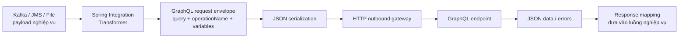
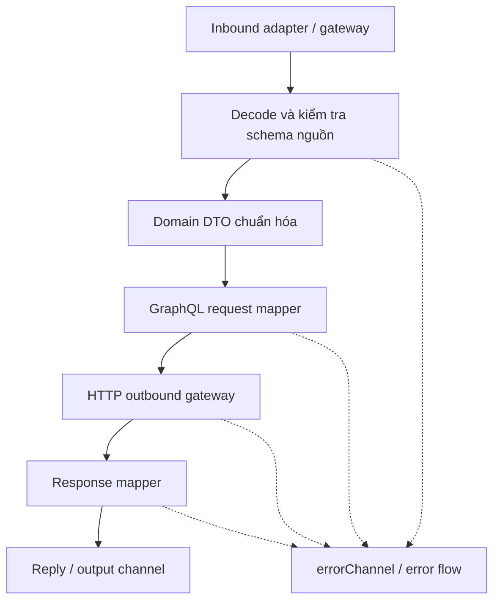

# Mapping payload sang request document trong Adapter GraphQL

## Mục tiêu

Trong module **SPRING_INTEGRATION_ADAPTERS**, Spring Integration kết nối các hệ thống ngoài thông qua inbound/outbound adapter, gateway, poller và `MessageChannel`. Khi một luồng nhận dữ liệu từ file, SFTP, HTTP, JMS, AMQP, Kafka hoặc cơ sở dữ liệu cần gọi GraphQL API, payload nhận được thường **không phải** là định dạng mà endpoint GraphQL chấp nhận. Ta cần biến đổi payload thành một yêu cầu GraphQL hợp lệ, sau đó gửi qua HTTP outbound gateway và xử lý phản hồi.

Sau bài này, bạn có thể:

- Phân biệt **payload nghiệp vụ**, **GraphQL document**, **variables** và **HTTP request body**.
- Ánh xạ các trường từ message sang GraphQL query/mutation theo schema của hệ thống đích.
- Xây dựng request với `operationName`, `query` và `variables` mà không nối trực tiếp giá trị nghiệp vụ vào query.
- Xử lý kiểu `ID`, enum, input object, danh sách, trường bắt buộc và giá trị `null`.
- Đặt transformer đúng vị trí trong Spring Integration flow, giữ metadata cần thiết ở message headers.
- Kiểm thử output mapping và phân biệt lỗi trước khi gửi request với lỗi GraphQL sau khi gọi API.

> **Phạm vi:** Ví dụ dùng GraphQL over HTTP. Spring Integration cung cấp luồng message, transformer, gateway và cơ chế xử lý lỗi; phần thực thi GraphQL document thuộc về GraphQL server. Các operation trong bài là ví dụ giả định dựa trên schema mẫu, phải đối chiếu với schema thật của hệ thống đích.

## 1. Bài toán thực tế

Giả sử một ứng dụng nhận sự kiện từ Kafka hoặc AMQP khi cần đồng bộ thông tin đơn hàng. Payload nội bộ:

```json
{
  "eventId": "evt-817",
  "orderId": "O-1024",
  "tenantHint": "shop-42",
  "correlationId": "flow-5f23"
}
```

Đích đến là GraphQL API công bố operation:

```graphql
query GetOrder($id: ID!) {
  order(id: $id) {
    id
    status
    total
  }
}
```

GraphQL API qua HTTP thường nhận JSON body có dạng:

```json
{
  "operationName": "GetOrder",
  "query": "query GetOrder($id: ID!) { order(id: $id) { id status total } }",
  "variables": {
    "id": "O-1024"
  }
}
```

Điểm quan trọng: `orderId` của hệ thống nội bộ đã trở thành variable `id`. Các trường `tenantHint`, `correlationId` và `eventId` không tự động trở thành GraphQL variables. Chúng chỉ được đưa vào request nếu schema hoặc hợp đồng tích hợp thật sự yêu cầu. Correlation ID phù hợp hơn với HTTP header, còn tenant dùng cho phân quyền phải được kiểm tra dựa trên danh tính đã xác thực.

Sơ đồ ánh xạ:



Bước biến đổi payload là ranh giới giữa mô hình sự kiện nội bộ và hợp đồng GraphQL của đối tác. Nếu mô hình nội bộ thay đổi, chỉ cần sửa mapper phù hợp; các bước transport và xử lý kênh có thể giữ nguyên.

## 2. Bốn khái niệm thường bị nhầm

| Thành phần | Ví dụ | Vai trò |
| --- | --- | --- |
| **Inbound message payload** | `OrderLookupEvent(orderId, tenantHint, …)` | Dữ liệu nguồn do upstream gửi vào Spring Integration |
| **GraphQL document** | `query GetOrder($id: ID!) { … }` | Khai báo operation, kiểu variables và fields yêu cầu theo GraphQL schema |
| **GraphQL variables** | `{"id":"O-1024"}` | Bộ giá trị truyền vào các variable của document khi thực thi |
| **GraphQL-over-HTTP request body** | `{"query":"…","operationName":"GetOrder","variables":{…}}` | JSON envelope gửi bằng HTTP POST tới endpoint |
| **Spring Integration MessageHeaders** | `Authorization`, `X-Correlation-Id`, `replyChannel` | Metadata của message; HTTP gateway có thể ánh xạ một số header cần thiết thành HTTP headers |

**GraphQL document không phải JSON request body.** `query` trong JSON là một chuỗi chứa GraphQL document; `variables` là một object JSON riêng. Khi chỉ có một operation trong document, `operationName` có thể được bỏ qua. Khi document chứa nhiều operation, cần chỉ rõ tên operation muốn thực thi.

GraphQL operation có thể là `query`, `mutation` hoặc `subscription`; bài này tập trung vào HTTP query/mutation. Subscription thường cần cơ chế truyền và vòng đời kết nối khác, chẳng hạn WebSocket theo giao thức của GraphQL server.

## 3. Bắt đầu từ hợp đồng GraphQL schema

Không thể suy ra tên field, kiểu dữ liệu hoặc cấu trúc input từ tên property của Java payload. Mapper phải dựa trên **schema được công bố bởi API đích**.

Ví dụ schema rút gọn:

```graphql
type Query {
  order(id: ID!): Order
  orders(filter: OrderFilterInput, limit: Int = 20): [Order!]!
}

type Mutation {
  updateOrder(input: UpdateOrderInput!): Order!
}

type Order {
  id: ID!
  status: OrderStatus!
  total: Float!
}

enum OrderStatus {
  NEW
  PAID
  CANCELLED
}

input OrderFilterInput {
  status: OrderStatus
  customerId: ID
}

input UpdateOrderInput {
  id: ID!
  status: OrderStatus!
  reason: String
}
```

Từ schema trên, các quyết định mapping phải được xác định trước:

| Input từ hệ thống nguồn | Vị trí tại GraphQL | Quy tắc |
| --- | --- | --- |
| `orderId` | `variables.id` cho `GetOrder` | Bắt buộc, phải có giá trị không rỗng |
| `status` | `variables.filter.status` hoặc `variables.input.status` | Chỉ chấp nhận giá trị enum đã công bố |
| `customerId` | `variables.filter.customerId` | Tùy chọn, theo đúng hợp đồng của operation |
| `reason` | `variables.input.reason` | Cần phân biệt không cung cấp với cố ý gửi `null` |
| `tenantHint` | Thường không có trong document | Chỉ gửi nếu API có hợp đồng rõ ràng, vẫn phải kiểm tra authorization |
| `correlationId` | HTTP header để quan sát luồng | Không phải variable của query |

Ví dụ các tên `customerId` và `status` bên trong `OrderFilterInput` là do schema quyết định. Nếu server định nghĩa `customer_id`, mapper phải dùng đúng tên đó dù Java property vẫn tên `customerId`.

## 4. Ánh xạ an toàn: document cố định, values ở variables

Giả sử order ID là `O-1024`. Cách có vấn đề là ghép giá trị vào document:

```java
// Tránh nối payload trực tiếp vào chuỗi GraphQL document.
String query = "query { order(id: \"" + event.orderId() +
    "\") { id status } }";
```

Cách này dễ sinh document lỗi khi giá trị chứa ký tự đặc biệt, khó cache/review và mở đường cho việc người gửi điều khiển cú pháp query nếu escape sai. Thay vào đó, dùng biến GraphQL được định nghĩa trong operation:

```graphql
query GetOrder($id: ID!) {
  order(id: $id) {
    id
    status
    total
  }
}
```

và truyền giá trị riêng:

```json
{
  "id": "O-1024"
}
```

Các lợi ích chính:

- Query được review và kiểm thử như một artifact ổn định.
- Giá trị nghiệp vụ không làm thay đổi cấu trúc operation.
- Dễ log tên operation mà không phải log toàn bộ payload.
- Có thể tái sử dụng document cho nhiều request chỉ khác variables.
- Có thể tích hợp với persisted queries theo hợp đồng của API nếu cần.

**Đặt variables đúng nơi không thay thế validation.** Vẫn cần kiểm tra độ dài, định dạng ID, giá trị enum, tenant, quyền và chi phí thực thi query ở hệ thống tương ứng.

## 5. Ví dụ Java: tạo request envelope từ payload

Dưới đây là một thiết kế gồm ba lớp: payload nguồn, request envelope và mapper. Ví dụ dùng Java 17+, Jackson và Spring Integration; lớp `GraphqlEnvelope` là DTO của HTTP request, không phải một GraphQL document mới.

### 5.1. Định nghĩa dữ liệu nguồn và envelope

```java
import java.util.Map;

public record OrderLookupEvent(
    String eventId,
    String orderId,
    String tenantHint,
    String correlationId
) {}

public record GraphqlEnvelope(
    String query,
    String operationName,
    Map<String, Object> variables
) {}
```

Với record trên, Jackson phiên bản hỗ trợ Java records sẽ xuất JSON theo tên component: `query`, `operationName`, `variables`. Ở hệ thống dùng Java/Jackson cũ hơn, cần DTO tương thích hoặc cấu hình serializer phù hợp.

### 5.2. Mapper chịu trách nhiệm về hợp đồng GraphQL

```java
import com.fasterxml.jackson.core.JsonProcessingException;
import com.fasterxml.jackson.databind.ObjectMapper;
import java.util.Map;
import java.util.Objects;

public final class OrderGraphqlRequestMapper {

    private static final String DOCUMENT = """
        query GetOrder($id: ID!) {
          order(id: $id) {
            id
            status
            total
          }
        }
        """;

    private final ObjectMapper objectMapper;

    public OrderGraphqlRequestMapper(ObjectMapper objectMapper) {
        this.objectMapper = Objects.requireNonNull(objectMapper);
    }

    public String toRequestJson(OrderLookupEvent event) {
        Objects.requireNonNull(event, "event");
        String orderId = event.orderId();

        if (orderId == null || orderId.isBlank()) {
            throw new IllegalArgumentException(
                "orderId is required for GetOrder");
        }

        GraphqlEnvelope envelope = new GraphqlEnvelope(
            DOCUMENT,
            "GetOrder",
            Map.of("id", orderId.trim())
        );

        try {
            return objectMapper.writeValueAsString(envelope);
        } catch (JsonProcessingException ex) {
            throw new IllegalStateException(
                "Cannot serialize GetOrder request", ex);
        }
    }
}
```

Lưu ý:

1. Mapper kiểm tra `orderId` trước khi gửi request; server sẽ kiểm tra lại theo schema.
2. Tên `id` là tên GraphQL variable, không bắt buộc giống tên property `orderId`.
3. Document là hằng số: không phụ thuộc vào payload của một request cụ thể.
4. `eventId`, `tenantHint` và `correlationId` không xuất hiện trong request body vì không nằm trong operation.
5. Exception mapping sẽ được Spring Integration xử lý theo ngữ nghĩa luồng đang chạy; muốn có error message riêng, cấu hình `errorChannel` hoặc error flow phù hợp.

**Ví dụ kết quả:** với `orderId = "O-1024"`, method `toRequestJson` sẽ tạo JSON có `query` đúng document, `operationName = "GetOrder"` và `variables.id = "O-1024"`. Số lượng khoảng trắng và xuống dòng của chuỗi `query` do text block quyết định, không làm thay đổi ý nghĩa GraphQL operation.

### 5.3. Gắn mapper vào Spring Integration flow

Ví dụ HTTP outbound gateway nhận JSON string tạo bởi transformer:

```java
import com.fasterxml.jackson.databind.ObjectMapper;
import org.springframework.context.annotation.Bean;
import org.springframework.context.annotation.Configuration;
import org.springframework.http.HttpMethod;
import org.springframework.http.MediaType;
import org.springframework.integration.dsl.IntegrationFlow;
import org.springframework.integration.http.dsl.Http;

@Configuration
class OrderGraphqlIntegrationConfig {

    @Bean
    OrderGraphqlRequestMapper orderGraphqlRequestMapper(
            ObjectMapper objectMapper) {
        return new OrderGraphqlRequestMapper(objectMapper);
    }

    @Bean
    IntegrationFlow orderGraphqlFlow(
            OrderGraphqlRequestMapper requestMapper) {

        return IntegrationFlow.from("orderLookupRequests")
            .transform(OrderLookupEvent.class,
                requestMapper::toRequestJson)
            .enrichHeaders(headers -> headers
                .header("Content-Type", MediaType.APPLICATION_JSON_VALUE)
                .header("Accept",
                    "application/graphql-response+json, application/json"))
            .handle(Http.outboundGateway(
                    "https://orders.example.test/graphql")
                .httpMethod(HttpMethod.POST)
                .expectedResponseType(String.class))
            .get();
    }
}
```

Luồng này gồm:

- **Input channel:** `orderLookupRequests` nhận `Message<OrderLookupEvent>`.
- **Transformer:** biến payload thành chuỗi JSON chứa request envelope.
- **Header enricher:** thêm HTTP Content-Type và Accept.
- **Outbound gateway:** gửi POST tới GraphQL endpoint và nhận chuỗi response JSON để các bước sau xử lý.

Header xác thực như `Authorization` và correlation ID cần được gắn bởi thành phần đáng tin cậy trước khi outbound gateway gọi API. Việc chuyển từ Spring `MessageHeaders` sang HTTP headers phải tuân theo cấu hình HTTP header mapper, đặc biệt với header tự định nghĩa. Không tự động copy token nhận từ một nguồn khác sang GraphQL API nếu token không dành cho API đó.

Đối với flow kiểu request/reply, có thể dùng `@MessagingGateway` để đưa payload cùng metadata cần thiết vào input channel:

```java
import org.springframework.integration.annotation.Gateway;
import org.springframework.integration.annotation.MessagingGateway;
import org.springframework.messaging.handler.annotation.Header;
import org.springframework.messaging.handler.annotation.Payload;

@MessagingGateway
public interface OrderGraphqlGateway {

    @Gateway(requestChannel = "orderLookupRequests")
    String fetch(
        @Payload OrderLookupEvent event,
        @Header("Authorization") String bearerAuthorization,
        @Header("X-Correlation-Id") String correlationId);
}
```

Một nơi gọi ví dụ:

```java
// tokenService lấy access token được cấp cho orders GraphQL API.
// Không chuyển tiếp mù quáng token của inbound request.
String accessToken = tokenService.tokenForOrdersApi();

String jsonResponse = gateway.fetch(
    event,
    "Bearer " + accessToken,
    event.correlationId()
);
```

`tokenService` và `gateway` trong đoạn gọi là các dependency đã được cung cấp sẵn. Đây là ví dụ kết nối giữa mapping và transport; cách cấp token cụ thể phụ thuộc hệ thống định danh/OAuth 2.0 của ứng dụng.

## 6. Trường hợp nâng cao: mutation có nested input object

GraphQL mutation thường nhận một object input. Payload nguồn có thể là:

```json
{
  "orderId": "O-1024",
  "newStatus": "PAID",
  "reason": "Payment confirmed"
}
```

Document tương ứng schema ví dụ:

```graphql
mutation UpdateOrder($input: UpdateOrderInput!) {
  updateOrder(input: $input) {
    id
    status
  }
}
```

JSON gửi đi:

```json
{
  "query": "mutation UpdateOrder($input: UpdateOrderInput!) { updateOrder(input: $input) { id status } }",
  "operationName": "UpdateOrder",
  "variables": {
    "input": {
      "id": "O-1024",
      "status": "PAID",
      "reason": "Payment confirmed"
    }
  }
}
```

Bộ mapping Java có thể tạo cấu trúc lồng nhau:

```java
Map<String, Object> updateInput = new LinkedHashMap<>();
updateInput.put("id", source.orderId());
updateInput.put("status", source.newStatus());
updateInput.put("reason", source.reason());

GraphqlEnvelope request = new GraphqlEnvelope(
    UPDATE_ORDER_DOCUMENT,
    "UpdateOrder",
    Map.of("input", updateInput)
);

String body = objectMapper.writeValueAsString(request);
```

`source`, `UPDATE_ORDER_DOCUMENT` và `objectMapper` là các thành phần minh họa được định nghĩa trong service mapper thực tế. Import `java.util.LinkedHashMap` và `java.util.Map` khi dùng đoạn code độc lập. Với mutation, mapper phải kiểm tra trạng thái enum cho phép trước khi gửi; riêng idempotency/retry thuộc hợp đồng xử lý nghiệp vụ và transport.

### Mapping nhiều operation và operationName

Một GraphQL document có thể chứa nhiều named operations:

```graphql
query GetOrder($id: ID!) {
  order(id: $id) { id status }
}

query ListOrders($limit: Int!) {
  orders(limit: $limit) { id status }
}
```

Nếu gửi toàn bộ document này, body phải có `operationName` tương ứng như `GetOrder` hoặc `ListOrders` để server biết operation cần chạy. Tuy nhiên, trong luồng tích hợp, thường dễ vận hành hơn khi lưu mỗi operation được chấp thuận trong một constant hoặc query registry riêng, thay vì để inbound payload chọn văn bản GraphQL tự do.

## 7. Kiểu dữ liệu và quy tắc chuyển đổi

Các loại GraphQL input phụ thuộc schema; không phải tất cả kiểu Java chuyển sang JSON đều hợp lệ với GraphQL.

| Kiểu GraphQL | Giá trị JSON tương ứng | Quy tắc mapping |
| --- | --- | --- |
| `String` | `"hello"` | Chuỗi; nếu là định danh đặc biệt cần validate format |
| `ID` | Thường `"O-1024"`, có thể là số nguyên theo GraphQL input coercion | Ưu tiên chuỗi để tránh mất số 0 đầu và giới hạn số nguyên |
| `Int` | `20` | GraphQL `Int` là signed 32-bit; kiểm tra giới hạn nếu Java dùng `long` |
| `Float` | `19.95` | JSON number hữu hạn; không mặc định coi là decimal tiền tệ chính xác |
| `Boolean` | `true` / `false` | Boolean thật, không phải `"true"` dưới dạng chuỗi |
| `Enum` | `"PAID"` | JSON string là tên enum đúng trong schema, không phải display label |
| `[ID!]!` | `["O-1","O-2"]` | Danh sách không null và phần tử không null |
| Input object | `{"id":"O-1","status":"PAID"}` | Object có tên field và nested structure khớp schema |
| Custom scalar | Phụ thuộc server, ví dụ chuỗi ISO-8601 cho `DateTime` | Kiểm tra tài liệu scalar của API đích |

**Lưu ý với tiền tệ:** nếu schema dùng `Float` cho `total`, Java `BigDecimal` vẫn có thể được Jackson serialize thành JSON number nhưng độ chính xác và quy tắc làm tròn cần hợp đồng rõ ràng. Nếu API công bố custom scalar `Decimal`, hãy tuân thủ định dạng mà server yêu cầu.

### Trường bắt buộc, null và omitted field

Với GraphQL, ý nghĩa giữa ba trạng thái có thể khác nhau:

1. **Không có key trong variables/input object:** không truyền giá trị; schema có thể sử dụng default nếu có.
2. **Key tồn tại với `null`:** cố ý truyền null; chỉ hợp lệ với trường cho phép null.
3. **Key có giá trị cụ thể:** server kiểm tra kiểu và nghiệp vụ.

Ví dụ với input field `reason: String`:

```json
{"input": {"id": "O-1024", "status": "PAID"}}
```

khác với:

```json
{"input": {"id": "O-1024", "status": "PAID", "reason": null}}
```

Khi không muốn truyền field tùy chọn:

```java
Map<String, Object> input = new LinkedHashMap<>();
input.put("id", source.orderId());
input.put("status", source.newStatus());

if (source.hasReasonField()) {
    input.put("reason", source.reason());  // Có thể null có chủ ý.
}
```

Với DTO cần phân biệt **field thiếu** và **field present-null** ở inbound JSON, `String reason` đơn thuần không đủ biểu diễn cả hai trạng thái. Có thể dùng `JsonNode.has("reason")` hoặc kiểu wrapper có cờ presence để giữ chính xác hợp đồng. Tránh dùng `Map.of(...)` với giá trị null vì `Map.of` không cho phép null.

Nếu field được định nghĩa `ID!` hoặc `UpdateOrderInput!`, không được gửi null. Validate tại mapper giúp trả lỗi sớm, nhưng server vẫn là nơi thực thi schema validation cuối cùng.

## 8. Mapping từ các loại inbound adapter

Mỗi nguồn có cách đưa dữ liệu vào `Message<?>` khác nhau. Mapper GraphQL nên đặt sau bước giải mã payload và chuẩn hóa thành một đối tượng nghiệp vụ thống nhất.

| Nguồn | Payload ban đầu có thể là | Bước chuẩn hóa trước GraphQL mapper |
| --- | --- | --- |
| File/SFTP | `File`, byte array, CSV/XML/JSON | Đọc file, parse schema nguồn, kiểm tra encoding/format |
| HTTP inbound gateway | DTO JSON, `String` | Deserialize request, validation và mapping sang domain command |
| JMS/AMQP/Kafka | Event object, byte array, `String` | Deserialize theo schema, kiểm tra version, idempotency của event |
| JDBC/DB polling | Row `Map`/DTO | Chuẩn hóa null, kiểu thời gian và key |
| TCP hoặc stream | Frame/byte array | Giải mã framing, xác định message boundaries |

Ví dụ mô hình logical flow:



Không đưa logic parse CSV/Kafka/HTTP đặc thù vào cùng một hàm dựng GraphQL document. Tách trách nhiệm sẽ giúp kiểm thử mapping GraphQL độc lập với transport nguồn.

**Metadata:** `correlationId`, tracing context, principal hoặc thông tin routing thường thuộc `MessageHeaders` sau khi được kiểm tra/sanitized. Transformer có thể giữ headers của incoming message, nhưng header mapping khi qua HTTP gateway là một cơ chế riêng. Cần kiểm chứng header được phép đi qua HTTP adapter thay vì giả định toàn bộ metadata nội bộ sẽ xuất hiện trên wire.

## 9. Response mapping: hoàn thiện hợp đồng hai chiều

Dù mục tiêu chính là mapping request, luồng request/reply cần xác định response có định dạng gì để không gây lỗi ở bước sau.

GraphQL response thường chứa `data` và/hoặc `errors`:

```json
{
  "data": {
    "order": {
      "id": "O-1024",
      "status": "PAID",
      "total": 125.0
    }
  }
}
```

Phản hồi lỗi có thể trả HTTP 200 và vẫn có `errors`:

```json
{
  "data": { "order": null },
  "errors": [
    {
      "message": "Not authorized",
      "path": ["order"],
      "extensions": { "code": "FORBIDDEN" }
    }
  ]
}
```

Một response mapper tối thiểu phải:

- Parse JSON thành cấu trúc được định nghĩa; kiểm tra các trường `data`, `errors` và nullability.
- Phân loại lỗi GraphQL trong body, kể cả khi HTTP status là 200.
- Tách transport errors (timeout, HTTP 401/403/5xx) khỏi errors do resolver/GraphQL execution.
- Chỉ chuyển các trường nghiệp vụ cần thiết về DTO đích; không đưa nguyên GraphQL response vào message nghiệp vụ nếu contract không cho phép.
- Quy định rõ có chấp nhận partial data khi `data` và `errors` cùng xuất hiện hay không.

Ví dụ kiểm tra sơ bộ:

```java
JsonNode root = objectMapper.readTree(rawResponse);
JsonNode errors = root.path("errors");

if (errors.isArray() && !errors.isEmpty()) {
    throw new GraphqlBusinessException(
        "GraphQL operation returned errors");
}

JsonNode orderNode = root.path("data").path("order");
if (orderNode.isMissingNode() || orderNode.isNull()) {
    throw new GraphqlBusinessException(
        "GetOrder returned no order");
}
```

Các symbol `GraphqlBusinessException`, `objectMapper` và `rawResponse` trong ví dụ là thành phần thuộc ứng dụng minh họa. Ở production, nên map lỗi theo `extensions.code` và contract của API, đồng thời tránh làm lộ nội dung nhạy cảm trong exception/log.

## 10. Lỗi mapping, an toàn và vận hành

Cần xác định lỗi xảy ra trước hay sau khi gửi HTTP request:

| Giai đoạn | Ví dụ lỗi | Cách xử lý |
| --- | --- | --- |
| Decode payload nguồn | JSON sai format, schema event khác version | Từ chối/đưa vào DLQ theo chính sách nguồn; không gọi GraphQL |
| Validate business mapping | `orderId` trống, enum không hợp lệ | Tạo lỗi rõ nguyên nhân; không retry nguyên payload liên tục |
| Serialize request | Custom scalar không serialize được | Sửa mapper/serializer hoặc phân loại dữ liệu sai |
| HTTP transport | Timeout, 401/403, 429, 5xx | Phân loại theo khả năng retry; tránh retry lỗi quyền |
| GraphQL validation | Sai tên field, sai variable type | Sửa document/schema contract, không retry nguyên request |
| GraphQL execution | Resolver lỗi hoặc trả partial data | Đọc `errors`, quyết định bù trừ/xử lý theo nghiệp vụ |
| Response mapping | Thiếu field bắt buộc, kiểu dữ liệu không đúng | Báo lỗi hợp đồng và giữ thông tin correlation để điều tra |

Với mutation, timeout sau khi POST không cho biết chắc server đã áp dụng mutation hay chưa. Không tự động retry mutation có tác dụng phụ nếu không có cơ chế idempotency hoặc cách xác nhận trạng thái được đối tác hỗ trợ.

Các quy tắc vận hành quan trọng:

- **Chọn operation từ allowlist:** nguồn dữ liệu không được quyết định toàn bộ GraphQL document nếu ứng dụng chỉ được phép chạy một số query/mutation nghiệp vụ đã phê duyệt.
- **Giới hạn đầu vào:** kiểm soát độ dài chuỗi, số lượng items trong list, page size, depth/cost của query được phép.
- **Hợp đồng schema:** theo dõi thay đổi tên field, input type, required/non-null, enum và custom scalar; review mapper khi API thay đổi.
- **Không log bí mật:** tránh log `Authorization`, access token, toàn bộ variables chứa PII hoặc full response nhạy cảm.
- **Observability:** log operation name, correlation ID, endpoint logic, latency, kết quả mapping, HTTP status và GraphQL error code an toàn.
- **Kênh lỗi:** trong Spring Integration, phân biệt exception của transformer, HTTP gateway và response handler để định tuyến đúng `errorChannel`; với `DirectChannel` đồng bộ, lỗi thường lan ngược tới caller nếu không có error handling phù hợp.

## 11. Kiểm thử mapping theo hợp đồng

Bộ test nên so sánh **JSON cấu trúc** thay vì so sánh chuỗi JSON nguyên văn, vì thứ tự object properties và whitespace không ảnh hưởng nội dung request.

Ví dụ JUnit 5 và Jackson:

```java
@Test
void mapsOrderIdIntoGraphqlVariables() throws Exception {
    ObjectMapper json = new ObjectMapper();
    OrderGraphqlRequestMapper mapper =
        new OrderGraphqlRequestMapper(json);

    OrderLookupEvent event = new OrderLookupEvent(
        "evt-817", "O-1024", "shop-42", "flow-5f23");

    JsonNode request = json.readTree(mapper.toRequestJson(event));

    assertEquals("GetOrder", request.path("operationName").asText());
    assertEquals("O-1024",
        request.path("variables").path("id").asText());
    assertTrue(request.path("query").asText()
        .contains("query GetOrder($id: ID!)"));
    assertFalse(request.path("variables").has("tenantHint"));
    assertFalse(request.path("variables").has("correlationId"));
}
```

Ví dụ trên giả định các imports `org.junit.jupiter.api.Test` và `org.junit.jupiter.api.Assertions.*` cùng DTO/mapper đã định nghĩa ở mục 5.

Các ca kiểm thử cần có:

| Test case | Payload / tình huống | Kỳ vọng |
| --- | --- | --- |
| Happy path | `orderId = "O-1024"` | Request có `query`, đúng `operationName`, `variables.id` |
| Thiếu ID | `orderId = null` hoặc chuỗi rỗng | Mapper từ chối trước HTTP call |
| Ký tự đặc biệt | ID có ký tự cần escape | JSON serializer giữ đúng giá trị, document không bị sửa |
| Không lộ metadata | Payload có `tenantHint` và `correlationId` | Không xuất hiện trong GraphQL variables nếu schema không yêu cầu |
| Enum sai | `status = "Paid"` thay vì `PAID` | Validate/từ chối hoặc mapping theo bảng enum được phê duyệt |
| Optional omitted | Không cung cấp `reason` | Không có field `reason` trong input object |
| Explicit null | Cố ý xóa `reason` | Field `reason: null` chỉ khi schema cho phép |
| Nested input | Mutation chứa `input.id/status` | JSON object lồng nhau khớp schema |
| Header mapping | Correlation ID nằm trong message header | HTTP header tương ứng có mặt nếu đã cấu hình cho phép |
| Response lỗi | HTTP 200 kèm `errors` | Không coi request là thành công chỉ vì HTTP status |

Có thể dùng mock HTTP server với Spring Integration flow để kiểm tra payload **sau transformer** và payload thực sự phát ra mạng, tránh nhầm kết quả kiểm thử mapper đơn vị với cấu hình header/body của adapter.

## 12. Bài tập thực hành

**Bối cảnh:** luồng nhận các sự kiện `OrderStatusRequested` từ JMS. Payload chứa `orderId`, `newStatus`, `reason`, `correlationId` và `tenantHint`. Ứng dụng phải gọi GraphQL mutation `updateOrder(input: UpdateOrderInput!)`.

Yêu cầu:

1. Viết `OrderStatusRequestMapper` chỉ tạo mutation cố định và biến `input` đúng schema. Với `reason`, phân biệt absent với explicit null.
2. Kiểm tra `orderId` không rỗng và `newStatus` thuộc enum cho phép; giá trị không hợp lệ phải đi vào nhánh lỗi trước khi gọi HTTP.
3. Tạo Spring Integration flow gồm inbound channel, transformer, HTTP outbound gateway và nhánh xử lý response. Đặt correlation ID trong metadata phù hợp và giữ Bearer token bên ngoài GraphQL variables.
4. Tạo test kiểm tra request JSON, schema compatibility, lỗi GraphQL có HTTP 200 và timeout sau mutation.

**Tiêu chí đạt:** request body đúng `query/operationName/variables`, giữ tách biệt metadata giao thức với dữ liệu nghiệp vụ, không để payload điều khiển cú pháp GraphQL và phát hiện được lỗi ở từng giai đoạn của luồng.

## Tài liệu tham khảo

- [Spring Integration Reference — Message Transformation](https://docs.spring.io/spring-integration/reference/transformer.html)
- [Spring Integration Reference — HTTP Support](https://docs.spring.io/spring-integration/reference/http.html)
- [Spring Integration Reference — HTTP Header Mapping](https://docs.spring.io/spring-integration/reference/http/header-mapping.html)
- [GraphQL — Queries and Mutations](https://graphql.org/learn/queries/)
- [GraphQL — Input Objects](https://graphql.org/learn/schema/#input-types)
- [GraphQL over HTTP — Specification](https://graphql.github.io/graphql-over-http/draft/)
