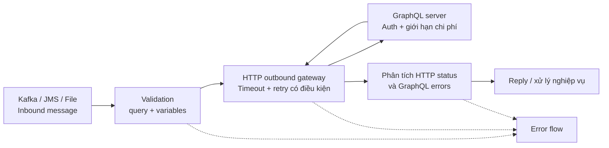
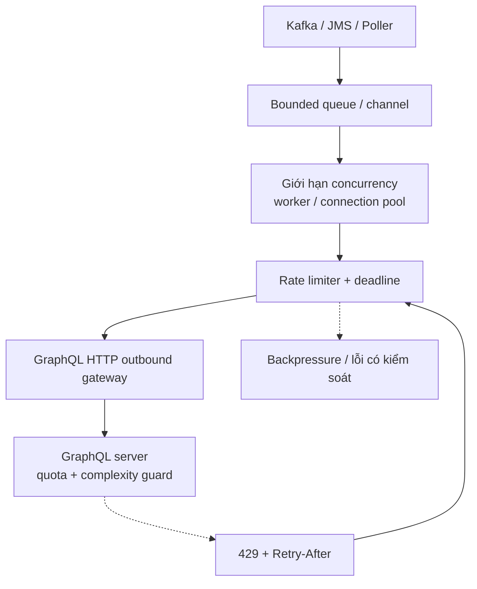

# Timeout, retry và giới hạn truy vấn trong Adapter GraphQL

## Mục tiêu bài học

Trong module **SPRING_INTEGRATION_ADAPTERS**, Spring Integration kết nối hệ thống ngoài bằng inbound/outbound adapter, gateway, poller và `MessageChannel`. Khi một luồng lấy dữ liệu từ file, SFTP, HTTP, JMS, AMQP, Kafka hoặc cơ sở dữ liệu rồi gọi GraphQL API, việc gửi đúng `query` hay `mutation` chưa đủ: luồng còn phải **không chờ vô hạn**, **không lặp lại thao tác gây tác dụng phụ** và **không tạo truy vấn quá tốn tài nguyên**.

Sau bài này, bạn có thể:

- Phân biệt connect timeout, read/response timeout, timeout chờ connection pool và deadline toàn luồng.
- Thiết kế retry dựa trên loại lỗi, loại GraphQL operation và thời gian còn lại của yêu cầu.
- Áp dụng `RequestHandlerRetryAdvice` có giới hạn cho một HTTP outbound gateway thực thi **query chỉ đọc**.
- Giải thích vì sao retry mutation sau timeout có thể gây ghi dữ liệu trùng.
- Giới hạn phân trang, danh sách, request size, query depth, query complexity, số request đồng thời và tốc độ gọi.
- Phân loại HTTP status với `errors` trong GraphQL response, đồng thời kiểm thử timeout/retry và bảo vệ tài nguyên.

> **Phạm vi:** GraphQL là giao thức truy vấn; với GraphQL qua HTTP, Spring Integration thường dùng HTTP outbound gateway và transformer. Các cơ chế timeout/retry của HTTP client và Spring Integration không tự động hiểu `query`, `mutation` hay độ phức tạp của một GraphQL document. Vì vậy phải kết hợp giới hạn ở **client/flow** với chính sách ở **GraphQL server**.

## 1. Bài toán: một sự kiện có thể gọi GraphQL bao nhiêu lần?

Giả sử flow nhận sự kiện từ Kafka:

```json
{
  "eventId": "evt-912",
  "orderId": "O-1024",
  "correlationId": "flow-a38"
}
```

Luồng dựng một request GraphQL rồi gửi HTTP POST:

```graphql
query GetOrder($id: ID!) {
  order(id: $id) {
    id
    status
  }
}
```

Trong điều kiện bình thường, API phản hồi sau 200 ms. Khi dịch vụ đích chậm, có thể xảy ra các trường hợp:

1. Không kết nối được trong 2 giây vì mạng hoặc endpoint không đáp ứng.
2. Kết nối được nhưng phải chờ phản hồi quá lâu.
3. HTTP trả `429 Too Many Requests` với hướng dẫn `Retry-After`.
4. HTTP trả `200` nhưng body GraphQL có `errors`.
5. Yêu cầu bị timeout, trong khi GraphQL server vẫn đang xử lý operation.

Nếu flow luôn retry mọi lỗi, một sự kiện có thể trở thành nhiều HTTP request, làm API đang quá tải càng chậm hơn. Với mutation, một response timeout còn có thể khiến client gửi lệnh ghi dữ liệu lần thứ hai sau khi lần đầu đã thành công.



Mục tiêu không phải đạt tỷ lệ retry cao, mà là giữ **thời gian xử lý có giới hạn**, **kết quả đúng** và **hệ thống có thể phục hồi** khi đối tác gặp sự cố.

## 2. Các loại timeout và vị trí áp dụng

| Giới hạn | Bắt đầu tính ở đâu? | Bảo vệ khỏi điều gì? | Lưu ý |
| --- | --- | --- | --- |
| **Connect timeout** | Khi HTTP client thiết lập kết nối tới endpoint | Chờ kết nối TCP kéo dài | Không đại diện cho tổng thời gian GraphQL xử lý |
| **Connection-pool acquisition timeout** | Khi xin một connection từ pool | Hết connection vì concurrency quá cao | Chỉ áp dụng với HTTP client có pool và cấu hình timeout tương ứng |
| **Read/response timeout** | Khi client chờ nhận dữ liệu từ kết nối | Server chậm hoặc đường truyền treo | Ý nghĩa chính xác tùy HTTP client; thường không phải deadline end-to-end |
| **Deadline tổng** | Từ lúc yêu cầu nghiệp vụ bắt đầu | Retry/backoff/queueing vượt quá SLA | Cần chủ động mang thời gian còn lại qua các bước |
| **Server execution timeout** | Trong GraphQL server | Resolver hoặc truy vấn dữ liệu chạy quá lâu | Client timeout không bảo đảm công việc server đã bị hủy |
| **Queue/poller time budget** | Khi message chờ kênh hoặc broker | Tích tụ message và tăng độ trễ đầu-cuối | Cần kiểm soát ở tầng messaging và vận hành |

Các timeout độc lập nhưng tác động lẫn nhau. Chẳng hạn client có `readTimeout = 4s` vẫn có thể hết 20 giây nếu nó thử 5 lần. Ngược lại, server dừng resolver sau 10 giây không giúp đáp ứng SLA 3 giây của client.

### 2.1. Tính ngân sách thời gian trước khi cấu hình retry

Một công thức ước lượng bảo thủ cho HTTP call không có pool wait là:

\[
T_{\text{worst}} \approx N\,(T_{\text{connect}} + T_{\text{read}}) + \sum_{i=1}^{N-1} T_{\text{backoff},i}
\]

Trong đó `N` là **tổng số lần thử**, bao gồm lần gọi đầu tiên. Đây là ước tính đơn giản; TLS handshake, DNS, connection pool, serialization và downstream queue cũng cần tính vào ngân sách thực tế.

Ví dụ:

- Tối đa 3 lần thử: một lần đầu và hai lần retry.
- Connect timeout: 1 giây.
- Read timeout: 3 giây.
- Backoff trước retry: 200 ms rồi 400 ms.

Khi đó:

\[
T_{\text{worst}} \approx 3\times(1+3)+0.2+0.4=12.6\text{ s}
\]

Nếu deadline nghiệp vụ chỉ **8 giây**, cấu hình này có thể vượt SLA dù mỗi timeout đơn lẻ trông có vẻ ngắn. Hãy giảm số lần thử, timeout mỗi lần, hoặc cắt retry theo deadline còn lại.

**Nguyên tắc:** timeout cấp thấp bảo vệ một thao tác I/O; deadline bảo vệ thời gian thực hiện của **toàn bộ** yêu cầu. Không coi một `readTimeout` là tổng deadline.

## 3. Chọn retry theo GraphQL operation và loại lỗi

GraphQL qua HTTP thường dùng POST cho cả query và mutation. Vì thế **HTTP method POST không đủ** để kết luận request có an toàn khi gửi lại hay không.

### 3.1. Query và mutation khác nhau như thế nào?

| Operation | Ý nghĩa kỳ vọng | Retry sau timeout |
| --- | --- | --- |
| `query GetOrder` đọc thông tin | Theo hợp đồng GraphQL, query không làm thay đổi trạng thái nghiệp vụ | Có thể cân nhắc khi chỉ đọc và chi phí có kiểm soát |
| `mutation CreatePayment` | Tạo/thay đổi dữ liệu | Không tự retry khi chưa biết lần gọi trước đã commit hay chưa |
| `mutation UpdateOrder` có idempotency key theo hợp đồng | Server có thể nhận biết và bỏ qua yêu cầu trùng | Retry chỉ khi đã xác minh cơ chế idempotency và timeout budget |
| Query đắt đỏ hoặc query không tuân thủ tính chất chỉ đọc | Có thể gây tải lớn hoặc side effects ngoài ý muốn | Cần hạn chế mạnh, thậm chí tắt retry |

Ví dụ mutation được gửi một lần:

```graphql
mutation ChargeOrder($input: ChargeOrderInput!) {
  chargeOrder(input: $input) {
    paymentId
    status
  }
}
```

Nếu response bị mất sau khi `chargeOrder` đã trừ tiền, client không thể phân biệt được **“server chưa xử lý”** với **“server đã xử lý, client chưa nhận phản hồi”** bằng thông tin timeout. Retry an toàn chỉ có thể thiết kế khi có hợp đồng riêng, chẳng hạn idempotency key do server lưu với trạng thái và kết quả, hoặc truy vấn trạng thái giao dịch trước khi quyết định gửi lại.

**Lưu ý:** `Idempotency-Key` hay `X-Idempotency-Key` là header theo quy ước của một số API, không phải một tính năng bắt buộc của GraphQL. Chỉ sử dụng khi server công bố và thực thi hợp đồng đó.

### 3.2. Ma trận lỗi và quyết định retry

| Hiện tượng | Ý nghĩa thường gặp | Chiến lược |
| --- | --- | --- |
| Connect/read timeout cho query chỉ đọc | Lỗi mạng hoặc server chậm | Retry có giới hạn, backoff + jitter, tuân thủ deadline |
| DNS không tồn tại, cấu hình TLS/certificate sai | Sai cấu hình hoặc endpoint không sẵn sàng cố định | Kiểm tra cấu hình; retry liên tục thường không hữu ích |
| HTTP 429 | Hết quota/tốc độ cho phép | Tôn trọng `Retry-After` và quota; ngừng khi vượt deadline |
| HTTP 502/503/504 | Gateway/backend có thể lỗi tạm thời | Cân nhắc retry với query; cần quota, backoff và circuit breaker |
| HTTP 400 do document/variables sai | Lỗi định dạng hoặc GraphQL validation | Sửa request/schema; không retry y nguyên |
| HTTP 401/403 | Lỗi xác thực/phân quyền | Không retry nguyên credential; xử lý token/quyền theo chính sách |
| HTTP 200 với GraphQL `errors` | Resolver hoặc business logic có thể lỗi, đôi khi có partial data | Phân loại theo hợp đồng `errors[].extensions`, không retry mặc định |
| Timeout sau mutation | Không biết trạng thái commit | Không retry tùy tiện; dùng idempotency hoặc reconciliation |

Chỉ HTTP 429, 503 hoặc mã lỗi nào đó **không tự động** chứng minh retry là an toàn. Phải đánh giá thêm operation type, số lần thử, giới hạn tốc độ, ngân sách thời gian và nghiệp vụ cụ thể.

### 3.3. Backoff, jitter và giới hạn số lần thử

Thay vì retry ngay lập tức, dùng exponential backoff có trần:

\[
T_{\text{backoff},k}=\min(T_{\text{base}}\times 2^{k-1},\,T_{\text{max}})
\]

Ví dụ `base = 200 ms`, `max = 2 s` cho các lần retry có khoảng chờ 200, 400, 800, 1.600, 2.000 ms. Thêm **jitter** ngẫu nhiên để nhiều client không cùng gọi lại một lúc sau sự cố. Chú ý `Retry-After` từ server khi hợp đồng cho phép; nếu thời gian chờ vượt deadline thì dừng.

Một chính sách retry cần định nghĩa ít nhất: lỗi nào retry được, tổng số attempts, cách backoff, deadline, giới hạn cạnh tranh và cách báo thất bại cuối cùng. Mỗi tầng không nên tự retry độc lập mà không biết tầng khác; retry của HTTP gateway cộng với retry của consumer Kafka/JMS có thể nhân số request theo cấp số.

## 4. Ví dụ Spring Integration: HTTP outbound gateway với timeout

Ví dụ dùng REST transport truyền JSON request envelope:

```json
{
  "operationName": "GetOrder",
  "query": "query GetOrder($id: ID!) { order(id: $id) { id status } }",
  "variables": {
    "id": "O-1024"
  }
}
```

Các đoạn Java dưới đây minh họa Spring Integration Java DSL, Spring Framework HTTP client và Spring Retry. Thư viện thực tế cần được khai báo theo version của dự án; trong môi trường sử dụng HTTP client khác, API cấu hình connect/read timeout có thể khác.

### 4.1. Cấu hình timeout tại HTTP client

```java
import org.springframework.context.annotation.Bean;
import org.springframework.context.annotation.Configuration;
import org.springframework.http.client.SimpleClientHttpRequestFactory;

@Configuration
class GraphqlHttpTimeoutConfig {

    @Bean
    SimpleClientHttpRequestFactory graphqlRequestFactory() {
        SimpleClientHttpRequestFactory factory =
            new SimpleClientHttpRequestFactory();

        factory.setConnectTimeout(1_000); // 1 giây
        factory.setReadTimeout(3_000);    // 3 giây
        return factory;
    }
}
```

`SimpleClientHttpRequestFactory` thích hợp để minh họa các timeout cơ bản. Với tải cao, có thể dùng HTTP client có connection pool để giới hạn kết nối và cấu hình thêm timeout chờ pool. Các con số trong ví dụ cần đo theo latency thực tế của GraphQL endpoint và SLA ứng dụng.

Lưu ý: những timeout này **không** tự cấu hình timeout của resolver, database query hay toàn bộ luồng message.

### 4.2. Chỉ bật retry cho flow query được kiểm soát

```java
import java.net.ConnectException;
import java.net.SocketTimeoutException;

import org.springframework.context.annotation.Bean;
import org.springframework.integration.handler.advice.RequestHandlerRetryAdvice;
import org.springframework.retry.support.RetryTemplate;

@Bean
RequestHandlerRetryAdvice graphqlQueryRetryAdvice() {
    RetryTemplate retryTemplate = RetryTemplate.builder()
        .maxAttempts(3)                      // Bao gồm lần đầu
        .exponentialBackoff(200L, 2.0, 800L) // ms
        .retryOn(ConnectException.class)
        .retryOn(SocketTimeoutException.class)
        .traversingCauses()
        .build();

    RequestHandlerRetryAdvice advice = new RequestHandlerRetryAdvice();
    advice.setRetryTemplate(retryTemplate);
    return advice;
}
```

`RequestHandlerRetryAdvice` áp dụng retry cho message handler khi handler ném exception. Một số HTTP client có thể bọc `SocketTimeoutException` hoặc `ConnectException` trong exception khác; `traversingCauses()` cho phép phân loại theo chuỗi nguyên nhân. Phải kiểm thử exception thực tế của HTTP client/version đang dùng. Chính sách ví dụ **không** retry HTTP 429/503 và **không** xử lý GraphQL `errors` nằm trong body khi HTTP status thành công; muốn thêm các trường hợp này cần phân loại rõ và có ràng buộc deadline/quota.

Gắn advice vào endpoint dành riêng cho query:

```java
import org.springframework.context.annotation.Bean;
import org.springframework.http.HttpMethod;
import org.springframework.integration.dsl.IntegrationFlow;
import org.springframework.integration.handler.advice.RequestHandlerRetryAdvice;
import org.springframework.http.client.SimpleClientHttpRequestFactory;
import org.springframework.integration.http.dsl.Http;

@Bean
IntegrationFlow graphqlQueryFlow(
        SimpleClientHttpRequestFactory graphqlRequestFactory,
        RequestHandlerRetryAdvice graphqlQueryRetryAdvice) {

    return IntegrationFlow.from("graphqlQueryRequests")
        .handle(
            Http.outboundGateway(
                    "https://orders.example.test/graphql")
                .httpMethod(HttpMethod.POST)
                .requestFactory(graphqlRequestFactory)
                .expectedResponseType(String.class),
            endpoint -> endpoint.advice(graphqlQueryRetryAdvice))
        .get();
}
```

Các chi tiết cần nắm:

- Input channel `graphqlQueryRequests` nhận payload là JSON request envelope đã validate và serialize, cùng HTTP headers cần thiết như `Content-Type: application/json` và `Authorization` do thành phần đáng tin cậy cấp.
- `Http.outboundGateway(...)` là request/reply endpoint; nếu HTTP request thành công, reply payload có thể là chuỗi JSON response để các bước sau parse.
- Advice được gắn **trực tiếp vào outbound handler**. Khi xử lý một mutation, tạo flow riêng không gắn advice này hoặc dùng chính sách idempotency dành riêng cho mutation.
- Không dùng URL `example.test` để chạy production. URL, timeout, token source, connection pool và metrics phải được cấu hình theo môi trường.
- Vì advice chỉ bao quanh HTTP handler, retry của ví dụ không tự nhìn thấy `errors` trong response JSON. Nếu cần retry lỗi GraphQL đã được phân loại, phải thiết kế rõ ở bước response mapping với chính sách riêng.

Ví dụ gọi vào input channel bằng messaging gateway:

```java
import org.springframework.http.HttpHeaders;
import org.springframework.integration.annotation.Gateway;
import org.springframework.integration.annotation.MessagingGateway;
import org.springframework.messaging.handler.annotation.Header;
import org.springframework.messaging.handler.annotation.Payload;

@MessagingGateway
interface GraphqlQueryGateway {
    @Gateway(requestChannel = "graphqlQueryRequests")
    String execute(
        @Payload String graphqlJson,
        @Header(HttpHeaders.CONTENT_TYPE) String contentType,
        @Header(HttpHeaders.AUTHORIZATION) String authorization,
        @Header("X-Correlation-Id") String correlationId);
}
```

Nếu custom header mapper được cấu hình, cần cho phép ánh xạ `X-Correlation-Id`; không suy ra mọi `MessageHeaders` đều được chuyển ra HTTP. `Bearer` token phải dành đúng audience/scope của GraphQL API, không chuyển tiếp tự động token từ một HTTP inbound request khác.

### 4.3. Khi retry hết lượt

Sau khi hết attempts, handler sẽ báo lỗi theo cơ chế exception của Spring Integration. Với caller đồng bộ qua `DirectChannel` hoặc messaging gateway, exception có thể lan tới caller; với flow poller/task executor, cơ chế error handling còn phụ thuộc cấu hình endpoint và error channel. Hãy quyết định rõ:

- Sự kiện có được retry ở broker không, hay chuyển đến DLQ?
- Nếu đã retry HTTP nhiều lần, broker redelivery có tiếp tục retry toàn bộ event không?
- Correlation ID nào sẽ nối các attempts với event gốc?
- Nếu flow nhận mutation, đã có bằng chứng kết quả/idempotency trước khi redelivery chưa?

Có thể dùng `RecoveryCallback`, `errorChannel` và cơ chế dead-letter/reconciliation theo hệ thống, nhưng không coi chúng là cách bảo đảm exactly-once trong mọi trường hợp.

## 5. GraphQL response: HTTP status và errors phải được kiểm tra riêng

GraphQL response chuẩn có thể trả dữ liệu thành công:

```json
{
  "data": {
    "order": {
      "id": "O-1024",
      "status": "PAID"
    }
  }
}
```

Hoặc HTTP 200 kèm lỗi resolver:

```json
{
  "data": {
    "order": null
  },
  "errors": [
    {
      "message": "Order service unavailable",
      "path": ["order"],
      "extensions": {
        "code": "DOWNSTREAM_UNAVAILABLE"
      }
    }
  ]
}
```

`errors[].extensions.code` là **quy ước của API**, không phải tập mã bắt buộc của GraphQL. Với các media type và triển khai GraphQL-over-HTTP khác nhau, HTTP status cho lỗi parse/validation có thể khác; chỉ kiểm HTTP 200 hoặc 500 là không đủ.

Ví dụ response classifier tối thiểu:

```java
import com.fasterxml.jackson.databind.JsonNode;
import com.fasterxml.jackson.databind.ObjectMapper;

JsonNode body = objectMapper.readTree(responseJson);

if (body.has("errors") && body.get("errors").isArray()
        && body.get("errors").size() > 0) {
    // Chỉ phân loại theo mã lỗi đã có trong hợp đồng với API.
    throw new GraphqlOperationException(
        "GetOrder failed; inspect sanitized error codes");
}

JsonNode order = body.path("data").path("order");
if (order.isMissingNode()) {
    throw new GraphqlOperationException(
        "Missing data.order in GraphQL response");
}
```

`GraphqlOperationException`, `objectMapper` và `responseJson` là thành phần minh họa. Trong ứng dụng thật, kiểm thêm `null`, partial data, nội dung field và khả năng retry dựa trên hợp đồng. **Không biến mọi GraphQL error thành retry**: lỗi `FORBIDDEN`, `BAD_USER_INPUT`, document không hợp lệ sẽ không tốt hơn khi gửi lại.

Với flow ở mục 4, `RequestHandlerRetryAdvice` chỉ thấy lỗi của HTTP handler, nên exception từ bước classifier phía sau không tự động được advice của handler retry. Điều này giúp tránh vòng lặp không chủ đích.

## 6. Giới hạn truy vấn: không chỉ timeout

Một GraphQL query rất ngắn về số ký tự vẫn có thể yêu cầu nhiều dữ liệu qua nested fields. Ví dụ:

```graphql
query ExpensiveExample {
  customers {
    orders {
      items {
        product {
          reviews {
            author {
              profile
            }
          }
        }
      }
    }
  }
}
```

Vấn đề không chỉ là độ sâu, mà còn ở **fan-out**: 100 khách hàng × 50 đơn hàng × 20 sản phẩm/đơn có thể tạo hàng trăm nghìn đối tượng trung gian tùy dữ liệu và cách resolver chạy. Đây là ví dụ ước lượng; chi phí thực tế do schema, SQL batching, caching và giới hạn phân trang quyết định.

### 6.1. Các lớp giới hạn nên phối hợp

| Giới hạn | Cách áp dụng | Mục đích |
| --- | --- | --- |
| **Request body size** | Giới hạn byte ở HTTP ingress/reverse proxy | Chặn body quá lớn trước khi parse |
| **Max query depth** | Phân tích GraphQL AST/server instrumentation | Chặn truy vấn lồng quá sâu |
| **Max query complexity/cost** | Gán trọng số field và hệ số kích thước list | Chặn fan-out dù depth thấp |
| **Pagination cap** | `first`, `limit`, `pageSize` có trần | Kiểm soát số node mỗi lần |
| **Max aliases/fields** | Kiểm soát cấu trúc selection set | Chặn lặp nhiều trường cùng cấp để né depth limit |
| **Max batch operations** | Giới hạn tính năng batching nếu API hỗ trợ | Tránh gói quá nhiều yêu cầu thành một HTTP call |
| **Request rate/quota** | Rate limit theo client, token/tenant, operation | Bảo vệ endpoint và bảo đảm công bằng |
| **Max in-flight requests** | Bulkhead, connection pool và luồng worker | Không khiến downstream cạn tài nguyên vì concurrency |
| **Execution timeout** | Deadline/cancellation trên server và data sources | Chặn resolver hoặc SQL chạy quá lâu |
| **Response size** | Giới hạn ở server/client; phân trang, streaming khi phù hợp | Tránh lưu nhiều dữ liệu vào bộ nhớ |

**Không có một giới hạn duy nhất áp dụng cho mọi schema.** Giá trị depth = 8 hay complexity = 500 chỉ là ví dụ cấu hình có thể cần điều chỉnh sau khi đo đạc. Chi phí thực tế phải tính cả data loading, truy vấn database, các lời gọi downstream và bộ nhớ.

### 6.2. Giới hạn pagination từ phía client

Giả sử API đích công bố:

```graphql
type Query {
  orders(first: Int!, after: String): OrderConnection!
}

type OrderConnection {
  edges: [OrderEdge!]!
  pageInfo: PageInfo!
}

type OrderEdge {
  node: Order!
  cursor: String!
}

type PageInfo {
  hasNextPage: Boolean!
  endCursor: String
}
```

Query có pagination:

```graphql
query ListOrders($first: Int!, $after: String) {
  orders(first: $first, after: $after) {
    edges {
      node {
        id
        status
      }
      cursor
    }
    pageInfo {
      hasNextPage
      endCursor
    }
  }
}
```

Client hạn chế `first` trước khi gửi:

```java
static int boundedPageSize(int requested) {
    if (requested < 1) {
        throw new IllegalArgumentException(
            "page size must be positive");
    }
    return Math.min(requested, 50); // Hợp đồng ví dụ: tối đa 50.
}
```

Giới hạn ở client giảm tải không cần thiết, nhưng **server cũng phải áp trần**. Một client khác hoàn toàn có thể bỏ qua đoạn Java trên và gửi `first = 1000000`. Khi đọc nhiều trang, cần có giới hạn tổng số trang/records và thời gian còn lại để tránh vòng phân trang vô hạn nếu dữ liệu hoặc cursor thay đổi.

### 6.3. Depth, complexity và aliases

GraphQL Java hỗ trợ cơ chế instrumentation để quan sát và từ chối query trước khi thực thi, chẳng hạn các dạng giới hạn **max query depth** và **max query complexity**. Spring for GraphQL có điểm mở rộng để đăng ký GraphQL Java instrumentation tùy phiên bản framework. Cần cấu hình và đo theo schema thực tế.

Ví dụ logic tính cost *mang tính minh họa*:

\[
\operatorname{cost}(\text{orders}) \approx
\text{pageSize}\times
\left(\operatorname{cost}(\text{order})+
\operatorname{cost}(\text{nested fields})\right)
\]

Nếu `orders(first: 50)` đồng thời tải `items(first: 100)` cho mỗi order, chi phí có thể tăng theo `50 × 100` ngay cả khi depth không quá lớn.

Vì thế:

- Depth limit phải đi cùng complexity/cost limit.
- Complexity cần tính hệ số phân trang, aliases và nested lists, tránh chỉ đếm số field trong document.
- Phải validate document bằng parser/validator GraphQL; chặn bằng regex trên chuỗi query không giải quyết được fragment, variable hay alias.
- Với API chỉ dành cho các nghiệp vụ đã biết, cân nhắc allowlist hoặc persisted operations theo hợp đồng server, từ đó tránh việc một message bất kỳ quyết định toàn bộ document.

### 6.4. Rate limiting và concurrency của Spring Integration flow

Client cũng cần hạn chế số HTTP requests đang bay:



Sơ đồ mô tả các lớp bảo vệ có thể triển khai, không có nghĩa Spring Integration tự cung cấp rate limiter cho GraphQL chỉ bằng cách bật HTTP gateway.

Cụ thể:

- Giới hạn `maxMessagesPerPoll`, fixed delay, executor concurrency và channel capacity ở inbound adapter/poller theo tải thực tế.
- Nếu dùng `ExecutorChannel` hoặc các worker bất đồng bộ, phải theo dõi độ dài hàng đợi và có chính sách khi đầy; không tạo queue vô hạn.
- Connection pool limit giúp giới hạn socket nhưng không thay thế request rate limit. Tốc độ request và số request đồng thời là hai chỉ số khác nhau.
- Circuit breaker và bulkhead có thể đặt quanh HTTP handler để giảm ảnh hưởng khi GraphQL API hỏng lâu. Retry vẫn phải bị giới hạn và không được vượt circuit breaker policy.
- Nếu nguồn là Kafka/JMS, redelivery hoặc retry ở consumer cần được tính chung với retry của HTTP gateway, tránh nhân số attempts.
- Khi bị HTTP 429, không đồng loạt retry ngay; hãy hạ nhịp gửi, dựa trên quota và `Retry-After` trong giới hạn deadline.

## 7. Server-side: kiểm soát chi phí và thời gian resolver

Client trong Spring Integration chỉ kiểm soát những request **do nó phát ra**. GraphQL server phải tự bảo vệ trước các client khác và mọi request không tuân thủ hợp đồng.

Ở GraphQL server, các biện pháp phổ biến:

1. **Xác thực và phân quyền:** kiểm tra danh tính, roles/scopes, tài nguyên và tenant. Query giới hạn tốt nhưng không được phép vẫn phải bị chặn.
2. **Validation trước execution:** kiểm tra schema, variables, giới hạn chiều sâu và complexity.
3. **Field/list caps:** giới hạn `first`, `limit` và kích thước input collection; đặt default pagination nhỏ.
4. **DataLoader/batching:** giảm N+1 query khi resolver lồng nhau, nhưng vẫn cần cost limit và timeout database.
5. **Execution timeout:** áp deadline cho GraphQL execution và các lời gọi bên dưới; hủy công việc khi có thể.
6. **Quotas:** rate limit theo client, API key/tenant, operation type và/hoặc query cost.
7. **Observability:** log operationName, chi phí ước tính, latency, error code và correlation ID, hạn chế PII và token trong log.

Khi client timeout hoặc đóng kết nối, server có thể vẫn đang chạy mutation hoặc SQL query. Hủy HTTP exchange **không** đồng nghĩa rollback transaction đã commit. Cần thiết kế idempotency và deadline ở cả hai phía.

## 8. End-to-end retry trong các nguồn adapter khác nhau

Một message có thể được phát lại từ tầng nguồn, khiến chính sách “3 attempts ở HTTP” không phải giới hạn cuối cùng.

| Nguồn đầu vào | Nguồn duplicate/redelivery | Cách xử lý khuyến nghị |
| --- | --- | --- |
| File/SFTP poller | File còn trong thư mục, filter thay đổi hoặc job bị restart | Đánh dấu file đã xử lý theo cơ chế đáng tin; kiểm soát xử lý trùng |
| HTTP inbound gateway | Client upstream retry sau timeout | Dùng request ID / idempotency theo hợp đồng |
| JMS/AMQP | Broker redelivery sau rollback/nack | Thiết kế DLQ, delivery count và idempotency cho downstream mutation |
| Kafka | Consumer rebalance, offset chưa commit, retry topic | Quy định commit/retry/DLT; xem message delivery là có thể lặp |
| JDBC/DB polling | Chưa cập nhật watermark/processing state | Thực hiện claim/checkpoint có thể phục hồi |
| Inbound gateway/MessageChannel khác | Retry advice hoặc exception handler ở nhiều tầng | Tổng hợp attempts ở toàn hệ thống, hạn chế retry lồng nhau |

Ví dụ: consumer JMS redelivery tối đa 4 lần, còn HTTP handler retry tối đa 3 lần. Nếu toàn bộ lỗi khiến message bị phát lại, một event có thể gọi GraphQL tới **12 lần** (4 delivery × 3 HTTP attempts), chưa kể upstream retry khác. Với mutation, mỗi lần có thể tạo side effect trùng nếu API không có idempotency.

Vì thế, ngoài `maxAttempts`, cần lưu event/business ID, trạng thái xử lý hoặc idempotency key theo hợp đồng; mô tả rõ lúc nào acknowledge/commit offset và lúc nào chuyển DLQ.

## 9. Logging, metrics và bảo mật khi retry

Các chỉ số vận hành hữu ích:

| Metric/log field | Vì sao quan trọng |
| --- | --- |
| `graphql.operation.name` | Cho biết operation nào chậm hoặc trả lỗi |
| `http.status_code` | Nhận biết 401/403/429/5xx |
| `graphql.error.code` theo allowlist | Phân loại GraphQL errors an toàn |
| `request.duration` và p95/p99 | Đặt timeout dựa trên phân phối latency thực |
| `retry.attempt` và `retry.reason` | Tìm retry storm hoặc lỗi cấu hình |
| `timeout.type` | Phân biệt connect/read/deadline |
| `inflight.requests` và queue length | Đánh giá concurrency, bulkhead và backpressure |
| `estimated.query.cost` | Kiểm soát hoạt động GraphQL server theo loại query |
| `correlationId` và event ID | Gắn các attempts với sự kiện nguồn |

Chỉ log thông tin đủ để điều tra. `Authorization`, cookie, token, variables chứa PII, raw response chứa thông tin khách hàng và query parameters nhạy cảm phải được lọc hoặc che. Không tạo nhãn metric có độ phân biệt rất cao từ order ID, user ID hay toàn bộ document; điều đó làm nổ cardinality.

Một retry nên có cùng correlation ID nghiệp vụ để liên kết attempts, nhưng mỗi attempt có thể có trace span/attempt number riêng để đo độ trễ thực tế.

## 10. Kiểm thử timeout, retry và giới hạn truy vấn

Dùng mock HTTP server hoặc môi trường kiểm thử có khả năng kiểm soát độ trễ để xác minh request thực sự được gửi. Khi kiểm thử retry cần **đếm số HTTP calls**: chỉ kiểm tra exception cuối cùng là chưa đủ.

| Ca thử | Tình huống giả lập | Kỳ vọng |
| --- | --- | --- |
| Query nhanh | HTTP 200 + `data` hợp lệ | 1 attempt, trả kết quả |
| Connect timeout | Địa chỉ/kết nối không đáp ứng | Dừng sau timeout; retry đúng số lần theo policy |
| Read timeout | Server nhận request nhưng trả lời chậm | Query chỉ đọc retry có giới hạn; không vượt deadline thiết kế |
| HTTP 401/403 | Token sai/hết quyền | Không retry vô hạn; báo lỗi bảo mật đúng |
| HTTP 429 | Server gửi `Retry-After` | Chỉ retry khi chính sách hỗ trợ và còn deadline; không retry liên tục |
| HTTP 503 | Service tạm lỗi | Chỉ retry nếu đã phân loại rõ và request an toàn |
| HTTP 200 + `errors` | GraphQL resolver trả lỗi nghiệp vụ | Không tự retry bằng HTTP advice |
| Mutation mất response | Server ghi thành công nhưng client timeout | Không tạo thêm side effect; xác nhận bằng idempotency/reconciliation |
| Pagination > max | Payload yêu cầu `first = 10000` | Mapper chặn/cap; server cũng giới hạn |
| Query quá sâu/đắt | Nested lists, nhiều aliases | Server từ chối trước khi chạy resolver tốn tài nguyên |
| Tải đồng thời cao | Nhiều message đến nhanh | Queue/concurrency/rate limit có giới hạn, có metric và chính sách đầy |
| Redelivery từ broker | HTTP retry đã cạn, event đến lại | Tổng attempts có giới hạn và idempotency không bị phá |

**Kiểm thử có ý nghĩa** nên ít nhất xác định: số attempts, khoảng cách backoff ở mức hợp lý, operation query/mutation có retry đúng chính sách, không rò token trong logs và phản hồi `errors` được xử lý như lỗi nghiệp vụ khi cần.

### Ví dụ kiểm chứng bằng số attempts

Một mock HTTP server được cấu hình để từ chối hai lần đầu rồi trả 200 ở lần thứ ba. Nếu chính sách của bạn chỉ retry `ConnectException` và `SocketTimeoutException` như ví dụ mục 4, **HTTP 503 không kích hoạt retry**; bài kiểm thử phải mong đợi 1 attempt. Muốn HTTP 503 được retry, phải mở rộng classifier và policy có chủ đích, đồng thời kiểm tra deadline/operation type.

Điều này giúp tránh lỗi phổ biến: test kỳ vọng retry trên mọi HTTP error nhưng cấu hình thực tế chỉ retry transport exceptions.

## 11. Bài tập thực hành

**Bối cảnh:** một pipeline nhận `OrderSyncRequested` từ Kafka, đọc đơn hàng qua GraphQL `query GetOrder` rồi có thể gửi `mutation MarkSynced` sang một GraphQL service khác. SLA cho xử lý một event là 8 giây. GraphQL service đôi khi trả HTTP 429 hoặc chậm 3–5 giây.

Yêu cầu:

1. Đề xuất connect timeout, read timeout, tổng attempts và backoff cho **query** sao cho có thể đáp ứng SLA 8 giây. Tính ngân sách thời gian với công thức ở mục 2.
2. Tách flow query và mutation. Giải thích vì sao mutation không thể dùng chung retry advice với query nếu chưa có idempotency.
3. Thiết lập giới hạn `first ≤ 50` cho một GraphQL list query; giải thích server cần kiểm soát thêm depth, complexity và aliases như thế nào.
4. Mô phỏng HTTP 200 kèm GraphQL `errors`, HTTP 429 có `Retry-After` và read timeout, rồi ghi lại chính xác số attempts của mỗi trường hợp.
5. Giả lập Kafka redelivery sau khi HTTP query đã retry. Tính số HTTP calls tối đa và thiết kế cách chống xử lý trùng cho bước mutation.

**Tiêu chí hoàn thành:** luồng dừng trong giới hạn thời gian có thể giải thích, không retry mutation thiếu bảo đảm an toàn, không mở fan-out GraphQL không kiểm soát và có dữ liệu quan sát để phân biệt timeout, HTTP errors, GraphQL errors và broker redelivery.

## Tài liệu tham khảo

- [Spring Integration Reference — HTTP Support](https://docs.spring.io/spring-integration/reference/http.html)
- [Spring Integration Reference — Retry Advice](https://docs.spring.io/spring-integration/reference/handler-advice/classes.html)
- [Spring Integration Reference — Error Handling](https://docs.spring.io/spring-integration/reference/error-handling.html)
- [Spring Framework — SimpleClientHttpRequestFactory](https://docs.spring.io/spring-framework/docs/current/javadoc-api/org/springframework/http/client/SimpleClientHttpRequestFactory.html)
- [Spring Retry — RetryTemplate](https://docs.spring.io/spring-retry/docs/current/apidocs/org/springframework/retry/support/RetryTemplate.html)
- [GraphQL — Learn: Queries and Mutations](https://graphql.org/learn/queries/)
- [GraphQL — Learn: Pagination](https://graphql.org/learn/pagination/)
- [GraphQL Java — Instrumentation](https://www.graphql-java.com/documentation/instrumentation/)
- [GraphQL over HTTP — Draft Specification](https://graphql.github.io/graphql-over-http/draft/)
