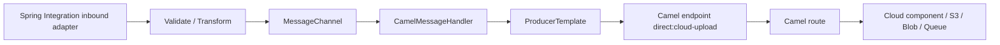
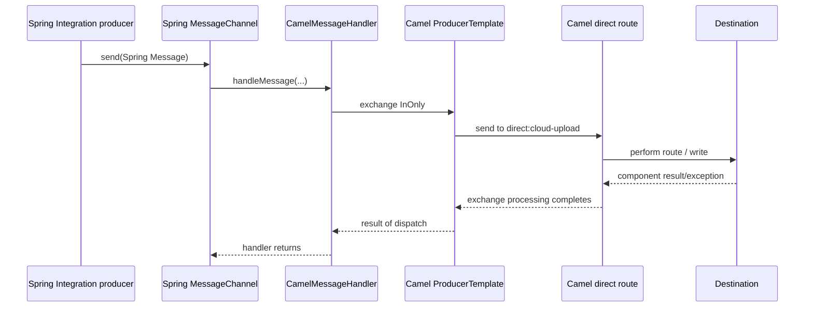
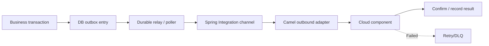

# Apache Camel outbound channel adapter

## 1. Tại sao Spring Integration cần kết nối Apache Camel?

Trong module **SPRING_INTEGRATION_ADAPTERS**, Spring Integration dùng **inbound/outbound adapter**, **gateway**, **poller** và **MessageChannel** để kết nối những hệ thống bên ngoài như file, SFTP, HTTP, JMS, AMQP, Kafka và cơ sở dữ liệu. Chương **Adapter Cloud** mở rộng góc nhìn sang dịch vụ đám mây và những hệ thống có sẵn connector trong framework khác.

Một đội phát triển có thể đã tổ chức nghiệp vụ bằng Spring Integration nhưng muốn sử dụng một **Apache Camel component** để tương tác với dịch vụ đám mây hoặc sản phẩm bên ngoài. Thay vì tự dựng một HTTP client, tạo thêm một broker trung gian chỉ để chuyển message giữa hai thư viện trong cùng JVM, hoặc viết lại toàn bộ flow sang Camel, có thể dùng **Apache Camel outbound channel adapter** của Spring Integration.

Ví dụ nghiệp vụ:

- Inbound HTTP/SFTP/Kafka tạo một Spring `Message<?>` biểu diễn yêu cầu lưu hóa đơn.
- Một `MessageChannel` chuyển yêu cầu tới **`CamelMessageHandler`**.
- Handler tạo một **Apache Camel exchange** và gửi tới endpoint `direct:cloud-upload`.
- Camel route kiểm tra object key, chuyển đổi payload, rồi gọi component cloud storage phù hợp.
- Spring Integration tiếp tục chịu trách nhiệm cho các bước trước adapter; Camel chịu trách nhiệm cho route và component sau ranh giới.



**Điểm cốt lõi:** Apache Camel outbound channel adapter là một **cầu nối trong cùng ứng dụng** từ Spring Integration `MessageChannel` tới Camel `Endpoint`. Bản thân cầu nối không phải kho lưu cloud, không tự cung cấp cloud credentials và cũng không tự bảo đảm retry/durable delivery.

### Mục tiêu bài học

Sau bài này, bạn có thể:

1. Phân biệt Spring Integration `Message`/`MessageChannel` với Camel `Message`/`Exchange`/`Endpoint`.
2. Hiểu `CamelMessageHandler`, `ProducerTemplate` và mặc định `ExchangePattern.InOnly`.
3. Cấu hình outbound channel adapter bằng `@Bean` + `@ServiceActivator` hoặc Java DSL `Camel.handler()`.
4. Tạo một Camel route `direct:...` và kiểm thử luồng từ Spring channel sang Camel.
5. Kiểm soát **payload, header mapping, endpoint URI và exchange pattern**.
6. Mở rộng Camel route sang dịch vụ cloud như AWS S3 mà không hardcode credentials.
7. Thiết kế timeout, retry, error handling, idempotency, backpressure, monitoring và lifecycle.
8. Tránh hiểu lầm giữa **adapter một chiều**, **outbound gateway**, **async delivery** và **durable commit**.

## 2. Hai mô hình tích hợp khác nhau

### 2.1. Spring Integration: MessageChannel là trung tâm

Spring Integration kết nối các endpoint bằng `MessageChannel`. Một message thường gồm:

```text
Spring Message<T> {
    payload: T,
    headers: MessageHeaders
}
```

Những loại channel quan trọng:

| Channel | Cách hoạt động | Lưu ý |
|---|---|---|
| `DirectChannel` | Gửi message tới subscriber trên thread gửi theo cơ chế đồng bộ | Handler chậm có thể block đường nhận. |
| `ExecutorChannel` | Dispatch subscriber qua executor | Có concurrency và task queue; không tự bền vững. |
| `QueueChannel` | Đưa message vào queue cho poller đọc | Mặc định trong bộ nhớ; cần store bền vững nếu yêu cầu replay. |
| `PublishSubscribeChannel` | Gửi tới nhiều subscribers | Cần thiết kế semantics broadcast và lỗi riêng. |

**Outbound channel adapter** thường tiêu thụ message một chiều. Nó có thể kết thúc Spring Integration flow ở điểm chuyển giao cho hệ thống ngoài. Trái lại, **outbound gateway** dùng khi nghiệp vụ cần kết quả trả về.

### 2.2. Apache Camel: Exchange và Endpoint là trung tâm

Apache Camel tổ chức các bước xử lý theo **Route**:

```text
from("direct:cloud-upload")
    -> validate
    -> transform
    -> to("cloud-service:destination")
```

- `Endpoint` được nhận diện bằng URI, chẳng hạn `direct:cloud-upload`, `log:example` hoặc URI của một Camel cloud component.
- `ProducerTemplate` là API gửi một **exchange** tới endpoint.
- `Exchange` chứa body, headers, properties, exchange pattern và trạng thái xử lý/lỗi.
- `ExchangePattern.InOnly` tương ứng ý nghĩa **gửi một chiều**, không yêu cầu reply nghiệp vụ.
- `ExchangePattern.InOut` tương ứng **request-reply**: caller cần một kết quả từ route.

**Camel `direct:` là endpoint nội bộ gọi consumer route đồng bộ** trong cùng CamelContext; nó không phải mạng cloud và không là persistent queue. Camel `seda:` có queue bất đồng bộ trong JVM, nhưng cũng **không tự là durable broker**.

### 2.3. Cầu nối nằm ở đâu?



Sơ đồ thể hiện **một cấu hình đồng bộ qua `DirectChannel` và Camel `direct:`**. Khi có `ExecutorChannel`, `seda:` hoặc component thực thi async, thứ tự/thời điểm hoàn tất có thể khác. Ngay cả trong cấu hình đồng bộ, `send()` trả về không thay thế **ack/commit bền vững** của đích cloud.

## 3. Thành phần chính: CamelMessageHandler

Theo tài liệu Spring Integration, `CamelMessageHandler` là một implementation của `AbstractReplyProducingMessageHandler`, có thể dùng cho:

- **One-way (mặc định)**: `ExchangePattern.InOnly`; phù hợp outbound channel adapter.
- **Request-reply**: `ExchangePattern.InOut`; tương ứng outbound gateway nếu muốn lấy reply.
- **Async mode**: sử dụng `ProducerTemplate.asyncSend(...)`, có thể xử lý kết quả dạng `CompletableFuture` trong các tình huống có reply.

Handler có thể chọn endpoint bằng:

1. URI cấu hình tĩnh qua `setEndpointUri(...)`.
2. Biểu thức SpEL qua `setEndpointUriExpression(...)` nếu thật sự cần lựa chọn endpoint ở runtime.
3. Một `LambdaRouteBuilder` in-line qua `setRoute(...)`.
4. Default endpoint của `ProducerTemplate` nếu không thiết lập endpoint khác.

Các cách **URI tĩnh, URI expression và inline route** mang ý nghĩa các lựa chọn thay thế; không cấu hình đồng thời nhiều cách trên cùng handler.

### 3.1. Những class quan trọng

| Spring Integration / Camel class | Vai trò |
|---|---|
| `org.springframework.integration.camel.outbound.CamelMessageHandler` | Handler nhận Spring message rồi gọi Camel endpoint. |
| `org.springframework.integration.camel.dsl.Camel` | Java DSL factory: `handler()`, `gateway()`, `route(...)`. |
| `org.springframework.integration.camel.support.CamelHeaderMapper` | Mapping Spring headers ↔ Camel headers. |
| `org.apache.camel.ProducerTemplate` | Gửi Camel exchange tới endpoint. |
| `org.apache.camel.CamelContext` | Registry, components, endpoints, routes và lifecycle Camel. |
| `org.apache.camel.builder.RouteBuilder` | Khai báo Camel route bằng Java DSL. |
| `org.apache.camel.ExchangePattern` | Phân biệt `InOnly` và `InOut`. |

Spring Integration **không** cung cấp một Apache Camel inbound channel adapter đối xứng theo tên chỉ vì có outbound adapter; hướng Camel → Spring có thể xây bằng Camel Bean Binding hoặc các endpoint/bridge có contract tương ứng.

### 3.2. Cần chọn đúng module

Với Spring Integration hiện đại, chức năng cầu nối này ở module:

```text
org.springframework.integration:spring-integration-camel
```

Đừng nhầm với Camel component **`camel-spring-integration`** — đó là một hướng tích hợp khác trong hệ sinh thái Camel, không phải tên dependency của `CamelMessageHandler`.

Không tự thêm `camel-http`, `camel-aws2-s3` hoặc `camel-sftp` nếu route không dùng các component đó. Khi route cần một cloud connector, thêm **Camel component tương ứng** và cấu hình nó riêng.

## 4. Ví dụ thực hành: chuyển message sang Camel trong một ứng dụng

Để hiểu cầu nối, ta xây một **lab hoàn chỉnh không cần tài khoản cloud thật**:

```text
Spring MessageChannel "toCamel"
    -> CamelMessageHandler (InOnly)
    -> Camel endpoint "direct:cloud-upload"
    -> Camel RouteBuilder
    -> in-memory DemoCloudSink
```

Tên `cloud-upload` diễn tả mục tiêu nghiệp vụ; sink trong bài chỉ là bộ nhớ phục vụ test. Ở phần sau, ta thay bước lưu demo bằng Camel cloud component thật.

### 4.1. Điều kiện và dependencies

Ví dụ hướng tới **Java 17+, Spring Boot 3.x, Spring Integration 6.x và Apache Camel 4.x** thuộc **một bộ phiên bản tương thích**. Không copy ngẫu nhiên các phiên bản từ hai BOM khác nhau rồi giả định chúng sẽ chạy chung.

Maven dependencies minh họa (quản lý version bằng Spring Boot BOM và Camel Spring Boot BOM/dependencies BOM **phù hợp**):

```xml
<dependencies>
    <dependency>
        <groupId>org.springframework.boot</groupId>
        <artifactId>spring-boot-starter-integration</artifactId>
    </dependency>

    <dependency>
        <groupId>org.springframework.integration</groupId>
        <artifactId>spring-integration-camel</artifactId>
    </dependency>

    <dependency>
        <groupId>org.apache.camel.springboot</groupId>
        <artifactId>camel-spring-boot-starter</artifactId>
    </dependency>

    <dependency>
        <groupId>org.apache.camel.springboot</groupId>
        <artifactId>camel-direct-starter</artifactId>
    </dependency>
</dependencies>
```

**Quan trọng:** snippet trên giả định `dependencyManagement` của ứng dụng đã import Spring Boot và Camel BOM tương thích. Nếu không, Maven cần các versions cụ thể được pin/test; không được thêm versions tùy ý khiến `camel-core` và các starters lệch nhau.

Camel Spring Boot starter cung cấp một `CamelContext` được Spring quản lý và tự tìm `RouteBuilder` beans. `camel-direct-starter` giúp sử dụng component `direct:` trong môi trường Spring Boot.

### 4.2. Spring Boot application

File `BridgeApplication.java`:

```java
package example.camelbridge;

import org.springframework.boot.SpringApplication;
import org.springframework.boot.autoconfigure.SpringBootApplication;
import org.springframework.integration.annotation.EnableIntegration;

@SpringBootApplication
@EnableIntegration
public class BridgeApplication {

    public static void main(String[] args) {
        SpringApplication.run(BridgeApplication.class, args);
    }
}
```

Trong một app chạy độc lập chỉ dùng Camel mà không có web server hay long-running consumer giữ process, có thể cần cấu hình **`camel.main.run-controller=true`** theo hướng dẫn Camel Spring Boot để duy trì lifecycle. Với chương trình chỉ chạy integration test, không cần đưa cấu hình đó vào test mặc định.

### 4.3. Tạo channel và outbound adapter

File `CamelOutboundConfiguration.java`:

```java
package example.camelbridge;

import org.apache.camel.ExchangePattern;
import org.springframework.context.annotation.Bean;
import org.springframework.context.annotation.Configuration;
import org.springframework.integration.annotation.ServiceActivator;
import org.springframework.integration.camel.outbound.CamelMessageHandler;
import org.springframework.integration.camel.support.CamelHeaderMapper;
import org.springframework.integration.channel.DirectChannel;
import org.springframework.messaging.MessageChannel;

@Configuration
public class CamelOutboundConfiguration {

    @Bean("toCamel")
    public MessageChannel toCamel() {
        return new DirectChannel();
    }

    @Bean
    @ServiceActivator(inputChannel = "toCamel")
    public CamelMessageHandler camelOutboundAdapter() {
        CamelHeaderMapper mapper = new CamelHeaderMapper();

        // Mặc định CamelHeaderMapper có thể map tất cả
        // Spring MessageHeaders. Chỉ cho qua metadata cần thiết.
        mapper.setOutboundHeaderNames(
            "eventId", "objectKey", "contentType");

        CamelMessageHandler handler = new CamelMessageHandler();
        handler.setEndpointUri("direct:cloud-upload");
        handler.setExchangePattern(ExchangePattern.InOnly);
        handler.setHeaderMapper(mapper);

        return handler;
    }
}
```

**Tại sao dùng constructor không tham số?** Nếu không cung cấp `ProducerTemplate`, `CamelMessageHandler` có thể tạo template thông qua `CamelContext` bean được resolve từ Spring application context. Đó là lý do cần CamelContext được cấu hình và khởi động đúng.

Có thể inject `ProducerTemplate` từ cấu hình Camel và gọi constructor `new CamelMessageHandler(producerTemplate)` nếu bạn cần quản lý template riêng. **Không tạo một CamelContext độc lập mới cho từng message**: route và endpoint phải thuộc lifecycle ổn định của ứng dụng.

**Vì sao cần header allowlist?** Nếu dùng default mapper cho tất cả headers, những nội dung như `replyChannel`, `errorChannel`, tenant metadata chưa xác thực hoặc object chứa Java framework references có thể bị chuyển vào Camel. Chỉ map những field thực sự cần theo hợp đồng, và kiểm tra giá trị trong Camel route.

### 4.4. Demo sink để kiểm chứng được dữ liệu

File `DemoCloudSink.java`:

```java
package example.camelbridge;

import java.util.Arrays;
import java.util.concurrent.ConcurrentHashMap;
import java.util.concurrent.ConcurrentMap;

import org.springframework.stereotype.Component;

@Component
public class DemoCloudSink {

    private final ConcurrentMap<String, byte[]> stored =
        new ConcurrentHashMap<>();

    public void put(String objectKey, byte[] content) {
        stored.put(objectKey,
            Arrays.copyOf(content, content.length));
    }

    public byte[] get(String objectKey) {
        byte[] found = stored.get(objectKey);
        return found == null ? null
            : Arrays.copyOf(found, found.length);
    }

    public int size() {
        return stored.size();
    }
}
```

`ConcurrentHashMap` giúp demo có thể nhận đồng thời, nhưng:

- Dữ liệu mất khi JVM restart.
- `put` trên cùng key sẽ overwrite nội dung cũ; nó không phải idempotency policy hoàn chỉnh.
- Không có encryption, retention, replication hay cloud IAM.
- Không có acknowledgment của AWS S3/Azure Blob/GCS.

**Đừng dùng sink này làm kho lưu audit hoặc production.** Nó chỉ làm kết quả dễ assert trong integration test.

### 4.5. Camel RouteBuilder nhận từ `direct:cloud-upload`

File `CloudUploadRoute.java`:

```java
package example.camelbridge;

import org.apache.camel.builder.RouteBuilder;
import org.springframework.stereotype.Component;

@Component
public class CloudUploadRoute extends RouteBuilder {

    private final DemoCloudSink sink;

    public CloudUploadRoute(DemoCloudSink sink) {
        this.sink = sink;
    }

    @Override
    public void configure() {
        from("direct:cloud-upload")
            .routeId("spring-integration-to-camel-cloud")
            .process(exchange -> {
                String eventId = exchange.getMessage()
                    .getHeader("eventId", String.class);

                String objectKey = exchange.getMessage()
                    .getHeader("objectKey", String.class);

                byte[] bytes = exchange.getMessage()
                    .getBody(byte[].class);

                if (eventId == null || eventId.isBlank()) {
                    throw new IllegalArgumentException(
                        "Missing eventId");
                }

                // Policy demo: chỉ lưu trong prefix events/.
                if (objectKey == null
                        || !objectKey.matches(
                            "events/[A-Za-z0-9._/-]{1,100}")
                        || objectKey.contains("..")
                        || objectKey.endsWith("/")) {
                    throw new IllegalArgumentException(
                        "Invalid objectKey");
                }

                if (bytes == null || bytes.length == 0
                        || bytes.length > 64 * 1024) {
                    throw new IllegalArgumentException(
                        "Invalid payload size");
                }

                sink.put(objectKey, bytes);
            });
    }
}
```

Khi Camel Spring Boot auto-configuration quét `@Component RouteBuilder`, route được đăng ký trong **cùng CamelContext**. `direct:cloud-upload` là endpoint có consumer từ route này. `CamelMessageHandler` gửi tới endpoint ấy bằng `ProducerTemplate`.

Điểm cần hiểu:

1. Camel route **không** tự tạo Spring `MessageChannel`; nó nhận `Exchange` từ `direct:`.
2. Các headers `eventId`/`objectKey` được Spring Integration `CamelHeaderMapper` chuyển sang Camel message.
3. Payload `byte[]` là body; Camel không có khái niệm `MessageHeaders.ID` giống Spring.
4. Validation phải chạy trước khi gọi dịch vụ đắt tiền/có side effect.
5. Một route `direct:` phải có consumer đang hoạt động; khi thiếu consumer, send có thể block/timeout hoặc lỗi tùy cấu hình endpoint.
6. Code mẫu chỉ lưu vào bộ nhớ, **không chứng minh cloud upload**.

### 4.6. Gửi một Spring Message qua channel

Một đoạn Java dùng `MessageChannel` trực tiếp:

```java
package example.camelbridge;

import java.nio.charset.StandardCharsets;
import java.util.UUID;

import org.springframework.beans.factory.annotation.Qualifier;
import org.springframework.messaging.Message;
import org.springframework.messaging.MessageChannel;
import org.springframework.messaging.support.MessageBuilder;
import org.springframework.stereotype.Service;

@Service
public class CloudUploadPublisher {

    private final MessageChannel toCamel;

    public CloudUploadPublisher(
            @Qualifier("toCamel") MessageChannel toCamel) {
        this.toCamel = toCamel;
    }

    public String publish(String content) {
        String eventId = UUID.randomUUID().toString();
        String key = "events/" + eventId + ".txt";

        byte[] bytes =
            content.getBytes(StandardCharsets.UTF_8);

        Message<byte[]> request = MessageBuilder
            .withPayload(bytes)
            .setHeader("eventId", eventId)
            .setHeader("objectKey", key)
            .setHeader("contentType", "text/plain")
            .build();

        boolean dispatched = toCamel.send(request);

        if (!dispatched) {
            throw new IllegalStateException(
                "Spring channel did not accept message");
        }

        // Đây là object key dự kiến của yêu cầu,
        // KHÔNG phải xác nhận cloud đã ghi bền vững.
        return key;
    }
}
```

Ở đây message flow dùng `DirectChannel`, Camel `direct:` và route demo đồng bộ. Trong lab, `publish(...)` trả về sau khi demo sink đã được gọi nếu không xảy ra lỗi. Tuy nhiên, khi route cloud thật có retry, callback bất đồng bộ hoặc broker trung gian, `publish()` trả về **không thay thế** nhận kết quả từ destination.

Nếu ứng dụng cần *xác nhận* upload và lấy version/ETag hoặc response object, xem **outbound gateway** `Camel.gateway()` ở mục 7.

## 5. Unit/integration test: chứng minh adapter đã chuyển message

Tạo `CamelOutboundBridgeTest.java`:

```java
package example.camelbridge;

import static org.junit.jupiter.api.Assertions.*;

import java.nio.charset.StandardCharsets;
import java.util.UUID;

import org.junit.jupiter.api.Test;
import org.springframework.beans.factory.annotation.Autowired;
import org.springframework.boot.test.context.SpringBootTest;

@SpringBootTest
class CamelOutboundBridgeTest {

    @Autowired
    CloudUploadPublisher publisher;

    @Autowired
    DemoCloudSink sink;

    @Test
    void deliversMessageToCamelRoute() {
        String payload = "cloud outbound bridge test "
            + UUID.randomUUID();

        String key = publisher.publish(payload);

        byte[] recorded = sink.get(key);

        assertNotNull(recorded);
        assertArrayEquals(
            payload.getBytes(StandardCharsets.UTF_8),
            recorded);
    }
}
```

Điều test này xác nhận:

- Spring Boot application context tạo Spring Integration channel và CamelContext.
- `@ServiceActivator` handler được đăng ký cho `toCamel`.
- `CamelMessageHandler` gọi được Camel `direct:cloud-upload`.
- Body và các headers cần thiết tới route.
- Route demo lưu payload vào bộ nhớ như mong đợi.

**Không dùng test này để kết luận** rằng S3/Azure Blob/GCS đã upload thành công, không mất dữ liệu khi crash, hoặc IAM/TLS production đang đúng. Test adapter với fake sink và test cloud component với credential/emulator được tách riêng để định vị lỗi.

### 5.1. Negative tests nên bổ sung

| Test | Kỳ vọng |
|---|---|
| Không có bean `CamelContext` | Khởi tạo handler/route thất bại; báo dependency/config thiếu. |
| Không có Camel route consumer cho `direct:cloud-upload` | Không âm thầm giả rằng message đã lưu; send fail/timeout theo config. |
| Không có `eventId` | Validator từ chối trước side effect. |
| `objectKey` sai prefix hoặc chứa `..` | Không ghi vào sink; log lỗi không chứa raw secret. |
| Payload rỗng hoặc quá 64 KiB theo demo | Bị từ chối theo policy. |
| Camel route ném exception | Kiểm tra cách lỗi lan qua `DirectChannel` và error flow thực tế. |
| Dùng `ExecutorChannel` thay `DirectChannel` | Có thể xảy ra lỗi sau khi `send()` đã trả; cần async error handler/recovery. |
| Sử dụng `seda:` thay `direct:` | Kiểm tra queue capacity, delay và nguy cơ mất khi restart. |
| Sender lặp cùng `objectKey` | Xác minh overwrite/idempotency policy, không mặc định “exactly once”. |

## 6. Cách cấu hình tương đương bằng Spring Integration Java DSL

`Camel.handler()` là DSL factory cho **one-way/InOnly**. Thay vì khai báo `@Bean @ServiceActivator` như mục 4.3, có thể khai báo một flow:

```java
package example.camelbridge;

import org.springframework.context.annotation.Bean;
import org.springframework.context.annotation.Configuration;
import org.springframework.integration.camel.dsl.Camel;
import org.springframework.integration.dsl.IntegrationFlow;

@Configuration
public class CamelOutboundDslConfiguration {

    @Bean
    public IntegrationFlow camelOutboundFlow() {
        return IntegrationFlow.from("toCamel")
            .handle(Camel.handler()
                .endpointUri("direct:cloud-upload"))
            .get();
    }
}
```

**Đây là phương án thay thế**, không đăng ký đồng thời với `camelOutboundAdapter()` của mục 4.3 trên cùng `toCamel` khi dùng `DirectChannel`. Nếu hai subscribers cùng đăng ký, `DirectChannel` không tự broadcast cho cả hai; dispatch có thể chọn một subscriber theo cơ chế channel.

Điểm khác:

- `Camel.handler()` tạo Camel handler ở chế độ **`ExchangePattern.InOnly`**.
- `Camel.gateway()` cấu hình **`ExchangePattern.InOut`**.
- `Camel.route(...)` cho phép khai báo inline route thay cho URI/RouteBuilder, khi hợp đồng phù hợp.
- DSL phía trên dùng **header mapping mặc định**. Muốn kiểm soát allowlist chặt chẽ, cần cấu hình `headerMapper` qua spec/API phù hợp version hoặc dùng bean `CamelMessageHandler` như ví dụ chính.

Không nhầm `IntegrationFlow.from("toCamel")` với Camel `RouteBuilder.from("direct:cloud-upload")`: chúng thuộc **hai framework và hai hệ thống endpoint** khác nhau.

## 7. One-way adapter, outbound gateway và async mode

### 7.1. InOnly không có reply nghiệp vụ

Với `InOnly`:

```text
Spring Message -> Camel outbound adapter -> Camel Route
               -> Cloud operation / destination
               (không có Spring reply message theo hợp đồng)
```

Nếu route tạo một body kết quả, one-way flow không tự chuyển nó thành response cho caller Spring Integration. Trong một `DirectChannel` + `direct:` sync path, lỗi có thể trở lại caller tùy Camel error handler và Spring Integration semantics, nhưng **không có một reply nghiệp vụ được cam kết**.

### 7.2. InOut khi cần kết quả

Giả sử nghiệp vụ cần biết S3 object version, cloud request ID hoặc status của một Camel component. Khi đó cần outbound gateway:

```java
@Bean
IntegrationFlow camelRequestReply() {
    return IntegrationFlow.from("cloudRequests")
        .handle(Camel.gateway()
            .endpointUri("direct:cloud-query"))
        .channel("cloudReplies")
        .get();
}
```

Trong trường hợp này route `direct:cloud-query` phải thực sự thực hiện request-reply; caller cần cấu hình timeout, response contract và error handling. **Không gọi `Camel.gateway()` là outbound channel adapter một chiều**, dù nó sử dụng cùng handler nền.

### 7.3. Async mode không phải bảo đảm bền vững

`CamelMessageHandler` có thể dùng `ProducerTemplate.asyncSend(...)` khi bật async. Nhưng cần tách ba khái niệm:

| Khái niệm | Nghĩa thực sự |
|---|---|
| **Asynchronous invocation** | Caller không nhất thiết chờ toàn bộ downstream work. |
| **Queue buffering** | Task/message có thể đợi trong executor/queue trước khi xử lý. |
| **Durable acceptance** | Dữ liệu đã được storage/broker xác nhận và có thể khôi phục khi crash. |

Async không suy ra durable. `CompletableFuture` cũng không phải business acknowledgment nếu chỉ gói trạng thái gửi tới endpoint nội bộ. Với cloud upload quan trọng, phải kiểm tra status/ETag/version hoặc xác nhận thích hợp từ SDK/component và ghi trạng thái công việc bền vững.

### 7.4. Exchange properties và headers

Camel `Exchange` có **headers** và **properties** riêng:

- **Headers** đi theo Camel message, có thể được components đọc/sửa.
- **Exchange properties** gắn với exchange và phục vụ route-level context.
- Spring `MessageHeaders` không tự biến thành Camel exchange properties.

Handler hỗ trợ cấu hình `exchangeProperties` hoặc `exchangePropertiesExpression` (SpEL phải trả một `Map`). Chỉ đặt các thuộc tính cần thiết và không dùng chúng để chở private key/token hoặc dữ liệu cá nhân khi không có lý do.

## 8. Header mapping: mặc định rộng, production cần allowlist

Tài liệu chính thức nêu `CamelHeaderMapper` **mặc định mapping tất cả headers** giữa Spring Integration và Camel. Đây là tiện lợi khi thử nghiệm, nhưng trong một bridge cloud cần giới hạn rõ dữ liệu:

```text
Spring MessageHeaders
  eventId        -> Camel header eventId
  objectKey      -> Camel header objectKey
  contentType    -> Camel header contentType

  replyChannel   -X-> Không forward
  errorChannel   -X-> Không forward
  arbitrary user -X-> Không forward
```

Cấu hình của bài:

```java
CamelHeaderMapper mapper = new CamelHeaderMapper();

mapper.setOutboundHeaderNames(
    "eventId", "objectKey", "contentType");

CamelMessageHandler handler = new CamelMessageHandler();
handler.setEndpointUri("direct:cloud-upload");
handler.setHeaderMapper(mapper);
```

`setOutboundHeaderNames(...)` chọn các **Spring headers được map ra Camel**. `setInboundHeaderNames(...)` chọn các **Camel headers được map trở lại Spring** khi có request-reply. Không nhầm chiều outbound/inbound với inbound/outbound adapters ở hệ thống cloud.

### 8.1. Dùng header cho metadata, không cho authorization

Một header như `tenantId`, `bucketName` hoặc `objectKey` có thể được caller tạo. Nếu caller không đáng tin, nó không thể tự quyết định:

- Cloud bucket được phép ghi.
- IAM principal/role.
- Key prefix được phép của tenant khác.
- HTTP endpoint đích hoặc database schema.
- Quyền overwrite/delete.

Hãy gắn tenant/authorization từ một **trust boundary đã xác thực** và tạo object key theo chính sách máy chủ. Cloud route cũng cần validate key/prefix/size trước khi gọi component.

### 8.2. Không dùng toàn bộ payload làm header

Một số message cloud có payload vài MB; copy payload vào header làm tăng memory/serialization overhead, khiến Kafka/JMS headers hoặc cloud metadata vượt giới hạn và lộ dữ liệu không cần thiết.

Nên dùng:

- Payload: bytes/stream/reference tới object.
- Headers: `eventId`, `objectKey`, `contentType` hoặc trace IDs có allowlist.
- Context bảo mật: principal/tenant do server xác minh, không lấy từ client message text.
- Secrets: credential chain/secret manager/managed identity, **không ghi vào headers/logs**.

## 9. Từ Camel direct route đến cloud storage thực tế

Trong lab, `direct:cloud-upload` gọi `DemoCloudSink`. Để upload một object thật, giữ nguyên Spring Integration outbound adapter nhưng **thay Camel route consumer** bằng component cloud tương ứng.

Ví dụ Camel AWS S3 component dùng URI dạng:

```text
aws2-s3://<bucket>?operation=putObject&amazonS3Client=#amazonS3Client
```

Với Camel Spring Boot, cần thêm **`camel-aws2-s3-starter`** tương thích với Camel BOM. Một `S3Client` AWS SDK v2 nên được quản lý bằng bean `amazonS3Client` hoặc theo credential provider configuration được component hỗ trợ. Ví dụ fragment **thay thế route demo**, không chạy đồng thời hai routes cùng `direct:cloud-upload`:

```java
package example.camelbridge;

import org.apache.camel.builder.RouteBuilder;
import org.springframework.stereotype.Component;

@Component
public class S3ArchiveRoute extends RouteBuilder {

    @Override
    public void configure() {
        from("direct:cloud-upload")
            .routeId("cloud-put-object")
            .validate(header("objectKey").isNotNull())
            .setHeader("CamelAwsS3Key", header("objectKey"))
            .to("aws2-s3://application-audit-archive"
                + "?operation=putObject"
                + "&amazonS3Client=#amazonS3Client");
    }
}
```

**Bổ sung cần thiết để chạy với AWS thật:**

1. Thêm module AWS2 S3 Camel đúng version và cấu hình `amazonS3Client`/credential provider.
2. Cấp IAM role có `s3:PutObject` chỉ trong bucket/prefix cho phép, không dùng static access key trong source code.
3. Đặt bucket, region, encryption, retention và network/TLS policy đúng môi trường.
4. Validate `objectKey`/size/MIME và authorization **trước Camel route** hoặc ngay đầu route; fragment này mới kiểm tra not-null để minh họa đường truyền header.
5. Có timeout/retry, quota, metrics và chính sách xử lý object trùng.
6. Kiểm tra status/metadata trả về và mốc xác nhận thực tế của component; một chiều `InOnly` không tự trả response cho caller Spring.
7. **Không** bật đồng thời `CloudUploadRoute` demo và `S3ArchiveRoute` trên cùng `direct:cloud-upload`. Chỉ chọn một consumer active cho endpoint trực tiếp.

**Cảnh báo về key động:** key cloud có thể chứa dấu `..`, ký tự đặc biệt hoặc chuỗi mà một số phiên bản component diễn giải như expression. Luôn normalize/validate key do input quyết định và nâng component lên bản vá an toàn. Bucket và endpoint URI phải lấy từ cấu hình tin cậy, không xây tùy tiện từ untrusted message headers.

### 9.1. Vì sao Camel hữu ích cho Adapter Cloud?

Camel có nhiều components cho cloud/object storage, queues và hệ thống SaaS. Spring Integration chỉ cần định nghĩa một contract chung:

```text
CloudUploadCommand {
    eventId
    trustedTenant
    objectKey
    payload bytes / stream reference
}
```

Camel route chịu trách nhiệm ánh xạ sang headers/operation riêng của từng component. Khi thay AWS S3 bằng Azure Blob hoặc Google Cloud Storage, tầng Spring Integration trước bridge có thể giữ nguyên **nếu** bạn duy trì một contract normalized ổn định và viết lại Camel route tương ứng.

Nhưng không nên tuyên bố mọi cloud components có cùng semantics: giới hạn object size, multipart upload, retries, consistency, request IDs, checksum và overwrite behavior có thể khác nhau.

### 9.2. Khi nào nên gọi cloud component trực tiếp từ Spring Integration?

Nếu Spring Integration đã có adapter ổn định cho đích cụ thể và yêu cầu đơn giản, dùng adapter đó có thể giảm số framework phải vận hành. Camel bridge có giá trị khi:

- Cần một Camel component mà Spring Integration không có adapter tương đương.
- Đã có Camel routes/transformations được đội dùng và kiểm thử.
- Muốn tận dụng endpoint ecosystem hoặc Camel-specific EIPs.
- Muốn di chuyển dần một hệ thống mà không viết lại toàn bộ Spring message flows.

Ngược lại, việc thêm Camel chỉ cho một HTTP POST đơn giản có thể tạo thêm dependency, lifecycle, error model và cấu hình bảo mật không cần thiết.

## 10. Endpoint URI động: tính linh hoạt đi kèm rủi ro

`CamelMessageHandler` hỗ trợ `setEndpointUriExpression(...)` để quyết định endpoint tại runtime. Chức năng này hữu ích nếu phải chọn một trong vài đích được cấu hình trước, nhưng **rất nguy hiểm** nếu biến header/payload do người ngoài nhập thành URI không kiểm soát.

Ví dụ **anti-pattern**:

```java
// KHÔNG làm: URL hoàn toàn do người gửi quyết định.
handler.setEndpointUriExpression(
    parser.parseExpression("headers.destinationUri"));
```

Nếu `destinationUri` chứa URI đến HTTP, file, cloud hoặc endpoint nội bộ không mong muốn, attacker có thể gây **SSRF, ghi sai bucket, đọc file hoặc lạm dụng component khác** tùy các components đang có trên classpath.

Phương án an toàn:

1. Lựa chọn đích bằng một **route key** thuộc allowlist, không phải URI tự do.
2. Map route key sang một URI đã cấu hình ở server.
3. Chỉ cho phép component schemes cần thiết và cloud account/region/bucket được phê duyệt.
4. Không đưa secrets vào URI hoặc log lỗi.
5. Quản lý URI cấu hình bằng profile/secret manager/đúng IAM.
6. Kiểm tra endpoint dynamic route theo test negative, kể cả URI encoding và query parameters.

`Camel.route(...)` hoặc một Camel router nội bộ có thể giúp giữ URI tĩnh ở code/config và cho phép chọn đường dựa trên policy, thay vì chuyển untrusted endpoint trực tiếp cho `ProducerTemplate`.

## 11. Lỗi, retry và semantics một chiều

### 11.1. Lỗi có thể xuất hiện ở nhiều tầng

```text
Spring inbound
  -> Spring MessageChannel
  -> CamelMessageHandler
  -> ProducerTemplate
  -> Camel direct route
  -> Cloud client / network
  -> Cloud storage confirmation
```

| Tầng | Lỗi thường gặp | Cần quan sát |
|---|---|---|
| Spring channel | Không subscriber, full queue, send timeout | Channel send failure, `MessagingException`. |
| Handler | Không có CamelContext/endpoint, header mapper sai | Bean initialization, mapping diagnostics. |
| Camel direct | Không có active consumer, route chưa start | Route status, direct endpoint errors. |
| Camel processor | Validation failed, conversion error | Exchange exception, Camel error handler. |
| Cloud component | Credentials, region, bucket, permission, throttling | SDK errors, 403/429/5xx, retry metrics. |
| Transport | DNS, TLS, connect/read timeout, proxy | Client telemetry, timeout and root cause. |
| Destination | Object key conflict, quota, checksum, retention policy | Storage response/version/ETag, audit logs. |
| Async/durable boundary | Queue trong memory khi crash | Pending tasks, retry inbox/DLQ. |

**Một điểm khó:** với `DirectChannel` và Camel `direct:` đồng bộ, exception có thể lan tới caller, nhưng chính xác cách lan phụ thuộc Camel route error handler và cấu hình Spring Integration. Khi xử lý qua `ExecutorChannel` hoặc Camel async queue, exception có thể xuất hiện **sau khi caller đã return**; phải dùng error channel, Camel onException/error handler và durable recovery tương ứng.

### 11.2. Retry phải phân loại lỗi

Không áp retry vô hạn cho mọi exception:

| Nhóm lỗi | Hướng xử lý |
|---|---|
| 401/403, credential/permission sai | Fail sớm, alert/config fix; không spam retry. |
| Object key không hợp lệ, payload sai contract | Quarantine/reject; deterministic failure. |
| Cloud throttle/429 hoặc 5xx tạm thời | Exponential backoff + jitter, giới hạn số lần và tổng deadline. |
| Connect/read timeout | Retry có chọn lọc; kết quả operation trước đó có thể **đã thành công**. |
| DB/broker unavailable | Durable queue/inbox, bounded replay, DLQ khi vượt chính sách. |
| Route/endpoint không tồn tại | Deployment/config failure; không liên tục phát lại vào một endpoint sai. |

**Tránh double-retry:** nếu Spring Integration có `RequestHandlerRetryAdvice` và Camel route có `onException(...).maximumRedeliveries(...)`, hai tầng có thể nhân số lần gửi cloud request. Ví dụ 3 attempts ở mỗi tầng có thể tạo tối đa 9 lần thực hiện operation, chưa tính SDK-level retries. Chọn **một lớp sở hữu retry chính** hoặc định nghĩa ngân sách end-to-end rõ.

### 11.3. At-least-once và idempotency

Giả sử một lệnh upload timeout sau khi cloud service đã lưu object. Caller retry cùng key có thể:

- Overwrite object đã có.
- Tạo object version mới nếu bucket bật versioning.
- Gây nhiều sự kiện downstream.
- Khi dùng multipart upload, để lại tài nguyên cần cleanup tùy component/policy.

Thiết kế cần:

- `eventId` hoặc idempotency key ổn định từ nguồn nghiệp vụ.
- Object key deterministic khi yêu cầu overwrite có kiểm soát.
- Content hash/checksum/conditional write nếu component hỗ trợ và contract cần.
- Persistence của trạng thái command (PENDING, IN_FLIGHT, SUCCEEDED, FAILED) với transaction/inbox phù hợp.
- Giới hạn số lần retry và dead-letter/quarantine để xử lý tay.
- Phân biệt **request accepted**, **remote API responded** và **remote object verified**.

Không hứa **exactly once** chỉ vì cấu hình một outbound channel adapter. Reliability end-to-end phụ thuộc nguồn, broker, route, cloud API và cơ chế dedup cụ thể.

## 12. Transaction boundary, backpressure và lifecycle

### 12.1. Spring transaction không tự đi theo Camel exchange

Nếu caller Spring Integration đang nằm trong DB transaction, gửi một Camel `InOnly` message không làm cloud write tự tham gia cùng một transaction. Nếu database commit thất bại sau khi S3 đã ghi thành công (hoặc ngược lại), trạng thái giữa hai hệ thống có thể lệch.

Kiến trúc thường phù hợp hơn:



Database outbox hoặc durable queue giúp **không mất yêu cầu** giữa lúc commit và lúc gọi cloud; vẫn cần idempotency do replay có thể trùng.

### 12.2. Queue, poller và executor

| Cách nối tới bridge | Hành vi | Cạm bẫy |
|---|---|---|
| `DirectChannel` | Handler chạy đồng bộ với sender thread | Cloud call chậm làm inbound flow block. |
| `ExecutorChannel` | Chuyển xuống worker pool | Task/queue trong JVM có thể mất khi crash; rejection khi đầy. |
| `QueueChannel` + poller | Tách ingress khỏi outbound bằng message queue | Mặc định không durable; poller rate ảnh hưởng throughput. |
| Durable broker/inbox | Replay được sau restart theo contract | Cần ack, duplicate handling, retention và DLQ. |

Camel `direct:` là synchronous handoff. Camel `seda:` tạo in-memory asynchronous queue. Đừng dùng `seda:` như một cloud delivery guarantee. Nếu muốn xử lý lệnh cloud khi remote service chậm hoặc offline, sử dụng durable queue/outbox có rate limit và backpressure.

### 12.3. Một ứng dụng có hai lifecycle

```text
Spring ApplicationContext
   ├── Spring Integration endpoint/channel lifecycle
   └── CamelContext lifecycle
         ├── routes
         ├── components
         ├── endpoints
         └── ProducerTemplate(s)
```

Khi khởi động:

1. Spring tạo beans, handler và channel.
2. CamelContext được auto-configured/started theo Camel Spring Boot.
3. Camel routes được phát hiện và khởi động.
4. Chỉ sau khi route consumer sẵn sàng mới nên gửi `direct:...`.
5. Readiness nên kiểm tra **cả handler lẫn Camel route và destination**, không chỉ Spring Boot process đang chạy.

Khi dừng:

- Ngừng nhận yêu cầu mới hoặc điều phối traffic khỏi instance.
- Drain các tác vụ/broker messages theo deadline.
- Đóng route/template/client đúng lifecycle.
- Ghi/replay những jobs chưa hoàn thành từ durable queue.
- Không dựa vào graceful shutdown để cứu data khi `SIGKILL` hoặc process crash.

Một request lỗi vì Camel route chưa start không được “giải quyết” bằng cách ngủ một khoảng cố định trước mỗi send; readiness và lifecycle coordination mới là cách đúng.

## 13. Bảo mật cloud integration

### 13.1. IAM/credential tối thiểu

Khi route ghi AWS S3, Azure Blob, Google Cloud Storage hoặc hệ thống cloud tương đương:

- Ưu tiên **workload identity/managed identity/role-based authentication**, không hardcode secrets trong Java/XML/URI.
- Chỉ cấp quyền `PutObject` hoặc operation tương ứng cho bucket/container và prefix được phép.
- Không cho phép public read/write vô tình; áp encryption, retention và access logging theo policy.
- Giới hạn network egress tới endpoints/cloud accounts cần thiết.
- Kiểm tra TLS hostname/certificate, không tắt validation cho tiện lab.
- Tách credentials test/staging/production và có rotation.

### 13.2. Tránh lộ dữ liệu trong headers, URI và logs

Camel component có thể log endpoint URI hoặc exchange content khi debug. Không đặt password, access token hay raw credential trong URI/logs. Không bật `log:...showHeaders=true` hoặc body logging không kiểm soát khi dữ liệu chứa hóa đơn, PII hoặc secrets.

- Redact trước khi forward.
- Dùng allowlist header.
- Không log raw `Throwable.toString()` nếu exception chứa HTTP response body hay object key nhạy cảm.
- Bảo vệ dead-letter storage bằng encryption/IAM/retention.
- Tránh raw `objectKey` hoặc tenant ID không giới hạn làm metric labels.

### 13.3. Đường dẫn và key không đáng tin

Một object key như `../../secret.txt` không nhất thiết là filesystem traversal trong S3, nhưng vẫn có thể vi phạm **prefix/tenant policy**, và nếu route sau đó ghi local file thì có thể trở thành path traversal thật.

Vì vậy:

- Tạo key server-side từ validated `eventId` hoặc tenant prefix.
- Reject dấu điều khiển, path segment không hợp lệ, length quá dài và key trùng policy.
- Không lấy bucket/container name từ arbitrary headers.
- Kiểm tra component behavior khi key chứa biểu thức, ký tự escape hoặc URL encoding.
- Chỉ sử dụng các Camel component và bản vá có kiểm tra bảo mật.

## 14. Observability: đo đủ hai framework

| Nhóm metric/trace | Theo dõi |
|---|---|
| Spring inbound received/sent | Bao nhiêu Spring messages đi tới `toCamel`. |
| Spring channel send errors | Subscriber failures, timeout, rejected tasks. |
| Camel route exchanges completed/failed | Đếm route success/failure, latency. |
| Camel route status | Started/stopped/suspended, consumer availability. |
| ProducerTemplate / component metrics | Thời gian gửi tới endpoint và các exceptions. |
| Cloud API status | 4xx/5xx/throttle, latency, request ID. |
| Durable queue/outbox | Queue depth, oldest pending age, retries, DLQ. |
| Storage confirmation | Số object verified/committed, missing/mismatch. |
| JVM CPU/heap/thread pools | Tắc nghẽn, saturation, GC pressure. |

**Correlation** nên xuyên qua ranh giới:

```text
Spring Message header: eventId
    -> Camel message header: eventId
    -> Cloud object metadata / trace linkage (nếu policy cho phép)
    -> Durable status record
```

`Spring MessageHeaders.ID` có thể thay đổi khi tạo message mới; đừng dùng nó như event ID bất biến sau retry/replay. `eventId` phải được tạo theo hợp đồng nghiệp vụ và giữ ổn định qua các lần thử.

Không chỉ giám sát `spring_channel_send_total` rồi suy ra upload success. Ở cuối pipeline phải có **confirmation** phù hợp từ cloud component/API và mốc update durable status.

## 15. Troubleshooting thường gặp

| Triệu chứng | Khả năng | Kiểm tra đầu tiên |
|---|---|---|
| Không tìm thấy `CamelMessageHandler` class | Thiếu `spring-integration-camel` | Dependency/version alignment. |
| Không có `CamelContext` bean | Camel Boot starter chưa cấu hình | Starter, auto-configuration, bean lifecycle. |
| Không có consumer cho `direct:cloud-upload` | Camel `RouteBuilder` không được scan/started, sai URI | Camel route list/status, package scanning. |
| Message vào Camel nhưng thiếu `objectKey` | Header mapper đã lọc hoặc producer không đặt | Outbound header allowlist và request headers. |
| Một vài header nội bộ bị forward | Dùng mapper mặc định tất cả headers | Chuyển sang explicit allowlist. |
| `DirectChannel` có hai handler và kết quả thất thường | Đăng ký đồng thời DSL và annotated adapter | Chỉ giữ một subscriber hoặc dùng broadcast có chủ đích. |
| `send()` trả thành công, cloud không có object | Route async/queue/sink khác đã nhận nhưng chưa commit | Cloud response, durable queue, error handler. |
| Permission denied 403 | IAM role/bucket policy sai | Credential provider, access logs, policy. |
| Upload trùng hoặc overwrite | Retry sau timeout, key không idempotent | Object key/idempotency policy, cloud versioning. |
| Async lỗi không xuất hiện ở caller | Worker chạy sau `send()` | Error channel, Camel onException, DLQ. |
| URI dẫn tới sai cloud account | Dynamic URI/header không có allowlist | Trusted config, endpoint URI validation. |
| Startup không đợi route ready | CamelContext/route chưa started | Readiness, lifecycle ordering, no fixed sleeps. |

### Runbook chẩn đoán

```text
1. Spring Integration inbound đã tạo Message<?> chưa?
2. toCamel có đúng một subscriber không?
3. CamelMessageHandler bean có được init với CamelContext không?
4. ExchangePattern là InOnly hay InOut?
5. CamelHeaderMapper có chuyển đủ eventId/objectKey/contentType không?
6. Camel route direct:cloud-upload đã started và có consumer không?
7. Camel component cloud tồn tại trên classpath không?
8. Endpoint URI, IAM, TLS, region/bucket/object key có hợp lệ không?
9. Exception nằm ở Spring, Camel hay cloud client?
10. Retry/DLQ và cloud commit/ack có được ghi vào durable status không?
```

## 16. Ma trận kiểm thử production

| Lớp | Trường hợp | Kết quả kỳ vọng |
|---|---|---|
| Spring channel | Message hợp lệ gửi qua `toCamel` | Một handler nhận, không có subscriber trùng. |
| Header mapping | `eventId`, `objectKey` được forward | Camel route đọc đúng metadata. |
| Header privacy | `errorChannel`, `replyChannel` không được forward | Camel không thấy internal refs không cần thiết. |
| Routing | `direct:cloud-upload` không tồn tại | Lỗi/timeout có thể quan sát, không báo thành công giả. |
| Validation | Payload rỗng/oversize hoặc key sai prefix | Fail sớm, không gọi cloud API. |
| One-way | `InOnly` không trả reply nghiệp vụ | Caller hiểu rõ contract. |
| Request-reply | `InOut` route trả kết quả | Gateway nhận reply khi có, timeout rõ ràng. |
| Cloud IAM | Không có quyền bucket/prefix | Từ chối, không lộ credentials. |
| Transient failure | 429/5xx/timeout | Retry bounded, backoff+jitter, DLQ sau budget. |
| Fatal failure | 403 hoặc payload invalid | Không retry vô hạn. |
| Duplicate | Replay cùng event ID/key | Theo idempotency/overwrite policy đã công bố. |
| Queue overload | Worker pool/full queue | Rejection/metrics; không silent discard. |
| Restart | JVM chết khi in-flight | Durable outbox/inbox cho phép replay. |
| Observability | Trace qua Spring/Camel/cloud | Correlation ID nhất quán, không lộ PII. |
| Security | User-controlled URI/key có dấu đặc biệt | Chặn hoặc normalize theo allowlist. |
| Multi-tenant | Source thuộc tenant A thử ghi tenant B | Bị chặn bởi server validation/IAM. |

## 17. Checklist triển khai

1. **Xác định nhu cầu:** có thật sự cần Camel component, hay Spring Integration adapter hiện có đã đủ?
2. **Chốt version:** Spring Boot, Spring Integration, Camel core/starters và BOM phải tương thích.
3. **Tạo CamelContext:** đảm bảo route discovery, startup/shutdown và endpoint consumer sẵn sàng.
4. **Chọn pattern:** `Camel.handler()`/`InOnly` cho one-way, `Camel.gateway()`/`InOut` khi cần reply.
5. **Chọn endpoint tĩnh:** ưu tiên `direct:...` có route rõ ràng; tránh URI động từ input không đáng tin.
6. **Chuẩn hóa payload:** body type, encoding, content type, size và object key theo hợp đồng.
7. **Chỉ map headers cần thiết:** không forward toàn bộ `replyChannel`/`errorChannel` hoặc secrets.
8. **Áp IAM/cloud policy:** role/workload identity, bucket/prefix, region, TLS và retention.
9. **Phân loại lỗi:** invalid input vs transient network/cloud vs permission/config errors.
10. **Giới hạn retries:** budget tổng, exponential backoff/jitter, không nhân retry giữa Spring/Camel/SDK vô hạn.
11. **Bổ sung persistence:** outbox/durable queue nếu upload không được phép mất khi crash.
12. **Thiết kế idempotency:** event ID ổn định, object key, overwrite/versioning và dedup.
13. **Giới hạn concurrency:** thread pools, cloud connection quotas, queue sizes, timeout và maximum in-flight.
14. **Theo dõi cả hai framework:** Spring channel, Camel route, cloud API và sink commit.
15. **Test negative paths:** thiếu route, thiếu component, sai IAM, malformed headers, timeout, quota, restart.
16. **Đặt runbook:** biết nơi xem Spring error channel, Camel exchange exception và cloud request ID.

## 18. Tổng kết

**Apache Camel outbound channel adapter** là cơ chế để một Spring Integration flow **gửi message vào Apache Camel endpoint trong cùng ứng dụng**:

- `CamelMessageHandler` làm cầu nối từ `MessageChannel` sang Camel `ProducerTemplate`/`Endpoint`.
- Mặc định handler là **`ExchangePattern.InOnly`**. Java DSL `Camel.handler()` phù hợp cho **one-way outbound adapter**; `Camel.gateway()` phù hợp khi cần **request-reply**.
- `direct:` là lời gọi route **nội bộ, đồng bộ**, không phải một cloud service hay durable queue.
- `CamelHeaderMapper` quyết định headers đi qua ranh giới; **production nên dùng allowlist** thay vì forwarding tất cả headers.
- Khi cần dịch vụ cloud như AWS S3, chỉ cần thay hoặc mở rộng Camel route bằng component phù hợp, giữ message contract Spring Integration ổn định.
- **Dispatch success không phải durable commit**: phải thiết kế timeout, retry, outbox/DLQ, idempotency, IAM, observability và lifecycle ở toàn bộ pipeline.

Với **SPRING_INTEGRATION_ADAPTERS**, adapter này bổ sung lựa chọn tích hợp khi Spring Integration xử lý luồng nghiệp vụ qua inbound adapter, gateway, poller và `MessageChannel`, còn Apache Camel cung cấp một endpoint/cloud component chuyên dụng ở phía outbound.

### Tài liệu tham khảo chính thức

- [Spring Integration — Apache Camel Support](https://docs.spring.io/spring-integration/reference/camel.html)
- [Spring Integration — CamelMessageHandler API](https://docs.spring.io/spring-integration/docs/6.4.2/api/org/springframework/integration/camel/outbound/CamelMessageHandler.html)
- [Spring Integration — Camel Java DSL API](https://docs.spring.io/spring-integration/api/org/springframework/integration/camel/dsl/Camel.html)
- [Spring Integration — CamelHeaderMapper API](https://www.springframework.org/spring-integration/docs/6.5.0/api/org/springframework/integration/camel/support/CamelHeaderMapper.html)
- [Spring Integration — Outbound Channel Adapter](https://docs.spring.io/spring-integration/reference/channel-adapter.html)
- [Spring Integration — Error Handling](https://docs.spring.io/spring-integration/reference/error-handling.html)
- [Apache Camel — Spring Boot Integration](https://camel.apache.org/camel-spring-boot/4.18.x/spring-boot.html)
- [Apache Camel — Direct Component](https://camel.apache.org/components/4.18.x/direct-component.html)
- [Apache Camel — AWS2 S3 Component](https://camel.apache.org/components/4.18.x/aws2-s3-component.html)
- [Apache Camel — Error Handler](https://camel.apache.org/manual/error-handler.html)
- [Apache Camel — Enterprise Integration Patterns](https://camel.apache.org/components/4.18.x/eips/enterprise-integration-patterns.html)
