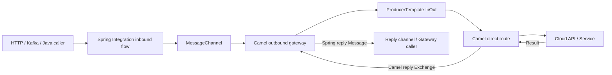
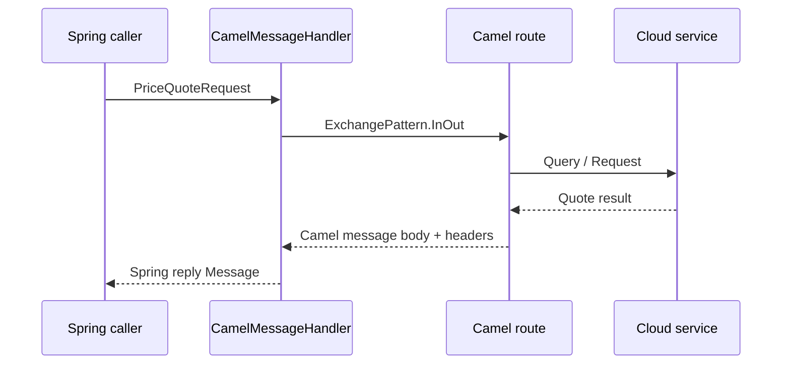
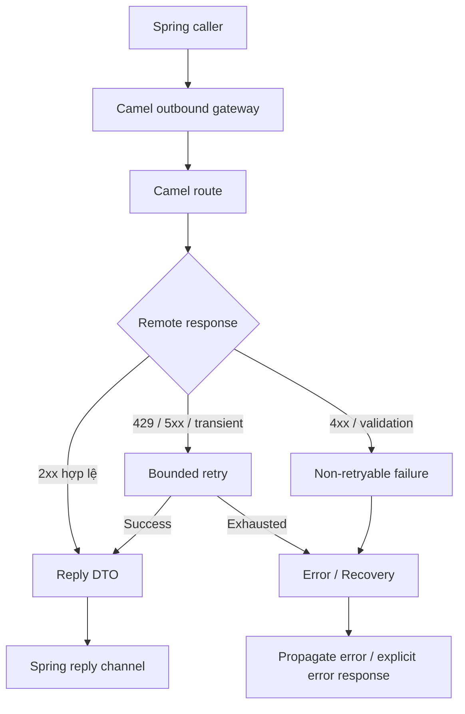

# Apache Camel outbound gateway

## 1. Bối cảnh: khi Spring Integration cần kết quả từ Apache Camel

Trong module **SPRING_INTEGRATION_ADAPTERS**, Spring Integration kết nối hệ thống ngoài bằng inbound/outbound adapter, gateway, poller và `MessageChannel`. Các luồng trao đổi qua file, SFTP, HTTP, JMS, AMQP, Kafka và cơ sở dữ liệu đều cần hợp đồng message, xử lý lỗi và vòng đời kết nối rõ ràng. Chương **Adapter Cloud** mở rộng mô hình tích hợp tới các dịch vụ cloud và các connector sẵn có trong **Apache Camel**.

Giả sử một hệ thống xử lý đơn hàng dùng Spring Integration. Trước khi xác nhận đơn hàng, hệ thống cần **hỏi một dịch vụ định giá được Camel route gọi tới**:

1. Spring Integration nhận `PriceQuoteRequest` từ HTTP, Kafka hoặc gateway nội bộ.
2. Message được đưa vào `camelPriceRequests`.
3. **Apache Camel outbound gateway** chuyển Spring message thành Camel exchange **`InOut`**.
4. Camel route gọi bộ xử lý định giá (trong lab) hoặc cloud HTTP service (trong production).
5. Camel đặt body phản hồi và headers cần thiết vào exchange.
6. Cầu nối chuyển kết quả về Spring Integration, rồi trả lại cho caller hoặc tiếp tục flow.



**Điểm quan trọng:** outbound gateway được dùng khi **người gọi cần kết quả nghiệp vụ** như báo giá, trạng thái bản ghi, ETag, cloud request ID hoặc quyết định xác nhận. Nếu chỉ cần chuyển dữ liệu một chiều mà không có reply, sử dụng **outbound channel adapter** sẽ phù hợp hơn.

### Kết quả học tập

Sau bài này, bạn có thể:

- Phân biệt `CamelMessageHandler` trong chế độ `InOnly` và `InOut`.
- Kết hợp Spring `@MessagingGateway`, `MessageChannel` và Camel outbound gateway.
- Sử dụng `Camel.gateway()` trong Java DSL, hoặc cấu hình `CamelMessageHandler` với `ExchangePattern.InOut`.
- Thiết kế Camel `RouteBuilder` nhận request, tạo response DTO và trả kết quả.
- Cấu hình `CamelHeaderMapper` hai chiều bằng allowlist.
- Tách timeout của Spring gateway, Camel `direct:` và HTTP/cloud client.
- Xử lý lỗi Camel route, lỗi remote service, retry, idempotency và duplicate reply.
- Kiểm thử request-reply cả khi thành công và khi lỗi.
- Quản lý security, observability, cloud IAM, rate limit và lifecycle.

## 2. Các thành phần đứng giữa request và reply

### 2.1. Hai hệ thống message khác nhau

| Spring Integration | Apache Camel | Ý nghĩa |
|---|---|---|
| `Message<T>` | `org.apache.camel.Message` | Body/payload và headers, nhưng không cùng class. |
| `MessageHeaders` | Camel message headers | Cần `CamelHeaderMapper` khi chuyển đổi. |
| `MessageChannel` | `Endpoint` | Nơi Spring dispatch message vs nơi Camel nhận exchange. |
| `@MessagingGateway` | `ProducerTemplate` / Camel route | API gọi từ Java và thành phần gửi tới endpoint. |
| Request/reply channels | `ExchangePattern.InOut` | Giao ước trao đổi hai chiều. |
| `ErrorMessage`, `errorChannel` | Camel exception/error handler | Hai cơ chế lỗi không thể đồng nhất máy móc. |

Spring Integration `Message<?>` bất biến về payload/headers; Camel `Exchange` là context được Camel route sử dụng và có thể cập nhật body, headers, properties, exception hoặc exchange pattern. Cầu nối chịu trách nhiệm biến kết quả Camel thành Spring reply phù hợp.

### 2.2. `CamelMessageHandler` là thành phần chung

Spring Integration module `spring-integration-camel` cung cấp:

```java
org.springframework.integration.camel.outbound.CamelMessageHandler
```

Handler kế thừa `AbstractReplyProducingMessageHandler` và sử dụng `ProducerTemplate` để gửi tới Camel `Endpoint`. Một số lựa chọn:

| Tùy chọn | Chức năng |
|---|---|
| `setEndpointUri(String)` | Đặt Camel endpoint URI cố định. |
| `setEndpointUriExpression(Expression)` | Chọn endpoint theo SpEL; cần bảo vệ khỏi URI do input không tin cậy kiểm soát. |
| `setRoute(LambdaRouteBuilder)` | Khai báo Camel route in-line thay cho URI. |
| `setExchangePattern(ExchangePattern)` | `InOnly` hoặc `InOut`. |
| `setExchangePatternExpression(Expression)` | Chọn pattern theo message; phải giới hạn tập giá trị. |
| `setHeaderMapper(HeaderMapper<org.apache.camel.Message>)` | Chọn headers hai chiều. |
| `setExchangeProperties(Map)` | Bổ sung Camel exchange properties theo policy nội bộ. |
| `setExchangePropertiesExpression(Expression)` | Tính properties qua SpEL trả một `Map`. |

**Không cấu hình đồng thời `setEndpointUri`, `setEndpointUriExpression` và `setRoute` cho cùng handler**: đó là những cách lựa chọn endpoint thay thế. Nếu không inject `ProducerTemplate`, handler có thể tạo nó bằng `CamelContext` được tìm trong Spring application context.

### 2.3. InOnly và InOut là hai hợp đồng khác nhau



| Tình huống | `InOnly` (channel adapter) | `InOut` (outbound gateway) |
|---|---|---|
| Đích dùng | Gửi một chiều | Gửi và nhận kết quả |
| Spring DSL | `Camel.handler()` | `Camel.gateway()` |
| Camel exchange pattern | `ExchangePattern.InOnly` | `ExchangePattern.InOut` |
| Spring reply | Không hứa tạo reply nghiệp vụ | Có đường reply khi route tạo kết quả |
| Phù hợp | Publish fire-and-forget, telemetry | Query giá, kiểm tra object, lệnh cần status |
| Rủi ro | Không biết kết quả cuối nếu bất đồng bộ | Phải xử lý timeout, lỗi, late reply, độ trễ |

**InOut không đồng nghĩa transaction** và **reply thành công không tự chứng minh dữ liệu đã được commit bền vững ở mọi dịch vụ liên quan**. Cần hiểu reply schema và mốc xác nhận của cloud API thật.

## 3. Điều kiện, dependencies và lựa chọn phiên bản

Một cấu hình học tập dễ theo dõi:

- Java 17+.
- Spring Boot 3.x tương thích Spring Integration 6.x, Apache Camel 4.x.
- Spring Integration module `spring-integration-camel`.
- Camel Spring Boot starter và Camel `direct:` component.
- JUnit Jupiter và Spring Boot Test cho integration test.

Với Maven **đã cấu hình dependency management/BOM tương thích**:

```xml
<dependencies>
    <dependency>
        <groupId>org.springframework.boot</groupId>
        <artifactId>spring-boot-starter-integration</artifactId>
    </dependency>
    <dependency>
        <groupId>org.springframework.integration</groupId>
        <artifactId>spring-integration-camel</artifactId>
    </dependency>
    <dependency>
        <groupId>org.apache.camel.springboot</groupId>
        <artifactId>camel-spring-boot-starter</artifactId>
    </dependency>
    <dependency>
        <groupId>org.apache.camel.springboot</groupId>
        <artifactId>camel-direct-starter</artifactId>
    </dependency>
    <dependency>
        <groupId>org.springframework.boot</groupId>
        <artifactId>spring-boot-starter-test</artifactId>
        <scope>test</scope>
    </dependency>
</dependencies>
```

Ví dụ không đặt version để tránh gắn nhầm một số phiên bản không phù hợp với BOM của dự án. Khi không có dependency management cho Camel, phải pin một **bộ phiên bản Camel nhất quán** đã kiểm thử. Spring Integration 7.x/Spring Boot 4.x có baseline và điều kiện tương thích riêng; kiểm tra release notes thay vì sao chép mù quáng config Boot 3.

`camel-spring-boot-starter` giúp tạo/quản lý CamelContext và phát hiện Camel route beans. `camel-direct-starter` bổ sung component nội bộ `direct:`. Ví dụ này **chưa cần** cloud credentials thật: route lab sẽ trả một DTO trong cùng JVM.

## 4. Hợp đồng request-reply của lab

Ta xây một API định giá minh họa:

```text
PriceQuoteRequest
  sku: string
  quantity: int

PriceQuoteReply
  sku: string
  quantity: int
  unitPriceCents: long
  totalCents: long
  correlationId: string
  decision: string
```

Yêu cầu:

- `sku` chỉ chấp nhận mã hàng từ danh mục demo.
- `quantity` phải trong giới hạn; không tùy tiện gọi remote service với input vô hạn.
- `correlationId` do caller/server tạo theo trust boundary, được gửi qua header từ Spring sang Camel.
- Camel route tạo `PriceQuoteReply` ở body và header `quoteSource`.
- Spring caller nhận đúng kiểu `PriceQuoteReply`; không phải một `Exchange` thô.

### 4.1. Request record

File `PriceQuoteRequest.java`:

```java
package example.camelgateway;

public record PriceQuoteRequest(
    String sku,
    int quantity
) {}
```

### 4.2. Reply record

File `PriceQuoteReply.java`:

```java
package example.camelgateway;

public record PriceQuoteReply(
    String sku,
    int quantity,
    long unitPriceCents,
    long totalCents,
    String correlationId,
    String decision
) {}
```

Hai record là **DTO nội bộ cho bài học**. Trong production, không gửi class Java serialization qua mạng theo mặc định; cloud HTTP service thường dùng JSON/Protobuf/schema riêng. Hãy kiểm soát tính tương thích của schema, kiểu tiền tệ, số lượng và số học.

Ở ví dụ, tiền sử dụng **cents dạng `long`** để tránh cộng/trừ bằng `float`/`double`. Với đa tiền tệ hoặc decimal thực, cần currency code, scale và quy tắc rounding theo hợp đồng.

## 5. Spring Boot app và Java Messaging Gateway

### 5.1. Tạo ứng dụng

File `CamelGatewayApplication.java`:

```java
package example.camelgateway;

import org.springframework.boot.SpringApplication;
import org.springframework.boot.autoconfigure.SpringBootApplication;
import org.springframework.integration.annotation.EnableIntegration;
import org.springframework.integration.annotation.IntegrationComponentScan;

@SpringBootApplication
@EnableIntegration
@IntegrationComponentScan
public class CamelGatewayApplication {

    public static void main(String[] args) {
        SpringApplication.run(CamelGatewayApplication.class, args);
    }
}
```

`@IntegrationComponentScan` cho phép framework phát hiện các interface `@MessagingGateway`. Một interface thuần không tự trở thành Spring bean chỉ vì có `@SpringBootApplication` nếu cơ chế scanning tương ứng chưa được bật.

### 5.2. Gateway interface ở phía Spring

File `PriceQuoteClient.java`:

```java
package example.camelgateway;

import org.springframework.integration.annotation.Gateway;
import org.springframework.integration.annotation.MessagingGateway;
import org.springframework.messaging.handler.annotation.Header;

@MessagingGateway
public interface PriceQuoteClient {

    @Gateway(
        requestChannel = "camelPriceRequests",
        requestTimeout = 5_000,
        replyTimeout = 15_000)
    PriceQuoteReply quote(
        PriceQuoteRequest request,
        @Header("correlationId") String correlationId);
}
```

Khi gọi:

```java
PriceQuoteReply quote = priceQuoteClient.quote(
    new PriceQuoteRequest("BOOK-01", 3),
    "req-52d2");
```

Spring Integration tạo request message có body `PriceQuoteRequest`, header `correlationId` và reply channel tạm thời cho lệnh gọi. Sau khi Camel gateway xử lý, response được chuyển về method `quote(...)`.

**Phân biệt tên “gateway”:**

- `@MessagingGateway` là **API Spring-facing**: biến một method Java thành luồng Spring message.
- `Camel.gateway()`/`CamelMessageHandler` với `InOut` là **outbound gateway tới Camel**.

Có thể dùng riêng outbound gateway từ `IntegrationFlow` mà không cần `@MessagingGateway` nếu đầu vào là Kafka/HTTP/file adapter và output tiếp tục đi vào một `MessageChannel` khác.

### 5.3. Ngữ nghĩa timeout ở Spring Messaging Gateway

`requestTimeout` và `replyTimeout` là các timeout **ở ranh giới Spring messaging**:

- `requestTimeout` liên quan đến việc gửi vào request channel, đặc biệt khi channel có thể block.
- `replyTimeout` là thời gian method gateway chờ reply từ messaging flow khi nó phải chờ theo cơ chế tương ứng.
- Chúng **không tự cấu hình** connect/read timeout của cloud HTTP client.
- Với **`DirectChannel` + Camel `direct:` đồng bộ**, handler có thể block ngay trên caller thread. Khi đó `replyTimeout` **không thể luôn cắt ngang một remote call đang treo**; cần timeout ở network/cloud client.
- Với async boundary, method có thể hết thời gian chờ trước khi remote operation hoàn tất. Khi đó **late reply** phải được xem như một khả năng thực tế, không được biến thành “chắc chắn chưa thực hiện”.

**Không dùng mỗi `replyTimeout=15_000` làm bảo đảm rằng cloud call sẽ kết thúc dưới 15 giây**.

## 6. Cấu hình outbound gateway bằng CamelMessageHandler

Bài thực hành chính dùng `@Bean` và `@ServiceActivator` để kiểm soát tường minh:

- Camel endpoint URI.
- `ExchangePattern.InOut`.
- Spring→Camel request header allowlist.
- Camel→Spring reply header allowlist.

File `CamelPriceGatewayConfiguration.java`:

```java
package example.camelgateway;

import org.apache.camel.ExchangePattern;
import org.apache.camel.ProducerTemplate;
import org.springframework.context.annotation.Bean;
import org.springframework.context.annotation.Configuration;
import org.springframework.integration.annotation.ServiceActivator;
import org.springframework.integration.camel.outbound.CamelMessageHandler;
import org.springframework.integration.camel.support.CamelHeaderMapper;
import org.springframework.integration.channel.DirectChannel;
import org.springframework.messaging.MessageChannel;

@Configuration
public class CamelPriceGatewayConfiguration {

    @Bean("camelPriceRequests")
    public MessageChannel camelPriceRequests() {
        return new DirectChannel();
    }

    @Bean
    @ServiceActivator(inputChannel = "camelPriceRequests")
    public CamelMessageHandler camelPriceOutboundGateway(
            ProducerTemplate producerTemplate) {

        CamelHeaderMapper mapper = new CamelHeaderMapper();

        // Chỉ các Spring request headers cần thiết đi sang Camel.
        mapper.setOutboundHeaderNames(
            "correlationId", "trustedTenantId");

        // Chỉ các Camel reply headers này quay về Spring.
        mapper.setInboundHeaderNames(
            "quoteSource", "cloudRequestId");

        CamelMessageHandler handler =
            new CamelMessageHandler(producerTemplate);

        handler.setEndpointUri(
            "direct:cloud-price-lookup"
            + "?block=true&timeout=2000&failIfNoConsumers=true");

        // Đây là điểm biến handler thành OUTBOUND GATEWAY.
        handler.setExchangePattern(ExchangePattern.InOut);
        handler.setHeaderMapper(mapper);

        return handler;
    }
}
```

**Các mấu chốt trong đoạn code:**

1. `@ServiceActivator(inputChannel="camelPriceRequests")` đăng ký handler để tiêu thụ message từ Spring channel.
2. `new CamelMessageHandler(producerTemplate)` dùng Camel `ProducerTemplate` được Spring/Camel quản lý.
3. `setExchangePattern(InOut)` yêu cầu xử lý theo request-reply.
4. `CamelHeaderMapper` có **hai danh sách hướng khác nhau**, không phải một chiều dùng cho cả request và reply.
5. `block=true&timeout=2000&failIfNoConsumers=true` là **tùy chọn của Camel `direct:` endpoint** để xử lý trường hợp chưa có consumer; nó **không** là timeout tổng của cloud API.
6. Khi Camel route trả body, `CamelMessageHandler` tạo Spring reply cho message đang có reply channel.
7. `DirectChannel` không phải queue; handler và route `direct:` sẽ chạy theo đường gọi đồng bộ trong lab.
8. **Chỉ đăng ký một subscriber** cho `camelPriceRequests`. Không thêm một DSL gateway khác trên cùng DirectChannel nếu muốn mọi request đều chạy qua cùng handler.

**Security note:** `trustedTenantId` chỉ có ý nghĩa nếu phía Spring đã tạo từ danh tính người dùng/đơn vị **được xác thực**. Không tự tin một HTTP header hoặc trường payload mang tên này là thông tin đáng tin.

### 6.1. Không nhầm mapper hai chiều

| Method trên `CamelHeaderMapper` | Chiều chuyển | Ví dụ |
|---|---|---|
| `setOutboundHeaderNames(...)` | Spring message → Camel request | `correlationId`, `trustedTenantId`. |
| `setInboundHeaderNames(...)` | Camel response → Spring reply | `quoteSource`, `cloudRequestId`. |

Các danh sách này nhận **tên header hoặc pattern**. Không mặc định map toàn bộ Spring headers vì `replyChannel`, `errorChannel` hoặc framework references có thể không phù hợp khi chuyển sang Camel và cloud components. Khi nhận reply, cũng không đưa tự do mọi cloud response header trở lại ứng dụng.

## 7. Tạo Camel RouteBuilder thực sự trả kết quả

File `PriceQuoteCamelRoute.java`:

```java
package example.camelgateway;

import java.util.Map;

import org.apache.camel.builder.RouteBuilder;
import org.springframework.stereotype.Component;

@Component
public class PriceQuoteCamelRoute extends RouteBuilder {

    private static final Map<String, Long> CATALOG = Map.of(
        "BOOK-01", 1250L,
        "PEN-02", 199L,
        "BAG-03", 6400L);

    @Override
    public void configure() {
        from("direct:cloud-price-lookup")
            .routeId("cloud-price-lookup")
            .process(exchange -> {
                PriceQuoteRequest request =
                    exchange.getMessage()
                        .getBody(PriceQuoteRequest.class);

                String correlationId =
                    exchange.getMessage().getHeader(
                        "correlationId", String.class);

                if (request == null
                        || request.sku() == null
                        || request.sku().isBlank()) {
                    throw new IllegalArgumentException(
                        "Missing SKU");
                }

                if (request.quantity() < 1
                        || request.quantity() > 1_000) {
                    throw new IllegalArgumentException(
                        "Invalid quantity");
                }

                if (correlationId == null
                        || correlationId.isBlank()
                        || correlationId.length() > 100) {
                    throw new IllegalArgumentException(
                        "Missing or invalid correlationId");
                }

                Long unitPrice = CATALOG.get(request.sku());

                if (unitPrice == null) {
                    throw new IllegalArgumentException(
                        "SKU not found");
                }

                long total = Math.multiplyExact(
                    unitPrice, request.quantity());

                PriceQuoteReply reply = new PriceQuoteReply(
                    request.sku(),
                    request.quantity(),
                    unitPrice,
                    total,
                    correlationId,
                    "APPROVED");

                // Camel route cập nhật body response của exchange.
                exchange.getMessage().setBody(reply);

                // Chỉ các Camel headers được allowlist mới trở
                // lại Spring reply.
                exchange.getMessage().setHeader(
                    "quoteSource", "demo-catalog");
            });
    }
}
```

Camel `direct:cloud-price-lookup` nhận exchange ngay trong **cùng CamelContext**. Trong route, `exchange.getMessage().getBody(...)` đọc request, còn `setBody(reply)` tạo kết quả cho `InOut`. Camel không tự chuyển điều này thành HTTP response: Spring Integration gateway là thành phần cần reply cho caller.

**Giới hạn bài thực hành:** đây là một **stub định giá tại chỗ**, không có network request. Nó giúp kiểm tra chính xác bridge Spring↔Camel trước khi thêm credential, TLS, REST, broker hay cloud SDK. `CATALOG` không thay thế một cloud pricing service thật.

### 7.1. Theo dõi body và headers ở biên

```text
Spring request
  payload: PriceQuoteRequest("BOOK-01", 3)
  headers:
    correlationId: "req-52d2"
    replyChannel: <temporary Spring channel>

After outbound mapping
Camel request
  body: PriceQuoteRequest("BOOK-01", 3)
  headers:
    correlationId: "req-52d2"
  exchange pattern: InOut

Camel response
  body: PriceQuoteReply(... totalCents=3750 ...)
  headers:
    correlationId: "req-52d2"
    quoteSource: "demo-catalog"

Spring reply
  payload: PriceQuoteReply(...)
  headers: allowed Camel response fields + framework metadata
```

Đây là **sơ đồ hợp đồng**, không phải dump chính xác mọi internal header. Những headers thực tế do Spring Integration/Camel thêm có thể thay đổi theo phiên bản và config; đặc biệt, đừng đưa `replyChannel`/`errorChannel` tùy ý ra Camel.

### 7.2. Test case nhanh

```java
PriceQuoteReply reply = priceQuoteClient.quote(
    new PriceQuoteRequest("BOOK-01", 3),
    "req-52d2");

// Dự kiến:
// reply.sku()         = "BOOK-01"
// reply.quantity()    = 3
// reply.unitPriceCents() = 1250
// reply.totalCents()  = 3750
// reply.correlationId() = "req-52d2"
// reply.decision()    = "APPROVED"
```

**Đừng nhầm** số tiền trả về với số tiền chắc chắn được thu hoặc giao dịch tài chính đã được ghi. Đây chỉ là kết quả của một **query**.

## 8. Cách viết tương đương bằng Spring Integration Java DSL

Spring Integration cung cấp factory:

- `Camel.gateway()` tạo `CamelMessageHandlerSpec` với `ExchangePattern.InOut`.
- `Camel.handler()` tạo spec với `ExchangePattern.InOnly`.
- `Camel.route(...)` là cách khai báo inline route với `InOut`.

Đoạn cấu hình **thay thế** bean `camelPriceOutboundGateway()` ở mục 6:

```java
package example.camelgateway;

import org.springframework.context.annotation.Bean;
import org.springframework.context.annotation.Configuration;
import org.springframework.integration.camel.dsl.Camel;
import org.springframework.integration.dsl.IntegrationFlow;

@Configuration
public class CamelGatewayDslConfiguration {

    @Bean
    public IntegrationFlow quoteViaCamel() {
        return IntegrationFlow.from("camelPriceRequests")
            .handle(Camel.gateway()
                .endpointUri("direct:cloud-price-lookup"))
            .get();
    }
}
```

**Không bật đồng thời** `CamelGatewayDslConfiguration` và `CamelPriceGatewayConfiguration` trên cùng `camelPriceRequests` khi đang dùng `DirectChannel`; hai endpoints sẽ cạnh tranh subscription. Nếu chọn DSL, ngừng khai báo bean annotated ở mục 6 hoặc dùng channel khác.

Điểm cần kiểm tra khi dùng DSL:

1. DSL `Camel.gateway()` đã thiết lập `InOut`; **không gọi `Camel.handler()` rồi chờ reply**.
2. Header mapping mặc định có thể rộng; nếu cần allowlist chặt chẽ, cấu hình spec theo API version hoặc sử dụng bean handler cấu hình tường minh như mục 6.
3. Mục 7 vẫn phải có Camel route consumer `direct:cloud-price-lookup`.
4. Reply không cần một `.channel("...")` riêng khi caller `@MessagingGateway` tạo temporary reply channel và flow kết thúc bằng reply-producing handler.
5. Nếu sau Camel gateway còn các bước `transform/filter`, kết quả phải là Spring message/DTO đúng hợp đồng với Java caller.

### 8.1. Flow cần xử lý thêm response

Ví dụ không dùng Java gateway mà nối response sang một channel khác:

```java
@Bean
IntegrationFlow quoteAndAudit() {
    return IntegrationFlow
        .from("quoteAuditRequests")
        .handle(Camel.gateway()
            .endpointUri("direct:cloud-price-lookup"))
        .filter(PriceQuoteReply.class,
            quote -> quote.totalCents() >= 0)
        .channel("quoteAuditResults")
        .get();
}
```

Đoạn này chỉ là **một flow khác**; `quoteAuditResults` cần có consumer được khai báo. Filter có thể **chặn reply** nếu điều kiện không đạt, khiến một caller request-reply chờ hoặc timeout. Với bài toán query, một response không hợp lệ thường nên tạo **lỗi rõ ràng** thay vì filter bỏ im lặng.

### 8.2. Khi nào nên dùng Java DSL, khi nào dùng handler bean?

| Phương án | Tốt nhất khi | Lưu ý |
|---|---|---|
| `Camel.gateway().endpointUri(...)` | Một flow ngắn, endpoint cố định | Cần chú ý mapper default và lifecycle. |
| `@ServiceActivator` + `CamelMessageHandler` | Cần kiểm soát tường minh mapper, exchange pattern, properties | Nhiều dòng cấu hình nhưng dễ review. |
| `Camel.route(...)` | Muốn khai báo Camel route inline trong Spring Integration flow | Tránh khai báo trùng một consumer route cùng URI. |
| `setEndpointUriExpression(...)` | Chọn một số endpoint theo policy runtime | Chỉ dùng allowlist, không lấy URI từ input không tin cậy. |

## 9. Mapping reply headers và exchange properties

### 9.1. Hai hệ thống header không giống nhau

Spring message có `MessageHeaders` và Camel message có Map headers. Handler mặc định có thể map **tất cả** headers, nhưng production nên kiểm soát vì:

- `replyChannel`/`errorChannel` là internal messaging references, không phải cloud metadata.
- Một header do caller đặt có thể chứa token, dữ liệu cá nhân hoặc tenant tự khai báo.
- Camel components có thể sử dụng headers để quyết định HTTP method, object key, bucket hoặc URI.
- Reply headers có thể chứa vendor-specific metadata và những giá trị không nên forward ra HTTP response/broker.

`CamelHeaderMapper` hỗ trợ:

```java
CamelHeaderMapper mapper = new CamelHeaderMapper();

// Spring request -> Camel request
mapper.setOutboundHeaderNames(
    "correlationId", "trustedTenantId");

// Camel reply -> Spring reply
mapper.setInboundHeaderNames(
    "quoteSource", "cloudRequestId");
```

**Với một endpoint InOut, inbound mapper là phần quan trọng**; không cấu hình chỉ request mapping rồi giả định mọi reply metadata cần thiết sẽ có trong Spring reply.

### 9.2. Header không phải Exchange property

Trong Camel:

- `exchange.getMessage().getHeader(...)` đọc Camel message header.
- `exchange.getProperty(...)` đọc Camel exchange property.
- `ExchangeProperty` không tự trở thành Spring `MessageHeaders` khi reply.

`CamelMessageHandler` có `setExchangeProperties(...)` và `setExchangePropertiesExpression(...)` để đưa context vào Camel exchange. Chỉ đưa giá trị cần thiết từ một nguồn đã xác thực; không đặt secret hoặc raw Java principal object vào properties vì có thể bị các processors khác log/serialize.

### 9.3. Correlation ID nào là ổn định?

- Spring `MessageHeaders.ID` là định danh message framework, có thể đổi khi tạo message khác.
- `correlationId` do nghiệp vụ tạo theo hợp đồng có thể giữ ổn định xuyên request/retry.
- Camel Exchange ID không nhất thiết bằng Spring message ID hay cloud request ID.
- Cloud request ID do provider trả về là **một định danh khác** phục vụ tra cứu ở provider.

Không dùng một ID bất kỳ để ngụ ý đã có deduplication. Idempotency key cần quy tắc ổn định cho **cùng một yêu cầu nghiệp vụ** và được xử lý ở destination hoặc durable inbox thích hợp.

## 10. Timeout: ba đồng hồ khác nhau

Một request-reply cloud có thể qua ba tầng:

```text
Spring caller
  -> requestChannel send / reply wait
  -> Camel direct consumer startup/wait
  -> Camel HTTP/SDK connection + response
  -> Reply mapping
```

| Tầng | Cần timeout nào | Không nên suy ra |
|---|---|---|
| Spring `@MessagingGateway` | `requestTimeout`, `replyTimeout` | Không tự cắt một blocking remote call trên DirectChannel. |
| Camel `direct:` | `block`, `timeout`, `failIfNoConsumers` | Chỉ liên quan việc có route consumer sẵn sàng. |
| Cloud HTTP/client | Connect timeout, response/read timeout, total deadline | Không do `direct:timeout` quyết định. |
| Camel retry/error handler | Max redeliveries, delay/backoff | Tổng latency phải nằm trong budget. |
| Downstream broker/DB | Publish/commit timeouts | Gửi tới broker không đồng nghĩa consumer đã xử lý. |

### 10.1. Ví dụ timeout budget

Giả sử nghiệp vụ mong phản hồi trong **10 giây**:

```text
Total budget:       10_000 ms
Connection setup:    1_000 ms
Remote response:     5_000 ms
Small retry margin:  2_000 ms
Serialization/queue: 2_000 ms
```

Đây là **mô hình phân bổ minh họa**, không phải timeout config áp dụng cho mọi Camel component. Trong production, cần giới hạn request tổng thực tế ở HTTP client/SDK, và bảo đảm retry không khiến request chạy vượt budget rồi tạo late reply hoặc lệnh trùng.

Nếu `direct:` route đã started nhưng remote HTTP server treo, tăng `direct:timeout` **không** giúp. Phải sửa timeout ở remote client.

### 10.2. Timeout và “kết quả không biết”

Khi caller timeout:

1. Request có thể **chưa được gửi**.
2. Request có thể **đã tới Camel route** nhưng chưa tới remote.
3. Cloud service có thể **đã xử lý thành công** nhưng reply bị mất hoặc tới muộn.
4. Spring gateway có thể đã ngừng chờ trong khi worker vẫn chạy.

Do đó, không tự động coi timeout là operation thất bại tuyệt đối. Với lệnh tạo/xóa object hoặc thanh toán, cần idempotency key, durable command state và cơ chế query/reconciliation.

## 11. Xử lý lỗi ở Spring và Camel

### 11.1. Hai hệ error model

**Spring Integration** sử dụng `MessagingException`, `ErrorMessage`, `errorChannel` và các advice cho handler.

**Apache Camel** dùng `Exchange` có exception/error status, `onException(...)`, redelivery/error handler, dead-letter endpoints và các policies khác.



Với `DirectChannel` và Camel `direct:` đồng bộ, exception route không được Camel đánh dấu `handled(true)` thường có thể lan trở lại Spring handler/caller. Với `ExecutorChannel` hoặc Camel async processing, lỗi có thể xảy ra sau khi caller đã thôi chờ. Cần cấu hình error channel/recovery đúng ranh giới và kiểm thử theo phiên bản.

### 11.2. Hướng dẫn với Camel `onException`

Ví dụ policy minh họa trong Camel `RouteBuilder.configure()`:

```java
@Override
public void configure() {

    onException(IllegalArgumentException.class)
        .maximumRedeliveries(0)
        .handled(false);

    from("direct:cloud-price-lookup")
        .routeId("cloud-price-lookup")
        .process(exchange -> {
            // Validate + call remote + create reply...
        });
}
```

Đây là **fragment thay thế** cho `configure()` của route mục 7, không phải code chạy đồng thời. `handled(false)` giúp không vô tình biến exception hợp đồng thành một exchange “thành công giả”. Hành vi chính xác khi exception trở lại Java caller cần được xác nhận bằng integration test.

Một số tình huống nghiệp vụ muốn trả **error DTO** thay vì throw. Khi đó:

- Định nghĩa một schema rõ: `success`/`errorCode`/`requestId`.
- Map Camel response thành đúng kiểu Spring reply, **không trả một object có type bất ngờ**.
- Đảm bảo HTTP inbound gateway (nếu có) ánh xạ errorCode sang HTTP status đúng.
- Không dùng 200 OK cho mọi trường hợp chỉ vì Camel `handled(true)` đã xóa exception.

### 11.3. Tránh nhân retry giữa Spring, Camel và SDK

Giả sử:

```text
Spring RequestHandlerRetryAdvice: 3 attempts
Camel redelivery:             3 attempts
Cloud HTTP client retry:      2 attempts
Theoretical max cloud calls:  3 × 3 × 2 = 18
```

Khi timeout và latency tăng, một lệnh có side effect có thể bị gửi lặp nhiều lần. Hãy xác định **một lớp sở hữu retry chính** và **deadline tổng**. Nếu buộc phải retry ở nhiều lớp, kiểm soát số lần kết hợp, backoff, jitter, quota và idempotency.

| Nhóm lỗi | Khả năng retry | Ghi chú |
|---|---|---|
| Input sai schema/quantity | Không | Deterministic validation error. |
| 401/403 remote, IAM sai | Thường không | Cần sửa credential/quyền; tránh retry storm. |
| HTTP 429, throttling | Có điều kiện | Exponential backoff, honor Retry-After nếu có. |
| HTTP 502/503/504 | Có điều kiện | Tổng deadline, circuit breaker và monitoring. |
| DNS/connect timeout | Có điều kiện | Phân biệt endpoint outage với config sai. |
| Read timeout sau gửi POST | Rủi ro duplicate | Remote có thể đã commit; cần idempotency. |
| Camel route chưa start | Cấu hình/lifecycle | Chờ readiness hoặc fail fast; không retry vô hạn. |
| Reply không đúng type | Không retry mù | Contract mismatch, cần sửa schema/converter. |

### 11.4. Error channel không phải reply channel

Spring reply channel là nơi gửi **kết quả request-reply**. Error channel là nơi một số thành phần có thể publish `ErrorMessage` khi lỗi xảy ra.

- `ErrorMessage` có payload là `Throwable`.
- `MessagingException.getFailedMessage()` có thể giúp tìm message gây lỗi.
- Lỗi trên `DirectChannel` có thể lan trực tiếp tới Java caller.
- Lỗi bất đồng bộ có thể được gửi đến header `errorChannel` hoặc global `errorChannel` khi publisher được sử dụng.
- Global error channel **không** mặc định là durable dead-letter queue.

Nếu muốn trả lỗi cho Java caller, phải thiết kế exception mapping/error reply theo hợp đồng; chỉ log exception vào một error channel riêng **không giải quyết** chuyện caller đang đợi response.

## 12. Cloud HTTP service thật: chuyển từ demo sang remote API

Trong lab, Camel route tính báo giá từ `Map` tại chỗ. Để gọi dịch vụ HTTP thật, có thể dùng Camel `http` component và bộ chuyển JSON. Đây là **một phương án thay thế route demo**, không đăng ký thêm một consumer `direct:cloud-price-lookup` thứ hai.

Các module Camel thường cần:

```xml
<dependency>
    <groupId>org.apache.camel.springboot</groupId>
    <artifactId>camel-http-starter</artifactId>
</dependency>
<dependency>
    <groupId>org.apache.camel.springboot</groupId>
    <artifactId>camel-jackson-starter</artifactId>
</dependency>
```

Fragment khái niệm trong `RouteBuilder`:

```java
import org.apache.camel.Exchange;
import org.apache.camel.builder.RouteBuilder;
import org.apache.camel.model.dataformat.JsonLibrary;

// Một phương án thay thế route demo.
// Endpoint thực tế phải tới dịch vụ tin cậy của bạn.
from("direct:cloud-price-lookup")
    .routeId("cloud-price-http")
    .process(exchange -> {
        PriceQuoteRequest request =
            exchange.getMessage()
                .getBody(PriceQuoteRequest.class);

        if (request == null || request.quantity() < 1) {
            throw new IllegalArgumentException(
                "Invalid quote request");
        }
    })
    .marshal().json(JsonLibrary.Jackson)
    .setHeader(Exchange.HTTP_METHOD, constant("POST"))
    .setHeader(Exchange.CONTENT_TYPE, constant("application/json"))
    .to("https://pricing.internal.example/api/quotes"
        + "?throwExceptionOnFailure=true")
    .unmarshal().json(
        JsonLibrary.Jackson, PriceQuoteReply.class);
```

**Đây là fragment tích hợp**, không thể chạy khi chưa có cloud service, endpoint, credentials, JSON schema và timeout thật. `PriceQuoteReply` ở lab là Java record; cần đảm bảo Jackson version/config của ứng dụng có thể deserialize response thực tế và schema cloud khớp contract. Nếu provider trả một DTO khác, nên tạo DTO phía provider rồi mapping vào `PriceQuoteReply` của domain, không phụ thuộc trực tiếp cloud format.

Khi chuyển sang remote:

- Cấu hình **connect/read/response/total timeout** theo Camel HTTP component/version và client sử dụng.
- Sử dụng HTTPS với certificate/hostname verification, không trust-all.
- Dùng OAuth2/workload identity/service token qua secret store; không hardcode vào URI/source code.
- Không tạo HTTP target URI tự do từ untrusted request.
- Cấu hình `throwExceptionOnFailure` và mapping 4xx/5xx theo chính sách.
- Không tự xem HTTP 202 Accepted là “đã có báo giá cuối”; có thể cần poll/query trạng thái.
- Dùng `cloudRequestId`/trace ID nếu provider trả header và được phép lưu.
- Dùng circuit breaker hoặc giới hạn concurrency khi cloud service chậm.

### 12.1. Vì sao Camel gateway có ích ở chương Adapter Cloud?

Camel có sẵn components cho nhiều provider và protocol. Phần Spring Integration vẫn giữ:

```text
Spring request contract
  -> Camel outbound gateway
  -> Camel route
  -> Cloud provider-specific request
  <- Provider-specific response
  <- Camel response mapper
  <- Spring domain reply
```

Ví dụ nghiệp vụ:

- Query trạng thái object từ object storage và trả `exists`/`size`.
- Hỏi cloud pricing API và nhận báo giá.
- Gọi dịch vụ kiểm tra gian lận và nhận quyết định.
- Gửi command tới SaaS cần phản hồi xác nhận.
- Gọi một Camel component không có Spring Integration outbound gateway tương đương.

Không phải mọi Camel component đều trả kết quả **theo InOut**. Với một provider chỉ hỗ trợ one-way publish, đừng tự tạo reply giả “thành công” rồi coi đó là business acknowledgment.

## 13. Bảo mật: endpoint URI, headers và cloud credentials

### 13.1. Dynamic URI có nguy cơ SSRF và truy cập sai đích

`setEndpointUriExpression(...)` cho phép chọn Camel endpoint theo Spring message; rất hữu ích nhưng cũng có thể đưa dữ liệu không tin cậy thành:

```text
headers.destinationUri = "http://internal-admin-service/..."
```

Đây là **anti-pattern** nếu `destinationUri` được lấy trực tiếp từ HTTP request, Kafka message hoặc Syslog body bên ngoài. Tùy Camel components có sẵn, attacker có thể điều hướng sang HTTP nội bộ, file, cloud bucket khác hoặc các protocol không mong muốn.

Cách an toàn:

1. Chỉ chấp nhận **route key** thuộc allowlist.
2. Map route key sang những URI cấu hình từ phía server.
3. Ràng buộc component scheme, host, tenant, region/bucket và IAM.
4. Có egress network policy, không cho arbitrary outbound network.
5. Không log endpoint URI nếu chứa token/query secret.
6. Test với malformed URI, encoding, host giả và cross-tenant routing.

### 13.2. Request headers không tự mang quyền

Một `@Header("trustedTenantId")` chỉ có ý nghĩa khi giá trị được phía server tạo sau xác thực. Nếu client tự gửi `trustedTenantId=admin`, header đó **chưa được xác thực**.

Cần tách:

- **Authenticated principal/tenant** từ security boundary đáng tin.
- **Business parameters** như SKU và quantity do caller cung cấp.
- **Routing metadata** như correlation ID, event ID.
- **Credential** cho cloud client ở IAM/managed identity/secret store, không nhét vào business message.

Không để user-supplied headers tự quyết định cloud project/account, object key prefix hoặc authorization.

### 13.3. Reply cũng phải được validate

Ngay cả khi request đã hợp lệ, remote response vẫn là dữ liệu từ hệ ngoài:

- Kiểm tra HTTP status và content type.
- Giới hạn response bytes và JSON depth/field count nếu có.
- Validate expected fields, enum, currency, amount range.
- Không deserialize untrusted polymorphic Java types tùy ý.
- Không log toàn bộ raw body khi response lỗi; có thể chứa PII/token.
- Không đưa mọi vendor headers trở lại Spring hoặc HTTP caller.
- Không thực thi biểu thức hoặc shell command từ reply body.

## 14. Concurrency, ordering, transaction và durability

### 14.1. Gateway đồng bộ làm caller chờ

`DirectChannel` + `Camel direct:` + cloud API đồng bộ nghĩa là thread gọi có thể bị giữ trong suốt request-reply. Nếu cloud service có độ trễ cao, hệ thống phải tính:

- Concurrent inbound requests.
- Số HTTP connections và thread pool.
- Thời gian chờ tối đa.
- Queue depth, backlog, cancellation.
- Rate limit/bulkhead theo tenant.
- Trạng thái caller khi remote đã xong nhưng reply không còn được chờ.

Tăng số threads vô hạn không làm provider nhanh hơn, thường chỉ tăng saturation.

### 14.2. ExecutorChannel/SEDA không tự bảo đảm reply

Nếu chèn `ExecutorChannel` phía Spring hoặc Camel `seda:`:

- Xử lý có thể chuyển sang thread khác.
- Queue có thể làm trễ reply.
- Reply timeout trở nên quan trọng vì caller chờ khác thread.
- Khi timeout, worker vẫn có thể hoàn tất sau đó.
- Queue trong bộ nhớ **không tự bền vững** sau restart.

Nếu nghiệp vụ không thể hoàn tất trong một request budget ngắn, **đổi hợp đồng sang asynchronous command** có job ID, durable queue/outbox và endpoint query trạng thái, thay vì kéo dài đồng bộ vô hạn.

### 14.3. Transaction không tự xuyên qua Spring và cloud

Một transaction trong Spring Data/JDBC không tự bao gồm Camel route và cloud API. Ví dụ:

```text
Spring DB transaction begins
 -> Camel gateway calls remote cloud write
 -> cloud writes successfully
 -> local DB transaction rolls back
```

Kết quả cloud/local DB không đồng nhất. Với command có side effect, cần **outbox/inbox/saga hoặc reconciliation** theo yêu cầu. Không hứa atomic commit chỉ vì tất cả code chạy trong một Spring ApplicationContext.

### 14.4. Đừng dùng timeout để quyết định retry thanh toán

Một cloud write timeout có thể là **unknown outcome**. Nếu retry không có idempotency key, có nguy cơ xử lý trùng. Bài thực hành là query định giá nên ít side effect; khi áp vào upload/create/delete/payment phải thay chính sách:

- Khóa idempotency do domain tạo và lưu bền vững.
- Conditional write hoặc optimistic concurrency nếu provider hỗ trợ.
- Retry với backoff/jitter và deadline.
- Persist correlation với provider request ID.
- Reconcile kết quả sau timeout trước khi tiếp tục side effect.

## 15. Kiểm thử end-to-end trong ứng dụng

### 15.1. Integration test cho request-reply

File `CamelPriceGatewayTest.java`:

```java
package example.camelgateway;

import static org.junit.jupiter.api.Assertions.*;

import org.junit.jupiter.api.Test;
import org.springframework.beans.factory.annotation.Autowired;
import org.springframework.boot.test.context.SpringBootTest;

@SpringBootTest
class CamelPriceGatewayTest {

    @Autowired
    PriceQuoteClient priceQuoteClient;

    @Test
    void returnsTypedQuoteFromCamelRoute() {
        PriceQuoteReply reply = priceQuoteClient.quote(
            new PriceQuoteRequest("BOOK-01", 3),
            "req-52d2");

        assertEquals("BOOK-01", reply.sku());
        assertEquals(3, reply.quantity());
        assertEquals(1250L, reply.unitPriceCents());
        assertEquals(3750L, reply.totalCents());
        assertEquals("req-52d2", reply.correlationId());
        assertEquals("APPROVED", reply.decision());
    }

    @Test
    void rejectsInvalidQuantity() {
        RuntimeException failure = assertThrows(
            RuntimeException.class,
            () -> priceQuoteClient.quote(
                new PriceQuoteRequest("BOOK-01", 0),
                "req-bad"));

        assertNotNull(failure);
        // Exception type/wrapping có thể phụ thuộc
        // Camel + Spring Integration version.
    }

    @Test
    void rejectsUnknownSku() {
        assertThrows(RuntimeException.class,
            () -> priceQuoteClient.quote(
                new PriceQuoteRequest("UNKNOWN", 1),
                "req-no-sku"));
    }
}
```

Ở bài này, **đừng cố assert một exception class quá chi tiết** nếu không kiểm tra behavior thực tế của Spring Integration/Camel version đang chạy. Exception có thể được bọc thành `MessagingException` hoặc exception của Camel route. Điều quan trọng là **không có reply “APPROVED” giả** khi validation thất bại.

### 15.2. Header mapping hai chiều nên có test riêng

Một request test có thể gắn correlation ID và xác nhận route đọc được (trong lab, correlation ID xuất hiện trong reply body). Để xác nhận header reply `quoteSource` được đưa về Spring:

1. Dùng một test gateway method trả về `Message<PriceQuoteReply>` theo hợp đồng có hỗ trợ.
2. Hoặc gọi `MessagingTemplate.sendAndReceive(...)` vào `camelPriceRequests` để nhận `Message<?>`.
3. Assert payload đúng kiểu và `reply.getHeaders().get("quoteSource")` bằng `"demo-catalog"`.
4. Assert rằng các header không nằm trong allowlist (ví dụ header nội bộ nhạy cảm) không bị forward.
5. Test một Camel reply có header không được allowlist và xác nhận nó **không** quay về Spring.

Cần nhớ một số Spring framework headers được thêm nội bộ sau mapping; test nên kiểm tra **những header có/không có theo policy** chứ không so sánh toàn bộ `MessageHeaders` theo thứ tự.

### 15.3. Kiểm thử timeout/lỗi bằng mock cloud service

Trước khi triển khai provider thật, test các case:

| Trường hợp | Kỳ vọng |
|---|---|
| Camel route trả DTO đúng | Spring gateway nhận `PriceQuoteReply`. |
| Camel body trả sai type | Fail/convert theo contract; không âm thầm chấp nhận data lạ. |
| Camel route ném exception | Java caller nhận lỗi có thể quan sát. |
| Không có consumer `direct:...` | Camel fail/timeout theo `block/failIfNoConsumers`. |
| Header `correlationId` thiếu | Validation fail; không tạo báo giá giả. |
| Reply header `quoteSource` | Được map qua inbound header allowlist. |
| Header `errorChannel` trên Spring request | Không map tùy ý sang Camel. |
| Remote API 401/403 | Không retry storm; report access/config issue. |
| Remote API 429/503 | Retry bounded với backoff/jitter nếu policy cho phép. |
| Remote API timeout sau side effect | Đánh dấu unknown outcome, kiểm tra idempotency/reconciliation. |
| Slow remote call vượt Spring replyTimeout | Test late reply; không giả định operation bị cancel. |
| Camel route chưa started | Readiness phát hiện, fail theo policy. |
| Spring/Camel version không tương thích | Startup/test failure rõ ràng, không nâng cấp component rời rạc. |

**Không chạy load test lên cloud production** hoặc dùng credentials thật trong unit test; có thể dùng một mock HTTP server, Testcontainers/emulator hợp lệ hoặc Camel `MockEndpoint` với test route riêng.

## 16. Observability và troubleshooting

### 16.1. Theo dõi cả hai framework

| Tín hiệu | Diễn giải |
|---|---|
| Spring gateway call count/latency | Bao nhiêu method calls, chờ reply bao lâu. |
| Spring channel send failures | Channel bận, không subscriber, dispatch lỗi. |
| Camel route exchanges completed/failed | Route đã xử lý được bao nhiêu InOut exchanges. |
| Camel endpoint consumer status | `direct:...` có route consumer đã start không. |
| Cloud HTTP status/latency | 2xx, 4xx, 429, 5xx, DNS/TLS errors. |
| Cloud request ID | Dùng đối chiếu với log phía provider. |
| Retry attempts/redeliveries | Có bị nhân retries qua các layers không. |
| Timeout và late reply count | Caller hết thời gian chờ nhưng xử lý còn chạy. |
| Thread/connection pool utilization | Bottleneck blocking/bulkhead. |
| Durable job/outbox/DLQ backlog | Recovery khi lệnh có side effect. |

Log correlation ID là một giá trị hữu ích nhưng phải được giới hạn kích thước, làm sạch và **không chứa secret/PII**. Tránh tạo metrics label từ arbitrary SKU, raw query hoặc cloud response body vì cardinality có thể rất lớn.

### 16.2. Các lỗi thường gặp

| Triệu chứng | Nguyên nhân có thể | Hướng kiểm tra |
|---|---|---|
| Không tìm được `Camel.gateway()` | Thiếu `spring-integration-camel` hoặc version cũ | Dependency và API version. |
| Không có bean `PriceQuoteClient` | Chưa bật `@IntegrationComponentScan` | Package scan/`@MessagingGateway`. |
| CamelContext không có | Camel Boot auto-config chưa hoạt động | Starters và bean initialization. |
| `direct:...` thiếu consumer | Route không scan/start hoặc URI sai | Camel route status, endpoint name. |
| Method Spring gateway đợi vô hạn | Reply không được tạo, remote call block | `InOut`, handler, remote timeout, thread dump. |
| Spring caller nhận `null` | Reply không tới trong thời hạn, async flow thiếu reply | Trace reply channel, `replyTimeout` và late reply. |
| Chỉ gửi một chiều, không có reply | Dùng `Camel.handler()`/`InOnly` | Đổi sang `Camel.gateway()`. |
| Reply thiếu `quoteSource` | Inbound mapper không allowlist header | `setInboundHeaderNames`. |
| Camel route thiếu correlationId | Outbound mapper chặn hoặc caller không đặt | `setOutboundHeaderNames`, request message. |
| Lỗi đã được Camel `handled(true)` nhưng client thấy “success” | Error handler nuốt exception | Mapping error DTO/status rõ ràng. |
| Cloud HTTP timeout nhưng direct timeout không có hiệu lực | Timeout đặt sai tầng | Cấu hình HTTP client/SDK timeout. |
| Nhiều lần gọi remote cho một request | Double/triple retry | Spring advice, Camel redelivery, SDK retry. |
| Không thấy lỗi trên errorChannel | Flow đồng bộ lan exception trực tiếp | Kiểm tra caller stack, async boundary. |
| Dynamic URI tới sai cloud account | Untrusted header/SpEL | URI allowlist và IAM/network policy. |

### 16.3. Runbook 10 bước

```text
1. Caller có gọi đúng @MessagingGateway bean không?
2. Request payload type và headers có đúng hợp đồng không?
3. camelPriceRequests có đúng một subscriber không?
4. CamelMessageHandler đang dùng InOut hay mặc định InOnly?
5. HeaderMapper có outbound + inbound allowlist phù hợp không?
6. ProducerTemplate thuộc đúng CamelContext không?
7. Camel direct route có started và consumer đang hoạt động không?
8. Cloud client timeout, status và exception ở đâu?
9. Reply body và headers có được Camel route đặt đúng không?
10. Spring reply channel trả đúng trước deadline hay là late reply?
```

Nếu route chạy và body đã được tạo nhưng `@MessagingGateway` vẫn chờ, ưu tiên kiểm tra `ExchangePattern`, reply channel, handler registration và message conversion trước khi tăng thread pool hoặc sửa cloud credentials.

## 17. Checklist áp dụng vào production

1. **Chọn đúng pattern:** one-way `Camel.handler()/InOnly` hay request-reply `Camel.gateway()/InOut`.
2. **Quản lý phiên bản:** Spring Boot/Integration/Camel BOM và component starters tương thích.
3. **Cố định hợp đồng DTO:** request, reply, validation, error codes, schema version và serialization.
4. **Giữ endpoint URI tin cậy:** chỉ map những route key cho phép, không lấy URI tự do từ caller.
5. **Bật header allowlist hai chiều:** Spring→Camel và Camel→Spring, loại bỏ internal channel refs/secret.
6. **Tạo correlation ID rõ ràng:** không nhầm Spring message ID, Camel Exchange ID, cloud request ID.
7. **Định nghĩa timeout từng tầng:** Spring messaging, Camel direct và HTTP/cloud client; có deadline tổng.
8. **Kiểm tra reply thật:** đúng type, số tiền/đơn vị, response status và content type.
9. **Phân loại lỗi:** validation/permanent, remote transient, quota, auth, unknown outcome.
10. **Tránh nhân retry:** một chính sách chính và idempotency khi operation có side effect.
11. **Giới hạn resource:** bulkhead, connections, executor queue, max in-flight, request/response size.
12. **Bảo vệ cloud:** IAM tối thiểu, TLS, managed identity/secret store, egress ACL.
13. **Kiểm soát durable state:** khi cần replay/commit, dùng outbox/inbox/broker phù hợp.
14. **Kiểm thử negative paths:** không route, sai mapper, timeout, cloud 429/5xx/403, wrong reply type, restart.
15. **Theo dõi cả hai framework:** Spring gateway/channel, Camel route/exchange, cloud API và sink acknowledgement.
16. **Định nghĩa readiness:** chỉ nhận lưu lượng khi CamelContext/routes và dependencies đủ điều kiện.
17. **Không đánh đồng reply với commit:** hiểu cloud API đã xác nhận điều gì và phần nào vẫn cần reconciliation.

## 18. Tổng kết

**Apache Camel outbound gateway** giúp Spring Integration **gọi Camel endpoint và nhận phản hồi** mà không cần viết lại toàn bộ flow theo Apache Camel:

- `CamelMessageHandler` sử dụng `ProducerTemplate` để gửi Spring message vào Camel exchange.
- Mặc định handler là **`InOnly`**; muốn request-reply phải đặt **`ExchangePattern.InOut`** hoặc dùng DSL **`Camel.gateway()`**.
- Spring **`@MessagingGateway`** là mặt API gọi từ Java; Camel outbound gateway ở phía sau chịu trách nhiệm gọi Camel route.
- `CamelHeaderMapper` hỗ trợ **Spring→Camel request** và **Camel→Spring reply** với allowlist riêng.
- Camel `direct:` là giao tiếp **nội bộ cùng CamelContext**, không phải HTTP/cloud API và không tạo durable queue.
- Timeout Spring gateway, timeout Camel direct và timeout remote cloud HTTP client **khác nhau**.
- Exception có thể lan đồng bộ hoặc đến qua error channel khi qua async boundary; không sử dụng `handled(true)` để che lỗi thành reply thành công.
- Retry, idempotency, security và durability phải được thiết kế xuyên Spring Integration → Camel → cloud provider.

Trong **SPRING_INTEGRATION_ADAPTERS**, pattern này đặc biệt có ích khi Spring Integration nhận dữ liệu qua inbound adapters, gateway, poller và `MessageChannel`, còn Apache Camel có sẵn connector tới cloud hoặc SaaS **có kết quả cần trả lại**. Mục tiêu cuối cùng không chỉ là đưa một message tới endpoint, mà còn là **nhận đúng phản hồi, đúng thời hạn và có thể giải thích rõ lỗi hoặc trạng thái chưa biết**.

### Tài liệu tham khảo chính thức

- [Spring Integration — Apache Camel Support](https://docs.spring.io/spring-integration/reference/camel.html)
- [Spring Integration — CamelMessageHandler API](https://www.springframework.org/spring-integration/docs/6.5.x/api/org/springframework/integration/camel/outbound/CamelMessageHandler.html)
- [Spring Integration — Camel DSL API](https://docs.spring.io/spring-integration/api/org/springframework/integration/camel/dsl/Camel.html)
- [Spring Integration — CamelHeaderMapper API](https://docs.spring.io/spring-integration/docs/6.5.0/api/org/springframework/integration/camel/support/CamelHeaderMapper.html)
- [Spring Integration — Messaging Gateway](https://docs.spring.io/spring-integration/reference/gateway.html)
- [Spring Integration — Message Channels](https://docs.spring.io/spring-integration/reference/channel.html)
- [Spring Integration — Error Handling](https://docs.spring.io/spring-integration/reference/error-handling.html)
- [Apache Camel — Direct Component](https://camel.apache.org/components/4.18.x/direct-component.html)
- [Apache Camel — HTTP Component](https://camel.apache.org/components/4.18.x/http-component.html)
- [Apache Camel — Error Handler](https://camel.apache.org/manual/error-handler.html)
- [Apache Camel — Spring Boot](https://camel.apache.org/camel-spring-boot/4.18.x/spring-boot.html)
