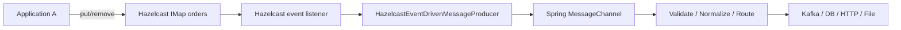
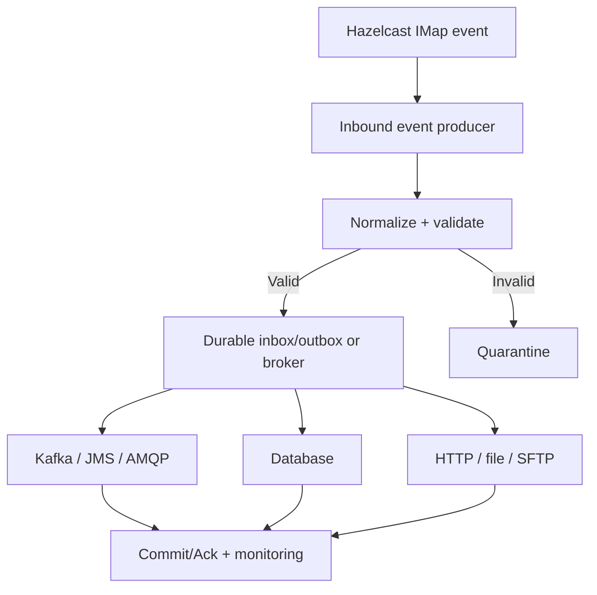

# Hazelcast inbound channel adapter

## 1. Giới thiệu: nhận sự kiện phân tán vào Spring Integration

Trong module **SPRING_INTEGRATION_ADAPTERS**, Spring Integration kết nối các hệ thống ngoài bằng inbound/outbound adapter, gateway, poller và `MessageChannel`. Người học thực hành các luồng qua file, SFTP, HTTP, JMS, AMQP, Kafka và cơ sở dữ liệu; đồng thời phải hiểu **hợp đồng message, xử lý lỗi và vòng đời kết nối**. Trong chương **Adapter Cloud**, Hazelcast inbound channel adapter là một ví dụ của việc đưa dữ liệu/sự kiện từ một cụm distributed in-memory data grid vào Spring Integration để xử lý hoặc chuyển tiếp.

**Hazelcast** cung cấp các distributed objects như `IMap`, `MultiMap`, `IList`, `ISet`, `IQueue`, `ITopic` và `ReplicatedMap`. Một instance khác trong cụm có thể sửa dữ liệu map hoặc publish lên topic. Thông qua **Hazelcast inbound channel adapter**, ứng dụng Spring Integration có thể lắng nghe biến động và phát sinh `Message<?>` lên kênh nội bộ.

Ví dụ nghiệp vụ:

1. Một dịch vụ cập nhật trạng thái đơn hàng trong Hazelcast `IMap`.
2. Listener được đăng ký bởi `HazelcastEventDrivenMessageProducer` nhận event tương ứng.
3. Inbound adapter tạo Spring Integration message mang payload và metadata sự kiện.
4. Message đi vào `MessageChannel`.
5. Các bước downstream validate, transform, route, rồi chuyển sang Kafka/JMS/AMQP, database, HTTP hoặc file/SFTP khi cần.



**Điểm quan trọng:** inbound adapter nhận **sự kiện từ Hazelcast**, chứ không biến cache thành một message broker có retention và replay giống Kafka. Nếu một callback bị mất, một node disconnect hoặc downstream crash, không thể mặc định adapter sẽ phát lại toàn bộ lịch sử đã bỏ lỡ.

### Bạn sẽ học được gì?

- Phân biệt Hazelcast distributed object, event listener và Spring `MessageChannel`.
- Nhận biết các dạng **event-driven**, **continuous query**, **cluster monitor** và **distributed SQL polling**.
- Sử dụng `spring-integration-hazelcast`, XML namespace và Java configuration.
- Cấu hình `HazelcastEventDrivenMessageProducer` cho `IMap` với `ADDED`, `UPDATED`, `REMOVED`.
- Hiểu `cache-listening-policy="SINGLE"` và `"ALL"`, tránh giả định exactly-once.
- Đọc `HazelcastHeaders`, kiểm tra payload và chuẩn hóa event trước khi dùng.
- Kiểm thử một flow từ `IMap.put(...)` tới inbound `QueueChannel`.
- Xử lý backpressure, serialization, security, monitoring, lỗi và vòng đời Hazelcast cluster.
- Phân biệt **lắng nghe sự kiện của `IQueue`** với **thực sự lấy phần tử `IQueue.poll()`**.

## 2. Mô hình: Hazelcast event → Spring Integration message

### 2.1. Phía Hazelcast

Một `HazelcastInstance` tham gia hoặc kết nối đến cluster. Các distributed objects cung cấp API:

| Hazelcast object | Chức năng chính | Biến động có thể lắng nghe |
|---|---|---|
| `IMap<K,V>` | Map phân tán key/value | Added, updated, removed, evicted, các sự kiện xóa toàn bộ theo support của adapter/version. |
| `MultiMap<K,V>` | Một key có nhiều values | Added, removed và những event map mà adapter hỗ trợ. |
| `ReplicatedMap<K,V>` | Map replicated | Added, updated, removed, evicted. |
| `IList<E>` | Danh sách phân tán | Item added/removed. |
| `ISet<E>` | Tập hợp phân tán | Item added/removed. |
| `IQueue<E>` | Queue phân tán | Item added/removed; listener **chỉ nhận notification**, không mặc nhiên lấy payload khỏi queue như consumer. |
| `ITopic<E>` | Pub/sub topic | Message published; không có cache-events `ADDED/UPDATED` như map. |

Adapter dùng các listener Hazelcast tương ứng, ví dụ `EntryListener`, `ItemListener` và `MessageListener`. Nó không cần poll một `IMap` theo khoảng thời gian cố định để phát hiện thay đổi khi đang dùng **event-driven inbound**.

### 2.2. Phía Spring Integration

```text
Hazelcast entry event
    -> Hazelcast listener callback
    -> HazelcastEventDrivenMessageProducer
    -> Spring Message<?> {
         payload: event-specific data,
         headers: Hazelcast metadata + framework metadata
       }
    -> MessageChannel
    -> ServiceActivator / Filter / Router / Transformer
```

**`MessageChannel` là ranh giới tích hợp**. Nó giúp tách adapter khỏi phần xử lý nghiệp vụ:

- `DirectChannel`: subscriber được dispatch đồng bộ với caller của channel.
- `ExecutorChannel`: subscriber chạy qua executor thread pool, có giới hạn concurrency/queue tùy cấu hình.
- `QueueChannel`: message được đặt trong queue để poller hoặc test tiêu thụ sau.
- `PublishSubscribeChannel`: phát message đến nhiều subscribers khi yêu cầu broadcast rõ ràng.

**Event-driven Hazelcast inbound adapter không tự cần Spring poller**. Chỉ khi lựa chọn `QueueChannel` có consumer bằng poller, hoặc dùng **Distributed SQL inbound adapter** vốn là polling, lịch poll mới trở nên quan trọng.

### 2.3. Vì sao đặt ở chương Adapter Cloud?

Hazelcast có thể chạy embedded, trong cluster riêng, Kubernetes hoặc managed/cloud deployment. Adapter giúp Spring Integration quan sát dữ liệu và biến động **qua boundary Hazelcast**, nhưng nó **không tự kết nối tới mọi cloud provider**. Connection, cluster discovery, authentication, TLS, serialization và network routing phải được cấu hình theo triển khai Hazelcast thực tế.

## 3. Bốn nhóm inbound adapter liên quan đến Hazelcast

Spring Integration cung cấp những thành phần inbound sau; chúng có mục đích khác nhau:

| Nhóm | Class/namespace | Kích hoạt bởi | Đầu vào |
|---|---|---|---|
| **Event-driven** | `HazelcastEventDrivenMessageProducer` / `<int-hazelcast:inbound-channel-adapter>` | Entry/item/topic event | `IMap`, `MultiMap`, `ReplicatedMap`, `IList`, `ISet`, `IQueue`, `ITopic`. |
| **Continuous Query** | `HazelcastContinuousQueryMessageProducer` / `<int-hazelcast:cq-inbound-channel-adapter>` | Entry event khớp predicate | `IMap` với query predicate. |
| **Cluster Monitor** | `HazelcastClusterMonitorMessageProducer` / `<int-hazelcast:cm-inbound-channel-adapter>` | Membership, object, migration, lifecycle, client event | `HazelcastInstance` và cluster events. |
| **Distributed SQL** | `HazelcastDistributedSQLMessageSource` / `<int-hazelcast:ds-inbound-channel-adapter>` | Spring poller | Truy vấn dữ liệu `IMap` theo `distributed-sql`, trả một tập kết quả mỗi poll. |

**Không đánh đồng** ba nhóm event-driven với Distributed SQL polling:

- Event-driven: một sự kiện xảy ra thì callback được gọi nếu listener đang hoạt động và nhận được event.
- Continuous Query: quan sát thay đổi thỏa predicate, không đồng nghĩa truy vấn toàn map sau mỗi lần poll.
- Cluster Monitor: thông báo quản trị cụm, không phải bản ghi giao dịch nghiệp vụ.
- Distributed SQL polling: định kỳ đọc trạng thái map; nếu state không đổi, poll sau vẫn có thể trả kết quả tương tự. Không có change-offset/ack mặc định như một event log.

Trong bài này, **ví dụ chính là event-driven `IMap`**. Các nhóm khác được giới thiệu ở phần 9–11 như những biến thể cùng chủ đề.

## 4. Event types và cache-listening-policy

### 4.1. Chọn sự kiện đúng distributed object

Theo tài liệu Spring Integration, `cache-events` của event-driven adapter là danh sách các event cần lắng nghe; mặc định là `ADDED`.

| Distributed object | Cache events được hỗ trợ bởi adapter |
|---|---|
| `IMap` / `MultiMap` | `ADDED`, `REMOVED`, `UPDATED`, `EVICTED`, `EVICT_ALL`, `CLEAR_ALL`. |
| `ReplicatedMap` | `ADDED`, `REMOVED`, `UPDATED`, `EVICTED`. |
| `IList` / `ISet` / `IQueue` | `ADDED`, `REMOVED`. |
| `ITopic` | Không cấu hình cache event types; dùng topic message listener. |

Ví dụ:

```xml
<int-hazelcast:inbound-channel-adapter
    channel="orderEvents"
    cache="ordersMap"
    cache-events="ADDED, UPDATED, REMOVED"/>
```

Không khai báo `UPDATED` cho `IQueue` hoặc mặc định rằng mọi map đều có event `CLEAR_ALL` với cùng semantics. Version Hazelcast và Spring Integration được dùng phải tương thích.

**ADDED** là entry mới, **UPDATED** là entry được cập nhật, **REMOVED** là entry bị xóa theo thao tác tương ứng. `EVICTED` khác `REMOVED`: eviction có thể do memory/TTL policy. Khi nhận một event, người xử lý phải đọc **event type** trước khi diễn giải `value`/`oldValue`; một số loại event không có đủ cả hai giá trị.

### 4.2. `SINGLE` và `ALL`

`cache-listening-policy` có hai giá trị:

| Policy | Ý nghĩa trong Spring Integration Hazelcast | Khi phù hợp |
|---|---|---|
| `SINGLE` | Mặc định; cơ chế lọc/cung cấp các event giữa adapters trên cùng distributed object theo chính sách “unique/local” của Spring Integration. | Khi muốn giảm nhân bản xử lý giữa các adapters. |
| `ALL` | Các Hazelcast inbound adapters lắng nghe cùng object/event có thể đều nhận thông báo. | Khi cần fan-out/broadcast tới nhiều ứng dụng/instances. |

Tài liệu Spring Integration mô tả `ALL` cho phép tất cả adapters phù hợp nhận sự kiện và `SINGLE` hướng tới từng event unique. Tuy nhiên, đây **không phải cam kết exactly-once end-to-end** hay một consumer group bền vững như Kafka:

- Khi process restart, có thể bỏ lỡ callback trong khoảng offline.
- Với partition migration/rebalance, cần test lại event distribution.
- Hai listeners không đồng nghĩa hai transactional subscribers với ack độc lập.
- Nếu cùng event được downstream retry/replay, duplicate vẫn có thể xuất hiện.
- Các điều kiện về **local node vs member/client** và phiên bản Hazelcast ảnh hưởng đến cách policy hoạt động.

**Quy tắc:** nếu yêu cầu xử lý mỗi biến động một lần với dữ liệu quan trọng, hãy thiết kế idempotency, durable log/outbox và recovery, không chỉ đặt `cache-listening-policy="SINGLE"`.

### 4.3. Khi nào dùng ALL?

Trong một lab chỉ có một Hazelcast member và một inbound adapter, `ALL` giúp thể hiện ý tưởng listener nhận các event mà không phụ thuộc vào cấu hình phân phối nhiều adapter. Trong production nhiều instances, nó có thể khiến **cùng một event được mỗi instance xử lý**, đặc biệt nếu tất cả cùng ghi Kafka/DB.

Vì vậy khi bật `ALL` trên nhiều replicas cần:

1. Xác định thật sự muốn fan-out.
2. Có idempotency/partition key nếu cần.
3. Đo duplicate ratio và traffic.
4. Tránh nhiều cảnh báo giống hệt nhau từ nhiều instances.
5. Test cluster membership và adapter restarts.

## 5. Payload và Hazelcast headers

### 5.1. Không giả định payload luôn là value của map

Một Hazelcast `IMap` entry event có thể tạo payload theo kiểu:

```java
org.springframework.integration.hazelcast.message.EntryEventMessagePayload<K, V>
```

Kiểu này biểu diễn ba trường logic:

- `key`: khóa entry.
- `value`: giá trị mới hoặc giá trị hiện tại nếu event cung cấp.
- `oldValue`: giá trị trước đó nếu event cung cấp.

Tùy **phiên bản Spring Integration**, class có thể thể hiện fields/accessors khác nhau; bản API hiện hành mô tả nó như record, còn API cũ từng thể hiện fields. Không nên ép kiểu mọi payload thành `String` hoặc `Map` khi thực tế adapter đang gửi event payload.

Với item/topic/cluster monitor, payload type có thể **khác** entry event. Ứng dụng nên viết một bước normalize theo **loại distributed object + event type**, không đưa trực tiếp một Java framework object ra Kafka/HTTP nếu chưa có schema.

### 5.2. Dùng hằng `HazelcastHeaders`

Spring Integration định nghĩa những headers hữu ích:

```java
import org.springframework.integration.hazelcast.HazelcastHeaders;
import org.springframework.messaging.Message;

public final class HazelcastEventInspector {

    public static void inspect(Message<?> message) {
        Object eventType = message.getHeaders()
            .get(HazelcastHeaders.EVENT_TYPE);

        Object cacheName = message.getHeaders()
            .get(HazelcastHeaders.CACHE_NAME);

        Object member = message.getHeaders()
            .get(HazelcastHeaders.MEMBER);

        Object publishingTime = message.getHeaders()
            .get(HazelcastHeaders.PUBLISHING_TIME);

        // Không log raw payload hoặc toàn bộ headers mặc định.
        System.out.println("cache=" + cacheName
            + ", eventType=" + eventType
            + ", hasMember=" + (member != null)
            + ", hasPublishingTime=" + (publishingTime != null));
    }
}
```

Các hằng biểu diễn tên metadata framework, không phải tên khóa tùy ý của user map:

| Header | Mục đích |
|---|---|
| `HazelcastHeaders.CACHE_NAME` | Distributed object/cache name liên quan. |
| `HazelcastHeaders.EVENT_TYPE` | Loại sự kiện. |
| `HazelcastHeaders.MEMBER` | Thông tin member khi event có cung cấp. |
| `HazelcastHeaders.PUBLISHING_TIME` | Thời điểm publish khi event có cung cấp. |

**Không giả định tất cả bốn header đều có mặt hoặc cùng kiểu ở mọi loại event.** Event item/topic/member có contract riêng; hãy kiểm tra thực tế bằng unit/integration test cho loại inbound adapter và version cụ thể.

### 5.3. Chuẩn hóa thành DTO nghiệp vụ

Một hệ thống production có thể định nghĩa:

```java
package example.hazelcast;

import java.time.Instant;

public record OrderChange(
    String eventId,
    String mapName,
    String orderId,
    String eventType,
    String previousStatus,
    String currentStatus,
    Instant receivedAt
) {}
```

Khi tạo DTO:

- Chỉ nhận `orderId` thuộc domain đã định nghĩa.
- Xác minh eventType nằm trong allowlist `ADDED/UPDATED/REMOVED`.
- Cho phép `previousStatus`/`currentStatus` là null khi event không cung cấp.
- Phân biệt `receivedAt` với thời điểm update tại Hazelcast.
- `eventId` do consumer tạo **không tự giúp deduplicate** cùng biến động được replay sau restart.
- Không chuyển các Java object `Member`, `EntryEvent` hoặc toàn bộ `MessageHeaders` ra broker theo mặc định.

## 6. Lab JavaConfig: IMap → HazelcastEventDrivenMessageProducer → QueueChannel

Lab này sử dụng:

- Java 17+.
- Spring Boot và Spring Integration/Hazelcast phiên bản tương thích; API ví dụ dựa trên Spring Integration Hazelcast support hiện đại.
- Một **embedded Hazelcast member** riêng cho môi trường học tập.
- `IMap<String,String>` tên `orders`.
- Event-driven producer lắng nghe `ADDED`, `UPDATED`, `REMOVED`.
- Một `QueueChannel` hữu hạn để test đọc event bằng `receive(timeout)`.

**Lưu ý an toàn:** không khởi động embedded member với mặc định discovery/port trong production mà chưa có network và cluster policy. Lab chỉ mô tả cơ chế, không cấu hình cloud managed Hazelcast thực tế.

### 6.1. Maven dependencies

Khi ứng dụng đã có Spring Boot dependency management tương thích:

```xml
<dependencies>
    <dependency>
        <groupId>org.springframework.boot</groupId>
        <artifactId>spring-boot-starter-integration</artifactId>
    </dependency>

    <dependency>
        <groupId>org.springframework.integration</groupId>
        <artifactId>spring-integration-hazelcast</artifactId>
    </dependency>

    <dependency>
        <groupId>org.springframework.boot</groupId>
        <artifactId>spring-boot-starter-test</artifactId>
        <scope>test</scope>
    </dependency>
</dependencies>
```

`spring-integration-hazelcast` là **module riêng**; không mặc định đi kèm chỉ vì có `spring-boot-starter-integration`. Hazelcast core/related dependencies được quản lý theo bộ phiên bản tương thích; khi BOM không quản lý module này, hãy pin phiên bản Spring Integration Hazelcast khớp với các module còn lại.

**Không pha tùy tiện Spring Boot 3 / Spring Integration 6 với Boot 4 / Integration 7.** Đặc biệt, ký hiệu class/record và baseline Java của thư viện có thể thay đổi giữa release lines. Mã bài thực hành cần được compile/test lại theo BOM chính thức của ứng dụng khi áp dụng.

### 6.2. Main application

File `HazelcastInboundApplication.java`:

```java
package example.hazelcast;

import org.springframework.boot.SpringApplication;
import org.springframework.boot.autoconfigure.SpringBootApplication;
import org.springframework.integration.annotation.EnableIntegration;

@SpringBootApplication
@EnableIntegration
public class HazelcastInboundApplication {

    public static void main(String[] args) {
        SpringApplication.run(HazelcastInboundApplication.class, args);
    }
}
```

`@EnableIntegration` bật thành phần cấu hình Spring Integration; Spring Boot integration starter cũng cung cấp auto-configuration liên quan. Chúng ta không tạo HTTP controller trong lab: event xuất phát từ Hazelcast `IMap`.

### 6.3. HazelcastInstance và IMap

File `HazelcastLabConfiguration.java`:

```java
package example.hazelcast;

import com.hazelcast.config.Config;
import com.hazelcast.core.Hazelcast;
import com.hazelcast.core.HazelcastInstance;
import com.hazelcast.map.IMap;

import org.springframework.context.annotation.Bean;
import org.springframework.context.annotation.Configuration;

@Configuration
public class HazelcastLabConfiguration {

    @Bean(destroyMethod = "shutdown")
    public HazelcastInstance hazelcastInstance() {
        Config config = new Config();

        // Tên cụm LAB để tránh vô tình join nhóm khác.
        config.setClusterName("si-hazelcast-lab");

        // Chỉ phục vụ lab: không tự discovery bằng multicast.
        config.getNetworkConfig()
            .getJoin()
            .getMulticastConfig()
            .setEnabled(false);

        config.getNetworkConfig()
            .getJoin()
            .getTcpIpConfig()
            .setEnabled(false);

        // Đây là embedded member, KHÔNG phải cloud client.
        return Hazelcast.newHazelcastInstance(config);
    }

    @Bean("ordersMap")
    public IMap<String, String> ordersMap(
            HazelcastInstance hazelcastInstance) {
        return hazelcastInstance.getMap("orders");
    }
}
```

Đây là **minimal lab**. Hazelcast 5 có nhiều discovery settings khác (ví dụ cloud/Kubernetes/TCP-IP/auto-detection) phải kiểm tra theo version và môi trường; tắt multicast/TCP-IP ở lab **không phải một hardening recipe production**. Khi học với nhiều nodes, cần cấu hình cluster discovery đúng; không tạo hai cụm tình cờ cùng tên.

Khi dùng Hazelcast Cloud/managed service, nên tạo **Hazelcast client** theo hướng dẫn provider:

- Cluster name + endpoints do provider cấp.
- Authentication/credentials và TLS đúng.
- Retry/connect timeout/reconnect behavior có giới hạn.
- Network/firewall/IP allowlist và least privilege.
- Không hardcode secret vào source code.

**Một Spring `IMap` bean không tự đảm bảo instance đã join đúng cluster**. Readiness cần xác nhận cluster membership/connection ổn định.

### 6.4. QueueChannel hữu hạn cho test

File `HazelcastInboundChannels.java`:

```java
package example.hazelcast;

import org.springframework.context.annotation.Bean;
import org.springframework.context.annotation.Configuration;
import org.springframework.integration.channel.QueueChannel;
import org.springframework.messaging.PollableChannel;

@Configuration
public class HazelcastInboundChannels {

    @Bean("hzOrderEvents")
    public PollableChannel hzOrderEvents() {
        // Bộ đệm message trong JVM, bounded, dùng cho lab.
        return new QueueChannel(128);
    }
}
```

Ta chọn `QueueChannel(128)` để test có thể gọi `receive(...)` và kiểm tra message. Lưu ý:

- Queue **trong JVM**, không bền vững khi process chết.
- Nếu queue đầy, callback Hazelcast có thể bị block, lỗi hoặc gặp áp lực tài nguyên tùy đường send/timeout; không xem queue này là bảo đảm chống mất event.
- Trong production, muốn xử lý liên tục, cần một consumer/poller riêng hoặc dùng `DirectChannel`/`ExecutorChannel` với design rõ ràng.
- Đối với tải lớn, không tăng queue capacity vô hạn vì memory/latency/GC pressure.

### 6.5. Event-driven inbound producer

File `HazelcastOrderEventConfiguration.java`:

```java
package example.hazelcast;

import com.hazelcast.map.IMap;

import org.springframework.beans.factory.annotation.Qualifier;
import org.springframework.context.annotation.Bean;
import org.springframework.context.annotation.Configuration;
import org.springframework.integration.hazelcast.CacheListeningPolicyType;
import org.springframework.integration.hazelcast.inbound.HazelcastEventDrivenMessageProducer;
import org.springframework.messaging.MessageChannel;

@Configuration
public class HazelcastOrderEventConfiguration {

    @Bean
    public HazelcastEventDrivenMessageProducer orderEventProducer(
            @Qualifier("ordersMap") IMap<String, String> ordersMap,
            @Qualifier("hzOrderEvents") MessageChannel channel) {

        HazelcastEventDrivenMessageProducer producer =
            new HazelcastEventDrivenMessageProducer(ordersMap);

        producer.setOutputChannel(channel);
        producer.setCacheEventTypes("ADDED,UPDATED,REMOVED");

        // ALL cho lab với một adapter; trong multi-node
        // phải hiểu fan-out và rủi ro duplicate.
        producer.setCacheListeningPolicy(
            CacheListeningPolicyType.ALL);

        return producer;
    }
}
```

**Các điểm cần nhớ:**

1. Constructor nhận distributed object reference: ở đây `ordersMap` là `IMap`.
2. `setOutputChannel(...)` chỉ định Spring Integration channel nhận events.
3. `setCacheEventTypes(...)` chọn danh sách cần theo dõi. Nếu không đặt, default của event-driven adapter là `ADDED`.
4. `setCacheListeningPolicy(...)` ảnh hưởng cách adapters lắng nghe/nhận events; nó không tạo message acknowledgment hay transaction.
5. Bean thuộc Spring context và có lifecycle listener. Nếu tự khởi tạo producer bằng `new` ngoài container mà không initialize/start, nó không tự trở thành endpoint đang chạy.
6. `IMap.put(...)` có thể tạo `ADDED` hoặc `UPDATED` tùy key đã tồn tại và thao tác; `IMap.remove(...)` có thể tạo `REMOVED`.
7. **Không cần `@Poller`** để Hazelcast event-driven producer nhận callback.

### 6.6. Ví dụ ghi dữ liệu vào IMap

File `OrderStateWriter.java`:

```java
package example.hazelcast;

import com.hazelcast.map.IMap;
import org.springframework.beans.factory.annotation.Qualifier;
import org.springframework.stereotype.Service;

@Service
public class OrderStateWriter {

    private final IMap<String, String> ordersMap;

    public OrderStateWriter(
            @Qualifier("ordersMap") IMap<String, String> ordersMap) {
        this.ordersMap = ordersMap;
    }

    public void demo() {
        ordersMap.put("order-42", "CREATED");
        ordersMap.put("order-42", "PAID");
        ordersMap.remove("order-42");
    }
}
```

Thao tác `put/remove` diễn ra trên Hazelcast distributed map. Inbound adapter **không nhận request HTTP** và không phải chính nó ghi vào map: nó chỉ **lắng nghe những thay đổi** do writer/ứng dụng khác tạo.

Khi test với cùng một map name, cần tránh dữ liệu còn lại từ lần chạy trước khiến `put` đầu tiên trở thành `UPDATED` thay vì `ADDED`.

## 7. Kiểm thử end-to-end bằng QueueChannel

### 7.1. Integration test nhận sự kiện

File `HazelcastInboundTest.java`:

```java
package example.hazelcast;

import static org.junit.jupiter.api.Assertions.*;

import com.hazelcast.map.IMap;
import java.util.UUID;

import org.junit.jupiter.api.Test;
import org.springframework.beans.factory.annotation.Autowired;
import org.springframework.beans.factory.annotation.Qualifier;
import org.springframework.boot.test.context.SpringBootTest;
import org.springframework.integration.hazelcast.HazelcastHeaders;
import org.springframework.integration.hazelcast.message.EntryEventMessagePayload;
import org.springframework.messaging.Message;
import org.springframework.messaging.PollableChannel;

@SpringBootTest
class HazelcastInboundTest {

    @Autowired
    @Qualifier("ordersMap")
    IMap<String, String> ordersMap;

    @Autowired
    @Qualifier("hzOrderEvents")
    PollableChannel events;

    @Test
    void receivesMapMutationAsSpringMessage() {
        String key = "order-" + UUID.randomUUID();

        ordersMap.put(key, "CREATED");

        Message<?> message = events.receive(5_000);

        assertNotNull(message);
        assertInstanceOf(
            EntryEventMessagePayload.class,
            message.getPayload());

        assertNotNull(message.getHeaders()
            .get(HazelcastHeaders.EVENT_TYPE));

        assertEquals("orders", message.getHeaders()
            .get(HazelcastHeaders.CACHE_NAME));

        // Với version API hỗ trợ record accessors,
        // có thể kiểm tra payload.key()/value().
        // Test contract theo version trước khi dùng.
    }

    @Test
    void receivesUpdateAndRemove() {
        String key = "order-" + UUID.randomUUID();

        ordersMap.put(key, "CREATED");
        assertNotNull(events.receive(5_000));

        ordersMap.put(key, "PAID");
        Message<?> updated = events.receive(5_000);
        assertNotNull(updated);

        ordersMap.remove(key);
        Message<?> removed = events.receive(5_000);
        assertNotNull(removed);

        // Kiểm tra EVENT_TYPE bằng loại/chuỗi thực tế
        // của phiên bản đang dùng, thay vì giả định
        // mọi implementation trả một String hằng.
    }
}
```

Test này giả định một ứng dụng test đơn lập, một producer, một channel và **không có poller consumer khác tranh message**. Khi chạy test song song hoặc chung Hazelcast cluster, có thể có events chen vào; để test deterministic cần:

- Cụm riêng và map name riêng.
- Không dùng data của test trước.
- Assert theo **event key/correlation**, bỏ qua event không liên quan bằng một bộ thu có timeout hữu hạn.
- Chờ listener được đăng ký và ready trước khi publish.
- Cấu hình profile test với discovery cách ly.
- Dọn tài nguyên sau test; không dùng `Hazelcast.shutdownAll()` bừa bãi nếu JVM có cluster clients khác.

**Không coi test này là bằng chứng event delivery tuyệt đối.** Nó chứng minh cấu hình lab có thể nhận event khi adapter hoạt động bình thường, chưa kiểm thử crash/network partition/durable replay.

### 7.2. Payload/key/value trong phiên bản mới

Trong các API Spring Integration mới, `EntryEventMessagePayload<K,V>` mô tả dạng record có:

```java
// Đọc theo API record của phiên bản hiện hành tương ứng.
if (message.getPayload() instanceof
        EntryEventMessagePayload<?, ?> entry) {

    Object key = entry.key();
    Object currentValue = entry.value();
    Object previousValue = entry.oldValue();

    // Có thể null: event remove/evict hoặc config event fields.
}
```

**Tương thích phiên bản:** ở các release cũ, class `EntryEventMessagePayload` từng có các public fields thay vì record methods. Đừng sao chép code `entry.key()` sang line cũ mà không kiểm tra Javadoc/version dependency. Nếu cần ứng dụng hỗ trợ nhiều version, normalize qua một adapter layer có test riêng thay vì reflection tùy tiện trong flow nghiệp vụ.

### 7.3. Kiểm thử đúng thao tác và thứ tự

Một chuỗi:

```text
put("order-42", "CREATED")
put("order-42", "PAID")
remove("order-42")
```

**Có thể** sinh `ADDED`, `UPDATED`, `REMOVED`. Tuy nhiên:

- Test có thể bị sai nếu key đã tồn tại.
- Event callback có thể chạy ở thread khác và được enqueue sau khi `put` return.
- Trong cluster nhiều member/partitions, không nên giả định thứ tự hoàn tất toàn cục cho mọi keys.
- Khi `ALL` và có nhiều listeners, có thể có nhiều copies ở nhiều ứng dụng.
- Mọi test dùng shared queue không có guard filter key cần cô lập dữ liệu.

**Thiết kế test nên xác minh key, event type và payload theo contract thực**, chứ không dựa chỉ vào `receive(...) != null` nếu có nhiều event sources.

## 8. Xử lý message trong flow thực tế

Trong lab, `QueueChannel` được test trực tiếp. Trong production, thường cần một consumer đọc queue rồi chuyển thành event domain.

### 8.1. Polling consumer trên QueueChannel

Đây là **phần mở rộng thay thế việc test trực tiếp bằng `receive()`**. Khi bật consumer sau, đừng trông đợi test ở mục 7 vẫn lấy mọi message vì consumer sẽ cạnh tranh đọc cùng queue.

```java
package example.hazelcast;

import org.slf4j.Logger;
import org.slf4j.LoggerFactory;
import org.springframework.integration.annotation.Poller;
import org.springframework.integration.annotation.ServiceActivator;
import org.springframework.integration.hazelcast.HazelcastHeaders;
import org.springframework.messaging.Message;
import org.springframework.stereotype.Component;

@Component
public class HazelcastOrderEventConsumer {

    private static final Logger log =
        LoggerFactory.getLogger(HazelcastOrderEventConsumer.class);

    @ServiceActivator(
        inputChannel = "hzOrderEvents",
        poller = @Poller(
            fixedDelay = "200",
            maxMessagesPerPoll = "10"))
    public void onEvent(Message<?> message) {
        Object eventType = message.getHeaders()
            .get(HazelcastHeaders.EVENT_TYPE);

        Object cache = message.getHeaders()
            .get(HazelcastHeaders.CACHE_NAME);

        // Chỉ log metadata do hệ thống định nghĩa,
        // không in raw payload/oldValue/Member.
        log.info("Hazelcast event: cache={}, type={}",
            cache, eventType);

        // 1. Validate event payload type/key/value.
        // 2. Normalize thành OrderChange.
        // 3. Persist/publish theo transaction và ack policy.
    }
}
```

**Hai loại polling khác nhau:**

- Producer Hazelcast event-driven **không poll map**.
- `@ServiceActivator` trên `QueueChannel` **poll queue message nội bộ** để lấy events đã được producer push.

Nếu handler chậm, queue có thể đầy, gây áp lực lên listener callback. `fixedDelay` và `maxMessagesPerPoll` không thể vượt bottleneck DB/Kafka một cách thần kỳ.

### 8.2. Dùng DirectChannel hay ExecutorChannel?

| Lựa chọn | Ưu điểm | Rủi ro |
|---|---|---|
| `DirectChannel` | Ít overhead, dễ theo dõi exception đồng bộ | Subscriber chậm giữ callback thread, ảnh hưởng Hazelcast event dispatch. |
| `ExecutorChannel` + bounded pool | Offload xử lý I/O blocking khỏi callback | Queue/rejection và mất task khi crash; event completion không theo thứ tự. |
| `QueueChannel` + poller | Có buffer message hữu hạn và tốc độ kéo rõ | Queue trong JVM không durable; poller phải được cấu hình/recovery. |
| Durable queue/broker | Replay, DLQ và ack theo contract | Phải cấu hình persistence/retry/idempotency/retention. |

Đừng dùng `CallerRunsPolicy` mà không xét tác động: khi executor đầy, chạy handler DB/HTTP trên Hazelcast callback thread có thể làm chậm cơ chế phân phối event. `DiscardPolicy` có thể làm mất task âm thầm. Dùng bounded pool/queue, alert và đường khôi phục rõ ràng.

### 8.3. Message flow sang Kafka hoặc database

Một sơ đồ production:



**Không đồng nhất Hazelcast map event với một committed business event**. Nếu business cần audit đầy đủ mọi trạng thái, nên tạo domain event hoặc outbox **trong transaction của hệ thống nguồn**, rồi phát tới broker có retention/ack. Listener cache là kênh hữu ích cho **projection, invalidation, notification**, nhưng thiếu nhiều bảo đảm của event log bền vững.

## 9. Cấu hình XML của event-driven inbound adapter

Nếu dự án sử dụng Spring Integration XML namespace, có thể khai báo thay Java `HazelcastEventDrivenMessageProducer` bean.

File `src/main/resources/hazelcast-inbound.xml` minh họa:

```xml
<?xml version="1.0" encoding="UTF-8"?>
<beans xmlns="http://www.springframework.org/schema/beans"
       xmlns:xsi="http://www.w3.org/2001/XMLSchema-instance"
       xmlns:int="http://www.springframework.org/schema/integration"
       xmlns:int-hazelcast="http://www.springframework.org/schema/integration/hazelcast"
       xsi:schemaLocation="
         http://www.springframework.org/schema/beans
         https://www.springframework.org/schema/beans/spring-beans.xsd
         http://www.springframework.org/schema/integration
         https://www.springframework.org/schema/integration/spring-integration.xsd
         http://www.springframework.org/schema/integration/hazelcast
         https://www.springframework.org/schema/integration/hazelcast/spring-integration-hazelcast.xsd">

    <int:channel id="orderEvents">
        <int:queue capacity="128"/>
    </int:channel>

    <int-hazelcast:inbound-channel-adapter
        channel="orderEvents"
        cache="ordersMap"
        cache-events="ADDED, UPDATED, REMOVED"
        cache-listening-policy="ALL"/>

    <bean id="hazelcastInstance"
          class="com.hazelcast.core.Hazelcast"
          factory-method="newHazelcastInstance"/>

    <bean id="ordersMap"
          factory-bean="hazelcastInstance"
          factory-method="getMap">
        <constructor-arg value="orders"/>
    </bean>
</beans>
```

**Chú ý:**

1. `cache="ordersMap"` trỏ tới **bean distributed object**, không phải URI, map name string tùy ý hay hostname.
2. `channel="orderEvents"` trỏ tới Spring Integration channel.
3. `cache-events` và `cache-listening-policy` được namespace parser thiết lập cho producer.
4. `<int:queue capacity="128"/>` tạo bounded `QueueChannel`. Nếu có consumer, cần `poller` tương ứng; XML này chỉ minh họa ingress.
5. `Hazelcast.newHazelcastInstance()` theo mặc định có thể tham gia discovery/config theo environment. **Chỉ dùng đoạn đó trong lab cô lập**; production phải tạo instance/client bean theo cluster/network/TLS policy đã kiểm soát.
6. Nếu dùng JavaConfig ở mục 6, **không nạp đồng thời XML này** với bean `ordersMap`/producer tương tự, vì sẽ tạo duplicate bean hoặc duplicate listener.

### 9.1. Nạp XML khi chọn cấu hình XML

```java
package example.hazelcast;

import org.springframework.boot.SpringApplication;
import org.springframework.boot.autoconfigure.SpringBootApplication;
import org.springframework.context.annotation.ImportResource;
import org.springframework.integration.annotation.EnableIntegration;

@SpringBootApplication
@EnableIntegration
@ImportResource("classpath:hazelcast-inbound.xml")
public class HazelcastXmlApplication {

    public static void main(String[] args) {
        SpringApplication.run(HazelcastXmlApplication.class, args);
    }
}
```

Đây là **phương án khác** với `HazelcastInboundApplication`/JavaConfig, không phải bổ sung tất cả vào cùng package để Spring scan vô điều kiện. Việc quản lý `HazelcastInstance.shutdown()` trong XML/Java context cũng cần được kiểm tra để tránh cluster member/client rò rỉ sau test.

## 10. Continuous Query inbound: chỉ lắng nghe entry khớp predicate

Giả sử map `customers` có những entries mà chỉ một subset cần xử lý. Thay vì nhận mọi event rồi filter ở Spring, **Hazelcast Continuous Query inbound** cho phép lắng nghe các thay đổi theo một predicate.

### 10.1. XML fragment

```xml
<int:channel id="activeCustomerEvents"/>

<int-hazelcast:cq-inbound-channel-adapter
    channel="activeCustomerEvents"
    cache="customersMap"
    cache-events="UPDATED, REMOVED"
    predicate="status = 'ACTIVE'"
    include-value="true"
    cache-listening-policy="SINGLE"/>
```

Các thuộc tính:

| Attribute | Ý nghĩa |
|---|---|
| `cache` | `IMap` bean cần theo dõi. |
| `predicate` | Predicate truy vấn/map-entry filter, bắt buộc. |
| `cache-events` | Loại event cần nhận; mặc định `ADDED`. |
| `include-value` | Có lấy `value` và `oldValue` vào kết quả hay không; mặc định `true`. |
| `cache-listening-policy` | `SINGLE` hoặc `ALL`. |
| `channel` | Output Spring channel. |

**Không giả định cú pháp predicate bất kỳ đều được phép.** Syntax/field indexing và behavior khi cập nhật một entry chuyển từ “khớp” sang “không khớp” cần test theo Hazelcast version. Predicate ở đây là ví dụ học thuật, phụ thuộc object schema được lưu trong map.

### 10.2. JavaConfig fragment

```java
import com.hazelcast.map.IMap;
import org.springframework.integration.hazelcast.inbound.HazelcastContinuousQueryMessageProducer;

// Thay thế event-driven producer nếu cần filtered events.
HazelcastContinuousQueryMessageProducer producer =
    new HazelcastContinuousQueryMessageProducer(
        customersMap, "status = 'ACTIVE'");

producer.setOutputChannel(activeCustomerEvents);
producer.setCacheEventTypes("UPDATED,REMOVED");
producer.setIncludeValue(false);
```

Fragment giả định đã có `customersMap` và `activeCustomerEvents` beans. `setIncludeValue(false)` làm bớt dữ liệu trong event; **không** được viết handler yêu cầu `value/oldValue` luôn hiện diện khi đã tắt chúng. Nếu downstream cần đọc lại map theo key, phải chấp nhận race: entry có thể thay đổi giữa lúc nhận event và lúc `map.get(key)`.

### 10.3. CQ có thay thế transactional CDC không?

**Không.** Continuous Query cung cấp filtered events trên distributed map. Nó không tự là Change Data Capture với durable offset, snapshot/incremental sync, replay đầy đủ hoặc transaction log của database. Nếu muốn đồng bộ cơ sở dữ liệu chuẩn, cân nhắc CDC connector hoặc broker transactional log có semantics thích hợp, không chỉ listener theo predicate.

## 11. Cluster Monitor inbound: lắng nghe biến động của cụm

Hazelcast cluster có events không phải dữ liệu map:

- `MEMBERSHIP`: node join/leave.
- `DISTRIBUTED_OBJECT`: distributed objects được tạo/hủy.
- `MIGRATION`: phân bố partition thay đổi.
- `LIFECYCLE`: thay đổi trạng thái instance/cluster lifecycle.
- `CLIENT`: kết nối client theo khả năng hỗ trợ.

Một adapter cluster monitor dùng `HazelcastInstance` thay vì `IMap`:

```xml
<int:channel id="hzClusterEvents"/>

<int-hazelcast:cm-inbound-channel-adapter
    channel="hzClusterEvents"
    hazelcast-instance="hazelcastInstance"
    monitor-types="MEMBERSHIP, DISTRIBUTED_OBJECT"/>
```

JavaConfig tương đương về mặt ý tưởng:

```java
import com.hazelcast.core.HazelcastInstance;
import org.springframework.integration.hazelcast.inbound.HazelcastClusterMonitorMessageProducer;
import org.springframework.messaging.MessageChannel;

// Bên trong @Configuration, với HazelcastInstance và channel
// đã được inject:
HazelcastClusterMonitorMessageProducer producer =
    new HazelcastClusterMonitorMessageProducer(hazelcastInstance);

producer.setOutputChannel(hzClusterEvents);
producer.setMonitorEventTypes("MEMBERSHIP,DISTRIBUTED_OBJECT");
```

**Tách trách nhiệm:**

- Cluster monitor events là tín hiệu cho **vận hành, topology, health và capacity**.
- Map entry events là tín hiệu cho **nghiệp vụ**.
- Không dùng “một member rời cluster” làm bằng chứng tất cả operations trước đó đã rollback hoặc đã commit.
- Khi xảy ra partition split/merge, event stream có thể bị gián đoạn; cần trạng thái hiện tại và reconciliation.

Một Spring Integration flow có thể đưa cluster monitor messages đến alerting/metrics, nhưng phải chặn alert storm khi network flap; đừng gửi mỗi membership event thành một sự cố mới không dedup.

## 12. Distributed SQL inbound: polling, không phải event listener

**`HazelcastDistributedSQLMessageSource`** chạy truy vấn trên `IMap` theo lịch của Spring poller. Nó khác với các producer event-driven ở mục 6.

Ví dụ XML:

```xml
<int:channel id="pendingJobsSnapshot"/>

<int-hazelcast:ds-inbound-channel-adapter
    channel="pendingJobsSnapshot"
    cache="jobsMap"
    distributed-sql="status = 'PENDING'"
    iteration-type="ENTRY">
    <int:poller fixed-delay="1000"
                max-messages-per-poll="1"/>
</int-hazelcast:ds-inbound-channel-adapter>
```

Ý nghĩa:

- `distributed-sql` là điều kiện/truy vấn theo API được adapter hỗ trợ, không mặc định là toàn bộ SQL engine mới của Hazelcast.
- `iteration-type` chọn dạng kết quả: `ENTRY`, `KEY`, `LOCAL_KEY`, `VALUE` (mặc định `VALUE`).
- `<int:poller>` quyết định lịch gọi `MessageSource.receive()`.
- Nếu `jobsMap` vẫn có một entry `PENDING`, nhiều lần poll có thể thu cùng entry. Cần đánh dấu processed hoặc cursor/dedup **do ứng dụng thiết kế**.

Java fragment:

```java
import com.hazelcast.map.IMap;
import org.springframework.integration.hazelcast.DistributedSQLIterationType;
import org.springframework.integration.hazelcast.inbound.HazelcastDistributedSQLMessageSource;

HazelcastDistributedSQLMessageSource source =
    new HazelcastDistributedSQLMessageSource(
        jobsMap, "status = 'PENDING'");

source.setIterationType(DistributedSQLIterationType.ENTRY);

// Đăng ký source vào @InboundChannelAdapter với @Poller,
// hoặc IntegrationFlow.from(source, ... poller ...).
```

**Lưu ý kiến trúc:** nếu nhu cầu là **lấy lần lượt từng item trong Hazelcast `IQueue`**, hãy dùng `IQueue.poll()` hoặc API consumer tương ứng; không nên lắng nghe item ADDED rồi tưởng event listener đã **dequeue** item.

Một mẫu polling đơn giản khi dữ liệu được producer bên ngoài gửi trực tiếp vào Hazelcast `IQueue`:

```java
import com.hazelcast.collection.IQueue;
import java.util.function.Supplier;
import org.springframework.context.annotation.Bean;
import org.springframework.integration.annotation.InboundChannelAdapter;
import org.springframework.integration.annotation.Poller;

@Bean
@InboundChannelAdapter(
    channel = "workItems",
    poller = @Poller(fixedDelay = "500", maxMessagesPerPoll = "1"))
Supplier<String> workItemSource(IQueue<String> sourceQueue) {
    return sourceQueue::poll;
}
```

Đây là **Spring Integration generic polling inbound adapter trên Hazelcast IQueue**, không phải event-driven `<int-hazelcast:inbound-channel-adapter>`. Quan trọng: `poll()` lấy item khỏi queue **trước** khi downstream commit; cần thiết kế claim/ack/retry/idempotency hoặc durable broker nếu không được phép mất dữ liệu khi consumer crash.

## 13. Lỗi, backpressure và bảo đảm giao nhận

### 13.1. Hazelcast listener không phải event log bền vững

```text
IMap.put(...)
  -> Hazelcast partition/member processing
  -> listener callback
  -> Hazelcast inbound producer
  -> Spring MessageChannel
  -> downstream
  -> Kafka / database / file write
```

Mỗi mốc khác nhau:

1. Mutation trong `IMap` thành công.
2. Event được phát tới listener.
3. Adapter tạo Spring message.
4. Channel chấp nhận message.
5. Downstream handler bắt đầu xử lý.
6. Destination commit hoặc ack.

**Không gộp các bước thành một giao dịch phân tán.** Nếu database write thất bại sau khi map đã cập nhật, map không tự rollback. Nếu JVM crash sau bước 4, queue trong memory có thể mất. Nếu adapter chưa start hoặc cluster gián đoạn ở bước 2, lịch sử events không tự được replay đầy đủ khi reconnect.

### 13.2. Event loss và duplicate

Những tình huống cần thử:

- Subscriber/adapter khởi động muộn hơn mutation.
- Listener unregister/re-register khi app restart.
- Member restart hoặc cluster split/merge.
- Map event có TTL/eviction.
- `SINGLE/ALL` khi scale nhiều instances.
- Downstream retry sau timeout.
- Consumer nhận event nhưng crash trước commit.
- Producer cập nhật nhiều keys/partitions đồng thời.

Một hệ thống cần reliability cao nên:

- Xem Hazelcast map như **state store**, và có durable **domain event log/outbox** riêng cho những chuyển trạng thái quan trọng.
- Cho phép replay từ Kafka/broker/database inbox hoặc snapshot + reconcile.
- Idempotent consumer: dùng event ID ổn định/version sequence hợp lệ từ nguồn, không chỉ random UUID tạo tại consumer.
- Xử lý out-of-order events: so version hoặc lấy trạng thái mới nhất theo contract.
- Thiết lập retention/ack/DLQ theo công nghệ downstream thật.

### 13.3. Error channel không thu mọi thất bại

Trong Spring Integration:

- `ErrorMessage` có `Throwable` là payload.
- Một số endpoint/event producers có khả năng publish exception tới error channel theo cấu hình/framework.
- Exception trên `DirectChannel` có thể lan trực tiếp về sender thread.
- Lỗi bất đồng bộ của poller/`ExecutorChannel` thường đi theo error publishing của thành phần tương ứng.
- Một `errorChannel` chung không tự ghi lỗi bền vững.
- Không có `ErrorMessage` cho event đã mất **trước khi vào Spring Integration adapter**.

Ví dụ consumer an toàn ở mức metadata:

```java
import org.springframework.integration.annotation.ServiceActivator;
import org.springframework.messaging.Message;
import org.springframework.messaging.MessagingException;
import org.springframework.messaging.support.ErrorMessage;

public class HazelcastErrorObserver {

    @ServiceActivator(inputChannel = "hazelcastErrors")
    public void onError(ErrorMessage error) {
        Throwable failure = error.getPayload();
        Message<?> source = error.getOriginalMessage();

        if (source == null && failure instanceof MessagingException me) {
            source = me.getFailedMessage();
        }

        // Ghi loại lỗi và correlation an toàn; tuyệt đối
        // không log toàn bộ payload/cache entry chứa PII.
        String reason = failure.getClass().getSimpleName();
        boolean originalPresent = source != null;

        // Production: metrics/alerting/bounded recovery store.
    }
}
```

Fragment trên **chỉ là error consumer**: phải tạo `hazelcastErrors` channel và nối error publisher tương ứng mới nhận được messages. Không được giả định chỉ thêm `@ServiceActivator` là mọi callback exception đi vào đó. Đặc biệt, khi Hazelcast API bên dưới đã nuốt/ghi exception ở listener, một error channel phía Spring không thể tự suy ra sự kiện bị mất.

### 13.4. Tránh block Hazelcast callback thread

Với `DirectChannel` và handler làm HTTP/DB write chậm, listener callback có thể bị giữ trên thread Hazelcast. Với `ExecutorChannel` hoặc `QueueChannel`, giảm việc blocking callback nhưng lại có queue capacity/rejection và memory loss khi crash.

Một nguyên tắc tốt:

1. Hạn chế xử lý nặng trong callback thread.
2. Chuẩn hóa payload nhanh, tránh remote call trực tiếp nếu có burst.
3. Có **bounded** queue/bulkhead và đo queue depth.
4. Nếu không thể mất event, **không dựa vào in-memory queue** làm nơi tiếp nhận bền vững; dùng durable broker/outbox/ingress log.
5. Phân loại lỗi thành transient vs invalid payload; retry có backoff/jitter/limit.
6. Đừng dùng `DiscardPolicy` để bỏ task âm thầm.
7. Đừng coi `SINGLE` là một hình thức ack/nack.
8. Quan sát packet/cluster connection/partition state chứ không chỉ application counters.

## 14. Serialization và schema evolution

Hazelcast distributed data structures có thể lưu Java objects hoặc serialized formats khác nhau tùy config. Một đổi version của model có thể làm listener đọc không đúng class/schema.

### 14.1. Các lỗi phổ biến

| Vấn đề | Biểu hiện | Cách xử lý |
|---|---|---|
| Một node đổi class Java và các node khác chưa đổi | Deserialization failure hoặc sai kiểu | Schema version và rolling upgrade có kế hoạch. |
| Custom serializer không được deploy đủ nodes | Deserialize errors | Pin serializer IDs/config trên members/clients. |
| Payload map value quá lớn | Event processing/memory pressure | Size limit, không copy object nặng không cần thiết. |
| `oldValue` không có | NPE/logic sai | Cho phép null, test event type/config. |
| Vendor-specific Java object đưa sang Kafka/HTTP | Consumer không hiểu schema | Normalize sang DTO JSON/Avro/Protobuf. |
| Giá trị chứa token/PII | Lộ trong debug/event logs | Redaction, access control, encryption policy. |

Không gửi thẳng `HazelcastInstance`, `Member`, full `EntryEvent` hay Java serialized objects qua outbound adapters khi chưa có contract. Dùng `OrderChange`/DTO có version, trường ổn định và giới hạn kích thước.

### 14.2. Đừng dùng map update event làm audit log duy nhất

Một map chỉ giữ **trạng thái mới nhất** cho key. Nếu trạng thái thay đổi `NEW → PAID → SHIPPED` khi consumer offline, snapshot cuối có thể chỉ là `SHIPPED`. Muốn truy lại mọi chuyển trạng thái, cần event source/outbox riêng với retention và replay; inbound listener chỉ phản ánh những notifications nó đã nhận được.

## 15. Bảo mật khi kết nối Hazelcast cluster/cloud

### 15.1. Không mở Hazelcast member port ra Internet

Hazelcast cluster/member communication có các cổng/network discovery riêng và có thể cho phép thao tác dữ liệu phân tán. Một client không được xác thực có thể gây đọc/ghi trái phép hoặc flood nếu cluster được triển khai sai.

Hãy:

- Đặt cluster/private endpoints trong mạng riêng hoặc kết nối được bảo vệ.
- Bật TLS/mTLS và xác thực phù hợp với **phiên bản/edition/managed service** đang dùng.
- Dùng IP/network allowlist và security groups.
- Quản lý credentials bằng secret store/workload identity, không hardcode.
- Đặt giới hạn capacity của maps/queues/listeners và network connection pools.
- Không tự discovery vào một cluster có cùng tên trong môi trường không kiểm soát.
- Kiểm tra dữ liệu được map/replicate theo tenant boundaries.
- Cấu hình serializer allowlist/schema, tránh chấp nhận arbitrary untrusted object types.
- Tách quyền đọc event và quyền sửa map/cluster theo khả năng công nghệ/edition hỗ trợ.

**Lưu ý:** không phải mọi Hazelcast feature về security/CP subsystem đều có ở mọi edition/version. Xác minh chính sách license/feature set, không dựa vào một ví dụ local cluster để suy ra production security.

### 15.2. Đừng tin metadata event để cấp quyền

`HazelcastHeaders.CACHE_NAME` và event key/value là **thông tin được ứng dụng/cluster tạo hoặc truyền**, không tự là principal được xác thực. Nếu một tenant có thể chọn map key hoặc data fields, không dùng chúng để:

- Chọn bucket S3 tùy ý.
- Đặt HTTP destination URI.
- Chọn Kafka topic của tenant khác.
- Kích hoạt lệnh vận hành đặc quyền.
- Đưa raw secret vào logs/headers.
- Đánh dấu event là “đã được audit” trước khi commit thật.

Tạo `trustedTenantId` từ boundary đã xác minh, áp route allowlist và IAM ở adapter outbound tương ứng.

### 15.3. Giới hạn quan sát/logging

Một map event có thể chứa dữ liệu nhạy cảm:

- Không log `message.getPayload().toString()` mặc định.
- Không dump toàn bộ `MessageHeaders` hoặc Hazelcast `Member` object.
- Không dùng raw key/userId làm metric labels cardinality cao.
- Escape control characters trong event text trước khi đưa vào UI/log.
- Đặt retention, encryption at rest và quyền đọc riêng cho DLQ/quarantine.

## 16. Monitoring, readiness và lifecycle

### 16.1. Metrics quan trọng

| Chỉ số | Mục đích |
|---|---|
| Hazelcast client/member connectivity | Adapter có kết nối đúng cluster không? |
| Cluster membership và partition state | Tìm thời điểm topology thay đổi. |
| Listener registration status | Adapter đã start và đăng ký listener chưa? |
| Events received/sent by type | Phát hiện tỷ lệ `ADDED/UPDATED/REMOVED` thay đổi. |
| Hazelcast event queue metrics | Đo áp lực dispatch ở tầng Hazelcast. |
| Spring channel queue depth | Đo backlog sau inbound producer. |
| Executor active/rejections | Đánh giá concurrency và overload downstream. |
| Deserialization/validation failures | Phát hiện lỗi schema hoặc payload bất thường. |
| Broker/database commit latency | Đo thời gian tới mốc lưu bền vững. |
| Duplicate/out-of-order event counts | Đánh giá policy SINGLE/ALL và retry. |
| DLQ/retention/backlog | Khả năng replay và incident recovery. |

### 16.2. Readiness phải xét đến cả Hazelcast

```text
Spring context initialized
    -> HazelcastInstance connected/member active
    -> Distributed object obtained
    -> Listener registered and running
    -> Spring output channel has consumer/capacity
    -> Downstream destination ready
```

“Spring Boot process started” **không** chứng minh event listener đang active hoặc cluster đã đủ members. Nếu map mutation xảy ra trước khi listener được đăng ký, event có thể không được nhận. Readiness cần phản ánh đúng mốc vận hành và xác nhận kiểu deployment client/member.

### 16.3. Shutdown

Khi application dừng:

1. Ngừng nhận việc mới hoặc chuyển traffic/mutation source theo plan.
2. Drain các message đã vào queue nếu còn thời gian.
3. Stop/unregister listeners theo lifecycle của producer.
4. Close Hazelcast client/member bằng `shutdown()` đúng ownership.
5. Đảm bảo broker/DB producer đã flush/close và pending events có nguồn replay khi cần.
6. Không kỳ vọng `shutdown hook` chạy khi `SIGKILL`/OOM hoặc mất điện.

Khi dùng **shared HazelcastInstance** do infrastructure quản lý, không tự đóng instance trong một service activator; quy định **một owner cho lifecycle**.

## 17. Troubleshooting

| Triệu chứng | Nguyên nhân thường gặp | Kiểm tra |
|---|---|---|
| Không có events | Sai map bean/name, listener chưa start, cluster khác, filter events | Cluster name/UUID, outputChannel, event types, lifecycle. |
| Chỉ nhận `ADDED` | Quên `cache-events`, default là `ADDED` | Set `ADDED,UPDATED,REMOVED` theo nhu cầu. |
| Nhận event nhiều lần | `ALL` với nhiều adapters, retry downstream, restart | Listener count, cluster topology, idempotency. |
| Event từ node khác không tới | Join policy, local-vs-all behavior, partition topology | `SINGLE/ALL` và integration test nhiều members. |
| `IQueue` không mất phần tử sau event | Listener chỉ quan sát add/remove | Dùng `IQueue.poll()`/consumer hợp đồng phù hợp. |
| `QueueChannel` đầy | Consumer/poller chậm hoặc chưa đăng ký | Queue capacity, poller, sink latency. |
| Handler ném exception nhưng không có error channel event | Lỗi đồng bộ hoặc adapter không publish tới channel đó | Stack trace, listener/endpoint error strategy. |
| `Map` event thiếu value | Event REMOVED/EVICTED hoặc config/serialization | Event type, payload type, null handling. |
| `IMap` đọc được nhưng listener không nhận | Adapter chưa start hoặc subscription bị ngắt | Listener registration/reconnect, client/member logs. |
| Test flaky khi chạy song song | Shared cluster/map/queue | Isolated cluster, unique map/key, filter test events. |
| SQL poll nhận cùng dữ liệu liên tục | Snapshot query không có ack/offset | Dedup/mark-as-processed, query/poller policy. |
| Managed Hazelcast cloud không kết nối | TLS/credentials/network discovery sai | Client config, DNS/firewall, cluster name, certs. |
| Sai dữ liệu sau rolling upgrade | Serializer/model schema không tương thích | Versions, serializers, schema tests. |

### 17.1. Runbook kiểm tra từng bước

```text
1. HazelcastInstance ở đúng cluster/member/client?
2. ordersMap bean trỏ đúng distributed object "orders"?
3. Inbound producer được Spring initialize và start?
4. Event types cấu hình có chứa thao tác đang test?
5. SINGLE/ALL có phù hợp topology?
6. Hazelcast callback có nhận event thực sự?
7. Output MessageChannel có chỗ chứa hoặc subscriber?
8. Payload/header contract có đúng version?
9. ServiceActivator/poller có đang xử lý?
10. Outbound Kafka/DB/HTTP có commit và ack?
11. Khi error/restart, có cách reconcile/replay?
```

Nếu **`IMap.put(...)` thành công nhưng `QueueChannel.receive(...)` không có message**, đừng tăng poller frequency trước: hãy xác nhận producer đã đăng ký listener, cluster đúng, event type đúng và channel đang được dùng. Nếu queue **có message nhưng Kafka không có record**, vấn đề có thể nằm ở consumer/poller/outbound handler thay vì Hazelcast.

## 18. Ma trận kiểm thử triển khai

| Nhóm | Test | Kỳ vọng |
|---|---|---|
| Kết nối | HazelcastInstance join đúng cluster | Map beans trỏ đúng cluster, listener ready. |
| Event-driven map | Put key mới | ADDED event được quan sát. |
| Event-driven map | Put key đã có | UPDATED event khi thao tác phù hợp. |
| Event-driven map | Remove key | REMOVED event; value/oldValue có thể null. |
| Default behavior | Không set cache-events | Chỉ ADDED theo default document. |
| Listener policy | 1 adapter với ALL | Event vào đúng output channel. |
| Listener policy | Nhiều adapters ALL | Test duplicate/fan-out theo topology. |
| Listener policy | Nhiều adapters SINGLE | Xác minh behavior/version/locality; không suy exactly-once. |
| Payload | Map event type khác nhau | Có header EVENT_TYPE và payload schema tương ứng. |
| Serialization | Node serializer/schema khác | Error/recovery rõ ràng, không log raw secrets. |
| Continuous Query | Entry khớp predicate | Chỉ subset có thể phát event; test chuyển vào/ra predicate. |
| Cluster Monitor | Member join/leave | Monitor event tạo message theo monitor-types. |
| Distributed SQL | Poll một map không đổi | Có thể trả snapshot lặp; dedup/policy. |
| IQueue | Listen ADDED | Notification không tự dequeue item. |
| IQueue consumer | `poll()` | Item thực sự được lấy khỏi queue theo semantics. |
| Backpressure | Consumer chậm, bounded queue đầy | Metrics/rejection, không OOM hoặc silently drop. |
| Restart | Adapter offline khi map update | Không bảo đảm replay; cần reconcile. |
| Multi-node | Member migration/partition rebalance | Rà event duplication/loss và state reconciliation. |
| Security | Sai cluster credentials/TLS | Fail closed, không trust-all để “sửa”. |
| End-to-end | Valid event → Kafka/DB | Chỉ xác nhận thành công sau commit/ack. |

## 19. Checklist production

1. **Chọn đúng inbound pattern:** event-driven, continuous query, cluster monitor hoặc distributed SQL polling.
2. **Pin versions:** Spring Boot/Spring Integration/Hazelcast tương thích; test khi nâng cấp.
3. **Xác thực cluster:** network, discovery, TLS/credentials, member/client identity, tenant.
4. **Dùng đúng distributed object bean:** không nhầm map name với bean reference.
5. **Đặt `cache-events` chủ động:** default `ADDED` có thể bỏ qua updates/removes.
6. **Chọn `SINGLE/ALL` theo nghiệp vụ:** không xem chúng là exactly-once/durable consumer group.
7. **Định nghĩa payload schema:** `EntryEventMessagePayload`/item/topic/monitor khác nhau.
8. **Dùng `HazelcastHeaders` constants:** không tự đoán tên key hoặc map type.
9. **Giới hạn memory/concurrency:** bounded channels, executor, queue depth, consumer throughput.
10. **Không block listener dài:** tách downstream slow calls nhưng vẫn phải quản lý overflow.
11. **Phân loại lỗi:** input invalid, deserialization, cluster disconnect, consumer failure, sink failure.
12. **Thiết kế durability:** event log/outbox/broker nếu cần replay/ack và không được mất dữ liệu.
13. **Chống duplicate/out-of-order:** stable event ID/version/cursor và idempotent sink.
14. **Bảo vệ dữ liệu:** TLS/IAM/network, redaction, header allowlist, retention và quota.
15. **Kiểm thử startup/restart:** listener registration, readiness, cluster rebalance, shutdown.
16. **Quan sát end-to-end:** event nhận ở Hazelcast, message vào Spring, commit ở Kafka/DB/file/HTTP.
17. **Không lẫn IQueue notification với consume:** chỉ polling queue hoặc cơ chế có ack mới lấy công việc ra theo hợp đồng.
18. **Phân biệt snapshot với change event:** Distributed SQL poll có thể trả cùng dữ liệu nhiều lần.

## 20. Tổng kết

**Hazelcast inbound channel adapter** giúp Spring Integration chuyển **biến động hoặc dữ liệu truy vấn từ Hazelcast distributed objects** thành Spring messages để các flow downstream có thể xử lý.

- **`HazelcastEventDrivenMessageProducer`** lắng nghe `IMap`, `MultiMap`, `IList`, `ISet`, `IQueue`, `ITopic` hoặc `ReplicatedMap` theo event types phù hợp.
- **`cache-events`** mặc định chỉ `ADDED`; cần thêm `UPDATED`/`REMOVED` nếu nghiệp vụ yêu cầu.
- **`cache-listening-policy`** có `SINGLE` và `ALL`; không phải durable ack/consumer group hoặc exactly-once guarantee.
- **`HazelcastHeaders`** và `EntryEventMessagePayload` giúp hiểu event metadata; payload type cần được normalize trước khi forward ra bên ngoài.
- **Continuous Query** chọn event dựa trên predicate; **Cluster Monitor** nghe sự kiện topology; **Distributed SQL inbound** dùng poller để đọc state, không nghe change event.
- **`IQueue` item listener** chỉ thông báo add/remove; muốn lấy item làm công việc cần một consumer thực sự dùng `poll()` hoặc cơ chế queue phù hợp.
- **Channel dispatch không đồng nghĩa durable commit**: cần idempotency, outbox/broker, retry/DLQ, bảo mật, metrics, readiness và replay khi mục tiêu đòi hỏi độ tin cậy cao.

Trong **SPRING_INTEGRATION_ADAPTERS**, adapter Hazelcast là một nguồn event/state bổ sung cho các pipeline kết nối **file, SFTP, HTTP, JMS, AMQP, Kafka và database**. Hãy thiết kế mỗi boundary theo hợp đồng dữ liệu, bảo mật, lỗi và khả năng khôi phục — thay vì xem cache notification như một bản ghi sự kiện được bảo đảm tồn tại vĩnh viễn.

### Tài liệu tham khảo chính thức

- [Spring Integration — Hazelcast Support](https://docs.spring.io/spring-integration/reference/hazelcast.html)
- [Spring Integration — Hazelcast Support 6.3](https://docs.spring.io/spring-integration/reference/6.3/hazelcast.html)
- [Spring Integration — Hazelcast inbound package API](https://docs.spring.io/spring-integration/docs/6.5.x/api/org/springframework/integration/hazelcast/inbound/package-summary.html)
- [Spring Integration — Hazelcast headers API](https://docs.spring.io/spring-integration/api/org/springframework/integration/hazelcast/HazelcastHeaders.html)
- [Spring Integration — EntryEventMessagePayload API](https://docs.spring.io/spring-integration/api/org/springframework/integration/hazelcast/message/EntryEventMessagePayload.html)
- [Spring Integration — Message Channels](https://docs.spring.io/spring-integration/reference/channel.html)
- [Spring Integration — Channel Adapter / Pollers](https://docs.spring.io/spring-integration/reference/channel-adapter.html)
- [Spring Integration — Error Handling](https://docs.spring.io/spring-integration/reference/error-handling.html)
- [Hazelcast — Spring Hazelcast Support](https://docs.hazelcast.com/hazelcast/5.5/spring/spring-hazelcast-support)
- [Hazelcast — Platform Documentation](https://docs.hazelcast.com/hazelcast/latest/)

