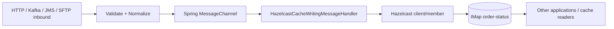
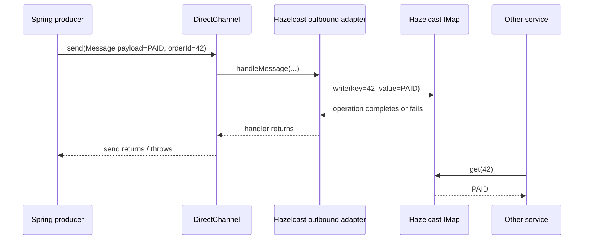

# Hazelcast outbound channel adapter

## 1. Tổng quan: đưa Spring Message vào Hazelcast

Trong module **SPRING_INTEGRATION_ADAPTERS**, Spring Integration kết nối các hệ thống bên ngoài bằng **inbound/outbound adapter**, **gateway**, **poller** và **MessageChannel**. Một hệ thống có thể nhận request qua HTTP, file, SFTP, JMS, AMQP hoặc Kafka, kiểm tra hợp đồng message rồi ghi trạng thái tạm thời vào kho dữ liệu phân tán. Trong chương **Adapter Cloud**, **Hazelcast outbound channel adapter** là cầu nối từ message flow của Spring Integration sang các **distributed objects** của Hazelcast.

Ví dụ: một ứng dụng xử lý đơn hàng nhận sự kiện `ORDER_PAID` từ Kafka. Sau khi kiểm tra payload và quyền truy cập, ứng dụng muốn cập nhật trạng thái đơn trong `IMap<String, String>` tên `order-status`. Một service khác kết nối cùng Hazelcast cluster có thể đọc trạng thái mới. Spring Integration không cần cho mọi handler tự lấy `HazelcastInstance` rồi gọi `IMap.put(...)`; thay vào đó, outbound adapter tiếp nhận Spring message, xác định key/value và ghi vào đối tượng Hazelcast đã cấu hình.



**Outbound** ở đây nghĩa là **đi từ Spring Integration ra Hazelcast**. Không phải outbound HTTP request, cũng không phải một cách tự động gửi log sang cloud provider. Hazelcast có thể chạy embedded, trong mạng riêng, Kubernetes hoặc managed deployment; vấn đề kết nối và bảo mật cluster được xử lý riêng.

**Mục tiêu bài học:**

1. Hiểu `HazelcastCacheWritingMessageHandler` và sự khác nhau giữa inbound và outbound channel adapter.
2. Biết các distributed objects mà outbound adapter hỗ trợ: `IMap`, `MultiMap`, `ReplicatedMap`, `IList`, `ISet`, `IQueue` và `ITopic`.
3. Cấu hình `cache`, `cache-expression`, `HazelcastHeaders.CACHE_NAME`, `key-expression` và `extract-payload`.
4. Xây dựng ví dụ **JavaConfig** và **XML** ghi trạng thái đơn hàng bằng Spring `MessageChannel`.
5. Kiểm thử end-to-end bằng Spring Boot Test và đọc ngược `IMap` để xác nhận kết quả.
6. Phân biệt **ghi key-value**, **thêm phần tử queue/list/set** và **publish topic**.
7. Thiết kế xử lý lỗi, retry, idempotency, TTL, serialization, monitoring, bảo mật và kết nối cloud.
8. Không đánh đồng **channel send thành công**, **Hazelcast mutation hoàn tất** và **durable business commit**.

> **Nguyên tắc xuyên suốt:** outbound channel adapter là cơ chế chuyển tiếp một chiều. Nó không tự tạo reply nghiệp vụ, không tự biến Hazelcast cache thành event log bền vững và không bảo đảm exactly-once khi nhiều hệ thống cùng tham gia.

## 2. Kiến trúc và trách nhiệm từng thành phần

### 2.1. Spring Integration nhận và điều phối message

Một message cơ bản:

```java
Message<String> message = MessageBuilder
    .withPayload("PAID")
    .setHeader("orderId", "order-42")
    .setHeader("eventId", "evt-123")
    .build();
```

Với Spring Integration:

- **`payload`** là dữ liệu muốn ghi: trong ví dụ là `"PAID"`.
- **`headers`** là metadata: `orderId` để xác định key và `eventId` để phục vụ correlation.
- **`MessageChannel`** đưa message tới subscriber hoặc handler.
- **`@ServiceActivator`** hoặc Java DSL `.handle(...)` đăng ký outbound handler với channel.
- **Hazelcast outbound adapter** chuyển message thành thao tác lên đối tượng phân tán.

Điểm đáng chú ý: `MessageHeaders.ID` của Spring là ID cho message hiện tại; nó không thay thế event ID nghiệp vụ ổn định xuyên retry/replay.

### 2.2. Hazelcast có nhiều kiểu dữ liệu

| Distributed object | Ý nghĩa | Cách hiểu thao tác outbound |
|---|---|---|
| `IMap<K,V>` | Map key-value phân tán | Ghi `value` tại `key`; key trùng có thể overwrite. |
| `MultiMap<K,V>` | Nhiều values cho một key | Ghi thêm value theo key; số lượng và duplicate phụ thuộc cấu hình. |
| `ReplicatedMap<K,V>` | Key-value map replicated | Ghi key/value; replication/consistency khác `IMap`. |
| `IList<E>` | Danh sách phần tử | Thêm phần tử; list có thể có phần tử trùng. |
| `ISet<E>` | Tập hợp phần tử | Thêm phần tử theo semantics set; phần tử tương đương có thể không làm tăng size. |
| `IQueue<E>` | Hàng đợi phân tán | Đưa phần tử vào queue; consumer riêng cần `poll()/take()`. |
| `ITopic<E>` | Publish/subscribe | Publish message đến listeners đang theo dõi; không tự là durable log. |

**Không áp `key-expression` cho mọi loại đối tượng.** Spring Integration mô tả `key-expression` là tùy chọn cần cho thao tác map-like `IMap`/`MultiMap`/`ReplicatedMap`; list, set, queue và topic không dùng key-value theo cùng cách.

### 2.3. Vị trí của outbound adapter trong pipeline



Đây là **mô hình đơn giản với `DirectChannel`**. Một handler chạy đồng bộ có thể làm caller chờ thao tác Hazelcast. Khi có `ExecutorChannel`, queue, retry hoặc network reconnect, thứ tự hoàn tất có thể khác.

**Không đọc `MessageChannel.send(...) == true` như một xác nhận vĩnh viễn:** giá trị đó chỉ cho biết dispatch đã được chấp nhận theo semantics của channel. Với `DirectChannel` và handler bình thường, lỗi đồng bộ có thể lan về caller; nhưng điều đó không nói điều gì về Kafka/database commit ở các hệ thống khác.

## 3. Thành phần Spring Integration chính xác

### 3.1. Module cần có

Dependency hỗ trợ Hazelcast là:

```xml
<dependency>
    <groupId>org.springframework.integration</groupId>
    <artifactId>spring-integration-hazelcast</artifactId>
</dependency>
```

`spring-boot-starter-integration` **không tự bao gồm** adapter Hazelcast nếu dự án chưa kéo module này vào dependency graph.

### 3.2. Class thực hiện ghi

Spring Integration sử dụng:

```java
import org.springframework.integration.hazelcast.outbound.HazelcastCacheWritingMessageHandler;
```

Đây là một `MessageHandler`: nó được gọi khi Spring channel có message, không tự tạo một `@MessagingGateway` hay một nguồn polling.

Các setters quan trọng được API công bố:

```java
HazelcastCacheWritingMessageHandler handler =
    new HazelcastCacheWritingMessageHandler();

handler.setDistributedObject(distributedObject);
handler.setKeyExpression(spelExpression);
handler.setExtractPayload(true);

// Hoặc lựa chọn cache theo expression, thay cho fixed object.
handler.setCacheExpression(cacheExpression);
```

Nên chọn **một cách xác định distributed object chính**, không tạo config mâu thuẫn:

- `setDistributedObject(...)`: dùng bean `IMap`/`IQueue`/... đã cấu hình.
- `setCacheExpression(...)`: resolve đối tượng theo một SpEL expression phù hợp.
- `HazelcastHeaders.CACHE_NAME`: dùng header nếu không cấu hình fixed cache hoặc cache expression.

Tên class có chữ **CacheWriting**, nhưng phạm vi không giới hạn `IMap`; nó hỗ trợ cả queue, list, set và topic như bảng ở mục 2.

### 3.3. Java annotation và XML namespace

Java:

```java
@Bean
@ServiceActivator(inputChannel = "writeOrderStatus")
HazelcastCacheWritingMessageHandler orderStatusWriter() {
    // ...
}
```

XML:

```xml
<int-hazelcast:outbound-channel-adapter
    channel="writeOrderStatus"
    cache="ordersMap"
    key-expression="headers['orderId']"
    extract-payload="true"/>
```

Hai cấu hình là **phương án thay thế cho cùng một flow**. Không bật đồng thời cả hai subscribers trên một `DirectChannel` rồi tưởng chúng tạo thêm hai bản sao; `DirectChannel` không phải broadcast channel.

## 4. Hợp đồng của các thuộc tính outbound

Theo tài liệu Spring Integration Hazelcast, outbound adapter hỗ trợ:

| Thuộc tính | Bắt buộc? | Ý nghĩa |
|---|---|---|
| `channel` | Có trong XML | Tên Spring `MessageChannel` đầu vào. |
| `cache` | Một trong các cách chọn object | Reference tới distributed object đã tạo, ví dụ bean `ordersMap`. |
| `cache-expression` | Thay thế `cache` | Biểu thức SpEL chọn đối tượng trên cơ sở message. |
| `HazelcastHeaders.CACHE_NAME` | Thay thế khi không dùng hai cách trên | Header cung cấp tên distributed object theo cơ chế adapter. |
| `key-expression` | Với map-like objects | Lấy key từ Spring message, ví dụ `headers['orderId']` hoặc `payload.id`. |
| `extract-payload` | Không; mặc định `true` | `true`: ghi payload; `false`: chuyển cả payload và headers theo converter của adapter. |

### 4.1. `cache`: reference cố định

Ví dụ:

```text
ordersMap: IMap<String,String> bean
writeOrderStatus: DirectChannel
adapter: cache=ordersMap
```

Ưu điểm là dễ review, test và giới hạn quyền ghi. Với một microservice chỉ ghi trạng thái đơn vào một map, đây thường là lựa chọn rõ ràng và an toàn nhất.

**`cache="ordersMap"` trong XML là tên bean**, không phải endpoint URI. Tên thực của Hazelcast map có thể là `order-status` và được tạo bằng `hazelcastInstance.getMap("order-status")`.

### 4.2. `cache-expression`: chọn object động

Tài liệu có ví dụ:

```xml
<int-hazelcast:outbound-channel-adapter
    channel="dynamicWrites"
    cache-expression="headers['CACHE_HEADER']"
    key-expression="payload.key"
    extract-payload="true"/>
```

Đây là cách chọn đối tượng từ header hoặc expression. Cần xác minh expression trả đúng kiểu/giá trị mà version adapter chấp nhận và **bảo đảm tên/cache được chọn thuộc allowlist**.

**Không** dùng trực tiếp header `cacheName` từ HTTP request/JMS/Kafka message không đáng tin để cho caller ghi tùy ý vào mọi Hazelcast map trong cluster. Đó là rủi ro chéo tenant và phá dữ liệu.

Một policy tốt hơn:

```text
untrusted request.target = "orders"
    -> authenticate + authorize tenant
    -> validate enum target
    -> server-side mapping:
         "orders" -> ordersMap
         "audit"  -> auditMap
    -> outbound adapter
```

### 4.3. `HazelcastHeaders.CACHE_NAME`

Nếu không cấu hình `cache` hoặc `cache-expression`, adapter có thể lấy tên distributed object từ header:

```java
import org.springframework.integration.hazelcast.HazelcastHeaders;

Message<String> request = MessageBuilder
    .withPayload("PAID")
    .setHeader(HazelcastHeaders.CACHE_NAME, "order-status")
    .setHeader("orderId", "order-42")
    .build();
```

**Đây là phương án routing động**, không phải để dùng đồng thời với một fixed-cache adapter khác đang nhận cùng channel. Khi ứng dụng có nhiều loại distributed objects, vẫn phải bảo đảm header chỉ mang những giá trị được phép và có Hazelcast instance/permissions thích hợp.

### 4.4. `key-expression`

Với `IMap` và các map-like types, handler cần key. Ví dụ:

```java
SpelExpressionParser parser = new SpelExpressionParser();

handler.setKeyExpression(
    parser.parseExpression("headers['orderId']"));
```

Hoặc nếu payload là DTO có accessor phù hợp:

```java
handler.setKeyExpression(
    parser.parseExpression("payload.orderId"));
```

**Đừng ép parser tự suy key** từ cả Spring message. Nếu header bị thiếu, biểu thức có thể trả `null`, gây lỗi khi ghi map. Hãy validate key trước khi dispatch, tránh một message không có ID làm hỏng cả flow hoặc bị retry liên tục.

### 4.5. `extract-payload=true/false`

Ví dụ message:

```text
Spring Message<String>
payload = "PAID"
headers =
  orderId: "order-42"
  eventId: "evt-123"
  traceId: "trace-567"
  replyChannel: <framework reference>
```

Với `extract-payload="true"` (mặc định), giá trị dùng để ghi là **`"PAID"`**.

Với `extract-payload="false"`, adapter chuyển đổi **payload cùng các headers** thành dữ liệu để ghi. Điều này có thể hữu ích khi downstream thật sự cần metadata, nhưng cũng tăng rủi ro serialization, lộ headers nội bộ hoặc ghi quá nhiều dữ liệu.

**Khuyến nghị:** ưu tiên `extract-payload=true` và tự chuẩn hóa payload thành DTO có schema rõ. Nếu muốn giữ `eventId`/`tenantId` trong cache, đặt chúng thành **fields đã chọn** trong DTO, thay vì lưu cả `MessageHeaders` mặc định.

## 5. Thực hành chính: Spring Integration ghi trạng thái đơn vào IMap

Lab này có thể chạy trong một ứng dụng Spring Boot riêng, không cần cloud account:

- Java 17+, Spring Boot/Spring Integration/Hazelcast phiên bản tương thích.
- Một embedded Hazelcast member dùng riêng cho lab.
- `IMap<String,String>` tên `order-status`.
- Spring `DirectChannel` tên `writeOrderStatus`.
- `HazelcastCacheWritingMessageHandler` ghi `payload` tại key từ header `orderId`.
- Java service gửi message vào channel.
- Spring Boot Test xác minh dữ liệu thực sự có trong map.

Các snippets là **một chương trình minh họa thống nhất** nếu đặt trong package `example.hzout`, và cần điều chỉnh version/BOM theo project. Đoạn mở rộng ở các phần sau chỉ là phương án thay thế, không bật hết cùng lúc.

### 5.1. Maven dependencies

Giả sử `dependencyManagement` quản lý Spring Boot, Spring Integration và Hazelcast tương thích:

```xml
<dependencies>
    <dependency>
        <groupId>org.springframework.boot</groupId>
        <artifactId>spring-boot-starter-integration</artifactId>
    </dependency>

    <dependency>
        <groupId>org.springframework.integration</groupId>
        <artifactId>spring-integration-hazelcast</artifactId>
    </dependency>

    <dependency>
        <groupId>org.springframework.boot</groupId>
        <artifactId>spring-boot-starter-test</artifactId>
        <scope>test</scope>
    </dependency>
</dependencies>
```

Không thêm version ngẫu nhiên cho `spring-integration-hazelcast` khi BOM đã quản lý các module còn lại. Hazelcast serialization/cluster discovery thay đổi theo version; pin và kiểm thử các dependencies như một bộ. Spring Boot 4 và Spring Integration 7 có baseline khác với Boot 3/Integration 6; kiểm tra tài liệu của line đang dùng.

### 5.2. Spring Boot application

File `HazelcastOutboundApplication.java`:

```java
package example.hzout;

import org.springframework.boot.SpringApplication;
import org.springframework.boot.autoconfigure.SpringBootApplication;
import org.springframework.integration.annotation.EnableIntegration;

@SpringBootApplication
@EnableIntegration
public class HazelcastOutboundApplication {

    public static void main(String[] args) {
        SpringApplication.run(
            HazelcastOutboundApplication.class, args);
    }
}
```

`@EnableIntegration` cho phép Spring Integration cấu hình infrastructure và endpoints. Không cần HTTP controller nếu chỉ muốn test message flow qua Java service.

### 5.3. Embedded HazelcastInstance cho lab

File `HazelcastLabConfig.java`:

```java
package example.hzout;

import com.hazelcast.config.Config;
import com.hazelcast.core.Hazelcast;
import com.hazelcast.core.HazelcastInstance;
import com.hazelcast.map.IMap;

import org.springframework.context.annotation.Bean;
import org.springframework.context.annotation.Configuration;

@Configuration
public class HazelcastLabConfig {

    @Bean(destroyMethod = "shutdown")
    public HazelcastInstance hazelcastInstance() {
        Config config = new Config();
        config.setClusterName("si-hz-outbound-lab");

        // Cấu hình cho môi trường lab cô lập;
        // không sử dụng discovery mặc định trong production.
        config.getNetworkConfig().getJoin()
            .getMulticastConfig().setEnabled(false);
        config.getNetworkConfig().getJoin()
            .getTcpIpConfig().setEnabled(false);

        return Hazelcast.newHazelcastInstance(config);
    }

    @Bean("ordersMap")
    public IMap<String, String> ordersMap(
            HazelcastInstance hazelcastInstance) {
        return hazelcastInstance.getMap("order-status");
    }
}
```

Các lưu ý:

1. Đây là **embedded member**, không phải Hazelcast Cloud client.
2. Tên cluster lab khác tên production để tránh join nhầm. Với môi trường nhiều nodes, phải cấu hình discovery và network theo topology thực.
3. Tắt multicast/TCP-IP trong lab không thay thế TLS, credential, network ACL hay firewall khi triển khai thật.
4. `destroyMethod="shutdown"` để Spring quản lý vòng đời instance; đừng tự shutdown nó sau mỗi message.
5. Cần bảo vệ port Hazelcast member/client; không mở cluster ports ra Internet.
6. Khi dùng managed Hazelcast, nên tạo `HazelcastInstance` bằng client config của provider thay vì embedded member.

### 5.4. DirectChannel và outbound adapter

File `HazelcastOutboundConfig.java`:

```java
package example.hzout;

import com.hazelcast.map.IMap;

import org.springframework.beans.factory.annotation.Qualifier;
import org.springframework.context.annotation.Bean;
import org.springframework.context.annotation.Configuration;
import org.springframework.expression.spel.standard.SpelExpressionParser;
import org.springframework.integration.annotation.ServiceActivator;
import org.springframework.integration.channel.DirectChannel;
import org.springframework.integration.hazelcast.outbound.HazelcastCacheWritingMessageHandler;
import org.springframework.messaging.MessageChannel;

@Configuration
public class HazelcastOutboundConfig {

    @Bean("writeOrderStatus")
    public MessageChannel writeOrderStatus() {
        return new DirectChannel();
    }

    @Bean
    @ServiceActivator(inputChannel = "writeOrderStatus")
    public HazelcastCacheWritingMessageHandler orderStatusWriter(
            @Qualifier("ordersMap") IMap<String, String> ordersMap) {

        HazelcastCacheWritingMessageHandler handler =
            new HazelcastCacheWritingMessageHandler();

        handler.setDistributedObject(ordersMap);
        handler.setKeyExpression(
            new SpelExpressionParser()
                .parseExpression("headers['orderId']"));
        handler.setExtractPayload(true);

        return handler;
    }
}
```

**Cách hoạt động:**

- Spring context có bean `writeOrderStatus` là `DirectChannel`.
- `@ServiceActivator` gắn `HazelcastCacheWritingMessageHandler` với channel.
- `setDistributedObject(ordersMap)` chọn đối tượng `IMap` cố định.
- `setKeyExpression(...)` lấy key từ header `orderId`.
- `setExtractPayload(true)` dùng payload `String` làm value.
- Khi channel dispatch một message, handler thực hiện ghi vào Hazelcast map.

Với cấu hình này, **không cần poller**. Outbound adapter phản ứng khi producer gửi message tới channel, khác với polling inbound adapter lấy dữ liệu từ nguồn.

### 5.5. Service phát message

File `OrderStatusPublisher.java`:

```java
package example.hzout;

import java.util.Set;
import java.util.UUID;

import org.springframework.beans.factory.annotation.Qualifier;
import org.springframework.messaging.MessageChannel;
import org.springframework.messaging.support.MessageBuilder;
import org.springframework.stereotype.Service;

@Service
public class OrderStatusPublisher {

    private static final Set<String> ALLOWED = Set.of(
        "CREATED", "PAID", "SHIPPED", "CANCELLED");

    private final MessageChannel writeOrderStatus;

    public OrderStatusPublisher(
            @Qualifier("writeOrderStatus")
            MessageChannel writeOrderStatus) {
        this.writeOrderStatus = writeOrderStatus;
    }

    public String publish(String orderId, String status) {
        if (orderId == null
                || !orderId.matches("[A-Za-z0-9_-]{1,80}")) {
            throw new IllegalArgumentException(
                "Invalid orderId");
        }

        if (status == null || !ALLOWED.contains(status)) {
            throw new IllegalArgumentException(
                "Invalid status");
        }

        String eventId = UUID.randomUUID().toString();

        boolean dispatched = writeOrderStatus.send(
            MessageBuilder.withPayload(status)
                .setHeader("orderId", orderId)
                .setHeader("eventId", eventId)
                .build());

        if (!dispatched) {
            throw new IllegalStateException(
                "Order status channel rejected message");
        }

        // Event ID dùng correlation demo; không chứng minh
        // dữ liệu đã bền vững hay hỗ trợ dedup sau crash.
        return eventId;
    }
}
```

Tại sao validate **trước** outbound handler?

- Tránh key rỗng/null, quá dài hoặc chứa dữ liệu tùy ý làm nổ cardinality.
- Tránh một trạng thái không có trong enum đi vào cache.
- Tránh phải retry một lỗi đầu vào không bao giờ tự hết.
- Định nghĩa hợp đồng payload độc lập với cách Hazelcast serialize values.

**Lưu ý:** `UUID` do receiver sinh **mỗi lần gọi**. Nếu cùng sự kiện nghiệp vụ được Kafka/JMS replay sau restart, UUID mới không cho phép suy ra đây là duplicate. Với idempotency thật, cần ID bền vững từ nguồn và chính sách lưu version/dedup.

### 5.6. Kiểm thử end-to-end

File `HazelcastOutboundTest.java`:

```java
package example.hzout;

import static org.junit.jupiter.api.Assertions.*;

import com.hazelcast.map.IMap;
import java.util.UUID;

import org.junit.jupiter.api.Test;
import org.springframework.beans.factory.annotation.Autowired;
import org.springframework.beans.factory.annotation.Qualifier;
import org.springframework.boot.test.context.SpringBootTest;

@SpringBootTest
class HazelcastOutboundTest {

    @Autowired
    OrderStatusPublisher publisher;

    @Autowired
    @Qualifier("ordersMap")
    IMap<String, String> ordersMap;

    @Test
    void writesPayloadToIMapUsingHeaderKey() {
        String orderId =
            "order-" + UUID.randomUUID();

        String eventId =
            publisher.publish(orderId, "PAID");

        assertNotNull(eventId);
        assertEquals("PAID", ordersMap.get(orderId));
    }

    @Test
    void laterWriteForSameKeyUpdatesMapValue() {
        String orderId =
            "order-" + UUID.randomUUID();

        publisher.publish(orderId, "CREATED");
        assertEquals("CREATED", ordersMap.get(orderId));

        publisher.publish(orderId, "SHIPPED");
        assertEquals("SHIPPED", ordersMap.get(orderId));
    }

    @Test
    void invalidStatusNeverReachesMap() {
        String orderId =
            "order-" + UUID.randomUUID();

        assertThrows(IllegalArgumentException.class,
            () -> publisher.publish(orderId, "UNKNOWN"));

        assertNull(ordersMap.get(orderId));
    }

    @Test
    void invalidOrderIdIsRejectedBeforeSend() {
        assertThrows(IllegalArgumentException.class,
            () -> publisher.publish("../admin", "PAID"));
    }
}
```

Các test trên kiểm chứng:

1. Spring Boot tạo đúng `HazelcastInstance` và `IMap` bean.
2. `@ServiceActivator` được đăng ký với `writeOrderStatus`.
3. `key-expression` đọc `orderId` từ header.
4. `extract-payload=true` ghi `"PAID"` thay vì cả Spring `Message`.
5. Cùng key được ghi lại thì giá trị map thay đổi.
6. Input sai bị từ chối trước khi gọi Hazelcast.

Test này **không** chứng minh độ bền sau cluster restart hay replication giữa các members. Với `DirectChannel`, hành vi có thể quan sát đồng bộ trong lab; với `ExecutorChannel` hoặc queue bất đồng bộ, không được giả định `ordersMap.get(...)` đã thấy giá trị ngay sau `send()`.

### 5.7. Giữ test cô lập

Một số biện pháp:

- Dùng cluster name/map name riêng và không kết nối cloud production.
- Dùng key ngẫu nhiên, tránh ghi đè dữ liệu người khác.
- Không chạy các test phụ thuộc thứ tự từ cùng một `IMap` với shared key.
- Không thêm listener/event consumer ngoài ý muốn tranh chấp hoặc làm chậm test.
- Đảm bảo Spring context đóng `HazelcastInstance` sau test.
- Khi test concurrency, kiểm tra có thể bị overwrite nếu nhiều writers đồng thời cập nhật cùng một key.
- Không dựa vào `Thread.sleep(...)` làm dấu hiệu readiness, nên kiểm tra instance và endpoint thực tế.

## 6. Cấu hình XML tương đương

Nếu ứng dụng dùng Spring Integration XML namespace, outbound adapter được biểu diễn bởi:

```xml
<int-hazelcast:outbound-channel-adapter
    channel="writeOrderStatus"
    cache="ordersMap"
    key-expression="headers['orderId']"
    extract-payload="true"/>
```

### 6.1. File XML hoàn chỉnh cho lab

Ví dụ `src/main/resources/hazelcast-outbound.xml`:

```xml
<?xml version="1.0" encoding="UTF-8"?>
<beans xmlns="http://www.springframework.org/schema/beans"
       xmlns:xsi="http://www.w3.org/2001/XMLSchema-instance"
       xmlns:int="http://www.springframework.org/schema/integration"
       xmlns:int-hazelcast="http://www.springframework.org/schema/integration/hazelcast"
       xsi:schemaLocation="
         http://www.springframework.org/schema/beans
         https://www.springframework.org/schema/beans/spring-beans.xsd
         http://www.springframework.org/schema/integration
         https://www.springframework.org/schema/integration/spring-integration.xsd
         http://www.springframework.org/schema/integration/hazelcast
         https://www.springframework.org/schema/integration/hazelcast/spring-integration-hazelcast.xsd">

    <int:channel id="writeOrderStatus"/>

    <bean id="hzInstance"
          class="com.hazelcast.core.Hazelcast"
          factory-method="newHazelcastInstance"
          destroy-method="shutdown">
        <constructor-arg>
            <bean class="com.hazelcast.config.Config"/>
        </constructor-arg>
    </bean>

    <bean id="ordersMap"
          factory-bean="hzInstance"
          factory-method="getMap">
        <constructor-arg value="order-status"/>
    </bean>

    <int-hazelcast:outbound-channel-adapter
        channel="writeOrderStatus"
        cache="ordersMap"
        key-expression="headers['orderId']"
        extract-payload="true"/>

</beans>
```

**Giải thích:**

- `cache="ordersMap"` là bean reference.
- `key-expression` lấy key từ message header.
- `extract-payload="true"` giữ value chỉ là `String`.
- `<int:channel>` không khai báo queue nên dùng semantics point-to-point đồng bộ phù hợp `DirectChannel`.
- Hazelcast `hzInstance` XML dùng cấu hình mặc định **chỉ để minh họa cú pháp**. Cấu hình discovery/ports mặc định có thể không an toàn hoặc join cluster không mong muốn; production phải thay bằng bean client/instance do infrastructure quản lý.

**Không nạp đồng thời** XML này và JavaConfig ở mục 5 cho cùng `hzInstance`/`ordersMap`/`writeOrderStatus`. Nếu cả XML adapter và `@ServiceActivator` được gắn trên một `DirectChannel`, kết quả dispatch có thể không như dự tính.

### 6.2. Import XML vào Spring Boot

```java
package example.hzout;

import org.springframework.boot.SpringApplication;
import org.springframework.boot.autoconfigure.SpringBootApplication;
import org.springframework.context.annotation.ImportResource;
import org.springframework.integration.annotation.EnableIntegration;

@SpringBootApplication
@EnableIntegration
@ImportResource("classpath:hazelcast-outbound.xml")
public class HazelcastXmlApplication {

    public static void main(String[] args) {
        SpringApplication.run(
            HazelcastXmlApplication.class, args);
    }
}
```

Đây là **cách cấu hình thay thế**, không phải lớp cần thêm song song với `HazelcastOutboundApplication` và toàn bộ JavaConfig. Khi dùng XML, có thể giữ riêng publisher Java `OrderStatusPublisher` miễn channel tên `writeOrderStatus` được tạo từ XML.

## 7. Java DSL: gắn outbound handler vào IntegrationFlow

Với dự án dùng Java DSL, có thể xây flow từ một input channel rồi `handle(...)` bằng bean handler tương tự:

```java
package example.hzout;

import com.hazelcast.map.IMap;
import org.springframework.beans.factory.annotation.Qualifier;
import org.springframework.context.annotation.Bean;
import org.springframework.context.annotation.Configuration;
import org.springframework.expression.spel.standard.SpelExpressionParser;
import org.springframework.integration.dsl.IntegrationFlow;
import org.springframework.integration.hazelcast.outbound.HazelcastCacheWritingMessageHandler;

@Configuration
public class HazelcastDslAlternative {

    @Bean
    public HazelcastCacheWritingMessageHandler hzDslWriter(
            @Qualifier("ordersMap")
            IMap<String, String> ordersMap) {
        HazelcastCacheWritingMessageHandler handler =
            new HazelcastCacheWritingMessageHandler();

        handler.setDistributedObject(ordersMap);
        handler.setKeyExpression(
            new SpelExpressionParser()
                .parseExpression("headers['orderId']"));
        handler.setExtractPayload(true);

        return handler;
    }

    @Bean
    public IntegrationFlow ordersToHazelcast(
            HazelcastCacheWritingMessageHandler hzDslWriter) {
        return IntegrationFlow.from("writeOrderStatus")
            .handle(hzDslWriter)
            .get();
    }
}
```

**Đây là phương án thay thế** `@ServiceActivator` trong mục 5.4, không bật cả hai trên cùng input channel.

Trong một flow đầy đủ, `.handle(hzDslWriter)` thường là **endpoint cuối của nhánh outbound**: handler không tạo reply nghiệp vụ. Nếu sau khi ghi Hazelcast còn muốn làm tiếp một bước, cần thiết kế flow riêng, publish event sau write bằng một cơ chế có outcome contract rõ ràng, hoặc dùng gateway/service phù hợp.

**Không nhầm** một `.handle(...)` outbound adapter với `@MessagingGateway` request-reply. Hazelcast `IMap.put(...)` có thể có return value trong API, nhưng adapter một chiều không tự biến giá trị cũ/trạng thái ghi thành Spring reply cho caller.

## 8. Các distributed objects khác: hành vi không đồng nhất

### 8.1. IMap

```text
Message: payload=PAID, orderId=order-42
    -> handler key-expression=headers['orderId']
    -> IMap.put("order-42", "PAID")
```

Khi ghi vào một key đã tồn tại, giá trị có thể bị thay thế; thay đổi thường phát event `UPDATED` cho listener phù hợp. Nếu không có key, có thể phát `ADDED`. Trạng thái map hiện tại **không phải log lịch sử các lần update**.

### 8.2. MultiMap

`MultiMap<K,V>` hỗ trợ nhiều values cho cùng key. Outbound adapter dùng key expression như map; cần xác định liệu collection type/config cho phép trùng và có yêu cầu loại bỏ duplicate hay không.

Ứng dụng không nên giả định:

- Một key chỉ chứa một record.
- Hai lần gửi cùng payload luôn tạo hai values khác nhau.
- Thứ tự values ổn định giống event log.
- Put vào MultiMap là một transaction giữa Kafka và Hazelcast.

Nếu cần mỗi key có một trạng thái mới nhất, `IMap` thường phù hợp hơn `MultiMap`.

### 8.3. ReplicatedMap

`ReplicatedMap` phù hợp một số tình huống đọc nhiều bản sao, nhưng đặc tính replication và nhất quán khác `IMap`. Khi ghi trạng thái thay đổi nhanh hoặc cần thứ tự mạnh, hãy đánh giá consistency, topology, serializer và conflict behavior.

### 8.4. IList / ISet

Với `IList` và `ISet`, adapter ghi **phần tử**, không cần `key-expression`:

```java
import com.hazelcast.collection.ISet;
import org.springframework.integration.hazelcast.outbound.HazelcastCacheWritingMessageHandler;

ISet<String> seenOrders =
    hazelcastInstance.getSet("seen-orders");

HazelcastCacheWritingMessageHandler handler =
    new HazelcastCacheWritingMessageHandler();

handler.setDistributedObject(seenOrders);
handler.setExtractPayload(true);
```

Đoạn code trên **chỉ là fragment**; muốn hoạt động, cần đăng ký handler làm subscriber trên một channel/flow. `ISet` có semantics tập hợp nên một value trùng có thể không làm tăng số phần tử, nhưng điều này **không thay thế idempotency business** nếu value không phải key nghiệp vụ chuẩn hóa.

`IList` cho phép phần tử trùng và có semantics danh sách, nhưng không được suy ra tổng thứ tự thực thi của mọi cập nhật qua nhiều network nodes/clients chỉ từ việc nhận response ở một thread.

### 8.5. IQueue: đưa việc vào queue khác với nghe event

Một queue-based flow:


Ví dụ:

```java
import com.hazelcast.collection.IQueue;
import org.springframework.integration.hazelcast.outbound.HazelcastCacheWritingMessageHandler;

IQueue<String> workQueue =
    hazelcastInstance.getQueue("work-items");

HazelcastCacheWritingMessageHandler handler =
    new HazelcastCacheWritingMessageHandler();

handler.setDistributedObject(workQueue);
handler.setExtractPayload(true);
```

Outbound adapter đưa item vào `IQueue`, còn **consumer riêng** phải lấy item. Đừng nhầm với Hazelcast inbound **event listener** nghe `ADDED` của `IQueue`: listener chỉ thấy notification và **không tự dequeue** item.

Dù `IQueue` phân tán, việc gọi `poll()` rồi process xong mới commit ở DB vẫn có crash window: item có thể đã bị lấy khỏi queue trước khi nghiệp vụ hoàn tất. Nếu không được phép mất job, cần một claim/ack/retry protocol, store hoặc broker có semantics thích hợp.

### 8.6. ITopic: publish không phải lưu bền vững

```java
import com.hazelcast.topic.ITopic;
import org.springframework.integration.hazelcast.outbound.HazelcastCacheWritingMessageHandler;

ITopic<String> topic =
    hazelcastInstance.getTopic("notifications");

HazelcastCacheWritingMessageHandler handler =
    new HazelcastCacheWritingMessageHandler();

handler.setDistributedObject(topic);
handler.setExtractPayload(true);
```

`ITopic` gửi notification tới các listeners đang đăng ký. Đừng giả định subscriber offline sẽ nhận lịch sử khi kết nối lại. Nếu business cần replay, retention hoặc consumer offsets, hãy dùng broker/event log được thiết kế cho nhu cầu đó và đánh giá `ReliableTopic` hoặc các lựa chọn Hazelcast cụ thể theo phiên bản, thay vì suy từ tên “Topic”.

### 8.7. Bảng quyết định nhanh

| Yêu cầu | Cân nhắc | Hạn chế |
|---|---|---|
| Tra cứu trạng thái hiện tại theo ID | `IMap` | Overwrite; không lưu toàn bộ lịch sử. |
| Nhiều giá trị cho một key | `MultiMap` | Cần quy tắc duplicate/cleanup. |
| Map replicated cho trường hợp đọc đặc biệt | `ReplicatedMap` | Consistency/replication cần đánh giá. |
| Danh sách phần tử | `IList` | Có thể duplicate, memory growth. |
| Membership/unique values | `ISet` | Uniqueness theo equality/serialization, không phải business idempotency. |
| Consumer lấy công việc theo queue | `IQueue` | Dequeue trước commit có rủi ro mất job. |
| Broadcast thông báo tức thời | `ITopic` | Không mặc định replay cho late subscribers. |
| Lưu sự kiện audit dài hạn | Kafka/DB outbox/event log | Hazelcast notification/cache không thay thế. |

## 9. Chọn cache động: khả năng mạnh, rủi ro lớn

### 9.1. Những lựa chọn hợp lệ

Tài liệu Spring Integration nêu ba cách chọn distributed object:

1. Bean/reference `cache` cố định.
2. `cache-expression` SpEL.
3. Header `HazelcastHeaders.CACHE_NAME` khi hai cách trên không được cấu hình.

Nên sử dụng **fixed cache** nếu ứng dụng chỉ có một đích. Dynamic cache hữu ích khi cùng handler phục vụ một tập object đã được cho phép, nhưng đòi hỏi:

- Input được xác thực và phân quyền.
- Allowlist cache names/objects.
- Kiểm tra đúng object type (không gửi key-value vào queue hoặc ngược lại).
- Giới hạn số distributed objects mới được tạo.
- Thống nhất serializer/schema của từng object.
- Không rò tenant hoặc dữ liệu nhạy cảm giữa maps.

### 9.2. Không lấy Hazelcast object name tùy ý từ caller

**Anti-pattern:**

```text
HTTP request: {"cacheName":"tenantB-secrets","key":"x"}
    -> pass cacheName directly to HazelcastHeaders.CACHE_NAME
    -> outbound adapter
```

Caller có thể chọn tên map không được phép. Ngay cả khi Hazelcast client có quyền ghi rộng, ứng dụng phải **kiểm soát domain authorization**.

Giải pháp:

```java
enum TargetMap {
    ORDER_STATUS,
    ORDER_AUDIT
}

String allowedName(TargetMap target) {
    return switch (target) {
        case ORDER_STATUS -> "order-status";
        case ORDER_AUDIT -> "order-audit";
    };
}
```

Đây là **ví dụ ánh xạ enum→tên hợp lệ**; phải được dùng **sau khi xác thực quyền**. Không biến arbitrary string của người dùng thành enum có quyền tùy tiện; ranh giới security phải quyết định tenant và operation được phép trước.

### 9.3. Header metadata nào được chuyển xuống cache?

Các header hữu ích cho monitoring/correlation:

| Header | Đọc để làm gì? | Có nên ghi cùng value? |
|---|---|---|
| `orderId` | Map key | Thường không cần lặp trong value nếu schema không yêu cầu. |
| `eventId` | Correlation/idempotency | Có thể là field DTO đã kiểm soát. |
| `traceId` | Distributed tracing | Tránh dùng raw trace label/cardinality vô hạn. |
| `trustedTenantId` | Tenant authorization | Chỉ khi server gắn từ authenticated boundary. |
| `HazelcastHeaders.CACHE_NAME` | Routing object động | Không lưu tùy tiện như “sự thật” nghiệp vụ. |
| `replyChannel`/`errorChannel` | Framework nội bộ | **Không** đưa trực tiếp vào value/cache serialization. |
| `Authorization`/tokens | Secret | **Không**, quản lý qua security context/secret store. |

`extract-payload=false` có thể làm lưu nhiều metadata hơn dự kiến; trong production chỉ sử dụng sau khi có schema và policy cho phép.

## 10. Error handling: lỗi đến từ đâu?

### 10.1. Phân loại lỗi

Một flow outbound có thể thất bại ở nhiều lớp:

| Tầng | Lỗi điển hình | Hướng xử lý |
|---|---|---|
| Producer Spring | Payload/key thiếu hoặc sai schema | Reject trước adapter; không retry vô hạn. |
| MessageChannel | Không subscriber, full queue, timeout | Instrument channel; sửa cấu hình/capacity. |
| SpEL | `key-expression` sai property hoặc trả null | Test expression/schema, quarantine message lỗi. |
| Adapter | Chọn object sai type hoặc lỗi khởi tạo | Kiểm tra bean/cách routing. |
| Hazelcast client/member | Disconnected, timeout, cluster unavailable | Retry có hạn, reconnect/readiness, bounded recovery. |
| Serialization | Không có serializer, schema mismatch | Sửa schema/version; không retry y nguyên mãi mãi. |
| Map operation | Overwrite/TTL/policy sai | Business conflict handling, version checks. |
| Queue/topic | Full queue hoặc listener/subscriber không sẵn sàng | Backpressure/recovery, không giả đã giao. |
| Downstream khác | DB/Kafka/HTTP commit thất bại | Transaction/outbox/ack riêng. |

**Không đồng nhất** mọi lỗi với `ErrorMessage`. Với `DirectChannel`, một exception từ handler có thể lan về caller; với `ExecutorChannel`/poller, lỗi có thể xảy ra ở thread khác và được một error publisher chuyển vào error channel theo cấu hình. Một `errorChannel` toàn cục không tự nhận mọi lỗi từ network driver.

### 10.2. Fail fast đối với input sai

Ví dụ nên từ chối:

```text
orderId = null
orderId = ""
orderId = "../../otherTenant"
status = "UNKNOWN"
cacheName = "private-map-not-allowed"
```

Lỗi deterministic không nên tự động retry 100 lần. Validation nên chạy trước `writeOrderStatus` hoặc ngay trong service gửi message.

### 10.3. Khi Hazelcast tạm mất kết nối

Một client có thể gặp timeout hoặc cluster unavailable. Cần phân biệt:

- Operation chắc chắn **chưa được thực hiện**.
- Operation đã gửi nhưng response bị mất: outcome **không rõ**.
- Operation hoàn tất ở Hazelcast nhưng ứng dụng crash trước khi ghi trạng thái nội bộ.
- Retry cùng map key có thể overwrite value mới hơn.
- Retry vào `IQueue`/`MultiMap`/`IList` có thể **thêm phần tử trùng**.

Vì vậy, chỉ retry khi hợp đồng cho phép, giới hạn attempt/deadline/backoff và dùng idempotency/version checks nếu có side effects.

### 10.4. ErrorMessage consumer minh họa

Nếu flow có channel `hazelcastOutboundErrors` **và** error publisher/advice được nối đúng, có thể thêm:

```java
package example.hzout;

import org.slf4j.Logger;
import org.slf4j.LoggerFactory;
import org.springframework.integration.annotation.ServiceActivator;
import org.springframework.messaging.Message;
import org.springframework.messaging.MessagingException;
import org.springframework.messaging.support.ErrorMessage;
import org.springframework.stereotype.Component;

@Component
public class HazelcastOutboundErrorConsumer {

    private static final Logger log =
        LoggerFactory.getLogger(
            HazelcastOutboundErrorConsumer.class);

    @ServiceActivator(inputChannel = "hazelcastOutboundErrors")
    public void onError(ErrorMessage error) {
        Throwable failure = error.getPayload();

        Message<?> failed = error.getOriginalMessage();
        if (failed == null &&
                failure instanceof MessagingException ex) {
            failed = ex.getFailedMessage();
        }

        log.error("Hazelcast outbound error: type={}, hasMessage={}",
            failure.getClass().getSimpleName(),
            failed != null);

        // Production: metric, alert, bounded recovery/DLQ.
        // Không log raw payload hoặc credentials mặc định.
    }
}
```

**Đây chỉ là consumer**, không phải cấu hình publisher tự động. Khi dùng `DirectChannel`, caller phải bắt/quan sát exception đồng bộ hoặc gắn retry/error advice cụ thể; khi dùng async boundary, cần cấu hình header `errorChannel`/error publisher phù hợp. Không hứa rằng mọi exception của Hazelcast sẽ được publish tới channel trên chỉ vì bean tồn tại.

## 11. Retry, idempotency, versioning và consistency

### 11.1. IMap.put không tự là business transaction

Với `IMap`, một thao tác ghi có semantics của Hazelcast. Tuy nhiên, một business flow có thể gồm:

```text
Kafka consume event
 -> SQL business transaction
 -> Spring Integration outbound adapter
 -> Hazelcast IMap write
 -> Kafka offset commit
```

Các bước này **không tự tham gia một distributed transaction nguyên tử**. Có thể gặp:

1. Database commit nhưng Hazelcast update chưa xảy ra.
2. Hazelcast đã cập nhật nhưng Kafka offset chưa commit, dẫn tới replay.
3. Retry event cũ ghi đè một trạng thái mới hơn.
4. Cluster partition làm client timeout và không biết outcome.

Nếu Hazelcast chỉ là **cache/projection**, cách phù hợp thường là có **nguồn sự thật** (database/event log) và cơ chế rebuild cache. Nếu Hazelcast được dùng làm state store quan trọng, cần làm rõ persistence/backup/durability của configuration cụ thể, không dựa vào tên “distributed” để suy ra không mất dữ liệu.

### 11.2. Idempotency theo từng loại object

| Object | Rủi ro khi retry | Biện pháp |
|---|---|---|
| `IMap` | Event cũ overwrite trạng thái mới | Version/sequence và conditional update hoặc rebuild từ source-of-truth. |
| `MultiMap` | Giá trị bị thêm nhiều lần | Dedup by event ID, collection semantics. |
| `IList` | Phần tử lặp | Event ID và dedup trong consumer/store. |
| `ISet` | Có thể tránh phần tử tương đương, nhưng equality có thể sai domain | Key chuẩn hóa, stable identity. |
| `IQueue` | Job trùng | Idempotent consumer, claim/ack/retry strategy. |
| `ITopic` | Notification trùng hoặc mất | Subscriber idempotency hoặc durable broker. |

### 11.3. Không dùng last-write-wins nếu cần thứ tự nghiệp vụ

Ví dụ hai messages:

```text
event #105: order-42 = SHIPPED
event #104: order-42 = PAID
```

Nếu #104 được retry sau #105, một `IMap.put` bình thường có thể làm trạng thái quay ngược từ `SHIPPED` thành `PAID`. Khi đó cần lưu `version` cùng value và update có điều kiện (EntryProcessor/CAS hoặc logic tương đương theo Hazelcast API), không chỉ map key đến `String`.

Một DTO gợi ý:

```java
public record VersionedOrderState(
    String orderId,
    long version,
    String status,
    String eventId
) {}
```

Adapter ví dụ `IMap.put` chỉ minh họa thao tác ghi đơn giản. **Nếu yêu cầu conditional atomic update**, nên dùng một service/handler tùy chỉnh gọi Hazelcast entry processor hoặc API tương ứng, thay vì gán cho outbound adapter một tham số CAS không có trong API.

## 12. TTL, eviction, memory và cluster capacity

### 12.1. Adapter không quyết định mọi chính sách cache

`HazelcastCacheWritingMessageHandler` chủ yếu xác định **đối tượng đích, key và value**. Những yếu tố khác thường được cấu hình tại Hazelcast map:

- TTL/maximum idle.
- Eviction policy và memory budget.
- Backups và persistence/store integration.
- Partitioning, split-brain behavior.
- In-memory format, serialization và indexing.
- Cluster topology và client retries.

Không mặc định có setter `setTtl(...)` trên `HazelcastCacheWritingMessageHandler`; API chính của handler không công bố phương thức ấy.

### 12.2. Ví dụ TTL ở cấu hình map

Ví dụ minh họa ở tầng Hazelcast:

```java
import com.hazelcast.config.Config;
import com.hazelcast.config.MapConfig;

Config config = new Config();

MapConfig mapConfig = new MapConfig("order-status");
mapConfig.setTimeToLiveSeconds(3600);

config.addMapConfig(mapConfig);

// Dùng config này khi tạo HazelcastInstance trong lab.
```

TTL 3.600 giây làm record có thể biến mất sau thời gian được định nghĩa; do đó `IMap` không nên là nơi lưu **audit log cần giữ lâu dài**. Nếu nghiệp vụ cần không mất trạng thái quan trọng, lưu trước trong một hệ thống durable với retention/backup thích hợp và xem cache là projection.

### 12.3. Bounded memory và payload size

Một số rủi ro:

- Message payload chứa file lớn hoặc Java object graph phức tạp làm tăng serialization cost.
- `extract-payload=false` vô tình đưa nhiều headers vào cache.
- `IList`/`MultiMap` tăng vô hạn nếu không có cleanup.
- `IQueue` đầy hoặc consumer xử lý chậm.
- `ITopic` có quá nhiều listeners nhận thông báo mà không xử lý kịp.

Các giới hạn nên được đặt ở **nguồn**, **Spring channels**, **Hazelcast object configuration** và **downstream**. Không xem một queue lớn là cách giải quyết overload; nó có thể chỉ trì hoãn sự cố và tạo thêm memory pressure.

## 13. Connection, security và cloud deployment

### 13.1. Embedded member khác Hazelcast client

Lab sử dụng:

```java
Hazelcast.newHazelcastInstance(config);
```

Đây là **member**. Trong một triển khai managed/cloud, Spring Integration thường dùng **Hazelcast client** kết nối tới cluster đã có.

Ví dụ fragment cấu hình client (chỉ minh họa phương thức tạo; endpoint/credentials/TLS phải do infrastructure cung cấp):

```java
import com.hazelcast.client.HazelcastClient;
import com.hazelcast.client.config.ClientConfig;
import com.hazelcast.core.HazelcastInstance;

ClientConfig config = new ClientConfig();
config.setClusterName("approved-cluster");

// Trong production: config network address, discovery,
// TLS và authentication theo provider/version.
HazelcastInstance client =
    HazelcastClient.newHazelcastClient(config);
```

**Không copy fragment này như production security configuration**: chưa có TLS, identity, timeout/retry, secret source và endpoint allowlist. Đừng đặt cluster secret hay private key trong Java string literal.

### 13.2. Trust boundary khi nhận Spring message từ bên ngoài

Một Spring inbound HTTP/Kafka/JMS/SFTP flow có thể mang headers do external sender kiểm soát. Cần tách:

| Metadata | Có được tin trực tiếp? | Lưu ý |
|---|---|---|
| `orderId` | Không | Validate domain, length, tenant scope. |
| `cacheName` | Không | Chỉ allowlist server-side, không để tự chọn object. |
| `status` | Không | Enum/schema validation. |
| `tenantId` | Không nếu lấy từ client | Tạo từ authenticated principal/known topic/source. |
| `eventId` | Tùy source/trust | Validate và giữ ổn định cho dedup/replay. |
| `traceId` | Không nên làm auth | Dùng correlation, tránh high-cardinality metrics. |
| Cloud/Hazelcast credentials | Không nên nằm trong message | Dùng secret manager/managed identity. |

### 13.3. Bảo mật cluster

- Không mở member/client ports của Hazelcast ra Internet nếu không có kiến trúc bảo vệ.
- Dùng private networking, ACL/security groups và TLS/mTLS khi khả năng edition/deployment hỗ trợ.
- Kiểm tra cluster identity và discovery config để tránh join nhầm environment.
- Dùng authentication/authorization ở Hazelcast theo khả năng version/edition/managed provider.
- Bảo vệ backup/snapshot và event payload có PII bằng IAM/retention/encryption.
- Không serialize arbitrary Java objects từ untrusted sources khi không có schema/serializer policy.
- Áp egress controls khi ứng dụng còn forward dữ liệu sang HTTP/Kafka/SFTP/cloud destinations.

**Một cluster name đúng không phải bằng chứng authentication.** Nó là một phần cấu hình kết nối; cần bảo vệ transport và principal theo mô hình bảo mật thực.

### 13.4. Header injection và data leakage

`extract-payload=false` có thể làm headers đi vào dữ liệu cache. Điều này dễ vô tình lưu `Authorization`, `replyChannel`, `errorChannel`, thông tin người dùng hoặc framework metadata.

Production nên:

1. Giữ `extract-payload=true`.
2. Dùng DTO có field allowlist.
3. Redact secrets và giới hạn payload size.
4. Không log toàn bộ `Message<?>`/`IMap` value.
5. Ghi audit/correlation ID ở nơi có quyền truy cập phù hợp.
6. Không lấy cache key thô làm metric label không giới hạn.

## 14. Serialization và version compatibility

Một Hazelcast client/member có thể serialize value qua network. Java object không hợp lệ theo serializer hoặc class schema mismatch có thể làm outbound write thất bại.

### 14.1. Ví dụ những lỗi thường gặp

| Vấn đề | Biểu hiện | Hướng xử lý |
|---|---|---|
| Value là một class không có serializer phù hợp | Hazelcast serialization error | Định nghĩa serializer/schema theo version. |
| Node A/B chạy model versions khác nhau | Deserialize fail hoặc dữ liệu sai kiểu | Rolling upgrade và compatibility tests. |
| `extract-payload=false` ghi framework headers | Khó serialize/đọc hoặc lộ metadata | Dùng DTO chuẩn hóa, chỉ giữ fields cần thiết. |
| Object graph quá lớn | CPU/GC/memory pressure | Giới hạn bytes, tránh deep object graphs. |
| Key type khác kỳ vọng | Cache miss, duplicate keys | Chuẩn hóa `String`/numeric keys và equality. |
| Cache name chưa đồng nhất | Ghi vào object khác hoặc lỗi resolution | Cố định bean, schema/version, allowlist. |

### 14.2. Schema nên độc lập với Spring Message

Đối với cache projection nghiêm túc:

```java
public record OrderCacheValue(
    String orderId,
    long version,
    String status,
    String sourceEventId
) {}
```

Đừng lưu `Message<...>`, `HazelcastInstance`, `Member` hoặc framework `Throwable` làm domain cache value. Khi hệ thống có nhiều ngôn ngữ/platforms, cân nhắc JSON/Compact/Avro/Protobuf hoặc serialization contract phù hợp với Hazelcast version. Test round-trip trên **cùng client/server version set** sẽ dùng trong production.

## 15. Hiệu năng, backpressure và concurrency

### 15.1. DirectChannel với synchronous map write

```text
HTTP request thread / Kafka consumer
    -> DirectChannel
    -> Hazelcast handler
    -> Hazelcast remote operation
    -> returns or throws
```

Ưu điểm:

- Dễ xác định nơi exception xuất hiện.
- Dễ test `ordersMap.get(key)` sau khi send returns ở lab.
- Không tạo thêm task queue trong JVM.

Nhược điểm:

- Nếu Hazelcast chậm hoặc cluster reconnect, thread upstream bị block.
- Với Kafka consumer, thời gian xử lý lâu có thể ảnh hưởng poll/commit.
- Với HTTP, request latency tăng; timeout HTTP bên ngoài có thể xảy ra dù write về sau thành công.
- Nếu retries nằm cả ở source và downstream, duplicate hoặc stale writes có thể phát sinh.

### 15.2. ExecutorChannel

`ExecutorChannel` tách sender khỏi thread thực thi, nhưng cần cấu hình **bounded ThreadPoolTaskExecutor**:

```text
Spring source -> ExecutorChannel (bounded queue)
              -> Hazelcast outbound handler
```

Khi queue đầy, task có thể reject, block hoặc chạy tại caller tùy rejection policy. `CallerRunsPolicy` có thể làm sender thread block; `DiscardPolicy` có thể mất task âm thầm. Không sử dụng executor vô hạn và gọi đó là “backpressure handled”.

### 15.3. QueueChannel + poller

`QueueChannel` cho phép nhận rồi xử lý theo lịch poller. Tuy nhiên:

- Mặc định queue trong memory.
- Khi JVM crash trước Hazelcast write, message có thể mất.
- Poller xử lý chậm làm queue dài, tăng latency.
- Nếu key trùng, completion order khác source order có thể ghi đè sai phiên bản.

Khi cần **replay sau restart**, nên dùng durable queue/outbox với acknowledgment thật và idempotency. Hazelcast `HazelcastMessageStore` hoặc `IQueue` có thể là một thành phần nhưng phải kiểm tra tính bền vững theo cấu hình backup/persistence và crash behavior; không coi mọi deployment mặc định là persistent storage.

### 15.4. Size/throughput estimation

Ví dụ ứng dụng muốn xử lý:

```text
Incoming rate       = 1,000 status updates/second
Average payload     = 200 bytes
Approx. value rate  = 200,000 bytes/second
                    = ~0.2 MB/s payload, chưa gồm overhead
```

Cần tính thêm:

- Key serialization và headers (nếu có).
- Hazelcast partition/network replication.
- RTT và number of in-flight operations.
- TTL/eviction/indexing overhead.
- Số members/backups và traffic giữa nodes.
- Event listeners downstream.
- Retry bursts, reconnect và cơ chế spill/replay.

Đừng chỉ tăng thread count mà không biết remote cluster đang throttling ở CPU, network hoặc memory.

## 16. Vòng đời Hazelcast và readiness

### 16.1. Startup sequence

```text
Spring ApplicationContext starting
    -> Hazelcast client/member configured
    -> HazelcastInstance ready/connected
    -> IMap bean resolved
    -> outbound handler initialized
    -> channel subscriber registered
    -> start accepting Spring messages
```

Một process Java “started” chưa chắc đã join đúng Hazelcast cluster. Readiness nên xác nhận:

1. Instance/client kết nối đúng cluster.
2. Distributed object name/type đúng.
3. Handler đã được Spring khởi tạo.
4. Input channel có đúng một subscriber.
5. Nếu source là Kafka/HTTP, nguồn chỉ bắt đầu nhận lượng lớn khi đích đủ sẵn sàng theo policy.
6. Metrics và error recovery có khả năng quan sát khi cluster mất kết nối.

### 16.2. Shutdown sequence

- Ngừng nhận thêm work hoặc drain queue theo deadline.
- Cho in-flight Hazelcast operations hoàn tất trong giới hạn.
- Flush/persist retry state/outbox khi cần.
- Đóng Hazelcast client/member bằng owner duy nhất.
- Không gọi `Hazelcast.shutdownAll()` trong một service activator xử lý message.
- Không kỳ vọng shutdown hook khi container bị kill, node OOM hoặc mất điện.

Nếu dùng shared `HazelcastInstance` do infrastructure quản lý, chỉ context owner phù hợp mới gọi `shutdown()`.

## 17. Khi nào không nên dùng Hazelcast outbound adapter?

Dù adapter thuận tiện, không phải mọi nghiệp vụ nên ghi thẳng một cache:

| Yêu cầu | Có nên dùng outbound adapter đơn giản? |
|---|---|
| Projection/trạng thái tạm để đọc nhanh | Có, khi có source-of-truth để rebuild. |
| Flag hoặc membership trong cluster | Có thể, sau khi đánh giá TTL/consistency. |
| Fan-out notification tức thời | Có thể dùng `ITopic`; không mặc định replay. |
| Thêm công việc vào queue phân tán | Có thể dùng `IQueue`; consumer và crash recovery phải rõ. |
| Audit event không được mất | **Không chỉ dựa vào cache write**; cần durable log/outbox. |
| Giao dịch DB + cache atomic | Không; dùng transactional patterns/reconciliation. |
| Update state có version CAS phức tạp | Cần custom handler/service/API conditional update. |
| Lưu file/object nhiều GB | Không phù hợp khi chỉ dùng cache value; chọn object storage/file adapter. |
| Trao đổi với hệ không chạy Java/Hazelcast | Xem Kafka/JMS/AMQP/HTTP hoặc schema-neutral API. |

Spring Integration có các outbound adapters/gateways khác cho HTTP, JMS, AMQP, Kafka, file/SFTP và DB. Chọn công nghệ theo đặc tính delivery, retention, transaction, latency và security, không chỉ vì có sẵn một component.

## 18. Ma trận kiểm thử

| Nhóm | Test | Kết quả cần xác minh |
|---|---|---|
| Bean wiring | Handler được đăng ký với `writeOrderStatus` | Có đúng một subscriber. |
| Map write | Payload `PAID` và header `orderId` | `IMap.get(orderId) == "PAID"`. |
| Overwrite | Ghi `CREATED` rồi `SHIPPED` cùng key | Value hiện tại là `SHIPPED`. |
| Missing key | Không có `orderId` | Reject/error có thể quan sát; không ghi null key. |
| Invalid status | Payload không trong allowlist | Bị reject trước handler. |
| `extract-payload=true` | Có `eventId` và framework headers | Map chỉ giữ value `String`. |
| `extract-payload=false` | Ghi theo object contract đã test | Không leak secrets/internal headers. |
| XML fixed cache | `cache="ordersMap"` | Ghi đúng object bean. |
| Dynamic cache | Header hợp lệ đã authorize | Ghi đúng object cho phép. |
| Dynamic cache abuse | Header chọn map không được phép | Từ chối trước adapter. |
| MultiMap | Ghi nhiều values cùng key | Theo collection semantics đã config. |
| ISet | Gửi cùng value nhiều lần | Kiểm tra uniqueness/equality policy. |
| IQueue | Gửi item rồi consumer poll | Item tới queue, crash window được đánh giá. |
| ITopic | Có listeners trước publish | Chỉ listeners phù hợp nhận notification. |
| Serialization | Client/member khác model version | Contract test qua rolling upgrade. |
| Cluster offline | Hazelcast unavailable | Timeout/error/recovery, không silent success. |
| Timeout unknown outcome | Write response bị mất | Retry tránh stale overwrite/duplicates. |
| Backpressure | Queue/worker pool đầy | Rejections/alerts, không memory explosion. |
| Multi-instance | Hai producers cập nhật same key | Xử lý version/race theo domain. |
| Restart | App chết giữa ingress và Hazelcast write | Durable inbox/outbox nếu không chấp nhận mất. |
| Security | Wrong cluster/cert/tenant | Fail closed, không trust-all. |
| Lifecycle | Shutdown/restart | Client close, source replay/readiness rõ ràng. |

## 19. Troubleshooting

### 19.1. Những lỗi thường gặp

| Hiện tượng | Nguyên nhân có thể | Cách kiểm tra |
|---|---|---|
| `HazelcastCacheWritingMessageHandler` không có | Thiếu `spring-integration-hazelcast` | Maven dependency, classpath, version. |
| Spring send mà không thấy key | Không subscriber, sai input channel | `@ServiceActivator` registration, bean names. |
| Key bị null | `key-expression` sai hoặc header thiếu | Payload/header contract, validation. |
| Cache name sai | `cache` trỏ sai bean hoặc dynamic header sai | Bean reference, map names, allowlist. |
| Value thành object không mong muốn | `extract-payload=false` | Payload-vs-message policy, serializer. |
| `IMap` cập nhật sai trạng thái | Concurrent writers hoặc stale retry | Event version, conditional update. |
| `MultiMap`/`IList` tăng dữ liệu quá nhanh | Retry duplicate, thiếu retention | Dedup, cleanup, quotas. |
| Queue item bị lấy rồi mất | Consumer `poll()` rồi crash | Claim/ack/recovery, persistent broker. |
| `ITopic` subscriber offline không nhận | Pub/sub notification không replay | Durable event log khi cần. |
| Network timeout | Cluster unreachable hoặc quá tải | DNS, TLS, firewall, members, metrics. |
| Serialization exception | Model/serializer mismatch | Version, schema, class allowlist. |
| Channel send trả true nhưng downstream thiếu | Async boundary hoặc thiếu sink commit | Trace end-to-end, ack/commit. |
| XML và JavaConfig cùng tồn tại | Trùng beans/handlers, sai dispatch | Chỉ chọn một mode cho cùng channel. |
| Map entry tự biến mất | TTL/eviction | Hazelcast map config, memory pressure. |

### 19.2. Runbook chẩn đoán theo thứ tự

```text
1. Spring inbound đã tạo đúng Message<?> chưa?
2. Payload, headers và orderId đã qua validation?
3. writeOrderStatus channel có đúng một subscriber?
4. HazelcastCacheWritingMessageHandler có được initialize?
5. key-expression có trả key hợp lệ không?
6. extract-payload đang true hay false?
7. cache / cache-expression / CACHE_NAME resolve tới object nào?
8. HazelcastInstance kết nối đúng cluster và object type?
9. Map/queue/topic operation hoàn tất hay timeout?
10. Có stale writer, TTL, eviction, serialization error?
11. Downstream readers có dùng cùng key/schema/cluster?
12. Nếu mất dữ liệu, outbox/broker/replay có hoạt động không?
```

Nếu **channel có subscriber và không ném lỗi nhưng reader không thấy value**, kiểm tra **cluster name, distributed object name, key type và TTL/eviction** trước khi tăng thread pool. Nếu giá trị hiện tại sai nhưng nhiều writers chạy, kiểm tra **ordering, duplicate và version** trước khi sửa serializer.

## 20. Checklist production

1. **Xác định đúng pattern:** outbound one-way ghi Hazelcast, không nhầm với inbound event listener hoặc gateway.
2. **Pin versions:** Spring Boot, Spring Integration và Hazelcast compatible; test serializer/rolling upgrades.
3. **Chọn distributed object:** `IMap`/`MultiMap`/`IList`/`ISet`/`IQueue`/`ITopic` phù hợp semantics.
4. **Chọn object rõ:** fixed `cache` khi có thể; chỉ dùng dynamic cache với allowlist/authorization.
5. **Validate `key-expression`:** null, type, length, tenant scope và số lượng keys.
6. **Giữ `extract-payload=true`:** nếu cần metadata thì chuẩn hóa DTO, không ghi cả internal headers.
7. **Xác thực cluster:** private network, TLS/credentials/managed identity theo môi trường.
8. **Giới hạn payload/queue:** size limit, bounded queues, max in-flight, timeout và backpressure.
9. **Cấu hình map:** TTL, eviction, memory budget, backup/persistence theo SLA thực.
10. **Phân loại lỗi:** deterministic validation vs transient cluster/network/serialization.
11. **Retry có hạn:** backoff/jitter, deadline và tránh duplicate/stale overwrite.
12. **Định nghĩa idempotency/version:** event ID ổn định, conditional update nếu ordering quan trọng.
13. **Dùng durable source:** outbox/broker khi không được phép mất event; cache chỉ là projection nếu phù hợp.
14. **Kiểm soát security:** tenant authorization, key/cache allowlist, serialization schema và PII.
15. **Theo dõi endpoints:** Spring channels, handler errors, Hazelcast cluster latency/reconnect, map size/TTL.
16. **Kiểm thử âm tính:** wrong key/cache, cluster offline, full queue, restart, out-of-order writes.
17. **Không công bố success quá sớm:** phân biệt channel dispatch, map mutation và business commit.
18. **Quản lý lifecycle:** readiness, shutdown/drain và một owner cho `HazelcastInstance`.

## 21. Tổng kết

**Hazelcast outbound channel adapter** đưa message của Spring Integration vào một **distributed object** của Hazelcast, nhờ đó các flow đang kết nối HTTP, JMS, AMQP, Kafka, file/SFTP và database có thể ghi cache hoặc publish notification mà không trộn toàn bộ code Hazelcast vào các bước nghiệp vụ.

- `HazelcastCacheWritingMessageHandler` là class cốt lõi; cấu hình bằng `@ServiceActivator`, XML `<int-hazelcast:outbound-channel-adapter>` hoặc Java DSL `.handle(...)`.
- Có thể chọn object bằng `cache`, `cache-expression` hoặc `HazelcastHeaders.CACHE_NAME`; trong production ưu tiên cố định/allowlist.
- `key-expression` cần thiết cho map-like objects; `extract-payload=true` là mặc định và thường là lựa chọn an toàn.
- `IMap` ghi key-value, `MultiMap` có nhiều values, `IList`/`ISet` thêm phần tử, `IQueue` nhận job, `ITopic` publish notification; **semantics khác nhau**.
- Với `DirectChannel`, thao tác thường được gọi trên thread gửi; với async channel hoặc queue, phải xử lý backpressure và error reporting đúng ranh giới.
- **Hazelcast mutation thành công không có nghĩa durable business transaction.** Muốn audit/replay/strict ordering cần event log/outbox, idempotency, versioning và reconciliation.
- Khi chạy Hazelcast trong cloud, cần network isolation, TLS/authentication phù hợp deployment, quyền truy cập theo tenant và quan sát cluster availability.

Trong **SPRING_INTEGRATION_ADAPTERS**, hãy coi outbound adapter là **một ranh giới tích hợp rõ ràng**: phía trước có message validation, phía sau là distributed object với consistency/TTL/lifecycle riêng; mỗi hệ thống tiếp theo cần hợp đồng lỗi, bảo mật và khả năng khôi phục độc lập.

### Tài liệu tham khảo chính thức

- [Spring Integration — Hazelcast Support](https://docs.spring.io/spring-integration/reference/hazelcast.html)
- [Spring Integration 6.3 — Hazelcast Outbound Channel Adapter](https://docs.spring.io/spring-integration/reference/6.3/hazelcast.html)
- [Spring Integration — HazelcastCacheWritingMessageHandler API](https://docs.spring.io/spring-integration/docs/6.5.x/api/org/springframework/integration/hazelcast/outbound/HazelcastCacheWritingMessageHandler.html)
- [Spring Integration — HazelcastHeaders API](https://docs.spring.io/spring-integration/api/org/springframework/integration/hazelcast/HazelcastHeaders.html)
- [Spring Integration — Service Activator](https://docs.spring.io/spring-integration/reference/service-activator.html)
- [Spring Integration — Message Channels](https://docs.spring.io/spring-integration/reference/channel.html)
- [Spring Integration — Error Handling](https://docs.spring.io/spring-integration/reference/error-handling.html)
- [Hazelcast — Spring Hazelcast Support](https://docs.hazelcast.com/hazelcast/5.6/spring/spring-hazelcast-support)
- [Hazelcast — Data Structures](https://docs.hazelcast.com/hazelcast/latest/data-structures/data-structures)
- [Hazelcast — Platform Documentation](https://docs.hazelcast.com/hazelcast/latest/)

