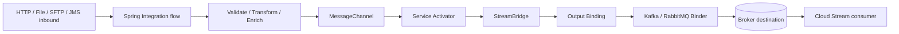
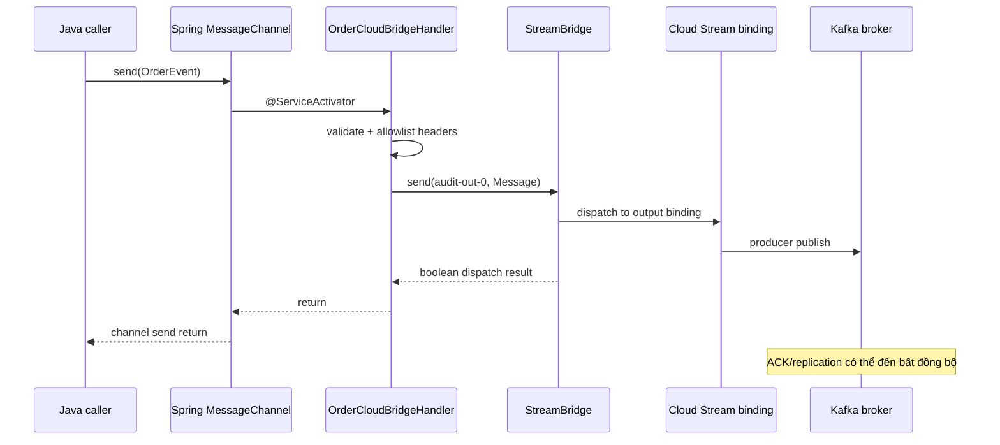
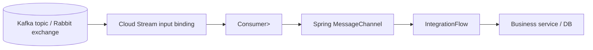
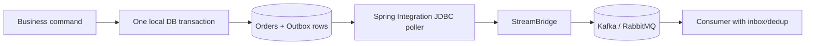

# Cloud stream bridge trong integration flow

## 1. Bối cảnh: nối Spring Integration với Spring Cloud Stream

Trong **SPRING_INTEGRATION_ADAPTERS**, Spring Integration kết nối hệ thống bên ngoài bằng inbound/outbound adapter, gateway, poller và `MessageChannel`. Các ví dụ phổ biến là file, SFTP, HTTP, JMS, AMQP, Kafka hoặc cơ sở dữ liệu. Khi ứng dụng đã có flow xử lý/định tuyến sự kiện nhưng muốn sử dụng **binder abstraction** của **Spring Cloud Stream** để publish hoặc consume qua Kafka/RabbitMQ, ta cần một **cloud stream bridge trong integration flow**.

Tình huống:

1. Hệ thống nhận đơn hàng từ HTTP hoặc SFTP.
2. Một Spring Integration flow validate, chuyển đổi payload và làm giàu metadata.
3. Flow đưa message tới một **service activator**.
4. Service activator gọi **`StreamBridge.send(...)`** với output binding.
5. Spring Cloud Stream dùng binder đã cấu hình để đưa message tới broker.
6. Một consumer khác đọc từ destination, xác minh schema và xử lý tiếp.



Đây là **bridge ở tầng framework** giữa Spring Integration và Spring Cloud Stream. `StreamBridge` **không phải** một broker, cũng không phải tên của một remote cloud service. Nó là API Spring Cloud Stream để **gửi dữ liệu từ nguồn không phải một function/supplier binding** tới output binding do binder quản lý.

Ví dụ sử dụng:

- Nhận một file qua SFTP rồi publish thông báo “import completed” sang Kafka.
- HTTP inbound gateway nhận đơn và chuyển lệnh bất đồng bộ qua RabbitMQ.
- Poll database/outbox bằng Spring Integration rồi publish sự kiện domain ra broker.
- Nhận Syslog/Hazelcast events và forward các events đã normalize sang event bus.
- Gọi một Camel/Hazelcast adapter ở upstream, sau đó publish kết quả ra cloud stream.

**Mục tiêu học tập:**

1. Phân biệt Spring `MessageChannel`, Cloud Stream `binding`, `destination`, `binder` và `StreamBridge`.
2. Cấu hình `StreamBridge.send(bindingName, data)` với Spring POJO hoặc `Message<?>`.
3. Thiết kế một flow có đầu vào riêng, transformer, service activator và output binding.
4. Thiết lập `spring.cloud.stream.bindings.<name>.destination`, content type, binder và output bindings.
5. Kiểm thử bằng **Spring Cloud Stream Test Binder**, không cần Kafka trong unit/integration test.
6. Biết cách nối consumer binding ngược vào Spring Integration flow.
7. Hạn chế dynamic destination, headers, tenant routing và các bề mặt bảo mật.
8. Xử lý producer errors, retries, async send, broker acknowledgments, idempotency và durable outbox.
9. Theo dõi throughput, backpressure, serialization, health và lifecycle.

> **Nguyên tắc:** `StreamBridge.send(...)` trả `true` không phải cam kết rằng broker đã replicate/commit message, và chắc chắn không đồng nghĩa downstream consumer đã xử lý thành công.

## 2. Bốn khái niệm không nên nhầm lẫn

### 2.1. Spring Integration MessageChannel

Một Spring message gồm `payload` và `headers`:

```java
Message<String> message = MessageBuilder
    .withPayload("ORDER_PAID")
    .setHeader("eventId", "evt-123")
    .setHeader("orderId", "order-42")
    .build();
```

`MessageChannel` là điểm nối giữa các Spring Integration endpoints. Chẳng hạn:

| Channel | Cách dispatch | Lưu ý |
|---|---|---|
| `DirectChannel` | Gọi subscriber đồng bộ trên sender thread | Handler có thể block; exception có thể quay về caller. |
| `ExecutorChannel` | Chuyển việc sang executor | Async boundary, task queue/rejection; không tự lưu bền vững. |
| `QueueChannel` | Đẩy message vào hàng đợi cho poller đọc | Thường là in-memory nếu không cấu hình message store. |
| `PublishSubscribeChannel` | Fan-out đến nhiều subscribers | Không phải consumer group trên broker. |

Spring Integration biết cách **kết nối và xử lý** message trong ứng dụng. Nó không tự biết một channel tên `eventsToCloud` phải publish đến Kafka topic nào nếu không có handler/binder tương ứng.

### 2.2. Spring Cloud Stream binder

**Binder** là phần tích hợp với middleware messaging cụ thể, ví dụ:

- Kafka binder: output destination thường là **Kafka topic**.
- RabbitMQ binder: output destination thường ánh xạ tới **exchange** theo binder conventions.
- Binders khác: Kinesis, Pulsar hoặc nền tảng do provider hỗ trợ, mỗi binder có semantics riêng.

Binder thực hiện những phần như binding lifecycle, chuyển đổi payload, producer/consumer properties, kết nối broker và một số khả năng lỗi/retry/monitoring.

Không vì cùng dùng từ “stream” mà suy ra mọi binder có cùng **partitioning, durability, acknowledgment, ordering hay transaction model**.

### 2.3. Binding name và destination

Ví dụ:

```yaml
spring:
  cloud:
    stream:
      bindings:
        audit-out-0:
          destination: orders.audit.v1
          content-type: application/json
```

**`audit-out-0`** là tên **logical output binding** trong ứng dụng. **`orders.audit.v1`** là **destination vật lý** mà binder sử dụng. Hai tên có thể khác nhau.

```text
streamBridge.send("audit-out-0", event)
                  ^^^^^^^^^^^ logical binding name

spring.cloud.stream.bindings.audit-out-0.destination
                               |
                               v
                        orders.audit.v1
                         physical topic
```

Nhầm `bindingName` với `destination` có thể dẫn đến tạo một binding động với destination trùng tên binding ngoài dự kiến, thay vì gửi tới topic mong muốn.

### 2.4. StreamBridge

Class trung tâm:

```java
import org.springframework.cloud.stream.function.StreamBridge;
```

Các overload phổ biến:

```java
boolean send(String bindingName, Object data);

boolean send(String bindingName, Object data,
             org.springframework.util.MimeType outputContentType);

boolean send(String bindingName, String binderName,
             Object data);

boolean send(String bindingName, String binderName,
             Object data,
             org.springframework.util.MimeType outputContentType);
```

`data` có thể là Java POJO, bytes hoặc Spring `Message<?>`. `StreamBridge` dùng conversion/content type, partitioning và các cấu hình của binding tương tự cách output từ `Function`/`Supplier` hoạt động trong Spring Cloud Stream.

**Không mặc định** rằng `send(...)` có overload trả `CompletableFuture`; API cơ bản trả `boolean`. Khi cần acknowledgment từ provider, phải sử dụng callback/confirmation mechanisms được binder hỗ trợ.

## 3. Khi nào cần StreamBridge?

### 3.1. Nguồn dữ liệu không phải Cloud Stream function

Spring Cloud Stream khuyến nghị **functional model** với `Supplier`, `Function` và `Consumer`. Ví dụ một function:

```java
@Bean
Function<String, String> uppercase() {
    return String::toUpperCase;
}
```

Nếu bạn có function này, framework có thể tạo các bindings theo tên `uppercase-in-0` và `uppercase-out-0`. Không cần gọi `StreamBridge` thủ công chỉ để chuyển output của function sang binder.

Nhưng khi dữ liệu đến từ một:

- Spring Integration `@InboundChannelAdapter` cho file/database poller,
- HTTP `@RestController`,
- `@MessagingGateway`/`MessageChannel` nội bộ,
- scheduled job hay callback của SDK,
- Hazelcast/Syslog listener hoặc custom integration component,

thì `StreamBridge` là cách thích hợp để đưa message đến Spring Cloud Stream binder.

### 3.2. So sánh các hướng gửi

| Cách | Phù hợp khi | Lưu ý |
|---|---|---|
| `StreamBridge` trong service activator | Spring Integration flow đã xử lý dữ liệu và cần publish tới binder | Ranh giới rõ, dễ unit test và quản lý error. |
| `StreamBridge` trong `@RestController` | Endpoint nhỏ, ít bước xử lý | Nên tách validation/tracing/publish ra service. |
| `Supplier/Function` bean | Toàn pipeline vốn là functional Cloud Stream app | Có binding convention riêng. |
| Spring Integration Kafka/JMS/AMQP outbound adapter | Cần API chuyên biệt binder/protocol hoặc flow đang dùng trực tiếp adapter | Giảm thêm abstraction khi không cần binder. |
| KafkaTemplate / RabbitTemplate | Cần producer-specific API, callback, transaction hoặc fine-grained control | Tự quản lý nhiều cấu hình ở protocol level. |

`StreamBridge` **không phải** bản thay thế trực tiếp cho một Spring Integration `outbound gateway`: gửi message tới broker là **one-way** trừ khi thiết kế thêm reply/correlation flow độc lập.

## 4. Hợp đồng message xuyên ranh giới

Một message nghiệp vụ có thể chứa:

```text
Spring Message<OrderEvent>:
  payload:
    eventId: "evt-abc"
    orderId: "order-42"
    status: "PAID"
    occurredAt: "2026-11-23T02:15:10Z"
  headers:
    contentType: "application/json"
    correlationId: "req-88"
    source: "order-service"
    replyChannel: <internal framework reference>
```

**Chỉ những thông tin cần thiết** nên được đưa sang binder/broker:

- Payload: một DTO có schema version rõ ràng.
- Header: `eventId`, `correlationId`, `trustedTenantId` đã được xác thực, trace context đã kiểm soát.
- Content type: đồng thuận serializer giữa producer và consumer.
- Partition key: `orderId` hoặc key đã được validate nếu muốn giữ thứ tự theo đơn.

Không forward toàn bộ Spring `MessageHeaders` như một JSON payload hoặc map header tùy ý. `replyChannel`, `errorChannel` và framework objects có thể không serialize được, có thể làm lộ nội bộ và không có ý nghĩa ở broker.

### 4.1. Định nghĩa event schema

Trong lab:

```java
package example.cloudbridge;

import java.time.Instant;

public record OrderEvent(
    String eventId,
    String orderId,
    String status,
    Instant occurredAt
) {}
```

Một ứng dụng thật thường thêm `schemaVersion`, `sourceSystem`, tenant và business sequence/version. Nếu sự kiện dùng để cập nhật trạng thái có thứ tự, hãy bổ sung **stable version** từ nguồn thay vì chỉ timestamp/UUID.

### 4.2. Khi nào dùng POJO, khi nào dùng Message?

Có thể gọi:

```java
streamBridge.send("audit-out-0", event);
```

hoặc:

```java
Message<OrderEvent> outgoing = MessageBuilder
    .withPayload(event)
    .setHeader("eventId", event.eventId())
    .setHeader("orderId", event.orderId())
    .setHeader("correlationId", "req-88")
    .build();

streamBridge.send("audit-out-0", outgoing);
```

Với POJO, content type của binding hoặc overload `MimeType` quyết định conversion. Với `Message<?>`, các headers có thể mang content type/metadata cần giữ. Phải validate từng header trước khi publish.

### 4.3. Không nhầm conversion với native serialization

Theo binding properties:

- `content-type: application/json`: định hướng conversion khi không dùng native encoding.
- `producer.use-native-encoding=true`: producer client/binder dùng serializer riêng; Cloud Stream không thực hiện cùng loại JSON conversion trên payload.
- `consumer.use-native-decoding=true`: consumer phải có deserializer phù hợp.

Không bật native encoding mà vẫn kỳ vọng automatic POJO→JSON giống cấu hình mặc định. Nếu consumer viết bằng ngôn ngữ khác, test **wire format** thật bằng broker/emulator chứ không chỉ so Java objects.

## 5. Lab: Spring Integration flow → StreamBridge → Kafka binding

Để học đúng phạm vi **cloud stream bridge trong integration flow**, ta xây một ứng dụng Spring Boot:

```text
OrderEventPublisher (Java caller)
     |
     v
orderEvents (DirectChannel)
     |
     v
OrderEventValidator @ServiceActivator
     |
     v
StreamBridge.send("audit-out-0", Message<OrderEvent>)
     |
     v
Cloud Stream Kafka binder
     |
     v
orders.audit.v1 topic
```

Lab sẽ chạy bằng **Spring Cloud Stream Test Binder** để không cần Kafka trong integration test. Khi deploy production, thay test binder bằng Kafka binder và broker thực.

### 5.1. Dependencies Maven

Ví dụ định hướng Java 17+, Spring Boot 3.x, Spring Integration 6.x và **Spring Cloud Stream 4.x** thuộc một Spring Cloud release train tương thích. Với Boot 4/Stream 5.x, phải dùng bộ versions và Java baseline đúng từ Spring Cloud compatibility matrix. Không tự ghép các BOM khác line.

Maven dependencies **không ghi version** dưới giả định `dependencyManagement` đã import Spring Boot BOM + Spring Cloud BOM tương thích:

```xml
<dependencies>
    <dependency>
        <groupId>org.springframework.boot</groupId>
        <artifactId>spring-boot-starter-integration</artifactId>
    </dependency>

    <dependency>
        <groupId>org.springframework.cloud</groupId>
        <artifactId>spring-cloud-stream</artifactId>
    </dependency>

    <!-- Binder Kafka cho runtime thực; có thể dùng RabbitMQ
         binder thay thế khi đích là RabbitMQ. -->
    <dependency>
        <groupId>org.springframework.cloud</groupId>
        <artifactId>spring-cloud-stream-binder-kafka</artifactId>
    </dependency>

    <dependency>
        <groupId>org.springframework.boot</groupId>
        <artifactId>spring-boot-starter-test</artifactId>
        <scope>test</scope>
    </dependency>

    <dependency>
        <groupId>org.springframework.cloud</groupId>
        <artifactId>spring-cloud-stream-test-binder</artifactId>
        <scope>test</scope>
    </dependency>
</dependencies>
```

Để tránh kết nối broker trong bài test, bật **test binder** bằng cấu hình `@EnableTestBinder` theo phần 7. Để chạy với Kafka thật, cần broker, topic/policy, kết nối và credentials phù hợp.

**Không** cần thêm `@EnableBinding(Source.class)`, `BinderAwareChannelResolver` hoặc `@StreamListener` của các mô hình Cloud Stream cũ chỉ để sử dụng `StreamBridge`. Với StreamBridge hiện đại, có thể publish mà không định nghĩa `Supplier` bean.

### 5.2. application.yml

```yaml
spring:
  application:
    name: order-cloud-bridge

  cloud:
    stream:
      # Tạo output binding ngay khi khởi động để
      # phát hiện lỗi config/binding sớm hơn.
      output-bindings: audit-out-0

      bindings:
        audit-out-0:
          destination: orders.audit.v1
          content-type: application/json
          producer:
            # Với binder có support async producer errors;
            # vẫn cần error consumer/recovery riêng.
            error-channel-enabled: true

      kafka:
        binder:
          brokers: ${KAFKA_BOOTSTRAP_SERVERS:localhost:9092}
```

**Giải thích:**

1. `audit-out-0` là **binding name** ứng dụng sử dụng trong Java.
2. `orders.audit.v1` là topic Kafka thực khi dùng Kafka binder.
3. `output-bindings` chủ động yêu cầu tạo output binding **từ startup** dù không có Supplier/Function output tương ứng.
4. `content-type` giúp xác định content conversion; phần payload/headers vẫn phải theo contract consumer.
5. `producer.error-channel-enabled` yêu cầu cơ chế producer error channel nếu binder hỗ trợ; **không** tự ghi DLQ hoặc khôi phục.
6. `brokers` dùng environment variable; production cần TLS/SASL/IAM/secrets và broker ACL tương ứng.

Không coi `output-bindings` là nơi cấu hình destination: trường này chỉ liệt kê **binding names**. Đích thật nằm dưới `spring.cloud.stream.bindings.<bindingName>.destination`.

### 5.3. Spring Boot application

File `CloudStreamBridgeApplication.java`:

```java
package example.cloudbridge;

import org.springframework.boot.SpringApplication;
import org.springframework.boot.autoconfigure.SpringBootApplication;
import org.springframework.integration.annotation.EnableIntegration;

@SpringBootApplication
@EnableIntegration
public class CloudStreamBridgeApplication {

    public static void main(String[] args) {
        SpringApplication.run(
            CloudStreamBridgeApplication.class, args);
    }
}
```

Không cần tạo một Kafka `ProducerFactory` thủ công khi đang dùng binder thông thường; binder tự quản lý producer theo cấu hình. Nếu cần callback/protocol-specific feature đặc biệt, tham khảo binder-specific APIs thay vì tự tạo một producer khác ngoài binder.

### 5.4. MessageChannel nội bộ

File `CloudBridgeChannels.java`:

```java
package example.cloudbridge;

import org.springframework.context.annotation.Bean;
import org.springframework.context.annotation.Configuration;
import org.springframework.integration.channel.DirectChannel;
import org.springframework.messaging.MessageChannel;

@Configuration
public class CloudBridgeChannels {

    @Bean("orderEvents")
    public MessageChannel orderEvents() {
        return new DirectChannel();
    }
}
```

`orderEvents` là **Spring Integration channel nội bộ**, khác output binding `audit-out-0`. Tên channel này không tự tương ứng broker topic.

Chúng ta dùng `DirectChannel` để kết quả validation/failure đồng bộ có thể quan sát dễ trong test. Nếu đổi sang `ExecutorChannel` hoặc `QueueChannel`, cần quản lý worker/poller, timeout, error publishing và durability phù hợp.

### 5.5. Service Activator thực hiện bridge

File `OrderCloudBridgeHandler.java`:

```java
package example.cloudbridge;

import java.util.Set;

import org.springframework.cloud.stream.function.StreamBridge;
import org.springframework.integration.annotation.ServiceActivator;
import org.springframework.messaging.Message;
import org.springframework.messaging.support.MessageBuilder;
import org.springframework.stereotype.Component;

@Component
public class OrderCloudBridgeHandler {

    public static final String OUTPUT_BINDING = "audit-out-0";

    private static final Set<String> ALLOWED_STATUSES =
        Set.of("CREATED", "PAID", "SHIPPED", "CANCELLED");

    private final StreamBridge streamBridge;

    public OrderCloudBridgeHandler(StreamBridge streamBridge) {
        this.streamBridge = streamBridge;
    }

    @ServiceActivator(inputChannel = "orderEvents")
    public void publish(Message<OrderEvent> incoming) {
        OrderEvent event = incoming.getPayload();

        if (event == null
                || event.eventId() == null
                || !event.eventId().matches("[A-Za-z0-9_-]{1,100}")
                || event.orderId() == null
                || !event.orderId().matches("[A-Za-z0-9_-]{1,100}")
                || event.status() == null
                || !ALLOWED_STATUSES.contains(event.status())
                || event.occurredAt() == null) {
            throw new IllegalArgumentException(
                "Invalid OrderEvent contract");
        }

        // Xây message mới với danh sách header cho phép.
        // Không forward replyChannel/errorChannel/Authorization.
        Message<OrderEvent> outbound = MessageBuilder
            .withPayload(event)
            .setHeader("eventId", event.eventId())
            .setHeader("orderId", event.orderId())
            .setHeader("sourceSystem", "order-service")
            .build();

        boolean accepted =
            streamBridge.send(OUTPUT_BINDING, outbound);

        if (!accepted) {
            throw new IllegalStateException(
                "Cloud Stream output binding rejected message");
        }

        // accepted=true không phải broker commit ACK và
        // không có nghĩa consumer đã xử lý sự kiện.
    }
}
```

**Chi tiết thiết kế:**

- `@ServiceActivator` là outbound endpoint thực tế của Spring Integration flow.
- `StreamBridge` do Spring Cloud Stream đăng ký để gửi tới binder.
- Validation chạy **trước** binder để lỗi deterministic không gây retry vô hạn.
- Chỉ các metadata cần thiết đi qua boundary, tránh internal headers hoặc token.
- `OUTPUT_BINDING` là một **hằng cấu hình tin cậy**, không lấy tùy ý từ input.
- `accepted=false` được biến thành exception để caller/flow thấy failure.
- Dù `accepted=true`, có thể xuất hiện **producer send failure bất đồng bộ** ở broker; cần error handling cấp binder.

Ở test binder, dữ liệu sẽ xuất hiện trong `OutputDestination`. Ở Kafka binder thật, cần kiểm tra trạng thái publish từ producer/binder và broker, không chỉ xem test binder pass.

### 5.6. Publisher đầu vào Spring channel

File `OrderEventPublisher.java`:

```java
package example.cloudbridge;

import java.time.Instant;
import java.util.UUID;

import org.springframework.beans.factory.annotation.Qualifier;
import org.springframework.messaging.MessageChannel;
import org.springframework.messaging.support.MessageBuilder;
import org.springframework.stereotype.Service;

@Service
public class OrderEventPublisher {

    private final MessageChannel channel;

    public OrderEventPublisher(
            @Qualifier("orderEvents") MessageChannel channel) {
        this.channel = channel;
    }

    public String publish(String orderId, String status) {
        String eventId = UUID.randomUUID().toString();

        OrderEvent event = new OrderEvent(
            eventId, orderId, status, Instant.now());

        boolean dispatched = channel.send(
            MessageBuilder.withPayload(event).build());

        if (!dispatched) {
            throw new IllegalStateException(
                "orderEvents channel rejected message");
        }

        return eventId;
    }
}
```

**Cảnh báo về event ID:** publisher lab tạo UUID mới cho mỗi lần gọi. Khi cùng một business event được replay sau restart, UUID mới **không** giúp consumer nhận ra duplicate. Production cần một **stable event ID** từ nguồn nghiệp vụ, tốt nhất được tạo khi ghi outbox trong cùng DB transaction.

### 5.7. Hợp đồng end-to-end



**Không đọc mũi tên `boolean` như là broker ACK**. Giá trị `true` từ `StreamBridge.send` biểu diễn thành công ở ranh giới gửi qua framework/binding theo semantics cấu hình; trạng thái broker và consumer có thể chỉ được xác định sau đó.

## 6. Viết cùng flow bằng Java DSL

Cách `@ServiceActivator` ở mục 5 đủ cho một channel và một handler. Nếu dự án đang dùng **Spring Integration Java DSL**, có thể khai báo một flow nhận dữ liệu và gọi một service bean:

```java
package example.cloudbridge;

import org.springframework.context.annotation.Bean;
import org.springframework.context.annotation.Configuration;
import org.springframework.integration.dsl.IntegrationFlow;

@Configuration
public class CloudStreamFlowAlternative {

    @Bean
    public IntegrationFlow cloudBridgeFlow(
            OrderCloudBridgeHandler handler) {
        return IntegrationFlow.from("orderEvents")
            .handle(handler, "publish")
            .get();
    }
}
```

**Đây là phương án thay thế** cho `@ServiceActivator(inputChannel="orderEvents")` trong mục 5.5. Không bật đồng thời cả annotated endpoint và DSL endpoint trên cùng `DirectChannel`: hai subscribers có thể cạnh tranh nhau, chứ không bảo đảm cả hai cùng nhận message.

Với flow phức tạp hơn, đặt các bước như `filter`, `transform`, `headerEnricher`, `router` trước `.handle(...)`:

```text
IntegrationFlow
  -> validate
  -> transform OrderCommand -> OrderEvent
  -> enrich eventId / schemaVersion / trusted tenant
  -> route by event type
  -> ServiceActivator calling StreamBridge
```

Điểm kết thúc `.handle(...)` không tạo reply nghiệp vụ. Nếu HTTP inbound gateway yêu cầu reply, cần định nghĩa một response/receipt riêng **không được tuyên bố là broker commit** khi chưa nhận confirmation thật.

### 6.1. Dùng lambda GenericHandler nếu cần

Một đoạn thay thế tối giản:

```java
@Bean
IntegrationFlow bareCloudBridge(StreamBridge bridge) {
    return IntegrationFlow.from("bareEvents")
        .handle((payload, headers) -> {
            boolean sent = bridge.send("audit-out-0", payload);
            if (!sent) {
                throw new IllegalStateException(
                    "Output binding rejected message");
            }
            // Handler một chiều, không phát Spring reply.
            return null;
        })
        .get();
}
```

Cách này chỉ minh họa API. Nó **bỏ hết incoming headers** vì gửi `payload`, không validate schema và không định nghĩa correlation. Khi học hoặc triển khai production, phiên bản `OrderCloudBridgeHandler` tường minh thường tốt hơn.

### 6.2. Đừng nhầm hai cách tạo binding

`IntegrationFlow.from("orderEvents")` chọn Spring Integration channel **nội bộ**. Nó **không** tự tạo output binding `audit-out-0`.

`StreamBridge.send("audit-out-0",...)` chọn Spring Cloud Stream binding **ra broker**. Nếu tên chưa được cấu hình, framework có thể tạo dynamic binding tự động.

## 7. Test với Spring Cloud Stream Test Binder

Spring Cloud Stream cung cấp **Spring Integration Test Binder** (module `spring-cloud-stream-test-binder`), cho phép kiểm tra flow/binding mà không cần Kafka hoặc RabbitMQ thật. Nó cung cấp `InputDestination` và `OutputDestination` với in-JVM infrastructure.

### 7.1. Dependency test

```xml
<dependency>
    <groupId>org.springframework.cloud</groupId>
    <artifactId>spring-cloud-stream-test-binder</artifactId>
    <scope>test</scope>
</dependency>
```

Với các bản Spring Cloud Stream hiện đại, bật test binder bằng `@EnableTestBinder` hoặc cấu hình `TestChannelBinderConfiguration` đúng version. Không dùng `spring-cloud-stream-test-support` và `MessageCollector` của những dòng hướng dẫn rất cũ.

### 7.2. SpringBootTest hoàn chỉnh

File `CloudStreamBridgeTest.java`:

```java
package example.cloudbridge;

import static org.junit.jupiter.api.Assertions.*;

import java.nio.charset.StandardCharsets;

import com.fasterxml.jackson.databind.JsonNode;
import com.fasterxml.jackson.databind.ObjectMapper;

import org.junit.jupiter.api.Test;
import org.springframework.beans.factory.annotation.Autowired;
import org.springframework.boot.test.context.SpringBootTest;
import org.springframework.cloud.stream.binder.test.EnableTestBinder;
import org.springframework.cloud.stream.binder.test.OutputDestination;
import org.springframework.messaging.Message;

@SpringBootTest
@EnableTestBinder
class CloudStreamBridgeTest {

    @Autowired
    OrderEventPublisher publisher;

    @Autowired
    OutputDestination output;

    @Autowired
    ObjectMapper objectMapper;

    @Test
    void springIntegrationFlowPublishesJsonToBinding()
            throws Exception {

        String eventId =
            publisher.publish("order-42", "PAID");

        Message<byte[]> delivered =
            output.receive(5_000, "orders.audit.v1");

        assertNotNull(delivered);

        String json = new String(
            delivered.getPayload(), StandardCharsets.UTF_8);

        JsonNode payload =
            objectMapper.readTree(json);

        assertEquals(eventId,
            payload.path("eventId").asText());
        assertEquals("order-42",
            payload.path("orderId").asText());
        assertEquals("PAID",
            payload.path("status").asText());
        assertTrue(payload.hasNonNull("occurredAt"));
    }

    @Test
    void invalidStatusIsRejectedBeforeStreamBridge() {
        assertThrows(IllegalArgumentException.class,
            () -> publisher.publish(
                "order-bad", "NOT_A_STATUS"));
    }
}
```

**Giải thích:**

- `@SpringBootTest` tạo Spring context với Spring Integration, Cloud Stream và các beans.
- `@EnableTestBinder` buộc sử dụng binder in-JVM dành cho test.
- `OrderEventPublisher` gửi message qua `orderEvents`.
- `@ServiceActivator` validate và gọi `StreamBridge`.
- `OutputDestination.receive(5_000,"orders.audit.v1")` lấy message từ **destination** đã cấu hình.
- `ObjectMapper.readTree(...)` xác nhận **serialized JSON**, không chỉ kiểm tra object Java cục bộ.

Các test chung một `OutputDestination` có thể ảnh hưởng nhau nếu chạy song song hoặc còn message từ test trước. Để test deterministic, cô lập context/destination theo test, không chạy song song những test dùng shared output, hoặc lọc kết quả theo event ID với timeout hữu hạn.

**Giới hạn của test binder:** nó không kiểm tra Kafka ACL, replication factor, topic partition, producer acks, message size của broker hay network partition. Các case đó cần integration test Kafka thật (ví dụ container/emulator trong môi trường kiểm thử được cho phép).

### 7.3. Test negative cases nên có

| Test | Kỳ vọng |
|---|---|
| Order status không hợp lệ | Throw trước binder, không publish. |
| `orderId` thiếu/rỗng | Không publish; error reason rõ. |
| `eventId` không hợp lệ | Không publish; không tạo event ID mặc định lặng lẽ trong handler. |
| Payload schema v1 không đổi | Consumer parse được JSON fields theo contract. |
| Content type sai | Contract test phát hiện conversion mismatch. |
| Output binding name sai | Kiểm tra tạo nhầm dynamic destination. |
| Broker không khả dụng | App nhận lỗi phù hợp hoặc async failure; không báo business commit giả. |
| Producer error channel có event | Consumer error xử lý, không lộ payload. |
| Nhiều events cùng order ID | Partition/order test với Kafka thật. |
| Restart khi pending outbox | Replay có kiểm soát, stable event ID. |

### 7.4. Unit test không cần cả Spring context

Ngoài integration test, có thể unit test `OrderCloudBridgeHandler` bằng mock `StreamBridge` để khẳng định **binding name** và validated messages. Khi mock trả `false`, handler phải throw:

```java
// Fragment minh họa logic unit test với Mockito:
StreamBridge bridge = mock(StreamBridge.class);

when(bridge.send(eq("audit-out-0"), any(Message.class)))
    .thenReturn(false);

OrderCloudBridgeHandler handler =
    new OrderCloudBridgeHandler(bridge);

assertThrows(IllegalStateException.class,
    () -> handler.publish(
        MessageBuilder.withPayload(
            new OrderEvent(
                "evt-1",
                "order-1",
                "PAID",
                Instant.parse("2026-11-23T02:15:10Z")))
            .build()));
```

Fragment cần các imports JUnit, Mockito, Spring Messaging và `Instant`. Nó chỉ xác minh cách handler phản ứng với `send=false`; không kiểm tra broker và không thay cho integration test.

## 8. Dynamic bindings và dynamic destinations

### 8.1. StreamBridge tự tạo binding khi cần

Nếu ứng dụng gọi:

```java
streamBridge.send("temporaryExport", event);
```

mà `temporaryExport` không được cấu hình như một binding, Spring Cloud Stream có thể tạo một **output binding động** với destination tương ứng. Framework cache các bindings đã tạo cho lần gửi sau.

Điều này tiện cho routing theo nghiệp vụ, nhưng nguy hiểm nếu input không tin cậy được dùng trực tiếp làm binding name.

**Nguy cơ:**

- Tự tạo Kafka topics/Rabbit exchanges ngoài dự kiến nếu broker cho auto-provision.
- Sai tenant/topic, data exfiltration.
- Tăng metadata, network connections và producer resources.
- Nhiều dynamic bindings làm cache eviction, tạo lại thường xuyên.
- Gây high-cardinality metrics và chi phí vận hành.

### 8.2. Cache size mặc định

Tài liệu Spring Cloud Stream nêu **dynamic-destination-cache-size mặc định 10**. Khi quá giới hạn, những dynamic bindings cũ có thể bị evict, dẫn đến tạo lại binding và tăng overhead.

```yaml
spring:
  cloud:
    stream:
      dynamic-destination-cache-size: 10
```

Đừng tăng cache size lên hàng nghìn chỉ để “hết miss” nếu nguồn tên binding thật ra không được kiểm soát. Ưu tiên **số lượng logical bindings cố định** và route vào đúng destination.

### 8.3. Cấu hình dynamic destinations allowlist

Có thể dùng property:

```yaml
spring:
  cloud:
    stream:
      dynamic-destinations:
        - approved.audit.events
        - approved.billing.events
```

Theo tài liệu cấu hình, khi danh sách được thiết lập, chỉ các destinations được liệt kê mới được bind động. Tuy nhiên, phải kiểm tra phiên bản/binder để chắc chắn property được áp đúng trong topology và test việc **từ chối** tên ngoài allowlist. Không dựa duy nhất vào property này để thực thi phân quyền tenant.

### 8.4. Map route key sang binding cố định

Thay vì:

```java
// KHÔNG làm: tên binding do request quyết định.
streamBridge.send(userRequest.getTarget(), event);
```

dùng một tập tên cố định:

```java
enum EventClass {
    ORDER_AUDIT,
    BILLING_AUDIT
}

String approvedBinding(EventClass kind) {
    return switch (kind) {
        case ORDER_AUDIT -> "audit-out-0";
        case BILLING_AUDIT -> "billing-out-0";
    };
}
```

Cần cấu hình `billing-out-0` → destination đã phê duyệt và kiểm tra principal/tenant trước khi chọn. Không được suy rằng một input string parse được thành enum thì đã được **authorize**.

## 9. Nhiều binders: Kafka và RabbitMQ

Một ứng dụng có thể cần publish tới hai brokers:

```text
Spring Integration flow
    -> StreamBridge
         -> Kafka binder -> audit topic
         -> Rabbit binder -> work exchange
```

Spring Cloud Stream có overload:

```java
streamBridge.send(
    "audit-out-0",
    "kafkaBinder",
    auditEvent);

streamBridge.send(
    "jobs-out-0",
    "rabbitBinder",
    jobCommand);
```

**Điều kiện:**

1. Cả hai binder dependencies có trên classpath.
2. `kafkaBinder` và `rabbitBinder` thực sự là tên binder configurations đã khai báo.
3. Binding/destination properties mapping đúng.
4. Serialization/headers và security credentials riêng cho từng broker.
5. Error/ack/transaction semantics được kiểm tra theo binder.

Theo docs, nếu output binding **đã được tạo trước** (ví dụ bởi `output-bindings` hoặc đã bind bằng một binder khác), tham số `binderName` trong lời gọi sau **không nhất thiết thay thế binder đã chọn trước đó**. Chọn binder ngay từ binding config để tránh một dynamic call “đổi broker” ngoài dự kiến.

### 9.1. Ví dụ cấu hình hai binders

```yaml
spring:
  cloud:
    stream:
      binders:
        kafkaBinder:
          type: kafka
          environment:
            spring:
              cloud:
                stream:
                  kafka:
                    binder:
                      brokers: kafka.internal.example:9092

        rabbitBinder:
          type: rabbit
          environment:
            spring:
              rabbitmq:
                host: rabbit.internal.example

      bindings:
        audit-out-0:
          destination: orders.audit.v1
          binder: kafkaBinder
          content-type: application/json

        jobs-out-0:
          destination: order.jobs.v1
          binder: rabbitBinder
          content-type: application/json
```

**Đây là cấu trúc minh họa;** cần các dependencies, connection settings, TLS/SASL và credentials do môi trường cấp. Kafka và RabbitMQ không dùng chung các properties bảo mật và không thể đạt atomic cross-broker transaction chỉ vì đi qua cùng `StreamBridge`.

## 10. Nối chiều ngược: Cloud Stream consumer vào Spring Integration flow

Đôi khi flow cần nhận broker events bằng Cloud Stream binder rồi sử dụng các **Spring Integration EIPs** để transform/filter/router.

Có thể tạo một `Consumer<Message<OrderEvent>>` bean nhận từ binder và gửi vào Spring channel:



### 10.1. Function bean làm ingress bridge

Fragment Java:

```java
package example.cloudbridge;

import java.util.function.Consumer;

import org.springframework.beans.factory.annotation.Qualifier;
import org.springframework.context.annotation.Bean;
import org.springframework.context.annotation.Configuration;
import org.springframework.messaging.Message;
import org.springframework.messaging.MessageChannel;
import org.springframework.integration.channel.DirectChannel;

@Configuration
public class CloudInboundAlternative {

    @Bean("cloudIngress")
    MessageChannel cloudIngress() {
        return new DirectChannel();
    }

    @Bean
    Consumer<Message<OrderEvent>> receiveOrders(
            @Qualifier("cloudIngress") MessageChannel cloudIngress) {

        return incoming -> {
            boolean accepted = cloudIngress.send(incoming);

            if (!accepted) {
                throw new IllegalStateException(
                    "cloudIngress channel rejected message");
            }
        };
    }
}
```

Cần consumer/service activator cho `cloudIngress`; nếu không, `DirectChannel` thiếu subscriber và có thể ném `MessageDeliveryException`.

Trong app có nhiều function beans, cấu hình rõ:

```yaml
spring:
  cloud:
    function:
      definition: receiveOrders

    stream:
      bindings:
        receiveOrders-in-0:
          destination: orders.work.v1
          group: order-workers
          content-type: application/json
```

**Lưu ý về hai cấu hình:** `definition` ở đây là `spring.cloud.function.definition`, còn `spring.cloud.stream.bindings` quản lý destination và group. Nếu source chỉ publish qua StreamBridge mà không có function beans, không cần đặt `definition`.

### 10.2. IntegrationFlow phía consumer

```java
@Bean
IntegrationFlow cloudBusinessFlow(OrderService service) {
    return IntegrationFlow.from("cloudIngress")
        .handle(service, "process")
        .get();
}
```

`OrderService.process(OrderEvent)` cần validation, idempotency và transaction riêng. Lỗi trong function consumer có thể được binder retry/đẩy DLQ theo configuration; không tự giả rằng ném exception ở một handler bất đồng bộ sẽ làm broker nack nếu boundary đã trả về.

### 10.3. Dùng functional IntegrationFlow thay vì StreamBridge thủ công

Spring Cloud Stream còn hỗ trợ **Spring Integration flow as function**. Một `IntegrationFlow` có thể được expose như `Function` theo API `IntegrationFlow.from(SomeFunction.class, ...)`; framework bind input/output của function thông qua naming conventions.

Ví dụ minh họa:

```java
@Bean
IntegrationFlow uppercaseFlow() {
    return IntegrationFlow
        .from(MessageFunction.class,
            spec -> spec.beanName("uppercase"))
        .<String, String>transform(String::toUpperCase)
        .bridge()
        .get();
}

interface MessageFunction
    extends java.util.function.Function<
        Message<String>, Message<String>> {
}
```

**Đây là một cách triển khai khác**, đặc biệt khi toàn bộ pipeline nguồn→đích đã là functional Cloud Stream flow. Khi dùng cách này, không cần `StreamBridge` để gửi output function. Chọn mô hình nhất quán thay vì ghép nhiều cơ chế tạo binding trên cùng một destination ngoài chủ đích.

### 10.4. Tránh lặp vô tận giữa inbound và outbound

Nếu cùng app consume `orders.audit.v1` rồi publish lại vào chính `orders.audit.v1` mà không có guard, hệ thống có thể tạo vòng lặp:

```text
Broker topic -> Consumer -> IntegrationFlow -> StreamBridge
       ^                                     |
       |_____________________________________|
```

Cần:

- Tách input vs output destinations theo nhiệm vụ.
- Sử dụng hop count/route policy khi thực sự cần fan-out nhiều tầng.
- Có duplicate detection/idempotency key.
- Không route về nguồn chỉ vì message header tên `destination` do sender khai báo.
- Theo dõi sudden multiplier giữa consumed rate và produced rate.

## 11. Poller, batch và cloud stream bridge

Khi nguồn là **pollable**, flow cần poller ở **upstream**; `StreamBridge` vẫn chỉ publish khi được gọi.

Ví dụ kiến trúc:

```text
FileReadingMessageSource / JDBC outbox / SFTP inbound
  -> @InboundChannelAdapter + @Poller
  -> MessageChannel
  -> Transformer
  -> StreamBridge
  -> Kafka topic
```

Poller không nên phát “hàng triệu messages tức thì” chỉ vì backlog lớn. Cần tính:

- `fixedDelay`/cron và `maxMessagesPerPoll`.
- Concurrency và transaction của nguồn.
- Tốc độ binder producer, backpressure và broker quotas.
- Message size và batch behavior của producer thực tế.
- Cửa sổ có thể duplicate khi source đã đánh dấu processed nhưng broker chưa confirm.

### 11.1. Ví dụ polling outbox

Pseudo-code:

```text
repeat every 500ms:
    rows = claim_up_to_100_pending_outbox_rows()
    for row in rows:
        StreamBridge.send("audit-out-0", row.event)
        wait_for_required_confirmation_if_contract_demands()
        mark_delivered_with_transaction_or_retry_metadata()
```

**Không** mark outbox `DELIVERED` ngay khi `StreamBridge.send(...)` trả `true` nếu hợp đồng yêu cầu Kafka broker ACK bền vững mà acknowledgment chưa được xác minh. Trong một thiết kế hoàn chỉnh, relay quản lý claim lease, publish confirmation, retry và idempotency để tránh mất bản ghi hoặc double send.

### 11.2. Consumer functions và pollers khác nhau

- `Supplier` Cloud Stream có default polling semantics theo functional model.
- `@InboundChannelAdapter` Spring Integration dùng poller bạn cấu hình.
- `StreamBridge` không tự poll file hoặc database.
- `Consumer` Cloud Stream được binder gọi khi nhận broker data.
- `PollableMessageSource` của Cloud Stream là một abstraction riêng cho pollable consumers.

Không đặt một `@Poller` lên `StreamBridge` rồi kỳ vọng nó tự quét tất cả destinations.

## 12. Delivery semantics: send, ACK, commit và xử lý thực sự

Một chuỗi sự kiện:

```text
Spring source
  -> MessageChannel
  -> StreamBridge
  -> Binder producer
  -> Broker append/replication
  -> Consumer group receive
  -> Business transaction
  -> Consumer offset/ack
```

Mỗi bước có điểm lỗi riêng:

| Mốc | Điều có thể biết | Không thể suy ra |
|---|---|---|
| Spring channel accepted | Subscriber/queue nội bộ chấp nhận theo semantics | Broker đã nhận. |
| `StreamBridge.send==true` | Dispatch qua bridge/binding thành công tại thời điểm gọi | Broker replicated/consumer processed. |
| Producer callback success | Middleware báo thành công theo producer/binder contract | Consumer business DB committed. |
| Broker ACK | Broker chấp nhận record theo acks/quorum policy | Mọi consumer đã đọc. |
| Consumer received | Listener/framework đã nhận record | DB transaction đã commit. |
| Consumer ack/offset commit | Broker coi record được xử lý theo ack contract | Side effects ở các hệ khác đã atomic. |

### 12.1. Vì sao Kafka/RabbitMQ khác nhau?

- Kafka gửi record tới topic/partition; semantics phụ thuộc `acks`, idempotent producer, retries, transaction và offset management.
- RabbitMQ publish tới exchange; routing tới queue, publisher confirms/returns và consumer acknowledgments là những cơ chế khác nhau.
- Các binders có thể có những thuộc tính error channel, retry và telemetry khác nhau.
- Cloud Stream thống nhất phần lớn API ứng dụng nhưng **không xóa** khác biệt vật lý.

### 12.2. At-least-once và idempotency

Khi producer timeout nhưng broker đã append record, relay retry có thể phát duplicate. Khi consumer xử lý rồi crash trước offset commit, record có thể được phân phát lại.

Hãy:

1. Tạo `eventId` ổn định từ nguồn nghiệp vụ.
2. Consumer lưu idempotency/inbox record với unique constraint và transaction phù hợp.
3. Chỉ thực thi side effect nếu event chưa được xử lý.
4. Thiết kế replay/backoff với max attempts.
5. Không dùng `MessageHeaders.ID` hoặc UUID mới ở mỗi retry làm dedup key.
6. Giữ business ordering theo key/version nếu quan trọng.

### 12.3. Cross-system transaction

Ví dụ:

```text
UPDATE orders SET status='PAID'
  -> StreamBridge.send(...)
  -> commit local DB
```

Nếu broker publish thành công nhưng DB rollback, consumer có thể thấy event không tương ứng state thật. Ngược lại, DB commit nhưng producer fail thì event mất nếu không có recovery.

**Outbox pattern** là một giải pháp phổ biến:



Outbox giải quyết cửa sổ ghi DB + event creation bằng transaction local, nhưng không tự tạo exactly-once end-to-end. Relay vẫn cần handling cho **unknown publish outcome**, duplicate, lease/claim và confirmation.

## 13. Errors: synchronous failure và asynchronous failure

### 13.1. Khi lỗi phát sinh trước khi gửi

Ví dụ:

- Payload `OrderEvent` thiếu `orderId` hoặc `status` sai enum.
- Content conversion không tạo được bytes.
- Không có output binding/binder phù hợp.
- Kafka/RabbitMQ connection hoặc authentication configuration sai.
- Spring `MessageChannel` không có subscriber hoặc đã full.

Trong `DirectChannel`, exception từ `@ServiceActivator` có thể lan trực tiếp đến caller. Khi đi qua `ExecutorChannel` hoặc poller, xử lý lỗi có thể diễn ra ở thread khác.

### 13.2. Producer error channel

Spring Cloud Stream binding property:

```yaml
spring:
  cloud:
    stream:
      bindings:
        audit-out-0:
          destination: orders.audit.v1
          producer:
            error-channel-enabled: true
```

Khi binder hỗ trợ asynchronous producer results, send failures có thể được phát thành `ErrorMessage` vào **producer error channel** tương ứng. Điều này **không tự đưa record sang DLQ**.

Tên, wiring và payload exception cụ thể cần được xác minh theo binder/version. Ví dụ Kafka binder mô tả `KafkaSendFailureException` với thông tin `failedMessage` và `ProducerRecord`; Rabbit binder có returned messages/negative publisher confirms tùy configuration.

**Không chỉ** lắng nghe một arbitrary channel tên `errors` rồi cho rằng đã bắt tất cả producer failures. Phải kiểm tra channel do binder đăng ký và auto-bridge tới global error channel trong implementation thực tế.

### 13.3. Error consumer minh họa

```java
package example.cloudbridge;

import org.slf4j.Logger;
import org.slf4j.LoggerFactory;
import org.springframework.integration.annotation.ServiceActivator;
import org.springframework.messaging.Message;
import org.springframework.messaging.MessagingException;
import org.springframework.messaging.support.ErrorMessage;
import org.springframework.stereotype.Component;

@Component
public class CloudStreamErrorObserver {

    private static final Logger log =
        LoggerFactory.getLogger(CloudStreamErrorObserver.class);

    // Ví dụ lắng nghe global errorChannel.
    // Cần xác minh binder đã publish lỗi vào channel này.
    @ServiceActivator(inputChannel = "errorChannel")
    public void observe(ErrorMessage error) {
        Throwable cause = error.getPayload();
        Message<?> failed = error.getOriginalMessage();

        if (failed == null &&
                cause instanceof MessagingException exception) {
            failed = exception.getFailedMessage();
        }

        log.error(
            "Cloud stream error: type={}, failedMessagePresent={}",
            cause.getClass().getSimpleName(),
            failed != null);

        // Production: metric, classified retry, bounded DLQ.
        // Không log raw failedMessage hoặc Throwable.toString()
        // mặc định: chúng có thể chứa PII/token/body.
    }
}
```

**Đây chỉ là quan sát**, chưa có durable recovery. Một failure có thể xảy ra trước khi business message tồn tại, khi đó `failed` là null. Và không phải mọi lỗi binder đều publish vào global channel theo cùng cách.

### 13.4. Những lỗi không nên retry

| Lỗi | Hướng xử lý |
|---|---|
| JSON/schema sai hoặc header bắt buộc thiếu | Reject/quarantine, sửa producer hoặc contract. |
| Unauthorized topic/tenant hoặc credentials sai | Alert/config fix, không retry storm. |
| Binding name sai hoặc dynamic destination ngoài allowlist | Fail fast và sửa cấu hình. |
| Invalid partition key/content type | Reject có reason code. |
| Kafka timeout/temporary unavailable | Retry có hạn với backoff/jitter và stable event ID. |
| Broker throttle/quota exceeded | Rate limit/bulkhead; backoff theo policy. |
| Persistent producer error | DLQ/outbox recovery, không im lặng drop. |

### 13.5. Tránh nhân retries

Giả sử:

```text
Spring Integration retry advice:  3 attempts
Cloud Stream producer retry:      3 attempts
Kafka/Rabbit client retry:        2 attempts
--------------------------------------------
Possible send attempts:          3 x 3 x 2 = 18
```

Đây là phép minh họa số lần gọi, không phải một thông số mặc định. Cấu hình retry ở nhiều lớp có thể gây latency cao, duplicate, quá tải broker và “retry storm”. Chọn nơi điều khiển retry chính và budget tổng.

## 14. StreamBridge async mode và backpressure

### 14.1. Đồng bộ mặc định

Theo tài liệu chính thức, `StreamBridge` mặc định dùng sender thread qua cơ chế Spring Integration. Bởi vậy:

```java
boolean sent =
    streamBridge.send("audit-out-0", message);
```

có thể block trong quá trình binding/dispatch/conversion và hoạt động producer nhất định. Tuy nhiên, không suy ra rằng nó luôn chờ broker ACK theo cùng semantics với mọi binder.

### 14.2. Async mode

API cung cấp:

```java
streamBridge.setAsync(true);

// Các lệnh gửi tiếp theo có thể dùng async dispatch.
streamBridge.send("audit-out-0", message);
```

**Cực kỳ quan trọng:**

- `setAsync(true)` là cấu hình behavior **trên bean StreamBridge**, không phải tham số chỉ ảnh hưởng một lần gọi.
- Không toggle `setAsync(true/false)` theo từng message trong ứng dụng nhiều threads.
- Async send làm khoảng cách giữa dispatch và actual publish lớn hơn; phải có failure channel/callback và recovery.
- Thread boundary có thể làm mất tracing context nếu không cấu hình Micrometer Context Propagation.
- Async không có nghĩa in-memory queue là durable.
- Không coi `boolean` trả về trong async mode là commit ACK.

Nếu ứng dụng cần strict delivery, hãy tạo **durable outbox/relay** hoặc dùng producer API có xác nhận cụ thể. Đừng bật async chỉ để “HTTP request nhanh hơn” khi phía sau không có nơi lưu và theo dõi failure.

### 14.3. Queue và thread pool

Một kiến trúc có `ExecutorChannel`:

```text
Spring inbound adapter
  -> bounded ExecutorChannel
  -> StreamBridge
  -> binder
```

cần kiểm soát:

- Số worker và queue capacity.
- Rejection/backpressure policy.
- Broker producer buffer memory và send timeout.
- Source poll rate.
- In-flight messages sau HTTP reply timeout.
- Độ trễ tới durable confirmation.
- Shutdown/drain/replay khi JVM crash.

`CallerRunsPolicy` có thể làm nguồn chậm/block; `DiscardPolicy` có thể mất message âm thầm. Cần chọn policy dựa trên SLA và độ bền nguồn dữ liệu.

## 15. Header mapping, partition key và ordering

### 15.1. Vì sao phải giữ orderId?

Nếu sự kiện cùng một order cần xử lý tuần tự, producer nên chọn **cùng partition key** cho tất cả events của order đó.

Ví dụ cấu hình producer partitioning theo payload:

```yaml
spring:
  cloud:
    stream:
      bindings:
        audit-out-0:
          producer:
            partition-key-expression: payload.orderId
            partition-count: 12
```

Đây là **Spring Cloud Stream producer partition configuration**. Cách mapping sang partition thực tế còn phụ thuộc binder, broker topic partition count và consumer configuration.

**Không hứa total ordering toàn topic.** Kafka chỉ bảo đảm thứ tự nhất định trong từng partition theo contract của broker; RabbitMQ và các binders khác có ordering semantics riêng, có thể bị ảnh hưởng bởi concurrency/retry.

### 15.2. Stable business key

Không nên chọn:

```text
partition key = eventId mới cho mỗi lần cập nhật order
```

vì các events của một order sẽ phân tán. `orderId` phù hợp hơn nếu muốn per-order ordering, nhưng cần kiểm tra multi-tenant uniqueness và Kafka key serializer/binder partitioning.

### 15.3. Header allowlist

Ví dụ header nên cân nhắc gửi:

| Header | Giữ? | Lý do |
|---|---|---|
| `eventId` | Có | Correlation/dedup theo domain. |
| `orderId` | Có khi cần | Trace/partition policy. |
| `schemaVersion` | Có | Consumer compatibility. |
| `trustedTenantId` | Có nếu được cấp từ trusted boundary | Phân vùng và authorization. |
| `contentType` | Có theo conversion contract | Payload deserialization. |
| `replyChannel` | **Không** | Java internal channel reference. |
| `errorChannel` | **Không** | Internal error infrastructure. |
| `Authorization`/API token | **Không** | Secret. |
| Header arbitrary từ caller | **Không mặc định** | Có thể làm lộ data hoặc điều hướng binder. |

Không dùng raw `tenantId` từ HTTP header làm quyền chọn Kafka topic. Source identity phải đến từ hệ thống authentication đã xác minh.

## 16. Bảo mật khi bridge ra cloud broker

### 16.1. Kafka

- Dùng TLS và SASL/mTLS theo cluster policy.
- Producer principal chỉ được `WRITE` vào topics cần thiết.
- Không tự tạo topic tùy ý ở production nếu IAM không cho phép.
- Cấu hình acks/replication, retries và message size đúng yêu cầu.
- Đặt network egress/private endpoints và xác minh server certificates.
- Không đặt password/SASL secret trong source code hoặc application logs.

### 16.2. RabbitMQ

- Dùng TLS, user/vhost/permissions theo least privilege.
- Publish tới exchange được phép, routing key theo allowlist.
- Bật publisher confirms/returns nếu nghiệp vụ cần biết trạng thái route/accept.
- Cấu hình DLX/DLQ/consumer ack theo binder-specific semantics.
- Tránh tạo số lượng exchanges/queues động không giới hạn theo untrusted input.

### 16.3. Multi-tenant

Một ứng dụng phục vụ nhiều tenants phải:

1. Xác thực caller/source.
2. Gắn `trustedTenantId` ở server side.
3. Map tenant→approved binding/destination theo policy.
4. Cấu hình ACL/credentials ngăn cross-tenant publish.
5. Giới hạn rate, bytes và number of in-flight messages theo tenant.
6. Không log raw payload/headers có PII.
7. Audit publish success/failure qua correlation ID và broker metadata phù hợp.

### 16.4. SSRF, routing injection và sensitive headers

`StreamBridge` không tự mở HTTP URL như Camel dynamic endpoint, nhưng **dynamic destinations** có thể bị lạm dụng để định tuyến dữ liệu tới topic/queue khác. Bởi vậy vẫn phải chống **routing injection**. Không coi “topic chỉ là string” nên an toàn hơn một URL.

Nếu downstream consumer đọc raw text có command/URL, hãy xử lý log injection, output escaping và schema validation tại consumer. Producer không có quyền tạo event “đã tin cậy” chỉ nhờ đi qua cloud binder.

## 17. Monitoring và readiness

### 17.1. Metrics cần quan sát

| Nhóm | Metric/tín hiệu |
|---|---|
| Spring inbound | Số messages tạo ra, lỗi đọc SFTP/file/HTTP/DB. |
| Spring channels | Send count/errors, queue depth, dispatch latency. |
| StreamBridge | Bindings created, send attempts/returns, dynamic cache churn. |
| Binder | Producer errors, retries, timeouts, in-flight, buffer pressure. |
| Kafka | Broker ACK latency, topic partition status, record metadata (nếu cấu hình). |
| RabbitMQ | Publisher confirms/returns, exchange routing, queue depth. |
| Outbox | Pending count, oldest event age, retry count, lease timeouts. |
| Consumer | Lag, processing rate, DLQ count, commit/ack errors. |
| System | CPU, memory, thread pool, network, TLS failures. |

### 17.2. Đừng đo “publish success” bằng mỗi một counter

Ví dụ:

```text
stream_bridge_send_attempts_total
stream_bridge_send_returned_true_total
binder_producer_error_total
broker_confirmed_publishes_total
outbox_pending
consumer_business_commits_total
```

Các counters khác nhau có thể được cập nhật ở **những thời điểm khác nhau**. Hãy đặt tên chính xác theo sự kiện được quan sát, không gọi `sendReturnedTrue` là `kafkaReplicated`.

### 17.3. Readiness

Một readiness check có thể xem:

- Spring context và `@ServiceActivator` endpoint đã được đăng ký?
- Output binding `audit-out-0` đã được tạo và bind tới broker dự kiến?
- Credential/TLS/ACL còn hợp lệ?
- Kafka/RabbitMQ producer còn kết nối được theo health checks?
- Queue/outbox không vượt capacity budget?
- Consumer downstream có đủ capacity, hay event bus đang tồn đọng nhiều?
- Dynamic binding count có tăng ngoài dự kiến?

**Một process Spring Boot trả HTTP 200** không chứng minh publisher đã bind đúng Kafka topic. Khi dùng `output-bindings`, một số lỗi được phát hiện sớm ở startup, nhưng runtime broker outage vẫn có thể xảy ra sau đó.

### 17.4. Lifecycle shutdown

```text
Stop accepting inbound work
  -> drain or persist pending messages
  -> finish broker producer in-flight work
  -> capture unresolved outcomes in outbox/recovery
  -> close binder connections
  -> stop Spring context
```

Khi JVM bị `SIGKILL`, OOM hoặc máy mất điện, graceful shutdown không thể cứu in-memory data. Nếu không được phép mất event, cần durable source/outbox.

## 18. Troubleshooting

| Triệu chứng | Nguyên nhân có thể | Điều tra |
|---|---|---|
| Không inject được `StreamBridge` | Thiếu Spring Cloud Stream dependency/auto-config | BOM, classpath, beans. |
| `StreamBridge.send` trả true nhưng không thấy topic mong muốn | BindingName nhầm destination hoặc binder async | `audit-out-0` mapping, producer errors/broker metadata. |
| Broker tự tạo topic lạ | Gọi binding động với tên sai | Dynamic bindings và `output-bindings`. |
| Test binder có message, Kafka production không có | IAM/network/TLS/topic policy khác | Kafka binder/prod credentials. |
| Payload không phải JSON như consumer kỳ vọng | `content-type`/native encoding/serializer lệch | Wire format, schema. |
| Missing eventId ở consumer | Header bị lọc/không serialize theo binder | Binder header mode, DTO field, contract test. |
| Kafka partitioning không theo order | Partition key expression sai hoặc producer config khác | `payload.orderId`, broker partitions, key mapping. |
| Error channel không có message | Binder chưa enable producer errors hoặc failure không publish ở đó | `producer.error-channel-enabled`, version-specific channel. |
| `send=false` nhưng caller vẫn trả HTTP 202 | Không kiểm tra boolean | Service activator error propagation. |
| Duplicate events | Retry/outbox replay/consumer offset commit | Stable event ID, idempotency. |
| Outbox backlog tăng | Broker chậm, worker/thread saturation | Producer latency, poll rate, quotas. |
| Dynamic binding cache churn | Quá nhiều binding names | Cache size/allowlist, giới hạn destination. |
| HTTP requests timeout | DirectChannel handler blocking | Broker/timeouts, async architecture, outbox. |
| Một app vừa consume vừa publish loop | Input/output cùng destination | Routing guard, topic design. |
| Spring Boot startup ổn nhưng broker disconnected | Readiness kiểm tra không đủ | Binder health/producer telemetry. |

### 18.1. Runbook 12 bước

```text
1. Spring inbound endpoint đã tạo Message<?> chưa?
2. MessageChannel nội bộ có đúng một subscriber?
3. OrderEvent payload/headers có qua validation không?
4. @ServiceActivator đã được gọi chưa?
5. StreamBridge bean có tồn tại và output binding name đúng?
6. Binding destination thực tế là gì?
7. Binder đang dùng Kafka, Rabbit hay binder khác?
8. Content type, native encoding và partition key có đúng?
9. StreamBridge.send trả false, ném exception hay true?
10. Binder có async producer error/record metadata/confirm không?
11. Broker topic/queue có nhận và replicate/route đúng?
12. Consumer group xử lý/commit, DLQ/replay và idempotency thế nào?
```

Nếu **Spring channel không nhận message**, không cần điều tra Kafka broker trước. Nếu Spring channel/`StreamBridge` hoạt động nhưng broker thiếu record, chuyển tập trung sang binding/binder/producer/broker semantics. Nếu broker có record nhưng business DB chưa cập nhật, điều tra consumer/transaction/offset.

## 19. Ma trận kiểm thử tổng hợp

| Nhóm | Trường hợp | Kết quả cần xác minh |
|---|---|---|
| Wiring | `orderEvents` có subscriber `OrderCloudBridgeHandler` | Một message được xử lý một lần theo flow lab. |
| Validation | `orderId` rỗng | Reject trước binding. |
| Validation | `status` không cho phép | Reject trước binding. |
| Serialization | OrderEvent POJO | JSON fields/schema đúng ở Test Binder. |
| Output binding | `audit-out-0` → `orders.audit.v1` | OutputDestination nhận đúng destination. |
| Dynamic destination | Gọi binding chưa cấu hình | Tạo binding theo policy; không tạo vô hạn. |
| Allowlist | Tên destination không được cho phép | Reject/fail có thể quan sát. |
| Multiple binders | Kafka/Rabbit binder names | Message đến đúng middleware. |
| Headers | eventId/orderId được giữ khi cần | Consumer đọc được metadata được chọn. |
| Header privacy | Internal reply/error channel | Không bị forward tùy ý. |
| Content type | JSON và native encoding | Producer/consumer tương thích wire format. |
| Ordering | Nhiều events một order | Routing theo key; không hứa global order. |
| Blocking | Broker chậm | Deadline/backpressure có thể quan sát. |
| Async | `setAsync(true)` | Test failure reporting/tracing context, không coi true là ACK. |
| Retry | Broker 503/throttle/timeouts | Backoff/jitter/limit, stable eventId. |
| DLQ | Producer failure đã vượt retry budget | Durable recovery theo policy, không silent loss. |
| Kafka integration | Topic ACK/replication | Chỉ broker test thật mới xác nhận. |
| Rabbit integration | Publisher confirms/returns | Route đến queue theo config và confirms. |
| Outbox | App chết sau DB commit trước publish | Replay, không mất event. |
| Consumer | Event được phân phát lại | Idempotency/inbox ngăn side effect trùng. |
| Security | Caller chọn tenant/topic trái quyền | Không ghi sang destination khác. |
| Shutdown | Worker còn in-flight | Drain/persist/mark unresolved; restart recovery. |

## 20. Checklist production

1. **Chọn mô hình đúng:** dùng `StreamBridge` khi nguồn là Spring Integration/custom callback; dùng Cloud Stream function nếu toàn bộ flow vốn functional.
2. **Pin dependency set:** Spring Boot, Spring Cloud Stream, Spring Integration và binder version phải tương thích.
3. **Chốt binding names:** ví dụ `audit-out-0`; cấu hình physical `destination` tách riêng.
4. **Pre-create output binding** qua `output-bindings` khi cần startup validation và tránh cold first-send.
5. **Kiểm soát dynamic destinations:** allowlist, quotas, cache size, không dùng untrusted binding name.
6. **Định nghĩa payload schema:** eventId, version, orderId, status, timestamp và serialization.
7. **Header allowlist:** loại internal channels, credentials/PII và arbitrary routing metadata.
8. **Partition policy:** per-key ordering khi cần, không tự suy total ordering.
9. **Kiểm tra boolean và exception:** xử lý `send=false` như dispatch failure, không ngầm bỏ.
10. **Tách producer ACK khỏi dispatch:** theo dõi asynchronous failures và broker confirmation khi cần.
11. **Định nghĩa retry policy:** bounded backoff, không nhân retry vô hạn qua các layers.
12. **Có durable outbox/inbox** nếu không được phép mất event hoặc có cross-system transaction.
13. **Giữ stable event ID:** replay không tạo lại UUID ngẫu nhiên cho cùng business event.
14. **Bật TLS/ACL/IAM:** hạn chế producer chỉ ghi destinations được phép.
15. **Tính capacity:** source poll rate, bounded executor/queue, broker producer buffers và DLQ.
16. **Giám sát đa tầng:** Spring channel, StreamBridge, binder, broker, consumer và business commits.
17. **Test riêng:** Test Binder cho framework flow và Kafka/Rabbit integration test cho wire/ack/security.
18. **Thử lỗi thực:** broker offline, timeout, slow consumer, schema mismatch, restart, duplicate.
19. **Tránh feedback loops:** không publish lại vô hạn vào input binding cùng topic.
20. **Tôn trọng lifecycle:** readiness, graceful shutdown/drain và recovery sau crash.

## 21. Tổng kết

**Cloud stream bridge trong integration flow** giúp Spring Integration kết nối các message sources truyền thống tới Spring Cloud Stream **binder-based messaging** mà không viết lại toàn bộ flow:

- Spring Integration chịu trách nhiệm **inbound adapters, pollers, transformations, routing, service activators và MessageChannel**.
- `StreamBridge` kết nối từ service activator đến **output binding**, sau đó binder publish lên Kafka, RabbitMQ hoặc middleware tương ứng.
- **Binding name khác destination**: `audit-out-0` là tên logic, `orders.audit.v1` là đích vật lý.
- `StreamBridge.send(...)` hỗ trợ POJO/`Message<?>`, content type và chọn binder; nó có thể tạo binding động, nhưng cần giới hạn tên và cache.
- **Spring Cloud Stream Test Binder** kiểm tra integration flow mà không cần broker thật; broker integration test vẫn bắt buộc để xác minh wire format, ACL và acknowledgments.
- Một `Consumer` binding cũng có thể đưa broker events vào Spring `MessageChannel` để tiếp tục một flow theo EIP.
- **`send(true)` không phải broker/business commit**. Retry, producer errors, outbox/inbox, idempotency và security quyết định độ tin cậy của hệ thống thực.

Trong **SPRING_INTEGRATION_ADAPTERS**, pattern này đặc biệt hữu ích để nối file/SFTP/HTTP/JMS/AMQP/Kafka/database flows với event streaming, trong khi giữ rõ **hợp đồng message, lỗi và vòng đời kết nối** ở từng ranh giới.

### Tài liệu tham khảo chính thức

- [Spring Cloud Stream — Producing and Consuming Messages / StreamBridge](https://docs.spring.io/spring-cloud-stream/reference/spring-cloud-stream/producing-and-consuming-messages.html)
- [Spring Cloud Stream — Binding Properties](https://docs.spring.io/spring-cloud-stream/reference/spring-cloud-stream/binding-properties.html)
- [Spring Cloud Stream — Testing with Spring Integration Test Binder](https://docs.spring.io/spring-cloud-stream/reference/spring-cloud-stream/spring_integration_test_binder.html)
- [Spring Cloud Stream — Error Handling](https://docs.spring.io/spring-cloud-stream/reference/spring-cloud-stream/overview-error-handling.html)
- [Spring Cloud Stream — Kafka Binder Usage](https://docs.spring.io/spring-cloud-stream/reference/kafka/kafka-binder/usage.html)
- [Spring Cloud Stream — Kafka Binder Error Channels](https://docs.spring.io/spring-cloud-stream/reference/kafka/kafka-binder/error-channels.html)
- [Spring Integration — Service Activator](https://docs.spring.io/spring-integration/reference/service-activator.html)
- [Spring Integration — Message Channels](https://docs.spring.io/spring-integration/reference/channel.html)
- [Spring Integration — Channel Adapter](https://docs.spring.io/spring-integration/reference/channel-adapter.html)
- [Spring Integration — Error Handling](https://docs.spring.io/spring-integration/reference/error-handling.html)

