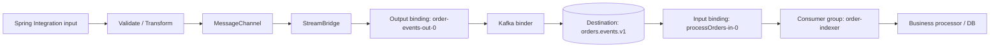
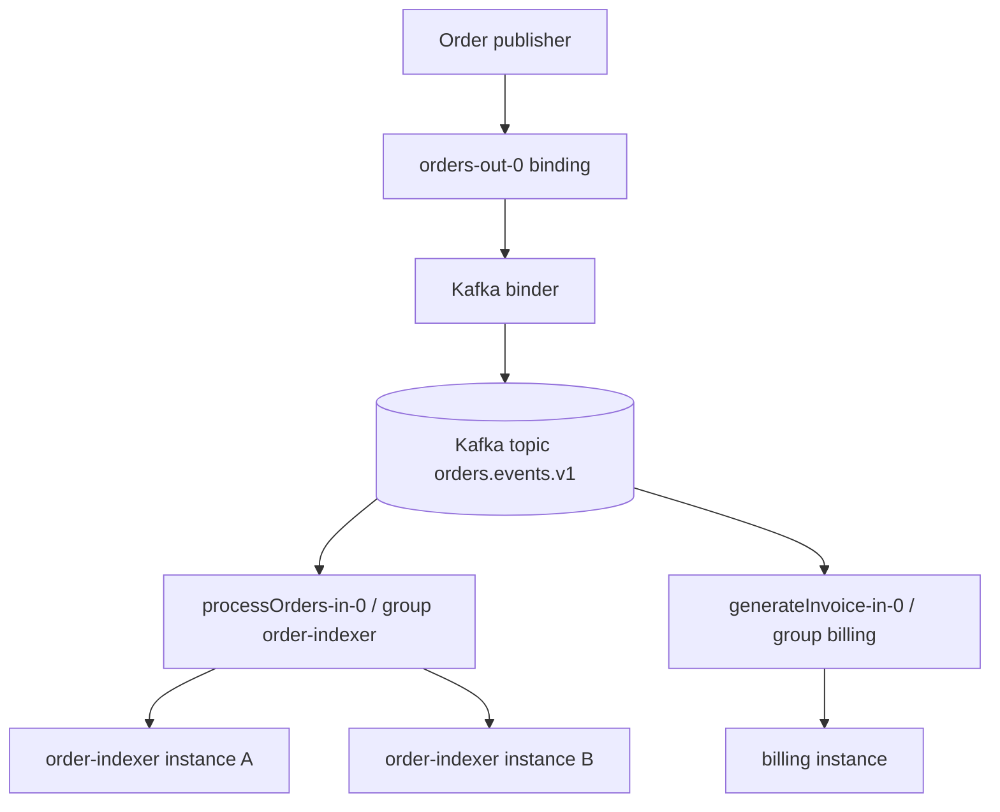
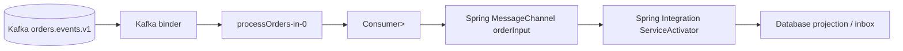
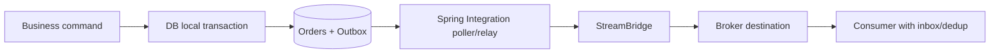

# Message broker binder và destination

## 1. Vì sao cần phân biệt binder và destination?

Trong module **SPRING_INTEGRATION_ADAPTERS**, Spring Integration kết nối các hệ thống ngoài thông qua inbound/outbound adapter, gateway, poller và `MessageChannel`. Dữ liệu có thể đi từ file, SFTP, HTTP hoặc cơ sở dữ liệu sang JMS, AMQP, Kafka, rồi tiếp tục tới ứng dụng khác. Khi dùng **Spring Cloud Stream** để tích hợp một **message broker**, các khái niệm **binder**, **binding**, **destination** và **consumer group** phải được phân biệt chính xác.

Một tình huống điển hình:

1. Spring Integration nhận thông tin cập nhật đơn hàng từ HTTP hoặc JDBC poller.
2. `IntegrationFlow` chuyển dữ liệu thành `OrderEvent` có schema rõ ràng.
3. Một `@ServiceActivator` dùng `StreamBridge` gửi vào một output **binding** có tên `order-events-out-0`.
4. **Binder** Kafka được cấu hình cho binding đó, biết cách kết nối broker.
5. Binder publish tới **destination** `orders.events.v1`, tức Kafka topic trong ví dụ.
6. Một ứng dụng tiêu thụ có input binding `processOrders-in-0`, cùng destination và consumer group `order-indexer`.
7. Các instances thuộc cùng group phối hợp tiêu thụ; group khác được nhận luồng riêng theo cơ chế broker.



**Một điểm dễ nhầm:** `order-events-out-0` là **tên logic trong ứng dụng**, còn `orders.events.v1` là **tên đích tại middleware**. `Kafka binder` không phải tên topic, và `order-indexer` không phải tên Kafka topic.

### Mục tiêu bài học

Sau bài này, bạn có thể:

- Phân biệt **Binder**, **Binding**, **Destination**, **Producer**, **Consumer**, **Consumer Group**.
- Hiểu sự khác nhau giữa Kafka topic/partition và RabbitMQ exchange/queue.
- Đọc và viết đúng `spring.cloud.stream.bindings.<bindingName>.*`.
- Cấu hình output binding và input binding cho hai ứng dụng.
- Gửi message từ một Spring Integration channel qua `StreamBridge`.
- Nhận message qua `Consumer<Message<OrderEvent>>` rồi chuyển vào Spring Integration.
- Kiểm thử bằng Spring Cloud Stream **Test Binder** không cần broker thật.
- Chọn binder khi có Kafka + RabbitMQ hoặc nhiều brokers cùng loại.
- Xử lý serialization, content type, headers, partitioning, retry, DLQ, acknowledgment và idempotency.
- Kiểm soát dynamic destination, authorization, tenant routing và lifecycle.

## 2. Bộ từ vựng cốt lõi

### 2.1. Binder là lớp kết nối middleware

**Binder** là một implementation của Spring Cloud Stream Binder SPI, chịu trách nhiệm kết nối application bindings với middleware tương ứng. Binder cung cấp khả năng tạo producer/consumer bindings, mapping đến đích vật lý, wiring client và áp các cấu hình riêng cho broker.

Ví dụ binder:

| Binder | Middleware | Đích vật lý thường gặp |
|---|---|---|
| Kafka binder | Apache Kafka | Topic và partitions. |
| RabbitMQ binder | RabbitMQ | Exchange + queues/bindings. |
| Spring Integration Test Binder | In-JVM test messaging | Test destinations, không kết nối broker thật. |
| Binder từ provider/extension | Middleware cụ thể | Theo semantics của binder đó. |

**Binder không phải message broker.** `spring-cloud-stream-binder-kafka` là thư viện chạy trong ứng dụng, còn **Kafka cluster** là dịch vụ ngoài. Khi broker down hoặc ACL sai, việc có binder dependency trên classpath không thể tự khôi phục dữ liệu đã mất.

### 2.2. Binding là cổng logic của ứng dụng

Một **binding** gắn input/output ở application level với middleware qua binder.

Ví dụ:

```text
processOrders-in-0     -> input binding
order-events-out-0     -> output binding
```

Tạo hai bindings bằng config:

```yaml
spring:
  cloud:
    stream:
      bindings:
        processOrders-in-0:
          destination: orders.events.v1
          group: order-indexer
        order-events-out-0:
          destination: orders.events.v1
```

Hai bindings khác tên nhưng cùng physical destination. Input binding tiêu thụ; output binding publish. Đổi tên bean/function có thể đổi tên binding theo convention, nên cần test cấu hình khi refactor.

### 2.3. Destination là địa chỉ logic phía broker

Spring Cloud Stream dùng property:

```text
spring.cloud.stream.bindings.<bindingName>.destination
```

Destination được binder diễn giải:

- Với **Kafka**: thường ánh xạ sang **topic**, ví dụ `orders.events.v1`.
- Với **RabbitMQ**: thường ánh xạ sang **exchange**, không phải queue nhận cuối cùng.
- Với binder khác: ý nghĩa vật lý tùy binder.

Nếu không cấu hình `destination`, framework mặc định dùng **binding name** làm destination. Quy tắc mặc định này tiện cho prototype nhưng dễ sinh topic/exchange sai tên khi binding name thay đổi.

### 2.4. Consumer group là cách chia sẻ công việc

Input binding có thể cấu hình:

```yaml
spring:
  cloud:
    stream:
      bindings:
        processOrders-in-0:
          destination: orders.events.v1
          group: order-indexer
```

Các instances cùng một **group** thường chia sẻ công việc trong group; hai groups khác nhau nhận luồng riêng theo publish-subscribe model. Cụ thể:

| Tình huống | Hành vi mong đợi |
|---|---|
| 3 instances nhóm `order-indexer` | Mỗi message được giao cho một consumer trong group theo cơ chế broker, không phải tất cả 3. |
| 2 instances nhóm `billing-audit` | Group này nhận luồng độc lập với `order-indexer`. |
| Consumer không có `group` | Có thể được coi là anonymous/ephemeral; semantics phụ thuộc broker/binder. |
| Hai ứng dụng vô tình dùng chung `group` | Chúng có thể cạnh tranh xử lý cùng luồng dù có vai trò nghiệp vụ khác nhau. |

**Group không bảo đảm exactly-once business processing.** Một record có thể được redeliver sau crash hoặc timeout/offset handling; business consumer vẫn cần idempotency.

### 2.5. So sánh ngắn

| Thuật ngữ | Thuộc về | Trả lời câu hỏi |
|---|---|---|
| `MessageChannel` | Spring Integration | Trong JVM, message đi tới handler nào? |
| `Binding name` | Spring Cloud Stream | Input/output của ứng dụng có tên gì? |
| `Binder` | Spring Cloud Stream integration | Dùng loại middleware nào để giao tiếp? |
| `Destination` | Middleware qua binder | Publish/subscribe ở topic hoặc exchange nào? |
| `Group` | Consumer subscription | Những instances nào cùng chia sẻ xử lý? |
| `Partition` | Broker/binder phân vùng | Message được phân tới shard/partition nào? |
| `DLQ/DLT` | Error recovery | Record không xử lý được được cô lập ở đâu? |

## 3. Sơ đồ hai ứng dụng và hai consumer groups

Một hệ thống đơn hàng có producer và hai nghiệp vụ downstream:



- Nhóm `order-indexer` và nhóm `billing` có cursor/offset/ack state độc lập theo Kafka/RabbitMQ semantics.
- Hai instances `order-indexer` **không mặc nhiên nhận mỗi instance một bản sao của mọi record**.
- `billing` được luồng riêng; lỗi của group này không đồng nghĩa `order-indexer` thất bại.
- `orders-out-0` là output binding producer; `processOrders-in-0` và `generateInvoice-in-0` là input bindings của các ứng dụng tiêu thụ.
- Destination có thể giữ nguyên qua môi trường, hoặc được cấu hình khác theo profile/deployment; application code nên dùng tên binding logic ổn định.

### 3.1. Đừng dùng group để định danh tenant không tin cậy

Một group name do người dùng nhập không phải authentication principal. Không để HTTP request header quyết định arbitrary `group` hoặc `destination` để đọc dữ liệu của tenant khác. Credentials/ACL broker và server-side authorization mới quyết định quyền truy cập.

## 4. Kafka binder: destination là topic

### 4.1. Ánh xạ cơ bản

```text
Binding:   order-events-out-0
Binder:    kafka
Destination: orders.events.v1
               |
               v
Kafka topic orders.events.v1
  partition 0 | partition 1 | partition 2 | ...
```

Kafka có **partitions**, **producer acks**, **consumer group offsets** và **retention policies**. Binder Kafka ánh xạ destination tới topic, group tới Kafka consumer group, partitioning tới partitions.

Ví dụ producer config:

```yaml
spring:
  cloud:
    stream:
      bindings:
        order-events-out-0:
          destination: orders.events.v1
          binder: kafka
          content-type: application/json
          producer:
            partition-key-expression: payload.orderId
            partition-count: 6
```

**Lưu ý:** khi chỉ có một binder trên classpath, property `binder: kafka` thường không bắt buộc. Nhưng với nhiều binders, explicit naming giúp tránh gửi sang middleware sai.

### 4.2. Kafka group và ordering

Trong Kafka:

1. Topic được chia thành partitions.
2. Một partition thường được assign cho một consumer instance trong cùng group tại một thời điểm.
3. Trong một partition, thứ tự record được duy trì theo broker semantics.
4. Nhiều partitions không có một total order duy nhất trên toàn topic.
5. Khi group rebalance, partition ownership chuyển giữa instances; consumer phải xử lý duplicates/recovery.

Muốn giữ thứ tự thay đổi của cùng đơn, dùng một stable key như `orderId` để các events của đơn đến cùng partition. Tuy nhiên, cần kết hợp concurrency/retry/error policy của consumer; xử lý song song không kiểm soát vẫn có thể làm side effects không đúng thứ tự.

### 4.3. Kafka destination provisioning

Tùy quyền và cấu hình, binder có thể tự tạo/provision topic hoặc mong đợi topic đã tồn tại. Production thường dùng IaC/operator để cấu hình:

- Số partitions và replication factor.
- Retention, compaction và cleanup policy.
- ACL cho producer/consumer groups.
- Maximum record size.
- TLS/SASL, network access.
- Monitoring cho lag và ISR/under-replicated partitions.

**Không dựa vào auto-provisioning để định nghĩa topology production** nếu tổ chức yêu cầu review và change control. Destination name có thể được chấp nhận ở application nhưng broker từ chối vì thiếu quyền `Create`/`Write`.

## 5. RabbitMQ binder: destination thường là exchange

Một điểm khác quan trọng:

```text
Binding: processOrders-in-0
Destination: orders.events.v1
Group: order-indexer
             |
             v
RabbitMQ exchange: orders.events.v1
             |
             v
Queue: orders.events.v1.order-indexer
             |
             v
Consumer instance(s)
```

Mặc định RabbitMQ binder thường provision **topic exchange** từ destination. Khi có `group`, nó provision queue có tên dạng `<destination>.<group>` (cộng prefix nếu đã cấu hình), rồi bind queue tới exchange. Khi không có group, thường dùng anonymous auto-delete queue.

### 5.1. Sự khác biệt với Kafka

| Đặc điểm | Kafka binder | RabbitMQ binder |
|---|---|---|
| Destination mặc định | Topic | Exchange. |
| Consumer group | Kafka group ID + offsets | Queue gắn với group, nhiều consumers chia sẻ queue. |
| Cơ chế phân phối | Partition assignment, read offsets | Exchange routing đến queue, queue delivery/acks. |
| Lưu lịch sử | Topic retention cho phép đọc lại tùy offsets | Message thường không còn trong queue sau khi ack; topology/queue policy quyết định. |
| Nhiều groups | Mỗi group có offset riêng trên cùng topic | Mỗi group thường có queue riêng cùng bind exchange. |
| Không có group | Anonymous subscription/consumer theo binder | Anonymous, auto-delete queue theo mặc định. |
| DLQ | Dead-letter topic theo binder Kafka | DLX + dead-letter queue theo Rabbit settings. |
| Ordering | Theo partition trong điều kiện phù hợp | Theo queue/consumer, có thể ảnh hưởng bởi concurrency, requeue và priority. |

**Cảnh báo:** `destination: orders.events.v1` không có nghĩa Rabbit consumer sẽ trực tiếp consume một queue tên `orders.events.v1`. Với default group-based topology, queue thường có hậu tố group.

### 5.2. Ví dụ Rabbit consumer

```yaml
spring:
  cloud:
    stream:
      bindings:
        processOrders-in-0:
          destination: orders.events.v1
          group: order-indexer
          binder: rabbit
          content-type: application/json
          consumer:
            concurrency: 2
```

Khi dùng Rabbit binder thật, cần bổ sung dependency, connection configuration và user/vhost permissions. `concurrency: 2` chỉ là cấu hình số consumer threads/containers theo binder, không bảo đảm throughput gấp đôi hoặc thứ tự không bị ảnh hưởng.

### 5.3. Khi broker có queue/exchange đã tạo sẵn

Có thể cần:

```yaml
spring:
  cloud:
    stream:
      bindings:
        processOrders-in-0:
          destination: precreated.exchange
          group: existing.queue
      rabbit:
        bindings:
          processOrders-in-0:
            consumer:
              bind-queue: false
              declare-exchange: false
              queue-name-group-only: true
```

Đây là **phương án sử dụng pre-provisioned Rabbit infrastructure**. Queue `existing.queue` và exchange `precreated.exchange` phải đã tồn tại và được bind đúng routing key bởi hạ tầng bên ngoài. Không dùng fragment này nếu chưa kiểm soát broker topology, vì nó có thể khiến consumer không nhận message.

### 5.4. Group không phải routing key

- `group` xác định nhóm consumer/queue subscription.
- `destination` chọn exchange.
- Routing key và binding key là các khái niệm riêng của RabbitMQ.
- Kafka không có exchange/routing key kiểu RabbitMQ.

Đừng dùng `group=highPriority` để suy rằng Rabbit sẽ route riêng priority cao; phải thiết kế routing keys/exchanges/queues và binder-specific properties phù hợp.

## 6. Đặt tên binding trong functional model

Spring Cloud Stream hiện đại dùng Spring Cloud Function model với `Supplier`, `Function` và `Consumer`.

### 6.1. Quy tắc tên

| Function bean | Input binding | Output binding |
|---|---|---|
| `Consumer<OrderEvent> processOrders` | `processOrders-in-0` | Không có output. |
| `Supplier<OrderEvent> orderSupplier` | Không có input. | `orderSupplier-out-0`. |
| `Function<String,String> normalize` | `normalize-in-0` | `normalize-out-0`. |

Hậu tố `-in-0` và `-out-0` đánh dấu vị trí argument/result đầu tiên. Với function composition/multiple inputs, naming phức tạp hơn và phải theo tài liệu của version đang dùng.

```java
@Bean
Consumer<OrderEvent> processOrders() {
    return order -> {
        // Validate, idempotency, business processing.
    };
}
```

Cấu hình:

```yaml
spring:
  cloud:
    function:
      definition: processOrders
    stream:
      bindings:
        processOrders-in-0:
          destination: orders.events.v1
          group: order-indexer
```

`spring.cloud.function.definition` là **tên function**, không phải tên destination hoặc binding.

### 6.2. Khi rename function

Nếu đổi bean `processOrders` thành `indexOrders` nhưng vẫn giữ:

```yaml
bindings:
  processOrders-in-0:
    destination: orders.events.v1
```

thì cấu hình cũ có thể không còn áp dụng cho input binding mới. Đây là một lỗi deployment tinh vi: app khởi động, nhưng consumer lại subscribe một destination mặc định như `indexOrders-in-0`.

**Cần test binding names như một phần contract deployment** trước và sau refactor function.

### 6.3. Ghi đè implicit naming

Spring Cloud Stream có cơ chế binding alias/property mapping cho một số trường hợp, nhưng cấu hình thường đơn giản nhất là giữ convention `<function>-in-0` và `<function>-out-0`, rồi đặt `destination` tường minh. Không dựa vào tên function như tên Kafka topic ở production.

## 7. Cấu trúc properties: chung và binder-specific

### 7.1. Thứ tự cấu hình

```text
spring.cloud.stream
  .bindings.<bindingName>.destination
  .bindings.<bindingName>.group
  .bindings.<bindingName>.content-type
  .bindings.<bindingName>.binder
  .bindings.<bindingName>.consumer.*
  .bindings.<bindingName>.producer.*

spring.cloud.stream.kafka.bindings.<bindingName>.consumer.*
spring.cloud.stream.kafka.bindings.<bindingName>.producer.*

spring.cloud.stream.rabbit.bindings.<bindingName>.consumer.*
spring.cloud.stream.rabbit.bindings.<bindingName>.producer.*
```

**Common binding properties** áp cho phần lớn binders. **Extended binder properties** chỉ áp cho Kafka/Rabbit hoặc middleware tương ứng.

### 7.2. Bảng các properties nên thuộc lòng

| Property | Dùng cho | Ý nghĩa |
|---|---|---|
| `bindings.<name>.destination` | Input/output | Destination vật lý; mặc định bằng binding name. |
| `bindings.<name>.group` | Input | Consumer group; không áp cho output. |
| `bindings.<name>.binder` | Input/output | Binder cụ thể; mặc định binder được chọn khi có thể. |
| `bindings.<name>.content-type` | Input/output | Content type hỗ trợ chuyển đổi, thường mặc định JSON. |
| `bindings.<name>.consumer.concurrency` | Input | Mức concurrency consumer. |
| `bindings.<name>.consumer.max-attempts` | Input | Số lần thử xử lý gồm lần đầu theo common retry policy. |
| `bindings.<name>.consumer.use-native-decoding` | Input | Để deserializer của client/binder xử lý native bytes. |
| `bindings.<name>.producer.use-native-encoding` | Output | Để serializer của client/binder xử lý native payload. |
| `bindings.<name>.producer.partition-key-expression` | Output | SpEL tìm partition key. |
| `bindings.<name>.producer.partition-count` | Output | Tổng partitions logic đề nghị cho producer partitioning. |
| `output-bindings` | Output từ non-function sources | Pre-create output binding trước first send. |
| `default-binder` | Cấp ứng dụng | Binder mặc định khi nhiều binders có thể dùng. |
| `binders.<name>.type` | Multi-binder | Loại binder của một cấu hình binder có tên. |

`group` chỉ có nghĩa với input binding. Không cấu hình group trên output và cho rằng producer sẽ “publish vào consumer group”.

### 7.3. Ví dụ tách app producer và consumer

Producer:

```yaml
spring:
  cloud:
    stream:
      output-bindings: order-events-out-0
      bindings:
        order-events-out-0:
          destination: orders.events.v1
          content-type: application/json
```

Consumer:

```yaml
spring:
  cloud:
    function:
      definition: processOrders
    stream:
      bindings:
        processOrders-in-0:
          destination: orders.events.v1
          group: order-indexer
          content-type: application/json
```

Chỉ cần cùng destination/schema và binder tương thích; không bắt buộc hai ứng dụng dùng cùng tên binding.

## 8. Dependency/BOM: chọn đúng line tương thích

Ví dụ Java 17+, Spring Boot 3.x, Spring Integration 6.x, Spring Cloud Stream 4.x phải đi cùng Spring Cloud release train được tuyên bố tương thích. Với Spring Boot 4.x/Cloud Stream 5.x, Java baseline và cách quản lý dependencies có thể khác. **Không copy một version cụ thể từ blog cũ rồi ghép với framework mới.**

Maven trong ví dụ giả định Spring Boot BOM và Spring Cloud BOM được import trong `dependencyManagement` phù hợp:

```xml
<dependencies>
    <dependency>
        <groupId>org.springframework.boot</groupId>
        <artifactId>spring-boot-starter-integration</artifactId>
    </dependency>
    <dependency>
        <groupId>org.springframework.cloud</groupId>
        <artifactId>spring-cloud-stream</artifactId>
    </dependency>
    <!-- Chọn đúng binder cho runtime; ví dụ Kafka. -->
    <dependency>
        <groupId>org.springframework.cloud</groupId>
        <artifactId>spring-cloud-stream-binder-kafka</artifactId>
    </dependency>
    <dependency>
        <groupId>org.springframework.boot</groupId>
        <artifactId>spring-boot-starter-json</artifactId>
    </dependency>
    <dependency>
        <groupId>org.springframework.boot</groupId>
        <artifactId>spring-boot-starter-test</artifactId>
        <scope>test</scope>
    </dependency>
    <dependency>
        <groupId>org.springframework.cloud</groupId>
        <artifactId>spring-cloud-stream-test-binder</artifactId>
        <scope>test</scope>
    </dependency>
</dependencies>
```

Nếu chọn RabbitMQ thay Kafka, dùng `spring-cloud-stream-binder-rabbit`. Trong một dự án multi-binder, có thể dùng cả hai dependencies và đặt `binder` cho từng binding.

**Không** sử dụng `@EnableBinding`, `@StreamListener` hoặc `BinderAwareChannelResolver` của API đời cũ làm con đường chính cho một project Spring Cloud Stream hiện đại; sử dụng functional model và `StreamBridge`.

## 9. Lab A: Spring Integration outbound → StreamBridge → Kafka topic

Trong lab này, ta tạo một **producer application**:

```text
OrderEventPublisher
  -> Spring DirectChannel "toBroker"
  -> @ServiceActivator OrderOutboundHandler
  -> StreamBridge.send("order-events-out-0", Spring Message)
  -> Kafka binder
  -> destination "orders.events.v1"
```

Lab không cần mở một HTTP port: test gọi Java service. Điều này giúp tập trung vào contract của binder/destination.

### 9.1. DTO event

File `OrderEvent.java`:

```java
package example.binder;

import java.time.Instant;

public record OrderEvent(
    String eventId,
    String orderId,
    String status,
    long version,
    Instant occurredAt
) {}
```

`eventId` phải ổn định qua retries; `version` phục vụ thứ tự/loại bỏ stale updates khi domain yêu cầu. Demo publisher sinh event mới, nhưng production cần lấy event ID/version từ source-of-truth hoặc outbox.

### 9.2. Spring Boot application

File `BrokerBridgeApplication.java`:

```java
package example.binder;

import org.springframework.boot.SpringApplication;
import org.springframework.boot.autoconfigure.SpringBootApplication;
import org.springframework.integration.annotation.EnableIntegration;

@SpringBootApplication
@EnableIntegration
public class BrokerBridgeApplication {

    public static void main(String[] args) {
        SpringApplication.run(
            BrokerBridgeApplication.class, args);
    }
}
```

### 9.3. MessageChannel

File `BrokerChannels.java`:

```java
package example.binder;

import org.springframework.context.annotation.Bean;
import org.springframework.context.annotation.Configuration;
import org.springframework.integration.channel.DirectChannel;
import org.springframework.messaging.MessageChannel;

@Configuration
public class BrokerChannels {

    @Bean("toBroker")
    public MessageChannel toBroker() {
        return new DirectChannel();
    }
}
```

`toBroker` là channel **nội bộ Spring Integration**. `order-events-out-0` là **Cloud Stream binding**. Một channel không tự trở thành Kafka topic chỉ vì trùng tên.

### 9.4. Outbound service activator

File `OrderOutboundHandler.java`:

```java
package example.binder;

import java.util.Set;

import org.springframework.cloud.stream.function.StreamBridge;
import org.springframework.integration.annotation.ServiceActivator;
import org.springframework.messaging.Message;
import org.springframework.messaging.support.MessageBuilder;
import org.springframework.stereotype.Component;

@Component
public class OrderOutboundHandler {

    public static final String BINDING =
        "order-events-out-0";

    private static final Set<String> STATUSES =
        Set.of("CREATED", "PAID", "SHIPPED", "CANCELLED");

    private final StreamBridge bridge;

    public OrderOutboundHandler(StreamBridge bridge) {
        this.bridge = bridge;
    }

    @ServiceActivator(inputChannel = "toBroker")
    public void onOrder(Message<OrderEvent> incoming) {
        OrderEvent event = incoming.getPayload();
        validate(event);

        // Tạo outbound Message mới với header allowlist.
        // Không forward replyChannel/errorChannel/credentials.
        Message<OrderEvent> outbound = MessageBuilder
            .withPayload(event)
            .setHeader("eventId", event.eventId())
            .setHeader("orderId", event.orderId())
            .setHeader("schemaVersion", "1")
            .build();

        boolean sent = bridge.send(BINDING, outbound);

        if (!sent) {
            throw new IllegalStateException(
                "StreamBridge rejected order event");
        }

        // sent == true không phải broker durable ACK,
        // cũng không xác nhận business consumer đã commit.
    }

    private static void validate(OrderEvent event) {
        if (event == null
                || event.eventId() == null
                || !event.eventId().matches("[A-Za-z0-9_-]{1,100}")
                || event.orderId() == null
                || !event.orderId().matches("[A-Za-z0-9_-]{1,100}")
                || event.status() == null
                || !STATUSES.contains(event.status())
                || event.version() <= 0
                || event.occurredAt() == null) {
            throw new IllegalArgumentException(
                "Invalid OrderEvent contract");
        }
    }
}
```

**Giải thích:**

- `@ServiceActivator` nối message từ `DirectChannel` tới handler.
- `StreamBridge` chọn **logical binding name**, không trực tiếp chọn Kafka topic.
- Binding config ánh xạ `order-events-out-0` tới `orders.events.v1`.
- Fail-fast validation chạy trước khi publish.
- Header allowlist giúp không đưa Spring internal references hoặc secret sang broker.
- `boolean sent` chỉ biểu diễn trạng thái gửi ở boundary framework; producer confirmation là chuyện riêng.

### 9.5. Publisher gọi channel

File `OrderEventPublisher.java`:

```java
package example.binder;

import java.time.Instant;
import java.util.UUID;

import org.springframework.beans.factory.annotation.Qualifier;
import org.springframework.messaging.MessageChannel;
import org.springframework.messaging.support.MessageBuilder;
import org.springframework.stereotype.Service;

@Service
public class OrderEventPublisher {

    private final MessageChannel toBroker;

    public OrderEventPublisher(
            @Qualifier("toBroker") MessageChannel toBroker) {
        this.toBroker = toBroker;
    }

    public String publish(String orderId, String status,
                          long version) {
        String eventId = UUID.randomUUID().toString();

        OrderEvent event = new OrderEvent(
            eventId, orderId, status, version, Instant.now());

        boolean dispatched = toBroker.send(
            MessageBuilder.withPayload(event).build());

        if (!dispatched) {
            throw new IllegalStateException(
                "Spring channel rejected event");
        }

        return eventId;
    }
}
```

**Không tái tạo event ID khi replay cùng một business event.** Demo tạo `UUID` để minh họa độc lập; sản phẩm thật nên phát từ một outbox record mang ID ổn định.

### 9.6. application.yml producer

```yaml
spring:
  application:
    name: order-producer

  cloud:
    stream:
      output-bindings: order-events-out-0

      bindings:
        order-events-out-0:
          destination: orders.events.v1
          content-type: application/json
          producer:
            partition-key-expression: payload.orderId
            partition-count: 6

      kafka:
        binder:
          brokers: ${KAFKA_BOOTSTRAP_SERVERS:localhost:9092}
```

`output-bindings` tạo output binding từ startup dù app không có `Supplier`/`Function` tạo output. Nó giúp giảm rủi ro lần gửi đầu phải khởi tạo binder trong thời điểm nhạy cảm. Tuy vậy, broker vẫn có thể trở nên unavailable sau startup.

**Điều kiện production:** broker ACL, TLS/SASL, topic partitions/replication và secret management phải được cấu hình riêng; lệnh `send(...)` không tự thêm chúng.

## 10. Lab B: Cloud Stream input binding → Spring Integration

App consumer có thể dùng cùng `OrderEvent` schema nhưng triển khai riêng:



### 10.1. Khai báo consumer function

File `OrderConsumerBridge.java`:

```java
package example.binder.consumer;

import java.util.function.Consumer;

import org.springframework.beans.factory.annotation.Qualifier;
import org.springframework.context.annotation.Bean;
import org.springframework.context.annotation.Configuration;
import org.springframework.integration.channel.DirectChannel;
import org.springframework.messaging.Message;
import org.springframework.messaging.MessageChannel;

import example.binder.OrderEvent;

@Configuration
public class OrderConsumerBridge {

    @Bean("orderInput")
    MessageChannel orderInput() {
        return new DirectChannel();
    }

    @Bean
    Consumer<Message<OrderEvent>> processOrders(
            @Qualifier("orderInput") MessageChannel input) {
        return message -> {
            boolean dispatched = input.send(message);
            if (!dispatched) {
                throw new IllegalStateException(
                    "orderInput channel rejected event");
            }
        };
    }
}
```

Consumer function nhận message từ binder, rồi chuyển vào Spring Integration channel. Chúng ta **không** gọi `StreamBridge` để consume ở đây: framework gọi `Consumer` qua input binding.

**Cảnh báo:** đặt code này ở một **consumer application/profile** khác với producer lab khi triển khai thực tế. Nếu cùng app có producer + consumer trên cùng topic, phải xác định tránh vòng lặp và tên function; không tự bật mọi cấu hình cùng lúc mà không có mục đích.

### 10.2. Xử lý nghiệp vụ phía Spring Integration

File `OrderProjectionHandler.java`:

```java
package example.binder.consumer;

import org.springframework.integration.annotation.ServiceActivator;
import org.springframework.messaging.Message;
import org.springframework.stereotype.Component;

import example.binder.OrderEvent;

@Component
public class OrderProjectionHandler {

    @ServiceActivator(inputChannel = "orderInput")
    public void apply(Message<OrderEvent> incoming) {
        OrderEvent event = incoming.getPayload();

        if (event == null || event.orderId() == null
                || event.version() <= 0) {
            throw new IllegalArgumentException(
                "Invalid event for projection");
        }

        // Production:
        // 1. Transactional inbox / idempotency check by eventId.
        // 2. Reject stale version, preserve per-order ordering.
        // 3. Update DB/materialized view.
        // 4. Commit according to binder ack/offset contract.
    }
}
```

Đây là **demo handler**, chưa có database transaction/inbox. Nếu `apply(...)` chỉ validate rồi return, test chỉ chứng minh message đã đến handler, **không** chứng minh business state đã commit.

### 10.3. Cấu hình consumer application

```yaml
spring:
  application:
    name: order-indexer

  cloud:
    function:
      definition: processOrders

    stream:
      bindings:
        processOrders-in-0:
          destination: orders.events.v1
          group: order-indexer
          content-type: application/json
          consumer:
            concurrency: 2
            max-attempts: 3
            back-off-initial-interval: 1000
            back-off-max-interval: 10000
            back-off-multiplier: 2.0

      kafka:
        binder:
          brokers: ${KAFKA_BOOTSTRAP_SERVERS:localhost:9092}
```

Ở đây `processOrders` là **function bean name**. `processOrders-in-0` là input binding; `orders.events.v1` là topic; `order-indexer` là consumer group.

**Không đặt** `group` ở output binding. Group chỉ có ý nghĩa với input/consumer.

### 10.4. Group thứ hai độc lập

Nếu một billing service cũng cần dữ liệu:

```yaml
spring:
  cloud:
    stream:
      bindings:
        generateInvoice-in-0:
          destination: orders.events.v1
          group: billing
```

Khi `billing` khác `order-indexer`, đây là hai subscriptions độc lập. Nếu bạn vô tình dùng `group: order-indexer` cho billing service, hai nghiệp vụ có thể chia nhau messages thay vì mỗi bên nhận đủ, dẫn tới mất dữ liệu nghiệp vụ theo cách rất khó phát hiện.

## 11. Kiểm thử bằng Test Binder

Spring Cloud Stream cung cấp **Spring Integration Test Binder** ở module:

```text
org.springframework.cloud:spring-cloud-stream-test-binder
```

Nó chạy trong JVM để test binding names, destinations, serialization và message contracts mà không cần Kafka/RabbitMQ thật.

### 11.1. Test producer

File `OrderProducerBindingTest.java`:

```java
package example.binder;

import static org.junit.jupiter.api.Assertions.*;

import java.nio.charset.StandardCharsets;
import java.util.UUID;

import com.fasterxml.jackson.databind.JsonNode;
import com.fasterxml.jackson.databind.ObjectMapper;

import org.junit.jupiter.api.Test;
import org.springframework.beans.factory.annotation.Autowired;
import org.springframework.boot.test.context.SpringBootTest;
import org.springframework.cloud.stream.binder.test.EnableTestBinder;
import org.springframework.cloud.stream.binder.test.OutputDestination;
import org.springframework.messaging.Message;

@SpringBootTest
@EnableTestBinder
class OrderProducerBindingTest {

    @Autowired
    OrderEventPublisher publisher;

    @Autowired
    OutputDestination output;

    @Autowired
    ObjectMapper mapper;

    @Test
    void sendsJsonToConfiguredDestination()
            throws Exception {

        String orderId = "order-" + UUID.randomUUID();
        String eventId =
            publisher.publish(orderId, "PAID", 2);

        Message<byte[]> outbound =
            output.receive(5_000, "orders.events.v1");

        assertNotNull(outbound);

        String json = new String(
            outbound.getPayload(), StandardCharsets.UTF_8);

        JsonNode event = mapper.readTree(json);

        assertEquals(eventId,
            event.path("eventId").asText());
        assertEquals(orderId,
            event.path("orderId").asText());
        assertEquals("PAID",
            event.path("status").asText());
        assertEquals(2L,
            event.path("version").asLong());
    }

    @Test
    void rejectsInvalidStatus() {
        assertThrows(IllegalArgumentException.class,
            () -> publisher.publish(
                "order-invalid", "UNKNOWN", 1));
    }
}
```

**Điểm then chốt:** `OutputDestination.receive(5_000, "orders.events.v1")` nhận theo **physical destination**, không phải `order-events-out-0` khi đã cấu hình mapping destination.

### 11.2. Test consumer

Trong **consumer application/profile** riêng, có thể bật:

```java
@SpringBootTest
@EnableTestBinder
class OrderConsumerBindingTest {
    @Autowired InputDestination input;

    @Test
    void routesBrokerEventToSpringIntegration() {
        String body = """
            {
              "eventId":"evt-101",
              "orderId":"order-42",
              "status":"PAID",
              "version":2,
              "occurredAt":"2026-11-23T02:15:10Z"
            }
            """;

        Message<byte[]> message = MessageBuilder
            .withPayload(body.getBytes(StandardCharsets.UTF_8))
            .setHeader("contentType", "application/json")
            .build();

        input.send(message, "orders.events.v1");

        // Cần một spy/probe hoặc fake repository ở
        // OrderProjectionHandler để assert handler đã chạy.
        // Chỉ gọi input.send() không chứng minh DB commit.
    }
}
```

Fragment cần imports JUnit/Spring Boot/Test Binder/`InputDestination`/`MessageBuilder`/`Message`/`StandardCharsets`. Muốn test business hoàn chỉnh, thay placeholder bằng một fake/spy `OrderProjectionHandler` hoặc store thật trong test profile rồi assert state.

### 11.3. Giới hạn Test Binder

| Test Binder kiểm tra | Test Binder không xác nhận |
|---|---|
| Function/binding wiring, destination names | Kafka topic ACL/replication/partition count. |
| POJO→bytes content conversion | Kafka native serializer với broker thực nếu khác config. |
| Spring Integration service activator | Rabbit exchange/queue binding ngoài JVM. |
| Validation, route và header allowlist | TLS/SASL/secret đúng production. |
| InputDestination/OutputDestination | Broker ack, consumer rebalances hoặc network partition. |

Để xác minh Kafka/Rabbit semantics, cần thêm **integration test với broker thật hoặc môi trường mô phỏng hỗ trợ đúng tính năng**. Không sử dụng test binder như bằng chứng exactly-once.

### 11.4. Tránh test nhiễu

Test binder có thể giữ messages giữa các tests trong một Spring context. Dùng unique event IDs, test isolation, không chạy song song trên shared output/input destinations nếu test phụ thuộc thứ tự, và xác minh messages theo correlation/ID thay vì chỉ “không null”.

## 12. Nhiều binders trong cùng ứng dụng

Một ứng dụng có thể:

```text
Spring Integration
   -> audit-out-0  --Kafka binder--> Kafka topic
   -> jobs-out-0   --Rabbit binder-> Rabbit exchange
```

### 12.1. Cấu hình chọn binder cho mỗi binding

```yaml
spring:
  cloud:
    stream:
      binders:
        kafkaAudit:
          type: kafka
          environment:
            spring:
              cloud:
                stream:
                  kafka:
                    binder:
                      brokers: kafka.internal.example:9092

        rabbitJobs:
          type: rabbit
          environment:
            spring:
              rabbitmq:
                host: rabbit.internal.example

      output-bindings: audit-out-0;jobs-out-0

      bindings:
        audit-out-0:
          destination: audit.events.v1
          binder: kafkaAudit
          content-type: application/json

        jobs-out-0:
          destination: jobs.commands.v1
          binder: rabbitJobs
          content-type: application/json
```

**Yêu cầu:** cả Kafka và Rabbit binder dependencies phải có trong ứng dụng. `kafkaAudit`/`rabbitJobs` là **binder configuration names**, còn `kafka`/`rabbit` là **binder types**.

Khi khai báo explicit binder configurations, Spring Cloud Stream thay đổi cơ chế chọn default binder; phải liệt kê và cấu hình đủ binders được dùng. Không mặc định tự động chọn binder đúng chỉ vì classpath có cả hai.

### 12.2. StreamBridge gửi theo binding cố định

```java
streamBridge.send("audit-out-0", auditEvent);

streamBridge.send("jobs-out-0", jobCommand);
```

Do binding config đã chọn binder, ứng dụng không cần để message đến từ HTTP input tự quyết định broker URI. Đây là cách giữ authorization và routing dễ review.

### 12.3. Hai Kafka clusters cũng cần multi-binder config

Một ứng dụng có thể muốn ghi tới Kafka cluster East và Kafka cluster West. Mặc dù đều dùng Kafka binder type, vẫn cần **hai binder configurations** với broker properties khác nhau, và ánh xạ binding riêng.

Đừng chỉ thêm hai bootstrap servers vào cùng `brokers` rồi suy đó là hai hệ độc lập: trong Kafka, danh sách bootstrap servers thường thuộc **một cluster**, không dùng để publish cùng event sang hai clusters khác nhau.

### 12.4. Không có atomic transaction xuyên nhiều binders

Hai lời gọi:

```java
streamBridge.send("audit-out-0", auditEvent);
streamBridge.send("jobs-out-0", jobCommand);
```

không tự tham gia một transaction nguyên tử giữa Kafka và RabbitMQ. Lệnh thứ nhất có thể thành công còn lệnh thứ hai lỗi. Cần outbox/saga/reconciliation, hoặc tách luồng nguồn sự thật và fan-out downstream theo contract.

## 13. Producer/consumer group, partition và scaling

### 13.1. Fan-out giữa groups, load balancing trong group

```text
Topic orders.events.v1
    |
    +--> Group order-indexer
    |      +-- instance 1
    |      +-- instance 2
    |
    +--> Group billing
           +-- instance 1
           +-- instance 2
```

Trong group `order-indexer`, một record được phân công cho một instance/partition owner theo broker; nhóm `billing` được luồng riêng. **Redelivery và retry vẫn có thể tạo multiple processing attempts** trong cùng group.

### 13.2. Concurrency và partitions

Ví dụ Kafka topic có 3 partitions nhưng triển khai 8 consumer threads trong cùng group; tại một thời điểm không thể có 8 threads đều xử lý 8 partitions độc lập vì chỉ có 3 partitions. Ngược lại, tăng partitions có thể tăng song song nhưng làm thay đổi partition routing/key distribution và ảnh hưởng ordering.

Với RabbitMQ, multiple consumers trên một queue có thể tăng throughput nhưng ảnh hưởng ordering khi requeue/retry và side effects không đồng bộ.

### 13.3. Cấu hình producer partition key

```yaml
spring:
  cloud:
    stream:
      bindings:
        order-events-out-0:
          producer:
            partition-key-expression: payload.orderId
            partition-count: 6
```

**Mục tiêu** là các events của cùng `orderId` có cơ hội đến cùng partition. Cần kiểm tra binder-specific Kafka partition algorithm, real topic partition count và consumer concurrency. Không dùng `eventId` mới cho mỗi event nếu muốn giữ per-order ordering.

### 13.4. Partitioning không phải authorization

Một tenant ID hoặc order ID quyết định partition **không** hạn chế quyền đọc topic. Nếu yêu cầu isolation đa tenant, cấu hình broker ACL/topic ownership, consumer principal và server-side authorization riêng.

## 14. Content type, serializer và schema

### 14.1. Content conversion

Spring Cloud Stream binding có:

```yaml
spring:
  cloud:
    stream:
      bindings:
        order-events-out-0:
          content-type: application/json
        processOrders-in-0:
          content-type: application/json
```

Khi không bật native encoding/decoding, framework sử dụng message conversion theo contract. Producer phải kiểm tra **wire bytes**; consumer phải kiểm tra DTO schema.

### 14.2. Native encoding/decoding

```yaml
spring:
  cloud:
    stream:
      bindings:
        order-events-out-0:
          producer:
            use-native-encoding: true
        processOrders-in-0:
          consumer:
            use-native-decoding: true
```

Khi bật native mode, payload được serializer/deserializer ở binder/client xử lý. **Không** chỉ bật hai flags rồi mong POJO tự thành JSON; cần cấu hình Kafka serializers/deserializers tương thích và test với broker thật.

### 14.3. Schema evolution

Một event nên có:

```json
{
  "schemaVersion": 1,
  "eventId": "evt-101",
  "orderId": "order-42",
  "status": "PAID",
  "version": 2,
  "occurredAt": "2026-11-23T02:15:10Z"
}
```

Không dùng arbitrary Java serialization làm hợp đồng xuyên service. Với sự kiện quan trọng, có thể dùng Avro/Protobuf/JSON Schema và registry; kiểm tra backward/forward compatibility trước khi rollout.

### 14.4. Header mapping

Chỉ forward metadata được phép:

| Header | Thường giữ? | Lưu ý |
|---|---|---|
| `eventId` | Có | Stable ID cho correlation/dedup. |
| `orderId` | Có thể | Routing/partition; tránh tạo metric cardinality cao. |
| `schemaVersion` | Có | Consumer biết cách decode. |
| `traceparent` | Có theo tracing policy | Kiểm soát trust/length. |
| `trustedTenantId` | Có khi nguồn đã được xác thực | Không lấy từ arbitrary HTTP header. |
| `replyChannel`/`errorChannel` | Không | Framework-specific Java objects. |
| `Authorization`/API tokens | Không | Secrets. |
| `destination` tự khai báo | Không dùng trực tiếp làm quyền route | Dễ cross-tenant/routing injection. |

## 15. Error channel, retry và DLQ

### 15.1. Hai loại failure chính

1. **Producer-side failure:** Spring handler không thể publish hoặc broker từ chối/timeout.
2. **Consumer-side failure:** record đã được broker phân phát nhưng business code ném exception, deserialize lỗi hoặc DB không sẵn sàng.

`errorChannel` của Spring Integration và producer/consumer error infrastructure của Cloud Stream có thể liên thông, nhưng **không phải mọi lỗi đều tự đến một channel chung**. Một số thất bại đến qua callback, binder-specific error channels hoặc logs/metrics.

### 15.2. Consumer retry

Common properties:

```yaml
spring:
  cloud:
    stream:
      bindings:
        processOrders-in-0:
          consumer:
            max-attempts: 3
            back-off-initial-interval: 1000
            back-off-max-interval: 10000
            back-off-multiplier: 2.0
```

`max-attempts` **tính cả lần xử lý đầu tiên**. Một event sai schema mang tính deterministic không nên được retry nhiều lần rồi mới fail; cần phân loại exception và khả năng recover.

### 15.3. Kafka DLT/DLQ

Cấu hình **Kafka binder-specific**:

```yaml
spring:
  cloud:
    stream:
      bindings:
        processOrders-in-0:
          destination: orders.events.v1
          group: order-indexer

      kafka:
        bindings:
          processOrders-in-0:
            consumer:
              enable-dlq: true
              dlq-name: orders.events.v1.dlt
```

Khi retry thất bại và cấu hình phù hợp, binder có thể chuyển record tới dead-letter topic. Với Kafka binder, DLQ thường yêu cầu **named consumer group** và những điều kiện riêng cho partition count/serializer. Không chỉ đặt `enable-dlq: true` rồi cho rằng DLQ đã an toàn: cần topic policy, permissions, retention, serializer, monitoring và thủ tục replay.

### 15.4. RabbitMQ DLX/DLQ

Với Rabbit binder, phần mở rộng tương ứng:

```yaml
spring:
  cloud:
    stream:
      bindings:
        processOrders-in-0:
          destination: orders.events.v1
          group: order-indexer

      rabbit:
        bindings:
          processOrders-in-0:
            consumer:
              auto-bind-dlq: true
```

Cấu hình này yêu cầu điều kiện provisioning/exchange/queue phù hợp. Khi dùng infrastructure có sẵn, phải kiểm tra dead-letter exchange/queue routing chứ không mặc định auto-creation được phép.

### 15.5. DLQ không phải thùng rác vô hạn

Mọi DLQ cần:

- Retention/TTL và dung lượng có giới hạn.
- Quyền truy cập riêng; raw message có thể chứa PII/secrets.
- Mã lỗi, schema version, original destination và correlation được kiểm soát.
- Replay policy, giới hạn retry sau khi fix.
- Metric backlog/age và alert.
- Quy tắc không đưa record malformed quay vòng vô hạn về topic nguồn.

Không đưa mọi exception trở lại cùng destination mà không có idempotency và guard chống feedback loops.

### 15.6. Producer `send(true)` không phải broker ACK

`StreamBridge.send(...)` thường trả `boolean` biểu thị trạng thái dispatch. Với asynchronous Kafka producer hoặc Rabbit publisher confirm/return, lỗi publish có thể được báo về sau.

Không update outbox row thành `DELIVERED` chỉ dựa vào `send(true)` nếu SLA yêu cầu **broker confirmed durable publish**. Nếu cần mức xác nhận chặt, sử dụng callback/transaction/producer API phù hợp binder, ghi confirmation vào durable status và kiểm tra unknown outcome khi timeout.

## 16. Outbox, idempotency và transaction boundary

### 16.1. Cửa sổ mất dữ liệu

```text
DB transaction committed
    -> application tries StreamBridge.send(...)
    -> process crashes before broker confirmation
```

Không có gì trong `StreamBridge` tự hoàn tác DB transaction hay tự phát lại event sau process crash.

### 16.2. Transactional outbox



Trong transaction local, ghi business state và một outbox row chứa event ID ổn định. Relay poll pending rows, publish và cập nhật trạng thái theo acknowledgment contract. Nếu publish outcome chưa rõ, row có thể retry — consumer phải idempotent.

### 16.3. Idempotent consumer

Ví dụ consumer xử lý `evt-101` hai lần:

- Lần đầu cập nhật DB thành công nhưng crash trước broker offset/ack.
- Broker giao lại `evt-101`.
- Inbox table với unique key `eventId` ngăn side effect trùng.
- Chỉ ack/commit theo chính sách sau khi transaction business hoàn tất.

**Exactly-once broker semantics** (nếu có) không tự mở rộng thành transaction nguyên tử qua Kafka + HTTP + DB + RabbitMQ. Hãy nêu rõ từng boundary.

### 16.4. Stale events và version

`orders.events.v1` có:

```text
version 7: PAID
version 8: SHIPPED
version 7 (redelivery): PAID
```

Nếu consumer chỉ overwrite DB state bằng event đến sau cùng, nó có thể làm trạng thái quay ngược. Dùng domain version/sequence và conditional update khi cần. Partition key giúp về ordering nhưng không thay thế stale-version validation.

## 17. Dynamic destination và giới hạn quyền routing

`StreamBridge` có thể tạo output binding khi gọi với tên chưa được cấu hình:

```java
streamBridge.send("someDynamicDestination", event);
```

Điều này tiện khi có nhiều destinations, nhưng không an toàn nếu tên được lấy trực tiếp từ HTTP request hoặc payload ngoài.

### 17.1. Rủi ro

- Kafka auto-create topic/exchange mới ngoài whitelist.
- Cross-tenant data exfiltration.
- Quá nhiều bindings/producer objects, tăng memory/connections.
- Tên destination rác làm nhiễu observability.
- Khi cache bindings giới hạn, churn/eviction gây overhead.

### 17.2. Chọn tên từ server-side allowlist

```java
enum EventRoute {
    ORDER_EVENTS, BILLING_EVENTS
}

String bindingFor(EventRoute route) {
    return switch (route) {
        case ORDER_EVENTS -> "order-events-out-0";
        case BILLING_EVENTS -> "billing-out-0";
    };
}
```

Chỉ sử dụng route sau khi caller/tenant đã được xác thực và phân quyền. Không suy rằng parse một chuỗi thành enum đồng nghĩa có quyền gửi.

### 17.3. Dynamic destination properties

```yaml
spring:
  cloud:
    stream:
      dynamic-destinations:
        - approved.order.events
        - approved.billing.events
      dynamic-destination-cache-size: 10
```

Spring Cloud Stream hỗ trợ allowlist dynamic destinations và cache size; mặc định cache size trong tài liệu là **10**. Cần test theo version/binder để kiểm tra yêu cầu từ chối destination ngoài danh sách thật sự được áp. **Không dùng property này làm lớp bảo mật duy nhất**; broker ACL vẫn cần.

### 17.4. Đặt tên destination có version

Một convention gợi ý:

```text
orders.events.v1
billing.commands.v2
audit.security.v1
```

Tên nên phản ánh **domain + message intent + version** khi contract cần. Đổi tên destination là một thay đổi topology, có thể cần chuyển dần consumers và đồng thời publish hai destinations trong một giai đoạn với cơ chế dedup/reconciliation.

## 18. Bảo mật binder, group và destination

### 18.1. Producer và consumer cần quyền khác nhau

| Principal | Quyền nên cấp |
|---|---|
| Order producer | Write vào `orders.events.v1`, không phải mọi topics. |
| Order indexer | Read `orders.events.v1` với group `order-indexer` và quyền group cần thiết. |
| Billing service | Read cùng destination với group `billing`, không mặc định Write. |
| DLQ operator | Read/replay DLT theo thủ tục, có audit logs. |
| Kafka/Rabbit admin | Thay đổi topology/ACL; tách khỏi application service accounts. |

### 18.2. Kafka

- TLS/SASL hoặc mTLS theo cluster policy.
- Xác minh server certificate; không trust-all.
- ACL cho Topic Read/Write và Group Read phù hợp.
- Hạn chế topic auto-creation ở production.
- Bảo vệ broker credentials bằng secret manager.
- Giới hạn egress network tới broker endpoints.

### 18.3. RabbitMQ

- Dùng TLS, vhost và permissions cho exchange/queue theo role.
- Hạn chế `configure` permission nếu app không được phép provision topology.
- Kiểm tra publisher confirms/returns khi SLA cần.
- Tách DLQ/DLX permissions và retention.
- Không để user input chọn arbitrary routing key/exchange hoặc vhost.

### 18.4. Tenant isolation

Một producer xử lý tenant A/B không nên tin header `tenantId` do caller tự gắn. Hãy tạo `trustedTenantId` từ authentication boundary và dùng routing policy server-side; với yêu cầu tách dữ liệu mạnh, dùng destination hoặc credential/namespace/ACL riêng và giới hạn consumer groups tương ứng.

## 19. Throughput, backpressure và ordering

### 19.1. Bounded integration flow

```text
HTTP/File/SFTP/JDBC poller
    -> DirectChannel / ExecutorChannel
    -> validate / normalize
    -> StreamBridge
    -> producer buffer
    -> broker
```

Các ranh giới cần capacity budget:

- Input poll rate và batch size.
- `ExecutorChannel` thread pool + queue capacity.
- StreamBridge conversion/serialization overhead.
- Producer buffer memory/batch size/linger/retries.
- Kafka partitions/replicas hoặc Rabbit exchange/queue throughput.
- Consumer concurrency và downstream DB latency.

Một `QueueChannel` Spring Integration mặc định thường là **in-memory**; nó không tự có consumer ack hoặc replay sau JVM crash. Nếu không được mất event, dùng durable outbox/broker trước khi trả lời caller “đã tiếp nhận bền vững”.

### 19.2. Synchronous và asynchronous failure

Với `DirectChannel`, handler có thể ném exception đồng bộ về caller khi validation/send thất bại. Nhưng broker publish failure có thể xảy ra **sau khi send return**. Cần monitoring/callback/error channel đúng binder.

Nếu dùng `ExecutorChannel`, gửi vào queue có thể return trước khi handler chạy; caller không thể coi thành công này là publish success.

### 19.3. Tính thử capacity

Giả sử:

```text
Producer rate:     2,000 events/s
Average payload:     800 bytes
Raw body rate:       1.6 MB/s
```

Con số 1.6 MB/s **chỉ là payload**, chưa tính headers, serialization, TLS, broker protocol, replication, retry, consumer re-delivery và storage overhead. Nếu Kafka replication factor 3, network/storage budget khác phép tính bytes raw từ app.

### 19.4. Event ordering

Không hứa global ordering khi scale partitions/consumers. Với business domain cần thứ tự, dùng stable partition key, version, idempotent consumer và policy xử lý retry/replay. Với RabbitMQ, nhiều consumers và requeue cũng có thể làm thứ tự hoàn tất khác thứ tự publish.

## 20. Readiness, lifecycle và điều tra vận hành

### 20.1. Startup

```text
Spring Boot starts
 -> Binder discovered and configured
 -> Input/output bindings created
 -> Broker connections/topology ready
 -> Spring Integration endpoints registered
 -> Begin receiving from upstream
```

Không chỉ kiểm tra Java process đã start. Nếu `output-bindings` không được cấu hình, `StreamBridge` có thể tạo output binding ở **lần gửi đầu**, khiến lỗi broker configuration xuất hiện muộn.

### 20.2. Shutdown

- Ngừng nhận thêm message từ HTTP/poller/consumer.
- Cho in-flight publishes hoàn tất trong deadline.
- Persist những outcomes chưa được xác nhận vào outbox/recovery.
- Đóng producer/binder resources.
- Giữ offset/ack/retry state đúng contract.
- Có recovery khi process bị kill đột ngột.

### 20.3. Observability

| Metric/tín hiệu | Ý nghĩa |
|---|---|
| Spring channel send/handler errors | Flow nội bộ có dispatch thành công không? |
| StreamBridge send attempts/false/exception | Lỗi tại ranh giới bridge. |
| Binding state | Output/input binding đã started/bound đúng không? |
| Kafka producer errors/latency | Broker publishing thực tế. |
| Kafka consumer lag/rebalances | Group bị chậm hoặc thay đổi partition owners. |
| Rabbit queue depth/unacked | Consumers không theo kịp hay thiếu ack. |
| Retry/DLQ rate và oldest age | Record lỗi có đang tích tụ? |
| Outbox pending/age | Event chưa có confirmation bền vững. |
| Schema conversion failures | Producer/consumer contract mismatch. |
| TLS/auth/ACL errors | Principal sai hoặc cluster không truy cập được. |

Không dùng raw destination name/user input làm label metrics nếu dynamic destinations không kiểm soát được; tránh high cardinality.

## 21. Troubleshooting: tìm đúng nơi sai

| Triệu chứng | Nguyên nhân có thể | Cách chẩn đoán |
|---|---|---|
| Không tạo `StreamBridge` bean | Thiếu Cloud Stream dependency/auto-config | Dependency graph/BOM. |
| `StreamBridge.send==true` nhưng không thấy topic | Binding name khác destination, publish async, broker sai | Binding mapping, producer callback, broker ACL. |
| Kafka topic tên `processOrders-in-0` | Chưa cấu hình destination hoặc function rename | `bindings.processOrders-in-0.destination`. |
| Rabbit consumer chờ queue tên topic nhưng không có | Nhầm destination là queue | Kiểm tra exchange `destination` và queue `destination.group`. |
| Hai services bỏ lỡ các messages của nhau | Dùng cùng consumer group ngoài ý muốn | Đổi group theo nghiệp vụ. |
| Mọi replica đều xử lý từng message | Anonymous group hoặc groups khác nhau | Chọn named group chung cho replicas. |
| Kafka consumer số threads lớn nhưng throughput thấp | Ít partitions, downstream chậm | Partitions, assignments, DB latency. |
| Kafka producer ACL errors | Sai topic/principal | SASL/TLS, broker Topic Write ACL. |
| Rabbit no route/returns | Exchange/queue/binding key sai | Topology, publisher returns. |
| Payload không deserialize được | Content type/native serializer mismatch | Wire bytes và schema version. |
| Event thiếu eventId/trace | Header lọc mất hoặc serializer khác | Header allowlist, DTO fields. |
| DLT không có record | Không bật đúng binder property hoặc group | `enable-dlq`, retry/error handling, named group. |
| Retry rất nhiều | Retry chồng tầng | Spring/Cloud Stream/binder/client policy. |
| Binding nhầm Kafka vs Rabbit | Có nhiều binders nhưng thiếu `binder` | `binders.<name>` và binding selection. |
| Dynamic topics tăng | Tên binding do external input cung cấp | Allowlist/ACL/dynamic cache. |
| App started nhưng không nhận events | Consumer function definition/binding sai | `spring.cloud.function.definition`, `-in-0`, group. |
| Broker có event nhưng DB không đổi | Consumer chưa ack/exception/transaction | Group lag, DLQ, business logs. |

### 21.1. Runbook 12 câu hỏi

```text
1. Message ban đầu đã vào Spring Integration channel chưa?
2. Có đúng một subscriber/handler ở channel này không?
3. Payload/header có đúng schema và không chứa secret?
4. StreamBridge dùng binding name nào?
5. Binding đó map tới destination nào?
6. Binder type/config thực tế là Kafka hay Rabbit?
7. Output binding đã started/broker credentials/ACL đúng?
8. Wire bytes và contentType có khớp consumer không?
9. Consumer function bean và -in-0 binding đúng tên?
10. Consumer group có vô tình trùng với nghiệp vụ khác không?
11. Retry, producer error, DLQ/DLT, broker ACK nằm ở đâu?
12. Business DB commit/offset/ack và idempotency đã đúng?
```

Nếu không có Spring Integration message, chưa cần điều tra broker. Nếu `StreamBridge` dispatch nhưng không có broker record, xem binder/topic/exchange/ACL và async error. Nếu broker có record nhưng consumer không thấy, xem destination/group/partition/topology. Nếu consumer nhận nhưng business không cập nhật, điều tra transaction/inbox/idempotency.

## 22. Ma trận kiểm thử

| Test | Kỳ vọng |
|---|---|
| Producer dùng đúng `order-events-out-0` | OutputDestination nhận `orders.events.v1`. |
| Không set destination | Hệ thống có thể dùng binding name làm destination; test phát hiện sai tên. |
| Event invalid | Reject trước broker. |
| JSON schema version | Consumer decode đúng DTO fields. |
| Header allowlist | Không gửi `replyChannel`/`Authorization`. |
| Kafka group A, hai replicas | Trong group phân phối theo partition assignment. |
| Kafka group A + group B | Hai groups có subscription độc lập. |
| Rabbit destination+group | Exchange và queue mapping đúng theo binder. |
| Rabbit anonymous group | Queue ephemeral theo policy; không giả có replay bền vững. |
| Multiple binders | Gửi tới Kafka/Rabbit đúng binding. |
| Partition key | Cùng `orderId` đi cùng logical partition theo config. |
| Low partition count | Concurrency không vượt hiệu quả thực tế. |
| Kafka broker offline | Lỗi/timeout/async producer failure được theo dõi. |
| Rabbit exchange thiếu | Config/provision/return error rõ ràng. |
| Consumer throws | Retry và DLQ behavior đúng binder policy. |
| DLT replay | Không tạo duplicate side effects ở DB. |
| Content type mismatch | Fail có thể quan sát, không silently corrupt payload. |
| Native encoding | Serializer/deserializer tương thích wire format. |
| Destination injection | External input không chọn topic/queue ngoài allowlist. |
| Tenant A đọc topic tenant B | Broker ACL ngăn truy cập. |
| Crash sau DB commit, trước publish | Outbox cho phép replay. |
| Crash sau business commit, trước ack | Inbox/idempotency ngăn double processing. |
| Runtime broker disconnect | Health/readiness/alerts nhận ra, recovery rõ. |
| Dynamic binding overflow | Quota/cache/churn metrics, không OOM. |

## 23. Checklist production

1. **Phân biệt rõ binder/binding/destination/group** trong thiết kế và tên biến.
2. **Chọn middleware theo semantics:** Kafka topic/partition/retention hay Rabbit exchange/queue/ack.
3. **Pin BOM versions** Spring Boot, Integration, Cloud Stream và binder tương thích.
4. **Cấu hình destination tường minh**; không dựa vào fallback binding name trong production.
5. **Đặt group cho consumer nghiệp vụ**; tránh anonymous group nếu cần subscription bền vững theo broker.
6. **Không dùng chung group giữa nghiệp vụ độc lập**; replicas của cùng chức năng mới chia sẻ group.
7. **Chọn binder tường minh** khi có nhiều middleware/clusters.
8. **Tách config common và binder-specific** đúng prefix.
9. **Kiểm soát topic/exchange provisioning** bằng IaC/ACL/policy.
10. **Cố định schema và content type**; native serializer phải được test.
11. **Chỉ forward header allowlist**; không đưa credentials/internal channels lên broker.
12. **Dùng stable event ID**, domain version và partition key theo business.
13. **Giới hạn concurrency/buffers** và đo consumer lag/queue depth.
14. **Tách dispatch result khỏi broker ACK**; không gọi `send(true)` là durable commit.
15. **Phân loại lỗi/retry**; tránh retry storm giữa nhiều layers.
16. **Cấu hình DLQ/DLT đúng binder**, kèm retention, permissions, monitoring, replay.
17. **Dùng outbox/inbox** khi cần bảo đảm dữ liệu qua transaction boundary.
18. **Giữ dynamic destinations trong allowlist** và có broker ACL.
19. **Bảo mật network/TLS/authentication** theo Kafka/Rabbit deployment.
20. **Test hai tầng**: Test Binder cho application wiring và broker integration test cho topology/acks.
21. **Đảm bảo readiness/shutdown/recovery**, không nhận việc không thể xử lý mà không có durable buffer.
22. **Có runbook** để xác định lỗi nằm ở Spring channel, binding, binder, broker, consumer hay database.

## 24. Tổng kết

**Message broker binder và destination** là nền tảng khi dùng Spring Cloud Stream cùng Spring Integration:

- **Binder** là implementation kết nối ứng dụng tới Kafka, RabbitMQ hoặc middleware khác; nó **không phải** broker.
- **Binding** là input/output logic của ứng dụng, ví dụ `processOrders-in-0` hoặc `order-events-out-0`.
- **Destination** là đích phía middleware: Kafka thường là **topic**, RabbitMQ thường là **exchange**.
- **Consumer group** cho các replicas chia sẻ việc trong cùng chức năng; các groups khác nhau nhận luồng độc lập. **Group không phải exactly-once guarantee**.
- `StreamBridge` đưa dữ liệu từ một Spring Integration `MessageChannel` ra output binding; Cloud Stream `Consumer` có thể đưa dữ liệu từ input binding vào Spring Integration flow.
- Common properties `bindings.<name>.*` và binder-specific properties phải dùng đúng prefix; **`group` áp cho input binding**.
- Kafka partitioning/offsets khác Rabbit exchange/queue/acks. Tính đúng đắn phụ thuộc broker thực, không chỉ abstraction.
- **Test Binder** xác minh application wiring/content conversion; broker tests xác minh ACL, topology, producer ACK, redelivery, DLQ.
- Muốn reliability, cần **idempotency, outbox/inbox, retry bounded, schema, observability và security** xuyên tất cả boundaries.

Trong **SPRING_INTEGRATION_ADAPTERS**, cách hiểu chính xác binder và destination giúp những luồng đi qua **file, SFTP, HTTP, JMS, AMQP, Kafka và cơ sở dữ liệu** được kết nối với cloud messaging một cách rõ ràng: nhận ở đâu, publish đi đâu, ai cùng xử lý và khi lỗi xảy ra có thể khôi phục thế nào.

### Tài liệu tham khảo chính thức

- [Spring Cloud Stream — Binder abstraction](https://docs.spring.io/spring-cloud-stream/reference/spring-cloud-stream/binders.html)
- [Spring Cloud Stream — Overview of binder abstraction](https://docs.spring.io/spring-cloud-stream/reference/spring-cloud-stream/overview-binder-abstraction.html)
- [Spring Cloud Stream — Binding properties](https://docs.spring.io/spring-cloud-stream/reference/spring-cloud-stream/binding-properties.html)
- [Spring Cloud Stream — Binder configuration properties](https://docs.spring.io/spring-cloud-stream/reference/spring-cloud-stream/binder-configuration-properties.html)
- [Spring Cloud Stream — Multiple binders](https://docs.spring.io/spring-cloud-stream/reference/spring-cloud-stream/multiple-binders.html)
- [Spring Cloud Stream — Partitioning](https://docs.spring.io/spring-cloud-stream/reference/spring-cloud-stream/overview-partitioning.html)
- [Spring Cloud Stream — Producing and consuming messages / StreamBridge](https://docs.spring.io/spring-cloud-stream/reference/spring-cloud-stream/producing-and-consuming-messages.html)
- [Spring Cloud Stream — Spring Integration Test Binder](https://docs.spring.io/spring-cloud-stream/reference/spring-cloud-stream/spring_integration_test_binder.html)
- [Spring Cloud Stream — Kafka binder options](https://docs.spring.io/spring-cloud-stream/reference/kafka/kafka-binder/config-options.html)
- [Spring Cloud Stream — RabbitMQ existing queues/exchanges](https://docs.spring.io/spring-cloud-stream/reference/rabbit/rabbit_overview/existing-destinations.html)
- [Spring Cloud Stream — RabbitMQ consumer properties](https://docs.spring.io/spring-cloud-stream/reference/rabbit/rabbit_overview/rabbitmq-consumer-properties.html)
- [Spring Integration — Service Activator](https://docs.spring.io/spring-integration/reference/service-activator.html)
- [Spring Integration — Message Channels](https://docs.spring.io/spring-integration/reference/channel.html)
- [Spring Integration — Error Handling](https://docs.spring.io/spring-integration/reference/error-handling.html)

