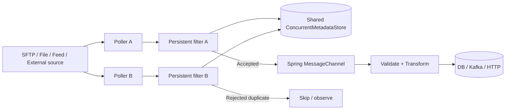
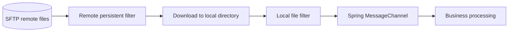
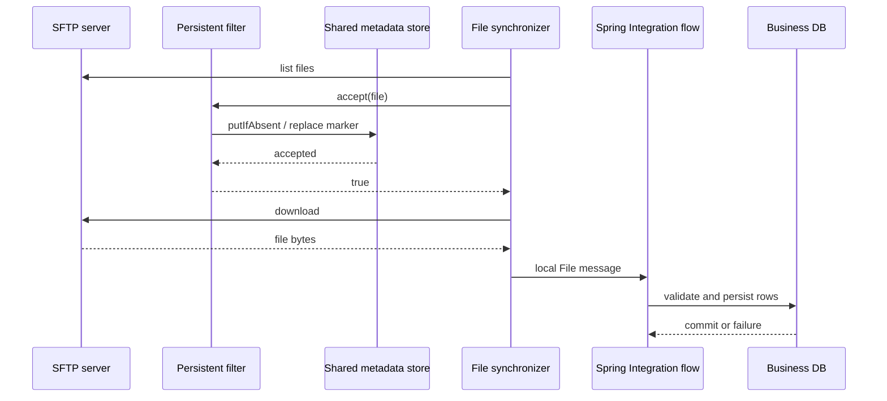

# Distributed metadata store

## 1. Bài toán: một ứng dụng chạy nhiều instance thì ai nhớ “đã xử lý”?

Trong module **SPRING_INTEGRATION_ADAPTERS**, Spring Integration kết nối hệ thống ngoài bằng inbound/outbound adapter, gateway, poller và `MessageChannel`. Dữ liệu có thể đi qua file, SFTP, HTTP, JMS, AMQP, Kafka hoặc cơ sở dữ liệu. Khi ứng dụng chỉ có một instance, một bộ nhớ nhỏ lưu danh sách file “đã thấy” có thể đủ cho bản demo. Khi triển khai nhiều replicas lên VM, Kubernetes hoặc cloud, cách đó không còn an toàn:

- Pod A quét thư mục SFTP và thấy `orders-2026-11-23.csv`.
- Pod B quét cùng thư mục ngay sau đó.
- Nếu mỗi pod giữ state riêng, **cả hai** có thể tải, phát message và ghi DB.
- Restart pod làm state trong RAM biến mất, file có thể được xử lý lại.
- Nếu metadata được đánh dấu quá sớm, process chết trước khi commit DB thì file có thể bị **bỏ qua vĩnh viễn** ở lần poll sau.

**Distributed metadata store** trong Spring Integration giải quyết một phần bài toán bằng cách lưu **metadata key–value dùng chung** cho nhiều ứng dụng/instances, có khả năng lưu giữa các lần restart và, với `ConcurrentMetadataStore`, hỗ trợ thao tác nguyên tử trên một key. Nó giúp phối hợp các **accept-once filters**, idempotent receivers và progress/checkpoint state.



**Phạm vi thực tế:** metadata store thường chỉ chứa **dấu vết đã nhìn thấy/đã chọn**, phiên bản hoặc tiến độ. Nó **không tự là distributed message broker, transactional outbox, distributed lock hay exactly-once business transaction**.

### Mục tiêu bài học

Sau bài học, bạn có thể:

1. Giải thích `MetadataStore`, `ConcurrentMetadataStore`, `SimpleMetadataStore` và các persistent implementations.
2. Phân biệt **atomicity trên một key** với **transaction/business processing**.
3. Cấu hình `JdbcMetadataStore`, `RedisMetadataStore` và `HazelcastMetadataStore` cho nhiều ứng dụng.
4. Dùng `SftpPersistentAcceptOnceFileListFilter` và `FileSystemPersistentAcceptOnceFileListFilter` với shared store.
5. Thiết kế key prefix/region/canonical path để không đụng khóa giữa jobs, tenants hoặc environments.
6. Hiểu `putIfAbsent`, `replace`, `get`, `put`, `remove` và cách test concurrency.
7. Tích hợp với Spring Integration `@InboundChannelAdapter`, `@Poller`, `MessageChannel`, `@ServiceActivator` và idempotent receiver.
8. Xử lý crash window, stale claim, TTL, rollback, retry, duplicate và out-of-order processing.
9. Quan sát và bảo vệ metadata backend trong cloud.
10. Xây checklist rollout, migration và runbook khôi phục lỗi an toàn.

## 2. Metadata khác message và business state như thế nào?

### 2.1. Một key–value nhỏ thay vì lưu toàn bộ event

Ví dụ một file được nhìn thấy:

```text
metadata key:
  sftp:orders:v1:/incoming/2026/11/orders-42.csv

metadata value:
  2026-11-23T02:15:10Z  (remote modified timestamp)

business payload:
  [toàn bộ nội dung CSV hoặc các OrderEvent]
```

Metadata có thể lưu **tên file + thời điểm thay đổi**, còn file vẫn nằm trên SFTP/local directory và business records được lưu ở DB/Kafka. Dữ liệu “file đã được filter chấp nhận” không chứng minh records đã commit vào DB.

### 2.2. Bốn loại state nên tách riêng

| Loại | Ví dụ | Công cụ |
|---|---|---|
| **Source checkpoint** | File path + modified time, RSS publish date | `MetadataStore`/persistent file filter. |
| **Business dedup/inbox** | `eventId` + trạng thái xử lý + commit transaction | Bảng DB unique constraint, inbox hoặc idempotency mechanism có hợp đồng rõ. |
| **Message buffering** | `Message<?>` chưa được consumer lấy | `MessageStore`/durable queue/broker, **không** phải `MetadataStore`. |
| **Distributed coordination** | Leadership/lock/lease có owner và timeout | `LockRegistry`, DB lease/CAS, broker partition ownership. |

Cùng Redis, JDBC hoặc Hazelcast có thể cung cấp **các abstraction khác nhau**, nhưng chúng không vì cùng backend mà trở thành một:

- `MetadataStore`: key→String value để nhớ dấu vết.
- `MessageStore`: lưu `Message<?>`, message groups, channel buffering.
- `LockRegistry`: lấy và nhả locks với ownership contract.
- Durable broker: giữ records, offsets/acks, redelivery theo broker.

### 2.3. Tại sao “distributed” không đồng nghĩa “durable”?

Một store được chia sẻ bởi ba instances có thể dùng Redis cache không bật AOF/RDB, Hazelcast map không có persistence, hoặc một database mất kết nối. Khi restart toàn backend, metadata có thể mất mặc dù các pods trước đó đã dùng chung state.

Phải xác định riêng:

1. **Shared visibility:** mọi replicas cùng đọc/ghi một namespace?
2. **Atomic conditional update:** hai writers có thể claim cùng key không?
3. **Persistence:** state còn sau service/backend restart hoặc failover không?
4. **Durability:** đã fsync/replicate theo SLA chưa?
5. **Recovery:** có snapshot/replay hoặc cách rebuild keys không?
6. **Consistency:** client đọc state nào trong split-brain/failover?

Đây là sáu câu hỏi độc lập, không được thay bằng một nhãn “distributed metadata”.

## 3. API Spring Integration: MetadataStore và ConcurrentMetadataStore

### 3.1. `MetadataStore`

Interface:

```java
package org.springframework.integration.metadata;

public interface MetadataStore {

    void put(String key, String value);

    String get(String key);

    String remove(String key);
}
```

Quy ước của các implementations phổ biến:

- `get(key)` trả value hoặc `null` khi key chưa tồn tại.
- `put(key,value)` ghi đè value **không có điều kiện**.
- `remove(key)` xóa key và trả value trước đó nếu có.

**Race condition kinh điển** khi dùng `get` rồi `put`:

```java
// ANTI-PATTERN: không nguyên tử giữa nhiều nodes.
if (store.get("order:42") == null) {
    store.put("order:42", "SEEN");
    processOrder();
}
```

`Pod A` và `Pod B` đều có thể đọc `null` trước khi một bên `put`, nên cả hai cùng process.

### 3.2. `ConcurrentMetadataStore`

Interface này kế thừa `MetadataStore` và thêm:

```java
public interface ConcurrentMetadataStore extends MetadataStore {

    String putIfAbsent(String key, String value);

    boolean replace(
        String key,
        String oldValue,
        String newValue);
}
```

Hợp đồng:

- `putIfAbsent(key, value)`: **nguyên tử** trên key; trả `null` khi insert thành công, trả **giá trị cũ** nếu key đã tồn tại.
- `replace(key, oldValue, newValue)`: compare-and-set (CAS) nguyên tử; thành công khi giá trị hiện tại khớp `oldValue`.
- `put` là unconditional overwrite; không dùng thay CAS để phân quyền hoặc claim.
- `remove` là unconditional remove; không phải “delete only if owner == X”.

Đọc kỹ return semantics trước khi viết:

```java
String previous =
    metadataStore.putIfAbsent("sftp:orders:42", "CLAIMED");

// Chỉ một contender thắng khi backend thật sự chia sẻ
// và implementation giữ đúng atomic contract.
if (previous == null) {
    // Tôi lấy được claim.
} else {
    // Đã có claim/value; KHÔNG tự chạy trùng.
}
```

**Atomic trên một key không phải atomic trên toàn pipeline.** Việc insert claim thành công và gọi HTTP/ghi DB là hai operation khác nhau.

### 3.3. `SimpleMetadataStore` cũng implement ConcurrentMetadataStore, nhưng...

`SimpleMetadataStore` dùng collection nội bộ trong **một JVM/application context**. Hai threads cùng chia sẻ instance có thể sử dụng `putIfAbsent` an toàn, nhưng hai containers có hai `SimpleMetadataStore` khác nhau sẽ không phối hợp với nhau.

```text
Pod A: SimpleMetadataStore [order42=SEEN]
Pod B: SimpleMetadataStore [         ]
                         ^ separate memories
```

**Kết luận:** `ConcurrentMetadataStore` là **API cần** cho shared atomic key operations; để có **distributed behavior**, phải chọn **implementation/backend thật sự được chia sẻ và cấu hình đúng**.

### 3.4. Khi không khai báo metadataStore bean

Theo Spring Integration reference, một số endpoints khi cần metadata sẽ:

1. Tìm bean ID/tên `metadataStore` trong application context nếu endpoint không được inject store riêng.
2. Nếu không thấy, dùng `SimpleMetadataStore` trong memory.

Điều này lý giải tại sao lab chạy một pod có vẻ ổn nhưng production nhiều replicas lại xử lý trùng sau restart.

**Tuy nhiên không phải mọi custom filter/endpoint tự khám phá bean theo cùng quy tắc.** Với persistent filter dùng constructor `ConcurrentMetadataStore`, nên **inject tường minh**; không chỉ tạo bean có tên `metadataStore` rồi tin rằng mọi filter mặc định sẽ chọn nó.

## 4. Chọn implementation phù hợp

| Implementation | State ở đâu? | Chia sẻ giữa pods? | Điểm cần nhớ |
|---|---|---|---|
| `SimpleMetadataStore` | RAM một JVM | **Không** | Tốt cho unit test/dev, mất khi restart. |
| `PropertiesPersistingMetadataStore` | File properties | Không an toàn nếu mỗi pod có local file; shared file cũng cần xem atomicity xuyên processes | Theo docs, thường flush khi close bình thường; có `flush()`. |
| `RedisMetadataStore` | Redis hash/region | Có, nếu cùng Redis và namespace | Nhanh, cần cấu hình Redis durability; `replace` có giới hạn với Redis Cluster. |
| `JdbcMetadataStore` | Bảng RDBMS | Có, nếu cùng DB/table/region | Transaction/unique key, schema migration và lock settings. |
| `HazelcastMetadataStore` | Hazelcast `IMap` | Có, nếu cùng cluster/map | CAS/metadata listeners; durability tùy map persistence/backups. |
| `MongoDbMetadataStore` | MongoDB collection | Có, nếu cùng DB/collection | Phải xem indexes, write concern, phiên bản và failover. |
| `ZookeeperMetadataStore` | ZooKeeper nodes | Có, nếu cùng ensemble/path | Consistency/coordination model và lifecycle riêng. |
| `DynamoDbMetadataStore` | AWS DynamoDB qua Spring Cloud AWS | Có | Conditional writes, IAM, capacity/region và AWS-specific contract. |

Một implementation “persistent” trong tài liệu có khả năng giữ metadata ngoài JVM; **mức độ durable thực tế phụ thuộc backend**.

### 4.1. Lựa chọn theo nhu cầu

- **Đã có PostgreSQL/MySQL trong hệ thống:** `JdbcMetadataStore` thường dễ vận hành, đặc biệt nếu cần chia sẻ transaction quản lý state trong cùng DB.
- **Đã có Redis HA thực sự:** `RedisMetadataStore` hợp cho markers/filters với latency thấp, nhưng phải test CAS/cluster deployment và retention.
- **Đã dùng Hazelcast cluster:** `HazelcastMetadataStore` tận dụng shared `IMap`; cân nhắc replication/split-brain/backups.
- **Dev/test một instance:** `SimpleMetadataStore` giúp hiểu contract, không dùng để chứng minh distributed safety.
- **Muốn chính xác một transaction business:** inbox table và unique constraint trong **cùng DB transaction** thường rõ ràng hơn một claim metadata bên ngoài DB.

## 5. Thiết kế key, region và value trước khi viết code

### 5.1. Key phải nêu rõ phạm vi

Một key metadata nên thể hiện:

```text
<environment>:<application>:<flow-version>:<source>:<resource-id>
```

Ví dụ:

```text
prod:order-import:v2:sftp:/incoming/2026/11/file-0042.csv
prod:order-import:v2:idempotent:event-123
staging:order-import:v2:sftp:/incoming/2026/11/file-0042.csv
```

Nếu staging và production dùng cùng Redis region, nhưng key không có environment, một môi trường có thể khiến môi trường kia bỏ qua file. Nếu hai SFTP directories có trùng simple filename, dùng **canonical remote directory + filename** hoặc cơ chế filter đã bao gồm path.

**Lưu ý nâng cấp:** Spring Integration 7.0 thay đổi cách tạo key trong một số `AbstractPersistentAcceptOnceFileListFilter` remote để bao gồm đường dẫn dài (directory + filename). Khi nâng cấp từ line cũ, test **tương thích key prefix** và khả năng reprocessing. Không xóa toàn bộ metadata chỉ để “sửa” duplicate mà không có migration plan.

### 5.2. Region khác prefix

- **JdbcMetadataStore** có `REGION` trong primary key của bảng `INT_METADATA_STORE`; `setRegion("...")` chọn nhóm keys.
- **RedisMetadataStore** dùng key của Redis hash như một **region**; constructor nhận `key` để tránh chia sẻ hash mặc định `MetaData`.
- **HazelcastMetadataStore** có thể dùng một dedicated `IMap` cho vùng state.
- **Persistent file filter** có `prefix` riêng, được nối với key generated từ file/path.

Chúng đều hỗ trợ namespace isolation, nhưng **không tự áp ACL theo tenant**. Region là cách tổ chức dữ liệu, không thay IAM/service identity.

### 5.3. Value nên nhỏ và rõ nghĩa

Ví dụ:

```text
key = prod:orders:remote:/incoming/order-42.csv
value = 1700700000000                # file modified timestamp

key = prod:orders:event:event-123
value = DONE:2026-11-23T03:00:00Z   # trạng thái domain theo policy
```

Đối với idempotency state, thêm các trường `status`, `ownerToken`, `leaseUntil` hoặc `version` thường đòi hỏi **schema có thể cập nhật nguyên tử**. Một String ghép dấu `:` chỉ phù hợp minh họa; production nên có format xác định, parsing/validation và CAS/transaction.

Không lưu raw payload chứa PII, API tokens, password hoặc toàn bộ Spring `Message<?>` trong metadata store. **Metadata store không phải document store hay MessageStore.**

## 6. Lab 1: Atomic metadata claim trước khi xử lý event

Ta bắt đầu bằng hợp đồng cốt lõi, chưa kết nối SFTP/Kafka thật. Mục tiêu: hai threads/instances cùng claim `eventId`, chỉ một bên được đi tiếp.

### 6.1. Bean với SimpleMetadataStore cho local unit test

File `LocalMetadataConfiguration.java`:

```java
package example.metastore;

import org.springframework.context.annotation.Bean;
import org.springframework.context.annotation.Configuration;
import org.springframework.integration.metadata.ConcurrentMetadataStore;
import org.springframework.integration.metadata.SimpleMetadataStore;

@Configuration
public class LocalMetadataConfiguration {

    @Bean("metadataStore")
    public ConcurrentMetadataStore metadataStore() {
        // CHỈ cho lab một JVM: KHÔNG shared giữa pods.
        return new SimpleMetadataStore();
    }
}
```

Đối với demo production multi-node, thay bean này bằng `JdbcMetadataStore` hoặc `RedisMetadataStore` **và cùng một shared backend**; tuyệt đối không bật đồng thời nhiều beans trùng tên.

### 6.2. Service claim nguyên tử

File `EventClaimService.java`:

```java
package example.metastore;

import org.springframework.integration.metadata.ConcurrentMetadataStore;
import org.springframework.stereotype.Service;

@Service
public class EventClaimService {

    private final ConcurrentMetadataStore metadataStore;

    public EventClaimService(ConcurrentMetadataStore metadataStore) {
        this.metadataStore = metadataStore;
    }

    public boolean claim(String eventId) {
        if (eventId == null
                || !eventId.matches("[A-Za-z0-9_-]{1,100}")) {
            throw new IllegalArgumentException(
                "Invalid eventId");
        }

        String key = "demo:orders:event:" + eventId;

        return metadataStore.putIfAbsent(
            key, "CLAIMED") == null;
    }
}
```

**Đúng:** `putIfAbsent` không có race giữa `get` và `put`, miễn hai contenders dùng **cùng shared store** với implementation atomic.

**Chưa đủ:** marker `CLAIMED` không có completion/lease/TTL/recovery. Nếu process chết ngay sau khi claim, event có thể bị chặn mãi mãi. Đoạn này chỉ dạy **atomic key insertion**, không phải thuật toán xử lý công việc có độ tin cậy cao.

### 6.3. Spring Integration service activator

File `EventClaimHandler.java`:

```java
package example.metastore;

import org.springframework.integration.annotation.ServiceActivator;
import org.springframework.messaging.Message;
import org.springframework.stereotype.Component;

@Component
public class EventClaimHandler {

    private final EventClaimService claims;

    public EventClaimHandler(EventClaimService claims) {
        this.claims = claims;
    }

    @ServiceActivator(inputChannel = "candidateEvents")
    public void handle(Message<String> message) {
        Object rawId =
            message.getHeaders().get("eventId");

        if (!(rawId instanceof String eventId)) {
            throw new IllegalArgumentException(
                "Missing eventId header");
        }

        boolean first = claims.claim(eventId);

        if (!first) {
            // Demo: log/count duplicate without raw payload.
            return;
        }

        // Demo: claim nhận thành công.
        // Production KHÔNG nên kết luận business DONE.
        // Cần durable inbox/transaction và failure recovery.
    }
}
```

Một Spring channel cho lab:

```java
@Bean("candidateEvents")
MessageChannel candidateEvents() {
    return new DirectChannel();
}
```

Với `DirectChannel`, handler chạy khi caller gửi message. Với `ExecutorChannel`, trách nhiệm xử lý exception/ack có thể chuyển sang thread khác và `send()` có thể trả trước khi claim thực hiện.

### 6.4. Đừng dùng get-then-put để implement idempotency

```text
Time    Pod A                   Pod B
t0      get(k) -> null
t1                              get(k) -> null
t2      put(k, "DONE")
t3                              put(k, "DONE")
t4      process()               process()
```

Dùng `putIfAbsent`:

```text
Time    Pod A                       Pod B
t0      putIfAbsent(k, CLAIMED)    ...
t1      returns null (winner)
t2                                  putIfAbsent(k, CLAIMED)
t3                                  returns "CLAIMED" (loser)
```

Khóa được bảo vệ **trong một backend atomic**. Nếu Pod A và Pod B nối đến **hai Redis clusters khác nhau**, cùng API cũng không thể ngăn xử lý trùng.

## 7. Lab 2: JdbcMetadataStore chia sẻ giữa nhiều instances

`JdbcMetadataStore` là lựa chọn phù hợp khi công ty có RDBMS đáng tin và muốn tận dụng transaction/unique constraints. Đặc biệt trong Spring Integration, JDBC store hỗ trợ `ConcurrentMetadataStore` và bảng metadata chuẩn.

### 7.1. Dependencies

Maven (giả định Spring Boot BOM/Spring Integration version tương thích):

```xml
<dependencies>
    <dependency>
        <groupId>org.springframework.boot</groupId>
        <artifactId>spring-boot-starter-integration</artifactId>
    </dependency>

    <dependency>
        <groupId>org.springframework.integration</groupId>
        <artifactId>spring-integration-jdbc</artifactId>
    </dependency>

    <dependency>
        <groupId>org.springframework.boot</groupId>
        <artifactId>spring-boot-starter-jdbc</artifactId>
    </dependency>

    <!-- Chọn driver của database thực trong deployment. -->
    <dependency>
        <groupId>org.postgresql</groupId>
        <artifactId>postgresql</artifactId>
        <scope>runtime</scope>
    </dependency>
</dependencies>
```

Không tự ghép Spring Integration 6/7 và Boot 3/4 bất tương thích. Pin BOM theo release train được hỗ trợ, compile/test riêng khi nâng version.

### 7.2. Schema metadata

Spring Integration cung cấp scripts theo database vendor. Cấu trúc cơ bản:

```sql
CREATE TABLE INT_METADATA_STORE (
    METADATA_KEY   VARCHAR(255) NOT NULL,
    METADATA_VALUE VARCHAR(4000),
    REGION         VARCHAR(100) NOT NULL,
    CONSTRAINT INT_METADATA_STORE_PK
        PRIMARY KEY (METADATA_KEY, REGION)
);
```

Giải thích:

- `METADATA_KEY`: key của metadata.
- `METADATA_VALUE`: value String.
- `REGION`: vùng/namespace.
- **Primary key composite** ngăn hai rows trùng key trong cùng region.
- Hai flows khác region có thể dùng cùng logical key mà không đè nhau.

DDL trên là **hình dạng ví dụ từ tài liệu**, cần chọn script/migration đúng **RDBMS và Spring Integration version**. Không dùng tùy tiện H2 syntax trong PostgreSQL/MySQL/SQL Server. Production dùng Flyway/Liquibase/IaC migration có kiểm soát, không đổi table prefix nếu thiếu migration tương ứng.

### 7.3. JavaConfig với `JdbcMetadataStore`

File `JdbcMetadataConfiguration.java`:

```java
package example.metastore;

import javax.sql.DataSource;

import org.springframework.context.annotation.Bean;
import org.springframework.context.annotation.Configuration;
import org.springframework.integration.jdbc.metadata.JdbcMetadataStore;
import org.springframework.integration.metadata.ConcurrentMetadataStore;

@Configuration
public class JdbcMetadataConfiguration {

    @Bean("metadataStore")
    public ConcurrentMetadataStore metadataStore(
            DataSource dataSource) {

        JdbcMetadataStore store =
            new JdbcMetadataStore(dataSource);

        store.setRegion("orders-import-v1");

        // Chỉ cần khi DDL table prefix đã được migrate.
        // store.setTablePrefix("MYAPP_");

        return store;
    }
}
```

Các pod dùng chung `DataSource` (cùng **database/schema/table/region**), không chỉ cùng tên bean. `JdbcMetadataStore` còn cho phép `setLockHint(...)` theo SQL dialect (mặc định có `FOR UPDATE`) và kiểm tra metadata table khi start theo version mới.

**Quan trọng:** `JdbcMetadataStore` cần transaction management. Đảm bảo Spring JDBC transaction manager được cấu hình và các thao tác metadata/poller tham gia transaction theo thiết kế. Nếu metadata và domain records ở cùng DB nhưng dùng **hai DataSources/transaction managers khác nhau**, không được suy rằng chúng đã atomic với nhau.

### 7.4. SQL query chẩn đoán

```sql
SELECT
    METADATA_KEY,
    METADATA_VALUE,
    REGION
FROM INT_METADATA_STORE
WHERE REGION = 'orders-import-v1'
ORDER BY METADATA_KEY;
```

Query phục vụ debug trên môi trường được phép; không tự copy bảng metadata ra nơi công cộng hoặc log mọi keys trong production. Khi database có nhiều entries, query cần limit/pagination và index/DB access policy tương ứng.

### 7.5. Khi poller transaction rollback

Nếu `JdbcMetadataStore` được dùng bởi một inbound adapter trong **đúng transaction** do poller quản lý, metadata write có thể rollback cùng transaction. Điều đó có ích nếu processing trong cùng DB transaction thất bại.

**Nhưng** tải file từ SFTP, gọi HTTP, publish Kafka hoặc upload cloud storage là external side effects; chúng không tự rollback theo JDBC. Một transaction DB không phải distributed transaction cho mọi adapter.

Ví dụ:

```text
BEGIN DB TRANSACTION
  select/claim file metadata row
  update local DB
COMMIT

separate remote call:
  HTTP / SFTP / Kafka
```

Nếu nghiệp vụ cần phối hợp các bước, hãy thiết kế outbox/inbox/saga/reconciliation; không chỉ thêm `@Transactional` rồi tuyên bố exactly-once.

## 8. Lab 3: RedisMetadataStore cho nhiều replicas

### 8.1. Dependencies

```xml
<dependencies>
    <dependency>
        <groupId>org.springframework.boot</groupId>
        <artifactId>spring-boot-starter-integration</artifactId>
    </dependency>

    <dependency>
        <groupId>org.springframework.integration</groupId>
        <artifactId>spring-integration-redis</artifactId>
    </dependency>

    <dependency>
        <groupId>org.springframework.boot</groupId>
        <artifactId>spring-boot-starter-data-redis</artifactId>
    </dependency>
</dependencies>
```

`spring-boot-starter-data-redis` cung cấp cách tạo `RedisConnectionFactory` qua Spring Data Redis/Lettuce theo cấu hình Boot tương thích. Spring Integration Redis là module riêng.

### 8.2. Bean dùng Redis hash key riêng

File `RedisMetadataConfiguration.java`:

```java
package example.metastore;

import org.springframework.context.annotation.Bean;
import org.springframework.context.annotation.Configuration;
import org.springframework.data.redis.connection.RedisConnectionFactory;
import org.springframework.integration.metadata.ConcurrentMetadataStore;
import org.springframework.integration.redis.metadata.RedisMetadataStore;

@Configuration
public class RedisMetadataConfiguration {

    @Bean("metadataStore")
    public ConcurrentMetadataStore metadataStore(
            RedisConnectionFactory redisConnectionFactory) {

        // Tham số thứ hai là Redis hash key/region,
        // KHÔNG phải một metadata entry key.
        return new RedisMetadataStore(
            redisConnectionFactory,
            "si:prod:orders:metadata:v1");
    }
}
```

Theo API, `RedisMetadataStore(RedisConnectionFactory, String key)` sử dụng `key` làm vùng/Redis hash chứa các entries. Nếu không cung cấp, region mặc định của tài liệu là `MetaData`. **Không để nhiều ứng dụng sử dụng hash mặc định** rồi vô tình trùng keys.

`application.yml` ví dụ (chỉ environment-dev, không có secret hardcoded):

```yaml
spring:
  data:
    redis:
      host: ${REDIS_HOST:localhost}
      port: ${REDIS_PORT:6379}
      timeout: 2s
```

Cấu hình security production còn cần TLS/authentication, private networking, secrets/managed identity và failover behavior đúng Redis platform.

### 8.3. Redis Cluster: giới hạn quan trọng của `replace()`

Spring Integration Redis documentation ghi rõ: **`RedisMetadataStore.replace()` không sử dụng được với Redis Cluster** trong tình huống cần `WATCH` để thực hiện CAS; Redis Cluster không hỗ trợ pattern WATCH được implementation này yêu cầu.

Điều này ảnh hưởng trực tiếp tới:

- `AbstractPersistentAcceptOnceFileListFilter` khi muốn so old/new timestamp.
- Bất kỳ flow nào sử dụng `ConcurrentMetadataStore.replace` để đổi claim/version.
- Quy trình reuse filter state sau restart/migration.

**Không** suy rằng chỉ vì `putIfAbsent` có thể chạy trên Redis Cluster thì **toàn bộ `ConcurrentMetadataStore` contract** ở implementation đó đều chạy an toàn. Test đúng **topology Redis standalone/Sentinel/Cluster** và operations được dùng, hoặc chọn `JdbcMetadataStore`/implementation phù hợp nếu cần CAS đầy đủ.

### 8.4. Persistence/TTL của Redis

Redis có thể chạy in-memory hoặc persistence AOF/RDB tùy cấu hình, với durability/snapshot policy khác nhau. Metadata store **không tự cấu hình TTL cho từng entry** chỉ vì nó là Redis hash.

- Cấu hình backend persistence và replica/failover theo SLA.
- Thiết kế cleanup metadata có retention, không xóa hết hash thiếu review.
- Với một hash chung, TTL ở cấp Redis key có thể làm **cả region hết hạn**, không phải một file entry đơn lẻ.
- Nếu cần per-entry TTL/lease, dùng một backend/model hỗ trợ atomic expiry theo schema riêng và test concurrency/failover.
- Không xem Redis cache eviction như policy business retention.

### 8.5. Redis metadata store khác RedisMessageStore

`RedisMetadataStore` chứa metadata strings dùng cho filters/idempotency. `RedisMessageStore` hoặc `RedisChannelMessageStore` lưu messages/groups/queue state theo abstraction khác.

**Không** cấu hình `QueueChannel` bằng `RedisMetadataStore` rồi chờ nó lưu `Message<?>` và redeliver theo ack; chúng không cùng interface hoặc semantics.

## 9. Lab 4: HazelcastMetadataStore trên một distributed IMap

Nếu ứng dụng đã dùng Hazelcast trong chương Adapter Cloud, có thể dùng `HazelcastMetadataStore`:

```java
package example.metastore;

import com.hazelcast.core.HazelcastInstance;
import com.hazelcast.map.IMap;

import org.springframework.context.annotation.Bean;
import org.springframework.context.annotation.Configuration;
import org.springframework.integration.hazelcast.metadata.HazelcastMetadataStore;
import org.springframework.integration.metadata.ConcurrentMetadataStore;

@Configuration
public class HazelcastMetadataConfiguration {

    @Bean("metadataStore")
    public ConcurrentMetadataStore metadataStore(
            HazelcastInstance hazelcastInstance) {

        IMap<String, String> map = hazelcastInstance
            .getMap("si-prod-orders-meta-v1");

        return new HazelcastMetadataStore(map);
    }
}
```

**Điều kiện:** một `HazelcastInstance` client/member đã được tạo và join **đúng cluster**, có TLS/auth/network policy. Đoạn này không tự dựng Hazelcast cloud account/cluster. `HazelcastMetadataStore` cũng hỗ trợ constructor nhận `HazelcastInstance` và mặc định dùng map `SPRING_INTEGRATION_METADATA_STORE`.

Hazelcast metadata store là `ListenableMetadataStore`: có thể đăng ký `MetadataStoreListener` để quan sát add/update/remove theo khả năng hỗ trợ của implementation. **Đừng nhầm metadata listener với một durable audit event log** — khi listener offline, event có thể không replay.

### 9.1. MetadataStore khác HazelcastMessageStore

- `HazelcastMetadataStore`: key/value marker phục vụ filter/checkpoint/dedup.
- `HazelcastMessageStore`: lưu `Message<?>` và message groups cho aggregator hoặc channel.
- `Hazelcast LockRegistry`: làm việc với distributed locks, không thay thế hai store ở trên.

Tính bền vững của Hazelcast metadata phụ thuộc backups/persistence/map configuration và deployment. Mặc định distributed in-memory map không tự thành durable database.

## 10. Ứng dụng thực tế: SFTP persistent accept-once filter

Đây là use case điển hình của **Distributed metadata store** trong Spring Integration.

### 10.1. Không có shared store

```text
SFTP /incoming/orders.csv
   |
   +-- Pod A: local AcceptOnce => ACCEPT => download + process
   |
   +-- Pod B: local AcceptOnce => ACCEPT => download + process
```

Hai pods không có chung state, nên cùng một file có thể được đọc hai lần.

### 10.2. Có shared ConcurrentMetadataStore

```text
SFTP /incoming/orders.csv
   |
   +-- Pod A: SftpPersistentAcceptOnceFileListFilter --+
   |                                                   |
   +-- Pod B: SftpPersistentAcceptOnceFileListFilter --+--> Shared store
                                                       |
                                                one accepted
                                                one rejected
```

`SftpPersistentAcceptOnceFileListFilter` kế thừa persistent file list filter, sử dụng `ConcurrentMetadataStore`. File acceptance thường xét **filename/path** và **remote modified timestamp**, để file thay đổi có thể được nhận lại.

**Đây là anti-duplicate tại bước chọn file**, không đồng nghĩa downstream JDBC/Kafka commit. Hai bước có khoảng thời gian lỗi khác nhau.

### 10.3. Bean remote filter

File `SftpFilterConfiguration.java`:

```java
package example.metastore;

import org.springframework.context.annotation.Bean;
import org.springframework.context.annotation.Configuration;
import org.springframework.integration.metadata.ConcurrentMetadataStore;
import org.springframework.integration.sftp.filters.SftpPersistentAcceptOnceFileListFilter;

@Configuration
public class SftpFilterConfiguration {

    @Bean("ordersRemoteFilter")
    public SftpPersistentAcceptOnceFileListFilter ordersRemoteFilter(
            ConcurrentMetadataStore metadataStore) {

        // Prefix tách luồng và phiên bản key.
        return new SftpPersistentAcceptOnceFileListFilter(
            metadataStore,
            "sftp:orders:v1:remote:");
    }
}
```

Từng pod phải:

- Kết nối cùng SFTP source/directory.
- Dùng cùng **shared** metadata backend/region.
- Dùng **cùng filter prefix và key rule** cho cùng công việc.
- Khác tenant/flow nên có namespace khác.
- Dùng metadata store có đầy đủ CAS semantics cần thiết, đặc biệt nếu xử lý file đổi mtime.
- Cấu hình clock/timezone và remote timestamp semantics theo SFTP server; không giả định mọi file có độ phân giải mtime như nhau.

### 10.4. XML inbound adapter tham chiếu filter

Ví dụ này **giả định đã có** `sftpSessionFactory` an toàn và `ordersRemoteFilter` bean ở trên. Namespace boilerplate được hiển thị để thấy cấu hình:

```xml
<?xml version="1.0" encoding="UTF-8"?>
<beans xmlns="http://www.springframework.org/schema/beans"
       xmlns:xsi="http://www.w3.org/2001/XMLSchema-instance"
       xmlns:int="http://www.springframework.org/schema/integration"
       xmlns:int-sftp="http://www.springframework.org/schema/integration/sftp"
       xsi:schemaLocation="
         http://www.springframework.org/schema/beans
         https://www.springframework.org/schema/beans/spring-beans.xsd
         http://www.springframework.org/schema/integration
         https://www.springframework.org/schema/integration/spring-integration.xsd
         http://www.springframework.org/schema/integration/sftp
         https://www.springframework.org/schema/integration/sftp/spring-integration-sftp.xsd">

    <int:channel id="ordersFiles"/>

    <int-sftp:inbound-channel-adapter
        id="ordersSftpInbound"
        channel="ordersFiles"
        session-factory="sftpSessionFactory"
        remote-directory="/incoming/orders"
        local-directory="file:/var/app/orders"
        filter="ordersRemoteFilter"
        auto-create-local-directory="true">

        <int:poller
            fixed-delay="3000"
            max-messages-per-poll="10"/>
    </int-sftp:inbound-channel-adapter>

</beans>
```

**Giải thích:**

- `filter="ordersRemoteFilter"` là filter **trước khi tải file từ SFTP**.
- `local-directory` là nơi file được đồng bộ về trước khi thành Spring message.
- `ordersFiles` là `MessageChannel` sau inbound adapter.
- Poller vẫn phải chạy; metadata store không tự poll directory.
- Các SFTP session options (host, auth, host-key verification, connection pool, timeout) do `sftpSessionFactory` cung cấp.
- Nếu có consumer chậm, `DirectChannel` có thể block poller; cần sizing và error recovery.

### 10.5. Có hai lớp filter, không phải một

SFTP file-synchronizing inbound adapter thường liên quan:

1. **Remote filter**: file nào được phép **fetch** từ SFTP server?
2. **Local filter**: file local nào được phép **emit** thành Spring message?



Nếu remote file thay đổi và được fetch lại nhưng local filter giữ marker cũ không phù hợp, có thể **download nhưng không emit** message mới. Ngược lại, nếu local filter chỉ là in-memory, restart có thể emit lại file cũ trên disk.

Với local file system, Spring Integration có `FileSystemPersistentAcceptOnceFileListFilter`:

```java
import org.springframework.integration.file.filters.FileSystemPersistentAcceptOnceFileListFilter;

FileSystemPersistentAcceptOnceFileListFilter localFilter =
    new FileSystemPersistentAcceptOnceFileListFilter(
        metadataStore,
        "sftp:orders:v1:local:");
```

Gắn local filter qua `local-filter` (XML) hoặc source spec (Java DSL) theo version và nhu cầu. **Dùng prefix khác remote filter** vì hai loại metadata không cùng contract và key; khi dùng chung store, một bên có thể ghi đè marker của bên kia nếu namespace trùng.

**Chú ý về container filesystem:** mỗi pod có thể có `/var/app/orders` riêng; shared remote metadata khiến chỉ một pod download file, nghĩa là các pod khác không có bản local. Nếu pod tải file crash trước khi phát message, **không tự có pod khác xử lý**. Cần durable staging hoặc recovery/reconciliation phù hợp.

### 10.6. Hạn chế fetch một lúc

Dùng `max-fetch-size` ở SFTP inbound adapter/source theo API version để không có một pod fetch quá nhiều file trước khi các pods khác có cơ hội nhận. `max-messages-per-poll` lại giới hạn số Spring messages được poller phát mỗi lần, không nhất thiết giống số remote files được download.

Không đặt `max-fetch-size=1` và suy rằng hệ thống đã exactly-once: nó chỉ thay đổi khối lượng fetch/công bằng hơn giữa pods.

## 11. Khi file thay đổi: mtime, hash và đường dẫn

### 11.1. Mặc định persistent file filter

Với `SftpPersistentAcceptOnceFileListFilter`, metadata thường dựa trên **file path/name và remote modified timestamp**. Nếu file có cùng tên nhưng mtime mới, filter có thể nhận lại.

```text
/incoming/orders.csv @ T1  -> accepted
/incoming/orders.csv @ T1  -> rejected
/incoming/orders.csv @ T2  -> accepted (file đã thay đổi)
```

Không suy rằng byte content khác luôn làm mtime khác; một số tools giữ nguyên timestamp khi upload/rename. Nếu nghiệp vụ cần content identity, dùng checksum/object version/business key riêng.

### 11.2. Directory key collision

Hai thư mục:

```text
/incoming/tenantA/orders.csv
/incoming/tenantB/orders.csv
```

Nếu key chỉ là `orders.csv`, một file có thể chặn file kia. Vì vậy cần full path hoặc prefix theo nguồn. Ở Spring Integration 7.0+, remote persistent file filters đã chuyển sang key bao gồm đường dẫn đầy đủ hơn theo hướng dẫn nâng cấp. Với bản 6.x, xem `forRecursion` và cách build key của filter version cụ thể.

### 11.3. Remote file chưa upload hoàn tất

Metadata filter chỉ kiểm soát trùng, **không** bảo đảm file đã ghi xong. Các cách giảm rủi ro:

- SFTP producer ghi `*.writing` rồi atomic rename sang `*.csv` khi hoàn tất.
- Filter theo tên extension cuối, hoặc marker file đã sẵn sàng.
- Age filter hoặc quy tắc ổn định size/mtime theo SLA.
- Kiểm tra checksum/manifest khi business cần.

Nếu fetch file dở rồi chèn marker, recovery phải đảm bảo filter revert/cleanup theo framework behavior; không coi accept-once như validation của nguồn.

## 12. Điểm nguy hiểm: accept-once trước, business commit sau

### 12.1. Các mốc khác nhau của một file



Ở đây **thứ tự rất quan trọng**: filter lưu marker **trước** business processing. Việc `MetadataStore` đã có key chỉ nói file **được filter chấp nhận**, không nói mọi rows trong file đã tới DB.

### 12.2. Ma trận crash window

| Crash ở đâu? | Metadata có thể ở trạng thái nào? | Rủi ro | Khôi phục |
|---|---|---|---|
| Trước khi filter accept | Chưa có marker | Poll lại và đọc file | Bình thường. |
| Sau filter accept, trước download | Có marker | File bị bỏ qua sau restart | Kiểm tra local staging, reset đúng marker theo recovery policy. |
| Download dở | Marker có thể tồn tại | File local thiếu/truncated | Framework có cơ chế reverse trên fetch error; crash cứng vẫn có thể cần cleanup. |
| Download xong, trước emit | Remote marker có, local file tồn tại | Không ai process nếu pod mất và local disk mất | Durable staging hoặc reconciliation. |
| Sau emit, trước DB commit | Marker có, business chưa hoàn tất | Lost processing | Inbox/outbox, requeue hoặc reset marker có kiểm soát. |
| DB commit xong, trước audit/ack | Marker có, business đã hoàn tất | Retry tạo duplicate | Transactional idempotent consumer. |
| Metadata backend mất state | Marker mất | Nhận lại files đã xử lý | Rebuild/reconcile từ business log. |

Theo tài liệu Spring Integration, khi remote fetch thất bại, file filter reversible có thể được rollback trong một số đường lỗi. Tuy nhiên, **lỗi downstream sau khi synchronizer đã tạo message không tự rollback remote filter**. Đây là lý do phải có kế hoạch reset/replay riêng.

### 12.3. Tại sao xóa key sau exception không luôn an toàn?

Ví dụ `Node A` claim key, xử lý quá lâu; một cơ chế recovery khác cho phép `Node B` claim lại. Nếu A catch exception và gọi `remove(key)` **vô điều kiện**, nó có thể xóa claim mà B vừa sở hữu, mở đường cho Node C bắt đầu xử lý lần ba.

```text
A obtains CLAIM owner=A
A becomes slow
Recovery decides A is expired
B obtains CLAIM owner=B
A catches exception -> remove(key)  // xóa nhầm B
C obtains CLAIM
```

`ConcurrentMetadataStore` cung cấp `replace(key, expectedOld, newValue)`, nhưng **không cung cấp một atomic remove-if-value-matches** trong API cơ bản. Nếu cần ownership/lease, dùng DB row với conditional update/delete, backend lock/lease có fencing token hoặc schema riêng hỗ trợ atomic operations.

### 12.4. Khi nào nên reset persistent filter?

Chỉ khi:

1. Đã xác minh source object/path + timestamp đúng.
2. Xác định rõ business state đã commit hay chưa.
3. Đảm bảo hiện không có một worker khác đang xử lý cùng item.
4. Có lịch sử operator/reason và giới hạn đối tượng bị reset.
5. Có idempotent downstream để chịu được duplicate nếu đánh giá sai.

Không chạy một script `DEL all keys` hoặc `TRUNCATE INT_METADATA_STORE` trong production để làm một file “hiện lại”. Hãy dùng chức năng reset của filter hoặc thao tác metadata được kiểm soát theo đúng key/prefix/version.

## 13. Idempotent Receiver Enterprise Integration Pattern

**Persistent file filter** bảo vệ ở bước *source selection*. Một **idempotent receiver** bảo vệ ở bước *message processing* và thường dựa vào **business key** (event ID, invoice ID, source file version).

### 13.1. Không chỉ so `get(key)==null`

Một filter tự viết:

```java
// KHÔNG an toàn khi nhiều replicas cạnh tranh.
if (metadataStore.get(eventId) == null) {
    businessService.process(event);
    metadataStore.put(eventId, "DONE");
}
```

vẫn có race condition: hai replicas cùng thấy `null`. Nếu chuyển `putIfAbsent` lên trước `process`, lại xuất hiện crash window giữa claim và business commit. Vì thế idempotency **đúng nghĩa end-to-end** cần lựa chọn thời điểm ghi marker và khả năng recovery.

### 13.2. `IdempotentReceiverInterceptor`

Spring Integration cung cấp `IdempotentReceiverInterceptor`, sử dụng một `MessageSelector`; implementation `MetadataStoreSelector` có thể dùng `ConcurrentMetadataStore` để quyết định message đã gặp hay chưa.

Ví dụ XML (giả định có `metadataStore` và `orderService` beans):

```xml
<int:channel id="candidateEvents"/>
<int:channel id="duplicateEvents"/>

<int:service-activator
    id="processOrderEndpoint"
    input-channel="candidateEvents"
    ref="orderService"
    method="process"/>

<int:idempotent-receiver
    endpoint="processOrderEndpoint"
    metadata-store="metadataStore"
    key-expression="headers['eventId']"
    discard-channel="duplicateEvents"/>
```

Ý nghĩa:

- `endpoint` chỉ định **Spring Integration endpoint** được advice.
- `key-expression` tạo idempotent key từ Spring message.
- `metadata-store` tham chiếu `ConcurrentMetadataStore`.
- `discard-channel` nhận những messages bị từ chối theo policy.
- Nếu không khai báo discard channel hoặc `throw-exception-on-rejection`, interceptor có thể **vẫn chuyển duplicate đến handler**, đánh dấu bằng header `duplicateMessage=true` — **không mặc định drop**.
- Một invalid/missing `eventId` phải bị validate trước khi chạy; không cho mọi message thiếu ID va vào một key `null`.

**Quan trọng:** interceptor là *advice trên MessageHandler*, không phải một durable broker consumer with ack. Cần test cách marker được tạo/cập nhật và cách rollback/retry xử lý khi business handler throw.

### 13.3. `MetadataStoreSelector` so sánh phiên bản

Spring Integration hỗ trợ `compareValues` để chấp nhận message mới nếu value có quan hệ phù hợp so với value cũ (ví dụ line number hoặc version cao hơn). Điều này hữu ích khi key không cần tạo mới cho mỗi phiên bản.

Nhưng:

- Không so version strings theo thứ tự từ điển nếu phiên bản là số không có padding.
- Dựa vào `long`/structured value hợp lệ, parse với error handling.
- Kiểm tra CAS trên backend đã chọn.
- Với Redis Cluster, lưu ý `RedisMetadataStore.replace()` limitation.
- `compareValues` chỉ quyết định marker mới; không tự rollback side effects nếu business handler thất bại.

### 13.4. Idempotency làm gì khi nhận duplicate?

| Trạng thái | Cách ứng dụng có thể xử lý |
|---|---|
| `UNSEEN` | Cho phép xử lý; tạo durable claim/transaction nếu yêu cầu. |
| `IN_PROGRESS` | Tránh chạy song song; quan sát lease và khả năng retry. |
| `SUCCEEDED` | Skip hoặc trả cached result theo contract. |
| `FAILED_RETRYABLE` | Cho phép retry sau backoff/deadline. |
| `FAILED_PERMANENT` | Quarantine/DLQ và operator review. |
| `UNKNOWN_OUTCOME` | Reconcile kết quả bên ngoài trước khi retry. |

Một marker duy nhất `SEEN` không phân biệt được năm trạng thái sau. Nếu nghiệp vụ quan trọng, thiết kế **inbox table** hoặc command-state machine thay vì cố nhồi tất cả logic vào một filter.

## 14. CAS với owner token: mẫu nâng cao nhưng không phải lease hoàn chỉnh

### 14.1. Thực hiện state transition bằng `replace()`

Ví dụ một service minh họa conditional update:

```java
package example.metastore;

import java.util.UUID;

import org.springframework.integration.metadata.ConcurrentMetadataStore;

public final class ClaimTransitions {

    private final ConcurrentMetadataStore store;

    public ClaimTransitions(ConcurrentMetadataStore store) {
        this.store = store;
    }

    public String begin(String eventId) {
        String key = "orders:v1:event:" + eventId;

        String token = UUID.randomUUID().toString();
        String claimed = "IN_PROGRESS:" + token;

        return store.putIfAbsent(key, claimed) == null
            ? claimed : null;
    }

    public boolean markDone(
            String eventId, String claimedValue) {
        return store.replace(
            "orders:v1:event:" + eventId,
            claimedValue,
            "SUCCEEDED");
    }

    public boolean markFailed(
            String eventId, String claimedValue) {
        return store.replace(
            "orders:v1:event:" + eventId,
            claimedValue,
            "FAILED_RETRYABLE");
    }
}
```

`claimedValue` được xem như **fencing/owner token đơn giản ở mức CAS marker**, nhằm ngăn worker cũ ghi đè state của worker mới. Tuy nhiên đây **chưa phải một fencing token có thứ tự tăng và được kiểm tra ở resource đích**; không dùng thuật ngữ “fencing an toàn end-to-end” cho ví dụ này.

### 14.2. Những gì ví dụ chưa giải quyết

- Claim có thể không có TTL, nên node crash để lại `IN_PROGRESS` mãi.
- Chưa có atomic transition `FAILED_RETRYABLE -> IN_PROGRESS(newOwner)` kèm lease/time check.
- Chưa lưu attempt count/retry deadline.
- Chưa có transaction atomic giữa business DB và metadata backend.
- Chưa bảo đảm `SUCCEEDED` sau một cloud operation đã được xác nhận.
- Chưa chống stale worker vẫn thực hiện side effect dù CAS markDone thất bại.

Muốn production-safe lease:

1. Lưu `ownerToken`, `leaseUntil` và `version` trong DB/model có conditional update.
2. Dùng **server-side time**/lease semantics do backend định nghĩa, không chỉ local wall clock.
3. Khi lease hết hạn, claim mới phải dùng CAS/transaction ngăn hai owners cùng thắng.
4. Side-effect endpoint phải kiểm tra fencing/version nếu có thể.
5. Persist completion + business data trong transaction phù hợp, hoặc dùng outbox/saga.
6. Giữ durable recovery và alert cho stale claims.

### 14.3. Khi nào không nên tự viết lease?

Nếu source là Kafka, JMS hoặc AMQP, framework/broker đã có **consumer group/offset/ack/redelivery**. Trước khi tự xây lease bằng metadata store, xác định có thể dùng broker semantics và một **idempotent inbox** trong domain DB thay không. Tự viết lease cho mỗi message thường làm hệ thống phức tạp và dễ mất dữ liệu hơn.

## 15. Kiểm thử: local race, multi-instance và crash

### 15.1. Unit test atomicity trong cùng JVM

File `MetadataClaimTest.java`:

```java
package example.metastore;

import static org.junit.jupiter.api.Assertions.*;

import java.util.ArrayList;
import java.util.List;
import java.util.concurrent.CountDownLatch;
import java.util.concurrent.ExecutorService;
import java.util.concurrent.Executors;
import java.util.concurrent.Future;

import org.junit.jupiter.api.Test;
import org.springframework.integration.metadata.ConcurrentMetadataStore;
import org.springframework.integration.metadata.SimpleMetadataStore;

class MetadataClaimTest {

    @Test
    void onlyOneThreadCanInsertSameKey() throws Exception {
        ConcurrentMetadataStore store =
            new SimpleMetadataStore();

        int count = 16;
        CountDownLatch start = new CountDownLatch(1);
        ExecutorService pool =
            Executors.newFixedThreadPool(count);

        try {
            List<Future<Boolean>> results =
                new ArrayList<>();

            for (int i = 0; i < count; i++) {
                results.add(pool.submit(() -> {
                    start.await();
                    return store.putIfAbsent(
                        "order:event:42",
                        "CLAIMED") == null;
                }));
            }

            start.countDown();

            int winners = 0;
            for (Future<Boolean> result : results) {
                if (result.get()) {
                    winners++;
                }
            }

            assertEquals(1, winners);
            assertEquals(
                "CLAIMED",
                store.get("order:event:42"));
        }
        finally {
            pool.shutdownNow();
        }
    }

    @Test
    void compareAndSetRejectsStaleOwner() {
        ConcurrentMetadataStore store =
            new SimpleMetadataStore();

        assertNull(store.putIfAbsent(
            "event-88", "IN_PROGRESS:ownerA"));

        assertFalse(store.replace(
            "event-88", "IN_PROGRESS:ownerB",
            "SUCCEEDED"));

        assertTrue(store.replace(
            "event-88", "IN_PROGRESS:ownerA",
            "SUCCEEDED"));

        assertEquals(
            "SUCCEEDED",
            store.get("event-88"));
    }
}
```

Các test này xác minh **CAS implementation trong cùng một instance** và logic API. Chúng **không chứng minh** khả năng phối hợp nhiều pods. `SimpleMetadataStore` dùng ConcurrentMap nội bộ nên có thể làm tốt test đồng thời mà vẫn sai nếu deploy từng pod một store riêng.

### 15.2. Integration test thật với hai application contexts

Muốn chứng minh shared store:

1. Tạo **một** PostgreSQL/Redis/Hazelcast backend test.
2. Tạo **hai** Spring application contexts hoặc hai processes có client connections riêng.
3. Mỗi context có một `ConcurrentMetadataStore` bean, **cùng database/region**.
4. Cho cả hai cùng `putIfAbsent(sameKey, ...)` qua barrier.
5. Kỳ vọng đúng một contender thắng.
6. Kiểm tra CAS `replace` và readback nhất quán từ hai connections.
7. Restart context A: context B vẫn nhìn thấy key.
8. Restart backend theo profile durability: state có còn không?
9. Với SFTP, test hai pollers cạnh tranh đúng một source directory và có downstream idempotent sink.
10. Test Redis Cluster **riêng** nếu triển khai cluster: thử cả `putIfAbsent` và `replace`; không mặc định cả hai được support.

Nếu dùng Testcontainers, pin image và không thử nghiệm với broker/database production. Bài hiện tại chưa chạy build/test; các bước là **kế hoạch kiểm thử** cho STEP QA/triển khai sau.

### 15.3. Negative test cases

| Test | Điều cần xác minh |
|---|---|
| Hai contexts vô tình nối hai Redis instances | Test phải phát hiện khác namespace/backend. |
| Hai contexts cùng Redis nhưng khác hash key | Không chia sẻ state; hành vi cố ý hoặc lỗi cấu hình. |
| JDBC dùng khác `REGION` | Keys độc lập; không ngăn trùng giữa regions. |
| Redis Cluster gọi `replace` | Có thể fail/unsupported theo implementation, không silently pass. |
| Metadata DB timeout | Fail closed hoặc durable recovery, không process trùng âm thầm. |
| Crash sau claim, trước fetch | Stale marker được phát hiện và recover. |
| Crash sau business commit, trước ack | Retry được idempotency ngăn double side effect. |
| File same name khác directory | Không collision nếu key path/prefix đúng. |
| File cùng name nhưng mtime mới | Nhận lại theo policy hoặc report duplicate rõ ràng. |
| Remote upload chưa hoàn tất | Không đọc partial file. |
| Shared metadata region bị clear | Có công cụ reconcile để xử lý reprocessing. |
| Local filter khác remote filter | Không bị download thành công nhưng local emit bỏ qua. |
| Nhiều pods + local ephemeral directories | Nếu pod chủ chết, job không bị bỏ quên không kiểm soát. |

## 16. Metadata store trong JDBC/FTP/SFTP/File/Feed flows

### 16.1. File inbound

`FileReadingMessageSource` có thể dùng `FileSystemPersistentAcceptOnceFileListFilter` để nhớ path + modified time của local files.

```java
FileSystemPersistentAcceptOnceFileListFilter filter =
    new FileSystemPersistentAcceptOnceFileListFilter(
        metadataStore, "local:invoice:v1:");
```

Khi dùng chung shared file system/NFS giữa nhiều replicas, shared `ConcurrentMetadataStore` giúp phối hợp việc chọn file. Nhưng vẫn có race khi file bị xóa/move và process crash; cần file-ready policy và durable sink.

### 16.2. FTP/FTPS inbound

`FtpPersistentAcceptOnceFileListFilter` dùng pattern tương tự SFTP: remote file name/path + mtime, shared store giúp tránh nhiều pods cùng tải. **Không** gọi nó là transactional acknowledgment của FTP server.

### 16.3. SFTP streaming inbound

Một streaming adapter có thể cung cấp `InputStream` payload từ remote file. Metadata filter có thể nhớ file đã được chọn, nhưng stream có thể lỗi giữa lúc đọc. Phải đóng session/stream đúng lifecycle; nếu downstream đọc được một phần rồi fail, cần replay hoặc reset marker có chủ đích.

### 16.4. Feed inbound và các source không transactional

RSS/Atom/feed adapters thường cần nhớ publish date/ID của entry đã thấy vì source không cung cấp transaction/ack giống Kafka. `MetadataStore` giúp giữ checkpoint giữa polls/restarts; nếu feed thay thứ tự hoặc time skew, không thể chỉ so một timestamp rồi mặc định đầy đủ.

### 16.5. Poll database vs metadata store

Với JDBC polling source, thường database có thể tự ghi trạng thái `PENDING -> CLAIMED -> DONE` trong transaction. Khi đó một **đúng transaction/unique constraint** ở DB có thể dễ chứng minh hơn so với việc poll rows và ghi một metadata key ở Redis rồi mới update DB.

Chọn MetadataStore khi cần phối hợp/adapt external nontransactional source; đừng dùng nó như một bản sao trạng thái DB không cần thiết.

## 17. Transaction semantics: thiết kế đúng mốc completion

### 17.1. Cùng một JDBC transaction

`JdbcMetadataStore` có thể được dùng cùng `DataSourceTransactionManager` của poller và domain DB để metadata entry rollback nếu transaction rollback, khi mọi thao tác JDBC liên quan dùng **cùng DataSource và transaction boundary**.

Nhưng không phải tất cả `@ServiceActivator` hoặc async channel tự join transaction poller. Ví dụ `ExecutorChannel` tạo ranh giới thread khác; transaction context thông thường không tự truyền sang thread đó. Khi sử dụng DB transaction, cần test **thời điểm transaction begin/commit** trên flow thực tế.

### 17.2. Không có distributed transaction với remote SFTP

```text
SFTP: remote file -> local disk
DB:   metadata insert -> business rows
HTTP: update external API
Kafka: publish event
```

Các resource này **không tự nằm trong một XA transaction**. Có thể xử lý bằng:

- **Transactional inbox/outbox** cho phần DB.
- External side effect có idempotency keys.
- Reconciliation/durable job state cho unknown outcome.
- Retry bounded, backoff và DLQ/quarantine.
- SFTP file staging/rename/manifest hoặc separate processed directory khi phù hợp.
- Chấp nhận at-least-once delivery và thiết kế consumer idempotent.

### 17.3. Khi metadata write xảy ra mà business fail

Không tự chạy:

```java
try {
    process(message);
}
catch (Exception ex) {
    metadataStore.remove(key); // RỦI RO: xóa claim của worker khác
    throw ex;
}
```

Trước tiên xác định claim ownership, DB commit state và backend atomic delete semantics. Dùng transaction rollback hoặc conditional status update nếu có; nếu cần reset, làm đúng đối tượng và có audit.

## 18. TTL, cleanup và migration

### 18.1. Metadata không thể tăng vô hạn

Với một flow xử lý 100.000 files/ngày, mỗi file tạo một key, sau một năm có khoảng **36,5 triệu entries** (chưa tính file reprocessed). Kích thước thực phụ thuộc key length, value, Redis hash/JDBC row indexes và backend overhead.

Cần xác định:

- Retention policy bao lâu?
- Sau retention, source còn những files cũ không?
- Business DB có thể dedup nếu key bị xóa không?
- Lịch cleanup dùng batch/cursor/rate limit hay xóa ồ ạt?
- Audit cần lưu marker bao lâu để đáp ứng compliance?
- Có migration từ key/prefix version cũ không?

### 18.2. TTL và cách hiểu đúng

TTL trên Redis **hash key** có thể xóa toàn bộ region. `JdbcMetadataStore` không mặc định dọn rows theo một per-entry TTL. Hazelcast map TTL/eviction có thể làm mất metadata theo cache policy.

Nếu key biến mất quá sớm, một file cũ vẫn có trên SFTP có thể được coi là “mới” và phát lại. **Đừng đặt TTL chỉ theo giới hạn dung lượng**, mà phải xét thời gian source giữ file và khả năng business dedup.

### 18.3. Cleanup an toàn

Một runbook cleanup tốt:

1. Chọn đúng environment/region/prefix và sample 20 keys.
2. Xác nhận age/owner/source state và business commit.
3. Quiesce affected pollers hoặc áp bounded migration protocol.
4. Backup/snapshot metadata nếu khả thi.
5. Xóa theo batch nhỏ và giới hạn rate.
6. Quan sát duplicate events/DB writes sau cleanup.
7. Rollback/recover từ backup hoặc idempotent sink khi cần.

Không delete/truncate bảng metadata dùng chung vì “test một key”. Không cho một housekeeping job tự chọn namespace bằng user-provided string.

### 18.4. Rolling upgrade và key migration

Giả sử bản 6.x lưu `sftp:orders:v1:orders.csv`, bản 7.x lưu `sftp:orders:v1:/incoming/orders.csv`. Nếu rollout rolling và cả hai versions chạy song song, chúng có thể **không nhận ra marker của nhau**, gây duplicate.

Các hướng tiếp cận:

- Dừng pollers/controlled cutover rồi migrate keys khi đã test.
- Chọn prefix mới và chủ động chấp nhận replay vào idempotent sink.
- Dùng shared canonicalization strategy được version support.
- Không chạy cùng source bằng hai key formats không tương thích nếu không có defense ở downstream.
- Quan sát duplicated rate trong giai đoạn rollout.

### 18.5. Đừng xóa những marker đang IN_PROGRESS

Một cleanup job chỉ xét timestamp trên value có thể xóa marker của worker còn đang xử lý chậm. Cần lease/heartbeat/fencing hoặc work-state table để biết có chủ sở hữu active và các side effects đã đạt mốc nào. **`MetadataStore` thuần không tự định nghĩa lease semantics**.

## 19. Security, credentials và dữ liệu nhạy cảm

### 19.1. Metadata có thể chứa PII gián tiếp

Một key như:

```text
sftp:orders:/incoming/customer-email@example.com.csv
```

vẫn tiết lộ định danh khách hàng dù không lưu nội dung file. Tương tự event ID có thể có giá trị nhạy cảm hoặc phản ánh thông tin nội bộ.

Hãy:

- Dùng opaque keys hoặc hash/HMAC theo chính sách khi không cần raw path.
- Không đưa full path chứa user data vào metrics labels.
- Giới hạn `METADATA_VALUE` và xác minh parse/length.
- Tránh lưu access tokens, password, JWT, session IDs hoặc raw Spring MessageHeaders.
- Encrypt data at rest/in transit và quản lý retention.
- Ghi audit cho operation xóa/reset markers.

### 19.2. Redis

- Private endpoint, TLS/AUTH/ACL, credential rotation.
- Tách hash region/key prefix giữa environments/teams.
- Chỉ cấp quyền Redis commands/keys cần thiết theo cơ chế provider hỗ trợ.
- Kiểm tra eviction policy: metadata bị evict có thể gây duplicate.
- Test Redis failover và `replace` compatibility trên topology đang dùng.
- Không chạy `FLUSHDB`/`FLUSHALL` như cách dọn mỗi flow.

### 19.3. JDBC

- DB user chỉ có quyền SELECT/INSERT/UPDATE/DELETE cần thiết trên metadata table; DDL migration do actor riêng.
- TLS kết nối DB, secrets từ vault/managed identity.
- Index theo primary key/region; quota và pool sizing.
- Logs SQL không ghi tràn key/value nhạy cảm.
- Migration qua Flyway/Liquibase được review.
- Nếu shared DB với domain data, tách schema/role và transaction manager rõ.

### 19.4. Hazelcast, MongoDB, ZooKeeper và cloud stores

- Dùng private networking, authentication/TLS theo edition/provider.
- Cluster name/namespace **không phải credential**.
- Hạn chế quyền ghi map/collection/znode/table theo ứng dụng.
- Cấu hình persistence/backups và split-brain/failover theo SLA.
- Không dùng metadata listener làm audit log duy nhất.
- Với DynamoDB, IAM least privilege và conditional write capacity phải phù hợp.

### 19.5. Fail open hay fail closed?

Khi metadata backend unavailable:

- **Fail open:** tiếp tục process mà không check/record marker → có thể duplicate/vi phạm contract.
- **Fail closed:** dừng/đưa vào retry/durable queue → giảm duplicate nhưng có thể làm chậm nguồn.

Đối với file import có side effect không idempotent, thường phải **fail closed hoặc có durable buffering**. Với dữ liệu telemetry có thể duplicate và được dedup downstream, fail open có thể là quyết định rõ ràng theo SLA. Điều quan trọng là **không fail open âm thầm** khi hệ thống tưởng đang được bảo vệ bằng distributed store.

## 20. Backpressure và hiệu năng

### 20.1. Một metadata operation cho mỗi file cũng có chi phí

`SftpPersistentAcceptOnceFileListFilter` thực hiện lookup/conditional update metadata qua backend. Khi poller liệt kê 100.000 files, số lượt thao tác store/network có thể lớn. Cần:

- Giới hạn remote listing/fetch theo API/pattern.
- Có age/filename filters trước accept-once khi khả thi.
- Cấu hình poll frequency theo source volume.
- Giới hạn `max-fetch-size` và `max-messages-per-poll` theo downstream.
- Theo dõi latency của `putIfAbsent`/`replace`/`get`.
- Tránh một region quá lớn hoặc noisy-neighbor hot keys.
- Không giữ DB transaction dài qua một external HTTP/SFTP call nếu có thể tránh.

### 20.2. Quan hệ giữa poll rate và xử lý

```text
Source produces     = 2,000 files/minute
Downloader capacity = 1,200 files/minute
DB processing       =   900 files/minute
```

Dù metadata store ngăn duplicate fetch, **backlog vẫn tăng** nếu nguồn nhanh hơn downstream. Tăng poller threads không giải quyết bottleneck DB; chỉ tăng concurrency/lock contention và nguy cơ file staging đầy.

### 20.3. Thống kê đáng đo

| Tín hiệu | Tại sao |
|---|---|
| Metadata get/putIfAbsent/replace latency | Phát hiện bottleneck Redis/JDBC/Hazelcast. |
| CAS conflict count | Cạnh tranh keys giữa nodes, hot sources. |
| Accepted/rejected file rate | Phát hiện duplicate hay unexpected reprocessing. |
| Marker count/age | Capacity, stale claims và cleanup. |
| Redis eviction/DB deadlocks | Metadata có thể mất hoặc update fail. |
| SFTP remote listing/download duration | Phân biệt source bottleneck với store bottleneck. |
| Local disk staging usage | Bảo vệ chống crash/đầy disk. |
| Business DB committed rows | Mốc hoàn tất thật. |
| Kafka/JMS broker ACK/DLQ | Mốc delivery khác metadata accept. |
| Duplicate/replay after restart | Kiểm tra hệ thống thật sự xử lý đúng. |

Không dùng key/path/userID thô làm label metrics: cardinality có thể tăng không kiểm soát và rò PII. Dùng flow/region/environment và buckets latency thay thế.

## 21. Readiness, deployment và shutdown

### 21.1. Khởi động

```text
Spring ApplicationContext start
    -> Metadata backend reachable + authenticated
    -> Schema/map/hash region available
    -> MetadataStore bean initialized
    -> Persistent file filters wired
    -> Inbound adapters/pollers started
    -> Business sink/backpressure ready
```

Một process Spring Boot báo “started” chưa chứng minh nó đang dùng **đúng shared store**. Nếu `metadataStore` bean bị thiếu và framework fallback về `SimpleMetadataStore`, luồng có thể vẫn chạy nhưng rủi ro duplicate chỉ xuất hiện khi scale/restart.

Readiness nên xác minh bean implementation, connection/region/table, permission và một **safe health check** (không ghi thử vào namespace production tùy ý).

### 21.2. Graceful shutdown

1. Tạm dừng pollers/inbound adapters để không nhận thêm jobs mới.
2. Drain in-flight work trong deadline đã định.
3. Persist completion/claim state theo hợp đồng.
4. Flush stores có cơ chế flush (ví dụ file-backed store khi cần).
5. Đóng Redis/JDBC/Hazelcast client connections theo Spring lifecycle.
6. Có durable replay/recovery nếu process bị kill không qua graceful shutdown.

`PropertiesPersistingMetadataStore` theo tài liệu mặc định persist state khi application context đóng bình thường; nếu crash trước flush, marker mới có thể mất và file bị nhận lại. Shared distributed store với durability phù hợp thường hợp hơn khi có nhiều replicas.

### 21.3. Multi-region/cloud

Nếu triển khai hai regions có network partition:

- Metadata backend shared giữa regions cần latency, consistency, failure mode rõ.
- Redis active-active hoặc multi-master có thể không giữ đúng single-key CAS contract như một primary ở mọi nơi.
- Hai Hazelcast clusters độc lập không tự chia sẻ markers.
- DB replication async có thể khiến marker chưa hiện ở failover region.
- Cross-region failover cần idempotent downstream và reconciliation.

Không kết luận “mỗi region có một RedisMetadataStore” là đã có distributed coordination toàn hệ thống.

## 22. Troubleshooting

| Triệu chứng | Nguyên nhân có thể | Kiểm tra |
|---|---|---|
| File bị xử lý lại sau restart | Fallback `SimpleMetadataStore`, marker mất hoặc key rule đổi | Bean `metadataStore`, backend durability, prefix. |
| Hai pods cùng nhận file | Khác region/Redis hash/DB, local stores | Shared backend/namespace và CAS conflict. |
| JDBC startup fail | Bảng `INT_METADATA_STORE` chưa tạo, sai prefix/permission | DDL migration, user/schema. |
| JDBC CAS timeout/deadlock | Transaction/lock hint/DB contention | Isolation level, query plan, pool/lock timeout. |
| Redis Cluster replace lỗi | `WATCH` không được implementation hỗ trợ | Redis topology, backend alternative. |
| Redis metadata biến mất | Cache eviction, TTL, flush hoặc failover mất state | Redis config/eviction/AOF/replicas. |
| SFTP file có trên server nhưng không fetch | Persistent marker cũ hoặc filter pattern | Key/mtime, reset policy và logs. |
| File download lại nhưng không tạo Spring message | Local filter chặn | `local-filter`, local file mtime, prefix. |
| Download dở rồi bị skip | Crash sau filter accept | Manual recovery/reverse marker có kiểm soát. |
| Business DB thiếu rows nhưng marker có | Metadata accept xảy ra trước commit | Outbox/inbox/replay và error channel. |
| Đã xử lý nhưng retry lại tạo duplicate | Crash sau commit trước ack | Idempotent consumer, unique event ID. |
| Các namespaces vô tình ảnh hưởng nhau | Prefix/region trùng | Environment/tenant/flow namespacing. |
| CPU/DB tăng vì metadata | Poll too frequent, large listing, hot key | Poll/fetch limits, indexes, metrics. |
| Async flow mất exception | Error xảy ra sau sender thread | Error channel/retry publisher và durable recovery. |
| Sau upgrade 7.0 có duplicate | Remote filter key include long path | Key migration/rollout plan. |
| Store bảo mật thất bại | ACL/TLS/cert/secret sai | Fail closed, provider connection settings. |

### 22.1. Runbook theo thứ tự

```text
1. Có đúng một source/remote directory theo configuration?
2. Pods A/B thực sự dùng cùng metadata backend?
3. Bean name metadataStore có resolve đúng implementation?
4. Region/hash/map/table và key prefix có giống nhau không?
5. File key có bao gồm remote path/version/mtime đúng không?
6. Một replica có thể putIfAbsent và replica kia thấy marker không?
7. CAS replace được backend hỗ trợ trên topology thật không?
8. File có đang upload dở hoặc mtime thay đổi không?
9. Remote filter vs local filter đang chặn ở bước nào?
10. Marker đã có nhưng business sink có commit chưa?
11. Có stale claim cần reconcile chứ không chỉ xóa marker?
12. Sau restart/failover metadata và idempotency state còn không?
```

**Chẩn đoán theo vị trí mất tiến độ**: xem remote listing → persistent filter → local download → local filter → Spring channel → business sink. Nếu remote filter đã skip, không nên debug Kafka consumer trước; nếu filter accept và local message đã ra nhưng DB thiếu dữ liệu, tập trung vào downstream transaction/recovery.

## 23. Ma trận kiểm thử production

| Nhóm | Test | Kết quả kỳ vọng |
|---|---|---|
| API | `get/put/remove` với một store | Key/value đúng theo contract. |
| CAS | Hai threads cùng `putIfAbsent` | Một winner. |
| Distributed CAS | Hai application instances với cùng shared backend | Một winner toàn cụm. |
| Restart | Restart một pod | Marker vẫn có ở backend persistent. |
| Backend restart | Redis/DB/Hazelcast failover | Theo durability SLA đã công bố. |
| JDBC schema | Thiếu metadata table | Startup fail rõ; không silently fallback. |
| JDBC transaction | Rollback cùng transaction | Metadata row rollback theo thiết kế. |
| Redis Cluster | `replace` trên topology thật | Fail/unsupported được phát hiện trước production. |
| SFTP | Hai pollers cùng list một file | Chỉ một filter accept theo policy. |
| SFTP | Remote file mtime mới | Nhận lại hoặc reject theo contract. |
| SFTP | Same filename khác directories | Không collide key. |
| SFTP | File chưa hoàn tất | Ready-marker/rename filter chặn partial content. |
| Crash | Sau claim trước fetch | Recovery nhận diện stale marker. |
| Crash | Sau DB commit trước ack | Consumer idempotent không side-effect trùng. |
| Local filter | Remote file thay đổi | Local stage emit đúng version mới. |
| Async | `ExecutorChannel` sau inbound | Exception/retry/durability được kiểm soát. |
| Region | Test/prod cùng backend nhưng khác namespaces | Không cross-interference. |
| Tenant | Untrusted key/filename | Không gây key injection hoặc data leak. |
| Cleanup | Xóa marker cũ có kiểm soát | Không xóa active claim/nhầm flow. |
| Migration | Nâng Spring Integration 6→7 key format | Có plan duplicate/replay. |
| Observability | Metadata store down | Readiness/alerts/recovery trigger. |
| Security | Sai TLS/ACL | Fail closed, không bypass auth. |

## 24. Checklist trước khi production

1. **Chọn đúng vấn đề:** chống đọc file trùng, checkpoint hay business idempotency?
2. **Dùng `ConcurrentMetadataStore` thật sự shared** nếu nhiều replicas cần CAS.
3. **Không dùng SimpleMetadataStore cho distributed guarantee**, dù unit test atomicity pass.
4. **Pin version/BOM** Spring Boot, Spring Integration, JDBC/Redis/Hazelcast.
5. **Chốt backend** theo durability, consistency, topology và latency.
6. **Tạo table/region/map/hash key rõ ràng**, không để default namespace đè nhau.
7. **Thiết kế key canonical** gồm environment/flow/source/path/version.
8. **Không chứa secrets/PII trong key/value** nếu không cần; đặt retention và ACL.
9. **Chỉ inject một metadataStore đúng**; bảo đảm adapters không fallback ngoài ý muốn.
10. **Cấu hình remote và local filters riêng** cho SFTP/FTP.
11. **Xác minh mtime/path semantics** và cách remote producer hoàn tất file.
12. **Test crash sau filter accept** và recovery/reset markers có audit.
13. **Không nhầm marker SEEN với business DONE** hoặc broker ACK.
14. **Dùng inbox/outbox/transaction** khi cần exactly-once business effects.
15. **Test CAS trên backend thật**, đặc biệt Redis Cluster `replace`.
16. **Chọn retry/backoff/DLQ** theo transient/permanent failures.
17. **Không xóa claim của worker khác** bằng `remove(key)` vô điều kiện.
18. **Thiết kế lease/version/fencing** nếu có nhiều workers xử lý cùng key.
19. **Giới hạn polling/fetch/concurrency** và đo metadata operation latency.
20. **Cấu hình persistence/backup** cho Redis/Hazelcast/DB theo SLA.
21. **Bảo vệ backend** qua TLS/ACL/private network và secret management.
22. **Định nghĩa TTL/cleanup** dựa trên source retention và business dedup.
23. **Có kế hoạch key migration** khi upgrade versions/forRecursion.
24. **Test two-process/two-pod** cùng directory chứ không chỉ test 16 threads.
25. **Bật health/metrics/runbook** để xác định lỗi ở metadata filter hay business sink.
26. **Quản lý shutdown/restart/failover** và pending/unknown outcomes.

## 25. Tổng kết

**Distributed metadata store** trong Spring Integration là cơ chế lưu dấu vết tiến độ và hỗ trợ phối hợp nhiều flow/instances qua một kho key–value được chia sẻ:

- `MetadataStore` cung cấp `get`, `put` và `remove`; `ConcurrentMetadataStore` bổ sung `putIfAbsent` và `replace` nguyên tử trên từng key.
- `SimpleMetadataStore` hữu ích cho unit test nhưng không phối hợp giữa các JVM/containers.
- `JdbcMetadataStore` dùng DB table/`REGION` và transaction semantics; `RedisMetadataStore` dùng Redis hash key/region; `HazelcastMetadataStore` dùng `IMap`.
- Với Redis Cluster, phải chú ý giới hạn `RedisMetadataStore.replace()` dựa trên `WATCH` của implementation — không giả định CAS đầy đủ.
- `SftpPersistentAcceptOnceFileListFilter` và `FileSystemPersistentAcceptOnceFileListFilter` giúp tránh fetch/emit trùng theo key và modified time, nhưng **không tự xác nhận xử lý business đã commit**.
- `IdempotentReceiverInterceptor` và `MetadataStoreSelector` hỗ trợ EIP idempotent receiver, nhưng mặc định cách xử lý duplicate có thể là **gắn header** chứ không drop; cần định nghĩa policy cụ thể.
- CAS claim vẫn có crash window. **Idempotent inbox/outbox, durable queue, lease recovery và transaction boundary** mới quyết định độ tin cậy của các bước downstream.
- **Namespace, retention, key migration, bảo mật, metrics và kiểm thử multi-instance** là phần bắt buộc khi đưa lên cloud.

Với **SPRING_INTEGRATION_ADAPTERS**, metadata store giúp các inbound adapters/pollers đang đọc file, SFTP, HTTP feeds và các nguồn không transactional biết **điều gì đã được chọn hoặc nhìn thấy**. Phần còn lại của flow sang JMS, AMQP, Kafka, HTTP hoặc database vẫn cần hợp đồng message, acknowledgment, xử lý lỗi và khôi phục riêng. Hãy phân biệt rõ **“đã thấy”**, **“đã claim”**, **“đã xử lý”** và **“đã commit”**.

### Tài liệu tham khảo chính thức

- [Spring Integration — Metadata Store](https://docs.spring.io/spring-integration/reference/meta-data-store.html)
- [Spring Integration API — MetadataStore](https://docs.spring.io/spring-integration/api/org/springframework/integration/metadata/MetadataStore.html)
- [Spring Integration API — ConcurrentMetadataStore](https://docs.spring.io/spring-integration/api/org/springframework/integration/metadata/ConcurrentMetadataStore.html)
- [Spring Integration — JDBC Metadata Store](https://docs.spring.io/spring-integration/reference/jdbc/metadata-store.html)
- [Spring Integration API — JdbcMetadataStore](https://docs.spring.io/spring-integration/api/org/springframework/integration/jdbc/metadata/JdbcMetadataStore.html)
- [Spring Integration — Redis Support and Redis Metadata Store](https://docs.spring.io/spring-integration/reference/redis.html)
- [Spring Integration API — RedisMetadataStore](https://docs.spring.io/spring-integration/api/org/springframework/integration/redis/metadata/RedisMetadataStore.html)
- [Spring Integration — Hazelcast Support and Metadata Store](https://docs.spring.io/spring-integration/reference/hazelcast.html)
- [Spring Integration — Remote Persistent File List Filters](https://docs.spring.io/spring-integration/reference/file/remote-persistent-flf.html)
- [Spring Integration — SFTP Inbound Adapter](https://docs.spring.io/spring-integration/reference/sftp/inbound.html)
- [Spring Integration — Remote File Information](https://docs.spring.io/spring-integration/reference/sftp/remote-file-info.html)
- [Spring Integration — Idempotent Receiver EIP](https://docs.spring.io/spring-integration/reference/handler-advice/idempotent-receiver.html)
- [Spring Integration API — FileSystemPersistentAcceptOnceFileListFilter](https://docs.spring.io/spring-integration/api/org/springframework/integration/file/filters/FileSystemPersistentAcceptOnceFileListFilter.html)
- [Spring Integration — Message Store](https://docs.spring.io/spring-integration/reference/message-store.html)
- [Spring Integration — Distributed Locks](https://docs.spring.io/spring-integration/reference/distributed-locks.html)
- [Spring Integration — Error Handling](https://docs.spring.io/spring-integration/reference/error-handling.html)


