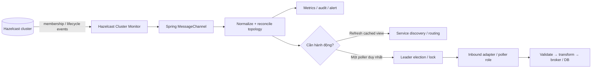
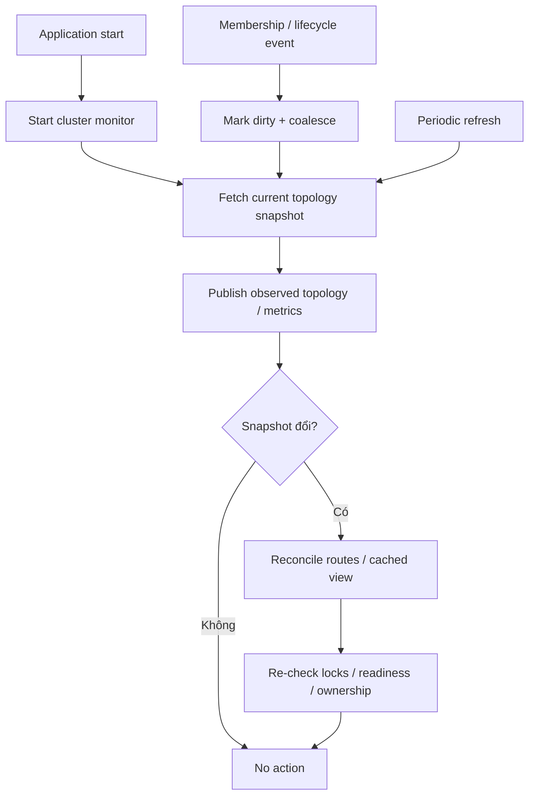
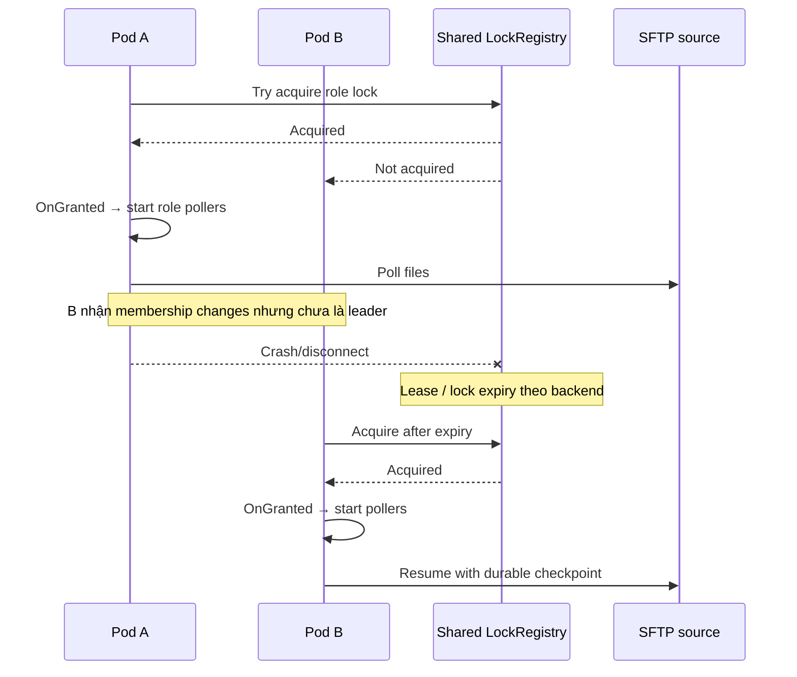
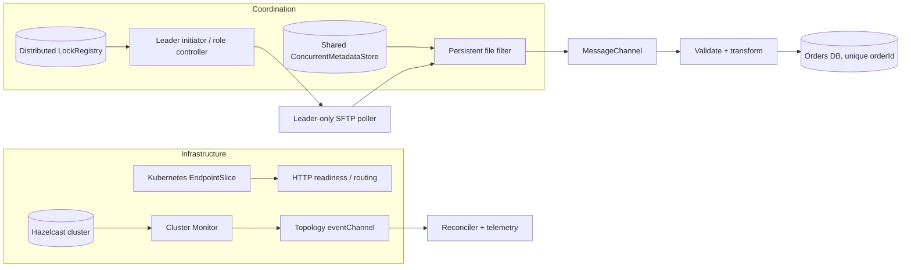

# Cluster membership và topology change

## 1. Bối cảnh: cloud thay đổi thành viên trong khi integration flow vẫn chạy

Trong module **SPRING_INTEGRATION_ADAPTERS**, Spring Integration kết nối hệ thống ngoài bằng inbound/outbound adapter, gateway, poller và `MessageChannel`. Những luồng đọc file, SFTP, HTTP, JMS, AMQP, Kafka hoặc cơ sở dữ liệu có thể chạy trên nhiều tiến trình/Pod để tăng độ sẵn sàng. Khi một instance khởi động, bị thay thế trong rolling deployment, mất mạng hoặc dừng đột ngột, **topology** mà các instance quan sát thay đổi ngay cả khi code của flow không đổi.

Ví dụ: có ba replicas xử lý file từ một SFTP server, đồng thời các instance dùng Hazelcast làm distributed metadata store:

1. Pod A, B, C đều đang chạy, cùng nhìn thấy SFTP và cùng kết nối một Hazelcast cluster.
2. Pod D được thêm vào khi autoscaling; membership của Hazelcast cluster thay đổi nếu D là một Hazelcast member.
3. Pod B mất mạng; các members còn lại có thể phát hiện B rời cluster sau cơ chế failure detection.
4. Phân vùng dữ liệu Hazelcast có thể được phân phối lại; các file pollers vẫn có thể cạnh tranh.
5. Nếu từng pod tự quyết định "tôi là leader" chỉ từ số lượng members, hai pollers có thể chạy song song và ghi trùng đơn hàng.

**Cluster membership** trả lời "những node nào hiện thuộc một cluster cụ thể?". **Topology change** mô tả một biến đổi trong tập node, trạng thái kết nối, phân vùng hoặc các endpoint khả dụng. Đây là các *tín hiệu hạ tầng*, không phải chứng nhận rằng một business message đã được xử lý hoặc một node đã được cấp quyền độc quyền để poll.



### Mục tiêu bài học

Sau bài học, bạn có thể:

1. Phân biệt **membership**, **service discovery**, **health/readiness**, **leader election** và **message ownership**.
2. Hiểu các sự kiện `MEMBERSHIP`, `LIFECYCLE`, `MIGRATION`, `CLIENT`, `DISTRIBUTED_OBJECT` của Hazelcast.
3. Cấu hình `HazelcastClusterMonitorMessageProducer` để đưa topology events vào Spring Integration.
4. Xây luồng nhận sự kiện, cập nhật topology snapshot và phục hồi khi mất sự kiện.
5. Kết hợp `SmartLifecycleRoleController`, `LockRegistryLeaderInitiator` và adapter/poller khi cần leader-only processing.
6. Đánh giá race condition, network partition, rolling deployment, duplicate, failover và backpressure.
7. Kiểm thử, quan sát và vận hành topology changes an toàn trong cloud.

## 2. Các khái niệm cần tách bạch

### 2.1. Membership khác discovery, readiness, leader và ownership

| Khái niệm | Nguồn sự thật điển hình | Trả lời câu hỏi | Không suy ra được |
|---|---|---|---|
| **Cluster membership** | Hazelcast `Cluster.getMembers()`, ZooKeeper/Consul member registry | Ai đang là thành viên của cluster đó? | Thành viên có xử lý business thành công không? |
| **Service discovery** | Kubernetes Service/EndpointSlice, Spring `DiscoveryClient`, Consul | Instance nào được đăng ký để gọi dịch vụ? | Instance có độc quyền poll một nguồn không? |
| **Readiness** | Health probe, EndpointSlice `ready`/`serving` | Endpoint có nên nhận traffic mới? | Đang giữ lock hay đang xử lý xong message? |
| **Leader election** | Lock/lease/quorum coordination | Ai được điều khiển công việc leader-only? | Đã commit transaction ở hệ thống ngoài chưa? |
| **Shard/partition ownership** | Kafka group coordinator, broker, shard coordinator | Consumer nào sở hữu partition? | Ai là leader của toàn ứng dụng? |
| **Business idempotency** | Unique key/inbox/outbox/DB transaction | Side effect đã commit hoặc có thể replay an toàn? | Topology hiện có bao nhiêu nodes? |

Một Pod mới có thể được Kubernetes đánh dấu `Ready` nhưng **chưa** kết nối vào Hazelcast. Ngược lại, một Hazelcast member có thể tồn tại trong cluster nhưng HTTP readiness của ứng dụng đã false. Hai hệ thống có vòng đời độc lập.

Trong một hệ thống, có thể có đồng thời:

- Kubernetes Deployment replicas: `orders-adapter-0`, `orders-adapter-1`, `orders-adapter-2`.
- Hazelcast members: JVM A, B và một Hazelcast server độc lập; các Spring Boot pods có thể chỉ là **clients** của cluster này.
- Kafka consumer group: mỗi partition được cấp cho một consumer theo protocol riêng.
- Leader poller: đúng một application instance giữ distributed lease/lock cho nguồn SFTP.

**Lưu ý:** nếu Spring Boot pods chỉ chạy **Hazelcast client**, thêm Pod có thể thay đổi số client connections mà **không** tạo sự kiện `MembershipEvent` cho tập Hazelcast server members. Khi muốn phát hiện replicas của Spring Boot service, phải dùng chính nguồn membership/discovery tương ứng.

### 2.2. Các thời điểm quan sát được trong một lần scale

```text
t0: Kubernetes tạo Pod D
t1: Container app D start; Hazelcast client kết nối cluster
t2: Pod D hoàn tất readiness; EndpointSlice có endpoint mới
t3: DiscoveryClient/client cache cập nhật routing
t4: Poller của D có thể start nếu cấu hình auto-start
t5: Leader/lock coordinator quyết định ai được poll
```

Không có bảo đảm tổng quát rằng `t1 < t2 < t3 < t4 < t5` trên mọi hệ thống. Các mốc do các control plane và network riêng quản lý. Vì vậy, không dùng "nhận thấy Pod mới" làm điều kiện duy nhất để cấp quyền thực thi job.

### 2.3. Một event là thay đổi, snapshot là trạng thái

Ví dụ hệ thống nhận `MEMBER_REMOVED(B)`. Event cho biết B bị loại khỏi membership trong view của publisher, **không** bảo đảm:

- B đã dừng mọi thread hay side effect.
- Mọi nodes đều quan sát event cùng thời điểm.
- Sự kiện sẽ được lưu durable và replay khi listener restart.
- B đã kết thúc các message đang xử lý dở.

Để biết tập members hiện tại, lấy **snapshot** từ authority thực sự (ví dụ `hazelcastInstance.getCluster().getMembers()`); để biết có nên thay đổi ownership, hỏi coordinator có hợp đồng leader/lease riêng.

## 3. Hazelcast Cluster Monitor của Spring Integration

Spring Integration cung cấp **Hazelcast Cluster Monitor Inbound Channel Adapter** trong module `spring-integration-hazelcast`. Nó đăng ký các listeners với `HazelcastInstance` và phát Spring messages khi Hazelcast có cluster-related events. Đây là **event-driven inbound adapter**; không cần Spring Integration poller để đọc từng event.

Tên Java API chính thức là:

```java
org.springframework.integration.hazelcast.inbound
    .HazelcastClusterMonitorMessageProducer
```

Các nhóm event được hỗ trợ:

| Monitor type | Nguồn sự kiện | Ý nghĩa thực hành |
|---|---|---|
| `MEMBERSHIP` | Member join/leave | Gợi ý cập nhật danh sách Hazelcast members và cảnh báo thay đổi cluster size. |
| `DISTRIBUTED_OBJECT` | Distributed object create/destroy | Quan sát lifecycle của các data structures, **không** phải thông báo update một entry. |
| `MIGRATION` | Partition migration | Quan sát việc phân phối lại dữ liệu; không giả định migration đã an toàn chỉ vì có event bắt đầu. |
| `LIFECYCLE` | Start, stop, reconnect/merge theo Hazelcast API | Dùng để chẩn đoán biến đổi trạng thái Hazelcast member/client. |
| `CLIENT` | Client connection events | Quan sát client join/leave nơi Hazelcast instance/type có hỗ trợ. |

**Mặc định của XML adapter** là `MEMBERSHIP` nếu không chỉ định `monitor-types`. Nên khai báo rõ khi ứng dụng phụ thuộc nhiều loại sự kiện để người đọc không suy đoán từ default.

### 3.1. Phân biệt cluster monitor và Hazelcast cache adapter

Hai inbound adapters có mục đích khác nhau:

- **Cluster monitor** nghe membership, migration, lifecycle, client và distributed-object events.
- **Event-driven cache inbound adapter** nghe `ADDED`, `UPDATED`, `REMOVED`… của `IMap`, `ISet`, `IQueue`, v.v.

Nếu mục tiêu là xử lý update một key trong `IMap`, dùng cache event adapter hoặc Hazelcast entry listener; bật `MEMBERSHIP` sẽ không thay thế được. Nếu mục tiêu là theo dõi Pod join/leave ở Kubernetes, Hazelcast monitor cũng không phải cách duy nhất hay luôn đúng.

### 3.2. Cấu hình dependency

Với Maven và BOM Spring Boot/Spring Integration tương thích:

```xml
<dependency>
    <groupId>org.springframework.integration</groupId>
    <artifactId>spring-integration-hazelcast</artifactId>
</dependency>
```

Nếu không dùng BOM, phải khai báo một phiên bản Spring Integration phù hợp và kiểm tra tương thích với Hazelcast được sử dụng. Ví dụ trong tài liệu Spring Integration 7.1.1, artifact này mang version `7.1.1`. Không trộn tùy tiện các phiên bản Spring Integration khác major/minor vào cùng ứng dụng.

Backend Hazelcast phải được cấu hình thành **cluster thật**, gồm discovery mode, cluster name, authentication/network, replica/backups và clients/members phù hợp. `Hazelcast.newHazelcastInstance()` thuận tiện để demo cục bộ, nhưng không phải cấu hình cluster production.

## 4. Ví dụ Java: đưa membership event vào MessageChannel

Ví dụ dưới đây giả định đã có `HazelcastInstance` bean được cấu hình đúng và quản lý lifecycle. Dùng `DirectChannel` để trình bày đường đi cơ bản; với production, cần giữ listener nhanh và chuyển việc reconcile nặng sang executor có giới hạn hoặc queue phù hợp.

```java
import com.hazelcast.core.HazelcastInstance;

import org.springframework.beans.factory.annotation.Qualifier;
import org.springframework.context.annotation.Bean;
import org.springframework.context.annotation.Configuration;
import org.springframework.integration.channel.DirectChannel;
import org.springframework.integration.hazelcast.inbound.HazelcastClusterMonitorMessageProducer;
import org.springframework.messaging.MessageChannel;

@Configuration
public class ClusterMonitorConfiguration {

    @Bean
    public MessageChannel clusterEvents() {
        return new DirectChannel();
    }

    @Bean
    public HazelcastClusterMonitorMessageProducer clusterMonitor(
            HazelcastInstance hazelcastInstance,
            @Qualifier("clusterEvents") MessageChannel channel) {

        var producer =
            new HazelcastClusterMonitorMessageProducer(hazelcastInstance);
        producer.setMonitorEventTypes("MEMBERSHIP,LIFECYCLE,MIGRATION");
        producer.setOutputChannel(channel);
        return producer;
    }
}
```

Producer chuyển raw Hazelcast events thành payload của Spring message. Handler nhận `Message<?>` và **kiểm tra kiểu** trước khi dùng để không giả định mọi loại event có chung fields:

```java
import com.hazelcast.cluster.MembershipEvent;
import com.hazelcast.core.HazelcastInstance;

import org.slf4j.Logger;
import org.slf4j.LoggerFactory;
import org.springframework.integration.annotation.ServiceActivator;
import org.springframework.messaging.Message;
import org.springframework.stereotype.Component;

@Component
public class TopologyEventHandler {

    private static final Logger log =
        LoggerFactory.getLogger(TopologyEventHandler.class);

    private final TopologyReconciler reconciler;

    public TopologyEventHandler(TopologyReconciler reconciler) {
        this.reconciler = reconciler;
    }

    @ServiceActivator(inputChannel = "clusterEvents")
    public void handle(Message<?> message) {
        Object event = message.getPayload();

        if (event instanceof MembershipEvent membership) {
            log.info("Hazelcast membership changed: type={}, member={}",
                    membership.getEventType(),
                    membership.getMember().getUuid());
        } else {
            log.debug("Hazelcast cluster event: type={}",
                    event.getClass().getSimpleName());
        }

        // Phải là tín hiệu ngắn. Việc reconcile thực tế
        // được gom/coalesce và chạy ngoài callback thread.
        reconciler.requestRefresh();
    }
}
```

`TopologyReconciler` là **service ứng dụng cần tự triển khai** (không phải API có sẵn của Spring Integration). Nó có thể ghi lại sự kiện, debounce các thay đổi liên tiếp và đối chiếu topology từ nguồn sự thật. `requestRefresh()` nên là thao tác nhanh, không chờ gọi HTTP/SFTP/DB hàng chục giây bên trong Hazelcast listener.

**Về payload:** handler chỉ phân tích `MembershipEvent` khi thực sự nhận được loại này; các nhóm `LIFECYCLE`, `MIGRATION` có Java event classes khác. Không convert tất cả event sang `MembershipEvent` hoặc đọc giả định fields chung.

### 4.1. XML tương đương

Nếu dự án sử dụng XML namespace:

```xml
<int:channel id="clusterEvents"/>

<int-hazelcast:cm-inbound-channel-adapter
    channel="clusterEvents"
    hazelcast-instance="hazelcastInstance"
    monitor-types="MEMBERSHIP, LIFECYCLE, MIGRATION"/>
```

Cấu hình XML trên cần các namespace và schemaLocation `int` / `int-hazelcast` trong file Spring XML, đồng thời bean `hazelcastInstance` đã khai báo. Java configuration và XML là hai cách thay thế; không bật đồng thời hai monitors cho một nhu cầu nếu không muốn quan sát trùng.

### 4.2. Event lifecycle và vòng đời adapter

- Khi endpoint start, producer đăng ký listeners với Hazelcast theo monitor types đã bật.
- Khi stop/shutdown, các subscriptions/listeners thuộc producer phải được giải phóng theo lifecycle của component.
- Một listener vừa được đăng ký **không tự nhận lại** toàn bộ lịch sử node đã join trước đó.
- Một `DirectChannel` có handler chậm sẽ gây áp lực ngay trên đường callback; `ExecutorChannel` giúp tách thread nhưng cần capacity, error strategy và chính sách khi queue đầy.
- Spring `MessageChannel` in-memory tự nó không làm Hazelcast events trở thành durable log.

Ứng dụng cần **snapshot lúc startup** và **reconciliation định kỳ** để khôi phục khi missed events hoặc watch reconnect.

## 5. Thiết kế topology reconciliation đúng

### 5.1. Thuật toán state convergence

Mỗi event là lời nhắc "topology có thể đổi"; state dùng cho quyết định phải được tính lại từ authority.



Các bước thực thi nên là:

1. **Đăng ký event source**, bắt đầu nhận thông báo.
2. **Đọc snapshot đầu tiên** và đánh dấu thời điểm quan sát; không chờ một `MEMBER_ADDED` tiếp theo mới biết nodes hiện hữu.
3. **Mỗi event chỉ đặt dirty flag** hoặc gửi một notification vào queue. Nếu có 50 events trong 1 giây, có thể chỉ cần một lần refresh sau khoảng debounce nhỏ.
4. **Fetch snapshot mới** từ Hazelcast cluster, Kubernetes EndpointSlice hoặc `DiscoveryClient` tùy mục tiêu.
5. **So sánh theo stable ID và version**; cập nhật cached view một cách idempotent. Nếu event cũ đến muộn, snapshot hiện tại thắng.
6. **Reconcile định kỳ** dù không có event để khôi phục sau disconnect, lost notifications hoặc listener restart.
7. **Chỉ kích hoạt business action** sau khi kiểm tra quyền lãnh đạo, lock, readiness và transaction riêng.

Snapshot tối thiểu của Hazelcast members có thể được lấy như sau:

```java
import com.hazelcast.core.HazelcastInstance;

import java.util.List;

public List<String> currentMemberIds(HazelcastInstance instance) {
    return instance.getCluster().getMembers().stream()
        .map(member -> member.getUuid().toString())
        .sorted()
        .toList();
}
```

Danh sách trên chỉ phản ánh **Hazelcast members tại thời điểm đọc**. Nó không bao gồm application instances chạy như Hazelcast clients, không thay thế Kubernetes readiness, và không đủ để xác lập partition ownership cho Kafka.

### 5.2. Không tính toán từ delta vô hạn

Mẫu dễ lỗi:

```text
Nhận MEMBER_ADDED(A)  → count = count + 1
Nhận MEMBER_REMOVED(B) → count = count - 1
```

Nếu listener restart, event bị mất hoặc nhận bản sao, `count` trong memory lệch dần. Mẫu vững hơn:

```text
Nhận bất kỳ topology event → requestRefresh()
Snapshot = authority.getCurrentMembers()
newMembers = normalizeAndSort(Snapshot)
if (newMembers != lastMembers):
    recordChange(lastMembers, newMembers)
    lastMembers = newMembers
```

Cùng một topology snapshot được áp dụng hai lần phải có hiệu quả như một lần: **idempotent reconciliation**.

### 5.3. Nhận diện tính mới và race giữa snapshot và event

Ngay cả khi subscribe trước rồi đọc snapshot, sự kiện vẫn có thể đến **trong lúc** đọc snapshot. Một implementation thực tế nên:

- Serialize việc áp dụng snapshots trong một worker/actor hoặc dùng version token để tránh kết quả refresh cũ ghi đè mới.
- Nếu refresh đang chạy và có event mới, đánh dấu `dirty` để refresh lại sau khi xong.
- Kèm generation/observed-at cho **local bookkeeping**; không xem wall-clock timestamp từ các nodes như fencing token đáng tin tuyệt đối.
- Nếu API có version/resourceVersion, dùng khả năng của API đó đúng contract thay vì tạo counter cục bộ.
- Ưu tiên "full snapshot now" hơn "replay all deltas" khi phục hồi sau mất kết nối.

Với Kubernetes, watchers thường làm `LIST → WATCH` theo `resourceVersion` và phải xử lý watch timeout/expired resource version bằng relist. Nếu chỉ cần gọi service thông thường, thường nên dùng **Kubernetes Service DNS/Service routing** thay vì tự duy trì danh sách Pod IP.

## 6. Quyết định ứng dụng từ topology change: ba mô hình

### 6.1. Mô hình A — Observe only

Dùng khi muốn metrics, logs hoặc alert khi Hazelcast cluster mất thành viên.

```text
Hazelcast MEMBER_REMOVED
     → Spring MessageChannel
     → normalize event
     → metric cluster_members_current / member_changes_total
     → alert khi số nodes dưới ngưỡng
```

Không start/stop business pollers dựa đơn thuần vào `memberRemoved`. Đây là mô hình mặc định an toàn cho giám sát.

### 6.2. Mô hình B — Refresh service routing/cache

Dùng khi một adapter gọi HTTP services qua cached discovery information:

- Kubernetes EndpointSlices hoặc Spring Cloud Kubernetes `DiscoveryClient` là authority cho tập HTTP service endpoints.
- Hazelcast membership event chỉ liên quan nếu hệ thống **thực sự định tuyến vào Hazelcast members**.
- Mỗi routing refresh nên lọc endpoint chưa ready/terminating theo contract của discovery.
- Client retries chỉ áp dụng cho request an toàn hoặc có idempotency key, nhất là khi một endpoint biến mất sau khi request đã được gửi.

Ví dụ service D được tạo, sau đó B shutdown: việc update cache thay đổi endpoint routing, nhưng một POST đã gửi tới B có thể đang ở trạng thái **unknown outcome**. Không thể gọi POST tới D mà không xét duplicate side effect.

### 6.3. Mô hình C — Leader-only inbound poller

Dùng khi **một** instance duy nhất được phép poll một nguồn chung (file staging shared, SFTP feed không có lock riêng, scheduled reconciliation). Spring Integration có:

- `LockRegistryLeaderInitiator` để tham gia leader election qua distributed `LockRegistry`.
- `OnGrantedEvent` / `OnRevokedEvent` cho thay đổi vai trò lãnh đạo.
- `SmartLifecycleRoleController` để start/stop các endpoints thuộc role tương ứng.
- `autoStartup=false` để poller chưa được cấp leadership không tự start khi Spring context khởi động.

Ví dụ khai báo initiator khi đã có **distributed** `LockRegistry` được cấu hình đúng:

```java
import org.springframework.context.annotation.Bean;
import org.springframework.integration.support.leader.LockRegistryLeaderInitiator;
import org.springframework.integration.support.locks.LockRegistry;

@Bean
public LockRegistryLeaderInitiator leaderInitiator(LockRegistry locks) {
    return new LockRegistryLeaderInitiator(locks);
}
```

**Chú ý:** bean `LockRegistry` phải là implementation chia sẻ giữa instances với timeout/lease và isolation phù hợp; instance-local lock registry không đảm bảo độc quyền trên nhiều pods. Muốn role controller tự start/stop endpoint, tên role của `Candidate` và endpoint phải khớp. Không nên ghép tay `MEMBER_ADDED` với `roleController.startLifecyclesInRole(...)`.

Với XML endpoint, nguyên tắc role và auto-startup có thể biểu diễn:

```xml
<int:inbound-channel-adapter
    id="leaderOnlySource"
    channel="sourceEvents"
    expression="'check-source'"
    role="sftp-pollers"
    auto-startup="false">
    <int:poller fixed-rate="10000"/>
</int:inbound-channel-adapter>
```

Đoạn này dùng nguồn `expression` ngắn để **minh họa vòng đời endpoint**; để lấy dữ liệu thật, thay bằng file/SFTP inbound adapter phù hợp. Phải cấu hình leader initiator/Candidate cùng role `sftp-pollers`; nếu dùng defaults, hãy xác nhận role thực tế trên phiên bản thư viện đang dùng.



Leader election giảm cạnh tranh trên **shared source** nhưng không tạo exactly-once business processing. Nếu A đã ghi DB rồi crash trước ACK/checkpoint, B có thể xử lý lại cùng dữ liệu. Cần idempotency key, unique constraint/inbox/outbox hoặc transaction boundary phù hợp.

## 7. Topology change tác động thế nào đến các adapter?

| Adapter / nguồn | Khi một instance rời cluster | Phương án phối hợp |
|---|---|---|
| **File/SFTP inbound polling** | Cần tránh nhiều nodes đọc/chuyển cùng file hoặc bỏ qua file khi crash | Leader-only poller **hoặc** shared `ConcurrentMetadataStore`/persistent filter; business idempotency vẫn bắt buộc. |
| **HTTP inbound gateway** | Endpoint có thể rời load balancer; request đang xử lý có thể còn tồn tại | Readiness/drain; stateless processing; idempotency cho retry. |
| **HTTP outbound gateway** | Cache route có thể cũ; request fail/timeout | Service discovery, connection pool refresh, retry/backoff có giới hạn. |
| **JMS/AMQP consumer** | Broker phân phối lại messages còn chưa ACK | Broker ACK/redelivery/DLQ; consumer idempotent; không tự dựa vào Hazelcast member count. |
| **Kafka inbound adapter** | Group coordinator rebalance partitions khi consumer join/leave | Kafka consumer group/rebalance/offset contract; có chiến lược xử lý in-flight. |
| **DB/JDBC poller** | Có thể trùng truy vấn khi nhiều instances poll | DB-backed claim/transaction/locking, leader-only role hoặc work-queue pattern. |
| **Hazelcast IMap/IQueue/ITopic** | Membership/migration có thể làm biến động partition/connection | Backend consistency, backup/quorum và API contract của từng data structure. |

Sự kiện của topology thường dùng để **quan sát và kích hoạt reconciliation**; nguồn phân phối công việc cụ thể (broker, leader initiator, metadata store hoặc DB) mới quyết định quyền xử lý.

### 7.1. Ví dụ SFTP: hai kiểu coordination

**Leader-only:** A giữ distributed lock và chỉ A có active SFTP poller. Khi A chết, B đắc cử rồi poll sau khi stale state được xử lý.

**Shared file filter:** A và B cùng poll, nhưng dùng `SftpPersistentAcceptOnceFileListFilter` với một shared `ConcurrentMetadataStore` để tránh cùng accept key/mtime. Cả hai kiểu đều có crash window. Filter nhận file không đồng nghĩa business record đã commit.

Không cố gộp role leader và accept-once filter thành một khái niệm. Có thể sử dụng cả hai khi rủi ro duplicate cao và số lượng nguồn hợp lý, nhưng phải tính chi phí và khả năng khôi phục.

### 7.2. Ví dụ Kafka: topology không ra lệnh phân partition

Khi một Kafka consumer pod rời cụm, Kafka group coordinator sẽ xử lý partition reassignment/rebalance theo protocol. Hazelcast `MembershipEvent` của một cluster khác **không** thay thế Kafka assignment callback. Nếu application cũng dùng Hazelcast cho cache, hai kinds of topology có thể thay đổi gần nhau nhưng không có một order/transaction chung.

## 8. Kubernetes topology: Pod, Service và EndpointSlice

Nếu ứng dụng chạy trên Kubernetes, nguồn quan sát HTTP endpoints thường là **Service/EndpointSlice**:

- `EndpointSlice` chứa addresses, ports, tham chiếu Pod và topology metadata như zone.
- `ready` liên quan việc có nên nhận traffic; `serving` và `terminating` hỗ trợ drain các endpoints đang đóng.
- Các updates không nhất thiết đến atomically trên nhiều EndpointSlices. Một endpoint có thể xuất hiện tạm thời ở hơn một slice; hãy deduplicate theo identity và tổng hợp tất cả slices của Service.
- Pod `Running` không đồng nghĩa endpoint `Ready`, và service discovery endpoint cũng không khẳng định Hazelcast cluster membership.

Một ví dụ kiểm tra theo namespace (đổi `integration`, `orders-adapter` theo môi trường):

```bash
kubectl get pods -n integration -o wide
kubectl get endpointslices -n integration \
  -l kubernetes.io/service-name=orders-adapter -o wide
```

Lệnh kiểm tra endpoint chỉ phục vụ quan sát; nó không tạo một Spring Integration message tự động.

### 8.1. Spring Cloud Kubernetes DiscoveryClient

Spring Cloud Kubernetes cung cấp discovery integration và cơ chế **catalog watch/heartbeat** cho service catalog theo cấu hình/phiên bản. Với phiên bản được hỗ trợ, khi bật catalog watcher và scheduling, ứng dụng có thể quan sát `HeartbeatEvent` liên quan discovery state; listener nên đối chiếu sự khác biệt giữa các heartbeat, **không phụ thuộc cấu trúc nội bộ của payload**.

Đây là **lớp Spring Cloud Kubernetes**, không phải `HazelcastClusterMonitorMessageProducer`. Dùng khi bài toán là thay đổi danh sách endpoints/instances mà Spring Cloud dùng để gọi HTTP. Phải kiểm tra properties và behavior tương ứng phiên bản Spring Cloud Kubernetes được pin trong ứng dụng.

Nếu chỉ cần routing tới một Service đã có, DNS/service proxy/LoadBalancer phù hợp có thể giúp tránh logic watch phức tạp. Một application-specific monitor thường chỉ cần thiết khi phải phản ứng thêm, ví dụ reset connection pools, ghi audit hoặc điều chỉnh workload theo topology.

## 9. Race conditions và các failure mode nguy hiểm

### 9.1. Split-brain và network partition

Giả sử A và B mất kết nối nhưng cả hai vẫn chạy business threads:

```text
          Network partition
        ┌─────────────────┐
Zone 1  │ A + SFTP poller │
        └─────────────────┘
               X
        ┌─────────────────┐
Zone 2  │ B + SFTP poller │
        └─────────────────┘
```

Mỗi bên có thể quan sát phía kia "đã rời cluster". **Membership event không được dùng làm phép chứng minh phía kia đã dừng.** Nếu lock backend hoặc quorum configuration không bảo toàn single-holder semantics, cả hai có thể chạy đồng thời.

Biện pháp:

1. Dùng coordination backend có contract về ownership/quorum/expiry rõ ràng.
2. Nếu có lease, xác định timeout, renew, mất connectivity và cách revoke work.
3. Với tài nguyên hỗ trợ, dùng **fencing token tăng đơn điệu từ coordinator** để downstream có thể từ chối owner cũ. Tự tạo timestamp tại mỗi Pod không phải fencing.
4. Thiết kế business operations idempotent khi retry/replay dù có leader election.
5. Định nghĩa fail-closed/failover policy nếu coordinator unreachable; không tự bật toàn bộ pollers.

### 9.2. Crash ở mỗi điểm pipeline

| Crash xảy ra | Điều cần hỏi | Hành động khôi phục |
|---|---|---|
| Sau khi nhận membership event, trước khi refresh snapshot | View đã lệch? | Periodic reconcile, không phụ thuộc event log trong RAM. |
| Khi refresh trong lúc có sự kiện mới | Kết quả cũ ghi đè mới? | Serialize updates, dirty flag và refresh lại. |
| Leader A mất lease khi đang poll SFTP | A còn side effect nào in-flight? | Stop/drain có giới hạn, fencing nếu có, downstream idempotency. |
| Sau khi file filter đã accept, trước khi xử lý | Marker đã có nhưng business DB chưa commit? | Replay/reset marker có kiểm soát, inbox/outbox. |
| Sau DB commit, trước broker ACK | Retry có tạo bản ghi trùng? | Unique business id, idempotent consumer. |
| Listener disconnect/reconnect | Event nào bị mất? | Snapshot + reconcile, health/alert khi stale quá lâu. |

### 9.3. Tình huống event storm

Rolling deployment có thể tạo nhiều join/leave, lifecycle và migration events cùng lúc. Không nên:

- Gọi API Kubernetes/Hazelcast đồng bộ ở **mỗi** event với tải không giới hạn.
- Tạo mới toàn bộ outbound clients khi membership thay đổi mà không drain clients cũ.
- Gửi event thô qua nhiều hops rồi giả định thứ tự được giữ.
- Ghi log toàn bộ topology/IP/member metadata với cardinality vô hạn.
- Chạy DB migration/rebalance business partition chỉ vì vừa nhận `MEMBER_ADDED`.

Dùng bounded queue, debounce/coalescing, rate limit, idempotency và backoff/jitter cho từng nhóm thao tác. Nếu queue overflow, đặt trạng thái `needsFullRefresh=true` và thực hiện một snapshot reconcile sau đó theo giới hạn tải.

## 10. Kịch bản minh họa end-to-end

**Nhiệm vụ:** chạy hai instances của `orders-ingest`, cùng dùng Hazelcast metadata store, nhận file từ SFTP; khi scale/restart, không bỏ sót file và không tạo duplicate orders.

### 10.1. Ranh giới trách nhiệm



Giải thích:

- Cluster Monitor **quan sát** membership, lifecycle, migration và gửi event qua `MessageChannel`.
- Reconciler **đối chiếu trạng thái** thực tế, ghi metrics/audit và báo khi mất kết nối.
- Distributed leader/lock quyết định poller nào được chạy; `status=leader` phải đến từ coordinator.
- Persistent filter giảm duplicate fetch theo path/mtime, nhưng không thay thế inbox/business dedup.
- DB unique key/idempotency quyết định side effect cuối cùng.

### 10.2. Dòng thời gian khi Pod A chết

| Thời điểm | Sự kiện | Hành vi mong muốn |
|---|---|---|
| `t0` | A có leadership, đang xử lý file `order-42.csv` | B giữ poller ở trạng thái stopped. |
| `t1` | A crash, DB chưa commit | B không bật poller chỉ từ membership event. |
| `t2` | Hazelcast/coordination layer phát hiện mất node; monitor emit event | Refresh topology snapshot; tăng metric changes, cảnh báo nếu cần. |
| `t3` | Lock/lease của A hết hạn, B giành leadership hợp lệ | Role controller start poller B. |
| `t4` | B nhận lại file theo policy recovery | Idempotency/inbox xác định cần process hay đã hoàn tất. |
| `t5` | DB commit, checkpoint được xác nhận | Flow tiến tiếp; metric pending trở về bình thường. |

Nếu A chết **sau** DB commit nhưng **trước** checkpoint, B có thể thấy lại `order-42.csv`. Unique `orderId` hoặc inbox transaction cho phép xử lý lại an toàn. Chỉ một leader tại một thời điểm **không đủ** để ngăn sự lặp này.

## 11. Kiểm thử topology change có kiểm soát

Bài thực hành có thể dùng hai application contexts/processes và một Hazelcast cluster riêng cho test; với production nên kiểm tra trên deployment topology thực thay vì chỉ tạo hai threads cùng JVM.

### 11.1. Các case tối thiểu

| Test | Thao tác | Kỳ vọng |
|---|---|---|
| **Bootstrap snapshot** | Start listener sau khi cluster đã có 2 members | View có 2 members dù không xảy ra join event mới. |
| **Join** | Thêm member C | Nhận membership signal, snapshot có A/B/C. |
| **Leave** | Gracefully shutdown C | Nhận thay đổi, snapshot còn A/B. |
| **Crash** | Kill member C không graceful | Cuối cùng snapshot loại C theo failure detector; có delay hợp lý. |
| **Listener restart** | Dừng monitor, thay membership, start lại | Full reconcile bắt được state mới dù bỏ lỡ event. |
| **Duplicate event** | Submit cùng refresh signal nhiều lần | Chỉ một state transition có hiệu lực. |
| **Out-of-order refresh** | Snapshot cũ trả về sau snapshot mới | View mới không bị ghi đè bằng stale result. |
| **Rolling deployment** | Thay lần lượt các pods | Không tạo nhiều active leader-only pollers. |
| **Lease expiry** | Leader mất lock khi xử lý | Poller dừng/drain; tác vụ cũ không thể commit trái ownership policy. |
| **Split network** | Chặn connection A↔coordination | Không có hai owners cùng gây side effect không kiểm soát. |
| **Backend outage** | Hazelcast/lock backend unreachable | Readiness/degradation rõ; không fail open tùy tiện. |
| **Event storm** | Nhiều members join/leave liên tục | Không memory leak, không gọi refresh vô hạn. |
| **Post-commit crash** | DB commit xong trước ACK/checkpoint | Retry không tạo duplicate order. |
| **Client-only scaling** | Tăng số application Hazelcast clients, giữ nguyên server members | Không kỳ vọng `MEMBERSHIP` đếm số Spring Boot replicas. |

### 11.2. Cách đánh giá kết quả

Đặt metrics/test assertions ở **hai lớp khác nhau**:

1. **Topology:** số members/endpoint hiện có, event→snapshot convergence latency, observer lag, refresh failure rate.
2. **Business:** số active pollers, số lần một file được fetch, số records DB đã commit, duplicate rejected, số jobs cần replay.

Test chỉ thấy "nhận được `MEMBER_REMOVED`" chưa chứng minh business workflow an toàn. Test phải kiểm tra trạng thái downstream trước/sau crash.

### 11.3. Bài tập tự làm

Cho một cluster 3 members, hai SFTP pollers và một shared metadata store. Giả sử A nhận file F rồi crash trước khi ghi DB; B quan sát A rời cluster.

Hãy thiết kế:

- Điều kiện để B được chạy poller và cách nó xác minh leadership.
- Cơ chế B nhận lại F nếu marker/filter đã được cập nhật trước crash.
- Unique key/idempotency giúp không ghi trùng nếu A đã commit nhưng chưa ACK.
- Cách khôi phục view khi B mất toàn bộ membership events trong 30 giây.
- Hai metrics phân biệt "mất node" với "mất đơn hàng".

Một lời giải tốt phải có **coordinator cho leadership**, **snapshot reconciliation**, **durable recovery/checkpoint** và **business idempotency** riêng biệt.

## 12. Observability, alerting và runbook

### 12.1. Những tín hiệu nên đo

| Metric/log | Ý nghĩa |
|---|---|
| `topology_members_current` (gauge) | Số Hazelcast members **theo snapshot**; gắn cluster/environment. |
| `topology_events_total{type=...}` | Đếm events theo type cho thấy churn. |
| `topology_reconcile_duration_seconds` | Thời gian đọc/tính và apply snapshot. |
| `topology_reconcile_failures_total` | Refresh backend/discovery không thành công. |
| `topology_last_success_timestamp` | Phát hiện view stale khi event path im lặng. |
| `leader_state{role=...}` | Node hiện có leadership không (nên kết hợp coordinator status). |
| `active_pollers{flow=...}` | Phát hiện không có poller hoặc nhiều pollers không mong đợi. |
| `business_duplicate_rejected_total` | Đánh giá idempotency path khi failover. |
| `inflight_messages` / `unacked_messages` | Theo dõi drain và retry sau topology change. |

Tránh dùng member UUID, Pod IP, file name hoặc event ID làm label metrics vì cardinality cao; giữ định danh chi tiết trong **structured logs** có retention và quyền đọc phù hợp.

### 12.2. Trình tự chẩn đoán khi service ngừng xử lý

1. Xác nhận **business sink** còn nhận records hay chỉ thiếu metrics.
2. Kiểm tra readiness/replicas và EndpointSlices nếu đường đi liên quan Kubernetes Services.
3. Kiểm tra Hazelcast cluster/client connectivity và danh sách `getMembers()` thực tế.
4. Xác định monitor đang start, monitor types, output channel và handler subscriptions.
5. So sánh `last topology event` với `last successful full reconcile`; chạy refresh an toàn nếu stale.
6. Nếu flow leader-only, kiểm tra owner/lease/lock ở **coordination backend**, không suy owner từ số members.
7. Kiểm tra role controller/endpoint `autoStartup` và active poller count.
8. Kiểm tra metadata markers, pending files, broker ACK, DB commit và idempotency keys.
9. Khi service trở lại, đối soát những file/records còn chưa commit; replay theo idempotency policy.
10. Ghi lại cause, window mất kết nối, số lần failover và bằng chứng không mất/nhân đôi business data.

### 12.3. Triển khai và shutdown

- **Startup:** khởi tạo client/cluster connection; start topology monitor; fetch snapshot; xác nhận coordination backend; chỉ sau đó mở các pollers theo role/ownership.
- **Scale up:** new replicas kết nối, được readiness kiểm tra, subscribe events và reconcile; chưa được cấp leadership thì không poll shared source.
- **Scale down:** ngừng nhận việc mới, revoke/yield leadership theo coordinator contract nếu cần, drain in-flight work trong grace period; để backend giải phóng lock/lease.
- **Hard crash:** không dựa vào graceful shutdown; cần lease expiry, checkpoint recovery và idempotency.
- **Backend outage:** định nghĩa degraded mode rõ; nếu ownership không thể xác minh, tránh kích hoạt công việc leader-only.
- **Cross-region:** tập members, network partition, failover consistency và write fencing cần được thiết kế theo region; "hai regions nhận cùng event" không chứng minh độc quyền thực thi.

## 13. Những lỗi thiết kế thường gặp

| Nhận định sai | Cách hiểu đúng |
|---|---|
| "Có `MEMBER_REMOVED` tức node đã ngừng làm việc." | Node có thể còn chạy dưới network partition hoặc processing in-flight. |
| "Cluster Monitor giúp mọi adapter tự load balance." | Nó phát cluster events; phân phối work thuộc broker, lock coordinator, filters hoặc application. |
| "Một Pod mới luôn tạo Hazelcast `MEMBER_ADDED`." | Pod có thể là Hazelcast client và không nằm trong member set. |
| "Nhận join/leave events là có current topology." | Phải có bootstrap snapshot và periodic reconciliation. |
| "Event sẽ tự retry khi message handler crash." | Event listener/`MessageChannel` in-memory không mặc định durable/replay. |
| "Leader election ngăn mọi duplicate business records." | Crash sau commit trước ACK vẫn có thể replay; cần idempotency ở sink. |
| "Kubernetes readiness tương đương Hazelcast membership." | Hai trạng thái do hai subsystems riêng quyết định. |
| "Dùng local locks trên mỗi Pod là leader election toàn cluster." | Lock phải được chia sẻ và bảo toàn ownership semantics. |
| "Nhận `MIGRATION` có thể tự thay Kafka partition assignment." | Kafka ownership được điều khiển bởi Kafka group coordinator. |
| "Refresh ở mọi event luôn tốt hơn." | Event storm gây overload; nên debounce và full snapshot định kỳ. |

## 14. Checklist đưa vào production

- [ ] Chỉ rõ **cluster nào** đang được quan sát: Hazelcast members, Kubernetes service endpoints, Kafka consumers hay logical workers.
- [ ] Có phiên bản tương thích Spring Integration/Hazelcast và cấu hình client/member minh bạch.
- [ ] Cấu hình monitor types theo nhu cầu; xác nhận default `MEMBERSHIP` và subscription lifecycle.
- [ ] Handler topology events nhẹ, không block Hazelcast event thread.
- [ ] Có startup snapshot, periodic reconcile, debounce và stale-view detection.
- [ ] Một snapshot mới không bị kết quả refresh cũ ghi đè.
- [ ] Có source of truth riêng cho service discovery/readiness.
- [ ] Leader-only pollers tắt `autoStartup` và dùng distributed election/lock với role phù hợp.
- [ ] Đã test lock loss, expiry, network partition và failover.
- [ ] Đã test nhận lại file/message khi crash sau accept và sau DB commit.
- [ ] Idempotency key/unique constraint/inbox hoặc replay mechanism hoạt động.
- [ ] Metrics và logs cho topology/leadership/business được theo dõi độc lập.
- [ ] Đã kiểm thử rolling deployment, autoscaling, disconnect/reconnect, backend outage.
- [ ] Có runbook manual reconciliation và replay có kiểm soát.
- [ ] Bảo vệ Hazelcast/Kubernetes credentials, TLS, RBAC và quyền truy vấn topology.

## 15. Tổng kết

**Cluster membership và topology change** cung cấp thông tin về thay đổi cấu trúc hạ tầng đang chạy các Spring Integration flows. Với Hazelcast, `HazelcastClusterMonitorMessageProducer` là **event-driven inbound adapter** biến các sự kiện `MEMBERSHIP`, `LIFECYCLE`, `MIGRATION`, `CLIENT` và `DISTRIBUTED_OBJECT` thành messages đi vào `MessageChannel`. Nó phù hợp để quan sát và yêu cầu cập nhật topology, không mặc định là công cụ leader election hay work distribution.

Mẫu thiết kế thực tế là **event → request refresh → snapshot từ authority → idempotent reconcile → hành động có điều kiện**. Với nguồn chỉ cho một instance poll, dùng distributed leader election và `SmartLifecycleRoleController`; với nguồn có thể poll song song, dùng shared metadata/lock hợp đồng rõ. Trong mọi trường hợp, ACK, transaction, idempotency và recovery quyết định độ tin cậy của business processing.

Đối với **SPRING_INTEGRATION_ADAPTERS**, điều quan trọng nhất là không để thay đổi cluster vô tình start thêm SFTP/File pollers, làm mất trạng thái HTTP routing hoặc khiến JMS/AMQP/Kafka/database xử lý trùng trong lúc scale, restart và failover.

### Tài liệu tham khảo

- [Spring Integration — Hazelcast Support (Cluster Monitor Inbound Channel Adapter)](https://docs.spring.io/spring-integration/reference/hazelcast.html)
- [Spring Integration API — HazelcastClusterMonitorMessageProducer](https://docs.spring.io/spring-integration/docs/current/api/org/springframework/integration/hazelcast/inbound/HazelcastClusterMonitorMessageProducer.html)
- [Spring Integration — Leadership Event Handling](https://docs.spring.io/spring-integration/reference/leadership-event-handling.html)
- [Spring Integration — Endpoint Roles](https://docs.spring.io/spring-integration/reference/endpoint-roles.html)
- [Spring Integration — Distributed Locks](https://docs.spring.io/spring-integration/reference/distributed-locks.html)
- [Hazelcast — Cluster Events](https://docs.hazelcast.com/hazelcast/5.7/events/cluster-events)
- [Hazelcast — Listening to Events](https://docs.hazelcast.com/hazelcast/5.4/events/distributed-events)
- [Spring Cloud Kubernetes — DiscoveryClient](https://docs.spring.io/spring-cloud-kubernetes/reference/discovery-client.html)
- [Kubernetes — EndpointSlices](https://kubernetes.io/docs/concepts/services-networking/endpoint-slices/)
- [Kubernetes — Pod Termination](https://kubernetes.io/docs/concepts/workloads/pods/pod-termination/)
