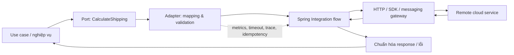
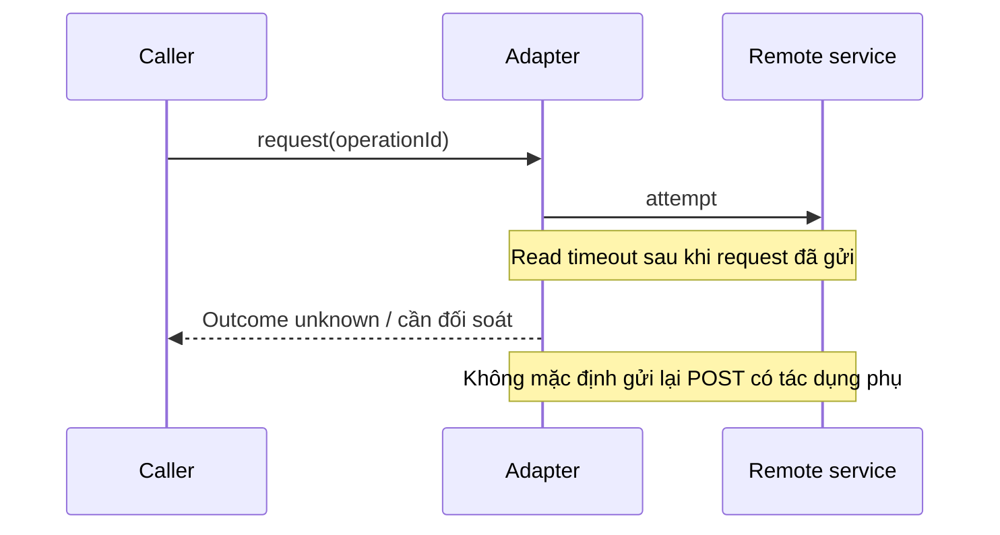
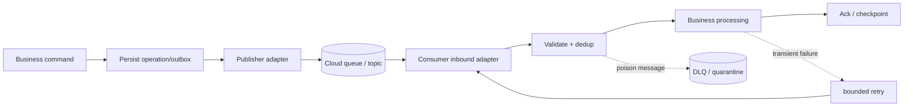

# Remote service adapter boundary trong Spring Integration

Trong một hệ thống cloud, ứng dụng thường phải gọi dịch vụ nằm ngoài tiến trình của mình: API định giá, hệ thống thanh toán, dịch vụ xác minh danh tính, kho đối tượng, dịch vụ gửi thông báo hoặc một nền tảng SaaS. Điểm giao tiếp với những dịch vụ này được gọi là **remote service adapter boundary** (ranh giới adapter cho dịch vụ từ xa). Đây là nơi ứng dụng chuyển đổi hợp đồng nghiệp vụ nội bộ thành giao thức của hệ thống bên ngoài, đồng thời kiểm soát lỗi, thời gian chờ, xác thực, truyền ngữ cảnh và trách nhiệm xử lý lại.

Trong module **SPRING_INTEGRATION_ADAPTERS**, Spring Integration cung cấp các thành phần inbound/outbound adapter, gateway, poller và `MessageChannel` để xây dựng ranh giới đó. Chủ đề này tập trung vào **thiết kế và vận hành ranh giới** khi kết nối cloud/remote service; lựa chọn cụ thể như HTTP, SFTP, JMS, AMQP, Kafka, file hay cơ sở dữ liệu chỉ là một phần của thiết kế.

Sau bài học, bạn cần có khả năng:

- Xác định đâu là mã nghiệp vụ, đâu là mã tích hợp, đâu là trạng thái thuộc quyền sở hữu của hệ thống ngoài.
- Chọn đúng inbound/outbound **adapter** hoặc **gateway** dựa trên hợp đồng một chiều hay request/reply.
- Thiết kế payload, header, định danh, ánh xạ lỗi và chính sách retry không làm lặp tác dụng phụ.
- Tách hợp đồng ổn định bên trong khỏi API, SDK và chi tiết cloud provider.
- Đặt timeout, giới hạn lưu lượng, giám sát và kiểm thử phù hợp với luồng đồng bộ hoặc bất đồng bộ.

## 1. Ranh giới remote service thực sự là gì?

Xét chức năng báo giá vận chuyển. Ứng dụng nhận yêu cầu `CalculateShipping` với mã đơn hàng, địa chỉ nhận và khối lượng. Nhà cung cấp vận chuyển yêu cầu HTTP `POST /v2/rates`, JSON có tên trường riêng, access token và một header định danh giao dịch. Nếu controller hoặc nghiệp vụ biết trực tiếp URL, HTTP status, SDK exception và cấu trúc JSON của nhà cung cấp, mọi thay đổi từ bên ngoài sẽ lan vào phần lõi.

Ranh giới adapter thu gom những chi tiết đó tại một nơi:

| Bên trong ứng dụng | Tại remote service adapter boundary | Bên ngoài ứng dụng |
|---|---|---|
| Lệnh `CalculateShipping`, kiểu tiền, quy tắc nghiệp vụ | Chuyển lệnh thành request DTO theo hợp đồng nhà cung cấp | JSON, HTTP endpoint, SDK request |
| `orderId`, `operationId`, `correlationId` | Sinh/ánh xạ header được phép xuất ra ngoài | Request ID, idempotency key, trace context |
| Ý nghĩa `RateUnavailable`, `AddressRejected` | Phân loại HTTP status, lỗi mạng, response lỗi | 4xx, 5xx, timeout, rate limit |
| Ngân sách thời gian của use case | Timeout, retry có điều kiện, circuit breaker, giới hạn đồng thời | Độ trễ và hạn mức của remote service |
| Đơn vị tiền và trạng thái nội bộ | Chuẩn hóa response, kiểm tra invariant | Kiểu số, đơn vị, trạng thái riêng của đối tác |

Mục tiêu là để phần nghiệp vụ gọi một **năng lực** như `ShippingRatePort.calculate(...)`, còn adapter chịu trách nhiệm giao tiếp với một đối tác cụ thể. Boundary cũng là một **ranh giới thất bại**: yêu cầu đã gửi ra mạng có thể được xử lý thành công tại bên ngoài ngay cả khi ứng dụng không nhận được câu trả lời.

### Sơ đồ trách nhiệm



Một flow có thể đồng thời dùng `MessageChannel`, transformer, header enricher, router, service activator và handler truy cập remote service. Chúng giải quyết các khía cạnh khác nhau; **không có một adapter duy nhất tự động bảo đảm tính nhất quán xuyên mạng**.

## 2. Nhận diện hướng kết nối và loại endpoint

Thuật ngữ inbound/outbound luôn được hiểu **từ góc nhìn của ứng dụng đang chạy Spring Integration**, không phải từ góc nhìn nhà cung cấp:

| Nhu cầu | Thành phần phù hợp | Đặc tính |
|---|---|---|
Nhận webhook HTTP và phản hồi ngay | Inbound gateway | Có request và reply cho bên gọi |
| Thăm dò thư mục/kho đối tượng hoặc API để nhận thay đổi | Inbound channel adapter + poller, khi công nghệ hỗ trợ | Đẩy message vào flow; poll phải có checkpoint/dedup |
| Gửi một sự kiện tới queue/topic hoặc gọi API theo kiểu fire-and-forget | Outbound channel adapter | Không cung cấp phản hồi nghiệp vụ trên cùng lời gọi |
| Gọi API báo giá và chờ kết quả | Outbound gateway | Request/reply; lời gọi có thể chờ hoặc thất bại |
| SDK không có adapter chính thức trong Spring Integration | Service activator/custom `MessageHandler` hoặc `MessageSource` | Tự quản lý SDK, lỗi, lifecycle và giới hạn tài nguyên |

**Inbound adapter** đưa dữ liệu từ hệ thống ngoài vào channel. **Outbound adapter** gửi dữ liệu ra ngoài, thường một chiều. **Gateway** thể hiện trao đổi hai chiều. Với một số công nghệ, phản hồi là ACK ở tầng vận chuyển chứ không phải kết quả xử lý nghiệp vụ. Ví dụ, một dịch vụ hàng đợi chấp nhận message không chứng minh worker phía sau đã xử lý đơn hàng.

Spring Integration có HTTP support, cùng các module/extension cho những giao thức khác. Khi tích hợp AWS, Azure, Google Cloud hoặc SaaS, cần kiểm tra thư viện tích hợp, phiên bản và mức hỗ trợ thực tế. Đừng suy ra rằng mọi cloud service đều có adapter chính thức trong `spring-integration-core`; đôi khi giải pháp đúng là bọc SDK hoặc HTTP client trong handler riêng.

## 3. Bắt đầu từ hợp đồng, không bắt đầu từ URL

Trước khi tạo flow, mô tả **hợp đồng biên** dưới dạng có thể kiểm thử:

| Quyết định | Câu hỏi cần trả lời | Ví dụ |
|---|---|---|
Năng lực | Ứng dụng muốn làm gì? | `quoteShipping(command)` |
Hình thức tương tác | Đồng bộ, bất đồng bộ hay phát sự kiện? | Đồng bộ, trả `ShippingQuote` |
Định danh | Cái gì định danh request và tác dụng phụ? | `operationId`, không chỉ message UUID |
Payload | Trường bắt buộc, đơn vị, giới hạn, version? | Khối lượng gram, tiền VND |
Kết quả | Đâu là thành công nghiệp vụ? | `APPROVED`, `DECLINED`, `PENDING` |
Lỗi | Trường hợp nào có thể retry? | 429/503 có giới hạn; 400 sai dữ liệu không retry |
Timeout | Caller có thể chờ tối đa bao lâu? | Tổng ngân sách 1,5 giây |
Idempotency | Yêu cầu trùng có tạo thêm tác dụng phụ không? | Nhà cung cấp hỗ trợ `Idempotency-Key` |
Vận hành | Log, metrics, trace, cảnh báo? | `remote_call_duration` theo đối tác và kết quả |
Bảo mật | Ai cấp credential, thông tin nào được truyền? | Token ngắn hạn, TLS, lọc header |

Một ví dụ hợp đồng nghiệp vụ độc lập với nhà cung cấp:

```java
public interface ShippingRatePort {
    ShippingQuote calculate(CalculateShipping command);
}

public record CalculateShipping(
        String operationId,
        String orderId,
        String destinationPostalCode,
        long weightInGrams) {}

public record ShippingQuote(
        String providerReference,
        java.math.BigDecimal amount,
        String currency,
        java.time.Instant expiresAt) {}
```

Đây là **port**, chưa phải endpoint HTTP. Adapter triển khai port và làm việc với kiểu dữ liệu của đối tác. Không để class response của SDK hoặc `HttpStatusCodeException` trở thành kiểu trả về của port.

## 4. Phân biệt ba loại định danh thường bị trộn lẫn

Một remote call có thể đi qua nhiều message và nhiều lần gửi lại. Vì vậy cần phân biệt:

1. **Business ID** (`orderId`, `customerId`): đối tượng nghiệp vụ được thao tác.
2. **Operation/idempotency ID** (`operationId`): một ý định thay đổi trạng thái duy nhất; giữ nguyên khi retry cùng ý định, đổi khi tạo ý định mới.
3. **Correlation/trace ID**: nối log và distributed trace; dùng để quan sát, không mặc nhiên là khóa chống trùng.

`MessageHeaders.ID` của Spring Integration mô tả **một message cụ thể**. Khi message được tạo lại, ID có thể thay đổi; đừng dùng nó làm khóa idempotency dài hạn. Một trường hợp phổ biến:

```text
orderId        = ORD-8125
operationId    = SHIP-8125-QUOTE-v1
correlationId  = trace-7c8a...
remoteRequest  = POST /v2/rates
idempotencyKey = SHIP-8125-QUOTE-v1  (nếu nhà cung cấp hỗ trợ)
```

Header nội bộ và header HTTP là hai namespace khác nhau. Không giả định `MessageHeaders` tự động được gửi ra mạng. Với HTTP outbound handler phải cấu hình `HeaderMapper` cho custom header được phép và kiểm tra request thực tế. Với SDK hoặc queue, adapter phải ánh xạ rõ sang message attributes/properties tương ứng.

**Quy tắc:** chỉ chuyển ra ngoài những header cần thiết và đã được duyệt. Không đẩy toàn bộ Spring message headers, bearer token nội bộ, thông tin người dùng hoặc exception stack trace sang đối tác.

## 5. Ví dụ nền tảng: outbound HTTP gateway đọc dữ liệu

Ví dụ dưới đây minh họa một luồng **request/reply** lấy giá sản phẩm từ dịch vụ danh mục bên ngoài. Chọn HTTP `GET` để tập trung vào adapter boundary: câu hỏi có kết quả, việc đọc không tạo tác dụng phụ. Với API ghi dữ liệu, phải bổ sung chính sách idempotency ở phần sau.

Giả sử nhà cung cấp có endpoint:

```http
GET /v1/products/SKU-100/price HTTP/1.1
Host: catalog.partner.example
Accept: application/json
```

và phản hồi JSON:

```json
{
  "sku": "SKU-100",
  "unitPrice": 129000,
  "currencyCode": "VND",
  "priceVersion": "2026-11"
}
```

### 5.1. Dependency và cấu hình

Dùng Spring Boot 3.x tương ứng Spring Integration 6.x, với dependency HTTP integration và JSON converter. Ví dụ Maven:

```xml
<dependencies>
    <dependency>
        <groupId>org.springframework.boot</groupId>
        <artifactId>spring-boot-starter-integration</artifactId>
    </dependency>
    <dependency>
        <groupId>org.springframework.integration</groupId>
        <artifactId>spring-integration-http</artifactId>
    </dependency>
    <dependency>
        <groupId>org.springframework.boot</groupId>
        <artifactId>spring-boot-starter-web</artifactId>
    </dependency>
</dependencies>
```

Version phải do Spring Boot BOM quản lý đồng bộ; không chọn ngẫu nhiên phiên bản Spring Integration cho dependency trên.

```yaml
# application.yml
remote:
  catalog:
    base-url: https://catalog.partner.example
```

### 5.2. DTO bên ngoài và kiểu nội bộ

Trong dự án thực tế đặt mỗi `public record` trong file Java riêng. Đoạn dưới trình bày các kiểu để nhìn được ranh giới:

```java
// Contract do ứng dụng kiểm soát:
public record PriceQuery(String sku) {}
public record ProductPrice(
        String sku,
        java.math.BigDecimal amount,
        String currency) {}

// DTO phụ thuộc JSON của nhà cung cấp:
public record PartnerPriceResponse(
        String sku,
        java.math.BigDecimal unitPrice,
        String currencyCode,
        String priceVersion) {}
```

Chỉ DTO `PartnerPriceResponse` được phép phản ánh cách đặt tên `unitPrice` và `currencyCode` của đối tác. Nếu đối tác chuyển sang `price.amount`, chỉ mapping ở boundary cần cập nhật.

### 5.3. Spring Integration flow

```java
import org.springframework.beans.factory.annotation.Value;
import org.springframework.context.annotation.Bean;
import org.springframework.context.annotation.Configuration;
import org.springframework.http.HttpMethod;
import org.springframework.http.client.ClientHttpRequestFactory;
import org.springframework.http.client.SimpleClientHttpRequestFactory;
import org.springframework.integration.annotation.IntegrationComponentScan;
import org.springframework.integration.config.EnableIntegration;
import org.springframework.integration.dsl.IntegrationFlow;
import org.springframework.integration.http.dsl.Http;
import org.springframework.integration.annotation.MessagingGateway;

@Configuration
@EnableIntegration
@IntegrationComponentScan
class CatalogIntegrationConfig {

    @Bean
    ClientHttpRequestFactory catalogRequestFactory() {
        SimpleClientHttpRequestFactory factory =
                new SimpleClientHttpRequestFactory();
        factory.setConnectTimeout(2_000);
        factory.setReadTimeout(4_000);
        return factory;
    }

    @Bean
    IntegrationFlow catalogPriceFlow(
            @Value("${remote.catalog.base-url}") String baseUrl,
            ClientHttpRequestFactory catalogRequestFactory) {

        return IntegrationFlow.from("catalogPriceRequests")
                .handle(Http.outboundGateway(
                                baseUrl + "/v1/products/{sku}/price")
                        .httpMethod(HttpMethod.GET)
                        .uriVariable("sku", "payload.sku")
                        .expectedResponseType(PartnerPriceResponse.class)
                        .requestFactory(catalogRequestFactory))
                .transform(PartnerPriceResponse.class, remote ->
                        new ProductPrice(
                                remote.sku(),
                                remote.unitPrice(),
                                remote.currencyCode()))
                .get();
    }
}

@MessagingGateway(defaultRequestChannel = "catalogPriceRequests")
interface CatalogPriceGateway {
    ProductPrice findPrice(PriceQuery query);
}
```

Luồng thực hiện:

1. `CatalogPriceGateway.findPrice(query)` gửi message tới `catalogPriceRequests`.
2. HTTP outbound gateway gọi remote `GET`; biểu thức `payload.sku` tạo biến URI từ payload.
3. HTTP message converter chuyển JSON thành `PartnerPriceResponse`; JSON và DTO phải tương thích, đồng thời `Content-Type` phản hồi phải được converter hỗ trợ.
4. Transformer chuyển DTO ngoài thành `ProductPrice`.
5. Gateway trả kết quả về caller; lỗi kết nối/HTTP có thể được phát sinh thành exception trên nhánh đồng bộ.

Ví dụ sử dụng trong application service:

```java
@Service
public class PriceApplicationService {
    private final CatalogPriceGateway gateway;

    public PriceApplicationService(CatalogPriceGateway gateway) {
        this.gateway = gateway;
    }

    public ProductPrice priceOf(String sku) {
        if (sku == null || sku.isBlank()) {
            throw new IllegalArgumentException("sku is required");
        }
        return gateway.findPrice(new PriceQuery(sku));
    }
}
```

Đây là mẫu tối thiểu để thấy sự phân chia trách nhiệm. Khi đưa vào production, adapter cần thêm kiểm tra response, mapping lỗi có chủ đích, tracing, cấu hình bảo mật, timeout theo ngân sách tổng và chính sách retry phù hợp. `SimpleClientHttpRequestFactory` được dùng cho ví dụ dễ đọc; client HTTP/connection pool trong production phải được chọn theo tải thực tế.

> **Lưu ý phiên bản:** API Java DSL và HTTP client cụ thể phụ thuộc phiên bản Spring Boot/Spring Integration. Khi nâng cấp, đối chiếu tài liệu phiên bản đang dùng, đặc biệt ở HTTP client, timeout và auto-configuration. Việc minh họa cấu trúc flow không thay thế kiểm thử build trong dự án thật.

## 6. Tách adapter triển khai port khỏi gateway kỹ thuật

Ví dụ HTTP flow trên trình bày các mắt xích kỹ thuật. Trong codebase thực tế có thể bọc `CatalogPriceGateway` bằng một lớp triển khai port nghiệp vụ:

```java
public interface ProductPricePort {
    ProductPrice getPrice(String sku);
}

@Component
public class RemoteCatalogPriceAdapter implements ProductPricePort {
    private final CatalogPriceGateway gateway;

    public RemoteCatalogPriceAdapter(CatalogPriceGateway gateway) {
        this.gateway = gateway;
    }

    @Override
    public ProductPrice getPrice(String sku) {
        try {
            return validate(gateway.findPrice(new PriceQuery(sku)));
        } catch (org.springframework.web.client.HttpClientErrorException.NotFound ex) {
            throw new ProductNotFoundException(sku, ex);
        } catch (org.springframework.web.client.RestClientException ex) {
            throw new RemoteCatalogUnavailableException(ex);
        }
    }

    private ProductPrice validate(ProductPrice price) {
        if (price == null
                || price.amount() == null
                || price.amount().signum() < 0
                || price.currency() == null) {
            throw new InvalidPartnerResponseException();
        }
        return price;
    }
}
```

`ProductNotFoundException`, `RemoteCatalogUnavailableException` và `InvalidPartnerResponseException` là **exception do ứng dụng tự định nghĩa**. Đoạn code chỉ minh họa việc dịch lỗi; trong triển khai thật cần phân biệt thêm 401/403, 429, 5xx, response có trạng thái nghiệp vụ không thành công và các lỗi decode. Đừng gom mọi `RestClientException` thành "không tìm thấy dữ liệu".

Việc đặt tên `RemoteCatalogPriceAdapter` giữ chi tiết nhà cung cấp ở bên ngoài; use case chỉ phụ thuộc `ProductPricePort`. Khi thay HTTP bằng SDK hoặc chuyển đối tác, business logic ít bị ảnh hưởng.

## 7. Cấu trúc message và header tại boundary

Một Spring Integration message gồm `payload` và `headers`. Ở boundary, chúng phục vụ các mục đích khác nhau:

| Thành phần | Ví dụ | Nguyên tắc |
|---|---|---|
`payload` | `PriceQuery`, `PartnerPriceResponse` | Dữ liệu đã được xác thực, serialization/deserialize rõ |
`MessageHeaders.ID` | UUID trong runtime | Nhận diện message; không dùng làm operation ID lâu dài |
`replyChannel` | Channel phản hồi gateway | Chi tiết điều phối nội bộ, không đưa ra API ngoài |
`errorChannel` | Channel tiếp nhận `ErrorMessage` khi có cơ chế phát lỗi vào channel | Không mặc định bắt mọi exception đồng bộ |
`correlationId` | ID nối nhiều bước/trace | Dùng cho quan sát và đối soát |
`Idempotency-Key` hoặc equivalent | `operationId` ổn định qua retry | Chỉ có giá trị khi đối tác hỗ trợ và thực thi đúng hợp đồng |
`Content-Type` / `Accept` | `application/json` | Khớp codec và API contract |

**Header mapping là một phần của contract.** Ví dụ, khi đối tác bắt buộc `Idempotency-Key`, adapter cần bảo đảm field này được đưa thành HTTP header đúng tên, đúng giá trị. Với HTTP outbound endpoint, kiểm soát `HeaderMapper` và kiểm thử request gửi ra bằng mock HTTP server. Với SQS/Kafka/Pub/Sub, xác định tên message attribute, key hoặc header tương ứng; các giao thức có luật kích thước, serialization và retention khác nhau.

Giới hạn header cần lưu ý:

- Chỉ forward `traceparent`/baggage khi chính sách quan sát và bảo mật cho phép.
- Không dùng ID của log/trace làm bằng chứng nghiệp vụ rằng một giao dịch được thực hiện đúng một lần.
- Không log toàn bộ payload chứa PII, token hoặc thông tin thanh toán.
- Kiểm tra giới hạn kích thước header/message của nhà cung cấp; message rất lớn nên tham chiếu tới object storage có quản lý vòng đời.

## 8. Lỗi phải được phân loại tại ranh giới

Gọi remote service tạo ra các loại kết quả không đồng nghĩa:

| Tình huống | Ý nghĩa | Hành động gợi ý |
|---|---|---|
HTTP 2xx, payload hợp lệ | Thành công theo giao thức; còn phải kiểm tra trạng thái nghiệp vụ | Parse, validate, map |
HTTP 200 nhưng `status=DECLINED` | Đối tác xử lý được yêu cầu nhưng từ chối nghiệp vụ | Trả kết quả/từ chối nghiệp vụ, không retry mù |
HTTP 400/422 | Request sai hoặc vi phạm quy tắc bên ngoài | Sửa dữ liệu/contract, thường không retry |
HTTP 401/403 | Authentication/authorization hoặc quyền chưa phù hợp | Xem lại credential/quyền; tránh vòng retry vô hạn |
HTTP 404 | Không có tài nguyên; tùy API có thể là trạng thái hợp lệ | Ánh xạ sang not found hoặc policy riêng |
HTTP 409 | Xung đột, có thể trùng operation hoặc sai phiên bản | Tra hợp đồng đối tác và đối soát |
HTTP 429 | Vượt hạn mức | Honor `Retry-After` nếu được cung cấp, backoff và giới hạn tổng |
HTTP 502/503/504 | Sự cố gateway/dịch vụ tạm thời | Retry có giới hạn khi operation an toàn |
Connect timeout | Có thể chưa kết nối đến server | Retry có điều kiện theo policy |
Read timeout/connection reset sau khi gửi | **Không biết** đối tác đã commit hay chưa | Đối soát theo operation ID trước khi lặp thao tác có tác dụng phụ |
JSON sai schema, lỗi parse | Contract drift hoặc dữ liệu lỗi | Quarantine/cảnh báo; không tự retry vô hạn |

Một kết quả HTTP 202 Accepted cũng chỉ chứng tỏ phía ngoài **đã tiếp nhận** yêu cầu theo hợp đồng của nó, thường chưa có kết quả cuối. Nếu công việc là thanh toán, xuất hóa đơn hoặc tạo tài nguyên, phải có cách truy vấn trạng thái qua operation ID hoặc nhận callback/event xác nhận.

### Lỗi đồng bộ và `errorChannel`

`DirectChannel` thường gọi handler trong cùng thread. Với outbound gateway đồng bộ, exception có thể trả ngược về caller và làm fail lời gọi gateway. `errorChannel` **không phải một catch-all tự động** cho mọi flow.

Trong flow bất đồng bộ (ví dụ `ExecutorChannel`, poller, message-driven endpoint), `ErrorMessage` có thể đi tới kênh lỗi được cấu hình. Phải xác định rõ:

1. Ai bắt exception: gateway, advice, error flow hay framework/container của broker?
2. Khi lỗi xảy ra, message còn ở queue gốc, được đưa vào DLQ hay đã bị acknowledge?
3. Có thành công ngoài hệ thống nhưng thất bại khi ghi trạng thái nội bộ không?
4. Khi replay message, khóa idempotency và trạng thái checkpoint có được giữ nguyên không?

Không coi log lỗi là cơ chế phục hồi. Một luồng production cần chiến lược retry, DLQ/quarantine, khả năng đối soát và quyền thao tác replay có kiểm soát.

## 9. Timeout: ngân sách của toàn bộ request

Có **nhiều timeout khác nhau**:

- **Connect timeout:** thời gian thiết lập kết nối mạng.
- **Read/response timeout:** thời gian chờ dữ liệu/response ở HTTP client.
- **Send/reply timeout của messaging gateway/channel:** thời gian chờ gửi/nhận giữa các endpoint trong Spring Integration; không thay thế network timeout.
- **Deadline của use case:** tổng thời gian caller cho phép, kể cả queueing, chuyển đổi dữ liệu, remote call, retry và fallback.

Ví dụ use case đặt mục tiêu phản hồi trong 1.500 ms. Nếu dành 1.000 ms cho remote call, 150 ms cho mapping/serialization và 350 ms cho hàng đợi, network/jitter cùng phần dự phòng, thì hai lần retry mỗi lần 1.000 ms là **không phù hợp** với deadline. Retry phải tuân theo **thời gian còn lại**, không chỉ `maxAttempts`.



Với HTTP, timeout dùng trong ví dụ ở phần 5 là cấu hình client. Trong thực tế cần cân nhắc connection pool exhaustion, DNS/TLS negotiation, số request chờ và timeout của các proxy/load balancer trung gian. Một timeout quá ngắn tạo retry storm; quá dài giữ thread/connection khiến cả ứng dụng cạn tài nguyên.

## 10. Retry, idempotency và trường hợp "unknown outcome"

Ba thuật ngữ cần tách riêng:

- **Retry:** thử gửi lại khi kết quả lần trước thất bại hoặc không rõ.
- **Idempotency:** thực thi cùng một **ý định** nhiều lần cho cùng kết quả nghiệp vụ/không nhân tác dụng phụ; cần bảo đảm ở nơi sở hữu trạng thái.
- **Deduplication:** phát hiện message hoặc operation trùng; là một cơ chế có thể giúp thực hiện idempotency.

Ví dụ hệ thống đặt hàng gọi `POST /payments` và bị read timeout. Có ít nhất hai khả năng: thanh toán chưa được ghi nhận, hoặc đã ghi nhận nhưng response thất lạc. Gửi lại với một ID mới có nguy cơ tạo lần thanh toán thứ hai.

Nếu remote API hỗ trợ idempotency key:

```http
POST /payments HTTP/1.1
Host: payment.partner.example
Content-Type: application/json
Idempotency-Key: ORDER-8125-CAPTURE-1

{"orderId":"ORD-8125","amount":120000,"currency":"VND"}
```

Khi retry **cùng một thao tác**, giữ nguyên key và payload theo hợp đồng đối tác. Nếu API không hỗ trợ, ưu tiên **read-after-write/lookup theo reference**, hoặc thiết kế state machine đối soát trước khi tạo request mới. Cơ chế lưu key cần có thời hạn lưu, quy tắc xử lý cùng key nhưng payload khác và một nguồn dữ liệu bền vững.

Một retry policy có thể bắt đầu như sau (mang tính thiết kế, không phải DSL tự động):

```text
if response is permanent business rejection:
    return mapped business result
if response is 429 or transient 503 and operation is retry-safe:
    respect Retry-After if present
    retry with capped exponential backoff + jitter
    stop when deadline or attempt budget is exhausted
if response is timeout after request was sent and operation changes state:
    query by stable operationId or return PENDING_RECONCILIATION
else:
    route to classified failure handling
```

Spring Integration có thể đặt retry advice (ví dụ `RequestHandlerRetryAdvice`) quanh handler phù hợp, kết hợp Spring Retry khi dependency tương ứng sẵn có. Tuy nhiên **retry advice chỉ quyết định thời điểm lặp lời gọi**; nó không tự cấp idempotency và không chứng minh giao dịch bên ngoài đã rollback. Với API tạo tác dụng phụ, không bật retry chung cho mọi exception.

## 11. Đồng bộ hay bất đồng bộ: cái gì thay đổi ở boundary?

Một remote service có thể cung cấp API đồng bộ, event bus, queue hoặc callback. Lựa chọn này quyết định nơi giữ trạng thái và nơi phục hồi:

| Tiêu chí | HTTP gateway đồng bộ | Outbound queue/event + xử lý bất đồng bộ |
|---|---|---|
Phản hồi cho caller | Có thể trả kết quả trong cùng request | Thường trả `ACCEPTED/PENDING`, kết quả đến sau |
Ảnh hưởng độ trễ remote | Gắn trực tiếp vào deadline caller | Có thể hấp thụ dao động bằng queue |
Khi remote down | Lỗi/timeout ngay ở caller | Queue tích lũy backlog, cần giám sát và hạn mức |
Retry | Nằm trong deadline; cần idempotency | Broker/consumer redelivery; vẫn cần idempotency |
Trạng thái | Có thể xử lý ngay nếu kết quả chắc chắn | Cần operation state, correlation và completion event |
Áp lực tải | Cần giới hạn đồng thời, connection pool | Cần backpressure, consumer concurrency, DLQ |

Flow bất đồng bộ thường có mô hình:



Trong hệ thống thực tế, thứ tự `persist`, publish, ACK và commit là một phần của thiết kế nhất quán. Khi cần tránh mất thông điệp lúc transaction database và publish message không thể commit nguyên tử, cân nhắc **transactional outbox**. Khi nhận message có khả năng redelivery, dùng **inbox/dedup theo operation ID** ở phía tiêu thụ.

Đừng đồng nhất `ACK` của queue với hoàn tất nghiệp vụ. Với queue có cơ chế visibility timeout/redelivery, thời gian xử lý phải tương thích visibility timeout hoặc cơ chế gia hạn; ACK/xóa message chỉ diễn ra sau khi trạng thái cần thiết đã được ghi bền vững theo chiến lược đã chọn.

## 12. Webhook inbound cũng là remote service boundary

Với webhook, remote service trở thành bên **gọi vào**. Spring Integration HTTP inbound gateway hoặc HTTP controller chuyển tiếp vào `MessageChannel` có thể đáp ứng hợp đồng request/reply, nhưng ranh giới cần thêm:

- **Xác thực nguồn:** chữ ký HMAC/mTLS/OAuth theo tài liệu nhà cung cấp; dùng raw body chuẩn xác khi thuật toán chữ ký yêu cầu.
- **Chống replay:** kiểm tra timestamp/nonce và thời hạn hợp lệ; lưu dấu event ID đã xử lý.
- **Kiểm soát body:** giới hạn kích thước, content type, schema, nesting và tỷ lệ request.
- **ACK có ý nghĩa:** chỉ phản hồi thành công sau khi đã ghi bền vững sự kiện hoặc hoàn thành công việc theo SLA của provider.
- **Xử lý trùng/thứ tự:** nhiều nhà cung cấp gửi at-least-once và không bảo đảm thứ tự; state machine phải kiểm soát event cũ.

Ví dụ remote service gửi `shipment.delivered` trước khi `shipment.in_transit` đến do mạng. Adapter không được đơn giản cập nhật trạng thái theo thứ tự nhận; phải so sánh version/timestamp nghiệp vụ và quy tắc chuyển trạng thái.

Nếu xác minh chữ ký thất bại, không đưa message vào luồng nghiệp vụ. Nếu sự kiện hợp lệ nhưng xử lý nghiệp vụ lâu, mẫu phổ biến là xác minh, ghi event vào durable queue/store, ACK theo hợp đồng provider và xử lý sau. Nếu chưa ghi bền vững, phản hồi 2xx có thể làm mất cơ hội provider gửi lại.

## 13. Không để SDK/cloud provider lan vào phần lõi

Khi tích hợp dịch vụ cloud có thể gặp ba cách triển khai:

1. **Spring Integration adapter/module phù hợp:** tận dụng inbound/outbound endpoints, header mapping, poller và integration lifecycle.
2. **HTTP gateway:** hợp lý cho REST/SaaS hoặc API HTTP có request/reply rõ.
3. **Adapter tự viết quanh SDK:** khi protocol phức tạp hoặc có tính năng SDK cần thiết; giữ SDK types ở lớp tích hợp, đưa ra channel/port ổn định.

Ví dụ về trách nhiệm khi bọc một SDK cloud queue:

```text
Internal event
    -> validate + canonical serialize
    -> cloudQueueOutboundHandler
    -> SDK publish(requestId, attributes, payload)
    -> classify provider exception
    -> emit metric / update operation state
```

Khi chuyển từ cloud queue A sang B, `Message` nội bộ có thể giữ lại, nhưng phải đánh giá lại:

| Khác biệt giữa provider | Ảnh hưởng tới ranh giới |
|---|---|
Message size / attribute limit | Serializer, object-store pointer, schema |
At-least-once delivery | Dedup/idempotency |
Ordering group / partition key | Khóa phân vùng và xử lý đúng thứ tự |
Visibility timeout / lease | Thời điểm ACK, renew, retry |
DLQ / retention | Khả năng replay và vận hành sự cố |
Authentication / IAM | Credential provider, quyền tối thiểu, rotation |
Throttling / quota | Rate limit và backpressure |

**Anti-corruption layer** không có nghĩa bỏ qua tính năng đặc thù của provider; nó là nơi quyết định rõ tính năng nào được phép tác động lên contract ứng dụng. Chẳng hạn FIFO ordering có thể là yêu cầu thực, cần được mô tả trong port hoặc policy thay vì ẩn sau tên adapter chung chung.

## 14. Chia trách nhiệm xử lý lỗi giữa transport và nghiệp vụ

Một quy tắc tổ chức code hữu ích:

| Lớp | Chịu trách nhiệm | Không nên ôm |
|---|---|---|
Use case/domain | Business invariant, trạng thái đơn hàng, lựa chọn có tiếp tục hay không | HTTP status, tên header của vendor |
Port/contract | Ý nghĩa input, output, lỗi có thể hiểu được | SDK request/response cụ thể |
Transformer/header mapper | Đổi schema, charset, đơn vị, header allowlist | Quyết định nghiệp vụ phức tạp |
Outbound handler/gateway | Gửi yêu cầu và nhận phản hồi, quản lý transport resource | Đổi trạng thái business tùy tiện |
Retry/recovery boundary | Retry policy, deadline, circuit breaker, routing lỗi | Giả định tất cả thao tác idempotent |
Ops/reconciliation | Đối soát outcome không rõ, DLQ, alert, replay | Sửa dữ liệu lặng lẽ không có audit |

Ví dụ: remote trả HTTP 409. Adapter cần đọc error code riêng của đối tác. Nếu `ALREADY_PROCESSED` và reference khớp operation ID, có thể xem là thành công idempotent theo hợp đồng; nếu `VERSION_CONFLICT`, cần xử lý business conflict. **Chỉ nhìn HTTP status là chưa đủ** để quyết định.

Một lỗi phổ biến là return `null` hoặc `Optional.empty()` cho mọi HTTP 404/503/timeout. Điều đó biến "không tìm thấy dữ liệu" và "dịch vụ không thể trả lời" thành cùng một nghĩa, khiến nghiệp vụ đưa ra quyết định sai. Hãy dùng kết quả/exception được phân loại hoặc một sealed result type rõ ràng.

## 15. Bảo mật tại ranh giới remote service

Với outbound cloud adapter:

- **Credential:** cấp từ secret manager hoặc workload identity; tránh hard-code, config công khai và log. Kiểm tra chính sách rotation, TTL và retry khi token sắp hết hạn.
- **Network:** TLS, kiểm tra hostname/chứng chỉ, egress allowlist, proxy theo môi trường; không tắt xác minh TLS để "chạy được".
- **Authorization:** IAM/API scope tối thiểu theo operation; phân tách quyền đọc, ghi, publish, delete.
- **URL và request:** không cho payload từ người dùng tự quyết định host/protocol nếu không có allowlist, để tránh SSRF và truy cập mạng nội bộ.
- **Headers:** không forward `Authorization` hoặc cookie từ request inbound sang remote service khác một cách tự động; dùng credential riêng cho từng đối tác.
- **Data:** lọc PII, token và thông tin nhạy cảm trong log; quản lý retention, mã hóa khi lưu và chính sách xuất dữ liệu.
- **Webhook:** xác minh chữ ký trước khi parse/mapping gây mất raw representation mà chữ ký dùng để tính toán.

Với mTLS hoặc OAuth, việc lấy token có thể hỏng độc lập với business API. Nên quan sát riêng lỗi xác thực và lỗi dịch vụ đích để không chẩn đoán sai.

## 16. Observability, backpressure và lifecycle

Một boundary dùng lâu dài cần trả lời được: *đã gửi operation nào, mất bao lâu, remote đã nhận chưa, nếu lỗi thì có thể khôi phục bằng cách nào?*

### Metrics nên có

| Metric (tên minh họa) | Nhãn có kiểm soát | Mục đích |
|---|---|---|
`remote_requests_total` | `provider`, `operation`, `outcome` | Phân tích tỷ lệ thành công/thất bại |
`remote_request_duration_seconds` | `provider`, `operation` | Latency, p95/p99, timeout budget |
`remote_retries_total` | `provider`, `reason` | Phát hiện retry storm |
`remote_inflight_requests` | `provider` | Cảnh báo cạn connection/thread |
`integration_queue_backlog` | `channel`/queue name | Backpressure và nhu cầu scale |
`integration_dlq_messages` | `flow`, `reason_class` | Sự kiện cần can thiệp |
`reconciliation_pending` | `operation_type` | Outcome không rõ cần đối soát |

Không dùng `orderId`, `customerId`, email, request ID hoặc URL đầy đủ làm **metric label** vì cardinality cao; đặt chúng trong log/traces có kiểm soát. Log nên ghi `operationId`, `correlationId`, provider, attempt, outcome class, elapsed time và mã lỗi đã lọc.

**Backpressure:** với HTTP synchronous, giới hạn số kết nối/requests đồng thời và chiều dài hàng đợi. Với queue cloud, giới hạn số consumer, batch size, số message inflight, visibility/lease và tốc độ retry. Nếu remote rate limit 100 rps nhưng hệ thống có 10 instance, mỗi instance tự gửi 100 rps sẽ vượt hạn mức chung; cần chính sách phối hợp hoặc rate limiter phân tán khi thực sự cần.

**Lifecycle:** endpoint/poller có pha start/stop; quyết định khi shutdown có được nhận thêm message không, xử lý inflight trong bao lâu, khi nào ACK và cách phục hồi message còn dở. Healthcheck không chỉ dựa vào ứng dụng đang chạy; cần biết credential hợp lệ, kết nối và độ sâu backlog ở mức phù hợp, tránh liên tục gọi provider khi health endpoint được scrape.

## 17. Kiểm thử contract và tình huống hỏng có chủ đích

Adapter boundary là nơi phù hợp nhất để viết contract/integration test với stub HTTP server, test container hoặc môi trường sandbox của cloud provider. Với ví dụ catalog ở phần 5, một nhóm test hữu ích:

| Test case | Điều cần xác minh |
|---|---|
200 + JSON hợp lệ | Mapping đúng `unitPrice` và `currencyCode`; trả `ProductPrice` |
200 + trường thiếu/sai kiểu | Lỗi được phân loại, không âm thầm dùng số 0 |
404 hợp đồng | `ProductNotFoundException` hoặc kết quả not found đúng |
401/403 | Báo lỗi xác thực/quyền; không retry liên tục |
429 + `Retry-After` | Giới hạn retry, không vượt deadline |
503 | Backoff đúng khi policy cho retry |
Read timeout sau khi server nhận POST | Không nhân tác dụng phụ; operation đi vào trạng thái cần đối soát |
Webhook chữ ký sai/nonce cũ | Không đưa vào business channel |
Hai message cùng operation ID | Chỉ thực hiện một tác dụng phụ theo idempotency contract |
Crash trước/sau ACK hoặc trước/sau commit | Message không mất và có thể replay an toàn theo thiết kế |

Khi dùng HTTP mock server, hãy assert **request thực gửi ra**: method, path, query encoding, content type, header allowlist, credential, JSON schema và timeout. Chỉ mock `CatalogPriceGateway` trong unit test của use case **không kiểm chứng** mapping HTTP ở boundary.

Với cloud queue, kiểm thử nên bao gồm duplicated delivery, out-of-order, consumer crash, delayed message, hết visibility timeout, DLQ và replay. Nhà cung cấp có thể có emulator, nhưng vẫn nên có một tập test nhỏ trên sandbox thực để nhận ra khác biệt về authentication, permission và semantics.

## 18. Một bài thực hành thiết kế hoàn chỉnh

**Bối cảnh:** dịch vụ Order phát lệnh tạo vận đơn đến Shipping SaaS. SaaS cung cấp `POST /shipments`, `GET /operations/{id}` và webhook `shipment.created`. Yêu cầu không tạo hai vận đơn cho cùng một yêu cầu của khách hàng.

**Bước 1 — Định nghĩa contract nội bộ.**

```text
createShipment(
    operationId: stable business request ID,
    orderId: string,
    destination: Address,
    items: List<Item>
) -> PENDING | CREATED(shipmentId) | REJECTED(reason)
```

**Bước 2 — Chọn ranh giới.** Application service ghi operation ở trạng thái `PENDING`, outbound handler gửi request theo hợp đồng provider, response transformer trả `CREATED` nếu nhận phản hồi xác thực thành công. Webhook inbound nhận kết quả muộn và cập nhật theo state transition hợp lệ.

**Bước 3 — Chốt idempotency.** Dùng `operationId` làm khóa theo hợp đồng nếu SaaS hỗ trợ. Nếu timeout sau POST, gọi `GET /operations/{id}` trước khi quyết định gửi lại. Khi không có cơ chế xác minh, lưu `PENDING_RECONCILIATION` và đưa vào quy trình đối soát thay vì tự tạo ID mới.

**Bước 4 — Xử lý độ trễ.** Đặt tổng deadline từ use case. Nếu SaaS không phản hồi trong deadline, trả `PENDING` khi operation đã được lưu bền vững; frontend dùng polling hoặc callback để nhận kết quả sau.

**Bước 5 — Xử lý inbound webhook.** Xác thực chữ ký, kiểm tra event ID trùng, ghi event bền vững, sau đó ACK theo SLA. Nếu webhook đã đến trước response POST, state machine phải chấp nhận thứ tự này mà không cập nhật ngược từ `CREATED` về `PENDING`.

**Bước 6 — Observability.** Trace liên kết order ID với operation ID; log đã lọc cho từng attempt; đo tỷ lệ `PENDING_RECONCILIATION`, webhook trễ, retry và số operation stuck quá hạn.

**Bước 7 — Thử sự cố.** Giả lập HTTP 503, timeout sau commit, webhook gửi hai lần, webhook đến sớm, sự cố lúc consumer ghi DB và deploy trong khi còn message inflight. Chỉ coi thiết kế đạt yêu cầu khi replay không sinh vận đơn thứ hai.

### Tiêu chí chấp nhận

- Use case không import HTTP/SDK/cloud provider DTO.
- Có mô tả rõ đâu là ACK transport, đâu là kết quả cuối của nghiệp vụ.
- Mọi side effect có operation ID ổn định hoặc chiến lược đối soát thay thế.
- Error taxonomy, timeout budget và retry policy là một phần của contract.
- Dữ liệu trả về được validate; header/credential chỉ truyền theo allowlist.
- Có test về duplicate, timeout không rõ outcome và crash/replay.
- Có dashboard/alert cho latency, error rate, backlog và reconciliation.

## 19. Sai lầm thường gặp và cách sửa

| Sai lầm | Hậu quả | Hướng sửa |
|---|---|---|
Để business code gọi trực tiếp SDK/HTTP API | Coupling với schema, status, exception vendor | Đưa qua port + adapter + mapping |
Mặc định `HTTP 200 = nghiệp vụ thành công` | Bỏ qua `DECLINED/PENDING` | Parse kết quả nghiệp vụ riêng |
Retry tất cả POST sau timeout | Có thể ghi/phát hành/thu tiền hai lần | Stable operation ID, idempotency/lookup |
Lấy `MessageHeaders.ID` làm idempotency key | Mỗi lần tạo message mới có thể đổi khóa | Dùng ID cấp từ ý định nghiệp vụ |
Cho mọi header nội bộ đi ra ngoài | Lộ token/PII hoặc hỏng contract | Header allowlist và contract test |
Xem `errorChannel` như global exception handler | Lỗi đồng bộ lọt ra caller hoặc mất hướng xử lý | Thiết kế catch/advice/error flow theo channel |
ACK queue trước khi commit trạng thái cần thiết | Mất message khi crash | Ghi bền vững rồi ACK theo semantics |
Không kiểm thử duplicate/out-of-order | Dữ liệu nghiệp vụ đi lùi hoặc bị nhân đôi | State machine, dedup và replay tests |
Mỗi instance tự retry không giới hạn | Rate-limit storm, thread exhaustion | Retry budget, jitter, circuit breaker, backpressure |
Đặt mỗi request ID thành metrics label | Bùng nổ series quan sát | Label cardinality thấp; ID trong trace/log |

## 20. Checklist khi đưa remote service boundary lên production

Trước khi mở lưu lượng thực, đối chiếu từng mục:

- [ ] Port nghiệp vụ được định nghĩa độc lập với HTTP/SDK/provider.
- [ ] Đã chọn đúng inbound/outbound adapter hoặc gateway theo chiều và kiểu tương tác.
- [ ] Request/response DTO có schema, version, validation và mapping đơn vị rõ ràng.
- [ ] Phân biệt business ID, operation/idempotency ID và correlation/trace ID.
- [ ] HTTP/message headers được allowlist; credential không lọt qua ranh giới khác.
- [ ] Đặt connect/read/deadline và giới hạn đồng thời phù hợp tải/SLI.
- [ ] Phân loại 4xx/5xx/429/timeout/invalid payload và trạng thái nghiệp vụ.
- [ ] Retry chỉ áp dụng khi an toàn; xác định hành động với **unknown outcome**.
- [ ] Có chính sách checkpoint, ACK, DLQ, dedup và replay cho luồng bất đồng bộ.
- [ ] Có tracing, metrics, log đã lọc và quy trình đối soát các operation chưa rõ kết quả.
- [ ] Có contract tests, fault-injection tests và kịch bản thay đổi API/provider.
- [ ] Có kế hoạch secret rotation, quota/rate limit, graceful shutdown và rollback.

## 21. Câu hỏi tự đánh giá

1. Một `OutboundChannelAdapter` và một `OutboundGateway` khác nhau thế nào về phản hồi và xử lý lỗi?
2. Vì sao `MessageHeaders.ID` không phải idempotency key tốt cho nghiệp vụ thanh toán?
3. Nếu `POST /payments` bị read timeout sau khi request đã gửi, bạn cần biết thêm gì trước khi retry?
4. Tại sao `errorChannel` không phải giải pháp chung cho mọi lỗi trong flow đồng bộ?
5. Đối với cloud queue có at-least-once delivery, điểm nào cần bảo đảm khi chọn thời điểm ACK?
6. Khi chuyển nhà cung cấp cloud, những đặc tính nào có thể buộc phải thay đổi contract, dù đã dùng adapter?
7. Cần kiểm thử gì để chứng minh webhook trùng và đến sai thứ tự không làm sai trạng thái nghiệp vụ?

**Thông điệp kỹ thuật:** một remote service adapter boundary tốt che giấu chi tiết transport và provider, nhưng **hiển lộ rõ semantics quan trọng**: kết quả cuối hay mới accepted, lỗi vĩnh viễn hay tạm thời, retry có an toàn không, transaction có thể đang ở trạng thái chưa rõ, và ai chịu trách nhiệm phục hồi. Spring Integration cung cấp các building block để tổ chức flow; tính đúng đắn xuyên ranh giới mạng đến từ contract, state machine và chính sách vận hành mà hệ thống tự thiết kế.
