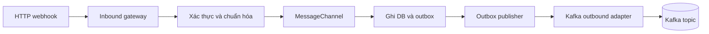

# Chọn adapter cloud-native phù hợp

Trong Spring Integration, adapter là điểm nối giữa một hệ thống bên ngoài và luồng message bên trong ứng dụng. Adapter phù hợp giúp ứng dụng nhận hoặc gửi dữ liệu đúng nhịp, giữ được hợp đồng message và xử lý được lỗi khi mạng, broker hay dịch vụ đích tạm thời không sẵn sàng. Khi triển khai trên cloud, quyết định này còn ảnh hưởng đến khả năng mở rộng nhiều instance, phục hồi sau khi pod khởi động lại và quản lý vòng đời kết nối.

Không nên chọn adapter chỉ vì hệ thống ngoài đang dùng một sản phẩm quen thuộc. Hãy bắt đầu từ cách dữ liệu được trao đổi: ai khởi tạo giao dịch, có cần phản hồi ngay không, nguồn dữ liệu có phát sự kiện hay phải được poll, và điều gì được xem là đã xử lý thành công. Sau đó mới chọn protocol, endpoint Spring Integration và cách vận hành.

## 1. Phân biệt adapter một chiều và gateway request-reply

Spring Integration đưa dữ liệu từ nhiều giao thức về cùng mô hình `Message<?>`, gồm payload và headers. Adapter đặt ở biên của luồng để chuyển đổi giữa message nội bộ và định dạng của hệ thống ngoài.

| Endpoint | Hướng trao đổi | Khi phù hợp |
|---|---|---|
| Inbound channel adapter | Hệ thống ngoài → `MessageChannel` | Ứng dụng nhận dữ liệu một chiều; nguồn có thể được poll hoặc chủ động đẩy sự kiện |
| Outbound channel adapter | `MessageChannel` → hệ thống ngoài | Ứng dụng gửi dữ liệu một chiều; không cần nhận nội dung phản hồi nghiệp vụ |
| Inbound gateway | Request bên ngoài → luồng nội bộ → response bên ngoài | Bên gọi cần nhận kết quả của xử lý trong cùng một lượt request |
| Outbound gateway | Message nội bộ → request bên ngoài → reply nội bộ | Luồng nội bộ gọi dịch vụ ngoài và cần dùng kết quả trả về |

Ví dụ, một webhook từ đối tác thường đi vào qua HTTP inbound gateway vì HTTP client cần nhận mã trạng thái hoặc response. Nếu một message nội bộ cần gọi REST API và dùng JSON trả về để xử lý tiếp, outbound gateway là lựa chọn tự nhiên. Nếu chỉ cần phát một sự kiện sang broker, outbound channel adapter thường đúng ý nghĩa hơn gateway.

Gateway tạo ra quan hệ request-reply và thường giữ luồng gọi chờ đến khi có phản hồi hoặc timeout. Vì vậy, không nên dùng gateway cho một tác vụ vốn bất đồng bộ kéo dài. Với tác vụ đó, hãy nhận request, trả về mã tiếp nhận hoặc correlation ID, rồi xử lý tiếp qua channel/broker và cung cấp trạng thái qua một API khác nếu cần.

## 2. Chọn theo hợp đồng trao đổi trước khi chọn protocol

Trước khi cấu hình adapter, hãy trả lời các câu hỏi sau:

1. **Chiều dữ liệu:** ứng dụng đọc từ nguồn ngoài, ghi ra đích ngoài hay cần cả hai chiều?
2. **Ai khởi tạo:** nguồn đẩy sự kiện đến ứng dụng, hay ứng dụng phải hỏi nguồn theo lịch?
3. **Kiểu tương tác:** gửi một chiều, nhận một chiều hay request-reply?
4. **Độ bền:** dữ liệu có phải sống sót qua restart, mất mạng hoặc triển khai lại pod không?
5. **Xác nhận:** hệ thống ngoài xác nhận khi nhận message, khi lưu message hay sau khi nghiệp vụ hoàn tất?
6. **Thứ tự và tải:** có cần giữ thứ tự theo khách hàng/đơn hàng, và cần bao nhiêu consumer xử lý song song?
7. **Giao dịch:** cập nhật cơ sở dữ liệu và gửi message có cần cùng một ranh giới giao dịch không?

Hai hệ thống cùng dùng HTTP hoặc cùng dùng broker vẫn có thể cần endpoint khác nhau vì hợp đồng khác nhau. Chẳng hạn, HTTP webhook cần nhận request từ ngoài là inbound gateway; HTTP client gọi dịch vụ ngoài và cần response là outbound gateway. Với Kafka, ứng dụng thường tiêu thụ record theo consumer group hoặc xuất record vào topic; request-reply chỉ phù hợp khi đã thiết kế rõ cơ chế correlation và timeout.

## 3. Đối chiếu các nhóm adapter thường gặp

| Hệ thống ngoài | Endpoint Spring Integration thường dùng | Chọn khi | Điểm cần thiết kế trong môi trường cloud |
|---|---|---|---|
| File | File inbound channel adapter; file outbound handler | Trao đổi theo lô qua thư mục hoặc volume dùng chung | Đường dẫn có tồn tại sau khi pod thay thế không; cách khóa/claim file; file tạm và đổi tên nguyên tử; lọc file đã nhận |
| SFTP | SFTP inbound/outbound adapter | Trao đổi file với đối tác qua máy chủ SFTP | Host key, khóa xác thực, timeout, session factory/pool, thư mục archive, bộ lọc chống nhận trùng và chính sách xóa file từ xa |
| HTTP/REST | HTTP inbound gateway, outbound gateway hoặc outbound channel adapter | Webhook, gọi API đồng bộ hoặc gửi request một chiều | TLS, OAuth/token, connection pool, timeout, giới hạn request, retry theo mã lỗi và idempotency key |
| JMS | Message-driven inbound adapter hoặc inbound adapter có poller; outbound adapter/gateway | Tích hợp hệ thống dùng JMS và cần broker quản lý message | Acknowledge, transaction, durable subscription, consumer concurrency, prefetch và dead-letter queue |
| AMQP | AMQP inbound adapter/message-driven adapter; outbound adapter/gateway | Gửi/nhận qua exchange, queue và routing key, thường với RabbitMQ | Binding, durable queue, publisher confirm/return, ack/requeue, DLQ, giới hạn số consumer và chính sách retry |
| Kafka | Kafka message-driven channel adapter; Kafka outbound channel adapter | Event stream có partition, consumer group, replay và throughput lớn | Partition key, offset commit, rebalance, consumer group, schema tương thích và xử lý record lặp |
| Cơ sở dữ liệu | JDBC inbound channel adapter có poller; JDBC outbound channel adapter | Đọc các bản ghi cần xử lý theo lịch hoặc ghi dữ liệu vào bảng | Truy vấn tăng dần, checkpoint, khóa/lease giữa nhiều instance, transaction, connection pool và chỉ mục |

### File và SFTP

File adapter phù hợp khi hệ thống nguồn/đích trao đổi qua thư mục. Inbound adapter đọc file rồi phát message; outbound handler ghi payload ra file. Cần xác định rõ thời điểm file được xem là hoàn chỉnh. Một quy ước phổ biến là bên gửi ghi file với phần mở rộng tạm, sau đó đổi tên khi ghi xong; bên nhận chỉ đọc file đã hoàn tất. Có thể dùng bộ lọc theo pattern, bộ lọc accept-once có lưu trạng thái bền vững và thư mục archive để hạn chế xử lý lặp.

Trong container, thư mục nội bộ của pod thường có vòng đời ngắn. Nếu dữ liệu phải tồn tại qua lần thay thế pod, hãy dùng persistent volume phù hợp hoặc một dịch vụ lưu trữ file/object có adapter riêng. File adapter làm việc với filesystem; không nên mặc định rằng mount một object store sẽ tự có đầy đủ ngữ nghĩa file như rename nguyên tử, lock và directory listing.

SFTP phù hợp khi đối tác yêu cầu chuyển file qua máy chủ SFTP. Bên cạnh cấu hình thư mục và pattern, cần quản lý host key, private key/credential, timeout và số session đồng thời. Nếu nhiều replica cùng đọc một thư mục remote, bộ lọc trong bộ nhớ của từng replica không đủ để ngăn hai replica tải cùng một file. Cần cơ chế claim/rename ở phía server, kho metadata dùng chung hoặc quy ước phân chia thư mục.

### HTTP/REST

HTTP phù hợp với API và webhook. Dùng inbound gateway khi ứng dụng nhận request và phải trả response cho bên gọi; dùng outbound gateway khi luồng nội bộ gọi API và cần nội dung response; dùng outbound channel adapter khi chỉ cần gửi đi một chiều.

HTTP là giao thức request-response, nhưng không tự bảo đảm một request chỉ được thực thi một lần. Client có thể gửi lại khi timeout dù server đã hoàn tất xử lý. Với thao tác tạo đơn hàng, thanh toán hoặc cập nhật trạng thái, hãy truyền idempotency key và lưu kết quả theo key đó. Phân loại lỗi trước khi retry: lỗi mạng, `429` hoặc `5xx` có thể tạm thời; nhiều lỗi `4xx` là lỗi request hoặc quyền truy cập cần sửa cấu hình/dữ liệu. Luôn đặt connect timeout và response timeout hữu hạn.

Với webhook, xác minh chữ ký hoặc cơ chế xác thực của nhà cung cấp trước khi đưa payload vào luồng nghiệp vụ. Nếu xử lý mất nhiều thời gian, chỉ xác nhận đã tiếp nhận sau khi message đã được ghi vào nơi lưu trữ bền vững; không giữ kết nối HTTP mở trong toàn bộ thời gian xử lý nền.

### JMS và AMQP

JMS và AMQP đều thường được dùng với broker, nhưng mô hình cấu hình và tính năng phụ thuộc broker cụ thể. Message-driven adapter nhận message theo cơ chế listener của broker; inbound adapter có poller phù hợp khi cần chủ động lấy dữ liệu theo lịch. Outbound adapter gửi message từ channel nội bộ đến destination.

Với JMS, hãy xác định acknowledgment mode, transaction, durable subscription và dead-letter policy. Với AMQP, hãy thiết kế exchange, queue, binding và routing key; xác định publisher confirm, consumer ack, requeue và DLQ. Không nên requeue vô hạn một message gây lỗi dữ liệu cố định vì message có thể quay vòng liên tục. Hãy giới hạn số lần thử và chuyển message lỗi sang nơi có thể điều tra, sửa rồi phát lại.

### Kafka

Kafka phù hợp với event stream có lưu trữ theo log, nhiều consumer group độc lập và nhu cầu đọc lại dữ liệu. Inbound adapter đưa record từ topic vào channel; outbound adapter ghi message nội bộ thành record. Khóa record quyết định partition, vì vậy chọn key theo thực thể cần giữ thứ tự, ví dụ `orderId`, thay vì chọn ngẫu nhiên nếu các sự kiện của cùng đơn hàng phải được xử lý tuần tự.

Offset biểu thị vị trí consumer đã đọc. Nếu ứng dụng commit offset trước khi nghiệp vụ hoàn tất, lỗi giữa chừng có thể làm mất xử lý. Nếu chỉ commit sau khi hoàn tất, một record có thể được nhận lại sau sự cố. Do đó, consumer vẫn cần xử lý idempotent. Khả năng xử lý đúng một lần của Kafka có phạm vi và điều kiện cụ thể; nó không tự làm cho một cập nhật JDBC bên ngoài trở thành giao dịch nguyên tử với Kafka.

### Cơ sở dữ liệu

JDBC inbound channel adapter thường dùng poller để truy vấn các bản ghi đang chờ. Câu truy vấn phải có tiêu chí tăng dần hoặc trạng thái xử lý rõ ràng, kèm checkpoint/lease để nhiều instance không cùng nhận một bản ghi. JDBC outbound channel adapter phù hợp để ghi dữ liệu từ message vào bảng.

Không nên xem một bảng nghiệp vụ bất kỳ như một message queue. Nếu nhiều worker cùng lấy việc, cần thiết kế thao tác claim có tính nguyên tử, trạng thái `PENDING/PROCESSING/DONE`, lease hết hạn và chỉ mục phù hợp. Với bài toán ghi dữ liệu rồi phát event, transactional outbox giúp lưu thay đổi nghiệp vụ và bản ghi outbox trong cùng transaction; một luồng riêng đọc outbox và phát event, có cơ chế chống phát/tiêu thụ trùng.

### Dịch vụ lưu trữ cloud

Object storage như S3, Azure Blob hoặc Google Cloud Storage có semantics khác filesystem: object thường được định danh bằng key, thao tác rename có thể thực chất là copy rồi delete, và việc liệt kê object có đặc điểm riêng. Hãy dùng adapter/module tích hợp dành cho nhà cung cấp nếu có, hoặc nhận thông báo sự kiện của object storage qua queue/event service rồi xử lý object bằng SDK. Chọn cách này giúp ứng dụng phản ứng theo sự kiện và tránh poll toàn bộ bucket liên tục.

## 4. Chọn poller hay nhận sự kiện trực tiếp

Poller được dùng khi nguồn không chủ động gửi message hoặc khi cần kiểm soát chu kỳ truy vấn. File, SFTP và truy vấn JDBC thường thuộc nhóm này. Cần cấu hình khoảng nghỉ, số message tối đa mỗi lượt và giới hạn song song. Poll quá dày làm tăng tải lên hệ thống ngoài; poll quá thưa làm tăng độ trễ.

Broker listener, webhook và nhiều nguồn event-driven có thể đẩy message vào ứng dụng mà không cần poller ở phía Spring Integration. Cách này thường giảm độ trễ, nhưng cần giới hạn số consumer và năng lực xử lý để tránh làm cạn tài nguyên khi lưu lượng tăng đột biến.

Ví dụ cấu hình một luồng đọc file theo chu kỳ bằng Java DSL:

```java
@Bean
IntegrationFlow inboundFiles(File inputDirectory) {
    return IntegrationFlow
        .from(Files.inboundAdapter(inputDirectory)
                .autoCreateDirectory(true)
                .patternFilter("*.json"),
            endpoint -> endpoint.poller(
                Pollers.fixedDelay(5_000).maxMessagesPerPoll(100)))
        .transform(Transformers.fileToString())
        .channel("rawFileMessages")
        .get();
}
```

Đoạn cấu hình minh họa nguồn file được kiểm tra mỗi 5 giây và tối đa 100 message trong một lượt poll. Giá trị thực tế phải dựa trên kích thước file, thời gian xử lý, giới hạn I/O và số replica. Trong môi trường nhiều replica, hãy bổ sung cơ chế phối hợp dùng chung để một file không bị xử lý đồng thời nhiều lần. `autoCreateDirectory` chỉ tạo thư mục nếu thiếu; nó không biến filesystem tạm của container thành nơi lưu trữ bền vững.

## 5. Thiết kế MessageChannel và hợp đồng message

Adapter chỉ giải quyết việc đi qua biên giao thức. Bên trong ứng dụng, hãy chuẩn hóa dữ liệu về một hợp đồng message mà các bước xử lý có thể hiểu được. Một message nên có payload với schema rõ ràng và một số header phục vụ định tuyến, truy vết hoặc chống trùng, chẳng hạn:

| Trường | Mục đích |
|---|---|
| `messageId` | Định danh message để ghi log và phát hiện bản sao |
| `correlationId` | Liên kết request với reply hoặc gom các bước của cùng một giao dịch |
| `sourceSystem` | Xác định hệ thống đã phát dữ liệu |
| `schemaVersion` | Chọn cách giải mã và chuyển đổi payload |
| `receivedAt` | Thời điểm ứng dụng tiếp nhận message |
| `idempotencyKey` | Khóa nghiệp vụ dùng để chống thực thi lặp |

Không nên chuyển nguyên mọi header của giao thức ngoài vào toàn bộ luồng nội bộ. Hãy ánh xạ các header cần thiết, chuẩn hóa kiểu dữ liệu và loại bỏ thông tin nhạy cảm. Khi trao đổi giữa các dịch vụ độc lập, ưu tiên định dạng có hợp đồng rõ ràng như JSON, Avro hoặc Protobuf thay vì phụ thuộc vào Java native serialization hay tên class nội bộ.

Loại `MessageChannel` cũng ảnh hưởng đến hành vi:

| Channel | Hành vi | Khi dùng |
|---|---|---|
| `DirectChannel` | Gọi subscriber trong cùng luồng thực thi | Luồng xử lý đồng bộ, đơn giản; lỗi có thể truyền ngược về bên gửi |
| `ExecutorChannel` | Chuyển việc sang executor để xử lý bất đồng bộ | Cần tách luồng thực thi; phải cấu hình giới hạn thread và xử lý từ chối tác vụ |
| `QueueChannel` | Giữ message trong queue trong bộ nhớ hoặc message store được cấu hình | Cần đệm giữa producer và consumer; queue trong bộ nhớ tự nó không bền vững qua restart |
| `PublishSubscribeChannel` | Phát một message đến nhiều subscriber | Một sự kiện cần kích hoạt nhiều nhánh xử lý độc lập |

Đổi từ `DirectChannel` sang `ExecutorChannel` thay đổi thời điểm lỗi được quan sát và cách điều phối luồng. Dùng `QueueChannel` trong bộ nhớ không đồng nghĩa đã có hàng đợi bền vững. Nếu message phải sống sót khi pod bị thay thế hoặc cần được nhiều replica tiêu thụ, hãy dùng broker hoặc message store bền vững được cấu hình phù hợp.

## 6. Xử lý lỗi, retry và message trùng

Trong hệ thống phân tán, timeout không chứng minh rằng hệ thống đích chưa thực hiện thao tác. Một lần gửi có thể đã thành công ở phía đích nhưng response bị mất trên đường về. Vì vậy, thiết kế an toàn thường giả định message có thể được giao nhiều lần và làm cho bước xử lý có tính idempotent.

- **Retry lỗi tạm thời:** dùng số lần thử hữu hạn, backoff tăng dần và jitter nếu nhiều instance có thể retry cùng lúc. Chỉ retry các lỗi có khả năng tự hồi phục.
- **Không retry mù quáng:** lỗi xác thực, schema không hợp lệ hoặc request sai thường cần sửa dữ liệu/cấu hình. Chuyển chúng sang luồng lỗi để điều tra.
- **Dead-letter và replay:** lưu payload, message ID, nguồn, thời điểm, số lần thử và nguyên nhân lỗi. Bảo vệ dữ liệu nhạy cảm trong log/DLQ và có quy trình phát lại sau khi đã khắc phục nguyên nhân.
- **Idempotency:** lưu khóa xử lý cùng kết quả hoặc trạng thái nghiệp vụ trong một ranh giới transaction phù hợp. Với cập nhật tăng số dư hoặc trừ tồn kho, chỉ kiểm tra message ID ở bộ nhớ là không đủ.
- **Xác nhận đúng thời điểm:** chỉ acknowledge hoặc commit offset sau khi bước xử lý cần thiết đã thành công theo semantics đã chọn. Nếu ghi DB và gửi broker phải nhất quán, cân nhắc outbox/inbox thay vì giả định hai hệ thống tự có chung transaction.

Spring Integration hỗ trợ định tuyến lỗi qua error channel và cấu hình retry/error handling ở endpoint. Cách cấu hình cụ thể phụ thuộc adapter và loại channel. Với luồng đồng bộ, exception có thể quay về caller; với luồng bất đồng bộ, lỗi thường cần được gửi đến error channel hoặc cơ chế xử lý lỗi của endpoint. Hãy kiểm tra hành vi của đúng adapter đang dùng, nhất là thời điểm broker acknowledge hoặc Kafka offset được commit.

## 7. Vận hành adapter trong môi trường cloud

Một ứng dụng có thể chạy đúng trên máy phát triển nhưng gặp lỗi khi chạy nhiều replica. Những điểm sau cần được xem là một phần của lựa chọn adapter:

**Trạng thái dùng chung.** Trạng thái chống trùng, checkpoint poller, vị trí file đã đọc và lease xử lý phải được lưu ở nơi các replica cùng truy cập nếu công việc có thể chuyển giữa các pod. Bộ lọc lưu trong bộ nhớ chỉ bảo vệ một tiến trình.

**Kết nối và credential.** Dùng connection factory/client được quản lý theo vòng đời ứng dụng; cấu hình pool, timeout, keep-alive và giới hạn kết nối theo năng lực broker/dịch vụ ngoài. Credential, private key và token nên được cấp qua secret/configuration service, có TLS và kế hoạch xoay vòng. Không ghi password, token hay payload nhạy cảm vào log.

**Mở rộng ngang.** Tăng số replica chỉ có ích khi nguồn cho phép chia tải. Kafka bị giới hạn song song bởi số partition đang được gán cho consumer group; JMS/AMQP phụ thuộc số consumer, queue và cấu hình broker; file/SFTP/JDBC cần cơ chế claim hoặc lease để tránh nhiều replica cùng lấy một việc. Đo tải thực tế trước khi tăng concurrency.

**Backpressure.** Giới hạn số message đang xử lý, kích thước queue, số thread và số request đồng thời. Nếu consumer chậm hơn producer, cần có nơi đệm bền vững và cảnh báo độ dài backlog. Queue không giới hạn trong bộ nhớ có thể làm pod hết heap khi nguồn gửi nhanh hơn khả năng xử lý.

**Vòng đời.** Các inbound endpoint và listener container được Spring quản lý vòng đời. Khi shutdown, ứng dụng cần ngừng nhận việc mới, cho phép message đang xử lý hoàn tất trong thời hạn cấu hình, đóng session/connection và để broker giao lại message chưa được xác nhận. Thời gian graceful shutdown của nền tảng triển khai phải đủ dài so với thời gian xử lý tối đa; nếu không, thiết kế xử lý phải chịu được việc bị dừng giữa chừng.

**Quan sát được.** Ghi log có cấu trúc với `messageId`, `correlationId`, endpoint và kết quả xử lý; không ghi bí mật. Theo dõi tốc độ nhận/gửi, thời gian xử lý, số lần retry, lỗi kết nối, số message trong DLQ, độ trễ poll và backlog. Metric phải giúp phân biệt nguồn ngừng phát dữ liệu với consumer đang bị nghẽn.

## 8. Một số mẫu lựa chọn điển hình

### Webhook tiếp nhận đơn hàng

Đối tác gửi HTTP request và cần biết hệ thống đã tiếp nhận. Dùng HTTP inbound gateway để xác thực chữ ký, kiểm tra cấu trúc cơ bản và ghi request vào nơi lưu trữ bền vững hoặc broker. Trả response tiếp nhận nhanh, sau đó xử lý nghiệp vụ bất đồng bộ. Dùng idempotency key của đối tác để tránh tạo hai đơn hàng khi webhook được gửi lại.

### Đồng bộ file từ đối tác

Đối tác chỉ hỗ trợ SFTP và gửi file theo lô. Dùng SFTP inbound adapter với poller, bộ lọc file đã nhận có trạng thái dùng chung, quy ước file hoàn tất và archive. Sau khi parse, chuẩn hóa record thành message nội bộ. Nếu cần xử lý song song, chuyển message sang broker bền vững thay vì để nhiều pod tự quét cùng thư mục.

### Phát sự kiện sau khi cập nhật dữ liệu

Ứng dụng cập nhật đơn hàng trong JDBC và cần phát `OrderUpdated` lên Kafka. Dùng transactional outbox: transaction nghiệp vụ ghi cả đơn hàng và outbox row; một IntegrationFlow đọc các row chưa phát và dùng Kafka outbound adapter gửi event. Consumer phía sau vẫn phải idempotent vì tiến trình phát có thể gửi lại khi bị dừng sau khi broker nhận nhưng trước khi outbox được đánh dấu hoàn tất.



## 9. Quy trình ra quyết định

1. Xác định nguồn/đích và chiều dữ liệu; chọn inbound hay outbound.
2. Nếu bên gọi cần response nghiệp vụ trong cùng lượt, chọn gateway. Nếu chỉ truyền message một chiều, chọn channel adapter.
3. Nếu nguồn tự phát sự kiện, dùng endpoint event-driven. Nếu phải truy vấn theo lịch, dùng inbound adapter có poller.
4. Chọn adapter theo protocol mà hệ thống ngoài thực sự hỗ trợ: file/SFTP, HTTP, JMS, AMQP, Kafka hoặc JDBC; với object storage, kiểm tra module chuyên biệt và semantics của dịch vụ.
5. Quy định message ID, correlation ID, schema version, idempotency, xác nhận, retry, DLQ và replay trước khi đưa vào production.
6. Kiểm tra trạng thái dùng chung, khả năng chạy nhiều replica, giới hạn kết nối, backpressure, metric và graceful shutdown.

Trước khi hoàn tất thiết kế, hãy mô phỏng ít nhất ba tình huống: message được gửi lại sau timeout; pod dừng ngay sau khi hệ thống ngoài đã nhận message; và hai replica cùng khởi động hoặc cùng poll một nguồn. Nếu dữ liệu vẫn được xử lý đúng, không mất và không tạo tác dụng phụ trùng, lựa chọn adapter cùng cơ chế vận hành đã đáp ứng được những điều kiện cloud-native quan trọng nhất.
