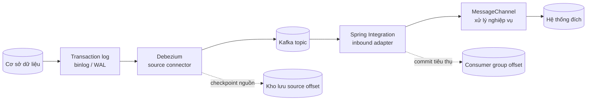
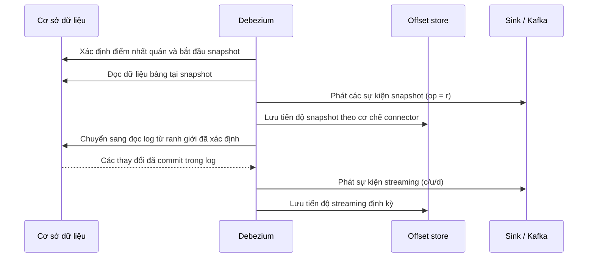

# Offset và vị trí log thay đổi trong Debezium

## 1. Bài toán: CDC phải đọc tiếp từ đâu?

Trong hệ thống dùng **Spring Integration Adapters**, dữ liệu có thể đi từ cơ sở dữ liệu sang một `MessageChannel`, qua bộ biến đổi (`transformer`), bộ lọc (`filter`) và cuối cùng tới hệ thống đích. Với nguồn dữ liệu thay đổi liên tục, **Debezium** đóng vai trò thu nhận *Change Data Capture* (CDC): đọc những thay đổi đã được cơ sở dữ liệu ghi vào transaction log rồi phát thành các bản ghi sự kiện. Vấn đề quan trọng là khi connector tạm dừng, bị lỗi hoặc được triển khai lại, nó cần biết **đã đọc tới đâu** để tiếp tục mà không bỏ qua dữ liệu.

Hai khái niệm thường xuất hiện cùng nhau nhưng không đồng nhất:

- **Vị trí log thay đổi (*log position*)**: tọa độ của thay đổi trong nhật ký giao dịch của **cơ sở dữ liệu nguồn**; ví dụ cặp tên file binlog và byte position trong MySQL, hoặc Log Sequence Number (LSN) trong PostgreSQL.
- **Offset của Debezium**: trạng thái tiến độ mà connector lưu lại để có thể khôi phục luồng đọc; thường bao gồm vị trí log và thông tin bổ sung như snapshot hoặc giao dịch. Cấu trúc cụ thể phụ thuộc connector và phiên bản.

Hãy hình dung một giao dịch cập nhật đơn hàng được ghi tại một vị trí binlog. Debezium đọc sự kiện đó rồi chuyển tới hệ thống nhận. Nếu tiến độ được lưu bền vững, lần chạy tiếp theo có thể tiếp tục từ điểm đã ghi nhận. Nếu sự kiện đã được gửi nhưng offset chưa được lưu trước khi tiến trình chết, sự kiện có thể xuất hiện lại. Đây là nguồn gốc thường gặp của việc **giao nhận ít nhất một lần (*at-least-once*)**.

### Kết quả học tập

Sau bài này, bạn có thể:

1. Phân biệt log position, Debezium source offset, Kafka topic offset và consumer group offset.
2. Nhận diện vị trí binlog của MySQL và WAL/LSN của PostgreSQL trong CDC event.
3. Giải thích cách snapshot chuyển sang streaming, cách lưu offset và cách connector khôi phục sau lỗi.
4. Thiết kế luồng Spring Integration xử lý sự kiện CDC có khả năng phát lại an toàn.
5. Chẩn đoán một số tình huống lệch offset, log bị xóa, backlog tăng và sự kiện trùng lặp.

## 2. Một thay đổi đi qua những lớp tiến độ nào?



*Sơ đồ giả định Debezium chạy trên Kafka Connect và Spring Integration đọc Kafka. Khi dùng Debezium Engine nhúng hoặc Debezium Server, vị trí lưu offset và cơ chế xác nhận được cấu hình khác nhau.*

| Khái niệm | Gắn với hệ thống nào? | Diễn đạt điều gì? | Ví dụ |
|---|---|---|---|
| **Vị trí log nguồn** | MySQL/PostgreSQL/... | Tọa độ của thay đổi trong transaction log của database | `mysql-bin.000017:15433`, WAL LSN `0/16B6C50` |
| **Debezium source offset** | Debezium/Kafka Connect | Checkpoint phục vụ đọc lại từ nguồn; có thể chứa vị trí log, trạng thái snapshot và dữ liệu khác | `{ "file": "mysql-bin.000017", "pos": 15433, ... }` *(minh họa)* |
| **Kafka topic offset** | Phân vùng (*partition*) của Kafka topic | Chỉ số của bản ghi trong partition Kafka; là vị trí ở hệ thống trung gian | `topic=cdc.orders`, `partition=0`, `offset=872` |
| **Kafka consumer group offset** | Nhóm consumer của Spring Integration | Vị trí nhóm đã commit khi đọc Kafka | `group=order-projection`, `offset=873` *(vị trí tiếp theo)* |

**Đừng thay thế các offset cho nhau.** Kafka topic offset `872` không cho biết binlog position là `872`; consumer group đã commit không chứng minh bản ghi đã được áp dụng thành công ở hệ thống đích nếu ứng dụng commit quá sớm. Debezium source offset cũng không phải một cột sequence nằm trong bảng dữ liệu nghiệp vụ.

### Source partition và source offset

Trong mô hình Kafka Connect, một `SourceRecord` mô tả nguồn bằng hai thành phần logic:

- `sourcePartition`: định danh **luồng nguồn** mà offset áp dụng cho; có thể là tên logical server/connector, database hay thông tin partition khác tùy connector.
- `sourceOffset`: tiến độ **bên trong luồng đó**; chẳng hạn binlog file/position hoặc LSN và trạng thái cần thiết để tiếp tục.

Checkpoint chỉ có ý nghĩa khi đi cùng định danh nguồn. Không nên tự coi một giá trị `pos`, `lsn` hay `ts_ms` là khóa duy nhất toàn cục. Với một số connector, nhiều row event của cùng transaction có thể liên quan tới cùng tọa độ log; vị trí đủ chính xác để phát lại còn do connector quản lý qua các trường bổ sung.

## 3. Vị trí log của MySQL: binlog file, position và GTID

MySQL có thể ghi thay đổi vào **binary log (binlog)**. Khi được cấu hình phù hợp cho CDC (thường là row-based logging), Debezium đọc các row event đã commit để dựng sự kiện `INSERT`, `UPDATE`, `DELETE`.

Một event MySQL dưới đây là **ví dụ lược giản**, không phải schema JSON cố định cho mọi Debezium version hoặc converter:

```json
{
  "before": { "id": 42, "status": "NEW" },
  "after":  { "id": 42, "status": "PAID" },
  "source": {
    "connector": "mysql",
    "name": "orders-cdc",
    "db": "sales",
    "table": "orders",
    "file": "mysql-bin.000017",
    "pos": 15433,
    "row": 0,
    "snapshot": "false"
  },
  "op": "u"
}
```

- `source.file` cho biết **tên binlog file**, ví dụ `mysql-bin.000017`.
- `source.pos` biểu diễn vị trí trong file đó. Phải xét **cặp** `(file, pos)`; chỉ so sánh số `pos` giữa hai file khác nhau là sai vì vị trí trong file mới có thể nhỏ hơn.
- `source.row` là một chi tiết bổ sung hữu ích khi nhiều row event nằm trong cùng nhóm thay đổi; không nên giả định `(file, pos, row)` luôn đủ để định danh duy nhất mọi event trong mọi phiên bản connector.
- `source.snapshot` giúp nhận diện sự kiện đến từ snapshot hay log streaming; giá trị và cách biểu diễn phụ thuộc schema/converter.
- `source.gtid` có thể hiện diện khi nguồn sử dụng **Global Transaction Identifier (GTID)**. GTID giúp định danh giao dịch qua các tình huống như chuyển đổi primary, nhưng việc nối lại vẫn phụ thuộc cấu hình connector, tính liên tục của log và tập GTID còn khả dụng.

Ví dụ, nếu MySQL đang ghi đến `mysql-bin.000018:500`, một source offset cũ ở `mysql-bin.000017:15433` chỉ khôi phục được nếu các binlog chứa đoạn cần đọc vẫn còn và connector có đủ trạng thái cần thiết. Không thể suy ra đã mất bao nhiêu sự kiện chỉ từ phép trừ `500 - 15433`.

### MySQL binlog position khác gì auto-increment ID?

`orders.id = 42` là khóa bản ghi nghiệp vụ; `mysql-bin.000017:15433` là tọa độ của một thay đổi trong log. Cùng đơn hàng có thể được cập nhật nhiều lần tại các vị trí log khác nhau. Ngược lại, một transaction có thể thay đổi nhiều dòng và nhiều bảng. Do đó **không thể đọc CDC tiếp bằng cách nhớ `MAX(id)`**.

## 4. Vị trí log của PostgreSQL: WAL và LSN

PostgreSQL dùng **Write-Ahead Log (WAL)**; Debezium PostgreSQL đọc thay đổi qua **logical decoding** và replication slot. WAL LSN (*Log Sequence Number*) định vị một điểm trong chuỗi WAL, thường được biểu diễn dưới dạng `X/Y`, ví dụ `0/16B6C50`.

Ví dụ một phần của CDC event:

```json
{
  "after": { "id": 42, "status": "PAID" },
  "source": {
    "connector": "postgresql",
    "name": "orders-cdc",
    "db": "sales",
    "schema": "public",
    "table": "orders",
    "lsn": 23817296,
    "txId": 701,
    "snapshot": "false"
  },
  "op": "u"
}
```

Ở ví dụ này, `source.lsn` được hiển thị dưới dạng số thập phân; các công cụ PostgreSQL có thể hiển thị cùng họ giá trị ở dạng `X/Y`. **Không so sánh LSN giữa hai cluster độc lập**. `txId` là thông tin giao dịch hữu ích để phân tích nhưng không thay thế cho checkpoint chính thức của connector.

Replication slot lưu trạng thái cần thiết cho logical replication và giúp PostgreSQL giữ phần WAL mà subscriber chưa xác nhận đủ xa. Khi Debezium tạm dừng lâu, WAL có thể tích tụ; khi slot bị mất, bị vô hiệu hoặc WAL cần thiết không còn, một source offset cũ chưa chắc khôi phục được. Các đại lượng như `restart_lsn`, `confirmed_flush_lsn` trên slot là **trạng thái replication phía database**, không đồng nghĩa thời điểm nghiệp vụ Spring Integration đã áp dụng xong sự kiện.

| Tiêu chí | MySQL | PostgreSQL |
|---|---|---|
| Nguồn thay đổi | Binary log | WAL qua logical decoding |
| Tọa độ thường thấy trong `source` | `file`, `pos`, có thể `row`, `gtid` | `lsn`, có thể `txId` |
| Cơ chế cần quan sát khi giữ log | Binlog retention và khả năng đọc log sau restart | WAL retention, logical replication slot, slot lag |
| Nguy cơ nếu dừng quá lâu | Binlog cần đọc bị xóa/không còn truy cập được | WAL tồn đọng gây đầy đĩa hoặc log cần đọc không còn, slot không dùng được |

Các connector khác có thể dùng vị trí riêng: SQL Server dùng LSN trong transaction log/CDC, Oracle thường gắn với SCN, MongoDB dùng resume token. **Luôn dựa trên hợp đồng offset của connector đang chạy** thay vì ép tất cả về một số nguyên chung.

## 5. Offset trong hai giai đoạn: snapshot và streaming

Debezium thường cần đồng bộ những bản ghi **đã tồn tại trước khi bật CDC**. Với `snapshot.mode=initial` và chưa có offset hợp lệ, connector có thể thực hiện initial snapshot rồi chuyển sang đọc log. Khái quát luồng hoạt động:



Sơ đồ chỉ diễn đạt **thứ tự logic**; điểm chụp nhất quán, khóa, mức cô lập, trạng thái offset và cơ chế chống mất sự kiện trong giai đoạn chuyển tiếp khác nhau theo database, connector và kiểu snapshot.

Các giá trị phổ biến của `op` trong Debezium envelope là `r` (read từ snapshot), `c` (create), `u` (update) và `d` (delete). Một số dòng có thể có `source.snapshot` để xác định sự kiện snapshot, và có trường hợp đánh dấu bản ghi cuối của snapshot. Không nên dùng `op = r` để tự suy ra event mới commit vào log vào lúc nhận được.

### Tại sao offset snapshot không phải luôn là binlog position/LSN?

Khi snapshot đang chạy, tiến độ có thể bao gồm trạng thái đã xử lý tới bảng hoặc khóa nào, cùng ranh giới log cần bắt đầu đọc sau snapshot. Với **incremental snapshot**, Debezium còn phối hợp cửa sổ đọc từng chunk với sự kiện streaming; có thể xuất hiện trạng thái bổ sung. Nếu ứng dụng tự ghi một giá trị LSN vào kho offset và bỏ qua các trạng thái này, lần khởi động tiếp theo có thể bỏ sót hoặc phát trùng thay đổi.

**Nguyên tắc:** để connector thực hiện chuyển tiếp snapshot–streaming và lưu/khôi phục checkpoint; ứng dụng xử lý downstream cần chịu được phát lại và thứ tự sự kiện phù hợp với nhu cầu nghiệp vụ.

## 6. Offset được lưu ở đâu, khi nào được xem là đã commit?

Vị trí lưu phụ thuộc **cách triển khai Debezium**, không phải chỉ tên database:

| Cách chạy Debezium | Kho lưu source offset thông dụng | Điều cần nhớ |
|---|---|---|
| Kafka Connect distributed | Kafka internal offset topic do Connect worker cấu hình | Topic phải bền vững, đủ replication và được giữ theo cấu hình phù hợp; source offset khác offset của CDC topic |
| Kafka Connect standalone | File offset của Connect worker | File cần nằm trên ổ đĩa bền vững nếu muốn khôi phục sau khi container/VM thay thế |
| Debezium Engine nhúng trong ứng dụng Java | Offset store được cấu hình cho engine, ví dụ file/JDBC/Redis/Kafka tùy bản triển khai và thư viện hỗ trợ | Đường lưu offset phải sống qua restart và phù hợp cơ chế xác nhận xử lý của engine |
| Debezium Server | Offset store được cấu hình riêng cho Debezium Server | Không mặc định rằng sink là Kafka thì offset nhất định nằm trong Kafka Connect internal topic |

Trong Kafka Connect, worker quản lý vòng đời source records và **flush offset định kỳ**. Một bản ghi đã được xuất tới Kafka chưa bảo đảm checkpoint tương ứng đã được ghi bền vững cùng thời điểm. Vì thế, sau crash, connector có thể đọc lại một đoạn log và phát lại sự kiện đã thấy.

Ví dụ các thuộc tính của **Kafka Connect distributed worker** (đây là cấu hình worker, không phải cấu hình Spring Integration consumer):

```properties
# Kafka Connect worker: minh họa kho offset và tần suất flush
offset.storage.topic=connect-offsets
offset.storage.replication.factor=3
offset.flush.interval.ms=10000
```

`10000` là 10 giây; điều chỉnh khoảng flush có thể tác động tới lượng công việc phải phát lại và chi phí ghi checkpoint, nhưng **không tự tạo bảo đảm exactly-once end-to-end**. Topic và replication factor chỉ là ví dụ, cần phù hợp cluster thực tế. Ngoài source offset, một số connector như MySQL còn yêu cầu **schema history** để diễn giải bản ghi log sau khi schema thay đổi. Schema history và source offset là **hai loại trạng thái khác nhau**, phải được quản lý tương thích khi khôi phục.

### Timeline lỗi thực tế

Giả sử offset bền vững hiện tại tương ứng vị trí `P100`:

1. Debezium đọc sự kiện `E101` tại vị trí sau `P100`.
2. Bản ghi `E101` được chuyển sang Kafka thành công.
3. Tiến trình chết **trước khi** offset mới được flush vào offset store.
4. Connector khởi động lại từ checkpoint còn lưu và có thể xuất `E101` lần nữa.
5. Spring Integration phải xử lý `E101` lặp lại một cách an toàn.

Tình huống này là **trùng lặp do phát lại**; muốn tránh *mất dữ liệu*, không được tự nhảy offset tới vị trí mới hơn trước khi đầu ra tương ứng đủ an toàn. Với nhiều hệ thống sink và nhiều lớp message, bài toán exactly-once cần một thiết kế giao dịch/idempotency cụ thể, không thể suy từ việc bật Debezium.

## 7. Thiết kế xử lý offset khi nối Debezium với Spring Integration

Trong phạm vi module **SPRING_INTEGRATION_ADAPTERS**, cần tách rõ hai trách nhiệm:

- **Debezium source connector** đọc log, quản lý checkpoint nguồn, xuất CDC event.
- **Spring Integration inbound adapter/gateway và MessageChannel** nhận event từ Kafka hoặc một cầu nối engine tương ứng, thực hiện chuyển đổi, định tuyến, lưu dữ liệu đích và xác nhận việc tiêu thụ theo adapter đang dùng.

Ví dụ: hệ thống `sales.orders` phát CDC vào Kafka topic `orders-cdc.sales.orders`; Spring Integration Kafka inbound adapter chuyển message vào `ordersChangesChannel`, một service handler cập nhật bảng projection ở database báo cáo. Quy trình xử lý một event có thể diễn đạt bằng giả mã:

```text
onCdcMessage(event, acknowledgement):
    key = businessKey(event)         # Ví dụ: orders.id
    changeId = stableChangeId(event) # Thiết kế riêng, dựa trên metadata nguồn

    transaction:
        if changeId chưa có trong processed_change:
            applyToProjection(key, event)
            insert processed_change(changeId)

    acknowledgeConsumerOffset()       # Chỉ sau khi giao dịch đích thành công
```

*Đây là giả mã về thứ tự xử lý. Cách lấy acknowledgement và thời điểm Kafka commit phụ thuộc chế độ ack, container và adapter Spring Integration được cấu hình; không mặc định mọi inbound adapter đều cho phép gọi `acknowledge()` theo cách giống nhau.*

Một vài chi tiết quyết định tính đúng đắn:

1. **Đảm bảo idempotency:** xử lý một sự kiện lặp lại không làm tăng tiền hai lần, gửi email hai lần hoặc ghi hai record giống nhau. Có thể dùng khóa dedupe bền vững, upsert theo khóa nghiệp vụ kèm version hoặc một transactional outbox ở hệ thống đích.
2. **Chọn khóa nhận diện thay đổi cẩn thận:** chỉ `orderId` không phân biệt các lần cập nhật khác nhau; chỉ `lsn` có thể không phân biệt từng hàng trong cùng transaction. Khóa sự kiện nên dựa trên metadata có sẵn và hợp đồng của connector (nguồn, transaction, bảng, thứ tự hàng/thay đổi), hoặc thiết kế đích dựa trên trạng thái cuối cùng thay vì cố tạo universal event ID.
3. **Commit consumer offset đúng thời điểm:** nếu Kafka consumer commit trước khi ghi dữ liệu đích, crash có thể làm bỏ qua event đối với nhóm consumer đó. Nếu ghi đích xong nhưng chưa commit, event sẽ được nhận lại: idempotency giải quyết tình huống này.
4. **Giữ thứ tự cần thiết:** các message có cùng business key nên được đưa vào cùng Kafka partition khi nghiệp vụ đòi hỏi thứ tự theo đối tượng; không giả định có một thứ tự toàn cục giữa tất cả partition/bảng.
5. **Phân biệt lỗi nghiệp vụ với lỗi nguồn:** retry/DLQ trong Spring Integration không sửa được một source offset đã bị reset sai; ngược lại chỉnh Debezium offset không giải quyết handler ghi dữ liệu đích thất bại.

Nếu Debezium được **nhúng trực tiếp** thay vì đẩy Kafka, API xác nhận và việc đánh dấu batch/record đã xử lý của Debezium Engine phải gắn với thời điểm luồng downstream hoàn tất. Khi gửi message bất đồng bộ vào `MessageChannel`, cần xác định rõ cơ chế bàn giao thành công: việc `send()` trả về chưa chắc đồng nghĩa nghiệp vụ ở hệ thống đích đã commit.

## 8. Theo dõi tiến độ và chẩn đoán sự cố

Giám sát offset tốt cần nhìn đủ **nguồn → connector → message broker → ứng dụng đích**. Một connector có trạng thái `RUNNING` vẫn có thể bị chậm hoặc không tiến offset, và Kafka consumer lag thấp vẫn có thể che giấu việc Debezium chưa bắt kịp database.

| Triệu chứng | Khả năng cần kiểm tra | Hướng xử lý |
|---|---|---|
| Debezium restart rồi xuất lại một số event | Offset flush chưa hoàn tất trước crash; consumer hoặc sink retry | Giữ idempotency; kiểm tra tần suất flush và cơ chế ack |
| Connector báo không tìm thấy binlog/LSN cần đọc | Log nguồn đã bị purge; replication slot/WAL không còn đáp ứng; checkpoint quá cũ | Kiểm tra retention, slot, thời gian dừng và quy trình resnapshot có kiểm soát |
| PostgreSQL tăng dung lượng WAL liên tục | Slot giữ WAL vì connector không xác nhận tiến độ đủ nhanh; connector chậm/dừng | Quan sát slot lag, `restart_lsn`, `confirmed_flush_lsn`, lưu lượng nguồn và connector |
| Database có thay đổi nhưng không thấy CDC event | Lọc database/table, cấu hình publication/privilege, connector lỗi, hoặc chỉ đang chụp snapshot | Kiểm tra connector logs, trạng thái snapshot, filter và thay đổi trên bảng được theo dõi |
| Kafka topic tăng message, báo cáo cập nhật chậm | Spring Integration consumer group tụt lại hoặc handler đích chậm | Kiểm tra Kafka consumer lag, throughput, retry/DLQ và giao dịch đích |
| Sau khi xóa offset, nhiều bản ghi `op=r` xuất hiện | Connector bắt đầu snapshot lại theo snapshot mode | Đánh giá tác động tới sink, dedupe, chiến lược initial/incremental snapshot |

### Heartbeat và khoảng trống thay đổi

Khi database ít thay đổi ở các bảng được capture, connector có thể thiếu cơ hội phát message và ghi nhận tiến độ dù transaction log vẫn di chuyển do các hoạt động khác. Debezium hỗ trợ **heartbeat** trong nhiều connector để biểu lộ sự sống và hỗ trợ cập nhật tiến độ. Tùy connector, chỉ cấu hình `heartbeat.interval.ms` có thể chưa đủ để giải quyết một số tình huống giữ WAL ở PostgreSQL; đôi khi cần thêm cơ chế heartbeat thực sự tạo thay đổi trong database (ví dụ cấu hình heartbeat action query phù hợp). Cấu hình phải kiểm chứng theo connector/version và quyền database.

Để đo trễ CDC, có thể đối chiếu thời điểm thay đổi ở `source` với thời điểm event được xử lý (`ts_ms` hoặc các trường timestamp tương ứng), nhưng phải hiểu ý nghĩa từng timestamp, độ lệch đồng hồ và giai đoạn snapshot. **Không dùng timestamp để thay thế vị trí log** và không suy ra chính xác số sự kiện còn chờ chỉ từ độ chênh timestamp.

### Quy trình an toàn khi nghi ngờ mất checkpoint

1. Ghi nhận trạng thái connector/task, thời điểm sự cố, source partition/offset còn lưu, tình trạng binlog hoặc replication slot và các cấu hình snapshot/retention liên quan.
2. Kiểm tra dữ liệu đích đã nhận đến đâu, có thể có bản ghi lặp hoặc khoảng thiếu nào; tách rõ tiến độ Debezium và tiến độ consumer.
3. Xác minh log cần đọc vẫn còn trước khi restart; nếu log đã mất, lập kế hoạch khởi tạo lại hoặc snapshot đồng bộ dữ liệu có kiểm soát.
4. Đảm bảo nơi nhận có thể idempotent/dedupe, có đối soát số liệu và phương án khôi phục khi phát lại.
5. Chỉ thay đổi offset hoặc schema history thông qua quy trình vận hành được hỗ trợ cho chính phiên bản connector đang dùng. Sao lưu trạng thái và đánh giá tác động trước khi thao tác.

Không tùy tiện sửa `lsn`, `file`/`pos` hay xóa offset store để “bắt kịp nhanh”: connector có thể bỏ mất thay đổi chưa xử lý, không đọc được schema lịch sử, hoặc chạy lại snapshot và phát dữ liệu cũ.

## 9. Bài thực hành: dự đoán điều gì xảy ra sau restart

Giả sử Debezium MySQL thu nhận thay đổi của bảng `sales.orders` và xuất tới Kafka; Spring Integration tiêu thụ topic đó. Offset nguồn bền vững ở `mysql-bin.000021:1000`. Sau đó có hai giao dịch:

- `T1`: cập nhật `orders.id=42`, sự kiện `E1` đã được gửi tới Kafka.
- `T2`: cập nhật `orders.id=43`, sự kiện `E2` đang được connector xử lý.

Debezium bị dừng trước lần flush offset tiếp theo; Spring Integration đã ghi projection cho `E1`, nhưng consumer group chưa kịp commit vị trí của `E1`.

**Câu hỏi:**

1. Sau khi Debezium và consumer cùng khởi động lại, `E1` có thể xuất hiện thêm lần nữa ở đâu?
2. Tại sao không nên tự đặt offset nguồn bằng Kafka offset của `E2`?
3. Nếu MySQL đã xóa file `mysql-bin.000021`, thao tác restart đơn thuần có bảo đảm tiếp tục từ checkpoint cũ không?
4. Cần lưu bằng chứng gì ở projection để xử lý `E1` an toàn khi nhận lại?

<details>
<summary>Gợi ý lời giải</summary>

1. Debezium có thể phát `E1` một lần nữa lên **bản ghi mới trong Kafka** do source offset chưa flush. Consumer group cũng có thể đọc lại **bản ghi Kafka cũ** vì chưa commit. Vì vậy cần phân biệt phát lại từ nguồn với đọc lại ở consumer.
2. Kafka offset đếm bản ghi trên một partition Kafka; source offset mô tả checkpoint của MySQL binlog và những trạng thái bổ sung. Chúng không thể quy đổi trực tiếp.
3. Không. Connector cần log phù hợp để đọc lại; binlog bị purge có thể khiến resume thất bại và cần recovery/resnapshot có kiểm soát.
4. Một trạng thái nghiệp vụ có thể cập nhật idempotent hoặc bảng dấu vết `processed_change` gắn với khóa thay đổi đáng tin cậy; việc áp dụng projection và ghi dấu nên cùng một giao dịch.

</details>

## 10. Checklist khi đưa CDC vào môi trường vận hành

- [ ] Xác định **connector cụ thể** (MySQL, PostgreSQL...) và định dạng source position/offset thực tế.
- [ ] Đặt offset store trên hạ tầng bền vững; sao lưu và theo dõi quyền truy cập.
- [ ] Kiểm tra retention binlog/WAL, replication slot và thời gian dừng tối đa có thể phục hồi.
- [ ] Hiểu snapshot mode, khả năng resume snapshot và điều kiện phát lại dữ liệu.
- [ ] Phân biệt checkpoint Debezium, offset Kafka topic và commit offset của Spring Integration consumer.
- [ ] Thiết kế idempotency, retry/DLQ và commit sau khi ghi dữ liệu đích thành công.
- [ ] Theo dõi connector lag, slot/binlog retention, lỗi task, broker lag và tiến độ ghi ở sink.
- [ ] Diễn tập restart giữa lúc xử lý, phát lại sự kiện và khôi phục khi log nguồn không còn.

**Ghi nhớ:** *Log position* trả lời “thay đổi nằm ở đâu trong log nguồn?”, còn *Debezium offset* trả lời “connector cần lưu trạng thái nào để tiếp tục đọc đúng?”. Trong Spring Integration, quá trình **xác nhận xử lý ở downstream** lại là một trách nhiệm riêng. Thiết kế tốt phải kết nối ba việc đó bằng checkpoint bền vững, chiến lược phát lại và xử lý idempotent.
