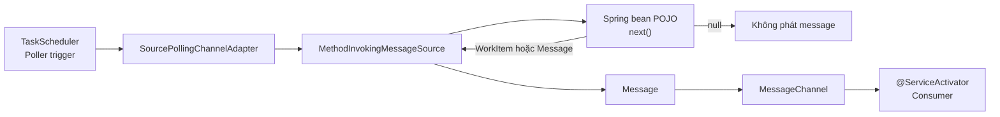
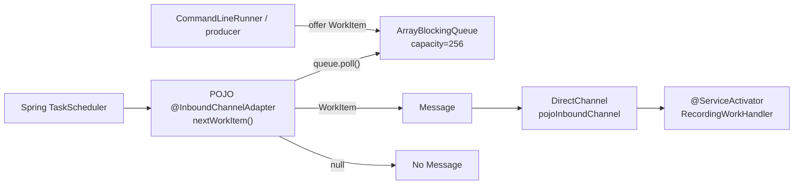
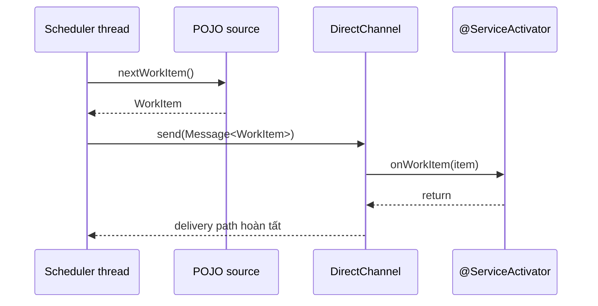
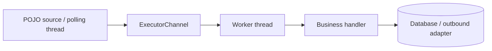
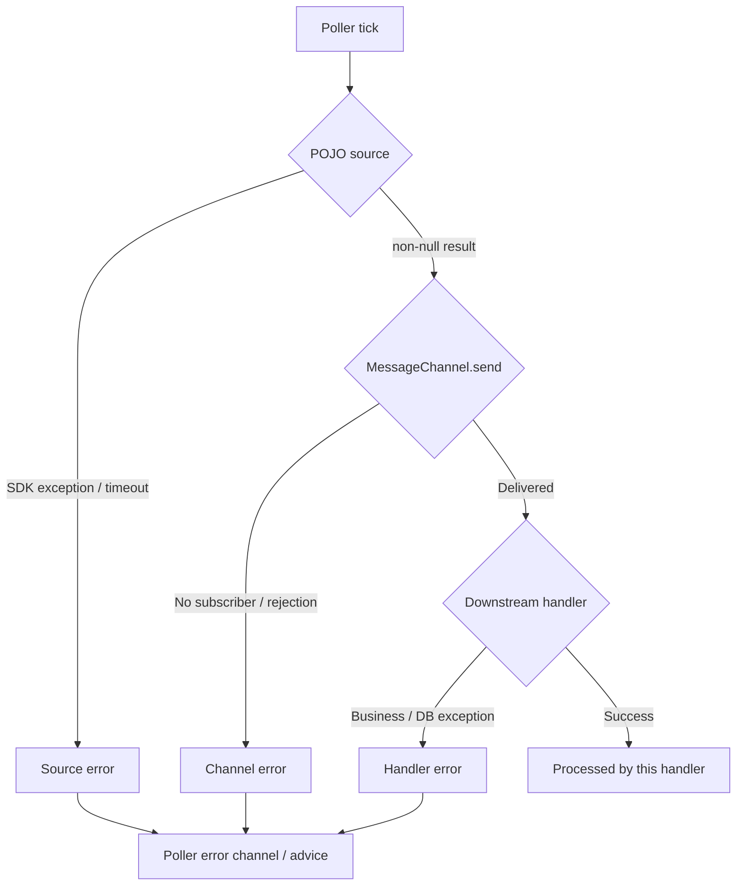
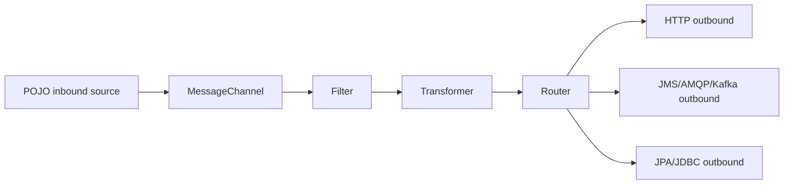

# POJO inbound channel adapter

## 1. Bối cảnh và mục tiêu

Trong module **SPRING_INTEGRATION_ADAPTERS**, Spring Integration được dùng để kết nối hệ thống bên ngoài với ứng dụng thông qua inbound/outbound adapter, gateway, poller và `MessageChannel`. Những nguồn thường gặp gồm file, SFTP, HTTP, JMS, AMQP, Kafka và cơ sở dữ liệu. Tuy nhiên, không phải nguồn dữ liệu nào cũng có sẵn một adapter chuyên biệt: đôi khi hệ thống đã có một **Spring bean Java thông thường** biết cách đọc trạng thái, lấy công việc từ một hàng đợi nội bộ hoặc gọi một thư viện cũ.

**POJO inbound channel adapter** cho phép dùng chính phương thức của bean đó làm **đầu vào của Spring Integration Flow**. Framework gọi phương thức theo lịch, bọc kết quả thành Spring Message khi cần, rồi gửi tới một `MessageChannel`. POJO không phải implement `MessageSource` hay trực tiếp gọi `channel.send(...)` trong phương thức nghiệp vụ.

Bài học này nằm trong chương **Adapter POJO**. Sau khi hoàn thành, bạn có thể:

- Giải thích POJO, inbound channel adapter, `MethodInvokingMessageSource`, `SourcePollingChannelAdapter` và `MessageChannel`.
- Phân biệt **source method được poll** với **consumer method nhận message**.
- Viết `@InboundChannelAdapter` trên một phương thức không tham số, trả payload hoặc `Message<?>`.
- Hiểu vì sao **`null` = không có message**, trong khi `0`, `false`, chuỗi rỗng và một `List` không rỗng đều là payload hợp lệ.
- Cấu hình `@Poller`/`Pollers` với `fixedDelay`, `fixedRate`, cron và `maxMessagesPerPoll`.
- Phân biệt một **poll tick**, một **lần gọi phương thức source**, một **Spring Message** và một **business record**.
- Tạo ví dụ Spring Boot 3.x, Spring Integration 6.x, Java 17+, nguồn POJO có bounded queue và handler `@ServiceActivator`.
- Dùng Java DSL `IntegrationFlow.fromSupplier(...)` và XML `<int:inbound-channel-adapter>` như các phương án thay thế.
- Đặt headers/correlation ID khi phương thức trả `Message<?>` thay vì chỉ payload.
- Thiết kế trạng thái start/stop, error channel, retry và backpressure.
- Biết giới hạn của nguồn trong-memory; chọn file/SFTP/JDBC/JPA/JMS/AMQP/Kafka adapter khi cần tính bền vững và ACK của transport.
- Viết kiểm thử direct method và integration test cho scheduler, khi nguồn rỗng và khi consumer thất bại.

> **Nguyên tắc quan trọng:** POJO inbound channel adapter là **polling integration endpoint**. Nó không biến một phương thức Java bất kỳ thành durable broker, không tự cấp transaction, không tự lưu checkpoint và không bảo đảm exactly-once delivery.

## 2. POJO inbound channel adapter là gì?

**POJO (Plain Old Java Object)** là một đối tượng Java thông thường, không phải implement một giao diện Spring Integration chuyên biệt để chứa logic. Chẳng hạn:

```java
public class LegacyWorkProvider {

    public WorkItem next() {
        // Đọc một công việc từ nguồn nghiệp vụ.
        // Trả null nếu tạm thời không có dữ liệu.
        return ...;
    }
}
```

Nếu `LegacyWorkProvider` là Spring bean và phương thức `next()` đáp ứng hợp đồng method-invoking source, Spring Integration có thể gọi nó mỗi 250 ms:



**Ở tầng kiến trúc:**

1. `TaskScheduler` kích hoạt một poll cycle.
2. `SourcePollingChannelAdapter` thực hiện việc poll.
3. `MethodInvokingMessageSource` gọi phương thức không tham số của POJO.
4. Nếu phương thức trả `null`, lần `receive()` đó không có message để gửi.
5. Nếu trả một object không phải `Message`, framework tạo một `Message` chứa object làm payload.
6. Nếu trả `Message<?>`, message đó có thể mang headers tùy biến.
7. Message được gửi tới output channel và các downstream handlers chạy theo semantics của channel.

Đây là một **push sang channel nhờ pull ở source**: framework chủ động poll nguồn rồi publish kết quả vào Integration Flow.

### 2.1. Vì sao không phải mọi inbound adapter đều là POJO?

Các adapter chuyên biệt cung cấp nhiều chức năng không có ở một phương thức POJO:

| Adapter | Nguồn | Chức năng transport-specific |
| --- | --- | --- |
| POJO inbound | Phương thức của Spring bean | Gọi method theo lịch, chuyển result sang message |
| File inbound | Filesystem | Directory scan, file filters, locking/duplicate prevention |
| SFTP inbound | Remote SFTP server | Session factory, remote synchronizer, file filters |
| JDBC inbound | Database query | SQL query, row mapping, polling theo kết quả |
| JPA inbound | `EntityManager`/JPQL | Entity query, persistence context, result limits |
| JMS inbound | JMS provider | Session/ACK, listener/polling behavior tùy adapter |
| AMQP/Kafka inbound | Broker | Delivery/offset/ACK/retry semantics theo adapter |
| HTTP inbound gateway | HTTP request | Request–reply, status/headers, web security |

**POJO inbound phù hợp** khi bạn đã có một API/Java bean có thể gọi mà không cần dựng adapter đặc thù. Nếu dữ liệu thực chất đến từ broker/remote transport, ưu tiên adapter chuyên dụng để không phải tự viết lại kết nối, filtering, retry, acknowledgment và recovery.

### 2.2. Inbound và outbound không đối xứng về phương thức

- **Inbound POJO:** framework **gọi** phương thức không tham số của bean để **lấy dữ liệu** rồi phát message vào channel.
- **Outbound POJO:** framework **nhận** message từ channel, sau đó gọi một phương thức của bean với payload/headers phù hợp.
- **Service activator:** endpoint tiêu thụ Spring Message để thực hiện logic; có thể có reply nếu handler trả kết quả.

```text
POJO inbound:
  poller → source.next() → Message → channel → handler

POJO outbound:
  channel → Message → target.handle(payload)
```

Phương thức nguồn POJO **không được nhầm với** `@ServiceActivator(inputChannel=...)`: một bên **tạo** message, bên còn lại **xử lý** message đã tồn tại.

## 3. Các thành phần Spring Integration liên quan

| Thành phần | Vai trò |
| --- | --- |
| `@InboundChannelAdapter` | Annotation khai phương thức nguồn POJO được poll |
| `@Poller` | Lịch và giới hạn polling tại endpoint annotation |
| `MethodInvokingMessageSource` | `MessageSource` gọi phương thức POJO không tham số |
| `SourcePollingChannelAdapter` | Endpoint quản lý polling và chuyển message tới output channel |
| `TaskScheduler` | Lập lịch poller triggers |
| `MessageSource<T>` | Hợp đồng pull qua `receive()` |
| `Message<T>` | Payload cùng metadata headers |
| `MessageChannel` | Ranh giới chuyển message tới downstream |
| `DirectChannel` | Gửi đồng bộ trên thread caller thông thường |
| `ExecutorChannel` | Dispatch bằng executor, tạo ranh giới thread |
| `QueueChannel` | Lưu message để consumer poll sau |
| `@ServiceActivator` | Consumer method xử lý message |
| `IntegrationFlow.fromSupplier(...)` | Java DSL tạo nguồn từ Java `Supplier` |
| `PollerMetadata` | Cấu hình poller: trigger, advice, limits, executor/error handling |
| `SmartLifecycle` | Điều khiển startup, stop, phase của endpoint |
| `@EndpointId` | Gán tên endpoint rõ ràng để quản lý/lifecycle |
| `errorChannel` | Đường đi của `ErrorMessage` khi polling/processing có lỗi |

### 3.1. Có cần tự implement MessageSource?

**Không.** Khi dùng `@InboundChannelAdapter` trên phương thức không tham số, framework tạo logic method-invoking source thích hợp.

Có thể implement `MessageSource<T>` nếu cần custom protocol hoặc kiểm soát `receive()` nâng cao:

```java
MessageSource<WorkItem> source = () -> {
    WorkItem item = lookupOneItem();
    return item == null
            ? null
            : MessageBuilder.withPayload(item).build();
};
```

Nhưng đoạn trên **không phải POJO method annotation**; nó là một cách tạo `MessageSource` tường minh. Khi chỉ cần gọi bean method thông thường, `@InboundChannelAdapter` đơn giản hơn.

### 3.2. Cần phân biệt SmartLifecycle với lịch poller

`SmartLifecycle.start()` bật khả năng xử lý, nhưng **không** có nghĩa ngay lúc start sẽ phát một message. Poller còn phải tới tick và source phải trả non-null result. `stop()` dừng các lần poll kế tiếp, không tự rollback công việc đã xử lý ngoài DB hoặc xóa dữ liệu trong source.

## 4. Hợp đồng của phương thức @InboundChannelAdapter

### 4.1. Phương thức không nhận tham số, không void

Theo Spring Integration 6.5, method-level annotation:

```java
@Component
public class HeartbeatSource {

    @InboundChannelAdapter(
            channel = "heartbeatChannel",
            poller = @Poller(fixedDelay = "1000"))
    public String nextHeartbeat() {
        return "heartbeat";
    }
}
```

Yêu cầu chính:

- Bean được Spring quản lý.
- Method được annotation `@InboundChannelAdapter`.
- **Không có tham số**.
- Return type **không phải `void`**.
- Cấu hình một output channel có tên hợp lệ.
- Có poller cụ thể hoặc default poller trong context.
- Với nhiều source methods, mỗi endpoint/channel cần có chủ đích để tránh nguồn trùng lặp.

Một method có tham số `next(String tenantId)` không phù hợp trực tiếp vì **poller không có request message** để truyền dữ liệu theo từng lần nhận. Nếu cần request payload/headers, dùng `@MessagingGateway`/retrieving outbound gateway hoặc thiết kế parameter source được server kiểm soát.

### 4.2. Return value và kết quả phát message

| Giá trị trả về | Hành vi nguồn |
| --- | --- |
| `null` | Không phát Spring Message cho lần receive đó |
| `new WorkItem(...)` | Framework bọc thành `Message<WorkItem>` |
| `"hello"` | Phát `Message<String>` |
| `0` | Phát `Message<Integer>`; số 0 không phải “không có dữ liệu” |
| `false` | Phát `Message<Boolean>` |
| `""` | Phát message có payload chuỗi rỗng |
| `List<WorkItem>` | **Một message** có payload là List, không phải một message cho mỗi item |
| `Message<WorkItem>` | Phát message với payload và các headers đã khai |
| `Optional.empty()` | Đây là một **object không-null**, không phải quy ước “không có message” |
| Một exception | Poll cycle thất bại và đi theo error-handling policy |

**Quy tắc chính xác:** Spring Integration dùng **`null`** như dấu hiệu source không có dữ liệu tại lần poll đó. Đừng dùng `false`, `0` hoặc `Optional.empty()` làm tín hiệu không có dữ liệu trừ khi bạn cố ý muốn downstream nhận chúng như business payload.

### 4.3. Trả Message khi cần headers

```java
@InboundChannelAdapter(
        channel = "workItemsChannel",
        poller = @Poller(fixedDelay = "1000"))
public Message<WorkItem> nextWithHeaders() {
    WorkItem work = legacyProvider.next();

    if (work == null) {
        return null;
    }

    return MessageBuilder.withPayload(work)
            .setHeader("sourceSystem", "legacy-work-provider")
            .setHeader("correlationId", work.id())
            .build();
}
```

Đây là **biến thể thay thế** cho source method của demo bên dưới, không đăng ký cùng lúc với source khác đang poll một queue nếu không cố tình muốn hai consumers cạnh tranh.

Lưu ý:

- `MessageBuilder.withPayload(...)` không chấp nhận payload null; kiểm tra `work==null` trước.
- Có thể bổ sung `MessageHeaders` để downstream filter/router/trace.
- Header `sourceSystem` do **server-defined source** đặt; nếu copy headers từ external input, phải kiểm tra độ tin cậy trước khi dùng làm authorization.
- Không dùng message header để mang raw JPA `EntityManager`, transaction hoặc secrets.

### 4.4. Không trả void

```java
@InboundChannelAdapter(
        channel = "workItemsChannel",
        poller = @Poller(fixedDelay = "1000"))
public void tick() {
    // Sai về hợp đồng: không có payload để phát.
}
```

Nếu mục tiêu chỉ chạy tác vụ định kỳ không phát message, `@Scheduled` hoặc scheduler nghiệp vụ có thể phù hợp hơn. Nếu mục tiêu là **đưa dữ liệu vào Integration Flow**, method phải trả kết quả non-void khi có dữ liệu.

### 4.5. Không cố đọc payload/headers trong source method

```java
public WorkItem next(Message<String> request) {
    // Sai cho @InboundChannelAdapter: method có tham số.
}
```

Tại thời điểm source được poll, chưa có Spring Message input do user gửi. Phương thức dùng fields/dependencies được inject vào bean, đọc DB/queue/cache/remote API **theo quyền server** rồi sinh kết quả. Headers chỉ được tạo **sau** khi có payload hoặc trả `Message<?>` trực tiếp.

## 5. Poller: fixedDelay, fixedRate, cron và maxMessagesPerPoll

### 5.1. Một tick không đồng nghĩa một record

Ví dụ:

```java
@InboundChannelAdapter(
        channel = "workItemsChannel",
        poller = @Poller(
                fixedDelay = "1000",
                maxMessagesPerPoll = "5"))
public WorkItem next() {
    return queue.poll();
}
```

Trong một poll cycle, adapter có thể gọi source method **tối đa 5 lần**, dừng sớm khi source trả null:

```text
tick #1
  next() → WorkItem A  → Message A
  next() → WorkItem B  → Message B
  next() → null        → dừng cycle

tick #2 (sau lịch)
  next() → WorkItem C  → Message C
  ...
```

Nếu source trả `List<WorkItem>` mỗi lần, `maxMessagesPerPoll=5` đếm **tối đa 5 receive invocations/messages**, **không phải tổng 5 WorkItems**. Một List 1000 records là một payload lớn và cần giới hạn riêng.

### 5.2. maxMessagesPerPoll của inbound source mặc định là 1

Đây là khác biệt dễ bỏ sót:

- `SourcePollingChannelAdapter` mặc định `maxMessagesPerPoll=1` nếu không cấu hình.
- Một `PollingConsumer` lấy message từ `PollableChannel` có thể dùng default khác (truyền thống `-1`), nên không áp máy móc cùng quy tắc.
- Giá trị `0` trong Spring Integration 5.5+ có thể dùng để **tạm dừng gọi `MessageSource.receive()`** mà không nhất thiết stop toàn endpoint.
- Giá trị âm như `-1` cho phép poll liên tiếp cho đến khi source trả null; **rất nguy hiểm** nếu nguồn luôn trả non-null và không thể bị ngắt đúng lúc.
- Giá trị dương N là giới hạn số lần receive trong một poll cycle.

**Nên chọn giới hạn dương, bounded** khi mới triển khai. Chỉ dùng `-1` khi chứng minh source có cơ chế cạn dữ liệu rõ ràng, thường trả null, và endpoint có thể được dừng an toàn.

### 5.3. fixedDelay và fixedRate

| Trigger | Hành vi tổng quát | Dùng khi |
| --- | --- | --- |
| `fixedDelay = "1000"` | Chờ khoảng 1 giây sau lần chạy trước kết thúc | Poll nguồn có thời gian xử lý không đều |
| `fixedRate = "1000"` | Lập lịch theo nhịp khoảng 1 giây | Cần chu kỳ tương đối đều và đã kiểm soát concurrency |
| `cron = "0 */5 * * * *"` | Theo lịch 5 phút (Spring cron có giây) | Công việc theo giờ/lịch nghiệp vụ |
| `maxMessagesPerPoll = "5"` | Giới hạn số lần gọi receive trong một tick | Backpressure căn bản |
| `errorChannel = "pollingErrors"` | Chỉ định error channel theo cấu hình polling | Quan sát lỗi nguồn/handler |
| `autoStartup = "false"` | Endpoint không tự start | Chờ hệ thống ngoài sẵn sàng |
| `phase` | Thứ tự lifecycle tương đối | Startup/shutdown phụ thuộc hạ tầng |

Trong Spring Integration 6.2+, các cấu hình delay/rate còn hỗ trợ ISO 8601 Duration strings ở những vị trí được tài liệu cho phép, ví dụ `PT10S`. Các ví dụ này dùng milliseconds để dễ đọc và tương thích Spring Integration 6.x.

### 5.4. Không hiểu fixedDelay là SLA cứng

`fixedDelay(1000)` **không bảo đảm** mỗi event được xử lý trong đúng 1 giây. Độ trễ còn phụ thuộc scheduler threads, thời gian xử lý source, DirectChannel handler, backlog, GC, DB/network I/O và trigger policy.

Với DirectChannel đồng bộ, nếu handler chạy 5 giây thì tick có thể bị kéo dài; khi fixedDelay áp sau completion, khoảng cách giữa các lần trigger cũng tăng. Với async channel, poller có thể tiếp tục nhận dữ liệu nhanh hơn downstream xử lý, khiến backlog tăng nếu không giới hạn queue/executor.

### 5.5. receiveTimeout khác thời gian chờ của POJO method

`@Poller.receiveTimeout` chủ yếu có ý nghĩa với **PollingConsumer** nhận message từ `PollableChannel`. Với một POJO inbound source, việc poller bị block hay không phụ thuộc **chính implementation của source method**.

- `queue.poll()` không chờ → method nhanh, trả null khi rỗng.
- `queue.take()` chờ vô hạn → có thể giữ polling thread, khó stop.
- HTTP client call không timeout → poller thread có thể kẹt lâu.
- `maxMessagesPerPoll` không tự đặt timeout cho network/DB method.

Ưu tiên **non-blocking hoặc bounded-timeout source method**, và cấu hình socket/query timeout ở underlying client.

## 6. Khi nào nên dùng POJO inbound?

### 6.1. Tình huống phù hợp

- Có một thư viện legacy với method `nextEvent()` hoặc `pollChanges()`.
- Đọc từ một in-memory bounded queue do một thành phần khác trong cùng JVM nạp.
- Poll dữ liệu từ một service/library không có Spring Integration adapter chính thức.
- Lấy status/counter nội bộ định kỳ để phát vào EIP flow.
- Thích nghi một custom SDK trả Java object từ method không tham số.
- Viết prototype/học về inbound polling, MessageChannel và consumer.

### 6.2. Tình huống nên chọn adapter chuyên biệt

- **Kafka/JMS/AMQP:** cần ACK/offset/consumer groups/DLQ; dùng inbound adapter/listener tương ứng.
- **SFTP/FTP/File:** cần atomic file transfer, filters, seen-file metadata, remote session management; dùng file adapter.
- **JDBC/JPA:** cần query, mapping, transaction và xử lý concurrency; dùng JDBC/JPA inbound adapter.
- **HTTP request:** cần status, authentication, headers và request–reply; dùng HTTP inbound gateway.
- **R2DBC/reactive stream:** nếu nguồn thực sự reactive/backpressure-aware, cân nhắc reactive integration thay blocking poller.

Một POJO method có thể gọi các API nói trên, nhưng khi tự viết sẽ phải **tự tái hiện** transport semantics và recovery mà adapter chuyên biệt đã cung cấp.

### 6.3. POJO inbound khác @Scheduled

Có thể viết:

```java
@Scheduled(fixedDelay = 1000)
public void pollManually() {
    WorkItem item = source.next();
    if (item != null) {
        channel.send(MessageBuilder.withPayload(item).build());
    }
}
```

Nhưng với `@InboundChannelAdapter`, framework cung cấp polling endpoint, message conversion, lifecycle, transaction advice và integration metadata trực tiếp. `@Scheduled` có ích cho tác vụ không cần message flow, nhưng khi mục tiêu là tích hợp vào EIP pipeline, adapter thường nhất quán hơn.

**Không cấu hình đồng thời** `@Scheduled` gọi `source.next()` và `@InboundChannelAdapter` poll cùng nguồn, vì hai scheduler có thể tranh nhau dữ liệu.

## 7. Bài thực hành: POJO source từ bounded in-memory queue

### 7.1. Yêu cầu

Ta xây ứng dụng demo:

1. Một thành phần có thể `submit(WorkItem)` vào bounded queue 256 phần tử.
2. Một POJO method `nextWorkItem()` trả **một** `WorkItem` hoặc `null` khi queue rỗng.
3. `@InboundChannelAdapter` poll mỗi 250 ms, tối đa 5 lần receive/cycle.
4. Method tự động được kết nối tới channel `pojoInboundChannel`.
5. `@ServiceActivator` nhận payload `WorkItem`, ghi vào in-memory recorder.
6. Một `CommandLineRunner` seed vài items để quan sát logs.
7. Integration test submit item mới, chờ có giới hạn đến khi handler xử lý.
8. Test xác minh `null` là nguồn rỗng, không phải một message.
9. Bài demo không sử dụng DB/broker; **không** coi nó là durable queue hay được bảo đảm redelivery.



### 7.2. Maven dependencies

Dùng Java 17+, Spring Boot 3.x, Spring Integration 6.x:

```xml
<dependencies>
    <dependency>
        <groupId>org.springframework.boot</groupId>
        <artifactId>spring-boot-starter</artifactId>
    </dependency>
    <dependency>
        <groupId>org.springframework.boot</groupId>
        <artifactId>spring-boot-starter-integration</artifactId>
    </dependency>
    <dependency>
        <groupId>org.springframework.boot</groupId>
        <artifactId>spring-boot-starter-test</artifactId>
        <scope>test</scope>
    </dependency>
</dependencies>
```

Spring Boot parent/BOM quản lý version Spring Framework và Spring Integration. Không cần `spring-integration-jpa` hay database nếu chỉ thực hành POJO inbound. Các ví dụ nói về JPA/SFTP/Kafka ở phần sau là **thiết kế mở rộng**, không nằm trong demo chạy này.

### 7.3. WorkItem record

File `WorkItem.java`, package `com.example.pojoinbound`:

```java
package com.example.pojoinbound;

import java.time.Instant;
import java.util.Objects;

public record WorkItem(
        String id,
        String source,
        Instant createdAt) {

    public WorkItem {
        Objects.requireNonNull(id, "id");
        Objects.requireNonNull(source, "source");
        Objects.requireNonNull(createdAt, "createdAt");

        if (id.isBlank() || source.isBlank()) {
            throw new IllegalArgumentException(
                    "id and source must not be blank");
        }
    }
}
```

`record` giúp payload có immutable value semantics ở mức field references. `Instant` là immutable, nên record này đủ đơn giản để truyền qua các handlers cùng JVM. Nếu payload chứa mutable `List` hay arrays, nên tạo defensive copies.

### 7.4. POJO source là Spring bean

File `WorkItemSource.java`:

```java
package com.example.pojoinbound;

import java.util.Objects;
import java.util.concurrent.ArrayBlockingQueue;
import java.util.concurrent.BlockingQueue;

import org.springframework.integration.annotation.InboundChannelAdapter;
import org.springframework.integration.annotation.Poller;
import org.springframework.stereotype.Component;

@Component
public class WorkItemSource {

    private final BlockingQueue<WorkItem> queue =
            new ArrayBlockingQueue<>(256);

    public boolean submit(WorkItem item) {
        return queue.offer(Objects.requireNonNull(item));
    }

    @InboundChannelAdapter(
            channel = "pojoInboundChannel",
            poller = @Poller(
                    fixedDelay = "250",
                    maxMessagesPerPoll = "5"))
    public WorkItem nextWorkItem() {
        return queue.poll();
    }

    public int bufferedCount() {
        return queue.size();
    }
}
```

Đọc code theo trình tự:

- `@Component` đưa POJO vào Spring context.
- `submit` được gọi bởi producer; `ArrayBlockingQueue` giới hạn tối đa 256 items.
- `offer` **không chờ**; trả `false` nếu queue đầy. Caller phải xử lý trường hợp đó, không tự vứt item.
- `@InboundChannelAdapter` đánh dấu phương thức nguồn không tham số.
- `queue.poll()` trả một `WorkItem` nếu có, hoặc `null` khi rỗng.
- Spring Integration tự bọc `WorkItem` thành `Message<WorkItem>` và chuyển tới `pojoInboundChannel`.
- `maxMessagesPerPoll=5` cho phép tối đa 5 items trong một tick vì mỗi lần `nextWorkItem` trả tối đa một item.
- Queue là **in-memory**: restart làm mất buffered items; nếu handler lỗi sau `poll()`, item đã rời queue, không tự xuất hiện lại.

**Quan trọng:** phần last bullet là giới hạn cố ý để học kiến trúc. Không mang `ArrayBlockingQueue` demo vào production để lưu đơn hàng, thanh toán hoặc dữ liệu cần đảm bảo delivery nếu chưa có durable store/ACK/retry.

### 7.5. MessageChannel configuration

File `PojoInboundConfiguration.java`:

```java
package com.example.pojoinbound;

import org.springframework.context.annotation.Bean;
import org.springframework.context.annotation.Configuration;
import org.springframework.integration.channel.DirectChannel;
import org.springframework.integration.config.EnableIntegration;
import org.springframework.messaging.MessageChannel;

@Configuration
@EnableIntegration
public class PojoInboundConfiguration {

    @Bean
    MessageChannel pojoInboundChannel() {
        return new DirectChannel();
    }
}
```

`@EnableIntegration` bật integration infrastructure và annotation processing phù hợp. Bean channel đặt tên theo method `pojoInboundChannel` để khớp `channel = "pojoInboundChannel"` ở POJO source.

### 7.6. POJO consumer bằng @ServiceActivator

File `RecordingWorkHandler.java`:

```java
package com.example.pojoinbound;

import java.util.concurrent.ConcurrentHashMap;
import java.util.concurrent.ConcurrentMap;
import java.util.concurrent.atomic.AtomicInteger;

import org.slf4j.Logger;
import org.slf4j.LoggerFactory;
import org.springframework.integration.annotation.ServiceActivator;
import org.springframework.stereotype.Component;

@Component
public class RecordingWorkHandler {

    private static final Logger log =
            LoggerFactory.getLogger(RecordingWorkHandler.class);

    private final ConcurrentMap<String, WorkItem> received =
            new ConcurrentHashMap<>();

    private final AtomicInteger deliveryAttempts =
            new AtomicInteger();

    @ServiceActivator(inputChannel = "pojoInboundChannel")
    public void onWorkItem(WorkItem item) {
        deliveryAttempts.incrementAndGet();
        received.putIfAbsent(item.id(), item);

        log.info("POJO inbound delivered work id={}, source={}",
                item.id(), item.source());
    }

    public boolean hasReceived(String id) {
        return received.containsKey(id);
    }

    public int receivedUniqueCount() {
        return received.size();
    }

    public int deliveryAttempts() {
        return deliveryAttempts.get();
    }
}
```

`@ServiceActivator` là phía **consumer**, nhận payload `WorkItem` từ Spring Message. `putIfAbsent` giúp demo tránh thêm hai entry cùng ID trong recorder, nhưng **không** là cơ chế idempotency bền vững qua restart hoặc đa node; mọi state đang ở heap của JVM.

### 7.7. Spring Boot application và seed

File `PojoInboundApplication.java`:

```java
package com.example.pojoinbound;

import java.time.Instant;
import java.util.List;

import org.springframework.boot.CommandLineRunner;
import org.springframework.boot.SpringApplication;
import org.springframework.boot.autoconfigure.SpringBootApplication;
import org.springframework.context.annotation.Bean;

@SpringBootApplication
public class PojoInboundApplication {

    public static void main(String[] args) {
        SpringApplication.run(
                PojoInboundApplication.class, args);
    }

    @Bean
    CommandLineRunner seedWork(WorkItemSource source) {
        return args -> {
            List<WorkItem> items = List.of(
                    new WorkItem(
                            "job-101", "demo", Instant.now()),
                    new WorkItem(
                            "job-102", "demo", Instant.now()),
                    new WorkItem(
                            "job-103", "demo", Instant.now()));

            for (WorkItem item : items) {
                if (!source.submit(item)) {
                    throw new IllegalStateException(
                            "Demo queue is full");
                }
            }
        };
    }
}
```

File `application.properties`:

```properties
spring.main.web-application-type=none
logging.level.org.springframework.integration=INFO
logging.level.com.example.pojoinbound=INFO
```

**Kết quả kỳ vọng:** sau khi Spring context start và poller chạy, handler log các items `job-101`, `job-102`, `job-103`. Thứ tự tương đối trong demo một nguồn/handler đồng bộ theo queue FIFO; không lấy demo này làm chứng minh thứ tự toàn cục khi đổi sang executor đa thread, nhiều instances hoặc broker.

### 7.8. Tại sao không cần tự gọi channel.send trong source?

Method `nextWorkItem()` chỉ trả `WorkItem`. Infrastructure của `@InboundChannelAdapter` chịu trách nhiệm chuyển nó thành `Message` rồi gửi. Nếu trong method vừa `channel.send(Message)` vừa return item, một công việc có thể bị phát **hai lần**.

Đúng:

```java
public WorkItem nextWorkItem() {
    return queue.poll();
}
```

Không đúng:

```java
public WorkItem nextWorkItem() {
    WorkItem item = queue.poll();
    if (item != null) {
        channel.send(MessageBuilder.withPayload(item).build());
    }
    return item; // Adapter lại phát một message nữa!
}
```

POJO source phải **cung cấp dữ liệu**, không cần tự điều phối việc gửi xuống channel.

## 8. Kiểm thử POJO method và scheduler thực tế

### 8.1. Unit test phương thức nguồn, không cần Spring

Vì `WorkItemSource` là một POJO, ta có thể kiểm tra trực tiếp hành vi queue:

File `WorkItemSourceTest.java`:

```java
package com.example.pojoinbound;

import static org.assertj.core.api.Assertions.assertThat;

import java.time.Instant;

import org.junit.jupiter.api.Test;

class WorkItemSourceTest {

    @Test
    void returnsNullWhenNoWorkItem() {
        WorkItemSource source = new WorkItemSource();

        assertThat(source.nextWorkItem()).isNull();
        assertThat(source.bufferedCount()).isZero();
    }

    @Test
    void returnsOneItemPerMethodInvocation() {
        WorkItemSource source = new WorkItemSource();

        WorkItem first =
                new WorkItem("one", "unit-test", Instant.now());

        WorkItem second =
                new WorkItem("two", "unit-test", Instant.now());

        assertThat(source.submit(first)).isTrue();
        assertThat(source.submit(second)).isTrue();

        assertThat(source.nextWorkItem()).isEqualTo(first);
        assertThat(source.nextWorkItem()).isEqualTo(second);
        assertThat(source.nextWorkItem()).isNull();
    }

    @Test
    void queueRejectsWhenCapacityReached() {
        WorkItemSource source = new WorkItemSource();

        for (int i = 0; i < 256; i++) {
            boolean accepted = source.submit(
                    new WorkItem(
                            "job-" + i, "unit-test", Instant.now()));

            assertThat(accepted).isTrue();
        }

        assertThat(source.bufferedCount()).isEqualTo(256);

        assertThat(source.submit(
                new WorkItem("overflow", "unit-test", Instant.now())))
                .isFalse();
    }
}
```

Đây là **unit tests cho method logic**, không chứng minh Spring đã đăng ký polling endpoint hay chuyển object thành Message. Vì unit test gọi phương thức Java trực tiếp, `@InboundChannelAdapter` không tự kích hoạt scheduler trong bài test đó.

### 8.2. SpringBootTest: tích hợp poller → channel → handler

File `PojoInboundIntegrationTest.java`:

```java
package com.example.pojoinbound;

import static org.assertj.core.api.Assertions.assertThat;

import java.time.Duration;
import java.time.Instant;
import java.util.UUID;

import org.junit.jupiter.api.Test;
import org.springframework.beans.factory.annotation.Autowired;
import org.springframework.boot.test.context.SpringBootTest;

@SpringBootTest
class PojoInboundIntegrationTest {

    @Autowired
    WorkItemSource source;

    @Autowired
    RecordingWorkHandler handler;

    @Test
    void eventuallyDeliversSubmittedWork()
            throws InterruptedException {

        String id = "integration-" + UUID.randomUUID();
        WorkItem item =
                new WorkItem(id, "integration-test", Instant.now());

        assertThat(source.submit(item)).isTrue();

        long deadline = System.nanoTime()
                + Duration.ofSeconds(10).toNanos();

        while (!handler.hasReceived(id)
                && System.nanoTime() < deadline) {
            Thread.sleep(25);
        }

        assertThat(handler.hasReceived(id)).isTrue();
    }

    @Test
    void eventuallyDeliversSeveralItems()
            throws InterruptedException {

        String prefix = UUID.randomUUID().toString();

        for (int i = 0; i < 8; i++) {
            assertThat(source.submit(
                    new WorkItem(
                            prefix + "-" + i,
                            "integration-test",
                            Instant.now())))
                    .isTrue();
        }

        long deadline = System.nanoTime()
                + Duration.ofSeconds(10).toNanos();

        while (System.nanoTime() < deadline) {
            boolean allPresent = true;

            for (int i = 0; i < 8; i++) {
                if (!handler.hasReceived(prefix + "-" + i)) {
                    allPresent = false;
                    break;
                }
            }

            if (allPresent) {
                break;
            }

            Thread.sleep(25);
        }

        for (int i = 0; i < 8; i++) {
            assertThat(handler.hasReceived(prefix + "-" + i))
                    .isTrue();
        }
    }
}
```

Test không dựa vào `Thread.sleep(250)` rồi assert ngay: scheduler và CI có thể chậm. Deadline hữu hạn giúp giảm tính flaky và không chờ vô thời hạn.

**Đặc điểm:**

- Tests submit IDs ngẫu nhiên, không trùng seed `job-101`/`job-102`/`job-103`.
- `WorkItemSource` là singleton Spring bean, queue có thể chứa items từ các tests khác nếu chạy song song; assertions dựa trên **ID cụ thể**, không dựa vào total count toàn context.
- `RecordingWorkHandler` dùng `ConcurrentHashMap` nên kiểm tra `hasReceived(id)` an toàn giữa scheduler thread và test thread.
- `maxMessagesPerPoll=5` không nhất thiết có nghĩa 8 items sẽ được xử lý chính xác trong hai tick: scheduler timing/other producers có thể ảnh hưởng.
- Chúng chỉ chứng minh **eventual delivery trong một JVM đang chạy bình thường**, không chứng minh retry/durable acknowledgment.

### 8.3. Cách kiểm thử trạng thái “không có message”

Không nên viết integration test chờ framework gửi `Message<null>` hoặc một message chứa sentinel. Nguồn không có item trả `null` và framework **không phát message** cho lần receive đó.

Có thể kiểm thử riêng bằng:

- Unit test `source.nextWorkItem()==null` khi queue rỗng.
- Integration test đo count trước/sau một khoảng idle theo một context riêng không có producers; tránh để seeding/parallel tests gây nhiễu.
- Instrumented poll count (source method invocation) và delivered-message count để phân biệt “scheduler vẫn chạy” với “có message”.

Đừng viết một test “không có event trong đúng 250 ms” quá cứng vì lịch scheduler không phải đồng hồ tuyệt đối.

### 8.4. Test không được gọi @InboundChannelAdapter hai lần như một scheduler

`@InboundChannelAdapter` là metadata được xử lý khi Spring context tạo bean. Một lời gọi Java trực tiếp `source.nextWorkItem()` **bỏ qua** scheduler và lấy item khỏi queue. Nếu integration test đang có poller tự chạy, việc tự gọi method có thể tranh item với poller.

Vì thế:

- **Unit test:** tạo `new WorkItemSource()`, không Spring context.
- **Integration test:** inject bean và chỉ `submit(...)`, để framework tự gọi `nextWorkItem()`.
- **Deterministic endpoint test:** nếu cần điều khiển từng tick, cấu hình autoStartup=false/named endpoint và gọi qua APIs thích hợp, không tự “giả scheduler” khi nó vẫn đang chạy.

## 9. Khi nguồn trả Message thay vì payload

Nếu downstream cần một số headers (correlation, source, tenant scope đã xác thực), source có thể trả `Message<WorkItem>`.

### 9.1. Biến thể code minh họa

```java
@Component
public class HeaderEnrichedWorkSource {

    private final BlockingQueue<WorkItem> queue =
            new ArrayBlockingQueue<>(256);

    public boolean submit(WorkItem item) {
        return queue.offer(item);
    }

    @InboundChannelAdapter(
            channel = "pojoInboundChannel",
            poller = @Poller(
                    fixedDelay = "250",
                    maxMessagesPerPoll = "5"))
    public Message<WorkItem> nextWithHeaders() {
        WorkItem item = queue.poll();

        if (item == null) {
            return null;
        }

        return MessageBuilder.withPayload(item)
                .setHeader("origin", "pojo-adapter")
                .setHeader("correlationId", item.id())
                .build();
    }
}
```

Đoạn này cần imports `BlockingQueue`, `ArrayBlockingQueue`, `Message`, `MessageBuilder`, `@Component`, `@InboundChannelAdapter`, `@Poller`. Đây là **phương án thay thế**, không thêm class này vào package demo đang chạy trừ khi vô hiệu hóa source cũ hoặc dùng output channel khác. Nếu cả hai sources hoạt động trên một channel, chúng sẽ cùng tạo messages — có thể ngoài chủ đích của bài.

### 9.2. Đọc headers ở consumer

```java
@ServiceActivator(inputChannel = "pojoInboundChannel")
public void handle(
        WorkItem item,
        @Header("correlationId") String correlationId) {

    // Dùng correlationId cho logs/tracing, không coi là ACL.
}
```

Nếu source khác cùng gửi tới channel nhưng không đặt `correlationId`, method có thể lỗi thiếu header. Có thể xử lý optional header bằng `@Header(required=false)`/`@Headers` hoặc cấu hình thống nhất contract. Tránh để consumer phụ thuộc header do một source bất kỳ tự khai rồi dùng nó như bằng chứng authorization.

### 9.3. Headers không phải một phần của business data mặc định

Một payload `WorkItem` có thể được chuyển từ POJO inbound sang:

```text
POJO source
  → Message<WorkItem>{correlationId, origin}
  → Filter/Router/Transformer
  → HTTP/JMS/Kafka outbound adapter
```

Từng outbound adapter quyết định cách map headers sang protocol, và không nhất thiết bảo toàn mọi custom header qua process boundary. Các headers nhạy cảm như authentication token phải được kiểm soát/loại bỏ, không serialize ngẫu nhiên.

### 9.4. MessageBuilder và null

```java
WorkItem item = queue.poll();
if (item == null) {
    return null;
}
return MessageBuilder.withPayload(item).build();
```

Không viết `MessageBuilder.withPayload(null)` để biểu thị “empty poll”. Spring Message contract không coi null payload là một business message bình thường trong ví dụ này.

## 10. Cấu hình Java DSL tương đương @InboundChannelAdapter

### 10.1. IntegrationFlow.fromSupplier

Java DSL có factory `IntegrationFlow.fromSupplier(...)` phù hợp khi nguồn là method reference hoặc Java `Supplier`.

**Thay thế cho POJO annotation trong mục 7:**

```java
package com.example.pojoinbound;

import java.time.Duration;

import org.springframework.context.annotation.Bean;
import org.springframework.context.annotation.Configuration;
import org.springframework.integration.dsl.IntegrationFlow;
import org.springframework.integration.dsl.Pollers;

@Configuration
public class WorkItemSupplierFlowConfiguration {

    @Bean
    IntegrationFlow workItemSupplierFlow(WorkItemSource source) {
        return IntegrationFlow
                .fromSupplier(
                        source::nextWorkItem,
                        endpoint -> endpoint.poller(
                                Pollers.fixedDelay(
                                        Duration.ofMillis(250))
                                        .maxMessagesPerPoll(5)))
                .channel("pojoInboundChannel")
                .get();
    }
}
```

**Không đăng ký đồng thời** `workItemSupplierFlow` này với `@InboundChannelAdapter` trên `WorkItemSource.nextWorkItem()`. Nếu dùng Java DSL variant, hãy **bỏ annotation `@InboundChannelAdapter`** khỏi source method, giữ POJO/queue/handler như cũ. Nếu không, hai endpoints sẽ poll cùng queue, khiến tốc độ và thứ tự xử lý khó dự đoán.

### 10.2. Vì sao fromSupplier có thể dùng POJO method reference?

`source::nextWorkItem` là một `Supplier<WorkItem>` theo hợp đồng Java, không có tham số và trả kết quả. Framework:

1. Đăng ký một message source dựa trên supplier.
2. Tạo polling endpoint cho source đó.
3. Sau trigger, gọi `Supplier.get()`, tức `source.nextWorkItem()`.
4. Tạo Spring Message khi kết quả khác null.
5. Gửi message đến `pojoInboundChannel`.

Đây là Java DSL tương đương về **luồng thông điệp**, không phải byte-for-byte giống bean graph do annotation tạo. Với source phức tạp, `IntegrationFlow.from(MessageSource<?> source, ...)` là biến thể tường minh hơn.

### 10.3. Nếu source đã là MessageSource<?>

```java
@Bean
MessageSource<WorkItem> workItemsMessageSource(
        WorkItemSource source) {

    return () -> {
        WorkItem item = source.nextWorkItem();

        return item == null
                ? null
                : MessageBuilder.withPayload(item).build();
    };
}

@Bean
IntegrationFlow workItemsFromMessageSource(
        MessageSource<WorkItem> workItemsMessageSource) {

    return IntegrationFlow.from(
                    workItemsMessageSource,
                    endpoint -> endpoint.poller(
                            Pollers.fixedDelay(
                                    Duration.ofMillis(250))
                                    .maxMessagesPerPoll(5)))
            .channel("pojoInboundChannel")
            .get();
}
```

Cần imports `MessageSource`, `MessageBuilder`, `Duration`, `IntegrationFlow`, `Pollers` và `@Bean` tương ứng.

Đây cũng là **alternative configuration**, không bật đồng thời với annotation source/`fromSupplier`. Nó cho phép source tự tạo `Message<?>` và headers theo ý muốn; khi không cần quyền này, `fromSupplier` gọn hơn.

### 10.4. Một Supplier trả List vẫn là một Message

```java
Supplier<List<WorkItem>> batchSource =
        () -> legacyProvider.nextBatch(50);
```

Kết quả non-null thường được bọc thành **một message chứa List**, không tự split mỗi item. Nếu cần một message per item, thêm `Splitter` trong flow và suy nghĩ về partial failures/transaction:

```java
IntegrationFlow.fromSupplier(
                batchSource,
                e -> e.poller(Pollers.fixedDelay(1000)))
        .split()
        .channel("pojoInboundChannel")
        .get();
```

Trong trường hợp không có dữ liệu, source nên trả `null` thay vì luôn trả `List.of()` nếu semantics là **không có message**. Một empty List là payload object không-null; tùy downstream splitter, flow có thể không phát business item nhưng upstream vẫn đã tạo một source message.

## 11. XML: method-invoking inbound-channel-adapter

Nếu ứng dụng cũ dùng XML, cùng POJO được cấu hình trong **core Spring Integration namespace**:

```xml
<int:channel id="pojoInboundChannel"/>

<bean id="workItemSource"
      class="com.example.pojoinbound.WorkItemSource"/>

<int:inbound-channel-adapter
        id="pojoWorkInbound"
        ref="workItemSource"
        method="nextWorkItem"
        channel="pojoInboundChannel">

    <int:poller
            fixed-delay="250"
            max-messages-per-poll="5"/>
</int:inbound-channel-adapter>

<int:service-activator
        input-channel="pojoInboundChannel"
        ref="recordingWorkHandler"
        method="onWorkItem"/>
```

**Yêu cầu để chạy XML:**

- Có root `beans` và namespace/schema Spring Integration `int` tương ứng.
- `recordingWorkHandler` được khai là Spring bean (qua component scan hoặc `<bean>`).
- `WorkItemSource` có phương thức `nextWorkItem()` không tham số.
- Nếu dùng XML variant, không giữ `@InboundChannelAdapter` annotation trên source method để tránh double polling.
- Nếu `RecordingWorkHandler.onWorkItem` cũng được đăng ký bằng annotation `@ServiceActivator`, không đăng ký đồng thời handler XML mà không có mục đích rõ.
- Tránh khai hai beans `workItemSource` trùng tên bằng cả XML và `@Component` nếu application vừa scan vừa import XML.

### 11.1. ref và method là yếu tố cốt lõi

`ref="workItemSource"` là tên bean; `method="nextWorkItem"` chỉ một method trên bean đó. Framework gọi method theo lịch mà không cần sửa source thành framework-specific class.

### 11.2. XML với expression

Có thể dùng expression-based inbound source:

```xml
<int:inbound-channel-adapter
        id="expressionSource"
        channel="pojoInboundChannel"
        expression="@workItemSource.nextWorkItem()">

    <int:poller
            fixed-delay="250"
            max-messages-per-poll="5"/>
</int:inbound-channel-adapter>
```

Đây là **biến thể thay thế cho XML ref/method**; không khai cả hai cho cùng source trừ khi chủ ý tạo nhiều pollers. SpEL chạy ở source boundary, **chưa có input Message** nên không có `payload`/`headers` của một request như tại transformer/service activator.

Không nhận raw SpEL expression từ client untrusted rồi evaluate trong server.

### 11.3. Khi nào nên chọn XML?

- Ứng dụng legacy dùng XML namespace.
- Cần thay đổi cấu hình wiring mà không sửa class POJO.
- Muốn tái sử dụng một bean legacy không thể gắn annotation.
- Cần một sơ đồ endpoint/channel rõ ràng cho vận hành.

Java DSL và annotations hiện đại thường thuận tiện hơn khi codebase chủ yếu Java configuration. **Ba cách là lựa chọn thay thế**, không phải ba nguồn nên bật chung một lúc.

## 12. @Bean + @InboundChannelAdapter trả Supplier

Spring Integration cũng hỗ trợ annotation trên một `@Bean` factory method trả `Supplier<?>` để dùng bean supplier làm source.

```java
@Configuration
@EnableIntegration
public class SupplierBeanConfiguration {

    @Bean
    @InboundChannelAdapter(
            channel = "pojoInboundChannel",
            poller = @Poller(
                    fixedDelay = "250",
                    maxMessagesPerPoll = "5"))
    public Supplier<WorkItem> workItemSupplier(
            WorkItemSource source) {

        return source::nextWorkItem;
    }
}
```

Đây là một **cách cấu hình thay thế**, không dùng đồng thời với `@InboundChannelAdapter` ở `WorkItemSource.nextWorkItem()` hoặc Java DSL `fromSupplier`.

**Phân biệt hai trường hợp:**

1. `@InboundChannelAdapter` trên POJO instance method `nextWorkItem()`: phương thức không tham số được poll.
2. `@Bean @InboundChannelAdapter` trên factory method trả `Supplier<WorkItem>`: factory method có thể nhận Spring dependencies, nhưng **Supplier.get()` mới là hàm nguồn không tham số được gọi theo lịch**.

Không suy ra “source method annotation có thể nhận bất kỳ request argument” từ việc một `@Bean` factory method nhận dependencies để tạo Supplier.

## 13. Endpoint lifecycle, tự khởi động và tên endpoint

### 13.1. Vì sao cần control start/stop?

Một POJO source có thể phụ thuộc:

- Legacy SDK chưa đăng nhập.
- Database đang migration.
- Remote API chưa ready.
- Một leader election/shard lease.
- Giờ làm việc hoặc maintenance window.
- Credentials/token chưa được cấp.
- Backpressure từ downstream.

Nếu poller chạy trước khi hạ tầng sẵn sàng, mỗi tick có thể ném lỗi, gây log storm và retry storm. `SmartLifecycle` cho phép quản lý thời điểm endpoint hoạt động.

### 13.2. @EndpointId và autoStartup

Một cấu hình method annotation:

```java
@EndpointId("pojoWorkPoller")
@InboundChannelAdapter(
        channel = "pojoInboundChannel",
        autoStartup = "false",
        poller = @Poller(
                fixedDelay = "1000",
                maxMessagesPerPoll = "1"))
public WorkItem nextWorkItem() {
    return queue.poll();
}
```

Ở đây:

- `@EndpointId("pojoWorkPoller")` gán identity rõ ràng cho source polling endpoint.
- `autoStartup="false"` khiến endpoint không tự chạy ngay khi context start.
- Sau khi dependency đã sẵn sàng, application có thể yêu cầu endpoint `start()` qua bean/Control Bus phù hợp.
- `stop()` ngừng poll kế tiếp, nhưng không làm item đã đưa ra khỏi queue tự quay lại.

Ví dụ management bean (minh họa):

```java
@Component
public class PollerAdmin {

    private final SmartLifecycle endpoint;

    public PollerAdmin(
            @Qualifier("pojoWorkPoller")
            SmartLifecycle endpoint) {
        this.endpoint = endpoint;
    }

    public void startAfterReady() {
        endpoint.start();
    }

    public void stopForMaintenance() {
        endpoint.stop();
    }
}
```

Bean management này cần imports `SmartLifecycle`, `@Qualifier`, `@Component`, và đúng endpoint ID ở application context. **Không đăng ký thêm nó vào demo cơ bản mà chưa chủ ý đổi source sang autoStartup=false**: mục đích là minh họa lifecycle khi đã quản lý dependencies.

### 13.3. SmartLifecycle phase

`phase` kiểm soát thứ tự start/stop tương đối giữa các `SmartLifecycle` beans. Đừng xem phase là cơ chế đảm bảo external broker/database đã “healthy”: cần explicit readiness check/leader election trước khi bật poller.

### 13.4. Pause bằng maxMessagesPerPoll=0

Trong Spring Integration 5.5+, `maxMessagesPerPoll=0` có thể dùng để bỏ qua `MessageSource.receive()` trong poll cycle cho đến khi được đổi sang giá trị khác bằng cơ chế quản trị phù hợp. Đây là khả năng vận hành khác với `stop()` endpoint; cần test cách thiết lập động trên version/framework hiện hành.

### 13.5. Nhiều instances không tự phân tán công việc

Nếu triển khai ba Spring Boot instances, mỗi instance có một `WorkItemSource` với **queue riêng**. Không có sự chia sẻ work giữa các queues trừ khi producer/client chủ động gửi đúng instance. Nếu tất cả instances cùng poll **một remote legacy API**, chúng có thể đọc trùng dữ liệu nếu API không hỗ trợ atomic claim/offset/lease. Endpoint phase và SmartLifecycle không tạo distributed locking.

## 14. Threading và channel boundaries

### 14.1. DirectChannel: đồng bộ trong poller thread



Với `DirectChannel`, `RecordingWorkHandler` trong demo chạy đồng bộ trên poller thread thông thường. Điều này có những hệ quả:

- Handler chậm làm poll cycle kéo dài.
- Handler exception có thể propagate trong poll task và kích hoạt error handling.
- Không có dispatch buffer riêng giữa source và consumer.
- Nếu một poller transaction advice đã được cấu hình, downstream đồng bộ **có thể tham gia** cùng transaction, tùy transaction manager/bean call path.
- Không tự suy ra DB commit thành công chỉ vì handler method đã return trong một transaction còn mở.

### 14.2. ExecutorChannel: bất đồng bộ



Nếu thay `DirectChannel` bằng `ExecutorChannel`:

- Poller thường giao task cho executor rồi tiếp tục.
- Source-side transaction/thread-local state **không tự truyền sang worker**.
- Handler lỗi sau đó có thể **không trở về poller** như exception synchronous.
- Cần bounded executor/queue/rejection policy, error channel và consumer transaction.
- Không dùng cùng mutable Java object/`EntityManager` không thread-safe giữa threads.

### 14.3. QueueChannel: tách thời điểm phát và nhận

```text
POJO source → QueueChannel → PollingConsumer → downstream
```

`QueueChannel` có buffer nội bộ (có thể in-memory hoặc persistent message store tùy thiết kế). Producer/source có thể được nhận vào queue trước khi consumer xử lý. Một queue trong memory **không** có tính bền vững sau restart mặc định.

Khác với `DirectChannel`, `QueueChannel` cần consumer poller để nhận messages, và lỗi consumer xảy ra ở một invocation/transaction khác.

### 14.4. PublishSubscribeChannel

Một `PublishSubscribeChannel` có thể gọi subscribers đồng bộ hoặc bất đồng bộ nếu cấu hình executor. Khi phát cùng một payload Java object tới nhiều subscribers, các handler có thể chia sẻ **một reference mutable** và gây race. Dùng immutable DTO/records hoặc defensive copies cho collections.

### 14.5. Không để source giữ transaction qua remote call dài

Nếu POJO source truy vấn DB rồi gọi HTTP/Kafka/SFTP trong cùng poller transaction, transaction có thể giữ connection/locks lâu. Nên tách:

1. Read/claim trong transaction ngắn, commit.
2. Chuyển DTO/ID.
3. Consumer xử lý external side effect.
4. Commit outcome/ACK theo workflow.

Chỉ làm như vậy sau khi đã thiết kế idempotency và recovery; tách transaction không tự tạo atomic delivery.

## 15. Error handling: source, channel và handler

### 15.1. Ba vị trí lỗi khác nhau



Hành vi propagating thực tế phụ thuộc `DirectChannel` vs async và cách error handler được cấu hình. Không suy ra mọi exception đều đi vào cùng một nơi trong mọi topology.

### 15.2. Annotation poller errorChannel

Một source variant:

```java
@InboundChannelAdapter(
        channel = "pojoInboundChannel",
        poller = @Poller(
                fixedDelay = "1000",
                maxMessagesPerPoll = "1",
                errorChannel = "pojoPollErrors"))
public WorkItem nextWorkItem() {
    return legacyProvider.next();
}
```

`@Poller(errorChannel="pojoPollErrors")` chọn error channel của poller trong các trường hợp được Spring Integration quản lý. Để xử lý, cần khai bean channel và error handler; ví dụ:

```java
@Bean
MessageChannel pojoPollErrors() {
    return new PublishSubscribeChannel();
}

@ServiceActivator(inputChannel = "pojoPollErrors")
public void onPollError(ErrorMessage error) {
    Throwable failure = error.getPayload();

    // Chỉ log dữ liệu đã mask/trace; không nuốt lỗi
    // rồi giả làm broker ACK thành công.
}
```

Các đoạn này là **mẫu cấu hình bổ sung**, cần imports `PublishSubscribeChannel`, `MessageChannel`, `ErrorMessage`, annotations và beans thích hợp. Trên topology cụ thể, hãy kiểm thử loại errors thực sự được publish và liệu chúng được propagate, được retry hay được xem là đã xử lý.

### 15.3. Không có durable redelivery trong demo

Với `ArrayBlockingQueue`:

```java
WorkItem item = queue.poll(); // Item bị lấy khỏi queue.
```

Nếu downstream `@ServiceActivator` ném lỗi, item **không tự quay lại** queue. Ngay cả khi có `@Transactional` cho database write của handler, rollback DB không tự undo `queue.poll()`.

Cần quyết định:

- Có cần requeue? Ai sở hữu item đang xử lý?
- Có retry được mà không gây duplicate side effect?
- Có giới hạn attempts và backoff?
- Có poison messages phải quarantine?
- App restart có mất items trong memory không?
- Nếu có external broker, có ACK/NACK/offset policy đúng không?

**Không hứa at-least-once chỉ vì đặt `@Poller(errorChannel=...)`.**

### 15.4. Không retry ngay trên một POJO method không idempotent

Một nguồn có side effect:

```java
public WorkItem next() {
    WorkItem item = legacyRemoteApi.takeAndDelete();
    return item;
}
```

Nếu remote API đã delete item rồi downstream thất bại, việc retry `next()` có thể lấy **item tiếp theo**, chứ không trả lại item cũ. Retry ở message source không giống retry **xử lý một item đã nhận**.

Khi API hỗ trợ:

- `peek/claim` → xử lý → `ack`.
- `leaseUntil`/owner → retry khi lease hết hạn.
- Stable `eventId` → dedup.
- Durable inbox/outbox/checkpoint.

Hãy dùng những cơ chế đó thay destructive read không có recovery.

### 15.5. Phân loại retry

| Lỗi | Hướng xử lý |
| --- | --- |
| Remote API timeout trước khi đọc | Bounded retry + timeout/backoff |
| DB unavailable | Retry transaction mới theo policy |
| Consumer business validation fail | Quarantine/DLQ, không retry vô hạn |
| Duplicate event | Idempotency/reconcile outcome |
| Source mất credentials | Alert/reauth, dừng hoặc backoff poller |
| Executor queue full | Reject/backpressure; nguồn phải có cách retry item |
| Handler exception sau destructive poll | Recovery phụ thuộc source ACK/lease, không có tự động |
| Broker ACK timeout | Idempotency/unknown outcome handling |
| Poison message luôn ném lỗi | Attempts budget + durable quarantine |

Một error channel chỉ cung cấp **cơ chế chuyển lỗi**, không tự là một durable dead-letter queue. DLQ/quarantine phải có store và retry semantics riêng.

## 16. Transaction: POJO source và database rollback

### 16.1. Transaction advice ở poller

Java DSL cho một POJO source có thể gắn transaction advice:

```java
@Bean
IntegrationFlow transactionalPojoSourceFlow(
        WorkItemSource source) {

    return IntegrationFlow.fromSupplier(
                    source::nextWorkItem,
                    endpoint -> endpoint.poller(
                            Pollers.fixedDelay(
                                    Duration.ofSeconds(1))
                                    .maxMessagesPerPoll(1)
                                    .transactional()))
            .channel("pojoInboundChannel")
            .get();
}
```

Đây là **biến thể thay thế**, chỉ chạy khi context có transaction manager phù hợp. Trong demo `ArrayBlockingQueue` không có database, nên không cần và không nên thêm transaction manager giả chỉ để làm cho code chạy.

Nếu source đọc DB bằng JPA/JDBC và handler DirectChannel ghi DB đồng bộ trong cùng thread/transaction manager, poller transaction có thể bao quanh **receive + forward**.

### 16.2. @Transactional trên POJO source method không đủ cho toàn flow

```java
@Transactional
public WorkItem nextWorkItem() {
    return repository.claimNext();
}
```

Nếu transaction thực sự được áp dụng qua Spring proxy, nó có thể chỉ bao quanh **lời gọi source method**, kết thúc trước downstream handler. Hãy kiểm tra proxy/self-invocation/call path. Muốn transaction bao cả việc đọc và handler đồng bộ, đặt transaction advice ở **poller** hoặc một service orchestration rõ ràng.

Nếu source claim job và commit trước handler, đó có thể là một thiết kế hợp lệ nhưng cần **lease/retry/idempotency** để phục hồi khi handler lỗi.

### 16.3. Async boundary không truyền transaction

```text
Poller transaction (Thread A)
   → source.poll()
   → ExecutorChannel
Consumer Thread B
   → @Transactional service (TX B riêng)
```

Transaction gắn với thread không tự theo Message qua `ExecutorChannel`/`QueueChannel`. Một entity JPA lấy từ nguồn rồi gửi qua async boundary có thể detached; không dùng lazy proxy ở consumer, hãy gửi IDs/DTOs và load lại trong transaction consumer khi cần.

### 16.4. Rollback không undo ArrayBlockingQueue.poll

Với demo:

```text
BEGIN DB TX
  queue.poll() → Item A removed from heap queue
  JPA INSERT A
  constraint violation
ROLLBACK DB TX
```

Database row rollback, nhưng queue đã mất item A. Đây là ví dụ phản chứng cho cách hiểu “transaction Spring Integration bao toàn bộ side effects”. Transaction chỉ thực sự rollback những resource được transaction manager quản lý và tham gia đúng cơ chế.

### 16.5. Transactional store cho durable work

Khi cần bảo đảm không mất work:

- Đưa work vào bảng có state `NEW/CLAIMED/DONE/RETRYABLE`.
- Atomic conditional claim và transaction commit.
- Worker xử lý với stable ID.
- Update outcome hoặc outbox record.
- Recover theo lease/attemptCount.
- Dedup theo idempotency key.

Khi công việc vốn nằm trong Kafka/JMS/AMQP, dùng cơ chế ACK/offset và retry/DLQ của adapter chuyên biệt thay vì mô phỏng bằng một `POJO queue.poll()`.

## 17. Backpressure, throughput và concurrency

### 17.1. Bounded queue chỉ là một tuyến phòng thủ

Demo dùng `new ArrayBlockingQueue<>(256)`. Nó ngăn một JVM giữ vô hạn WorkItems, nhưng:

- `submit` có thể trả `false` → producer phải quyết định retry/HTTP 429/503/backoff.
- Queue mất dữ liệu khi process restart.
- Queue đầy không đồng nghĩa downstream ổn hoặc DB healthy.
- Nếu `WorkItem` có payload lớn/graph, 256 items vẫn có thể chiếm nhiều heap.
- Không có distributed coordination giữa nhiều application instances.

### 17.2. Giới hạn nguồn và downstream là hai thứ khác nhau

| Tham số | Giới hạn |
| --- | --- |
| Queue capacity 256 | Tối đa số items được buffer trong demo JVM |
| `maxMessagesPerPoll=5` | Tối đa 5 lần gọi source/receive mỗi poll cycle |
| `fixedDelay=250ms` | Lịch poller, không phải guarantee tốc độ |
| `DirectChannel` | Consumer đồng bộ làm poller chậm theo |
| `ExecutorChannel` với bounded pool | Số tasks/threads, thêm hàng đợi/rejection policy |
| Business batch size | Số records trong một Message nếu source trả List |
| DB connection pool | Số concurrent database operations |
| Remote SDK rate limit | Số API calls được phép |
| Broker consumer concurrency | Số partitions/sessions/handlers thực thi song song |

Chọn các giới hạn theo **toàn pipeline** thay vì chỉ tăng `maxMessagesPerPoll`. Poller lấy nhanh hơn khả năng xử lý của consumer có thể tạo backlog/retry storm.

### 17.3. Đo throughput thực tế

Với method một item mỗi invocation và tối đa 5 receives/cycle, số messages *lý thuyết* cho một tick là tối đa 5. Không suy ra throughput ổn định chỉ từ `5 / 0,25 s`: scheduler có thể bị trễ, handler có thể chặn poller, nguồn rỗng trả null, SDK có thể giới hạn tốc độ và executor có thể quá tải.

Đo:

- Items accepted vào nguồn.
- Poll cycles và receive attempts.
- Non-null payloads.
- Messages delivered/processed.
- Handler failures và retries.
- Queue depth.
- Oldest pending item age.
- p95/p99 end-to-end latency.

### 17.4. TaskExecutor ở poller có thể thay concurrency

Nếu `@Poller(taskExecutor="...")` hoặc DSL poller có task executor, việc gọi source và/hoặc dispatch có thể chạy trên executor với concurrency khác mặc định. Khi nguồn không thread-safe, có thể có duplicate reads hoặc race conditions.

`ArrayBlockingQueue` thread-safe cho `offer/poll`, nhưng **điều đó không đảm bảo business operation exactly once** qua hai nodes hay khi handler fail. Remote SDK/source method phải được đánh giá riêng về thread-safety và reentrancy.

### 17.5. Các phương án kiểm soát quá tải

- Dùng bounded queue/executor và explicit rejection handling.
- Throttle poll interval hoặc giới hạn `maxMessagesPerPoll`.
- Đặt timeout cho remote I/O.
- Theo dõi queue depth, oldest-item age và consumer latency.
- Giảm concurrency khi DB/broker bị quá tải.
- Dùng durable broker nếu cần queue bền vững thay in-memory.
- Tránh tạo một thread vô hạn cho mỗi poll source/tenant.
- Có pause/stop endpoint khi dependency không sẵn sàng.

## 18. Tích hợp legacy SDK: từ POJO polling đến nguồn bền vững

### 18.1. Ví dụ một API nội bộ không có Spring adapter

Giả sử một SDK cũ có contract:

```java
interface LegacyWorkClient {
    LegacyWorkPage readPending(String cursor, int limit);
    void acknowledge(String eventId);
}

record LegacyWorkPage(
        String nextCursor,
        List<WorkItem> items) {
}
```

Đây là **interface giả định** để thảo luận thiết kế, không phải API có sẵn của Spring Integration. Nhiệm vụ của người viết adapter là bảo đảm các work items được phân phối mà không bị mất hoặc xử lý trùng quá giới hạn chấp nhận.

Một ý tưởng ngây thơ:

```java
public WorkItem next() {
    LegacyWorkPage page =
            client.readPending(cursor, 100);
    cursor = page.nextCursor();

    return page.items().isEmpty()
            ? null
            : page.items().get(0);
}
```

**Sai về business semantics** nếu page chứa nhiều items: code chỉ trả item đầu, nhưng cursor đã nhảy qua cả page. Những items còn lại có thể bị bỏ qua vĩnh viễn.

### 18.2. Tách fetch-page và emit-one

Một nguồn có thể giữ buffer cục bộ cho page:

```text
readPending(cursor, limit=100)
   → validate page
   → enqueue toàn bộ item vào bounded local buffer
   → emit ONE item per receive()
   → chỉ advance cursor/checkpoint theo contract phù hợp
```

**Không tự commit cursor chỉ vì buffer đã nhận page.** Nếu process crash khi mới phát 10/100 items, cursor đã advance có thể làm mất 90 items còn lại nếu SDK không cho replay. Khi API hỗ trợ replay từ cursor, vẫn cần stable event IDs và idempotency phía consumer.

### 18.3. Checkpoint semantics

Cần xác định:

- Cursor mô tả **page đã fetch**, **item đã phát** hay **item đã xử lý thành công**?
- Cursor có thể replay không? TTL của API?
- API có paginated snapshot nhất quán không hay pages thay đổi giữa requests?
- Có ack per item hay chỉ ack per page?
- Nếu một consumer fail, page còn lại có thể được xử lý không?
- Nhiều workers có được chia shard không?
- Nếu last ACK gửi thành công nhưng response ACK bị mất, retry ACK có idempotent không?
- Có cần ghi cursor vào database trong cùng business transaction?

Một thiết kế đáng tin cậy thường dùng **durable staging/inbox** để chuyển page từ SDK sang DB, rồi đọc tiếp bằng worker/queue có claim/lease. POJO inbound chỉ là lớp **kết nối**, không nên tự sở hữu toàn bộ consistency protocol.

### 18.4. Polling giá trị trạng thái khác polling công việc

Nếu `next()` trả một **snapshot metric** như CPU usage/counter, việc không có exactly-once thường không nghiêm trọng như payment/job. Với heartbeat có thể chấp nhận lặp/mất vài mẫu.

Nếu trả **command thanh toán**, yêu cầu durability/idempotency/authorization nghiêm ngặt hơn. Chọn giải pháp dựa trên **business consequences**, không vì class chỉ là một POJO.

## 19. Kết nối POJO source với những adapter khác

### 19.1. POJO → Filter → Transformer → Router → Outbound



Sau khi POJO source phát message, downstream có thể dùng các Enterprise Integration Patterns thông thường. Một ví dụ Java DSL **nối từ channel** đã do annotation tạo:

```java
@Bean
IntegrationFlow workProcessingFlow() {
    return IntegrationFlow.from("pojoInboundChannel")
            .filter(WorkItem.class,
                    item -> !item.source().isBlank())
            .transform(WorkItem.class,
                    item -> item.id())
            .handle(
                    String.class,
                    (id, headers) -> {
                        // Chỉ minh họa side effect nội bộ.
                        System.out.println("Processing id=" + id);
                        return null;
                    })
            .get();
}
```

Đây là **biến thể thay thế cho `RecordingWorkHandler`** ở demo: không đăng ký đồng thời với consumer annotation trên cùng `DirectChannel` nếu mục tiêu là mọi item đều đi qua đúng một handler. `DirectChannel` với nhiều subscribers thường dùng dispatch load balancing, **không phải broadcast**.

Nếu cần nhiều subscribers đều nhận một message, hãy dùng `PublishSubscribeChannel` và đánh giá fan-out/error/concurrency semantics.

### 19.2. Khi nối sang JPA/JDBC

Nếu POJO method trả một entity JPA hoặc command:

- Không chuyển nguyên managed entity qua async channel/broker.
- Dùng immutable DTO/ID với đủ tenant/business scope.
- Ghi DB trong `@Transactional` service hoặc JPA/JDBC endpoint transaction advice phù hợp.
- Nếu một batch có constraint violation, DB rollback không tự phục hồi item đã bị `queue.poll()`.
- Nếu dùng JPA inbound adapter để đọc DB trực tiếp, thường không cần POJO wrapper chỉ để gọi repository `findAll()`.
- Với nhiều nodes, dùng atomic claim/lease hoặc broker concurrency controls.

Ví dụ kiến trúc bền vững hơn:

```text
POJO source → validated WorkItem
   → inbox row (durable; unique eventId)
   → committed DB transaction
   → worker claim/process
   → outbox row (same business TX)
   → Kafka/JMS publisher
```

Cách này vẫn có redelivery; consumer/outbox publisher cần idempotency.

### 19.3. Khi nối sang Kafka/JMS/AMQP

```text
POJO source → Message<WorkItem> → Kafka outbound
```

**Không** xem `MessageChannel.send()==true` là broker ACK. Một Kafka producer có thể thành công/bất thành ở callback tương lai; JMS/AMQP có session/confirm/ACK semantics riêng.

Nếu source xóa item trước khi Kafka publish được xác nhận, item có thể mất. Đối với yêu cầu đáng tin cậy, dùng **outbox** hoặc nguồn durable có claim/retry, không dựa vào in-memory POJO queue.

### 19.4. Khi nối sang HTTP/WebSocket

Outbound HTTP hoặc WebSocket có thể fail/timeout hoặc peer disconnect; database transaction không tự rollback external effect đã xảy ra. Các message nên có:

- Event/command ID.
- Correlation ID.
- Schema version.
- Approved fields (không gửi internal entity graph/PII không cần).
- Timeout/retry policy.
- Idempotency key nếu remote API hỗ trợ.

Một số HTTP calls không idempotent; **không retry mù quáng** khi timeout vì server có thể đã xử lý request nhưng response bị mất.

### 19.5. POJO và file/SFTP polling

Nếu một POJO method tự liệt kê files trên SFTP, nó phải giải quyết: remote session lifecycle, file filters, partial downloads, atomic rename, checksum, seen-file metadata và reconnect. Spring Integration SFTP/File inbound adapters đã cung cấp nhiều công cụ này. Chỉ dùng POJO wrapper khi thật sự cần thích nghi SDK/cơ chế riêng, không làm lại adapter phức tạp bằng một `next()` thiếu recovery.

## 20. Security, multi-tenancy và hợp đồng message

### 20.1. Poller không phải HTTP request

`@InboundChannelAdapter` không có request Message input. Do đó:

- Không có sẵn user principal của một HTTP request.
- Không có payload/headers yêu cầu từ client để đọc trong method annotation.
- Poller thường chạy dưới một **service identity**.
- Nếu cần gọi remote SDK, credentials phải được cấu hình an toàn (secrets manager, rotation, least privilege).
- Nếu poll jobs theo tenant, tenant scope phải được chọn/ủy quyền theo server-side policy, không dùng header giả mạo.

### 20.2. Tránh tạo một poller vô hạn cho mỗi tenant

Một hệ thống multi-tenant có hàng nghìn tenants không nhất thiết nên tạo hàng nghìn POJO inbound endpoints, mỗi endpoint có thread/timer/remote connection riêng. Có thể dùng một scheduled work coordinator chọn tenant/shard và tạo messages với giới hạn concurrency/fairness.

Nhưng **fairness** cũng phải được thiết kế: một tenant có backlog lớn không được chiếm hết poll slots, rate limits hoặc database connections của tenants khác nếu SLA yêu cầu phân phối công bằng.

### 20.3. Dữ liệu từ SDK cũng phải validate

Một POJO method đọc từ “internal” SDK không đồng nghĩa dữ liệu luôn hợp lệ. Trước khi gửi downstream:

- Kiểm tra null/empty/length/schema.
- Kiểm tra event ID/idempotency key.
- Kiểm tra tenant authorization/resource ownership.
- Giới hạn kích thước payload và số records mỗi batch.
- Tránh đưa raw Java serialization blob vào message.
- Tách data invalid (quarantine) khỏi lỗi network timeout (retry).
- Không log tokens, passwords hoặc raw PII.

### 20.4. Không nhận SpEL source expression từ input untrusted

XML `expression="@workItemSource.nextWorkItem()"` là cấu hình do developer quản lý. Nếu client có thể chỉ định expression text để Spring evaluate, nó có thể truy cập beans/methods ngoài quyền. Không biến source expression thành “query API” tùy ý do client nhập.

### 20.5. Message headers không tự đáng tin

`MessageHeaders` có thể chứa `correlationId`, `sourceSystem` hoặc tenant token. Nếu header được copy từ remote data, downstream phải xác định trust boundary. Một trường tên `authenticatedTenant` không thay việc xác minh actor.

Dùng một immutable authorized context/command do server tạo sau ACL. Không gửi Spring Security principal, session hoặc access token trực tiếp sang external broker mà không có chính sách bảo mật rõ.

## 21. Observability: poller hoạt động có thực sự xử lý dữ liệu?

### 21.1. Những chỉ số nên quan sát

| Metric gợi ý | Câu hỏi |
| --- | --- |
| `pojo_poll_ticks_total` | Có bao nhiêu scheduler cycles? |
| `pojo_source_invocations_total` | Source method đã được gọi mấy lần? |
| `pojo_source_empty_polls_total` | Bao nhiêu lần trả `null`? |
| `pojo_source_messages_total` | Bao nhiêu lần phát non-null message? |
| `pojo_source_errors_total` | Nguồn SDK/POJO lỗi bao nhiêu? |
| `pojo_handler_attempts_total` | Downstream handler đã thử xử lý bao nhiêu? |
| `pojo_handler_success_total` | Bao nhiêu items được xử lý thành công theo business contract? |
| `pojo_handler_errors_total` | Bao nhiêu lần handler fail? |
| `pojo_queue_depth` | Còn bao nhiêu buffered items trong JVM? |
| `pojo_queue_rejected_total` | Bao nhiêu submit bị từ chối vì full? |
| `pojo_oldest_pending_age_seconds` | Items cũ đang chờ bao lâu? |
| `pojo_poll_duration_seconds` | Một poll task mất bao lâu? |
| `pojo_handler_duration_seconds` | Consumer xử lý chậm không? |
| `pojo_last_success_age_seconds` | Lần xử lý thành công cuối đã bao lâu? |
| `pojo_retry_backlog` | Số items đang chờ retry bền vững? |
| `outbox_pending_events` | Outbox events chưa publish? |
| `sdk_request_failures_total` | Remote dependency lỗi bao nhiêu? |

Đây là **đề xuất metrics**, không phải toàn bộ có sẵn mặc định trong Micrometer. Spring Integration có instrumentation/management riêng tùy version và configuration; đối với business metrics nên tạo counters/timers/gauges có kiểm soát.

### 21.2. Không đồng nhất “poller idle” với “poller chết”

Một nguồn `queue.poll()` trả `null` khi rỗng là **trạng thái idle hợp lệ**. Nếu dashboard báo “0 messages trong 10 phút”, có thể là không có công việc chứ không phải poller hỏng.

Để phân biệt:

- Poll ticks/invocations vẫn tăng?
- Last poll timestamp mới không?
- Queue depth có bằng 0 không?
- Dependency SDK có timeout liên tục không?
- Có items trong remote source nhưng không được fetch không?
- Error count/retries/queue rejected có tăng không?

### 21.3. Log không được gọi getters nhạy cảm ngầm

Nếu payload là một JPA entity/lazy proxy hoặc chứa PII, `logger.info("payload={}", payload)` có thể kích hoạt `toString()` phức tạp, lộ dữ liệu hoặc gây lazy exception. Nên log **event ID, source type, outcome, trace ID**, với masking và retention policy phù hợp.

### 21.4. Alert có ý nghĩa

- Queue depth tiến gần capacity hoặc submit rejection tăng.
- Oldest item age tăng dù poll ticks vẫn hoạt động.
- Tỷ lệ empty polls tăng khi remote source báo đang có backlog.
- Source errors/SDK timeouts tăng liên tục.
- Handler failures/retry backlog tăng.
- Time spent in DirectChannel handler làm giảm polling throughput.
- Source endpoints bị stop ngoài maintenance window.
- Outbox publisher bị kẹt sau DB commit.

### 21.5. Không tạo metric label cardinality cao

Không lấy `workItem.id()`, `eventId`, email hoặc tenant ID trực tiếp làm metric labels. Dùng labels có số lượng giới hạn như `sourceType`, `status`, `errorCategory`; correlation ID đặt ở tracing/logs được kiểm soát.

## 22. Troubleshooting: lỗi thường gặp

| Triệu chứng | Nguyên nhân khả dĩ | Cách kiểm tra |
| --- | --- | --- |
| Annotated method không được gọi | Bean không được scan, thiếu `@EnableIntegration`, endpoint chưa start | Kiểm tra context, lifecycle, annotation |
| Lỗi startup về method signature | Method nhận tham số hoặc trả `void` | Dùng no-arg non-void method |
| Không thấy message khi queue rỗng | `queue.poll()` trả null | Đây là idle bình thường |
| Source trả 0 nhưng vẫn có message | `0` không phải null | Dùng `null` cho no-data |
| `Optional.empty()` lọt vào handler | Optional là payload object | Dùng `null` hoặc explicit Optional handling |
| Trả List 10 items nhưng consumer nhận 1 message | Một List là một payload | Dùng splitter nếu cần item-level messages |
| `maxMessagesPerPoll=5` nhưng không thấy 5 messages | Source trả null sớm hoặc handler lỗi | Đo invocation/delivery counts |
| Poller không dừng khi queue rỗng | Source luôn trả non-null hoặc loop chờ sai | Return null; tránh maxMessagesPerPoll=-1 vô hạn |
| Poller thread bị kẹt | `queue.take()` hoặc SDK request không timeout | Non-blocking/bounded source + timeout |
| Java DSL và annotation cùng chạy | Double-registration nguồn | Chọn duy nhất một cấu hình |
| XML method không tìm thấy | `ref`/`method` hoặc visibility/signature sai | Kiểm tra bean name/method |
| Handler không nhận payload | Channel name không khớp hoặc không có subscriber | Kiểm tra bean names, `@ServiceActivator` |
| Hai handlers nhận message xen kẽ | `DirectChannel` load-balances subscribers | Dùng PublishSubscribeChannel nếu cần broadcast |
| Source gọi `channel.send` rồi return item | Double-send | Chỉ return payload/Message |
| Handler lỗi và item mất | `queue.poll()` destructive read | Durable source/claim/retry |
| Một message xử lý trùng sau restart | Redelivery/idempotency thiếu | Stable event ID, inbox/dedup |
| Source được poll bởi nhiều nodes | Không có distributed ownership | Shard/leader election/lease |
| Queue đầy dù fixedDelay ngắn | Consumer chậm hoặc scheduler bận | Monitor queue/rejection, tăng capacity có giới hạn |
| Async consumer đọc JPA lazy entity lỗi | Entity detached/thread boundary | DTO/ID, load transaction riêng |
| `@Transactional` ở producer nhưng DB handler lỗi | Consumer chạy thread khác | Transaction advice phía consumer |
| ErrorMessage có nhưng DB không rollback | Error handler nuốt exception | Test rollback/error routing thật |
| Error handler không thấy lỗi | Không cấu hình channel/advice hoặc async khác | Xem poller/errorChannel policy |
| Kafka send success nhưng DB không đồng bộ | Dual-write transaction gap | Outbox/idempotency |
| Endpoint autoStartup=false không chạy | Chưa start | Start bằng lifecycle/Control Bus |
| Bị thiếu bean channel lúc init | Annotation bean creation order | Khai channel bean rõ, kiểm tra late binding |
| JSON serialization lỗi trên external adapter | Payload chứa graph/proxy | Typed DTO/event schema |

### 22.1. Checklist chẩn đoán tuần tự

1. Bean POJO có được Spring quản lý/scan không?
2. `@InboundChannelAdapter` nằm đúng **no-arg non-void method** chưa?
3. Poller đã cấu hình `fixedDelay/fixedRate/cron` đúng chưa?
4. Endpoint có `autoStartup=true`/đã `start()`?
5. Tên output channel có khớp với bean channel/consumer không?
6. Source thực tế trả `null`, List, Optional hay một payload?
7. `maxMessagesPerPoll` đang là `1`, `5`, `0` hay `-1`?
8. Có hai endpoints cùng poll một nguồn do annotation + Java DSL/XML không?
9. Source có bị block bởi I/O, `take()` hoặc remote SDK không timeout?
10. Message được gửi qua `DirectChannel` hay async channel?
11. Handler có ném exception mà item đã bị destructive poll không?
12. Error channel có thực sự nhận lỗi đúng thread/transaction không?
13. Producer có xử lý queue full/rejection không?
14. Có idempotency/checkpoint/lease khi crash hoặc nhiều nodes không?
15. Business metrics có phân biệt empty polls và delivery successes không?

## 23. Ma trận kiểm thử production

| Kịch bản | Điều chứng minh |
| --- | --- |
| Source rỗng trả null | Không phát business message |
| Source trả `WorkItem` | Tạo message với payload chính xác |
| Source trả `Message<WorkItem>` | Headers được giữ theo flow contract |
| Source trả `0`/`false`/`""` | Vẫn là non-null payload |
| Source trả `List<WorkItem>` | Một message, không tự split |
| `maxMessagesPerPoll=1` | Mỗi tick tối đa một receive |
| `maxMessagesPerPoll=5` | Giới hạn receives/cycle |
| `maxMessagesPerPoll=0` | Tạm dừng source receive theo framework semantics |
| `maxMessagesPerPoll=-1` với source luôn có item | Phát hiện nguy cơ vòng poll không dừng |
| FixedDelay vs FixedRate | Lịch và xử lý chậm khác nhau |
| @Bean Supplier vs @Inbound annotation | Không tạo double sources |
| XML ref/method | Bean method được gọi đúng |
| autoStartup=false | Không poll trước khi bật |
| Endpoint stop/start | Lifecycle có hiệu lực |
| Queue capacity reached | `submit` từ chối có kiểm soát |
| DirectChannel consumer lỗi | Error path có thể propagate |
| ExecutorChannel consumer lỗi | Error handling diễn ra ở worker |
| Destructive queue.poll() + handler lỗi | Không có auto-requeue |
| Remote SDK timeout | Bounded retries, không kẹt scheduler |
| Source luôn trả null | Không log storm/busy spin |
| Nhiều sources cùng channel | Tính đúng đắn dispatch/reply |
| Nhiều app instances poll shared remote source | Claim/shard/lease chống duplicate |
| JPA handler transaction fail | DB rollback nhưng source ACK policy đúng |
| Kafka/JMS outbound failure | Recovery/outbox/idempotency |
| Multi-tenant WorkItem | Không vượt authorized scope |
| Test trên load thực tế | Backpressure, CPU/heap/p95 latency |

### 23.1. Không dùng mock để chứng minh scheduler hoạt động

Một unit test gọi `source.nextWorkItem()` chứng minh logic POJO, nhưng không chứng minh `@InboundChannelAdapter` được đăng ký hay `TaskScheduler` kích hoạt nó. Ít nhất một `@SpringBootTest` phải submit input rồi quan sát handler nhận message qua đúng channel.

### 23.2. Test fail-fast với cấu hình không hợp lệ

Trong một module test riêng hoặc cấu hình có kiểm soát:

- Annotate method có tham số để xác minh startup/config failure.
- Annotate `void` method để xác minh contract bị từ chối.
- Dùng channel name sai để xác minh error visibility.
- Đăng ký hai consumers lên DirectChannel để quan sát dispatch, không mong broadcast.
- Dùng slow handler để đo fixedDelay/throughput.
- Dùng test-only injected clock/queue để tránh dựa vào sleep chính xác.

Không đưa các cấu hình cố ý sai vào application demo cùng lúc vì sẽ khiến cả context không khởi động.

## 24. Bài tập thực hành

### Bài A — POJO source cơ bản

Xây `WorkItemSource` dùng `ArrayBlockingQueue` và `@InboundChannelAdapter` poll 250 ms. Viết `@ServiceActivator` nhận `WorkItem`. Trường hợp rỗng phải trả `null`; khi submit hai items, cuối cùng handler nhận cả hai.

Giải thích vì sao POJO không phải implement `MessageSource` hoặc gọi `MessageChannel.send` trực tiếp.

### Bài B — maxMessagesPerPoll và List payload

Thử `maxMessagesPerPoll=1`, `5` và `0`. Quan sát số method invocations/messages, không chỉ số business items. Đổi source để trả `List<WorkItem>` và giải thích vì sao một List không tự tạo nhiều Spring Messages. Thêm splitter nếu muốn xử lý mỗi item riêng.

### Bài C — Message headers và routing

Đổi source method sang trả `Message<WorkItem>`, gắn `sourceSystem` và `correlationId`. Viết filter/router theo source type, nhưng không dùng header chưa xác minh làm tenant authorization. Test header trong consumer và trường hợp thiếu header.

### Bài D — Java DSL, XML và lifecycle

Thay annotation source bằng `IntegrationFlow.fromSupplier(...)`, rồi bằng XML `<int:inbound-channel-adapter ref="..." method="...">`. Mỗi lần chỉ bật **một** phương án. Gắn `@EndpointId`, `autoStartup=false` và thử stop/start bằng `SmartLifecycle`.

### Bài E — lỗi sau queue.poll và retry

Tạo handler cố tình throw exception cho một `WorkItem`. Chứng minh item đã rời `ArrayBlockingQueue` nên DB rollback/errorChannel không tự requeue. Đề xuất một durable inbox/claim/lease có event ID, retry bounded, dead-letter và idempotency. So sánh với Kafka/JMS/AMQP adapter chuyên biệt.

### Bài F — POJO legacy SDK → JPA/outbox → Kafka

Giả định một SDK có `readPending(cursor,limit)` và `ack(eventId)`. Thiết kế POJO source xử lý page mà không bỏ mất items khi cursor advance. Ghi dữ liệu trong JPA transaction và outbox row, commit rồi publish Kafka. Thử crash trước/ sau commit, ACK timeout, duplicate event, queue full và multi-node workers. Xác định authorization, metrics và recovery.

**Tiêu chí đạt:** người học giải thích được POJO source/no-arg method contract, `null` semantics, poller scheduling/`maxMessagesPerPoll`, message conversion và channel boundaries; đồng thời không nhầm nguồn in-memory với hàng đợi có ACK/transaction/durability.

## 25. Tổng kết

- **POJO inbound channel adapter** chuyển return value của phương thức Java không tham số thành Spring Message và gửi vào `MessageChannel` theo lịch.
- `@InboundChannelAdapter` được xử lý thành một `MethodInvokingMessageSource` và `SourcePollingChannelAdapter`.
- Method phải **không nhận tham số**, **không trả void**; một result `null` nghĩa là không có message.
- Non-null payloads như `0`, `false`, `""`, `Optional.empty()` hoặc `List` không tự là “no data”.
- Trả `Message<?>` khi cần headers/correlation; nếu trả POJO, framework bọc vào message.
- `@Poller`/`Pollers` định nghĩa lịch và receive limits; SourcePollingChannelAdapter mặc định `maxMessagesPerPoll=1`.
- `maxMessagesPerPoll` đếm **lần receive**, không đếm business records bên trong List.
- `fixedDelay`, `fixedRate` và cron là lựa chọn scheduling, không phải SLA cam kết chính xác từng mili giây.
- `IntegrationFlow.fromSupplier(...)` và XML `ref/method` là các phương án cấu hình thay thế cho annotation.
- Không bật nhiều nguồn cùng poll một queue do trùng annotation/DSL/XML.
- `@ServiceActivator` là consumer của message, **không phải** phương thức nguồn POJO.
- `DirectChannel` thường đồng bộ; `ExecutorChannel`/`QueueChannel` tạo ranh giới thread, transaction và error handling khác.
- `SmartLifecycle`/`@EndpointId` giúp start/stop/pause endpoint; không tự tạo distributed leader election.
- Một `ArrayBlockingQueue.poll()` lấy item khỏi memory; database rollback hoặc error channel không tự đưa item trở lại.
- Cần bounded queue/backpressure và source I/O timeout để không làm poller kẹt hoặc quá tải.
- Khi công việc phải bền vững, dùng adapter transport chuyên biệt hoặc durable inbox/claim/lease/ACK/idempotency/outbox.
- Đo poll ticks, source invocations, non-null messages, handler successes và backlog **riêng biệt**.
- Integration tests cần xác minh scheduler thật, không chỉ test method Java trực tiếp.

## Tài liệu tham khảo

- [Spring Integration 6.5 — Channel Adapter (POJO method-invoking)](https://docs.spring.io/spring-integration/reference/6.5/channel-adapter.html)
- [Spring Integration 6.5 — Annotation Support](https://docs.spring.io/spring-integration/reference/6.5/configuration/annotations.html)
- [Spring Integration 6.5 — Java DSL](https://docs.spring.io/spring-integration/reference/6.5/dsl.html)
- [Spring Integration 6.5 — Poller và Polling Consumer](https://docs.spring.io/spring-integration/reference/6.5/polling-consumer.html)
- [Spring Integration 6.5 — Messaging Channels](https://docs.spring.io/spring-integration/reference/6.5/channel.html)
- [Spring Integration 6.5 — Error Handling](https://docs.spring.io/spring-integration/reference/6.5/error-handling.html)
- [Spring Integration 6.5 — Transaction Support](https://docs.spring.io/spring-integration/reference/6.5/transactions.html)
- [Spring Integration 6.5 API — InboundChannelAdapter](https://docs.spring.io/spring-integration/docs/6.5.0/api/org/springframework/integration/annotation/InboundChannelAdapter.html)
- [Spring Integration 6.5 API — Poller](https://docs.spring.io/spring-integration/docs/6.5.0/api/org/springframework/integration/annotation/Poller.html)
- [Spring Integration 6.5 API — MethodInvokingMessageSource](https://docs.spring.io/spring-integration/docs/6.5.0/api/org/springframework/integration/endpoint/MethodInvokingMessageSource.html)
- [Spring Integration 6.5 API — SourcePollingChannelAdapter](https://docs.spring.io/spring-integration/docs/6.5.0/api/org/springframework/integration/endpoint/SourcePollingChannelAdapter.html)
- [Spring Integration 6.5 API — MessageSource](https://docs.spring.io/spring-integration/docs/6.5.0/api/org/springframework/integration/core/MessageSource.html)
- [Spring Framework — Task Scheduling](https://docs.spring.io/spring-framework/reference/integration/scheduling.html)
- [Spring Framework — Transaction Management](https://docs.spring.io/spring-framework/reference/data-access/transaction.html)

