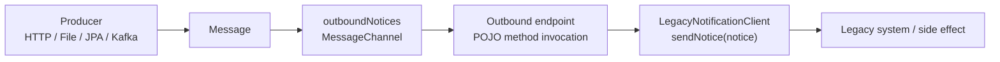
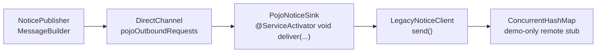
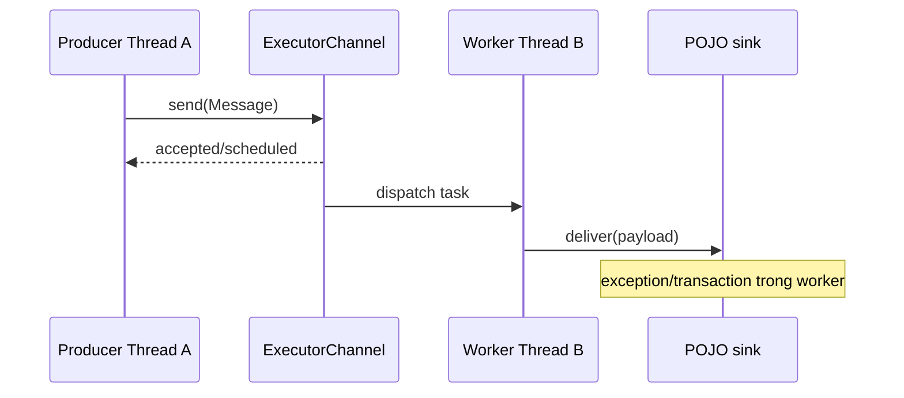
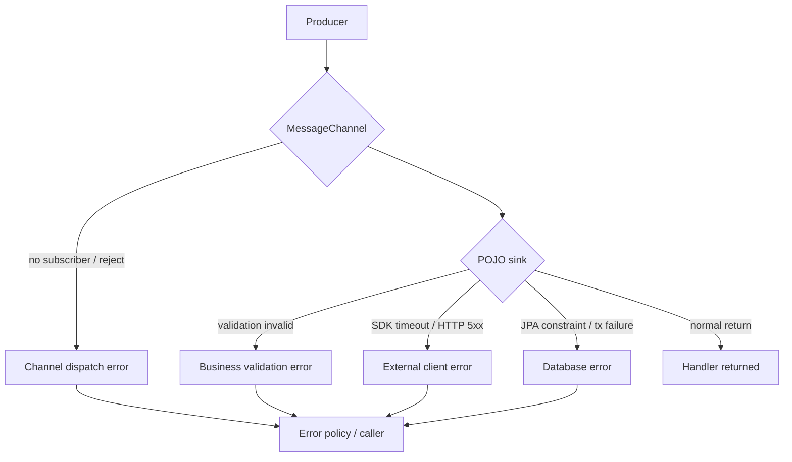
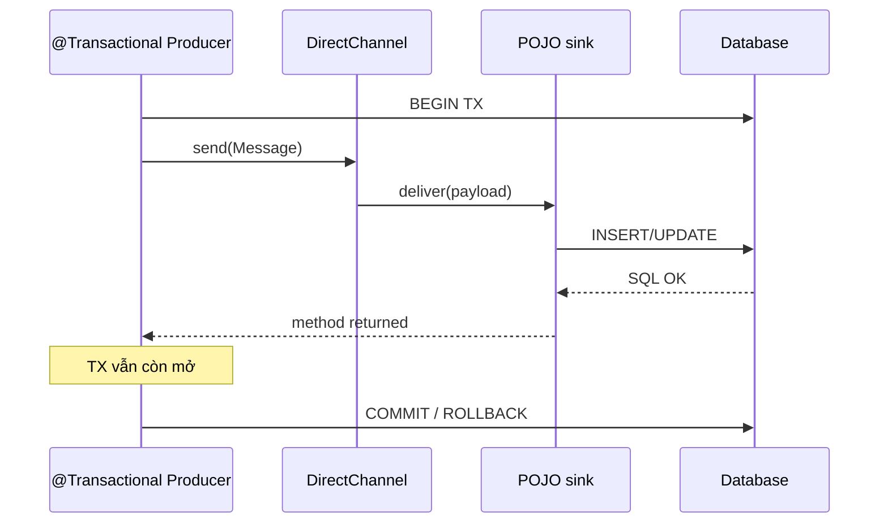
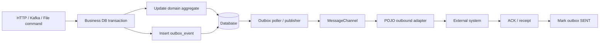
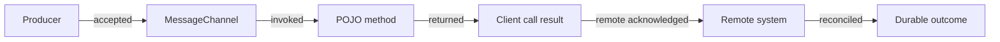

# POJO outbound channel adapter

## 1. Bối cảnh và mục tiêu

Trong module **SPRING_INTEGRATION_ADAPTERS**, ứng dụng kết nối các hệ thống ngoài thông qua inbound/outbound adapter, gateway, poller và `MessageChannel`. Các kênh tích hợp có thể trao đổi dữ liệu với file, SFTP, HTTP, JMS, AMQP, Kafka và cơ sở dữ liệu. Tuy nhiên, nhiều ứng dụng đã có một **Java bean thông thường** để gọi SDK nội bộ, ghi log/audit, cập nhật hệ thống cũ hoặc gửi một thông báo mà không cần nhận dữ liệu phản hồi.

**POJO outbound channel adapter** nối một `MessageChannel` tới **phương thức tiêu thụ** của Java object đó. Khi message đi vào channel, Spring Integration lấy payload hoặc các phần của message, gọi phương thức đã cấu hình và kết thúc luồng **một chiều**.

Bài **POJO outbound channel adapter** thuộc chương **Adapter POJO**. Mục tiêu:

- Giải thích POJO, `MessageChannel`, message handler, `@ServiceActivator` và outbound adapter.
- Phân biệt **inbound POJO** (method không tham số được poll để tạo message) với **outbound POJO** (method được gọi khi có message).
- Phân biệt **outbound channel adapter một chiều** với **request–reply gateway/service activator có kết quả**.
- Viết consumer POJO với tham số typed payload, `Message<?>` hoặc `@Header`.
- Cấu hình bằng annotation, Java DSL `.handle(pojo, "method")` và XML `<int:outbound-channel-adapter>`.
- Hiểu `DirectChannel`, `ExecutorChannel`, `QueueChannel`, `PublishSubscribeChannel` ảnh hưởng thế nào đến thread, thời điểm xử lý và lỗi.
- Thực hành Spring Boot 3.x, Spring Integration 6.x, Java 17+ với nguồn dữ liệu `OutboundNotice`, client Java thuần và sink `@ServiceActivator`.
- Kiểm thử đồng bộ, xử lý ngoại lệ, duplicate ID và hợp đồng trả về `void`.
- Biết khi nào cần transaction phía consumer, retry có giới hạn, idempotency, outbox, ACK và DLQ.
- Tránh nhầm `channel.send() == true` với việc remote API hoặc broker đã xác nhận.
- Chọn adapter chuyên biệt cho HTTP/JMS/AMQP/Kafka/JPA/SFTP khi yêu cầu protocol-specific acknowledgments/recovery.

**Thông điệp chính:** POJO outbound channel adapter là một **điểm cuối tiêu thụ message**; việc gọi một method thành công không tự tạo durable delivery, exactly-once hay atomic commit với hệ thống khác.

## 2. POJO outbound channel adapter là gì?

Một POJO bình thường:

```java
public class LegacyNotificationClient {

    public void sendNotice(OutboundNotice notice) {
        // Thực hiện side effect trên hệ thống legacy.
    }
}
```

Nếu bean này được nối với channel tên `outboundNotices`, message đi qua channel sẽ kích hoạt `sendNotice`:



Spring Integration đảm nhiệm **chuyển message sang lời gọi Java method**. Phương thức nghiệp vụ không cần tự implement `MessageHandler`, không cần biết source adapter nào tạo message, và thường không cần gọi `MessageChannel.receive()`.

### 2.1. Thế nào là "outbound"?

**Outbound** được hiểu theo góc nhìn **Spring Integration Flow**: dữ liệu đi *ra khỏi message pipeline* để tới một service/object/hệ thống tiêu thụ.

| Kiểu endpoint | Hướng xử lý | Ví dụ |
| --- | --- | --- |
| POJO inbound channel adapter | POJO method → Spring Message → channel | `nextEvent()` trả `WorkItem` theo poller |
| **POJO outbound channel adapter** | Channel → Spring Message → POJO method | `deliver(OutboundNotice)` thực hiện side effect |
| Service activator có reply | Channel → method → reply channel | `calculatePrice(cmd)` trả `PriceResult` |
| Messaging gateway (caller) | Java invocation → request message → reply/exception | `pricingGateway.quote(cmd)` |
| HTTP/JMS/Kafka outbound adapter | Channel → protocol-specific handler | HTTP POST, JMS send, Kafka publish |

**Đừng hiểu:** "Outbound" không có nghĩa phương thức bắt buộc gọi API qua network. Một method ghi file cục bộ, cập nhật bộ đếm hoặc lưu audit nội bộ cũng có thể là outbound endpoint nếu nó tiêu thụ message và kết thúc flow.

### 2.2. Tại sao tài liệu dùng @ServiceActivator?

Theo Spring Integration, **service activator** là endpoint tổng quát nối một Spring-managed object vào input channel. POJO outbound channel adapter là một trường hợp **một chiều** của cách nối này:

- Java annotation: `@ServiceActivator(inputChannel = "...")` trên phương thức `void`.
- Java DSL: `IntegrationFlow.from("...").handle(pojo, "method").get()`.
- XML: `<int:outbound-channel-adapter channel="..." ref="..." method="..."/>`.

Nếu muốn phương thức trả kết quả để tiếp tục xử lý, đó là **request–reply service activator**, không còn là *một chiều* theo nghĩa nghiệp vụ.

### 2.3. Outbound adapter không phải scheduler

Với một `SubscribableChannel` như `DirectChannel`, outbound method được gọi **khi có message được gửi tới channel**, không chạy theo lịch cố định.

Chỉ khi đầu vào là `PollableChannel` như `QueueChannel`, endpoint consumer cần **poller** để lấy message ra và gọi method. Không viết `@Poller` trên outbound adapter chỉ vì thấy bài inbound POJO luôn có poller.

## 3. Từ Message đến lời gọi POJO method

Một Spring Message gồm:

```text
Message<OutboundNotice>
  payload:
    id = "notice-101"
    kind = "STATUS"
    content = "Đơn đã duyệt"
  headers:
    id = ...
    timestamp = ...
    correlationId = "trace-001"
```

Framework quyết định cách inject arguments theo kiểu của method và annotations.

### 3.1. Typed payload method

```java
@ServiceActivator(inputChannel = "outboundNotices")
public void deliver(OutboundNotice notice) {
    legacyClient.sendNotice(notice);
}
```

`OutboundNotice` được lấy từ message payload. Phương thức **không cần** nhận một `Message<OutboundNotice>` nếu chỉ dùng business object; đây là lựa chọn đơn giản, dễ unit test.

### 3.2. Nhận đầy đủ Message<?> khi cần headers

```java
@ServiceActivator(inputChannel = "outboundNotices")
public void deliverMessage(Message<OutboundNotice> message) {
    OutboundNotice notice = message.getPayload();
    Object correlation = message.getHeaders().get("correlationId");

    legacyClient.sendNotice(notice);
}
```

Ví dụ này là một **cấu hình thay thế**, không dùng đồng thời với một handler khác trên `DirectChannel` nếu muốn mọi message chỉ được xử lý bởi một consumer nhất định.

### 3.3. Payload kết hợp @Header

```java
@ServiceActivator(inputChannel = "outboundNotices")
public void deliver(
        OutboundNotice notice,
        @Header(value = "correlationId", required = false)
        String correlationId) {

    log.info("Delivering notice id={}, trace={}",
            notice.id(), correlationId);

    legacyClient.sendNotice(notice);
}
```

Imports cần thiết:

```java
import org.springframework.integration.annotation.ServiceActivator;
import org.springframework.messaging.handler.annotation.Header;
```

`@Header(required=false)` cho phép thiếu header không làm method resolution thất bại. Với header **bắt buộc**, dùng `required=true` (mặc định), và kiểm tra producer nào có nghĩa vụ đặt header.

### 3.4. Dùng @Headers hoặc @Payload

```java
public void consume(
        @Payload OutboundNotice notice,
        @Headers Map<String, Object> headers) {
    // Xử lý payload và metadata do framework cung cấp.
}
```

Imports:

```java
import org.springframework.messaging.handler.annotation.Headers;
import org.springframework.messaging.handler.annotation.Payload;
```

Đây là một ví dụ về **chữ ký POJO method**, chỉ biến thành endpoint khi dùng annotation/wiring phù hợp. Khi phương thức chỉ cần payload, tránh nhận toàn bộ headers để giảm coupling.

### 3.5. Tránh signature mơ hồ

Một class có nhiều overloads:

```java
public void handle(String value) { ... }
public void handle(OutboundNotice value) { ... }
public void handle(Object value) { ... }
```

Spring Integration có thể chọn method theo loại payload, annotations và metadata; nhưng nếu cấu hình mơ hồ, lỗi method resolution có thể xảy ra ở runtime.

**Khuyến nghị:** dùng **tên method tường minh** như `deliverNotice`, typed argument rõ ràng và chỉ khai một handler cho một command contract. Nếu cần dispatch nhiều loại payload, dùng `Router`/`Filter` hoặc các flows riêng trước POJO sink.

### 3.6. Không dùng headers chưa xác thực làm quyền truy cập

Header `tenantId`, `actor` hoặc `sourceSystem` có thể do producer bên ngoài tự gửi. POJO outbound nhận header không biến nó thành danh tính đã được ủy quyền. Service phải kiểm tra authenticated tenant/ACL trước khi gọi hành động nhạy cảm, hoặc dùng một command DTO có scope server đã xác minh.

## 4. One-way semantics: khi nào dùng void?

### 4.1. Phương thức void là hợp đồng tự nhiên

```java
public void deliver(OutboundNotice notice) {
    legacyClient.sendNotice(notice);
}
```

Hàm không trả business result. Nếu xử lý hoàn tất bình thường, endpoint kết thúc; nếu ném exception, đường lỗi/transaction policy được áp dụng.

**Không có reply message** chỉ vì phương thức void đã chạy. Các loại thông tin sau **không** được tự động tạo:

- HTTP 200/201 từ API bên ngoài.
- Kafka broker ACK.
- JMS/AMQP consumer acknowledgment.
- Transaction commit của database khác.
- Confirmation rằng remote consumer đã áp dụng side effect.
- Reply cho một `@MessagingGateway` đang đợi result.

### 4.2. Nếu method trả giá trị?

```java
public ReceiptResult deliver(OutboundNotice notice) {
    return legacyClient.sendAndGetReceipt(notice);
}
```

Nếu mục tiêu là **có reply**, nên cấu hình service activator với output channel hoặc dùng `@MessagingGateway` request–reply có timeout/correlation thích hợp:

```java
@ServiceActivator(
        inputChannel = "noticeRequests",
        outputChannel = "noticeReplies")
public ReceiptResult deliverWithReply(OutboundNotice notice) {
    return legacyClient.sendAndGetReceipt(notice);
}
```

Đây là **biến thể giả định**, không nằm trong demo chạy; cần class `ReceiptResult` và client API riêng. Với service activator, kết quả non-null có thể được phát tới output channel hoặc `replyChannel` header. Khi cần kết thúc flow và bỏ reply, có thể dùng `nullChannel` phù hợp; tuy nhiên tốt nhất là dùng `void` cho side effect không có reply.

### 4.3. MessageChannel.send() không phải receipt

```java
boolean accepted = outboundNotices.send(message);
```

Với `DirectChannel` và handler đồng bộ, lệnh `send` thường chỉ return sau khi method handler hoàn tất. Nhưng:

- Nếu remote client gửi request bất đồng bộ rồi trả về trước ACK, `send()` không đợi ACK đó.
- Nếu channel là `ExecutorChannel`/`QueueChannel`, `send()` có thể return ngay khi accepted/buffered.
- Nếu một transaction ngoài vẫn chưa commit, handler return không đồng nghĩa DB đã commit.
- Nếu consumer bị lỗi sau đó, producer có thể không nhận exception trong call stack của mình.

Chỉ dùng cụm "đã xử lý thành công" khi business contract định nghĩa thành công tại điểm nào (method return, remote ACK, DB commit, durable outbox, ...).

### 4.4. Adapter one-way khác Gateway rõ ràng

| Đặc điểm | POJO outbound one-way | Request–reply gateway |
| --- | --- | --- |
| Method sink | Thường `void` | Trả kết quả hoặc reply message |
| Mục tiêu | Side effect, fire-and-forget theo transport semantics | Request → result |
| Reply channel | Không cần | Có hoặc framework tạo tạm qua messaging gateway |
| Timeout result | Không áp dụng ở tầng method void | Có thể có reply timeout |
| Error propagation | Theo channel/transaction/thread | Qua reply/error path theo config |
| Ví dụ | Ghi audit, gửi thông báo | Kiểm tra tồn kho, lấy kết quả tính phí |
| Dùng khi remote async | Phải có callback/status/reconcile riêng | Gateway chỉ đợi reply đã được thiết kế, không thể tự đợi mọi remote ACK |

**Lỗi thiết kế:** gửi vào một outbound method void từ gateway có return value và chờ mãi kết quả. Nếu ứng dụng cần phản hồi, hãy chọn contract request–reply ngay từ đầu.

## 5. Cách chọn POJO outbound hay adapter chuyên biệt

POJO outbound phù hợp khi đã có code Java thực hiện side effect:

- Gọi custom SDK của một dịch vụ nội bộ.
- Ghi audit vào một thư viện doanh nghiệp.
- Phát event tới abstraction legacy.
- Ghi vào một in-process collector.
- Gọi service Java khác mà không cần reply.
- Thích nghi một API chưa có Spring Integration adapter.

| Nhu cầu thật | Lựa chọn thường phù hợp |
| --- | --- |
| Gửi Kafka với partition/key/producer ACK | Spring Integration Kafka outbound |
| Gửi JMS/AMQP có broker-specific transactions/confirms | JMS/AMQP outbound |
| HTTP POST cần status, headers, timeout | HTTP outbound gateway/adapter |
| Ghi file/SFTP có atomic file/remote session | File/SFTP outbound |
| Persist JPA entity với flush/merge/transaction | JPA outbound adapter/gateway |
| SQL UPDATE với affected count | JDBC/JPA outbound gateway |
| POJO legacy SDK chỉ có `sendNotice(Notice)` | **POJO outbound channel adapter** |

POJO sink có thể gọi các SDK nói trên, nhưng **phải tự xử lý** mọi transport-specific guarantees nếu không dùng adapter chuyên biệt. Không viết lại JMS acknowledgments hoặc Kafka transactions bằng một `void send(Object)` đơn giản nếu nghiệp vụ đòi đảm bảo bền vững.

## 6. Kiến trúc demo: adapter một chiều gọi Java client

### 6.1. Kịch bản

Một ứng dụng tạo sự kiện `OutboundNotice`, đưa vào `DirectChannel` `pojoOutboundRequests`, rồi một POJO consumer `@ServiceActivator` gọi Java client `LegacyNoticeClient.send(...)`.

Để dễ quan sát mà không cần network thật, client trong demo lưu notices vào `ConcurrentHashMap` và có thể ném lỗi khi nội dung là `"FAIL"`.



Ràng buộc:

1. `OutboundNotice` dùng record với ID cố định, kind, content và thời gian tạo.
2. `LegacyNoticeClient` là **Java bean thông thường**, không implement `MessageHandler`.
3. `PojoNoticeSink` nhận typed payload và gọi client.
4. `NoticePublisher` gửi message có header `correlationId`.
5. `DirectChannel` gọi consumer đồng bộ; lỗi có thể propagate.
6. Một ID được gửi lại cùng payload không tạo thêm record trong demo; nếu ID giống nhưng payload khác, client báo conflict.
7. Không có transaction database/broker; các "receipt" trong `ConcurrentHashMap` mất khi restart.
8. Tests phải xác nhận message thực sự đi qua Spring channel chứ không chỉ gọi client trực tiếp.

### 6.2. Maven dependencies

Dùng **Java 17+**, Spring Boot 3.x và Spring Integration 6.x với Spring Boot BOM quản lý phiên bản:

```xml
<dependencies>
    <dependency>
        <groupId>org.springframework.boot</groupId>
        <artifactId>spring-boot-starter</artifactId>
    </dependency>
    <dependency>
        <groupId>org.springframework.boot</groupId>
        <artifactId>spring-boot-starter-integration</artifactId>
    </dependency>
    <dependency>
        <groupId>org.springframework.boot</groupId>
        <artifactId>spring-boot-starter-test</artifactId>
        <scope>test</scope>
    </dependency>
</dependencies>
```

Không cần `spring-boot-starter-web` hay JPA/Kafka dependencies để chạy demo. Các ví dụ về JPA/broker ở phần nâng cao **không được coi là đang có sẵn trong demo**.

### 6.3. Package layout

```text
com.example.pojooutbound
    OutboundNotice.java
    LegacyNoticeClient.java
    PojoNoticeSink.java
    NoticePublisher.java
    PojoOutboundConfiguration.java
    PojoOutboundApplication.java
```

Mỗi code block ở các mục tiếp theo là nội dung của một file Java trong cùng package.

## 7. OutboundNotice record: message contract

File `OutboundNotice.java`:

```java
package com.example.pojooutbound;

import java.time.Instant;
import java.util.Objects;

public record OutboundNotice(
        String id,
        String kind,
        String content,
        Instant createdAt) {

    public OutboundNotice {
        Objects.requireNonNull(id, "id");
        Objects.requireNonNull(kind, "kind");
        Objects.requireNonNull(content, "content");
        Objects.requireNonNull(createdAt, "createdAt");

        if (id.isBlank() || id.length() > 80) {
            throw new IllegalArgumentException("Invalid id");
        }
        if (kind.isBlank() || kind.length() > 40) {
            throw new IllegalArgumentException("Invalid kind");
        }
        if (content.isBlank() || content.length() > 500) {
            throw new IllegalArgumentException("Invalid content");
        }
    }
}
```

**Vì sao dùng record?**

- Các fields là immutable references.
- `String` và `Instant` đều immutable, nên message payload không thể bị sửa sau khi gửi.
- Có `equals/hashCode` theo toàn bộ giá trị, hữu ích cho dedup demo.
- Không có JPA lazy proxy, Hibernate session, transaction object hay raw network client trong payload.

`id` ở đây là **business event ID**, không phải header `MessageHeaders.ID` do framework tạo. Không dùng `MessageHeaders.ID` làm idempotency key bên ngoài nếu message có thể được tạo lại khi retry/redelivery.

## 8. LegacyNoticeClient: Java POJO thực hiện side effect

File `LegacyNoticeClient.java`:

```java
package com.example.pojooutbound;

import java.util.concurrent.ConcurrentHashMap;
import java.util.concurrent.ConcurrentMap;
import java.util.concurrent.atomic.AtomicInteger;

import org.springframework.stereotype.Component;

@Component
public class LegacyNoticeClient {

    private final ConcurrentMap<String, OutboundNotice> deliveries =
            new ConcurrentHashMap<>();

    private final AtomicInteger attempts = new AtomicInteger();

    public void send(OutboundNotice notice) {
        attempts.incrementAndGet();

        if ("FAIL".equals(notice.content())) {
            throw new IllegalStateException(
                    "Simulated legacy delivery failure");
        }

        OutboundNotice previous =
                deliveries.putIfAbsent(notice.id(), notice);

        if (previous != null && !previous.equals(notice)) {
            throw new IllegalStateException(
                    "Conflicting payload for same notice ID");
        }
    }

    public boolean hasDelivered(String id) {
        return deliveries.containsKey(id);
    }

    public int deliveredUniqueCount() {
        return deliveries.size();
    }

    public int attempts() {
        return attempts.get();
    }
}
```

Đây là **in-memory stub** của một client bên ngoài:

- Method `send` không nhận Spring `Message`, chỉ nhận Java record.
- `attempts` đếm số lần được gọi, kể cả khi lỗi.
- `deliveries` lưu successful distinct IDs.
- Cùng ID + cùng record là **replay giả lập**; không thêm record mới.
- Cùng ID + payload khác là conflict; không ghi đè record cũ.
- `"FAIL"` gây lỗi để test exception propagation.
- Mọi thứ biến mất khi app restart; **không phải durable inbox, broker ACK hoặc distributed idempotency**.

Nếu client thật dùng HTTP/JMS/Kafka, `send` phải tuân theo timeout, retry, rate limit, authentication và response/ACK semantics của protocol đó. Không coi việc method void return là remote system đã commit.

## 9. POJO outbound sink bằng @ServiceActivator

File `PojoNoticeSink.java`:

```java
package com.example.pojooutbound;

import org.slf4j.Logger;
import org.slf4j.LoggerFactory;
import org.springframework.integration.annotation.ServiceActivator;
import org.springframework.messaging.handler.annotation.Header;
import org.springframework.stereotype.Component;

@Component
public class PojoNoticeSink {

    private static final Logger log =
            LoggerFactory.getLogger(PojoNoticeSink.class);

    private final LegacyNoticeClient client;

    public PojoNoticeSink(LegacyNoticeClient client) {
        this.client = client;
    }

    @ServiceActivator(inputChannel = "pojoOutboundRequests")
    public void deliver(
            OutboundNotice notice,
            @Header(
                    value = "correlationId",
                    required = false)
            String correlationId) {

        log.info("Deliver notice id={}, type={}, trace={}",
                notice.id(), notice.kind(), correlationId);

        client.send(notice);
    }
}
```

### 9.1. Vì sao đây là POJO outbound channel adapter?

- `@Component` quản lý bean.
- `@ServiceActivator(inputChannel="pojoOutboundRequests")` tạo một endpoint **tiêu thụ** message từ channel.
- Method `deliver` là **void**, nên không tạo business reply.
- `OutboundNotice` được framework inject từ message payload.
- `@Header(required=false)` lấy correlation header, nếu có.
- Side effect thật nằm ở client POJO `send(OutboundNotice)`.
- `PojoNoticeSink` không cần implement `MessageHandler` hay gọi `channel.receive()`.

Spring Integration reference gọi `@ServiceActivator` là cách cấu hình Java cho POJO outbound channel adapter. Nếu dùng `@OutboundChannelAdapter` thì **sai API**: không có một annotation Spring Integration chuẩn tương đương theo cách đó cho consumer này. Tên adapter chỉ hướng tiêu thụ; annotation phù hợp là `@ServiceActivator`.

### 9.2. Vì sao không thêm @Poller?

`pojoOutboundRequests` của demo là `DirectChannel`, tức **SubscribableChannel**. Khi producer `send`, handler chạy đồng bộ ngay, không đợi poller. `@Poller` chỉ cần nếu inbound channel của outbound consumer là `PollableChannel`, chẳng hạn `QueueChannel`.

### 9.3. Nếu muốn viết Java object hoàn toàn không annotation?

`LegacyNoticeClient` đang là Java class thuần về nghiệp vụ; chỉ có `@Component` để Spring inject, không import Spring Integration. Với Java DSL hoặc XML, ta có thể nối trực tiếp:

```java
.handle(legacyNoticeClient, "send")
```

Đó cũng là một **POJO outbound channel adapter**, không cần `PojoNoticeSink`. Trong demo annotation, sink đóng vai trò bridge cho header logging và method dispatch.

## 10. Khai báo DirectChannel và producer

### 10.1. Spring configuration

File `PojoOutboundConfiguration.java`:

```java
package com.example.pojooutbound;

import org.springframework.context.annotation.Bean;
import org.springframework.context.annotation.Configuration;
import org.springframework.integration.channel.DirectChannel;
import org.springframework.integration.config.EnableIntegration;
import org.springframework.messaging.MessageChannel;

@Configuration
@EnableIntegration
public class PojoOutboundConfiguration {

    @Bean
    MessageChannel pojoOutboundRequests() {
        return new DirectChannel();
    }
}
```

Tên bean `pojoOutboundRequests` khớp `inputChannel` trên `PojoNoticeSink`. Không nên tạo hai beans cùng tên hoặc đăng ký nhiều competing handlers một cách vô tình.

### 10.2. Producer gọi MessageChannel

File `NoticePublisher.java`:

```java
package com.example.pojooutbound;

import java.util.Objects;

import org.springframework.beans.factory.annotation.Qualifier;
import org.springframework.messaging.MessageChannel;
import org.springframework.messaging.support.MessageBuilder;
import org.springframework.stereotype.Component;

@Component
public class NoticePublisher {

    private final MessageChannel outboundChannel;

    public NoticePublisher(
            @Qualifier("pojoOutboundRequests")
            MessageChannel outboundChannel) {
        this.outboundChannel = outboundChannel;
    }

    public void publish(OutboundNotice notice) {
        Objects.requireNonNull(notice, "notice");

        boolean accepted = outboundChannel.send(
                MessageBuilder.withPayload(notice)
                        .setHeader("correlationId", notice.id())
                        .build());

        if (!accepted) {
            throw new IllegalStateException(
                    "Outbound channel did not accept message");
        }
    }
}
```

**Quan trọng:** `publish()` chỉ là API gửi vào Spring channel. Vì channel hiện tại là `DirectChannel` và sink xử lý đồng bộ, method return bình thường sau khi handler hoàn tất. Nhưng không nên đặt tên `publishAndWaitForRemoteAck()` khi client thật không bảo đảm chờ ACK; nếu đổi sang async channel, contract thành "accepted" chứ không phải "processed".

### 10.3. Application chạy thử

File `PojoOutboundApplication.java`:

```java
package com.example.pojooutbound;

import java.time.Instant;

import org.springframework.boot.CommandLineRunner;
import org.springframework.boot.SpringApplication;
import org.springframework.boot.autoconfigure.SpringBootApplication;
import org.springframework.context.annotation.Bean;

@SpringBootApplication
public class PojoOutboundApplication {

    public static void main(String[] args) {
        SpringApplication.run(
                PojoOutboundApplication.class, args);
    }

    @Bean
    CommandLineRunner demo(
            NoticePublisher publisher,
            LegacyNoticeClient client) {

        return args -> {
            publisher.publish(new OutboundNotice(
                    "notice-101",
                    "STATUS",
                    "Đơn hàng đã duyệt",
                    Instant.now()));

            publisher.publish(new OutboundNotice(
                    "notice-102",
                    "AUDIT",
                    "Đã ghi nhận thao tác",
                    Instant.now()));

            System.out.println(
                    "Unique notices: "
                            + client.deliveredUniqueCount());
        };
    }
}
```

File `application.properties`:

```properties
spring.main.web-application-type=none
logging.level.org.springframework.integration=INFO
logging.level.com.example.pojooutbound=INFO
```

Ví dụ log và output minh họa:

```text
Deliver notice id=notice-101, type=STATUS, trace=notice-101
Deliver notice id=notice-102, type=AUDIT, trace=notice-102
Unique notices: 2
```

Không có database hay remote broker trong demo, nên count `2` chỉ là số records được lưu trong stub Java. Không suy ra durability hoặc delivery guarantee từ output này.

### 10.4. Không tạo hai outbound consumers cho cùng DirectChannel

Nếu thêm Java DSL `.handle(client, "send")` **mà vẫn giữ `@ServiceActivator` trên `PojoNoticeSink`**, `DirectChannel` có thể có hai subscribers và chọn một subscriber cho mỗi message theo dispatch/load-balancing policy. Bạn có thể thấy một nửa messages được log ở sink, nửa còn lại vào client trực tiếp.

**Điều này không phải broadcast.** Chỉ bật **một cấu hình adapter** khi thực hành cùng một output channel. Nếu muốn nhiều subscribers đều nhận một event, dùng `PublishSubscribeChannel` và thiết kế rõ failure/concurrency semantics.

## 11. Unit test cho POJO client và contract một chiều

### 11.1. Client test không cần Spring context

Vì `LegacyNoticeClient` là một class Java có state trong memory, có thể kiểm thử logic của nó riêng:

File `LegacyNoticeClientTest.java`:

```java
package com.example.pojooutbound;

import static org.assertj.core.api.Assertions.assertThat;
import static org.assertj.core.api.Assertions.assertThatThrownBy;

import java.time.Instant;

import org.junit.jupiter.api.Test;

class LegacyNoticeClientTest {

    @Test
    void recordsFirstDelivery() {
        LegacyNoticeClient client = new LegacyNoticeClient();

        OutboundNotice notice = new OutboundNotice(
                "unit-101", "AUDIT", "Accepted", Instant.now());

        client.send(notice);

        assertThat(client.hasDelivered("unit-101")).isTrue();
        assertThat(client.deliveredUniqueCount()).isEqualTo(1);
        assertThat(client.attempts()).isEqualTo(1);
    }

    @Test
    void exactReplayDoesNotCreateAnotherStoredEntry() {
        LegacyNoticeClient client = new LegacyNoticeClient();

        OutboundNotice notice = new OutboundNotice(
                "unit-102", "AUDIT", "Accepted", Instant.now());

        client.send(notice);
        client.send(notice);

        assertThat(client.deliveredUniqueCount()).isEqualTo(1);
        assertThat(client.attempts()).isEqualTo(2);
    }

    @Test
    void conflictingReplayIsRejected() {
        LegacyNoticeClient client = new LegacyNoticeClient();

        Instant timestamp = Instant.now();

        client.send(new OutboundNotice(
                "unit-103", "STATUS", "Accepted", timestamp));

        assertThatThrownBy(() ->
                client.send(new OutboundNotice(
                        "unit-103", "STATUS",
                        "Different content", timestamp)))
                .isInstanceOf(IllegalStateException.class);

        assertThat(client.deliveredUniqueCount()).isEqualTo(1);
    }

    @Test
    void simulatedFailureHasNoStoredDelivery() {
        LegacyNoticeClient client = new LegacyNoticeClient();

        assertThatThrownBy(() ->
                client.send(new OutboundNotice(
                        "unit-104", "TEST", "FAIL",
                        Instant.now())))
                .isInstanceOf(IllegalStateException.class);

        assertThat(client.hasDelivered("unit-104")).isFalse();
    }
}
```

Test này chỉ chứng minh Java method xử lý đúng; **chưa chứng minh `@ServiceActivator` đã được Spring đăng ký** hoặc channel dispatch đúng.

### 11.2. Những gì unit test không thể kết luận

- Không kiểm tra bean scanning hay annotation processing.
- Không kiểm tra `DirectChannel`/`QueueChannel` semantics.
- Không xác nhận exception mapping của Spring Messaging.
- Không có transaction/remote ACK thực.
- Không kiểm tra producer có gửi đúng payload và headers không.
- Không kiểm tra event được phục hồi sau process restart.

Cần integration test có ApplicationContext thật để đánh giá toàn flow.

## 12. @SpringBootTest: producer → channel → POJO sink

File `PojoOutboundIntegrationTest.java`:

```java
package com.example.pojooutbound;

import static org.assertj.core.api.Assertions.assertThat;
import static org.assertj.core.api.Assertions.assertThatThrownBy;

import java.time.Instant;
import java.util.UUID;

import org.junit.jupiter.api.Test;
import org.springframework.beans.factory.annotation.Autowired;
import org.springframework.boot.test.context.SpringBootTest;

@SpringBootTest
class PojoOutboundIntegrationTest {

    @Autowired
    NoticePublisher publisher;

    @Autowired
    LegacyNoticeClient client;

    @Test
    void invokesPojoConsumerSynchronously() {
        String id = "integration-" + UUID.randomUUID();

        publisher.publish(new OutboundNotice(
                id, "STATUS", "Ready", Instant.now()));

        // Với DirectChannel + synchronous handler,
        // client.send() đã return khi publisher.publish() return.
        assertThat(client.hasDelivered(id)).isTrue();
    }

    @Test
    void exactReplayDoesNotCreateAnotherRecord() {
        String id = "replay-" + UUID.randomUUID();

        OutboundNotice notice = new OutboundNotice(
                id, "AUDIT", "Accepted", Instant.now());

        publisher.publish(notice);
        publisher.publish(notice);

        assertThat(client.hasDelivered(id)).isTrue();
    }

    @Test
    void downstreamFailurePropagatesOnDirectChannel() {
        String id = "failure-" + UUID.randomUUID();

        assertThatThrownBy(() ->
                publisher.publish(new OutboundNotice(
                        id, "TEST", "FAIL", Instant.now())))
                .isInstanceOf(RuntimeException.class);

        assertThat(client.hasDelivered(id)).isFalse();
    }

    @Test
    void cannotOverwriteSameIdWithDifferentPayload() {
        String id = "conflict-" + UUID.randomUUID();
        Instant timestamp = Instant.now();

        publisher.publish(new OutboundNotice(
                id, "STATUS", "First", timestamp));

        assertThatThrownBy(() ->
                publisher.publish(new OutboundNotice(
                        id, "STATUS", "Second", timestamp)))
                .isInstanceOf(RuntimeException.class);

        assertThat(client.hasDelivered(id)).isTrue();
    }
}
```

**Lưu ý về exception:** trên `DirectChannel`, exception từ POJO sink có thể được framework bọc trong một `MessagingException`/`MessageHandlingException` (tùy endpoint và version). Test kiểm tra `RuntimeException` theo contract tổng quát, không cố định wrapper class khi chưa cần.

**Lưu ý về trạng thái test:** mỗi test dùng ID `UUID` để không trùng dữ liệu từ `CommandLineRunner`. `LegacyNoticeClient` là singleton trong context, nên không assert count tuyệt đối bằng 0/1 trên toàn suite khi các tests có thể chạy theo thứ tự bất kỳ.

### 12.1. Vì sao test có thể assert ngay?

Bởi vì demo dùng `DirectChannel`: `publisher.publish(...)` gọi handler đồng bộ. Khi thay bằng `ExecutorChannel`/`QueueChannel`, assertions ngay sau `publish` không còn hợp lệ; phải dùng eventual assertions với timeout hữu hạn, hoặc barrier/observable event từ consumer.

### 12.2. Dùng test để kiểm tra header contract

Nếu muốn biết `correlationId` có đúng, có thể bổ sung một test-only collector ở `PojoNoticeSink` hoặc một unit test gọi method với header argument. Không nên thêm consumer thứ hai vào chính `DirectChannel` rồi mong nó **cũng** nhận message để kiểm tra: DirectChannel không phải broadcast.

Một ví dụ unit test cho header mapping sẽ gọi `sink.deliver(notice, "trace-123")` để kiểm tra logging/delegation; nhưng chỉ integration test trên message channel mới xác minh được việc Spring bind `@Header` đúng. Khi cần assertions chính xác, dùng một client/spy có thể quan sát correlation metadata hoặc Spring Integration testing facilities.

## 13. Java DSL .handle(pojo, "method")

Trong codebase Java configuration, có thể nối POJO method vào channel mà **không thêm `@ServiceActivator` lên method**.

### 13.1. Flow dùng client Java trực tiếp

**Cấu hình thay thế** cho `PojoNoticeSink` ở mục 9:

```java
package com.example.pojooutbound;

import org.springframework.context.annotation.Bean;
import org.springframework.context.annotation.Configuration;
import org.springframework.integration.dsl.IntegrationFlow;

@Configuration
public class PurePojoOutboundFlowConfiguration {

    @Bean
    IntegrationFlow purePojoOutboundFlow(
            LegacyNoticeClient legacyNoticeClient) {

        return IntegrationFlow
                .from("pojoOutboundRequests")
                .handle(legacyNoticeClient, "send")
                .get();
    }
}
```

**Cần làm khi chuyển từ demo annotation sang Java DSL:**

1. Giữ `OutboundNotice`, `LegacyNoticeClient`, `NoticePublisher`, `DirectChannel`, Application.
2. **Bỏ `@ServiceActivator` khỏi `PojoNoticeSink`** hoặc loại bean sink khỏi component scan.
3. Đăng ký `PurePojoOutboundFlowConfiguration`.
4. Chỉ có **một** consumer cho channel `pojoOutboundRequests` nếu muốn mọi message gọi đúng một client.
5. `LegacyNoticeClient.send(OutboundNotice)` vẫn thuần Java; Spring Integration tạo message handler dựa trên method-invoking adapter.

Điều này giống đúng mẫu Java DSL trong tài liệu chính thức:

```java
IntegrationFlow.from("inputChannel")
        .handle(myPojo, "handle")
        .get();
```

### 13.2. .handle(pojo, "method") khác .handle(MessageHandler)

Trong Java DSL:

```java
.handle(legacyNoticeClient, "send")
```

là cách yêu cầu framework gọi method Java thông thường. Trong khi:

```java
.handle((MessageHandler) message -> {
    // Xử lý Spring Message trực tiếp.
})
```

là cách cung cấp một `MessageHandler` đã biết messaging contract.

Hai cách đều tiêu thụ message; **lựa chọn POJO** hữu ích khi bạn muốn giữ lớp nghiệp vụ độc lập với Spring Messaging.

### 13.3. .handle với GenericHandler

Một flow thay thế khác:

```java
@Bean
IntegrationFlow explicitHandlerFlow(
        LegacyNoticeClient client) {

    return IntegrationFlow
            .from("pojoOutboundRequests")
            .handle(
                    OutboundNotice.class,
                    (notice, headers) -> {
                        client.send(notice);
                        return null;
                    })
            .get();
}
```

Đây là `GenericHandler` lambda: `return null` nghĩa là không tạo reply. Nó tương đương về ý nghĩa kết thúc flow, nhưng không phải **method-invoking POJO adapter** thuần túy vì logic nằm trong lambda của Integration DSL.

Chọn `.handle(client, "send")` nếu mục tiêu là reuse POJO method có sẵn. Chọn lambda khi cần điều chỉnh message/header nhanh và vẫn giữ code dễ kiểm thử.

### 13.4. Một flow có thể xử lý trước khi gọi outbound

```java
@Bean
IntegrationFlow validatedOutboundFlow(
        LegacyNoticeClient client) {

    return IntegrationFlow
            .from("validatedOutboundRequests")
            .filter(
                    OutboundNotice.class,
                    notice -> !notice.content().isBlank())
            .handle(client, "send")
            .get();
}
```

`validatedOutboundRequests` cần có channel/source/producer riêng nếu chạy; ví dụ không thay thế trực tiếp bean tên `pojoOutboundRequests` của demo. `filter` bỏ message không đạt predicate, nên cần quyết định có gửi discard/error vào kênh khác không, tránh mất dữ liệu nghiệp vụ.

**Đừng coi filter là authorization**: nếu client không được phép gửi thông báo tới tenant khác, authorization cần kiểm tra danh tính, quyền và resource scope.

### 13.5. Không bật nhiều cấu hình cùng lúc

Annotation `@ServiceActivator`, DSL `.handle(client, "send")` và XML `<int:outbound-channel-adapter>` là **các lựa chọn**. Khi học, chỉ bật một cấu hình mỗi lần để kiểm tra đúng semantics, không để nhiều consumers ngầm cạnh tranh trên DirectChannel.

## 14. XML <int:outbound-channel-adapter>

### 14.1. Cấu hình ref/method

XML namespace của Spring Integration có element dành riêng cho POJO outbound:

```xml
<int:channel id="pojoOutboundRequests"/>

<beans:bean
        id="legacyNoticeClient"
        class="com.example.pojooutbound.LegacyNoticeClient"/>

<int:outbound-channel-adapter
        id="pojoNoticeOutbound"
        channel="pojoOutboundRequests"
        ref="legacyNoticeClient"
        method="send"/>
```

Đây là một **XML fragment**. Một ứng dụng chạy XML cần root `beans`, khai namespace/schema `int`/`beans` và component wiring phù hợp. Khi dùng XML variant, **không** đồng thời đăng ký `LegacyNoticeClient` bằng `@Component` trùng tên bean XML nếu không có chủ đích rõ ràng. Ngoài ra phải loại bỏ consumer annotation `PojoNoticeSink` để không có hai handlers.

### 14.2. ref + method cho phép reuse POJO

- `ref` trỏ tới Spring bean.
- `method` chỉ method được gọi khi message vào channel.
- `channel` chỉ message input channel.
- `id` là identity của endpoint để quản lý/lifecycle.
- `send(OutboundNotice)` là method void, nhận payload typed.

Bạn **không cần** sửa `LegacyNoticeClient` để nó import Spring Messaging hay implement một interface đặc biệt.

### 14.3. Inner bean thay ref

Nếu POJO chỉ dùng một chỗ:

```xml
<int:outbound-channel-adapter
        id="inlineNoticeOutbound"
        channel="pojoOutboundRequests"
        method="send">

    <beans:bean
            class="com.example.pojooutbound.LegacyNoticeClient"/>
</int:outbound-channel-adapter>
```

**Không dùng `ref` và inner `<bean>` trong cùng một `outbound-channel-adapter`**, vì đó là cấu hình mơ hồ và framework từ chối theo tài liệu.

### 14.4. Có thể bỏ channel nếu có id

Theo Spring Integration XML channel adapter conventions, nếu không khai `channel`, framework có thể tạo một `DirectChannel` ngầm dùng tên theo `id` của adapter. Tuy nhiên, khai channel **tường minh** thường dễ hiểu và dễ kiểm soát topology hơn, đặc biệt khi thêm monitoring, transaction advice hoặc chuyển sang queue.

### 14.5. Expression-based outbound adapter

Một biến thể khác sử dụng SpEL expression gọi bean method:

```xml
<int:outbound-channel-adapter
        id="expressionNoticeOutbound"
        channel="pojoOutboundRequests"
        expression="@legacyNoticeClient.send(payload)"/>
```

Đây là **alternative** cho `ref/method`, không bật đồng thời. Outbound expression nên tương đương lời gọi có side effect **không tạo reply**. `payload` ở đây là payload của **message đã có** (trái với POJO inbound source được poll khi chưa có input message).

SpEL expression phải là cấu hình do developer kiểm soát, **không** nhận expression text tùy ý từ HTTP client hay broker message.

### 14.6. Java DSL, annotation và XML: chọn cái nào?

| Cách | Điểm mạnh | Lưu ý |
| --- | --- | --- |
| `@ServiceActivator` | Rất ngắn, gần POJO consumer | Consumer gắn annotation Spring Integration |
| DSL `.handle(bean, "method")` | Giữ business bean ít phụ thuộc framework | Phải quản lý duy nhất một flow handler |
| XML `ref/method` | Hợp codebase legacy, thay wiring không sửa class | Phải khai namespace/bean names chính xác |
| DSL `GenericHandler` lambda | Linh hoạt xử lý payload + headers | Logic có thể dính vào flow configuration |
| `MessageHandler` custom | Kiểm soát messaging trực tiếp | Coupling với framework lớn hơn |

## 15. QueueChannel: outbound consumer cần poller

### 15.1. DirectChannel và QueueChannel khác nhau

Với `DirectChannel`:

```text
Producer send()
    → POJO outbound handler thực thi đồng bộ
    → producer return hoặc nhận exception
```

Với `QueueChannel`:

```text
Producer send()
    → QueueChannel buffer
    → Producer có thể return
                  ...
    → PollingConsumer scheduled receive()
    → POJO outbound handler
```

Do đó, **`@Poller` trong POJO outbound consumer chỉ cần khi input channel là PollableChannel**; nó không có vai trò lấy dữ liệu từ chính POJO như bài inbound.

### 15.2. Java annotation + QueueChannel

**Biến thể thay thế** cho `DirectChannel` demo:

```java
@Bean
MessageChannel pojoOutboundRequests() {
    return new QueueChannel(128);
}
```

Sau đó trên consumer:

```java
@ServiceActivator(
        inputChannel = "pojoOutboundRequests",
        poller = @Poller(
                fixedDelay = "500",
                maxMessagesPerPoll = "5"))
public void deliver(OutboundNotice notice) {
    client.send(notice);
}
```

Cần imports `QueueChannel` và `@Poller`. Không giữ bean `DirectChannel` cùng tên trong context khi bật QueueChannel. Một `QueueChannel(128)` là bounded **in-memory buffer** theo cách cấu hình này; không bền vững sau app restart.

### 15.3. maxMessagesPerPoll đếm nhận Message từ queue

Nếu queue đang có 20 messages và `maxMessagesPerPoll="5"`, một polling cycle lấy tối đa 5 messages (trừ khi lỗi/timeout/thay đổi concurrency). **Không** coi đó là tổng số business records nếu payload mỗi message chứa một `List`.

Default maxMessagesPerPoll của các loại polling endpoints có thể khác nhau, nên đặt giá trị tường minh để tránh hiểu nhầm khi chuyển từ SourcePollingChannelAdapter sang PollingConsumer.

### 15.4. XML poller cho PollableChannel

```xml
<int:queue
        id="pojoOutboundRequests"
        capacity="128"/>

<int:outbound-channel-adapter
        id="queuedPojoOutbound"
        channel="pojoOutboundRequests"
        ref="legacyNoticeClient"
        method="send">

    <int:poller
            fixed-delay="500"
            max-messages-per-poll="5"/>
</int:outbound-channel-adapter>
```

Đây là XML alternative, không dùng đồng thời với annotation/DSL consumer khác. Với `DirectChannel`, không cần `<int:poller>`.

### 15.5. Lỗi sau khi lấy message khỏi queue

Khi consumer đã nhận một message từ **in-memory QueueChannel**, nếu `client.send(...)` ném exception:

- Không mặc nhiên có durable redelivery.
- Không mặc nhiên rollback thao tác nhận message khỏi queue.
- Transaction DB của handler không tự khiến `QueueChannel` restore message.
- Poller/error handler có thể báo lỗi, nhưng nguồn có thể mất item khi process crash.

Nếu cần replay bền vững, dùng persistent `MessageStore` với đúng transaction semantics hoặc broker adapter có ACK/retry, cùng idempotency ở consumer. Không coi QueueChannel thường là một durable work queue.

### 15.6. Receive timeout không phải remote timeout

Một poller đọc `QueueChannel` có thể có `receiveTimeout` khi không có message. Nhưng sau khi nhận message, lệnh `LegacyNoticeClient.send(...)` có thể block vì network. Cần đặt timeout tại underlying SDK/HTTP/JDBC client; `receiveTimeout` không giới hạn thời gian side effect.

## 16. ExecutorChannel và PublishSubscribeChannel

### 16.1. ExecutorChannel chuyển sang worker thread



- Producer có thể return trước khi handler chạy.
- Exception handler có thể không propagate ngược về producer call stack.
- Thread-bound transaction/security/request context của producer **không tự đi theo Message**.
- Worker pool/queue có thể bão hòa hoặc reject tasks.
- Nếu cần result, thiết kế gateway/reply/correlation khác thay vì chờ một method void.

### 16.2. Sử dụng bounded executor

Một ví dụ cấu hình **thay thế**, không dùng đồng thời với `DirectChannel` bean tên cũ:

```java
@Bean
ThreadPoolTaskExecutor outboundExecutor() {
    ThreadPoolTaskExecutor executor = new ThreadPoolTaskExecutor();
    executor.setCorePoolSize(2);
    executor.setMaxPoolSize(4);
    executor.setQueueCapacity(64);
    executor.setThreadNamePrefix("pojo-outbound-");
    return executor;
}

@Bean
MessageChannel pojoOutboundRequests(
        ThreadPoolTaskExecutor outboundExecutor) {
    return new ExecutorChannel(outboundExecutor);
}
```

Spring sẽ quản lý lifecycle/initialization cho `ThreadPoolTaskExecutor` dưới dạng bean. Cần imports `ThreadPoolTaskExecutor`, `ExecutorChannel`, `MessageChannel`, `@Bean`.

Với một executor bounded, phải có **rejection/backpressure policy** ở producer. Gọi `send()` thành công có thể chỉ chứng minh task được schedule, **không** chứng minh remote delivery.

### 16.3. PublishSubscribeChannel không phải DirectChannel

Nếu muốn nhiều side effects (audit + notification) đều xử lý cùng một message:

```text
PublishSubscribeChannel
    ├─ Audit POJO outbound
    └─ Notification POJO outbound
```

Với `PublishSubscribeChannel` đồng bộ, subscribers thường được gọi trên thread gửi; một exception có thể ảnh hưởng các subscribers khác tùy cấu hình. Khi có executor, subscribers có thể chạy song song; cần thiết kế riêng lỗi, transaction và shared mutable payload.

**Không** chuyển `DirectChannel` thành `PublishSubscribeChannel` mà giả định “một event cần thành công ở cả hai consumers” đã được đảm bảo atomic. Hai side effects không mặc nhiên cùng transaction, đặc biệt khi gọi external systems.

### 16.4. Một message payload có thể bị mutate

Nếu gửi object Java mutable tới nhiều subscribers, subscribers có thể cùng sửa fields:

```java
class MutableNotice {
    String status;
}
```

Với fan-out async, việc này tạo race. Dùng immutable record/DTO, `List.copyOf` cho collections và mỗi consumer tự quản lý state riêng.

## 17. Exception propagation và error channel

### 17.1. Các vị trí có thể lỗi



`@ServiceActivator` method có thể throw unchecked exception. Framework có thể wrap exception trong `MessagingException`/`MessageHandlingException`, đặc biệt khi adapter muốn gắn failed message context.

### 17.2. DirectChannel: lỗi đồng bộ

Trong demo:

```java
publisher.publish(new OutboundNotice(
        "notice-bad", "TEST", "FAIL", Instant.now()));
```

`LegacyNoticeClient.send` ném `IllegalStateException`, POJO sink không catch, nên publisher gọi `DirectChannel.send` nhận exception theo synchronous call path. Không biến lỗi thành business success.

### 17.3. Async error handling

Với `ExecutorChannel` hoặc polling consumer từ `QueueChannel`, lỗi có thể phát sinh trên worker/poller thread, được đưa tới `ErrorMessage`/`errorChannel` theo cấu hình. Một error handler có thể nhận `Throwable` và thông tin failed message:

```java
@ServiceActivator(inputChannel = "pojoOutboundErrors")
public void reportOutboundError(ErrorMessage error) {
    Throwable failure = error.getPayload();
    // Log sanitized category, correlation ID, retry policy.
}
```

Đây là **fragment**; cần khai bean `MessageChannel pojoOutboundErrors`, imports và cấu hình error publisher/poller/executor phù hợp với topology. **Không có đảm bảo** rằng chỉ tạo một channel tên này thì mọi exception từ mọi async executor tự động được gửi vào đó.

### 17.4. Error channel không phải DLQ bền vững

`ErrorMessage` là một Spring Message mô tả lỗi. Nó không tự:

- Requeue message đã được QueueChannel lấy ra.
- Rollback request HTTP đã gửi.
- Hoàn tác Kafka publish thành công.
- ACK/NACK JMS session theo đúng business policy.
- Lưu item vào durable dead-letter storage.
- Đảm bảo downstream không xử lý trùng.

Khi cần DLQ/quarantine, thiết kế **durable store + retry count + error classification + operations**. Một error channel có thể là điểm vào của flow xử lý lỗi nhưng không thay durable lifecycle.

### 17.5. Nếu muốn retry method call?

Chỉ retry sau khi phân biệt:

- **Transient:** timeout chưa có response, kết nối tạm mất, DB lock timeout.
- **Permanent:** validation sai, invalid tenant, payload unsupported.
- **Unknown outcome:** request đã gửi nhưng response/ACK mất.
- **Duplicate:** cùng event ID đã commit trước đó hoặc khác payload.
- **Conflict:** cùng business key nhưng dữ liệu không tương thích.

Một lỗi timeout không chứng minh external system **chưa** xử lý request. Nếu tự retry một operation không idempotent, có thể tạo double charge/double notification. Dùng idempotency key và reconciliation khi có thể.

## 18. Transaction boundaries: vì sao @Transactional chưa đủ

### 18.1. DirectChannel có thể chia sẻ transaction caller



Nếu producer và JPA consumer cùng chạy trên thread của `DirectChannel`, một `@Transactional` ở producer **có thể** bao quanh handler khi được gọi đúng qua proxy và cùng transaction manager.

Nhưng điều đó không có nghĩa:

- Một external HTTP/Kafka call sẽ rollback cùng DB.
- Handler return đã commit DB.
- Context sẽ truyền qua `ExecutorChannel` hoặc `QueueChannel`.
- Một `@Transactional` trên self-invoked method có hiệu lực mặc định.

### 18.2. Transaction ngay trong business service của sink

Với DB writer, một mẫu thường phù hợp:

```java
@Component
public class DatabaseOutboundSink {

    private final TransactionalNoticeService service;

    public DatabaseOutboundSink(
            TransactionalNoticeService service) {
        this.service = service;
    }

    @ServiceActivator(inputChannel = "dbNoticeRequests")
    public void deliver(OutboundNotice notice) {
        service.storeNotice(notice);
    }
}
```

Trong một bean khác:

```java
@Service
public class TransactionalNoticeService {

    @Transactional
    public void storeNotice(OutboundNotice notice) {
        // repository.save(...), validate, update outbox...
        // Các repository/entity classes là phần mở rộng
        // cần định nghĩa ở ứng dụng có database.
    }
}
```

Đây là **mẫu kiến trúc**, không phải một module JPA thực thi độc lập trong demo không database. `DatabaseOutboundSink` nhận message và gọi một Spring transactional service proxy, nên boundary rõ hơn việc đặt `@Transactional` lên method rồi tự gọi cùng bean.

### 18.3. Flush khác commit

Nếu handler dùng Hibernate/JPA:

```java
repository.save(entity);
entityManager.flush();
```

`flush` có thể gửi INSERT/UPDATE xuống DB nhưng **không commit**. Constraint error có thể xuất hiện tại `flush` hoặc `commit`, tùy provider/DB. Không gửi event "đã lưu" ra ngoài trước khi transaction proxy commit thành công nếu đó là hợp đồng nghiệp vụ.

### 18.4. Rollback không undo external side effect

```text
BEGIN DB TX
  INSERT payment
  POJO sink gọi externalClient.send(...)
  Remote API thực hiện xong
  DB COMMIT thất bại
ROLLBACK DB
```

Remote API **không tự hoàn tác** chỉ vì DB rollback. Một Java method call nằm trong `@Transactional` không đồng nghĩa các side effects ngoài DB được quản lý bởi transaction manager.

Nếu cần atomic business state + intent gửi message, cân nhắc transactional outbox. Nếu external system có idempotency key, dùng stable event ID và reconcile sau unknown outcome.

### 18.5. Transaction phía consumer khi dùng Queue/Executor

```text
Producer TX Thread A
  → Queue/Executor
Consumer Thread B
  → service @Transactional
  → DB write
```

Transaction producer không tự vượt thread boundary. Consumer phải tự mở transaction; producer có thể đã return/ACK trước khi consumer thất bại. Một `QueueChannel` in-memory không thay broker transaction, và `ExecutorChannel` không thay durable work queue.

## 19. Idempotency và duplicate processing

### 19.1. Delivery attempts không phải unique deliveries

Một message có thể được gửi lại vì:

- Producer retry sau timeout.
- Kafka/JMS redelivery.
- HTTP client retry.
- SFTP file re-scan.
- Outbox publisher crash sau publish nhưng trước mark SENT.
- User nhấn lại nút.
- Hai workers cùng claim một work item.

Trong demo:

```text
client.attempts() = 3
client.deliveredUniqueCount() = 1
```

hoàn toàn có thể hợp lệ khi cùng một notice được gửi 3 lần và stub nhận diện exact replay. **Đừng đếm một call method tương đương một business effect duy nhất.**

### 19.2. Event ID ổn định

`OutboundNotice.id()` được producer tạo một lần cho business event. Khi retry chính event đó, **giữ nguyên event ID**, không tạo UUID mới trong mỗi attempt. Nếu tạo ID mới, downstream không thể phân biệt retry với thông báo mới.

### 19.3. Cùng ID nhưng payload khác phải là conflict

Stub demo gọi:

```java
deliveries.putIfAbsent(notice.id(), notice);
```

và so sánh `equals` của record khi key đã tồn tại. Production thường dùng durable table:

```text
event_id UNIQUE
canonical_payload_hash
status = PROCESSING | COMPLETED | FAILED
processed_at
external_receipt_id
```

Khi nhận duplicate:

1. So event ID và payload hash.
2. Nếu exact completed, trả outcome cũ theo policy.
3. Nếu cùng ID nhưng payload khác, báo conflict/audit.
4. Nếu processing/unknown, reconcile hoặc retry có giới hạn.
5. Không nuốt mọi UNIQUE violation rồi báo thành công.

### 19.4. Atomic idempotency trong database

Đừng làm:

```java
if (!repository.existsById(eventId)) {
    repository.save(event);
}
```

như cơ chế duy nhất: hai workers có thể cùng thấy `false`. Cần unique constraint/atomic insert/claim và xử lý duplicate sau transaction rollback trong transaction mới.

### 19.5. Durable side effect là hợp đồng của bên nhận

Nếu remote SDK không cung cấp idempotency, việc app lưu event ID trước khi gọi external API vẫn để lại các failure windows. Ví dụ:

```text
DB ghi "đã gửi"
  → app crash trước external send
  → có thể mất thông báo

External send thành công
  → app crash trước DB mark DONE
  → có thể gửi lại và trùng
```

Phải chọn outbox, remote idempotency key, reconciliation hoặc chấp nhận at-least-once theo nghiệp vụ. **Exactly-once end-to-end** không phải tính năng tự động của POJO outbound adapter.

## 20. Transactional outbox: DB commit và outbound POJO

Nếu một message outbound phát sinh từ việc cập nhật cơ sở dữ liệu, outbox giúp tránh mất **ý định gửi**.

### 20.1. Mẫu kiến trúc



Flow:

1. Xác thực và validate business command.
2. Trong **một DB transaction**, thay đổi domain state và INSERT outbox record.
3. Commit.
4. Publisher poll/claim outbox rows ở transaction riêng.
5. Tạo `Message<OutboundNotice>` với stable `eventId`.
6. POJO sink gọi external client theo timeout/idempotency policy.
7. Nếu có remote ACK, mark outbox SENT **sau khi ACK theo contract**.
8. Nếu crash sau ACK nhưng trước mark SENT, có thể gửi lại; remote cần idempotency hoặc reconciliation.

### 20.2. Tại sao không coi handler return = ACK?

Một SDK có thể implement:

```java
public void send(OutboundNotice notice) {
    asyncClient.submit(notice); // chỉ enqueue nội bộ
}
```

Method void return chỉ cho biết SDK đã nhận request vào bộ đệm, **không chứng minh remote đã nhận**. Nếu outbox publisher mark SENT ngay lúc này, thông báo có thể mất khi client process crash.

Với SDK async, cần callback/Future/completion stage, timeout và state transition đúng thời điểm. POJO adapter một chiều có thể chuyển sang một outbound gateway/async flow nếu business cần quan sát completion.

### 20.3. Chia responsibilities

| Thành phần | Trách nhiệm |
| --- | --- |
| Business service | Update domain + tạo outbox record trong DB transaction |
| Outbox publisher | Poll/claim/retry event bền vững |
| POJO outbound adapter | Gọi client method theo contract |
| External client | Giao tiếp network/SDK, timeout, ACK mapping |
| External consumer | Idempotent application, ACK chính xác |
| Outcome tracker | Mark SENT/RETRYABLE/FAILED và audit |
| Error flow | Bounded retry, DLQ/quarantine, alert |

Không dồn toàn bộ trách nhiệm vào một method `void deliver(OutboundNotice)`.

## 21. Bảo mật, multi-tenancy và hợp đồng message

### 21.1. POJO outbound không tự xác thực người gọi

`@ServiceActivator` nhận Spring Message từ channel. Message có thể được tạo từ HTTP, file, SFTP, JMS, Kafka hoặc Java component khác. Việc message đã đến channel **không chứng minh** producer có quyền gọi remote service hoặc ghi dữ liệu của tenant được chỉ định.

Cần phân tách:

1. Xác thực actor/source ở inbound boundary.
2. Kiểm tra quyền của actor với tenant/resource.
3. Tạo typed command chỉ chứa những fields được phép.
4. Đặt scope server-side, không tin header `tenantId` do client gửi.
5. Dùng credentials server-side cho external SDK, không truyền access token tùy ý qua payload.
6. Enforce allowlist của destinations/event types.
7. Cấu hình quota/rate limit, timeout và audit.

### 21.2. Không mở quyền chọn bean/method/SpEL

**Không** nhận JSON:

```json
{
  "bean": "someBean",
  "method": "deleteAll",
  "arguments": ["TENANT-B"]
}
```

rồi cho client chọn bean/method/SpEL expression để framework gọi. Tên method trong XML/DSL là **cấu hình do developer kiểm soát**. Nếu cần nhiều command types, dùng router, DTO và service authorization rõ ràng.

### 21.3. Không gửi JPA entity/proxy trực tiếp

```text
Message<ManagedJpaEntity>
    → ExecutorChannel
    → POJO outbound serializer
    → LazyInitializationException / PII leak
```

JPA entity có thể chứa lazy associations, mutable state và internal fields. Qua thread/process/network boundary, dùng immutable DTO/ID và map fields trong transaction thích hợp.

### 21.4. Header không phải ACL

`correlationId`, `sourceSystem` và `tenantId` giúp tracing/routing, nhưng nếu sao chép từ producer không đáng tin cậy thì downstream phải xác minh. Header tên `authenticatedTenant` không tự mang quyền truy cập.

### 21.5. Logging và dữ liệu nhạy cảm

**Tránh:**

```java
log.error("Outbound failed: {}", message, exception);
```

vì `message` có thể chứa PII, headers hoặc secrets.

**Ưu tiên:**

```java
log.error(
        "Notice delivery failed: id={}, kind={}, trace={}",
        notice.id(), notice.kind(), correlationId, exception);
```

IDs/logs vẫn cần masking, access control và retention policy. Không đặt event ID/customer ID vào metrics labels có cardinality cao.

## 22. Observability: accepted, invoked và ACK là ba mốc khác nhau

### 22.1. Sơ đồ các điểm đo



Một method void return không tự chứng minh remote đã xử lý. Không gộp mọi mốc thành một metric `outbound_success_total` nếu SDK không cung cấp ACK thực sự.

### 22.2. Metrics gợi ý

| Metric | Ý nghĩa |
| --- | --- |
| `pojo_outbound_messages_submitted_total` | Producer gửi vào channel |
| `pojo_outbound_channel_accepted_total` | Channel chấp nhận message |
| `pojo_outbound_handler_invocations_total` | POJO method được gọi |
| `pojo_outbound_handler_completed_total` | Method return bình thường |
| `pojo_outbound_handler_failed_total` | Method ném lỗi |
| `pojo_outbound_handler_duration_seconds` | Thời gian handler |
| `pojo_outbound_remote_ack_total` | Remote ACK được xác nhận |
| `pojo_outbound_unknown_outcomes_total` | Timeout/unknown completion |
| `pojo_outbound_exact_replay_total` | Duplicates đã reconciled |
| `pojo_outbound_business_conflict_total` | Cùng ID nhưng payload khác |
| `pojo_outbound_queue_depth` | QueueChannel/worker buffer tồn |
| `pojo_outbound_executor_rejections_total` | Executor hết capacity |
| `pojo_outbound_retry_attempts_total` | Retry có chính sách |
| `pojo_outbound_dlq_backlog` | Quarantine/DLQ |
| `outbox_pending_events` | Outbox chưa publish |

Đây là **tên metrics đề xuất**, không phải toàn bộ được Spring Boot/Micrometer tạo sẵn. Cần instrument business outcomes và đối chiếu metrics framework theo version.

### 22.3. Các loại ID

- **Event ID:** ổn định qua retries của cùng business event, phục vụ idempotency.
- **Correlation ID:** kết nối logs/traces giữa components; không bắt buộc trùng event ID.
- **Spring Message ID:** định danh một message instance; có thể đổi nếu build message mới.
- **Remote receipt ID:** do đích cấp khi thật sự nhận/áp dụng side effect.

Nếu chỉ log Spring Message ID, những delivery attempts của cùng event có thể bị tách thành nhiều traces sau retry.

### 22.4. Alert theo rủi ro

- Handler errors/latency tăng đột ngột.
- Executor/QueueChannel buffer đầy, producer bị reject.
- Outbox backlog và oldest pending age tăng.
- Remote ACK ít hơn method invocations.
- Retry storm với permanent error.
- Endpoint stop ngoài maintenance.
- Sai tenant/destination hoặc payload size tăng bất thường.

Không chỉ alert theo "method void returned" khi external SDK chạy bất đồng bộ.

## 23. Lifecycle và cấu hình vận hành

### 23.1. Service activator endpoint có lifecycle

`@ServiceActivator` hỗ trợ `autoStartup`, `phase` và `poller`. Ví dụ **biến thể thay thế**:

```java
@ServiceActivator(
        inputChannel = "pojoOutboundRequests",
        autoStartup = "false",
        phase = "100")
public void deliver(OutboundNotice notice) {
    client.send(notice);
}
```

Với `autoStartup=false`, endpoint không tự subscribe/poll ở startup; admin phải start endpoint qua `SmartLifecycle`/Control Bus hoặc cơ chế quản lý phù hợp. `phase` điều chỉnh thứ tự start/stop tương đối, **không** kiểm tra remote SDK đã healthy.

### 23.2. Stop endpoint không thu hồi tác động bên ngoài

Nếu `LegacyNoticeClient.send` đã bắt đầu một HTTP request hoặc gửi Kafka record, gọi `stop()` không tự hủy side effect đó. Khi maintenance/shutdown cần:

- Ngừng nhận message mới.
- Drain in-flight work khi contract yêu cầu.
- Chờ calls hoàn thành với timeout.
- Persist retryable state/checkpoint.
- Đóng upstream listeners/ACK theo thứ tự phù hợp.
- Restart phải chịu được redelivery.

### 23.3. requiresReply=true mâu thuẫn với method void

`@ServiceActivator` mặc định không yêu cầu non-null reply. Cấu hình **cố ý sai** sau đây:

```java
@ServiceActivator(
        inputChannel = "pojoOutboundRequests",
        requiresReply = "true")
public void deliver(OutboundNotice notice) {
    client.send(notice);
}
```

có thể gây `ReplyRequiredException` vì method void không tạo result. Đối với one-way adapter, giữ method void và không bật `requiresReply=true`. Nếu cần reply, thiết kế service activator/gateway có typed result.

### 23.4. Poller dùng để làm gì ở outbound?

`@InboundChannelAdapter(poller=...)` poll method để **tạo** message. Ngược lại, `@ServiceActivator(poller=...)` khi input là `QueueChannel` poll queue để **tiêu thụ** message.

```text
POJO inbound:
  poller → source method → channel

POJO outbound từ QueueChannel:
  channel → poller → consumer method
```

### 23.5. Nhiều application instances

Ba instances có ba consumer endpoints riêng. Nếu cả ba nhận cùng event, POJO adapter không tự phân phối quyền sở hữu. Cần broker partitions/consumer groups, atomic claim/lease hoặc idempotency ở hệ thống đích.

## 24. Failure windows và partial success

### 24.1. Các mốc hoàn thành

```text
Producer creates event
    ↓
A. MessageChannel accepts
    ↓
B. POJO handler invoked
    ↓
C. SDK accepts request
    ↓
D. Remote system applies side effect
    ↓
E. Remote ACK observed
    ↓
F. Durable local outcome marked DONE
```

| Sự cố xảy ra | Hậu quả | Cơ chế cần |
| --- | --- | --- |
| Trước A | Message chưa được gửi | Producer retry/idempotency |
| Sau A trước B, QueueChannel in-memory | Crash có thể mất buffered message | Durable queue/broker |
| Sau B trước C | Handler lỗi trước remote send | Retry từ durable source |
| Sau C trước D | SDK buffered request bị mất | ACK/receipt đúng cấp |
| Sau D trước E | Remote đã xử lý nhưng caller timeout | Idempotency key/reconciliation |
| Sau E trước F | ACK rồi app crash; có thể gửi lại | Durable state + idempotent consumer |
| Sau F trước source ACK | Broker redelivery | Inbox/dedup |
| DB rollback sau remote send | Remote side effect không tự rollback | Outbox/compensation |
| Error flow chỉ log, không requeue | Có thể mất item | Durable retry/DLQ |
| Nhiều consumers cùng ID | Duplicate side effects | Claim/partition/idempotency |

### 24.2. Timeout là unknown outcome

Timeout từ `client.send(...)` không có nghĩa remote chắc chắn **chưa** xử lý. Với payment/booking/notification, retry phải giữ stable event ID và có reconciliation từ remote nếu API hỗ trợ.

### 24.3. Partial success trong batch

```java
public void sendBatch(List<OutboundNotice> notices) {
    for (OutboundNotice notice : notices) {
        client.send(notice);
    }
}
```

Nếu item 67/100 fail, items 1–66 có thể đã được gửi. Framework exception không rollback các external sends. Cần per-item status và idempotency thay vì retry toàn batch mù quáng.

### 24.4. NullChannel để bỏ reply có chủ đích

Với service activator non-void, `outputChannel="nullChannel"` có thể dùng để bỏ result. Nhưng nếu business cần confirmation, bỏ reply mà không lưu outcome sẽ che mất thông tin. Cho one-way POJO, method void là cách diễn đạt rõ ràng hơn.

## 25. Troubleshooting theo triệu chứng

| Triệu chứng | Nguyên nhân thường gặp | Cách kiểm tra và sửa |
| --- | --- | --- |
| POJO method không được gọi | Bean không scan, sai channel, endpoint chưa start | Kiểm tra `@ServiceActivator`, Spring context/lifecycle |
| Method bị gọi hai lần | Đăng ký cả annotation, DSL, XML hoặc producer retry | Chỉ bật một handler; kiểm tra event ID |
| Hai consumers trên DirectChannel không cùng nhận | DirectChannel dispatch/load balance, không broadcast | Dùng PublishSubscribeChannel nếu cần fan-out |
| Handler nhận sai kiểu argument | Payload không khớp method signature | Typed DTO, transformer hoặc nhận `Message<?>` |
| `@Header` bắt buộc bị thiếu | Producer không đặt metadata | Enforce header contract hoặc `required=false` |
| Method trả non-null gây reply routing error | Service activator cố gửi reply | Dùng void hoặc khai output/reply channel |
| `ReplyRequiredException` | `requiresReply=true` với method void/null | Sửa hợp đồng |
| `MessageHandlingException` | POJO ném lỗi, framework wrap | Kiểm tra cause chain |
| `channel.send()==true` nhưng remote chưa nhận | Async SDK/Executor/Queue buffering | Đo remote ACK/receipt |
| Producer không nhận consumer exception | Async channel/thread boundary | Error handling phía worker |
| QueueChannel không tiêu thụ | Không có poller/default poller | Khai `@Poller` hoặc DSL/XML poller |
| Thêm poller cho DirectChannel gây khó hiểu | Nhầm inbound source với outbound consumer | Dùng subscribing handler |
| Timeout làm gửi lại trùng | Không biết remote outcome | Idempotency key + reconcile |
| Queue đầy | Consumer chậm hoặc executor saturation | Bounded retry/backpressure/telemetry |
| Handler lỗi và item mất | In-memory queue đã dequeue | Durable message store/broker |
| Java DSL không tìm thấy method | Sai tên/signature/bean | Kiểm tra `.handle(bean,"method")` |
| XML ref + inner bean | Cấu hình mơ hồ | Chỉ chọn một cách khai bean |
| `@Transactional` không hiệu lực | Self-invocation hoặc consumer thread khác | Gọi qua proxy, transaction phía consumer |
| DB rollback nhưng external notification đã gửi | Dual-write gap | Transactional outbox/compensation |
| Same event ID khác payload bị coi duplicate | Chỉ so ID | So canonical hash/outcome, báo conflict |
| Kafka/JMS redelivery vô hạn | Permanent error, thiếu DLQ | Bounded retry + quarantine |
| JPA lazy exception ở consumer | Detached entity qua async boundary | DTO/ID và transaction riêng |
| Restart làm mất pending messages | QueueChannel in-memory | Broker/persistent message store |
| Multi-tenant bị gửi sai nơi | Tin header do client tự khai | Auth/ACL ở business boundary |
| Có ErrorMessage nhưng không rollback | Error handler đã suppress exception | Test transaction/error routing thật |
| Batch gửi một phần rồi fail | POJO loop external sends | Per-item status/idempotency |

### 25.1. Checklist chẩn đoán tuần tự

1. Phương thức đang là **POJO source** hay **POJO consumer**?
2. `@ServiceActivator(inputChannel=...)` chỉ đúng channel chưa?
3. Spring bean đã được tạo và annotation processor hoạt động?
4. Có hai cấu hình annotation/Java DSL/XML cùng tạo consumers?
5. Channel là `DirectChannel`, `ExecutorChannel`, `QueueChannel` hay PubSub?
6. Nếu là PollableChannel, có poller và `maxMessagesPerPoll` đúng?
7. Payload Java type có khớp parameter của POJO method?
8. Headers bắt buộc có tồn tại và đáng tin không?
9. Method `void` hay trả kết quả cần reply?
10. `requiresReply` có mâu thuẫn với kiểu trả về?
11. Exception xảy ra ở producer thread hay async worker?
12. Transaction mở ở producer hay consumer, có qua Spring proxy?
13. SDK `send` thành công nghĩa là queued, sent, ACK hay committed?
14. Event có thể redeliver? Stable business event ID có được giữ nguyên?
15. Metrics có phân biệt submitted, handler invoked, remote ACK và durable outcome?

## 26. Ma trận kiểm thử nâng cao

| Test | Điều cần chứng minh |
| --- | --- |
| Unit test `LegacyNoticeClient.send` | Logic Java và error behavior |
| `@SpringBootTest` publisher → DirectChannel → sink | Endpoint wiring |
| Typed payload argument | Method nhận đúng `OutboundNotice` |
| `@Header(required=false)` | Header optional không làm fail |
| Header required vắng mặt | Contract có lỗi rõ ràng |
| Handler nhận `Message<OutboundNotice>` | Đọc được payload và headers |
| Method `void` | Không tạo business reply |
| `requiresReply=true` với `void` | Reply contract không hợp lệ |
| Java DSL `.handle(client,"send")` | POJO không cần Integration annotation |
| XML `ref/method` | Method-invoking adapter hoạt động |
| XML ref + inner bean | Cấu hình bị từ chối vì ambiguity |
| DirectChannel với nhiều consumers | Dispatch không phải broadcast |
| PublishSubscribeChannel với hai sinks | Fan-out đúng topology |
| QueueChannel với poller | Tiêu thụ theo lịch |
| QueueChannel crash trước consumer | In-memory buffer không durable |
| ExecutorChannel và slow handler | Producer có thể return trước completion |
| Executor bị reject | Backpressure policy |
| DirectChannel handler exception | Caller nhận lỗi |
| Async handler exception | Error flow ở worker |
| Exact replay với cùng event ID | Không tạo business effect mới |
| Event ID giống nhưng nội dung khác | Conflict, không overwrite |
| SDK timeout sau remote apply | Reconcile, tránh duplicate |
| DB commit thất bại sau external call | Outbox/compensation policy |
| Outbox crash sau ACK trước mark SENT | Downstream idempotency |
| JPA entity LAZY qua async boundary | DTO/ID thay vì detached entity |
| Multi-tenant unauthorized command | Reject trước side effect |
| Batch 100 items, item 67 lỗi | Partial success được xử lý |
| Restart với durable queue | Recovery state |
| Nhiều ứng dụng cùng publish | Claim/idempotency bảo vệ |

**Không chỉ mock client rồi kết luận Spring Integration adapter đã được đăng ký.** Ít nhất một integration test phải chạy Spring context thật, gửi qua đúng `MessageChannel` và quan sát Java method invocation.

### 26.1. Stub Java không thể kiểm chứng remote ACK

Demo dùng `ConcurrentHashMap`, không có broker/HTTP/database nên **không thể chứng minh**:

- Kafka producer ACK/partition mapping.
- JMS/AMQP broker transactions/confirms.
- HTTP status and retry-after handling.
- JPA commit/rollback timing.
- Recovery qua process restart và exactly-once toàn hệ thống.

Để kiểm tra các tính chất này, thêm integration tests với broker/DB mục tiêu (có thể dùng Testcontainers), fault injection và idempotency store bền vững.

### 26.2. Kiểm thử concurrency theo invariant

Với `ExecutorChannel`, không assert một thứ tự threads cụ thể. Thay vào đó xác minh: event ID outcome đúng, không overwrite conflict, mọi tasks settle/retry theo policy, queue bounded, không lộ tenant và không nhầm handler success với external ACK.

## 27. Bài tập thực hành

### Bài A — POJO outbound một chiều

Chạy `PojoOutboundApplication` với `DirectChannel` và `@ServiceActivator`. Gửi `OutboundNotice` và xác nhận `LegacyNoticeClient.send` đã được gọi. Thay `content="FAIL"` rồi kiểm tra exception qua producer. Giải thích vì sao `void` không tạo reply message.

### Bài B — Annotation, Java DSL và XML

Bỏ `@ServiceActivator` rồi dùng `IntegrationFlow.from("pojoOutboundRequests").handle(client,"send")`. Tiếp tục thay bằng XML `<int:outbound-channel-adapter ref="..." method="..."/>`. Mỗi lần chỉ bật **một** cấu hình; so sánh mức phụ thuộc framework và khả năng quan sát.

### Bài C — Payload, headers và typed dispatch

Dùng `MessageBuilder` gắn `correlationId`, thử method nhận `OutboundNotice` + `@Header(required=false)` rồi thử method nhận `Message<OutboundNotice>`. Kiểm thử header required vắng mặt. Không dùng header chưa xác minh làm tenant authorization.

### Bài D — DirectChannel, QueueChannel và ExecutorChannel

Đổi `DirectChannel` sang `QueueChannel` có `@Poller(fixedDelay="500",maxMessagesPerPoll="5")`, xác minh producer return trước lúc handler xử lý. Thử `ExecutorChannel` bounded với slow handler, quan sát retry/error channel và transaction phía worker.

### Bài E — Idempotency khi remote timeout

Giả lập external SDK đã nhận event nhưng response bị timeout. Retry **cùng event ID**, không tạo UUID mới. Phân biệt exact replay và same ID/different payload. Thiết kế durable idempotency table, bounded retry, backoff, quarantine và reconciliation.

### Bài F — HTTP/JPA → outbox → POJO → Kafka/JMS/SFTP

Từ HTTP request hoặc file SFTP, xử lý business command trong DB transaction, ghi outbox rồi commit. Outbox publisher chuyển `OutboundNotice` qua POJO outbound adapter gọi custom SDK. Giả lập crash trước commit, sau commit trước dispatch, sau remote ACK trước mark SENT, và broker redelivery. Thiết kế authorization, backpressure, retries và metrics.

**Tiêu chí đạt:** người học biết outbound POJO là **consumer một chiều**, cấu hình đúng annotation/DSL/XML, phân biệt PollableChannel với SubscribableChannel và không giả định một `void` method return là remote business ACK.

## 28. Tổng kết

- POJO outbound channel adapter nối `MessageChannel` tới một phương thức tiêu thụ của Java bean.
- Java annotation dùng **`@ServiceActivator(inputChannel=...)`**, không có annotation chuẩn `@OutboundChannelAdapter` riêng cho trường hợp này.
- Java DSL dùng `.handle(pojo, "method")`; XML dùng `<int:outbound-channel-adapter channel="..." ref="..." method="..."/>`.
- Method có thể nhận typed payload, `Message<?>` hoặc payload kết hợp `@Header`/`@Headers`.
- Method `void` là contract rõ cho one-way side effect. Non-null result kích hoạt reply semantics của service activator.
- `requiresReply=true` mâu thuẫn với void/null-returning method.
- `DirectChannel` thường gọi handler đồng bộ và **không cần poller**.
- `QueueChannel` là `PollableChannel` nên consumer cần poller; in-memory queue không durable.
- `ExecutorChannel` tạo ranh giới thread; transaction và exceptions phía producer không tự chuyển tới worker.
- `PublishSubscribeChannel` hỗ trợ fan-out, nhưng không tạo atomic multi-subscriber side effects.
- `MessageChannel.send()==true` không tự chứng minh remote ACK, DB commit hoặc business effect.
- Không bật nhiều annotation/Java DSL/XML adapters trên cùng channel khi muốn một consumer nhất định nhận mọi message.
- Lỗi synchronous có thể propagate; async cần error handling/transaction phía consumer.
- Database rollback không hoàn tác external HTTP/Kafka/JMS/SFTP side effects.
- Exact replay khác business conflict; dùng event ID ổn định, durable idempotency và reconciliation.
- Transactional outbox bảo vệ ý định publish sau DB commit nhưng vẫn cần downstream idempotency.
- Bảo mật phải kiểm tra tenant/ACL trước side effect; message headers không tự chứng minh quyền.
- Metrics phải phân biệt channel accepted, method invoked, remote ACK và durable outcome.
- Unit test POJO không thay integration test Spring channel hoặc fault injection.

## Tài liệu tham khảo

- [Spring Integration 6.5 — Channel Adapter: Outbound](https://docs.spring.io/spring-integration/reference/6.5/channel-adapter.html)
- [Spring Integration 6.5 — Service Activator](https://docs.spring.io/spring-integration/reference/6.5/service-activator.html)
- [Spring Integration 6.5 — Annotation Support](https://docs.spring.io/spring-integration/reference/6.5/configuration/annotations.html)
- [Spring Integration 6.5 — Java DSL](https://docs.spring.io/spring-integration/reference/6.5/dsl.html)
- [Spring Integration 6.5 — Messaging Channels](https://docs.spring.io/spring-integration/reference/6.5/channel.html)
- [Spring Integration 6.5 — Polling Consumer](https://docs.spring.io/spring-integration/reference/6.5/polling-consumer.html)
- [Spring Integration 6.5 — Error Handling](https://docs.spring.io/spring-integration/reference/6.5/error-handling.html)
- [Spring Integration 6.5 — Transaction Support](https://docs.spring.io/spring-integration/reference/6.5/transactions.html)
- [Spring Integration 6.5 API — ServiceActivator](https://docs.spring.io/spring-integration/docs/6.5.0/api/org/springframework/integration/annotation/ServiceActivator.html)
- [Spring Integration 6.5 API — Poller](https://docs.spring.io/spring-integration/docs/6.5.0/api/org/springframework/integration/annotation/Poller.html)
- [Spring Integration 6.5 API — DirectChannel](https://docs.spring.io/spring-integration/docs/6.5.0/api/org/springframework/integration/channel/DirectChannel.html)
- [Spring Integration 6.5 API — QueueChannel](https://docs.spring.io/spring-integration/docs/6.5.0/api/org/springframework/integration/channel/QueueChannel.html)
- [Spring Framework — Declarative Transactions](https://docs.spring.io/spring-framework/reference/data-access/transaction/declarative/annotations.html)
- [Spring Framework — Task Execution and Scheduling](https://docs.spring.io/spring-framework/reference/integration/scheduling.html)
