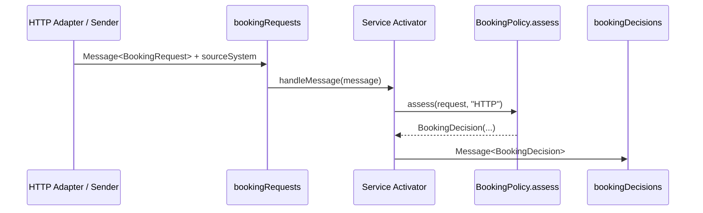

# MethodInvokingMessageProcessor: gọi phương thức POJO để xử lý message

## 1. Tại sao cần `MethodInvokingMessageProcessor`?

Trong một ứng dụng Java, chúng ta thường đã có các lớp nghiệp vụ như `BookingPolicy`, `PaymentValidator` hoặc `InventoryService`. Những lớp này xử lý đối tượng Java và không nhất thiết phải biết về `MessageChannel` hay Spring Integration. Khi message đi vào từ HTTP, JMS, AMQP, Kafka, file hoặc database adapter, làm thế nào chuyển **payload và headers của message** thành các đối số để gọi phương thức có sẵn đó?

Spring Integration có một thành phần hỗ trợ tên là **`MethodInvokingMessageProcessor<T>`**, thuộc package `org.springframework.integration.handler`. Thành phần này hiện thực `MessageProcessor<T>`: nhận một `Message<?>`, gọi phương thức trên POJO được cấu hình và trả lại kết quả của lời gọi. Nó giúp framework nối hợp đồng message với hợp đồng phương thức Java.

Trong module **`SPRING_INTEGRATION_ADAPTERS`**, bài học này tập trung vào điểm giao giữa adapter, gateway, `MessageChannel` và nghiệp vụ POJO: message được adapter đưa vào flow, xử lý bằng phương thức Java, rồi có thể trở thành reply cho channel hoặc adapter phía sau. Đây là mắt xích quan trọng để giữ logic nghiệp vụ độc lập với giao thức tích hợp.

Sau bài này, bạn có thể:

- Mô tả chính xác vai trò của `MethodInvokingMessageProcessor` và `MessageProcessor<T>`.
- Phân biệt message processor với message source, endpoint, handler, transformer và poller.
- Dùng `@ServiceActivator` hoặc Java DSL `.handle(bean, "method")` để kết nối POJO với flow.
- Nhận payload, headers hoặc toàn bộ `Message<?>` trong phương thức; hiểu reply `null`, `void` và `Message<?>`.
- Kiểm tra và xử lý các lỗi thường gặp về method signature, định tuyến reply, exception và tính tin cậy.

## 2. Vị trí trong đường đi của message

`MethodInvokingMessageProcessor` là một **chiến lược xử lý lời gọi phương thức**. Nó không phải adapter giao thức, không phải `MessageChannel` và không phải một endpoint tự hoạt động. Một `MessageHandler`/endpoint cấp cao hơn, chẳng hạn **service activator**, dùng cơ chế gọi phương thức để xử lý message đang đi qua flow.

```mermaid
flowchart LR
    A[Inbound Adapter / Gateway] --> C1[Input MessageChannel]
    C1 --> H[Service Activator / MessageHandler]
    H -->|processMessage(message)| P[MethodInvokingMessageProcessor]
    P -->|Binding payload và headers| B[Phương thức POJO]
    B -->|Kết quả hoặc null| P
    P -->|Giá trị trả về| H
    H -->|Reply nếu có| C2[Output / replyChannel]
    C2 --> D[Handler / Outbound Adapter]
```

Tư duy đúng là tách hai lớp trách nhiệm:

1. **Bên trong processor:** nhận `Message<?>`, tìm phương thức mục tiêu, ánh xạ đối số và gọi phương thức Java.
2. **Bên ngoài processor:** handler quyết định cách dùng giá trị trả về: phát reply, biến đổi payload, định tuyến, phân tách hay không gửi gì thêm. Processor **không tự chọn channel** hoặc áp dụng ý nghĩa của một router/transformer.

### So sánh các thành phần dễ nhầm

| Thành phần | Đầu vào | Nhiệm vụ | Đầu ra/hành vi |
|---|---|---|---|
| `MethodInvokingMessageSource` | Không có message đầu vào; lời gọi `receive()` | Gọi method nguồn, thường không tham số | Message mới hoặc `null`; thường được poller kích hoạt |
| **`MethodInvokingMessageProcessor<T>`** | Một `Message<?>` đã tồn tại | Gọi method POJO dựa trên nội dung message | Giá trị `T`, `Message<?>` hoặc `null` cho thành phần gọi nó |
| `ServiceActivatingHandler` | Message nhận từ channel | Điều phối lời gọi service và, nếu có, gửi reply | Một reply message hoặc không có reply |
| Transformer | Message đầu vào | Áp dụng ngữ nghĩa biến đổi payload/message | Message đã biến đổi để đi tiếp |
| Router | Message đầu vào | Chọn nơi chuyển tiếp | Một hoặc nhiều channel đích tùy cấu hình |
| Poller | Lịch kích hoạt endpoint polling | Yêu cầu endpoint lấy message từ nguồn/channel có thể poll | Không ánh xạ tham số method POJO |

**Điểm cần nhớ:** với `DirectChannel`, handler có thể được gọi ngay trên luồng đang gửi message. `MethodInvokingMessageProcessor` không cần poller khi message đã được đẩy vào `DirectChannel`. Nếu endpoint đọc `PollableChannel`, poller thuộc **endpoint nhận** message, không phải một tính năng độc lập của processor.

## 3. Hợp đồng `MessageProcessor<T>` và API của lớp

Hợp đồng cốt lõi có thể hình dung qua interface:

```java
// Khai niệm API của Spring Integration:
public interface MessageProcessor<T> {
    T processMessage(org.springframework.messaging.Message<?> message);
}
```

`MethodInvokingMessageProcessor<T>` implements hợp đồng này và gọi method trên **target object**. Các cách lựa chọn method thường gặp:

| Cách chọn method | Ý nghĩa |
|---|---|
| `new MethodInvokingMessageProcessor<>(target, "methodName")` | Chỉ định đối tượng và tên phương thức. Nếu có overload, việc chọn method phù hợp dựa vào message và cơ chế phân giải method. |
| `new MethodInvokingMessageProcessor<>(target, method)` | Dùng trực tiếp `java.lang.reflect.Method`, chủ động xác định chữ ký cụ thể. |
| `new MethodInvokingMessageProcessor<>(target, AnnotationType.class)` | Lọc các method ứng viên theo annotation đã cung cấp. |

Đây là **support API** được Spring Integration sử dụng bên trong các thành phần xử lý message. Trong ứng dụng thông thường, khai báo `@ServiceActivator` hoặc `.handle(pojo, "method")` dễ duy trì hơn việc tự lắp một processor với handler và channel.

### Ví dụ gọi processor ở mức thấp

Để thấy đúng hợp đồng `processMessage(...)`, xét POJO nhỏ:

```java
import org.springframework.integration.handler.MethodInvokingMessageProcessor;
import org.springframework.messaging.support.GenericMessage;

class PriceCalculator {
    public long doublePrice(long amount) {
        return amount * 2;
    }
}

class ProcessorDemo {
    public static void main(String[] args) throws Exception {
        MethodInvokingMessageProcessor<Long> processor =
                new MethodInvokingMessageProcessor<>(
                        new PriceCalculator(), "doublePrice");

        // Khi được tạo ngoài Spring container, tự chạy bước khởi tạo bean.
        processor.afterPropertiesSet();

        Long result = processor.processMessage(new GenericMessage<>(100L));
        System.out.println(result); // 200
    }
}
```

Ở ví dụ này, `GenericMessage<>(100L)` chứa payload `100L`. Processor tìm method `doublePrice(long)` và truyền payload vào method, sau đó trả `200L` cho caller. **Không có `MessageChannel` hoặc reply message nào được tạo ra chỉ từ đoạn code này**: việc định tuyến kết quả thuộc trách nhiệm handler/flow cấp cao hơn.

Trong môi trường thật, Spring quản lý bean lifecycle và các tiện ích phân giải argument, conversion service. Đoạn gọi trực tiếp ở trên phù hợp để hiểu/kiểm tra cơ chế cơ bản; khi triển khai integration flow, hãy dùng một endpoint được framework quản lý.

## 4. Cách Spring ánh xạ `Message<?>` vào tham số Java

Một message có hai phần chính:

```text
Message<BookingRequest>
  payload = BookingRequest(bookingId="B-100", guests=3)
  headers = {sourceSystem="HTTP", correlationId="trace-123", ...}
```

Spring Integration có thể ánh xạ dữ liệu đó sang method POJO bằng chữ ký và các annotation của Spring Messaging:

| Method signature | Dữ liệu được truyền vào | Trường hợp sử dụng |
|---|---|---|
| `Decision decide(BookingRequest request)` | Payload của message | Phổ biến nhất; giữ nghiệp vụ thuần Java |
| `Decision decide(@Payload BookingRequest request)` | Payload, nêu rõ mục đích | Khi method còn nhận header hoặc metadata |
| `Decision decide(Message<BookingRequest> message)` | Toàn bộ message | Khi cần chủ động đọc cả payload lẫn nhiều headers |
| `Decision decide(@Payload BookingRequest req, @Header("sourceSystem") String source)` | Payload và một header | Xử lý phụ thuộc hệ thống nguồn |
| `void audit(@Headers Map<String, Object> headers)` | Map headers | Log/audit có chọn lọc |
| `Decision decide(@Header(value = "sourceSystem", required = false) String source, @Payload BookingRequest req)` | Header tùy chọn và payload | Nguồn không luôn gửi metadata |

Các annotation thường nhập từ `org.springframework.messaging.handler.annotation`, chẳng hạn `@Payload`, `@Header`, `@Headers`. `@ServiceActivator` thuộc `org.springframework.integration.annotation`.

Khi thiếu header bắt buộc hoặc payload không tương thích kiểu mà không có chuyển đổi phù hợp, việc giải đối số có thể thất bại **trước khi** vào thân method. Vì vậy, cần thống nhất hợp đồng payload/header giữa inbound adapter và POJO. Đừng giả định Spring có thể biến bất kỳ chuỗi JSON nào thành record Java chỉ nhờ chữ ký method: bước giải mã/chuyển kiểu cần được cấu hình phù hợp.

### Dùng toàn bộ message khi thực sự cần

Ví dụ thay cho các tham số tách rời:

```java
import org.springframework.messaging.Message;

public BookingDecision decide(Message<BookingRequest> message) {
    BookingRequest request = message.getPayload();
    Object source = message.getHeaders().get("sourceSystem");

    return new BookingDecision(
            request.bookingId(),
            request.guests() > 0,
            String.valueOf(source),
            "checked");
}
```

Khi method cần ít metadata, khai báo `@Payload` và `@Header` thường dễ đọc, dễ kiểm thử hơn. Nếu method có nhiều overload trùng tên, việc chọn method có thể phụ thuộc kiểu payload; hãy tránh overload mơ hồ và chỉ định rõ method cần gọi.

## 5. Ví dụ hoàn chỉnh: nhận yêu cầu đặt chỗ và gọi POJO

Ví dụ dùng **Java 17+, Spring Boot 3.x, Spring Integration 6.x**. Hệ thống giả định nhận một yêu cầu từ adapter phía trước (HTTP/JMS/Kafka đều có thể đưa message vào channel chung), sau đó gọi chính sách nghiệp vụ kiểm tra số khách. Để tập trung vào method invocation, ví dụ kiểm thử **gửi message trực tiếp vào channel**.

Thêm starter vào dự án Spring Boot:

```groovy
dependencies {
    implementation 'org.springframework.boot:spring-boot-starter-integration'
    testImplementation 'org.springframework.boot:spring-boot-starter-test'
}
```

Tất cả file Java dưới đây nằm trong package `com.example.booking`.

### 5.1. Khởi tạo ứng dụng và mô hình nghiệp vụ

```java
// BookingApplication.java
package com.example.booking;

import org.springframework.boot.SpringApplication;
import org.springframework.boot.autoconfigure.SpringBootApplication;
import org.springframework.integration.config.EnableIntegration;

@SpringBootApplication
@EnableIntegration
public class BookingApplication {
    public static void main(String[] args) {
        SpringApplication.run(BookingApplication.class, args);
    }
}
```

```java
// BookingModels.java
package com.example.booking;

record BookingRequest(String bookingId, int guests) { }

record BookingDecision(
        String bookingId,
        boolean accepted,
        String sourceSystem,
        String reason) { }
```

Hai record chỉ biểu diễn dữ liệu. `BookingPolicy` sẽ chứa logic quyết định, không cần biết chi tiết giao thức vào/ra.

### 5.2. Tạo input và output channel

```java
// BookingChannels.java
package com.example.booking;

import org.springframework.context.annotation.Bean;
import org.springframework.context.annotation.Configuration;
import org.springframework.integration.channel.DirectChannel;
import org.springframework.integration.channel.QueueChannel;
import org.springframework.messaging.MessageChannel;
import org.springframework.messaging.PollableChannel;

@Configuration
public class BookingChannels {
    @Bean
    MessageChannel bookingRequests() {
        return new DirectChannel();
    }

    @Bean
    PollableChannel bookingDecisions() {
        return new QueueChannel();
    }
}
```

- `bookingRequests` là `DirectChannel`: message vừa được gửi vào sẽ được service activator tiếp nhận đồng bộ, nếu có subscriber.
- `bookingDecisions` là `QueueChannel`: cho phép demo/test gọi `receive()` để lấy reply. Trong sản phẩm thực tế, output channel thường được nối đến adapter/gateway tiếp theo.

### 5.3. Đăng ký phương thức POJO làm service activator

```java
// BookingPolicy.java
package com.example.booking;

import org.springframework.integration.annotation.ServiceActivator;
import org.springframework.messaging.handler.annotation.Header;
import org.springframework.messaging.handler.annotation.Payload;
import org.springframework.stereotype.Component;

@Component
public class BookingPolicy {

    @ServiceActivator(
            inputChannel = "bookingRequests",
            outputChannel = "bookingDecisions")
    public BookingDecision assess(
            @Payload BookingRequest request,
            @Header(value = "sourceSystem", required = false) String sourceSystem) {

        String source = sourceSystem == null ? "unknown" : sourceSystem;

        boolean accepted = request.bookingId() != null
                && !request.bookingId().isBlank()
                && request.guests() > 0
                && request.guests() <= 8;

        return new BookingDecision(
                request.bookingId(),
                accepted,
                source,
                accepted ? "ACCEPTED" : "INVALID_REQUEST");
    }
}
```

Khi một message vào `bookingRequests`, endpoint gọi `assess(...)` với `BookingRequest` lấy từ payload và `sourceSystem` lấy từ header. Giá trị trả về là `BookingDecision`, nên **service activator** tạo reply message và gửi đến `bookingDecisions`.

Nhiệm vụ của `MethodInvokingMessageProcessor` trong sơ đồ này là **gọi đúng method và trả `BookingDecision`** cho handler. Chính `ServiceActivatingHandler` và cấu hình `outputChannel` quyết định nơi reply được gửi.

### 5.4. Gửi một message thử

Ví dụ một component khác trong cùng ứng dụng gửi:

```java
import org.springframework.messaging.MessageChannel;
import org.springframework.messaging.support.MessageBuilder;

// Được inject từ bean tên "bookingRequests":
void submitBooking(MessageChannel bookingRequests) {
    bookingRequests.send(
            MessageBuilder.withPayload(new BookingRequest("B-100", 3))
                    .setHeader("sourceSystem", "HTTP")
                    .setHeader("correlationId", "trace-123")
                    .build());
}
```

Luồng diễn ra:



Đoạn gửi trên chỉ minh họa một caller. Với HTTP inbound gateway, Kafka inbound adapter hoặc JMS inbound adapter, luồng phía trước sẽ chuyển payload/header vào channel tương ứng theo cấu hình adapter của bạn. Phần `BookingPolicy` không cần thay đổi chỉ vì đổi giao thức nguồn.

## 6. Cách khác: đăng ký bằng Java DSL `.handle(...)`

Nếu không muốn đặt annotation Spring Integration trong lớp nghiệp vụ, để `BookingPolicy` là bean POJO chỉ có method thuần Java:

```java
// Không đặt @ServiceActivator lên method trong phương án DSL.
public BookingDecision assess(
        @Payload BookingRequest request,
        @Header(value = "sourceSystem", required = false) String sourceSystem) {
    // Cùng logic như mục 5.3.
}
```

Sau đó khai báo flow:

```java
package com.example.booking;

import org.springframework.context.annotation.Bean;
import org.springframework.context.annotation.Configuration;
import org.springframework.integration.dsl.IntegrationFlow;

@Configuration
public class BookingIntegrationFlow {

    @Bean
    IntegrationFlow bookingFlow(BookingPolicy bookingPolicy) {
        return IntegrationFlow.from("bookingRequests")
                .handle(bookingPolicy, "assess")
                .channel("bookingDecisions")
                .get();
    }
}
```

`.handle(bookingPolicy, "assess")` là service activator trong Java DSL: framework chuẩn bị cơ chế gọi method trên bean `bookingPolicy`, lấy kết quả và chuyển reply sang bước tiếp theo trong flow. `channel("bookingDecisions")` xác định channel đích cho message đi tiếp.

**Hai cách ở mục 5 và 6 là các cấu hình thay thế nhau.** Nếu vừa để `@ServiceActivator(inputChannel = "bookingRequests")` vừa tạo `IntegrationFlow.from("bookingRequests").handle(...)` cho cùng logic, `DirectChannel` có thể phân phối các message cho những subscriber khác nhau; kết quả không còn thể hiện một pipeline duy nhất như mong muốn.

Khi cần thay đổi flow nhiều bước, DSL tiện lợi:

```java
return IntegrationFlow.from("bookingRequests")
        .handle(bookingPolicy, "assess")
        .filter(BookingDecision.class, BookingDecision::accepted)
        .channel("approvedBookings")
        .get();
```

Trong ví dụ trên, `handle` tạo kết quả `BookingDecision`; `filter` mới là thành phần quyết định giữ hoặc bỏ message theo điều kiện; `channel` xác định nơi gửi tiếp. Processor gọi method **không tự thay thế** trách nhiệm của filter hay router.

## 7. Kết quả trả về: payload, `Message<?>`, `null`, `void`

`MethodInvokingMessageProcessor` trả về **giá trị của phương thức**. Endpoint sử dụng giá trị này theo ngữ nghĩa riêng. Với **service activator**:

| Method trả về | Điều xảy ra ở service activator |
|---|---|
| `BookingDecision` | Handler tạo một reply message có payload là `BookingDecision` rồi gửi đến `outputChannel` hoặc reply destination thích hợp. |
| `Message<BookingDecision>` | Handler dùng message trả về làm reply; các header của message đầu vào còn có thể được bổ sung vào reply theo quy tắc header propagation. |
| `null` | Mặc định không phát reply; nếu handler được cấu hình `requiresReply = true`, sẽ phát sinh `ReplyRequiredException`. |
| `void` | Thích hợp cho side-effect như ghi audit hoặc cập nhật trạng thái; không có reply từ lời gọi. |
| `List<BookingDecision>` | Với service activator thông thường, danh sách là **một payload chứa List**; muốn fan-out từng phần tử, dùng splitter rõ ràng. |

### 7.1. Trả về đầy đủ message để bổ sung header

Thay vì chỉ trả `BookingDecision`, POJO có thể trả `Message<BookingDecision>`:

```java
import org.springframework.messaging.Message;
import org.springframework.messaging.support.MessageBuilder;

public Message<BookingDecision> assessWithHeaders(BookingRequest request) {
    BookingDecision result = new BookingDecision(
            request.bookingId(), true, "internal", "ACCEPTED");

    return MessageBuilder.withPayload(result)
            .setHeader("validationVersion", "v2")
            .setHeader("bookingKey", request.bookingId())
            .build();
}
```

Với **service activator**, các header từ request còn thiếu trên reply có thể được sao chép sang reply; trả một `Message<?>` mới không tự động loại hết header cũ. Muốn bỏ header nhạy cảm hoặc chỉ giữ whitelist, hãy dùng `HeaderFilter` hoặc một bước biến đổi được thiết kế cho mục tiêu đó. Khi chuyển message qua HTTP/JMS/Kafka, mỗi adapter còn có chính sách ánh xạ header riêng.

### 7.2. Reply đi về đâu nếu không khai báo `outputChannel`?

Nếu service activator có kết quả khác `null`, thứ tự cơ bản để xác định điểm nhận reply là:

1. Dùng `outputChannel` nếu endpoint đã cấu hình.
2. Nếu không có, xem header `replyChannel` của **request message**.
3. Với một số trường hợp trả đầy đủ `Message<?>`, framework còn có thể xét `replyChannel` trên reply message khi request không có return address.

Ví dụ gửi yêu cầu có reply channel:

```java
import org.springframework.integration.channel.QueueChannel;
import org.springframework.messaging.Message;
import org.springframework.messaging.support.MessageBuilder;

QueueChannel replies = new QueueChannel();

Message<?> request = MessageBuilder.withPayload(new BookingRequest("B-200", 2))
        .setReplyChannel(replies)
        .build();

// Gửi request vào một service activator KHÔNG định nghĩa outputChannel.
// Khi method trả kết quả, handler chuyển reply về replies.
```

Nếu method thực sự trả một giá trị nhưng không có `outputChannel` **và** không có return address phù hợp, handler không biết gửi reply đi đâu và có thể ném `DestinationResolutionException`. Nếu thiết kế flow chủ ý bỏ kết quả, hãy gửi đến `nullChannel` (channel đặc biệt do framework cung cấp), hoặc thay method thành `void` nếu hợp đồng nghiệp vụ không cần reply.

### 7.3. Không dùng `null` để che lỗi nguồn

`null` có nghĩa **không sinh reply** trong bối cảnh service activator. Nó khác với exception và không có nghĩa message đầu vào chưa từng được nhận. Nếu việc kiểm tra booking lỗi do database không phản hồi, hãy ném lỗi có ý nghĩa để cơ chế xử lý lỗi ghi nhận được; đừng trả `null` làm hệ thống im lặng như thể không có dữ liệu.

## 8. Lựa chọn method, chuyển đổi kiểu và SpEL

Khi cấu hình `MethodInvokingMessageProcessor(target, "assess")`, tên method chỉ là một phần của hợp đồng. Framework còn xem xét method ứng viên, payload type, annotations và cách phân giải argument. Ví dụ:

```java
class BookingPolicy {
    public String assess(BookingRequest request) { return "BOOKING"; }
    public String assess(String requestId)       { return "ID"; }
}
```

Với một message có payload `BookingRequest`, method nhận `BookingRequest` thường phù hợp. Nhưng overload phức tạp (kiểu gần nhau, nullable, các converter, method generic) có thể gây mơ hồ hoặc gọi khác kỳ vọng. Để flow ổn định, nên:

- Dùng method tên riêng, public và chữ ký rõ; chỉ overload khi thực sự cần.
- Ghi rõ `@Payload`, `@Header` cho method có nhiều loại đối số.
- Dùng constructor nhận `Method` khi cấu hình trực tiếp và cần chọn duy nhất một chữ ký.
- Chuẩn hóa kiểu payload tại adapter/transformer, chẳng hạn chuyển JSON thành record trước khi gọi POJO.
- Có kiểm thử khi nâng phiên bản framework hoặc thay cơ chế chuyển kiểu.

Từ Spring Integration 5.x, hầu hết lời gọi POJO có thể dùng `InvocableHandlerMethod` của Spring Messaging; một số trường hợp, chẳng hạn truy cập đường dẫn thuộc tính bằng annotation expression, có thể dùng SpEL. Chi tiết tối ưu chọn cơ chế gọi phụ thuộc phiên bản Spring Integration; bài học này tập trung vào **hợp đồng message và method**, không buộc ứng dụng phải viết SpEL thủ công.

## 9. Lỗi và tính tin cậy trong luồng tích hợp

POJO method có thể ném exception, gọi database chậm, thực hiện side-effect hoặc cập nhật dữ liệu trước khi trả reply. `MethodInvokingMessageProcessor` **không tự đảm bảo** transaction, retry, dead-letter queue hay exactly-once; những chính sách này thuộc endpoint, channel, adapter và thiết kế nghiệp vụ.

| Vấn đề | Diễn biến | Hướng xử lý |
|---|---|---|
| Method ném exception | Quá trình xử lý message thất bại; có thể được bọc trong ngoại lệ messaging. | Xác định chính sách retry, recoverer, error channel và quan sát lỗi ở endpoint. |
| Header bắt buộc thiếu | Không giải được tham số `@Header`, method có thể chưa được gọi. | Định nghĩa hợp đồng header; thêm `required = false` khi thực sự tùy chọn. |
| Payload không tương thích | Method không khớp hoặc chuyển đổi dữ liệu thất bại. | Validate schema/version, thêm transformer hoặc converter rõ ràng. |
| Method trả `null` ngoài ý muốn | Service activator mặc định không tạo reply, caller có thể chờ rồi timeout. | Trả đối tượng kết quả rõ ràng hoặc bật yêu cầu phải có reply ở handler khi phù hợp. |
| Side-effect đã xong nhưng reply lỗi | Gửi lại message có thể thực thi nghiệp vụ lần nữa. | Idempotency key, transaction/ack hợp lý và chính sách retry theo loại adapter. |
| Handler xử lý chậm | Với `DirectChannel`, thời gian chậm ảnh hưởng trực tiếp lời gọi `send()` phía trên. | Đo độ trễ, tối ưu I/O, cân nhắc channel/scheduler bất đồng bộ có kiểm soát. |

Ví dụ tích hợp với JMS/AMQP/Kafka: nếu consumer upstream có cơ chế redelivery, method `chargePayment(...)` có thể được gọi **nhiều lần** cho cùng một message. Chính sách retry ở broker/channel adapter không tự làm cho thao tác thanh toán trở nên idempotent. Cần khóa nghiệp vụ (`paymentId`, `bookingId`, `eventId`) và cơ chế chống áp dụng lại hiệu ứng phụ.

### Chọn nơi xử lý exception

- Với `DirectChannel` đồng bộ, lỗi trong method thường truyền về luồng gửi, trừ khi có advice hoặc handler đặc biệt xử lý.
- Với endpoint polling hoặc kênh bất đồng bộ, lỗi có thể được đưa qua `errorChannel` và chính sách error handler tương ứng.
- Với inbound adapter có acknowledgment hoặc transaction, cách ack/rollback khi lỗi còn phụ thuộc adapter cụ thể; không thể suy ra chỉ từ `MethodInvokingMessageProcessor`.

Không nên âm thầm nuốt exception và trả `null` chỉ để giữ flow chạy, vì như vậy mất dấu thông tin thất bại. Nếu cần phân biệt kết quả nghiệp vụ (ví dụ `REJECTED`) với lỗi hệ thống (ví dụ database timeout), dùng kiểu kết quả hoặc exception rõ ràng.

## 10. Kiểm thử method và integration flow

Kiểm thử nên có hai lớp:

1. **Unit test POJO:** kiểm tra `BookingPolicy.assess(...)` với dữ liệu hợp lệ, không hợp lệ, header tùy chọn; không cần Spring context.
2. **Integration test:** gửi một `Message<BookingRequest>` qua input channel và xác minh rằng handler gọi đúng method, trả payload/header qua output channel.

### 10.1. Unit test logic nghiệp vụ

```java
package com.example.booking;

import static org.junit.jupiter.api.Assertions.*;

import org.junit.jupiter.api.Test;

class BookingPolicyTest {
    @Test
    void rejectsInvalidGuestCount() {
        BookingPolicy policy = new BookingPolicy();
        BookingDecision decision =
                policy.assess(new BookingRequest("B-300", 0), "JMS");

        assertFalse(decision.accepted());
        assertEquals("JMS", decision.sourceSystem());
        assertEquals("INVALID_REQUEST", decision.reason());
    }
}
```

### 10.2. Integration test với `DirectChannel` và `QueueChannel`

```java
package com.example.booking;

import static org.junit.jupiter.api.Assertions.*;

import org.junit.jupiter.api.Test;
import org.springframework.beans.factory.annotation.Autowired;
import org.springframework.beans.factory.annotation.Qualifier;
import org.springframework.boot.test.context.SpringBootTest;
import org.springframework.messaging.Message;
import org.springframework.messaging.MessageChannel;
import org.springframework.messaging.PollableChannel;
import org.springframework.messaging.support.MessageBuilder;

@SpringBootTest
class BookingFlowTest {

    @Autowired
    @Qualifier("bookingRequests")
    MessageChannel requests;

    @Autowired
    @Qualifier("bookingDecisions")
    PollableChannel decisions;

    @Test
    void invokesPojoMethodAndEmitsReply() {
        boolean sent = requests.send(
                MessageBuilder.withPayload(new BookingRequest("B-400", 4))
                        .setHeader("sourceSystem", "HTTP")
                        .build());
        assertTrue(sent);

        Message<?> reply = decisions.receive(1000);
        assertNotNull(reply);
        assertInstanceOf(BookingDecision.class, reply.getPayload());

        BookingDecision result = (BookingDecision) reply.getPayload();
        assertEquals("B-400", result.bookingId());
        assertTrue(result.accepted());
        assertEquals("HTTP", result.sourceSystem());
    }
}
```

`DirectChannel` cho phép lời gọi handler xảy ra đồng bộ; `QueueChannel` giữ reply để test đọc bằng `receive(1000)` (timeout mili giây), tránh phải chờ `Thread.sleep()`. Kiểm thử này xác minh cả method argument mapping và reply routing. Để kiểm thử adapter thật, cần thêm hạ tầng hoặc test fixture tương ứng cho HTTP/JMS/Kafka và trường hợp lỗi thực tế.

### Checklist khi debug

| Triệu chứng | Điều cần kiểm tra trước |
|---|---|
| `assess(...)` không chạy | Bean đã được Spring quét chưa? Input channel có message không? `@ServiceActivator` hoặc `.handle(...)` đã được khai báo đúng chưa? |
| Lỗi không tìm được method | Tên method, visibility, overload và kiểu payload có khớp không? |
| Lỗi tham số header | Header có tồn tại và đúng tên/kiểu không? Có cần `required = false` không? |
| Method chạy nhưng không thấy reply | Method có trả `null`/`void` không? Output channel hoặc `replyChannel` đã được cấu hình chưa? |
| Reply đi sai nơi | Có cả `outputChannel` và `replyChannel` không? Handler đang ưu tiên endpoint output channel nào? |
| Trùng lần xử lý | Có khai báo đồng thời cả annotation và DSL cho cùng input không? Adapter có retry/redelivery không? |
| Muốn tách nhiều bản ghi nhưng vẫn nhận `List` | Đã thêm splitter sau handler chưa? |

## 11. Bài tập thực hành

1. Dùng `@ServiceActivator` cho method `calculateFee(@Payload BookingRequest request, @Header("region") String region)`. Thử gửi message có `region` và quan sát reply.
2. Chuyển cùng flow sang Java DSL `.handle(bookingPolicy, "assess")`. Xác nhận có đúng một endpoint xử lý `bookingRequests`.
3. Bỏ `outputChannel` của service activator, gửi request có header `replyChannel` trỏ đến `QueueChannel` và đọc kết quả qua queue đó.
4. Tạo một method trả `null` khi booking không hợp lệ. Giải thích caller/gateway có thể gặp vấn đề gì nếu đang chờ reply; đề xuất hợp đồng `BookingDecision` luôn có trạng thái rõ ràng.
5. Cho method nhận `Message<BookingRequest>` để đọc `sourceSystem` và `correlationId`, sau đó trả một `Message<BookingDecision>` bổ sung `validationVersion`; kiểm tra header propagation của service activator.
6. Giả lập một lỗi database và retry lại cùng message. Viết unit test chứng minh `bookingId` được dùng làm khóa idempotency để không cập nhật hai lần.

## 12. Tổng kết kiến thức

- `MethodInvokingMessageProcessor<T>` là **công cụ gọi phương thức** từ một `Message<?>` đã có; API chính là `processMessage(message)`.
- Payload được truyền vào method theo kiểu đối số; `@Payload`, `@Header`, `@Headers` hoặc `Message<?>` diễn đạt hợp đồng cần lấy dữ liệu gì.
- `@ServiceActivator` và Java DSL `.handle(pojo, "method")` là hai cách thông dụng để sử dụng cơ chế POJO invocation trong một flow được Spring quản lý.
- **Processor không tự gửi reply**: service activator/handler quyết định reply channel và xử lý kết quả `null`/`void`.
- Tính tin cậy khi tích hợp HTTP, JMS, AMQP, Kafka hoặc database phụ thuộc chính sách ack, retry, transaction, error handling và idempotency ngoài processor.

### Tài liệu tham khảo

- [Spring Integration API — `MethodInvokingMessageProcessor<T>`](https://docs.spring.io/spring-integration/docs/6.2.0-M2/api/org/springframework/integration/handler/MethodInvokingMessageProcessor.html)
- [Spring Integration API — `MessageProcessor<T>`](https://docs.spring.io/spring-integration/docs/latest-ga/api/org/springframework/integration/handler/MessageProcessor.html)
- [Spring Integration Reference — Service Activator](https://docs.spring.io/spring-integration/reference/service-activator.html)
- [Spring Integration Reference — POJO Method Invocation](https://docs.spring.io/spring-integration/docs/6.1.8/reference/html/index-single.html)
