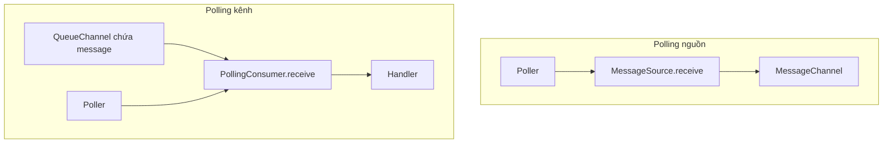

# MessageSource polling method: gọi phương thức lấy dữ liệu theo lịch

## 1. Bài toán và mục tiêu

Giả sử một hệ thống cũ có phương thức `nextOrder()` trả về **một** đơn hàng chờ xử lý. Không có webhook, message broker hay callback để báo ngay khi có đơn mới. Ứng dụng chỉ biết hỏi hệ thống đó định kỳ: “Có đơn hàng nào tiếp theo không?”. Ta muốn đưa kết quả từ phương thức Java ấy vào luồng Spring Integration để chuyển tiếp qua `MessageChannel`, kiểm tra nghiệp vụ hoặc gửi đến JMS, AMQP, Kafka và các hệ thống khác.

Trong module **`SPRING_INTEGRATION_ADAPTERS`**, các inbound/outbound adapter, gateway, poller và `MessageChannel` được dùng để kết nối file, SFTP, HTTP, JMS, AMQP, Kafka, cơ sở dữ liệu và những API Java sẵn có. Chủ đề **MessageSource polling method** tập trung vào một tình huống cụ thể: **một phương thức Java được gọi lặp lại theo lịch để tạo message đầu vào**. Hiểu cơ chế này giúp thiết kế hợp đồng message, quản lý tải, phát hiện lỗi và kiểm soát vòng đời kết nối khi nguồn bên ngoài không hỗ trợ sự kiện đẩy.

Sau bài học, bạn có thể:

1. Giải thích `MessageSource.receive()`, `SourcePollingChannelAdapter` và poller phối hợp như thế nào.
2. Viết phương thức POJO được poll bằng `@InboundChannelAdapter` hoặc triển khai `MessageSource<T>` tường minh.
3. Cấu hình `fixedDelay`, `fixedRate`, `maxMessagesPerPoll`, xử lý kết quả `null` và điều chỉnh nhịp đọc dữ liệu.
4. Phân biệt polling *nguồn* với việc polling một `PollableChannel` ở phía consumer.
5. Kiểm thử nguồn và luồng polling; nhận biết rủi ro mất dữ liệu, trùng dữ liệu, lỗi I/O và xử lý đồng thời.

## 2. Các thành phần tham gia và đường đi của một message

`MessageSource<T>` thuộc package `org.springframework.integration.core`. Hợp đồng cốt lõi là phương thức không tham số:

```java
public interface MessageSource<T> {
    Message<T> receive(); // Trả về một Message hoặc null khi chưa có dữ liệu.
}
```

*Đoạn trên diễn giải chữ ký chính của interface; các annotation và chi tiết bổ trợ tùy phiên bản không được liệt kê.*

Một đối tượng `MessageSource<T>` chỉ biết cách **lấy message khi có người gọi `receive()`**. Nó không tự khởi động bộ hẹn giờ. Thành phần endpoint **`SourcePollingChannelAdapter`** sử dụng poller để gọi `receive()` và gửi message khác `null` đến một channel.

```mermaid
flowchart LR
    TIMER[TaskScheduler / Poller] --> ENDPOINT[SourcePollingChannelAdapter]
    ENDPOINT -->|receive()| SOURCE[MessageSource]
    SOURCE -->|gọi phương thức lấy dữ liệu| POJO[POJO hoặc API cũ]
    POJO -->|đối tượng hoặc null| SOURCE
    SOURCE -->|Message hoặc null| ENDPOINT
    ENDPOINT -->|Message khác null| CHANNEL[MessageChannel]
    CHANNEL --> HANDLER[Service Activator / Transform / Outbound Adapter]
```

| Thành phần | Trách nhiệm chính | Không đảm nhận |
|---|---|---|
| **Phương thức POJO** | Trả một phần tử dữ liệu hoặc `null` khi tạm hết dữ liệu. | Không biết lịch poll hoặc channel. |
| **`MessageSource<T>`** | Biểu diễn thao tác nhận `Message<T>` thông qua `receive()`. | Không tự phát message theo thời gian. |
| **`SourcePollingChannelAdapter`** | Tạo endpoint inbound, gọi source theo poller và chuyển message sang channel. | Không tự xác định cách truy vấn hệ thống nguồn. |
| **Poller / `TaskScheduler`** | Điều khiển thời điểm, chu kỳ và số lần đọc mỗi chu kỳ. | Không tự biến API Java thành dữ liệu nghiệp vụ. |
| **`MessageChannel`** | Chuyển message cho các thành phần sau đó. | Không tự gọi `receive()` của nguồn nếu chỉ là `DirectChannel`. |
| **Consumer / outbound adapter** | Xử lý hoặc chuyển message sang hệ thống tiếp theo. | Không đảm bảo việc lấy nguồn chỉ chạy một lần nếu cấu hình nhiều endpoint. |

### Hai dạng “polling” cần phân biệt

**Polling nguồn (`SourcePollingChannelAdapter`)**: định kỳ gọi `MessageSource.receive()` để *tạo* message đầu vào. Ví dụ quét file, SFTP, bảng staging hoặc phương thức `nextOrder()` của thư viện cũ.

**Polling kênh (`PollingConsumer`)**: định kỳ gọi `receive()` trên một `PollableChannel` như `QueueChannel` để *tiêu thụ message đã nằm trong kênh*. Đây là điểm khác về đối tượng được poll, dù cả hai đều có poller và lịch kích hoạt.



Điểm phân biệt này giúp tránh sai lầm khi thấy từ `poller` rồi cho rằng mọi phương thức xử lý message đều cần được gọi theo lịch. Handler gắn với `DirectChannel` thường được kích hoạt ngay khi channel nhận message; chỉ những endpoint polling mới dùng poller.

## 3. Hợp đồng của phương thức được polling

Cách đơn giản nhất để khai báo một POJO method làm nguồn là `@InboundChannelAdapter`. Trong cấu hình này, Spring Integration tạo một **`MethodInvokingMessageSource`** để gọi method và một **`SourcePollingChannelAdapter`** để lập lịch polling.

Method mục tiêu phải đáp ứng các điều kiện:

- **Không có tham số đầu vào.** Không có request message để framework lấy payload rồi truyền vào một method nguồn, vì chính method đó đang sản xuất request message.
- **Không có kiểu trả về `void`.** Nó cần có kết quả để tạo message; kiểu trả về có thể là POJO hoặc `Message<?>`.
- **Trả `null` khi chưa có dữ liệu.** `null` là tín hiệu không phát message trong lần nhận ấy, không phải một payload hợp lệ.
- **Mỗi lần gọi chỉ có một kết quả.** Trả `List<Order>` sẽ tạo một message có payload là danh sách; muốn từng đơn thành từng message, trả từng `Order` hoặc dùng splitter phía sau.
- **Method phải bảo toàn trạng thái nguồn.** Khi method xóa một phần tử khỏi hàng đợi, đánh dấu bản ghi đã đọc hoặc tiêu thụ một item, hành vi ấy phải được tính đến trong retry và lỗi downstream.
- **Không nên chờ vô hạn.** Một method bị treo khi I/O có thể giữ luồng scheduler; timeout cần được thiết lập ở lời gọi đến hệ thống ngoài, không thể chỉ dựa vào `fixedDelay`.

Ví dụ với một POJO thuần Java:

```java
import java.util.Queue;
import java.util.concurrent.ConcurrentLinkedQueue;

public final class LegacyOrderInbox {
    private final Queue<String> waitingIds = new ConcurrentLinkedQueue<>();

    public void submit(String orderId) {
        waitingIds.add(orderId);
    }

    public String nextOrderId() {
        return waitingIds.poll(); // Null nếu hàng đợi rỗng.
    }
}
```

`ConcurrentLinkedQueue.poll()` lấy và xóa một phần tử trong một thao tác an toàn đối với truy cập đồng thời trong JVM. Đây là nguồn thử nghiệm đơn giản, **không phải giải pháp lưu bền**: khi tiến trình dừng hoặc handler thất bại sau khi lấy phần tử, dữ liệu có thể mất.

## 4. Mô hình thực thi một chu kỳ poll

Giả sử nguồn có ba đơn `ORD-01`, `ORD-02`, `ORD-03`, poller chạy mỗi 2 giây và cho phép tối đa 2 message/lần:

```text
T0:       chu kỳ poll #1
          receive() -> ORD-01 -> gửi channel
          receive() -> ORD-02 -> gửi channel
          đạt maxMessagesPerPoll = 2 => kết thúc chu kỳ

T0+2s*:   chu kỳ poll #2
          receive() -> ORD-03 -> gửi channel
          receive() -> null   -> dừng nhận trong chu kỳ

T0+4s*:   chu kỳ poll #3
          receive() -> null   -> không gửi message
```

`*` Các mốc là minh họa: với `fixedDelay`, khoảng chờ được tính sau khi tác vụ polling trước hoàn tất; thời điểm thực tế còn phụ thuộc thời gian xử lý, scheduler và tài nguyên.

Một vòng lặp khái niệm có thể mô tả như sau:

```java
// Pseudocode: diễn giải ý tưởng, không phải mã nguồn của framework.
void runOnePoll(int maxMessagesPerPoll) {
    for (int i = 0; i < maxMessagesPerPoll; i++) {
        Message<?> message = messageSource.receive();
        if (message == null) {
            break; // Hết dữ liệu ở thời điểm này.
        }
        outputChannel.send(message);
    }
}
```

Từ pseudocode có thể rút ra ba điểm: **lịch kích hoạt**, **số lần đọc trong mỗi lần kích hoạt** và **khả năng trả `null` của nguồn** là các yếu tố độc lập. Poll nhanh với `maxMessagesPerPoll = 1` khác với poll chậm nhưng đọc nhiều phần tử trong mỗi chu kỳ. Nếu downstream xử lý đồng bộ và chậm, thời gian gửi một message cũng ảnh hưởng thời gian hoàn tất tác vụ polling.

## 5. Ví dụ hoàn chỉnh bằng `@InboundChannelAdapter`

Ví dụ dùng Java 17+, Spring Boot 3.x và Spring Integration 6.x. Ứng dụng có một queue chứa đơn hàng đang chờ. Cứ 2 giây, framework gọi phương thức `takeNext()`, chuyển kết quả khác `null` vào `orderInputChannel`, rồi một service activator ghi nhận đơn vừa nhận.

Trong dự án Gradle:

```groovy
dependencies {
    implementation 'org.springframework.boot:spring-boot-starter-integration'
    testImplementation 'org.springframework.boot:spring-boot-starter-test'
}
```

### 5.1. Định nghĩa ứng dụng, dữ liệu và queue

Các file Java dưới đây cùng package `com.example.polling`.

```java
// PollingApplication.java
package com.example.polling;

import org.springframework.boot.SpringApplication;
import org.springframework.boot.autoconfigure.SpringBootApplication;
import org.springframework.context.annotation.Bean;
import org.springframework.integration.channel.DirectChannel;
import org.springframework.integration.config.EnableIntegration;
import org.springframework.messaging.MessageChannel;

import java.util.Queue;
import java.util.concurrent.ConcurrentLinkedQueue;

@SpringBootApplication
@EnableIntegration
public class PollingApplication {

    public static void main(String[] args) {
        SpringApplication.run(PollingApplication.class, args);
    }

    @Bean
    PendingOrderQueue pendingOrderQueue() {
        PendingOrderQueue queue = new PendingOrderQueue();
        queue.offer(new Order("ORD-01", 120_000));
        queue.offer(new Order("ORD-02", 180_000));
        queue.offer(new Order("ORD-03", 240_000));
        return queue;
    }

    @Bean
    MessageChannel orderInputChannel() {
        return new DirectChannel();
    }
}

record Order(String id, long totalVnd) { }

final class PendingOrderQueue {
    private final Queue<Order> orders = new ConcurrentLinkedQueue<>();

    void offer(Order order) {
        orders.add(order);
    }

    Order takeNext() {
        return orders.poll();
    }
}
```

`Order` là payload nghiệp vụ; `PendingOrderQueue` là lớp nguồn dữ liệu; `orderInputChannel` là nơi message được gửi **sau khi** polling. Queue ban đầu có ba đơn để quan sát sự khác biệt giữa chu kỳ nhận và số message phát ra.

### 5.2. Đánh dấu method làm nguồn polling

```java
// OrderPollingSource.java
package com.example.polling;

import org.springframework.integration.annotation.InboundChannelAdapter;
import org.springframework.integration.annotation.Poller;
import org.springframework.stereotype.Component;

@Component
public class OrderPollingSource {
    private final PendingOrderQueue queue;

    public OrderPollingSource(PendingOrderQueue queue) {
        this.queue = queue;
    }

    @InboundChannelAdapter(
            channel = "orderInputChannel",
            poller = @Poller(fixedDelay = "2000", maxMessagesPerPoll = "2")
    )
    public Order takeNext() {
        return queue.takeNext();
    }
}
```

Trong đoạn này:

- `@Component` khiến Spring quản lý object chứa method.
- `@InboundChannelAdapter` đăng ký endpoint inbound với output channel tên `orderInputChannel`.
- `@Poller(fixedDelay = "2000", maxMessagesPerPoll = "2")` yêu cầu chu kỳ polling có khoảng nghỉ 2.000 ms và tối đa hai lần nhận message khác `null` trong một chu kỳ.
- Phương thức `takeNext()` không có tham số và có kiểu trả về `Order`; Spring Integration tạo message với payload là object được trả về. Khi queue rỗng và kết quả là `null`, không có message mới được gửi.

Annotation là cách khai báo gọn cho hai nhiệm vụ ở phần kiến trúc: **gọi method POJO** và **lập lịch inbound endpoint**. Không cần tự tạo `Thread`, `Timer` hay vòng lặp `while(true)` để gọi method.

### 5.3. Nhận message ở phía consumer

```java
// OrderConsumer.java
package com.example.polling;

import org.springframework.integration.annotation.ServiceActivator;
import org.springframework.context.annotation.Profile;
import org.springframework.stereotype.Component;

@Component
@Profile("!test")
public class OrderConsumer {
    @ServiceActivator(inputChannel = "orderInputChannel")
    public void accept(Order order) {
        System.out.printf("Received %s: %,d VND%n", order.id(), order.totalVnd());
    }
}
```

Khi chạy ứng dụng, bạn sẽ thấy ba đơn được ghi nhận, thường hai đơn trong chu kỳ đầu tiên và một đơn trong chu kỳ sau. Các chu kỳ tiếp theo vẫn gọi nguồn nhưng không tạo message khi queue rỗng. `DirectChannel` thực thi consumer đồng bộ trong đường gửi message, vì vậy nếu `accept()` chậm, thời gian hoàn tất tác vụ polling cũng kéo dài.

### 5.4. Trả `Message<?>` để thêm headers

Nếu cần gửi cả metadata, hãy **thay** method `takeNext()` ở mục 5.2 bằng một phiên bản trả `Message<Order>`:

```java
import org.springframework.messaging.Message;
import org.springframework.messaging.support.MessageBuilder;

@InboundChannelAdapter(
        channel = "orderInputChannel",
        poller = @Poller(fixedDelay = "2000", maxMessagesPerPoll = "2")
)
public Message<Order> takeNextMessage() {
    Order order = queue.takeNext();
    if (order == null) {
        return null;
    }

    return MessageBuilder.withPayload(order)
            .setHeader("sourceSystem", "legacy-order-inbox")
            .setHeader("orderKey", order.id())
            .build();
}
```

Không để cả `takeNext()` và `takeNextMessage()` đồng thời được gắn `@InboundChannelAdapter` trên **cùng một queue**, bởi hai endpoint có thể tranh nhau lấy dữ liệu. Khi consumer cần header, có thể viết:

```java
@ServiceActivator(inputChannel = "orderInputChannel")
public void accept(
        Order order,
        @org.springframework.messaging.handler.annotation.Header("orderKey") String key) {
    System.out.printf("Received %s: %,d VND%n", key, order.totalVnd());
}
```

`orderKey` ở đây là khóa nghiệp vụ nhằm truy vết đơn. Nó hữu ích cho idempotency; header `id` của một message Spring Integration không thay thế khóa định danh nghiệp vụ bền vững.

## 6. Tự viết `MessageSource<T>` và lập lịch bằng Java DSL

Khi không thể chỉnh sửa POJO của thư viện cũ, hoặc muốn tách riêng lịch polling khỏi code nghiệp vụ, bạn có thể triển khai `MessageSource<T>` trực tiếp. Điểm khác quan trọng so với method có `@InboundChannelAdapter` là **`MessageSource.receive()` phải trả về `Message<T>` hoặc `null`**, không trả về POJO trần.

Ví dụ sau là **một phương án cấu hình thay thế** cho mục 5, sử dụng `PendingOrderQueue` nhưng **không** giữ `OrderPollingSource`/`OrderConsumer` cùng nguồn để tránh hai endpoint cạnh tranh:

```java
// OrderPollingFlow.java
package com.example.polling;

import org.springframework.context.annotation.Bean;
import org.springframework.context.annotation.Configuration;
import org.springframework.integration.core.MessageSource;
import org.springframework.integration.dsl.IntegrationFlow;
import org.springframework.integration.dsl.Pollers;
import org.springframework.messaging.support.MessageBuilder;

@Configuration
public class OrderPollingFlow {

    @Bean
    MessageSource<Order> orderMessageSource(PendingOrderQueue queue) {
        return () -> {
            Order order = queue.takeNext();
            if (order == null) {
                return null;
            }
            return MessageBuilder.withPayload(order)
                    .setHeader("sourceSystem", "legacy-order-inbox")
                    .build();
        };
    }

    @Bean
    IntegrationFlow orderPollingIntegrationFlow(MessageSource<Order> orderMessageSource) {
        return IntegrationFlow
                .from(orderMessageSource,
                        endpoint -> endpoint.poller(
                                Pollers.fixedDelay(2000).maxMessagesPerPoll(2)))
                .handle(message -> System.out.println(
                        "Order polled: " + message.getPayload()))
                .get();
    }
}
```

Ở đây:

1. Lambda `() -> { ... }` hiện thực duy nhất phương thức nhận `Message<T>` cần thiết của `MessageSource<T>`.
2. `IntegrationFlow.from(orderMessageSource, ...)` tạo inbound source endpoint.
3. `Pollers.fixedDelay(2000).maxMessagesPerPoll(2)` thiết lập nhịp lấy dữ liệu và giới hạn số lần nhận trong một chu kỳ.
4. `.handle(...)` xử lý message được phát vào flow. Trong ứng dụng thực, có thể thay bằng `.channel("orderInputChannel")`, `.transform(...)`, `.route(...)` hoặc outbound adapter tương ứng.

**Chỉ tạo bean `MessageSource<T>` chưa đủ để nguồn tự chạy.** Phải có `SourcePollingChannelAdapter` hoặc `IntegrationFlow.from(..., endpoint -> endpoint.poller(...))` để tạo endpoint được scheduler kích hoạt. Việc gọi `source.receive()` thủ công trong test chỉ nhận một message, không phải lập lịch.

### Một biến thể: `@Bean` trả về `MessageSource<T>`

Spring Integration cũng hỗ trợ đánh dấu một `@Bean` trả về `MessageSource<T>` bằng `@InboundChannelAdapter`:

```java
@Bean
@InboundChannelAdapter(
        channel = "orderInputChannel",
        poller = @Poller(fixedDelay = "2000", maxMessagesPerPoll = "2")
)
MessageSource<Order> annotatedOrderSource(PendingOrderQueue queue) {
    return () -> {
        Order order = queue.takeNext();
        return order == null ? null : MessageBuilder.withPayload(order).build();
    };
}
```

Với `@Bean` kiểu này, annotation đăng ký việc polling một **`MessageSource` đã được tạo**; còn khi đặt annotation trực tiếp lên method trả `Order` ở mục 5, framework dùng `MethodInvokingMessageSource` để gọi method. Cả hai đều có đầu ra message vào `orderInputChannel`. Đây cũng là **các cách triển khai thay thế**, không đăng ký cùng lúc trên một nguồn trừ khi chủ ý có nhiều consumer độc lập và đã thiết kế cơ chế đồng bộ.

Nếu chỉ muốn khai báo hàm sinh POJO, một `@Bean` trả `Supplier<Order>` cũng được hỗ trợ trong những phiên bản Spring Integration hiện đại, nhưng phải chọn cấu hình nhất quán và kiểm tra vòng đời bean.

## 7. Poller: chọn lịch và giới hạn số message

Không có cấu hình poller phù hợp thì phương thức đúng về nghiệp vụ vẫn có thể gây quá tải hệ thống nguồn hoặc tạo độ trễ lớn. Với `SourcePollingChannelAdapter`, các tham số sau đặc biệt quan trọng:

| Cấu hình | Ý nghĩa | Ví dụ sử dụng |
|---|---|---|
| `fixedDelay = "2000"` | Chờ khoảng 2 giây sau khi tác vụ polling trước **hoàn tất** mới kích hoạt chu kỳ tiếp. | Nguồn đọc database có thời gian phản hồi không ổn định. |
| `fixedRate = "2000"` | Lập lịch với chu kỳ dự kiến 2 giây theo nhịp thời gian; thời điểm thực tế phụ thuộc scheduler và độ dài tác vụ. | Nguồn rẻ, có yêu cầu nhịp thăm dò tương đối đều. |
| `cron = "0 */5 * * * *"` | Poll vào đầu mỗi 5 phút theo cron 6 trường của Spring. | Đồng bộ bảng định kỳ thay vì kiểm tra liên tục. |
| `maxMessagesPerPoll = "1"` | Tối đa một message được nhận mỗi lần kích hoạt. | Muốn hạn chế tải và độ dài một chu kỳ. |
| `maxMessagesPerPoll = "20"` | Có thể gọi `receive()` nhiều lần liên tiếp, tối đa 20 message/chù kỳ và dừng sớm khi trả `null`. | Backlog thường xuất hiện theo đợt. |
| `maxMessagesPerPoll = "0"` | Bỏ qua lời gọi `MessageSource.receive()` trong chu kỳ; có thể dùng để tạm dừng theo cấu hình động. | Tạm ngừng đọc nguồn mà vẫn giữ endpoint. |
| `maxMessagesPerPoll = "-1"` | Tiếp tục nhận cho đến khi source trả `null` trong chu kỳ đó. | Chỉ dùng nếu nguồn có thể cạn và method trả `null` trong thời gian hữu hạn. |

**Giá trị mặc định quan trọng:** với **`SourcePollingChannelAdapter`**, nếu không khai báo `maxMessagesPerPoll`, giá trị mặc định là **1**. Nó khác trường hợp `PollingConsumer` có thể có mặc định `-1` khi poll từ một channel. Vì thế, đừng suy luận rằng bỏ tham số này sẽ tự đọc hết queue nguồn trong một lần poll.

Với `maxMessagesPerPoll = -1`, nếu source luôn trả giá trị khác `null` (ví dụ method chỉ sinh mã tăng dần), tác vụ có thể chạy mãi trong cùng một chu kỳ, chiếm luồng scheduler và khó phản ứng với lệnh dừng. Với nguồn không biết bao giờ hết, đặt **giới hạn dương** là lựa chọn dễ kiểm soát hơn.

### `fixedRate` khác `fixedDelay` như thế nào?

Giả sử một chu kỳ poll mất 800 ms:

```text
fixedDelay = 2000 ms (minh họa)
poll #1: [xử lý 800ms] -------- nghỉ 2000ms -------- poll #2

fixedRate = 2000 ms (minh họa)
poll #1: [xử lý 800ms] ---- đến mốc 2000ms ---- poll #2
```

`fixedRate` không bảo đảm rằng các lần gọi chậm sẽ chạy song song: điều đó còn phụ thuộc `TaskScheduler`, pool và cấu hình endpoint. Khi muốn giới hạn tải lên API bên ngoài, `fixedDelay` thường dễ dự đoán hơn. Nếu cần giới hạn tốc độ thực theo quota (ví dụ 100 request/phút), vẫn phải thiết kế rate limiter hoặc backoff phù hợp; lịch poll đơn giản không tự cung cấp rate limiting phân tán.

### Tính throughput kỳ vọng

Trong trường hợp đơn giản nguồn luôn có dữ liệu, xử lý rất nhanh và scheduler đủ tài nguyên, cấu hình `fixedRate = 2000` với `maxMessagesPerPoll = 5` cho phép **tối đa khoảng 5 message mỗi 2 giây** (khoảng 2,5 message/giây). Đây chỉ là giới hạn gần đúng của tác vụ polling: thời gian gọi nguồn, gửi channel, các lần trả `null`, số consumer và lỗi làm throughput thực tế thấp hơn. Với `fixedDelay`, chu kỳ thực tế gồm thời gian xử lý cộng thời gian delay, nên không thể lấy `maxMessagesPerPoll / fixedDelay` làm cam kết tuyệt đối.

### Poller có timeout không?

`receiveTimeout` của một số polling endpoint/channel là cấu hình về thời gian chờ nhận trong bối cảnh tương ứng, **không** phải timeout chung có thể cắt ngang mọi phương thức `MessageSource.receive()`. Nếu `nextOrder()` gọi JDBC, HTTP hoặc SFTP, phải đặt timeout ở JDBC driver, HTTP client hoặc session/cấu hình adapter nguồn. Một method bị treo vì I/O không tự được cứu chỉ bằng việc giảm `fixedDelay`.

## 8. Phân biệt kết quả `null`, payload rỗng và danh sách

| Kết quả từ method | Hành vi trên nguồn polling |
|---|---|
| `new Order("ORD-01", ...)` | Framework tạo một message có payload kiểu `Order`. |
| `MessageBuilder.withPayload(order).build()` | Framework dùng message có sẵn, gồm payload và các header đã khai báo. |
| `null` | Không tạo message; kết thúc sớm các lần nhận trong chu kỳ hiện tại nếu đang lặp theo `maxMessagesPerPoll`. |
| `List<Order>` | Một message mang payload là `List<Order>`; không tự fan-out từng phần tử. |
| `Optional.empty()` | Đây vẫn là một giá trị Java khác `null`, không nên dùng để thay thế tín hiệu “không có dữ liệu” của nguồn. |
| Ngoại lệ | Là lỗi thực thi nguồn; cần cơ chế quan sát, xử lý hoặc khôi phục thích hợp. |

Lưu ý: một message Spring yêu cầu payload khác `null`. Hãy để phương thức nguồn trả `null` khi không có bản ghi, đừng cố tạo `Message` có payload `null`. Nếu cần biểu diễn một sự kiện nghiệp vụ với nội dung “trống”, hãy định nghĩa một kiểu payload riêng (ví dụ `NoNewOrdersEvent`) và chủ động gửi event ấy, nhưng **không** làm vậy ở mỗi chu kỳ trống nếu downstream chỉ quan tâm đơn hàng thật.

## 9. Độ tin cậy: lỗi, retry, giao dịch và idempotency

Polling chỉ quy định **khi nào đọc**. Nó không tự đảm bảo **exactly-once**, giao dịch xuyên hệ thống hay chống mất dữ liệu.

### 9.1. Vì sao `Queue.poll()` chỉ dùng làm demo?

Xét một chuỗi sự kiện:

```text
1. receive() gọi queue.poll(), lấy ORD-01 ra khỏi queue.
2. SourcePollingChannelAdapter tạo và gửi message ORD-01.
3. Handler gọi database nhưng bị lỗi.
4. ORD-01 đã biến mất khỏi queue trong bộ nhớ.
```

Kết quả là có nguy cơ **mất đơn**, vì thao tác lấy nguồn không gắn giao dịch với thao tác xử lý downstream. Với dữ liệu thật, cân nhắc một hoặc nhiều cơ chế sau:

1. **Nguồn bền:** lưu đơn trong database hoặc broker thay vì queue JVM không bền.
2. **Claim/lease/ack:** đánh dấu bản ghi `NEW → PROCESSING → DONE`; nếu worker chết, lease hết hạn cho phép đọc lại.
3. **Idempotency:** handler dựa vào `orderId` duy nhất để tránh ghi nhận hoặc thanh toán hai lần khi có redelivery.
4. **Transaction phù hợp:** nếu nguồn và đích cùng transaction manager, dùng transaction boundary; khi qua hệ thống khác, dùng outbox/inbox hoặc xác nhận ở ứng dụng thay cho giả định có distributed transaction.
5. **Retry có giới hạn:** chỉ retry lỗi tạm thời; lỗi dữ liệu không hợp lệ cần chuyển sang quy trình sửa/loại, tránh vòng retry vô hạn.

### 9.2. Xử lý exception từ phương thức được poll

Nếu method gọi database ném `DataAccessException` hoặc HTTP client timeout, lỗi xảy ra trong quá trình `receive()` của polling endpoint. Tùy scheduler, error handler, advice và cấu hình `errorChannel`, lỗi có thể được log, chuyển thành error message hoặc kích hoạt chính sách xử lý khác. **Không mặc định coi một lần poll lỗi là đã được retry thành công.**

Phân biệt rõ:

- **Hết dữ liệu hợp lệ:** method trả `null`, log ở mức thấp nếu cần quan sát.
- **Nguồn tạm thời không truy cập được:** method báo exception; có timeout, backoff và metric theo lỗi.
- **Bản ghi sai hợp đồng:** có chính sách reject/quarantine riêng; không trộn với “không còn dữ liệu”.

Ví dụ ý tưởng xử lý lỗi trong method nguồn:

```java
public Order nextOrder() {
    try {
        return repository.claimNextPendingOrder();
    } catch (TransientDataAccessResourceException ex) {
        // Cho endpoint biết nguồn thất bại, thay vì giả vờ hết dữ liệu.
        throw ex;
    }
}
```

`repository.claimNextPendingOrder()` là API minh họa cần được bạn tự triển khai theo nguồn dữ liệu thực; `TransientDataAccessResourceException` thuộc Spring DAO và không được dùng thay cho cơ chế retry/khôi phục. Đoạn này chỉ nhấn mạnh sự khác biệt giữa `null` và lỗi.

### 9.3. Đồng thời, phân vùng và nhiều phiên bản ứng dụng

Một `ConcurrentLinkedQueue` an toàn trong **một JVM** nhưng không giải quyết việc hai pod cùng gọi một API hoặc quét cùng một bảng. Nếu triển khai nhiều instance, phải có cơ chế điều phối nguồn: database row locking (`SELECT ... FOR UPDATE SKIP LOCKED` khi hệ quản trị hỗ trợ), lease, partition, distributed lock hoặc adapter chuyên dụng đã được thiết kế cho polling đồng thời.

Không tự động tăng `TaskScheduler` pool size rồi giả định mỗi phương thức POJO sẽ an toàn khi bị gọi đồng thời. Hợp đồng thread-safety phụ thuộc chính API nguồn và cách endpoint được cấu hình. Khi cần tạm dừng lấy dữ liệu để bảo trì, ưu tiên lifecycle endpoint hoặc cấu hình polling đã kiểm soát; `maxMessagesPerPoll = 0` có ý nghĩa tạm ngừng gọi source trong lúc giữ endpoint theo lịch.

### 9.4. Backpressure và khả năng quan sát

Nếu nguồn sinh nhanh hơn downstream, hàng đợi tích tụ hoặc hệ thống xử lý chậm. Cần đo các đại lượng như số message/chu kỳ, tỷ lệ lần poll trả `null`, thời gian gọi `receive()`, thời gian gửi channel, số lỗi, số lần retry, độ tuổi bản ghi lâu nhất trong backlog và số phần tử chờ xử lý. Với `DirectChannel`, thời gian handler được cộng vào tác vụ gửi; với channel bất đồng bộ, cần giới hạn capacity và chính sách khi queue đầy.

## 10. Vòng đời của polling endpoint

`SourcePollingChannelAdapter` là một endpoint được Spring quản lý và tuân theo vòng đời khởi động/dừng. Khi endpoint đang **started**, poller gọi source theo lịch; khi **stopped**, không bắt đầu các chu kỳ polling mới. Dừng endpoint **không tự xoá dữ liệu nguồn** và cũng không mặc định hoàn tác thao tác lấy dữ liệu đã xảy ra.

Một số quy tắc khi thiết kế vòng đời:

- Khi ứng dụng khởi động, xác định nguồn đã sẵn sàng chưa (DB, SFTP, API). Method cần có timeout và tín hiệu lỗi rõ ràng.
- Khi rolling deployment, tránh để hai phiên bản cùng claim một bản ghi nếu nguồn không cho phép.
- Khi shutdown, cân nhắc xử lý dở và điểm checkpoint; quyết định cho phép xử lý hết message đang có hay chuyển sang cơ chế retry.
- Nếu cần bật/tắt polling tại runtime, có thể điều khiển lifecycle endpoint qua quản lý bean/Control Bus theo thiết kế; không nhất thiết phải hủy toàn bộ Spring context.

## 11. Kiểm thử nguồn và endpoint

Cần tách kiểm thử **logic lấy dữ liệu** khỏi kiểm thử **lịch chạy**. Nếu kiểm thử logic mà phải đợi vài giây cho poller, test thường chậm và khó xác định nguyên nhân thất bại.

### 11.1. Unit test `MessageSource.receive()` không cần scheduler

Đối với phương án DSL ở mục 6, một `MessageSource<T>` có thể được gọi trực tiếp:

```java
package com.example.polling;

import static org.junit.jupiter.api.Assertions.*;

import org.junit.jupiter.api.Test;
import org.springframework.integration.core.MessageSource;
import org.springframework.messaging.Message;
import org.springframework.messaging.support.MessageBuilder;

class OrderMessageSourceTest {
    @Test
    void returnsOneMessageAndThenNull() {
        PendingOrderQueue queue = new PendingOrderQueue();
        queue.offer(new Order("TEST-01", 75_000));

        MessageSource<Order> source = () -> {
            Order order = queue.takeNext();
            return order == null
                    ? null
                    : MessageBuilder.withPayload(order).build();
        };

        Message<Order> first = source.receive();
        assertNotNull(first);
        assertEquals("TEST-01", first.getPayload().id());
        assertNull(source.receive());
    }
}
```

Test này chứng minh `receive()` có hợp đồng chính xác: một message khi còn dữ liệu, `null` khi hết dữ liệu. Nó **chưa kiểm tra** scheduler, channel, lifecycle hoặc handler. Đó là trách nhiệm của test tích hợp.

### 11.2. Kiểm thử tích hợp polling không dùng `Thread.sleep()` cố định

Với cấu hình annotation ở mục 5, có thể tạo một consumer chỉ hoạt động ở test profile, lưu payload vào `BlockingQueue` và chờ bằng `poll(timeout)`. `OrderConsumer` ở mục 5.3 đã có `@Profile("!test")`, vì vậy khi test kích hoạt profile `test`, một `DirectChannel` chỉ có một subscriber cần kiểm thử:

```java
// CapturingOrderConsumer.java (đặt ở src/test/java/com/example/polling)
package com.example.polling;

import org.springframework.context.annotation.Profile;
import org.springframework.integration.annotation.ServiceActivator;
import org.springframework.stereotype.Component;

@Component
@Profile("test")
class CapturingOrderConsumer {
    final java.util.concurrent.BlockingQueue<Order> received =
            new java.util.concurrent.LinkedBlockingQueue<>();

    @ServiceActivator(inputChannel = "orderInputChannel")
    public void accept(Order order) {
        received.add(order);
    }
}
```

Một integration test được chạy trên context sử dụng consumer này có thể xác nhận:

```java
package com.example.polling;

import static org.junit.jupiter.api.Assertions.*;

import org.junit.jupiter.api.Test;
import org.springframework.beans.factory.annotation.Autowired;
import org.springframework.boot.test.context.SpringBootTest;
import org.springframework.test.context.ActiveProfiles;

@ActiveProfiles("test")
@SpringBootTest
class OrderPollingIntegrationTest {
    @Autowired
    CapturingOrderConsumer consumer;

    @Test
    void pollsAndSendsOrders() throws Exception {
        Order first = consumer.received.poll(5, java.util.concurrent.TimeUnit.SECONDS);
        assertNotNull(first);
        assertEquals("ORD-01", first.id());
    }
}
```

`@ActiveProfiles("test")` bật consumer thu thập dữ liệu và vô hiệu hóa consumer demo. Vì vậy test có thể nhận `ORD-01` từ queue được khởi tạo ở mục 5.1 mà không bị hai subscriber cạnh tranh. Nếu cần kiểm tra chính xác nhiều chu kỳ, hãy điều khiển thời điểm/cấu hình poller trong test context và thu thập thời gian nhận message, thay vì chỉ dựa vào lịch ngủ của test runner.

### Bộ tình huống tối thiểu nên kiểm thử

| Tình huống | Kết quả mong đợi |
|---|---|
| Nguồn có một phần tử | `receive()` tạo đúng một message, payload đúng kiểu và giá trị. |
| Nguồn rỗng | `receive()` trả `null`; downstream không được gọi. |
| Có ba phần tử, `maxMessagesPerPoll = 2` | Chu kỳ đầu tối đa hai message; chu kỳ tiếp còn dữ liệu sẽ tiếp tục lấy. |
| Nguồn trả `List<Order>` | Một message chứa List; chỉ Splitter mới fan-out từng phần tử. |
| Nguồn ném exception | Lỗi có thể được quan sát/xử lý theo endpoint; không bị đánh đồng với `null`. |
| Handler lỗi sau khi đã claim dữ liệu | Có phương án retry/recovery, và xử lý lặp theo khóa nghiệp vụ. |
| Stop endpoint | Không bắt đầu các lần poll mới; kiểm tra hành vi xử lý dở theo cấu hình. |
| Chạy hai instance | Không xử lý trùng một đơn khi nguồn có locking/lease/idempotency thích hợp. |

## 12. Các lỗi triển khai thường gặp

| Triệu chứng | Nguyên nhân khả dĩ | Hướng xử lý |
|---|---|---|
| Method không bao giờ được gọi | Bean chưa được scan; thiếu `@InboundChannelAdapter`, endpoint chưa started hoặc không có poller phù hợp. | Kiểm tra component scanning, cấu hình endpoint/poller, trạng thái lifecycle. |
| Lỗi tạo inbound endpoint | Method được annotate có tham số hoặc trả `void`. | Chuyển thành method không tham số và trả object hoặc `Message<?>`. |
| Có log polling nhưng không thấy message | Source luôn trả `null`, output channel sai hoặc handler chưa subscribe. | Kiểm tra dữ liệu nguồn, method return, channel và consumer. |
| Chỉ một message mỗi vài giây dù queue có nhiều phần tử | `SourcePollingChannelAdapter` dùng mặc định `maxMessagesPerPoll = 1`. | Đặt giới hạn lớn hơn nếu downstream chịu được. |
| Chu kỳ không kết thúc, scheduler bị giữ lâu | `maxMessagesPerPoll` âm và source hầu như không trả `null`; hoặc method I/O treo. | Đặt giới hạn dương, timeout và cơ chế backoff. |
| `List<Order>` không được tách thành nhiều message | Danh sách chỉ là một payload. | Trả từng phần tử hoặc bổ sung Splitter rõ ràng. |
| Message mất khi handler thất bại | Nguồn đã `poll()`/xóa dữ liệu trước khi downstream xử lý thành công. | Dùng nguồn bền, claim/ack/retry và idempotency. |
| Message trùng khi nhiều instance | Hai poller lấy cùng bản ghi hoặc nguồn phát lại trong lúc retry. | Cơ chế lock/lease/partition và khóa nghiệp vụ ở consumer. |
| Thay đổi `fixedRate` không cải thiện throughput | Giới hạn ở nguồn, handler, pool scheduler hoặc tài nguyên khác. | Đo từng bước và xử lý bottleneck thực tế. |

## 13. Bài tập tự thực hành

1. Chạy ví dụ mục 5 với `maxMessagesPerPoll = "1"`. Dự đoán cần bao nhiêu chu kỳ để xử lý ba đơn, rồi đổi sang `"2"` và quan sát khác biệt.
2. Đổi nguồn thành phương thức trả `Message<Order>` có header `sourceSystem` và `orderKey`. Tại consumer, dùng `@Header("orderKey")` đọc khóa nghiệp vụ.
3. Cài đặt `MessageSource<Order>` theo DSL ở mục 6, bỏ endpoint annotation của phương án trước. Kiểm tra `receive()` trả `null` khi queue rỗng.
4. Tạo method luôn trả `new Order("CONSTANT", 1)` và cấu hình `maxMessagesPerPoll = -1` trong một demo cô lập có cơ chế dừng an toàn. Giải thích nguy cơ chu kỳ polling không kết thúc; **không** chạy cấu hình này không giới hạn trên hệ thống thật.
5. Giả lập database tạm thời không kết nối được. Điều chỉnh method để ném exception, thêm quan sát lỗi và xác định chính sách retry/backoff.
6. Thay nguồn trong bộ nhớ bằng bảng `pending_order` có các trạng thái `NEW`, `PROCESSING`, `DONE`; thiết kế claim và cơ chế trả lại bản ghi khi worker chết.
7. Dùng hai instance mô phỏng đọc chung nguồn, kiểm thử idempotency theo `orderId` để mỗi đơn chỉ được ghi nhận một lần trong nghiệp vụ.

## 14. Những nguyên tắc cần ghi nhớ

- **`MessageSource.receive()`** trả về một `Message<T>` hoặc `null`. Nó cung cấp nguồn dữ liệu khi được gọi; tự nó không có lịch.
- **`SourcePollingChannelAdapter`** là endpoint inbound thực hiện polling theo scheduler và gửi message nhận được vào channel.
- Với `@InboundChannelAdapter` trên method POJO, framework tạo `MethodInvokingMessageSource` để gọi method không tham số và chuyển kết quả thành message.
- **`maxMessagesPerPoll` mặc định là 1 cho `SourcePollingChannelAdapter`**. `0` bỏ qua lần đọc, giá trị âm đọc tiếp đến khi nguồn trả `null`.
- `null` nghĩa là không có message ở thời điểm hiện tại; danh sách là một payload; exception là lỗi cần được quan sát.
- Polling hợp với nguồn chỉ hỗ trợ pull. Với nguồn hỗ trợ push/event, cân nhắc inbound adapter/listener tương ứng để tránh thăm dò liên tục.
- Độ tin cậy yêu cầu thiết kế nguồn bền, checkpoint/ack, timeout, retry, idempotency và kiểm soát đồng thời phù hợp với adapter cụ thể.

### Tài liệu tham khảo

- [Spring Integration Reference — Channel Adapter: configuring an inbound channel adapter](https://docs.spring.io/spring-integration/reference/channel-adapter.html)
- [Spring Integration Reference — Message Endpoints: polling and global default poller](https://docs.spring.io/spring-integration/reference/endpoint.html)
- [Spring Integration Reference — Annotation Support: `@InboundChannelAdapter`](https://docs.spring.io/spring-integration/reference/configuration/annotations.html)
- [Spring Integration Reference — Messaging Meta-Annotations: `MessageSource` bean and `Supplier`](https://docs.spring.io/spring-integration/reference/configuration/meta-annotations.html)
