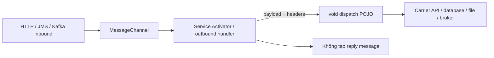
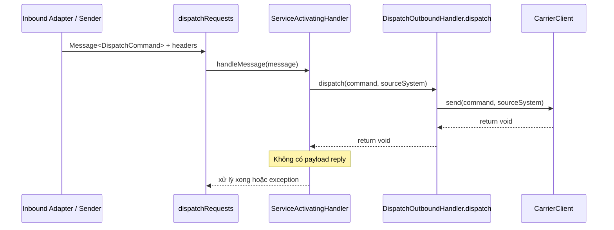

# Void method cho outbound handler trong Spring Integration

## 1. Bài toán: kết thúc một luồng message bằng phương thức POJO

Giả sử ứng dụng nhận yêu cầu giao hàng từ HTTP, JMS, AMQP hoặc Kafka. Message đã được kiểm tra và định tuyến đến bước cuối cùng: gọi `carrierClient.send(...)` để giao yêu cầu cho hệ thống vận chuyển. API hiện tại chỉ cung cấp một phương thức Java trả về `void`:

```java
public void send(DispatchCommand command) {
    // Gửi yêu cầu tới hệ thống vận chuyển.
}
```

Ta không cần tạo một payload mới sau bước gửi, nhưng vẫn cần Spring Integration **nhận message, ánh xạ tham số, gọi đúng phương thức và xử lý lỗi**. Đây là tình huống điển hình của **outbound handler một chiều**: một message đi vào một endpoint, endpoint thực hiện tác động phụ (side effect) và kết thúc nhánh xử lý.

Trong module **`SPRING_INTEGRATION_ADAPTERS`**, người học làm việc với inbound/outbound adapter, gateway, poller và `MessageChannel` để kết nối file, SFTP, HTTP, JMS, AMQP, Kafka, database cùng các hệ thống khác. Chủ đề **“Void method cho outbound handler”** thuộc nhóm **Adapter POJO**: dùng một phương thức Java sẵn có làm bước gửi/xử lý cuối của luồng tích hợp mà không phải đưa API Spring Messaging vào lớp nghiệp vụ.

Sau bài này, bạn có thể:

1. Giải thích ý nghĩa của một phương thức `void` trong `@ServiceActivator` hoặc Java DSL `.handle(...)`.
2. Phân biệt outbound handler một chiều với outbound gateway trả reply và với inbound `MessageSource`.
3. Truyền payload/header vào method POJO, cấu hình channel đầu vào và xử lý trường hợp thiếu tham số.
4. Nhận biết vì sao không có message để chuyển tiếp sau một handler `void`, ngay cả khi side effect thành công.
5. Thiết kế lỗi, retry, idempotency, transaction và kiểm thử cho endpoint outbound trong môi trường thực tế.

## 2. Outbound handler là gì?

Spring Integration lấy `Message<?>` làm đơn vị trao đổi giữa các thành phần. **Inbound adapter** đưa dữ liệu *vào* luồng; **outbound adapter** hoặc một handler cuối luồng đưa dữ liệu *ra* hệ thống khác hoặc gọi logic nghiệp vụ để thực hiện một tác động.

Ở cấp POJO, một `@ServiceActivator` có method trả về `void` là cách rất tự nhiên để biểu diễn bước nhận message và thực thi tác động một chiều. Spring Integration tạo endpoint/handler tương ứng, trích xuất dữ liệu từ message rồi gọi phương thức Java.



Một outbound handler POJO không nhất thiết tự mở kết nối mạng. Nó thường **ủy quyền** cho client hoặc service chuyên trách (`CarrierClient`, `InvoiceRepository`, `NotificationSender`...). Điều này giúp lớp xử lý nghiệp vụ giữ cấu trúc Java thông thường và dễ kiểm thử.

### Những lớp trách nhiệm dễ bị nhầm

| Thành phần | Vai trò | Có nhất thiết tạo reply? |
|---|---|---|
| `MessageSource` / inbound adapter | Lấy dữ liệu từ nguồn và đưa vào flow. | Không; nó **sản xuất** message đầu vào. |
| `MessageChannel` | Vận chuyển message giữa endpoint. | Không; channel không quyết định nghiệp vụ. |
| `@ServiceActivator` với method `void` | Nhận message và gọi logic, thường kết thúc nhánh flow. | **Không** tạo reply từ giá trị trả về vì method không trả giá trị. |
| `@ServiceActivator` với method trả DTO | Gọi logic và tạo giá trị cho bước sau. | Thường có reply nếu kết quả khác `null`. |
| Outbound channel adapter giao thức | Đẩy message sang JMS, Kafka, HTTP, file... theo cấu hình tương ứng. | Thông thường là tương tác một chiều tại ranh giới message flow. |
| Outbound gateway | Gửi yêu cầu và nhận phản hồi. | Có thiết kế request/reply; cần hợp đồng phản hồi phù hợp. |

**`void` nói về giá trị trả về của phương thức Java, không phải cam kết delivery của hệ thống bên ngoài.** Một method `void` có thể chạy đồng bộ rất lâu và ném exception. Một lời gọi hoàn tất bình thường cũng không tự chứng minh rằng hệ thống nhận đã lưu bền dữ liệu.

## 3. Hợp đồng xử lý: `void`, `null` và reply

Một service activator nhận một `Message<?>`, gọi phương thức phù hợp rồi xem xét kết quả trả về:

```text
Input message
  |
  v
ServiceActivatingHandler
  |
  +--> POJO method trả DTO/Message --> có thể phát reply
  |
  +--> POJO method trả null -------> mặc định không phát reply
  |
  +--> POJO method void ----------> không có giá trị để phát reply
  |
  +--> POJO method ném exception -> đi theo cơ chế xử lý lỗi
```

| Chữ ký method | Cách hiểu trong service activator thông thường |
|---|---|
| `void dispatch(DispatchCommand c)` | Thực hiện side effect; sau lời gọi không có đối tượng trả về để tạo reply. |
| `Void dispatch(DispatchCommand c)` trả `null` | Không tạo reply theo mặc định; khác kiểu `void` của Java nhưng kết quả message tương tự. |
| `DispatchReceipt dispatch(DispatchCommand c)` | Nếu trả DTO khác `null`, handler có thể tạo reply mang `DispatchReceipt`. |
| `Message<DispatchReceipt> dispatch(...)` | Trả message với payload và headers rõ ràng, để handler gửi reply. |
| `DispatchReceipt dispatch(...)` nhưng thực tế `return null` | Mặc định không tạo reply; có thể gây lỗi nếu endpoint đặt `requiresReply = true`. |

### 3.1. Header `replyChannel` không biến `void` thành reply

Request message có thể mang header `replyChannel`, và service activator có thể được cấu hình `outputChannel`. Các thông tin này **chỉ có ý nghĩa khi handler có reply để gửi**. Phương thức `void` không tạo reply, vì thế consumer ở cuối nhánh sẽ không tự gửi một message xác nhận chỉ do request có `replyChannel`.

Điều này đặc biệt quan trọng khi upstream là một **inbound gateway** hoặc phương thức Java qua `@MessagingGateway` đang chờ giá trị trả về. Nếu downstream cuối cùng là `void`, gateway yêu cầu phản hồi có thể nhận `null`, chờ đến timeout hoặc gặp lỗi tùy cấu hình endpoint và gateway. Hãy thiết kế hợp đồng rõ ràng:

- Chỉ cần phát lệnh hoặc ghi dữ liệu: dùng luồng một chiều, method `void`, không yêu cầu payload phản hồi.
- Cần biết nghiệp vụ đã chấp nhận/từ chối: trả về DTO xác nhận (`DispatchReceipt`, `Result`) và dùng request/reply flow phù hợp.
- Cần nhận kết quả từ API ngoài: dùng outbound gateway hoặc service trả kết quả, thay vì gọi một API bất đồng bộ `void` rồi tự diễn giải là đã thành công.

### 3.2. Khi nào `void` là lựa chọn tốt?

Phù hợp với **endpoint cuối luồng** có chức năng:

- Ghi audit hoặc metric không cần tạo response nghiệp vụ.
- Gửi thông báo tới một client đã quản lý việc gửi và lỗi.
- Lưu đối tượng vào repository hoặc gửi command đến hệ thống ngoài.
- Khởi phát tác vụ mà người gọi được thiết kế chỉ cần cơ chế xác nhận ở mức gửi message.

Không phù hợp nếu bước sau trong **cùng nhánh reply flow** cần payload do method tạo ra. Một handler `void` không cung cấp giá trị để `.transform(...)` hoặc `.channel("next")` nhận ở phía sau theo cách chuyển tiếp dựa trên reply.

## 4. Ánh xạ payload và headers vào tham số method

Một `Message<?>` có **payload** (dữ liệu chính) và **headers** (metadata). Spring Integration dùng cơ chế ánh xạ tham số của Spring Messaging để gọi phương thức POJO.

```text
Message<DispatchCommand>
    payload = DispatchCommand(dispatchId="D-100", destination="HN", packages=2)
    headers = { sourceSystem="HTTP", correlationId="flow-123", ... }
```

Các cách khai báo chữ ký thông dụng:

```java
// Chỉ cần payload:
public void dispatch(DispatchCommand command) { ... }

// Ghi rõ payload và đọc một header:
public void dispatch(
        @Payload DispatchCommand command,
        @Header("sourceSystem") String sourceSystem) { ... }

// Cho phép header tùy chọn:
public void dispatch(
        @Payload DispatchCommand command,
        @Header(value = "sourceSystem", required = false) String sourceSystem) { ... }

// Cần toàn bộ message:
public void dispatch(Message<DispatchCommand> message) { ... }

// Chỉ đọc metadata:
public void audit(@Headers Map<String, Object> headers) { ... }
```

Những annotation trên thuộc package `org.springframework.messaging.handler.annotation`: `@Payload`, `@Header`, `@Headers`. `Message` thuộc `org.springframework.messaging`. Khi sử dụng cả payload và header, cách đánh dấu rõ ràng giúp framework chọn đúng đối số và người đọc hiểu hợp đồng.

**Giới hạn cần nhớ:** nếu `@Header("sourceSystem")` bắt buộc mà message không có header tương ứng, việc giải đối số có thể thất bại trước khi đi vào method. Nếu inbound HTTP gửi JSON dưới dạng `String` hoặc `byte[]`, đừng giả định một method nhận `DispatchCommand` sẽ tự giải mã JSON trong mọi cấu hình: phải có converter hoặc transformer thích hợp ở ranh giới adapter.

### Khi nào nhận toàn bộ `Message<?>`?

Đọc `Message<DispatchCommand>` giúp method truy cập nhiều header linh hoạt:

```java
public void dispatch(Message<DispatchCommand> message) {
    DispatchCommand command = message.getPayload();
    String trace = (String) message.getHeaders().get("correlationId");
    carrierClient.send(command, trace);
}
```

Tuy nhiên, khi một lớp nghiệp vụ không cần biết đến hệ thống messaging, ưu tiên tham số POJO/DTO và chỉ truyền metadata thực sự cần thiết. Không đưa toàn bộ `Message<?>` vào client nghiệp vụ chỉ để lấy một trường `dispatchId`.

## 5. Ví dụ hoàn chỉnh: outbound handler gọi API vận chuyển

Ví dụ minh họa Java 17+, Spring Boot 3.x và Spring Integration 6.x. Luồng được cấu hình **một chiều**: một `DirectChannel` nhận yêu cầu, service activator `void` gửi yêu cầu đến `CarrierClient`. Để chạy độc lập không cần hệ thống mạng, dùng client in-memory thay cho adapter HTTP/Kafka thật.

Trong dự án Gradle:

```groovy
dependencies {
    implementation 'org.springframework.boot:spring-boot-starter-integration'
    testImplementation 'org.springframework.boot:spring-boot-starter-test'
}
```

Các lớp dưới đây cùng package `com.example.dispatch` và đặt ở các file Java tương ứng.

### 5.1. Khởi tạo Spring Integration và kênh đầu vào

```java
// DispatchApplication.java
package com.example.dispatch;

import org.springframework.boot.SpringApplication;
import org.springframework.boot.autoconfigure.SpringBootApplication;
import org.springframework.context.annotation.Bean;
import org.springframework.integration.channel.DirectChannel;
import org.springframework.integration.config.EnableIntegration;
import org.springframework.messaging.MessageChannel;

@SpringBootApplication
@EnableIntegration
public class DispatchApplication {

    public static void main(String[] args) {
        SpringApplication.run(DispatchApplication.class, args);
    }

    @Bean
    MessageChannel dispatchRequests() {
        return new DirectChannel();
    }
}
```

`dispatchRequests` nhận `Message<DispatchCommand>`. `DirectChannel` chuyển message đến subscriber theo cách đồng bộ: khi thread gọi `send(...)`, handler thường được thực thi ngay trên thread ấy. Không cần poller vì ở đây message được **đẩy vào channel** bởi thành phần phía trước.

### 5.2. Định nghĩa payload và cổng gọi hệ thống ngoài

```java
// DispatchCommand.java
package com.example.dispatch;

public record DispatchCommand(
        String dispatchId,
        String destination,
        int packages) { }
```

```java
// CarrierClient.java
package com.example.dispatch;

public interface CarrierClient {
    void send(DispatchCommand command, String sourceSystem);
}
```

Trong thực tế, `CarrierClient` có thể dùng HTTP client, message broker producer hoặc SDK của nhà vận chuyển. Để ví dụ có thể chạy độc lập, triển khai một fake client lưu lệnh theo `dispatchId`:

```java
// InMemoryCarrierClient.java
package com.example.dispatch;

import java.util.Map;
import java.util.concurrent.ConcurrentHashMap;
import org.springframework.stereotype.Component;

@Component
public class InMemoryCarrierClient implements CarrierClient {
    private final Map<String, DispatchCommand> submitted =
            new ConcurrentHashMap<>();

    @Override
    public void send(DispatchCommand command, String sourceSystem) {
        // Chỉ mô phỏng idempotency trong phạm vi một tiến trình.
        DispatchCommand previous =
                submitted.putIfAbsent(command.dispatchId(), command);
        if (previous == null) {
            System.out.printf("Sent %s to %s from %s%n",
                    command.dispatchId(), command.destination(), sourceSystem);
        }
    }

    public boolean contains(String dispatchId) {
        return submitted.containsKey(dispatchId);
    }
}
```

Đây là fake client phục vụ học tập. `ConcurrentHashMap` không thay thế database, không tồn tại qua restart và không tạo idempotency xuyên nhiều instance. Khi tích hợp thật, phải có cơ chế chống trùng ở nguồn hoặc đích dựa trên khóa nghiệp vụ bền.

### 5.3. Cài đặt outbound handler bằng method `void`

```java
// DispatchOutboundHandler.java
package com.example.dispatch;

import org.springframework.integration.annotation.ServiceActivator;
import org.springframework.messaging.handler.annotation.Header;
import org.springframework.messaging.handler.annotation.Payload;
import org.springframework.stereotype.Component;

@Component
public class DispatchOutboundHandler {
    private final CarrierClient carrierClient;

    public DispatchOutboundHandler(CarrierClient carrierClient) {
        this.carrierClient = carrierClient;
    }

    @ServiceActivator(inputChannel = "dispatchRequests")
    public void dispatch(
            @Payload DispatchCommand command,
            @Header(value = "sourceSystem", required = false) String sourceSystem) {

        if (command.dispatchId() == null || command.dispatchId().isBlank()) {
            throw new IllegalArgumentException("dispatchId must not be blank");
        }
        if (command.packages() <= 0) {
            throw new IllegalArgumentException("packages must be positive");
        }

        carrierClient.send(command,
                sourceSystem == null ? "unspecified" : sourceSystem);
    }
}
```

Spring Integration đăng ký một service activator nhận message từ `dispatchRequests`. Khi message đến, framework ánh xạ payload vào `command`, ánh xạ header `sourceSystem` vào tham số thứ hai và gọi `dispatch(...)`.

Method trả `void`, nên **không có reply message** từ handler để đưa đến channel tiếp theo. Không cần khai báo `outputChannel` cho endpoint một chiều này. Nếu `carrierClient.send(...)` ném exception, lỗi không biến mất chỉ vì method khai báo `void`.

### 5.4. Gửi một message thử từ upstream

Một HTTP inbound adapter, Kafka consumer hoặc JMS adapter có thể gửi dữ liệu đã chuẩn hóa vào channel. Để tự thử mà không cần kết nối bên ngoài:

```java
import org.springframework.messaging.MessageChannel;
import org.springframework.messaging.support.MessageBuilder;

void publish(MessageChannel dispatchRequests) {
    boolean acceptedByChannel = dispatchRequests.send(
            MessageBuilder.withPayload(
                            new DispatchCommand("D-100", "Hanoi", 2))
                    .setHeader("sourceSystem", "HTTP")
                    .setHeader("correlationId", "flow-123")
                    .build());

    System.out.println("Accepted by channel: " + acceptedByChannel);
}
```

Với `DirectChannel` có subscriber và không có lỗi, method `dispatch(...)` được gọi đồng bộ trước khi `send(...)` trả về. Fake client ghi nhận `D-100`; console có thể hiển thị:

```text
Sent D-100 to Hanoi from HTTP
Accepted by channel: true
```

**Giải thích đúng kết quả `send(...)`:** giá trị `true` thể hiện channel chấp nhận/phân phối message theo hợp đồng channel, không tự là biên nhận giao hàng từ hệ thống ngoài. Với client mô phỏng, kết quả chỉ được lưu trong RAM. Với HTTP hoặc broker thật, xác nhận thành công đến mức nào còn phụ thuộc giao thức, acknowledgment và cấu hình client.

### 5.5. Sơ đồ diễn tiến



Hình mô tả trường hợp đồng bộ thành công. Nếu client ném lỗi, luồng ngoại lệ được xử lý theo chính sách của channel/endpoint thay vì tạo một reply thành công.

## 6. Cách khác: Java DSL `.handle(pojo, "method")`

Khi muốn giữ toàn bộ cấu hình Spring Integration bên ngoài lớp nghiệp vụ, có thể dùng **Java DSL**. Giữ `DispatchOutboundHandler` là một `@Component` như mục 5.3 nhưng **gỡ annotation `@ServiceActivator`** khỏi method `dispatch(...)` và khai báo flow:

```java
// DispatchIntegrationFlow.java
package com.example.dispatch;

import org.springframework.context.annotation.Bean;
import org.springframework.context.annotation.Configuration;
import org.springframework.integration.dsl.IntegrationFlow;

@Configuration
public class DispatchIntegrationFlow {
    @Bean
    IntegrationFlow dispatchFlow(DispatchOutboundHandler outboundHandler) {
        return IntegrationFlow.from("dispatchRequests")
                .handle(outboundHandler, "dispatch")
                .get();
    }
}
```

`.handle(outboundHandler, "dispatch")` đăng ký một service activator gọi method POJO theo message đầu vào. Chữ ký `void` tiếp tục có nghĩa không tạo reply, vì vậy flow này kết thúc tại handler.

**Hai phương án `@ServiceActivator` và DSL là thay thế nhau.** Không nên vừa để annotation vừa tạo `IntegrationFlow.from("dispatchRequests")` với cùng logic. `DirectChannel` phân phối đến một subscriber nhận message, nên nếu có hai subscriber cùng loại, một lệnh có thể đến một trong hai endpoint, không bảo đảm tất cả endpoint cùng nhận.

### Dùng `MessageHandler` trực tiếp

Nếu muốn xử lý message theo hợp đồng framework thay vì POJO method, Java DSL còn cho phép handler lambda nhận nguyên `Message<?>`:

```java
@Bean
IntegrationFlow directHandlerFlow(CarrierClient carrierClient) {
    return IntegrationFlow.from("dispatchRequests")
            .handle(message -> {
                DispatchCommand command = (DispatchCommand) message.getPayload();
                String source = (String) message.getHeaders()
                        .getOrDefault("sourceSystem", "unspecified");
                carrierClient.send(command, source);
            })
            .get();
}
```

Đây là **phương án thứ ba**, dùng thay cho hai phương án trước. Lambda `MessageHandler` có hợp đồng `void handleMessage(Message<?> message)`; nó nhận toàn bộ message và thực hiện side effect. Ưu điểm của POJO method là khai báo tham số ngắn gọn và dễ tái sử dụng; ưu điểm của `MessageHandler` là chủ động thao tác trực tiếp với cấu trúc message khi điều đó thực sự cần thiết.

## 7. Tại sao `void` không tiếp tục được một flow yêu cầu reply?

Giả sử ta cấu hình:

```java
IntegrationFlow.from("dispatchRequests")
        .handle(outboundHandler, "dispatch") // Method trả void.
        .channel("afterDispatch")             // Không nhận được reply từ handler.
        .get();
```

Mặc dù biểu thức DSL có bước `.channel("afterDispatch")`, endpoint trước đó không có giá trị trả về nên **không phát reply** để bước sau nhận. Với service activator thông thường, `null`/`void` là kết quả không tạo reply; không phải tín hiệu tiếp tục tự động bằng message gốc.

Nếu yêu cầu nghiệp vụ là “gửi lệnh đi rồi tiếp tục xử lý cùng payload”, có thể viết handler **có trả kết quả** hoặc dùng một nhánh phụ thích hợp:

```java
@Bean
IntegrationFlow dispatchThenContinue(CarrierClient carrierClient) {
    return IntegrationFlow.from("dispatchRequests")
            .handle(DispatchCommand.class, (command, headers) -> {
                String source = (String) headers.getOrDefault(
                        "sourceSystem", "unspecified");
                carrierClient.send(command, source);
                return command; // Chủ động tạo reply payload cho bước sau.
            })
            .channel("afterDispatch")
            .get();
}
```

Đoạn này cũng là **phương án thay thế**, không chạy đồng thời với flow ở mục 6. Nhờ trả về `command`, service activator có payload cho bước tiếp theo. Nếu API trả về biên nhận thực (`DispatchReceipt`) thì trả biên nhận ấy sẽ rõ nghĩa hơn trả nguyên command. Đối với nhu cầu audit một bản sao message nhưng giữ đường đi chính, có thể xem xét `wireTap` và channel nhánh phù hợp.

### So sánh các thiết kế

| Nhu cầu | Gợi ý |
|---|---|
| Chỉ ghi log hoặc gửi lệnh một chiều | Method `void` ở cuối flow. |
| Gửi xong và chuyển nguyên payload sang bước khác | Handler trả payload hoặc dùng nhánh phụ (`wireTap`) được thiết kế rõ. |
| Cần biên nhận thực từ hệ thống đích | Dùng request/reply contract với gateway hoặc method trả `Receipt`. |
| Gửi lệnh bất đồng bộ rồi theo dõi sau | Thiết kế acknowledgment/event hồi đáp, correlation ID và trạng thái xử lý bền. |

## 8. Xử lý exception của outbound handler

Kiểu trả về `void` **không chặn exception**. Nếu method validate thất bại hoặc client lỗi kết nối, exception được ném trong quá trình xử lý message. Đường đi lỗi phụ thuộc channel và endpoint.

### `DirectChannel`: lỗi thường quay về người gửi

Với cấu hình ở mục 5, `DirectChannel` gọi handler đồng bộ. Nếu `carrierClient.send(...)` ném lỗi, lỗi thường được truyền ngược đến lời gọi `dispatchRequests.send(...)`, có thể được Spring Messaging bọc trong một `MessagingException` hoặc kiểu exception phù hợp. Người gửi hoặc adapter nguồn phải có chính sách xử lý lỗi đó.

Ví dụ (mô tả ý tưởng khi dùng client thật):

```java
public void dispatch(DispatchCommand command) {
    try {
        carrierClient.send(command, "HTTP");
    } catch (CarrierUnavailableException ex) {
        // Phân biệt hạ tầng tạm thời không sẵn sàng với lệnh không hợp lệ.
        throw ex;
    }
}
```

`CarrierUnavailableException` là exception minh họa do ứng dụng tự định nghĩa. Điều quan trọng là **không nuốt lỗi và giả vờ thành công**. Nếu lỗi đã được nuốt, downstream/upstream không thể biết thao tác thất bại để quyết định retry hoặc đưa vào dead-letter queue.

### `ExecutorChannel`, `QueueChannel` và adapter có transaction

Với `ExecutorChannel` hoặc polling consumer nhận từ `QueueChannel`, việc xử lý thường nằm ở thread hoặc chu kỳ khác. Người gọi `send(...)` có thể đã trả về trước khi method `void` thực sự chạy; exception không còn nhất thiết quay về caller ban đầu. Cần xem cấu hình `errorChannel`, error handler, advice và monitor của endpoint.

Với JMS, AMQP hoặc Kafka inbound, việc lỗi làm redelivery, commit/rollback, ack hoặc đưa vào dead-letter destination phụ thuộc **loại adapter, acknowledgment mode, transaction và chính sách retry**. Không thể suy ra hành vi retry cụ thể chỉ vì có một `@ServiceActivator` method `void` ở cuối flow.

### Trả `void` nhưng gửi thất bại một phần

Giả sử HTTP client gửi yêu cầu sang hãng vận chuyển, phía bên kia đã nhận nhưng kết nối bị ngắt trước khi client đọc được HTTP response. Method có thể ném timeout dù remote đã tạo đơn. Nếu adapter upstream redeliver, lệnh có thể được gửi lại. Do đó cần **idempotency key** như `dispatchId`, kiểm tra trạng thái từ xa hoặc cơ chế xác nhận bền vững; retry đơn thuần có thể gây trùng.

## 9. Đảm bảo giao hàng, transaction và idempotency

Một outbound handler `void` có thể được gọi **nhiều lần** cho cùng business event do retry hoặc redelivery. Đối với lệnh không thể áp dụng lại an toàn (thanh toán, gửi hàng, trừ kho), phải thiết kế chống trùng dựa trên khóa nghiệp vụ.

| Vấn đề | Rủi ro | Cách thiết kế |
|---|---|---|
| Upstream gửi trùng message | Gọi API đích hai lần. | Dùng `dispatchId`/`eventId` làm idempotency key; lưu trạng thái xử lý bền. |
| Handler làm xong side effect rồi lỗi ghi checkpoint | Message bị phát lại dù side effect đã xảy ra. | Kết hợp idempotency, outbox/inbox hoặc checkpoint phù hợp. |
| Thao tác nội bộ và gửi API ngoài ở hai hệ thống | Không có một transaction chung đảm bảo atomicity mặc định. | Dùng outbox, saga hoặc quy trình bù trừ khi cần. |
| Method trả `void` khi mới enqueue bất đồng bộ | Upstream tưởng đã giao thành công cho hệ thống đích. | Phân biệt “đã nhận lệnh”, “đã gửi” và “đã hoàn tất”; dùng sự kiện/receipt nếu cần. |
| Handler xử lý chậm | Chặn thread `DirectChannel` hoặc gây backlog ở queue. | Timeout I/O, giới hạn concurrency, capacity, backpressure và đo latency. |
| Nhiều instance xử lý cùng lệnh | Khóa trong JVM không đủ. | Thiết kế khóa/điều phối bền ở database/broker/dịch vụ đích. |

Ví dụ fake client ở mục 5 dùng `putIfAbsent(dispatchId, command)`, giúp bỏ qua lệnh trùng khi chạy **trong một JVM đang hoạt động**. Ở môi trường production, đó chỉ là một mô phỏng. Nếu có hai pod hoặc restart, map không còn tác dụng; cần cơ chế idempotency ở nơi dữ liệu được lưu bền hoặc ở chính API vận chuyển.

### Transaction đặt ở đâu?

Nếu service activator ghi vào database có transaction manager, có thể tổ chức transaction ở tầng service, endpoint hoặc upstream adapter theo mô hình dùng. Annotation `@Transactional` chỉ có tác dụng khi cấu hình transaction management và lời gọi đi qua cơ chế proxy phù hợp; nó **không tự khiến một cuộc gọi HTTP/Kafka ngoài database nằm trong cùng transaction**. Đối với thay đổi database rồi gửi event, transactional outbox thường giúp tránh khoảng trống giữa commit dữ liệu và phát message.

### Có cần retry trên method `void`?

Có thể, nhưng không nên áp dụng retry cho mọi lỗi. Lỗi tạm thời như timeout có thể retry với giới hạn và backoff. Lỗi hợp đồng (`dispatchId` trống, payload sai kiểu) thường cần reject hoặc đưa vào nơi kiểm tra. Mỗi lần retry có thể thực thi lại side effect, vì vậy retry phải đi cùng idempotency và quan sát trạng thái.

## 10. Quan sát và vận hành endpoint

Một outbound handler một chiều khó được theo dõi nếu chỉ dựa vào “không có exception”. Nên ghi nhận các thông tin sau theo chính sách bảo mật:

- `dispatchId` hoặc khóa nghiệp vụ để truy vết; tránh ghi lộ thông tin cá nhân trong payload.
- `sourceSystem`, `correlationId` hoặc trace ID để liên hệ với message phía trước.
- Số message đã nhận, số lệnh gửi thành công, số lỗi theo loại, thời gian gọi client và backlog ở upstream.
- Tỷ lệ retry/redelivery, số lệnh bị từ chối và số lệnh chờ xử lý lại.

Vòng đời endpoint liên quan đến cấu hình Spring Integration: service activator gắn với `DirectChannel` thường được kích hoạt mỗi khi channel có message và endpoint đang hoạt động. Nó **không cần poller**. Nếu nguồn đặt trong `QueueChannel` hoặc một adapter inbound polling, poller thuộc thành phần đọc nguồn/queue, không thuộc phương thức `void` đang xử lý.

Để bảo trì, có thể dừng adapter/upstream hoặc endpoint theo chính sách lifecycle. Dừng không tự động thu hồi một cuộc gọi mạng đã hoàn tất, cũng không bảo đảm xóa backlog đang chờ trong broker hoặc queue.

## 11. Kiểm thử từ POJO đến message flow

Có hai mức kiểm thử bổ trợ nhau: **unit test** xác nhận nghiệp vụ của method `void`, và **integration test** xác nhận Spring Integration ánh xạ message và gọi handler. Chúng có mục tiêu khác nhau.

### 11.1. Unit test outbound handler

Không cần Spring context để chứng minh method gọi client và validate đầu vào. Ví dụ dùng fake client ở mục 5:

```java
// DispatchOutboundHandlerTest.java
package com.example.dispatch;

import static org.junit.jupiter.api.Assertions.*;
import org.junit.jupiter.api.Test;

class DispatchOutboundHandlerTest {

    @Test
    void delegatesAValidCommandToClient() {
        InMemoryCarrierClient client = new InMemoryCarrierClient();
        DispatchOutboundHandler handler = new DispatchOutboundHandler(client);

        handler.dispatch(new DispatchCommand("UNIT-001", "Hanoi", 2), "JMS");

        assertTrue(client.contains("UNIT-001"));
    }

    @Test
    void rejectsInvalidPackageCountBeforeSending() {
        InMemoryCarrierClient client = new InMemoryCarrierClient();
        DispatchOutboundHandler handler = new DispatchOutboundHandler(client);

        assertThrows(IllegalArgumentException.class,
                () -> handler.dispatch(
                        new DispatchCommand("UNIT-002", "Hanoi", 0), "JMS"));
        assertFalse(client.contains("UNIT-002"));
    }
}
```

Test này xác nhận logic của POJO. Nó không xác nhận channel hoặc cơ chế ánh xạ header/payload.

### 11.2. Integration test kiểm tra service activator `void`

Sử dụng Spring Boot test context có `DispatchApplication`, `DispatchOutboundHandler` và `InMemoryCarrierClient` từ ví dụ mục 5:

```java
// DispatchFlowTest.java
package com.example.dispatch;

import static org.junit.jupiter.api.Assertions.*;

import org.junit.jupiter.api.Test;
import org.springframework.beans.factory.annotation.Autowired;
import org.springframework.beans.factory.annotation.Qualifier;
import org.springframework.boot.test.context.SpringBootTest;
import org.springframework.integration.channel.QueueChannel;
import org.springframework.messaging.MessageChannel;
import org.springframework.messaging.support.MessageBuilder;

@SpringBootTest
class DispatchFlowTest {

    @Autowired
    @Qualifier("dispatchRequests")
    MessageChannel requests;

    @Autowired
    InMemoryCarrierClient carrierClient;

    @Test
    void callsVoidHandlerWithoutProducingReply() {
        QueueChannel replies = new QueueChannel();

        boolean sent = requests.send(
                MessageBuilder.withPayload(
                                new DispatchCommand("FLOW-001", "Da Nang", 1))
                        .setHeader("sourceSystem", "HTTP")
                        .setReplyChannel(replies)
                        .build());

        assertTrue(sent);
        assertTrue(carrierClient.contains("FLOW-001"));
        assertNull(replies.receive(0));
    }
}
```

Với `DirectChannel`, handler được gọi đồng bộ; khi `send(...)` trở về thành công, fake client đã nhận lệnh. `replies.receive(0)` cho thấy **không có reply message** từ handler `void`, dù request có `replyChannel`. Test không cần `Thread.sleep()` và không phải chờ kết nối ngoài.

Nếu muốn kiểm tra đường lỗi, thay client bằng một test double ném exception rồi xác nhận hành vi tại channel/adapter. Đối với handler bất đồng bộ, không được giả định thread gọi `send(...)` sẽ nhận exception; cần kiểm tra error channel hoặc cơ chế theo dõi lỗi được cấu hình cho endpoint đó.

## 12. Những lỗi triển khai thường gặp

| Hiện tượng | Nguyên nhân cần xem | Hướng xử lý |
|---|---|---|
| Method `void` không chạy | Bean chưa được scan, channel sai tên, endpoint không đăng ký hoặc không có subscriber. | Kiểm tra `@Component`, `@ServiceActivator(inputChannel=...)`, trạng thái application context và việc gửi message. |
| Lỗi map tham số vào method | Payload sai kiểu hoặc thiếu `@Header` bắt buộc. | Xác nhận hợp đồng adapter; bổ sung converter/transformer hoặc `required = false` nếu header tùy chọn. |
| Đã gọi method nhưng flow không đến bước sau | Handler `void` không phát reply. | Trả DTO/payload nếu cần tiếp tục hoặc cấu hình nhánh side-effect riêng. |
| Inbound gateway timeout hoặc trả kết quả rỗng | Caller yêu cầu reply nhưng downstream cuối là `void`. | Dùng hợp đồng một chiều hoặc tạo kết quả xác nhận rõ ràng. |
| Một request không đến đúng handler | Khai báo trùng endpoint annotation và DSL trên cùng `DirectChannel`. | Chỉ giữ một cấu hình endpoint cho flow đang minh họa. |
| `send(...)` báo thành công nhưng phía đích thiếu dữ liệu | Side effect bất đồng bộ, không có ack bền hoặc lỗi phát sinh sau lời gọi. | Xác định cấp độ acknowledgment, timeout, retry và đối chiếu trạng thái thực tại đích. |
| Gửi trùng sau khi retry | API ngoài nhận rồi nhưng caller timeout, broker redeliver. | Idempotency key và cơ chế lưu trạng thái bền. |
| Lỗi chỉ xuất hiện ở log thread khác | Dùng channel/endpoint bất đồng bộ nên exception không quay về caller. | Thiết kế `errorChannel`, monitor và dead-letter handling phù hợp. |
| Hệ thống chậm khi số message tăng | `DirectChannel` xử lý đồng bộ với API I/O chậm. | Đo latency, đặt timeout và dùng buffer/concurrency có giới hạn khi cần. |

## 13. Bài tập thực hành

1. Viết `EmailNotificationSender` có method `void send(@Payload EmailCommand command)` và cấu hình `@ServiceActivator(inputChannel = "emailCommands")`. Gửi một message, xác nhận client fake nhận đúng payload.
2. Thêm `@Header(value = "sourceSystem", required = false)` vào method; kiểm thử khi có header và khi header vắng mặt.
3. Chuyển cấu hình annotation sang `IntegrationFlow.from("emailCommands").handle(sender, "send")`. Đảm bảo không còn endpoint annotation xử lý cùng channel.
4. Gắn `replyChannel` vào request gửi đến handler `void`, xác nhận không có reply; sau đó đổi method để trả `DispatchReceipt` và quan sát sự khác biệt.
5. Thêm bước `.channel("afterDispatch")` sau handler `void`. Giải thích vì sao channel này không nhận message; sửa bằng cách trả payload hoặc receipt thích hợp.
6. Giả lập carrier client timeout **sau khi đã ghi nhận lệnh**. Thử gửi lại cùng `dispatchId` và thiết kế cơ chế idempotency bền để tránh tạo đơn vận chuyển trùng.
7. Thay `DirectChannel` bằng một phương án bất đồng bộ, đo khác biệt giữa thời điểm `send(...)` trả về và thời điểm client thật được gọi; bổ sung kiểm soát lỗi và backlog.

## 14. Ghi nhớ

- **Method `void` trong `@ServiceActivator` phù hợp với outbound handler một chiều**: nhận message, gọi nghiệp vụ và kết thúc nhánh xử lý.
- **`void` không tạo reply**. Có header `replyChannel` hoặc khai báo bước DSL tiếp theo không làm Spring Integration tự chuyển tiếp message gốc.
- **`@Payload`, `@Header`, `@Headers` và `Message<?>`** là cách nhận dữ liệu từ message trong phương thức POJO.
- **`@ServiceActivator(inputChannel = "...")`** và **Java DSL `.handle(pojo, "method")`** là hai cách cấu hình thay thế nhau cho cùng mục đích.
- **Không cần poller** nếu handler nhận từ `DirectChannel` hoặc một upstream push message; poller được cấu hình ở endpoint đọc nguồn/kênh khi thực sự cần polling.
- **Kết quả `void` không bảo đảm delivery**. Timeout, ack, retry, transaction, idempotency, lỗi bất đồng bộ và lifecycle phải được thiết kế tại ranh giới adapter/client thích hợp.

### Tài liệu tham khảo

- [Spring Integration Reference — Service Activator](https://docs.spring.io/spring-integration/reference/service-activator.html)
- [Spring Integration Reference — Channel Adapter](https://docs.spring.io/spring-integration/reference/channel-adapter.html)
- [Spring Integration Reference — Java DSL](https://docs.spring.io/spring-integration/reference/dsl.html)
- [Spring Integration Reference — Message Endpoints](https://docs.spring.io/spring-integration/reference/endpoint.html)
- [Spring Integration Reference — Error Handling](https://docs.spring.io/spring-integration/reference/error-handling.html)
