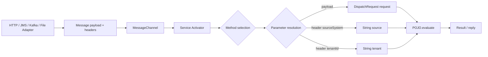
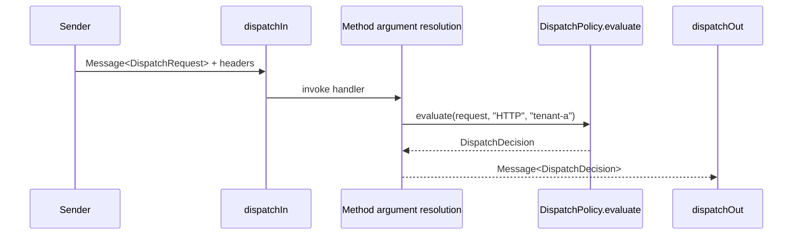
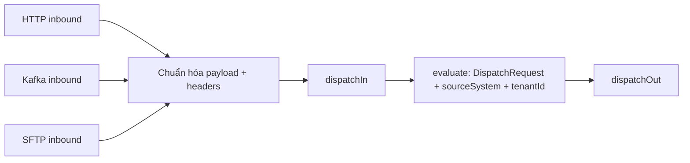

# Method parameter và payload resolution trong Spring Integration

## 1. Bài toán: một message, nhiều dạng tham số Java

Một hệ thống nhận đơn giao hàng từ HTTP, Kafka, JMS hoặc bảng dữ liệu cũ. Inbound adapter đưa dữ liệu vào `MessageChannel` dưới dạng `Message<DispatchRequest>`, kèm thông tin nguồn và người thuê dịch vụ (tenant). Ở bước xử lý nghiệp vụ, ta muốn gọi phương thức POJO:

```java
DispatchDecision evaluate(
        DispatchRequest request,
        String sourceSystem,
        String tenantId)
```

Nhưng message chỉ có **một payload và một tập headers**. Spring Integration phải quyết định tham số nào lấy từ payload, tham số nào lấy từ header, có cần chuyển đổi kiểu không và điều gì xảy ra khi thiếu dữ liệu.

Trong module **`SPRING_INTEGRATION_ADAPTERS`**, các inbound/outbound adapter, gateway, poller và `MessageChannel` kết nối file, SFTP, HTTP, JMS, AMQP, Kafka, cơ sở dữ liệu và hệ thống Java có sẵn. Chủ đề **Method parameter và payload resolution** giải thích việc *ánh xạ message sang tham số phương thức POJO* sau khi adapter chuyển dữ liệu vào luồng. Đây là nơi nhiều lỗi tích hợp tưởng như thuộc về adapter thực chất phát sinh do khác biệt về hợp đồng payload/header hoặc chữ ký method.

Mục tiêu bài học:

1. Giải thích cách framework chọn **phương thức cần gọi** và cách nó giải **giá trị của từng tham số**.
2. Ánh xạ payload, từng header, toàn bộ headers hoặc nguyên `Message<?>` bằng các annotation đúng.
3. Hiểu cơ chế chọn method theo kiểu payload, overload, `@Default`, giá trị tùy chọn và chuyển đổi kiểu.
4. Triển khai service activator POJO có cả payload và headers bằng annotation hoặc Java DSL.
5. Chẩn đoán lỗi thiếu header, payload không tương thích, method mơ hồ và kiểm thử hợp đồng đầu vào một cách có hệ thống.

## 2. Mô hình message và hai giai đoạn resolution

Một message của Spring Messaging bao gồm:

```text
Message<DispatchRequest>
  payload = DispatchRequest(
      dispatchId = "D-501",
      destination = "Hanoi",
      packages = 2
  )
  headers = {
      sourceSystem = "HTTP",
      tenantId = "tenant-a",
      correlationId = "flow-123",
      id = <UUID>,
      timestamp = <time>,
      ...
  }
```

**Payload** là dữ liệu nghiệp vụ chính. **Headers** là metadata phục vụ định tuyến, truy vết, lựa chọn nội dung hoặc tích hợp. Spring Integration thường tạo message từ dữ liệu của inbound adapter rồi chuyển qua channel đến một endpoint, chẳng hạn service activator, transformer, filter hoặc router.



Có **hai vấn đề khác nhau**:

- **Method selection:** Với bean có một hoặc nhiều method, framework phải quyết định *method nào* sẽ nhận message. Tên method được cấu hình, annotation, kiểu payload và các method ứng viên đều có thể ảnh hưởng.
- **Parameter resolution:** Sau khi chọn method, framework cần tạo các đối số Java *cho từng parameter*: lấy payload, header, headers map, toàn bộ message hoặc giá trị được chuyển kiểu.

Không nên gộp hai vấn đề này thành “Spring tự inject payload”. Một lớp có thể chọn được method nhưng vẫn thất bại khi thiếu header bắt buộc. Ngược lại, message có headers đầy đủ nhưng một overload mơ hồ khiến framework không chọn được method phù hợp.

## 3. Quy tắc ánh xạ tham số thông dụng

Spring Integration sử dụng cơ chế gọi method của Spring Messaging cho POJO endpoint. Những annotation phổ biến được import từ `org.springframework.messaging.handler.annotation`:

```java
import org.springframework.messaging.handler.annotation.Payload;
import org.springframework.messaging.handler.annotation.Header;
import org.springframework.messaging.handler.annotation.Headers;
```

| Chữ ký tham số | Giá trị nhận được | Lưu ý |
|---|---|---|
| `DispatchRequest request` | Toàn bộ payload nếu kiểu phù hợp | Cách ngắn gọn nhất với một payload rõ kiểu |
| `@Payload DispatchRequest request` | Payload, được chỉ định tường minh | Dễ đọc khi method có thêm header |
| `@Header("sourceSystem") String source` | Header tên `sourceSystem` | Mặc định bắt buộc hiện diện |
| `@Header(value = "tenantId", required = false) String tenant` | Header `tenantId` hoặc `null` | Kiểu tham số nên chấp nhận `null` |
| `@Headers Map<String, Object> headers` | Map các headers | Dùng khi cần nhiều header hoặc audit có chọn lọc |
| `Message<DispatchRequest> message` | Toàn bộ message | Cho phép lấy payload và headers trực tiếp |
| `MessageHeaders headers` | Đối tượng `MessageHeaders` | Thích hợp khi chỉ cần tập metadata |
| `Optional<DispatchRequest> request` | Giá trị payload được biểu diễn bằng `Optional` | Có hỗ trợ trong POJO invocation; payload của message vẫn không được `null` |
| `@Header("tenantId") Optional<String> tenant` | Header tùy chọn dạng `Optional` | Hữu ích khi không muốn truyền `null` |

Ví dụ các chữ ký hợp lệ cho **những handler thay thế nhau**:

```java
public void handle(DispatchRequest request) { ... }

public void handle(@Payload DispatchRequest request,
                   @Header("sourceSystem") String source) { ... }

public void handle(@Payload DispatchRequest request,
                   @Headers Map<String, Object> headers) { ... }

public void handle(Message<DispatchRequest> message) { ... }

public void audit(MessageHeaders headers) { ... }
```

Không khai báo tất cả các method trên cùng tên `handle` trong một flow mẫu nếu chưa thiết kế cơ chế chọn overload. Mỗi ví dụ chỉ minh họa một **hợp đồng đầu vào**.

### 3.1. Một tham số không annotation thường được coi là payload

Giả sử message có payload `DispatchRequest`:

```java
@ServiceActivator(inputChannel = "dispatchIn")
public void process(DispatchRequest request) {
    System.out.println(request.dispatchId());
}
```

Framework truyền `message.getPayload()` vào `request`. Cách này khuyến khích POJO chỉ biết dữ liệu nghiệp vụ, không phụ thuộc API `Message` của Spring. Nếu một phần tử của payload cần được dùng riêng, thông thường nên viết method nhận DTO rồi trích xuất trong code nghiệp vụ, hoặc dùng transformer trước handler.

**Không** giả định bất kỳ payload nào cũng tự chuyển thành `DispatchRequest`: một chuỗi JSON, `byte[]`, `Map` hoặc một DTO từ phiên bản schema khác có thể cần bước chuyển đổi trước khi handler chạy.

### 3.2. Dùng `@Payload` khi có nhiều tham số

```java
@ServiceActivator(inputChannel = "dispatchIn")
public void process(
        @Payload DispatchRequest request,
        @Header("sourceSystem") String sourceSystem) {
    System.out.println(request.dispatchId() + " from " + sourceSystem);
}
```

`@Payload` làm rõ đối số được lấy từ payload. `@Header` chỉ định metadata. Đây là dạng nên dùng khi chữ ký có cả dữ liệu nghiệp vụ lẫn dữ liệu tích hợp.

### 3.3. Lấy toàn bộ message khi cần payload cùng nhiều metadata

```java
import org.springframework.messaging.Message;

public void process(Message<DispatchRequest> message) {
    DispatchRequest command = message.getPayload();
    Object source = message.getHeaders().get("sourceSystem");
    Object correlation = message.getHeaders().get("correlationId");
    System.out.println(command.dispatchId() + " / " + source + " / " + correlation);
}
```

Với `Message<DispatchRequest>`, method nhìn thấy cả payload và headers. Đổi lại, lớp nghiệp vụ có thêm phụ thuộc Spring Messaging. Chỉ dùng cách này khi thực sự cần message như một đơn vị; một hoặc hai header riêng thì `@Header` thường gọn hơn.

### 3.4. Map payload và Map headers là hai đối tượng khác nhau

Đây là một trường hợp dễ gây nhầm:

```java
// Message có payload kiểu Map<String, Object>.
public void handle(@Payload Map<String, Object> body,
                   @Headers Map<String, Object> headers) {
    Object orderId = body.get("orderId");
    Object source = headers.get("sourceSystem");
}
```

Nếu dùng hai `Map` không annotation:

```java
public void handle(Map<String, Object> first,
                   Map<String, Object> second) { ... } // Dễ gây mơ hồ.
```

framework không có cách rõ ràng để biết map nào là payload và map nào là headers. Hãy **đặt `@Payload` trên map nghiệp vụ và `@Headers` trên map header**. Một `Map` không annotation đôi khi được ánh xạ theo quy ước, nhưng không nên dựa vào suy đoán đó trong hợp đồng tích hợp lâu dài.

## 4. Header bắt buộc, header tùy chọn và `Optional`

### Header bắt buộc

```java
public void process(@Payload DispatchRequest request,
                    @Header("sourceSystem") String source) {
    // Chỉ xử lý khi sourceSystem được cung cấp và resolve thành công.
}
```

`@Header("sourceSystem")` mặc định có `required = true`. Nếu inbound adapter không gửi header này, resolution thất bại trước lúc thực thi thân method. Đây thường là lỗi hợp đồng message, không phải lỗi kết nối đến hệ thống bên ngoài.

### Header tùy chọn

```java
public void process(@Payload DispatchRequest request,
                    @Header(value = "tenantId", required = false) String tenantId) {
    String tenant = tenantId == null ? "public" : tenantId;
    // ...
}
```

`required = false` cho phép header thiếu; khi dùng kiểu tham chiếu `String`, giá trị có thể là `null`. Với header tùy chọn, **không** dùng tham số primitive (`int`, `boolean`) nếu có khả năng thiếu dữ liệu và không có cách xử lý mặc định phù hợp.

Một số cấu hình POJO invocation cũng cho phép:

```java
public void process(@Payload DispatchRequest request,
                    @Header("tenantId") Optional<String> tenantId) {
    String tenant = tenantId.orElse("public");
}
```

`Optional` là lựa chọn phù hợp khi muốn biểu đạt trạng thái vắng mặt ngay trong chữ ký. Hỗ trợ `Optional` được tài liệu Spring Integration nêu cho service activator, nhưng hãy kiểm thử với phiên bản framework của dự án, đặc biệt nếu có custom resolver hoặc converter.

### Không tự đặt lại header hệ thống

Các header như `id`, `timestamp`, `replyChannel` và `errorChannel` có ý nghĩa với hạ tầng messaging. Ví dụ `replyChannel` có thể là một `MessageChannel` hoặc tên channel, không nên xử lý như một chuỗi nghiệp vụ thông thường. Dùng các khóa riêng, rõ nghĩa như `sourceSystem`, `tenantId`, `dispatchId`, `correlationId` và xác định chính sách header mapping ở từng adapter.

## 5. Method selection: chọn đúng phương thức trước khi giải đối số

Trước khi bind tham số, endpoint cần biết phải gọi method nào. Có hai dạng cấu hình phổ biến:

```java
// Chọn theo annotation trên method:
@ServiceActivator(inputChannel = "dispatchIn")
public DispatchDecision evaluate(DispatchRequest request) { ... }
```

```java
// Chọn theo tên method trong Java DSL:
IntegrationFlow.from("dispatchIn")
        .handle(dispatchPolicy, "evaluate")
        .channel("dispatchOut")
        .get();
```

Nếu chỉ có một method `evaluate` phù hợp, resolution đơn giản. Nhưng class có thể có nhiều overload:

```java
public String evaluate(DispatchRequest request) { return "DISPATCH"; }
public String evaluate(InventoryChange change) { return "INVENTORY"; }
```

Framework có thể chọn method theo kiểu payload tại runtime khi endpoint được cấu hình để xử lý nhiều phương thức trên một bean. Tuy nhiên, nếu có overload chung chung (`Object`, `Serializable`, các kiểu cha/con) hoặc converter có thể chuyển nhiều kiểu, việc chọn method có thể trở nên khó dự đoán.

### Biện pháp giảm mơ hồ

1. Ưu tiên một method `public` với chữ ký rõ ràng cho mỗi endpoint.
2. Nếu cần nhiều hành vi, dùng tên method khác nhau hoặc route theo loại message trước khi gọi POJO.
3. Khi dùng DSL, cung cấp tên method chính xác ở `.handle(bean, "methodName")`; nhớ rằng **tên method vẫn có thể có overload**.
4. Tránh để `Object`, `Map` hoặc nhiều generic tương tự làm tập ứng viên rộng lên khi không cần.
5. Viết integration test cho từng kiểu payload nếu dự án thật sự dùng overload để dispatch.

Spring Integration có `@org.springframework.integration.annotation.Default` làm method dự phòng trong tình huống đa phương thức không khớp kiểu payload. Đây là cơ chế chọn *method fallback*, không phải annotation để đặt giá trị mặc định cho một header. Nếu use case có nhiều loại event, một router với từng handler chuyên biệt thường dễ theo dõi hợp đồng hơn.

### Method không tham số có hợp lệ không?

Có. Service activator có thể gọi method không tham số như một phản ứng trước việc nhận message:

```java
@ServiceActivator(inputChannel = "auditEvents")
public void incrementCounter() {
    counter.incrementAndGet();
}
```

Message vẫn được dùng để kích hoạt endpoint, nhưng thân method không cần nội dung payload/header. Điều này **khác** phương thức nguồn `@InboundChannelAdapter`, nơi method không tham số được poll để **tạo ra** message mới.

## 6. Demo tự chứa: bind payload và headers vào POJO

Ví dụ dùng **Java 17+, Spring Boot 3.x và Spring Integration 6.x**. Một channel nhận lệnh giao hàng đã được deserialize sang record `DispatchRequest`; một service activator đọc payload, header bắt buộc `sourceSystem` và header tùy chọn `tenantId`, rồi tạo `DispatchDecision`.

### 6.1. Khai báo dependency

```groovy
// build.gradle (đoạn dependencies)
dependencies {
    implementation 'org.springframework.boot:spring-boot-starter-integration'
    testImplementation 'org.springframework.boot:spring-boot-starter-test'
}
```

Với Maven, dependency tương ứng là `spring-boot-starter-integration` và `spring-boot-starter-test`. Nếu tích hợp Kafka, JMS, HTTP hoặc file thật, bổ sung starter/module adapter đúng loại ở cấp dự án; chúng không bắt buộc đối với demo gửi message trực tiếp qua channel.

### 6.2. Ứng dụng và channels

Các ví dụ Java ở mục này cùng package `com.example.resolution` và được đặt trong các file tương ứng.

```java
// ResolutionApplication.java
package com.example.resolution;

import org.springframework.boot.SpringApplication;
import org.springframework.boot.autoconfigure.SpringBootApplication;
import org.springframework.context.annotation.Bean;
import org.springframework.integration.channel.DirectChannel;
import org.springframework.integration.channel.QueueChannel;
import org.springframework.integration.config.EnableIntegration;
import org.springframework.messaging.MessageChannel;
import org.springframework.messaging.PollableChannel;

@SpringBootApplication
@EnableIntegration
public class ResolutionApplication {
    public static void main(String[] args) {
        SpringApplication.run(ResolutionApplication.class, args);
    }

    @Bean
    MessageChannel dispatchIn() {
        return new DirectChannel();
    }

    @Bean
    PollableChannel dispatchOut() {
        return new QueueChannel();
    }
}
```

`DirectChannel` đẩy message đồng bộ đến handler. `QueueChannel` giữ reply để demo hoặc test đọc bằng `receive(timeout)`. Không có poller ở channel đầu vào vì lệnh sẽ được gửi trực tiếp từ sender; khi nối inbound adapter dùng polling, lịch nằm ở endpoint đọc nguồn.

### 6.3. Định nghĩa payload và kết quả

```java
// DispatchRequest.java
package com.example.resolution;

public record DispatchRequest(
        String dispatchId,
        String destination,
        int packages) { }
```

```java
// DispatchDecision.java
package com.example.resolution;

public record DispatchDecision(
        String dispatchId,
        boolean accepted,
        String sourceSystem,
        String tenantId,
        String reason) { }
```

`DispatchRequest` chứa dữ liệu nghiệp vụ; `sourceSystem` và `tenantId` được đưa vào headers theo hợp đồng tích hợp. Việc phân tách này cho phép đổi giao thức nguồn mà không phải sửa DTO mỗi khi adapter thêm metadata.

### 6.4. POJO method có ba tham số

```java
// DispatchPolicy.java
package com.example.resolution;

import org.springframework.integration.annotation.ServiceActivator;
import org.springframework.messaging.handler.annotation.Header;
import org.springframework.messaging.handler.annotation.Payload;
import org.springframework.stereotype.Component;

@Component
public class DispatchPolicy {

    @ServiceActivator(inputChannel = "dispatchIn", outputChannel = "dispatchOut")
    public DispatchDecision evaluate(
            @Payload DispatchRequest request,
            @Header("sourceSystem") String sourceSystem,
            @Header(value = "tenantId", required = false) String tenantId) {

        String resolvedTenant = tenantId == null ? "public" : tenantId;
        boolean accepted = request.dispatchId() != null
                && !request.dispatchId().isBlank()
                && request.packages() > 0;

        return new DispatchDecision(
                request.dispatchId(),
                accepted,
                sourceSystem,
                resolvedTenant,
                accepted ? "ACCEPTED" : "INVALID_DISPATCH");
    }
}
```

Điều quan trọng trong chữ ký:

- `@Payload DispatchRequest request` lấy **toàn bộ payload**. Framework không tạo thêm đối số từ các trường `dispatchId`, `destination` hay `packages` nếu method không yêu cầu.
- `@Header("sourceSystem") String sourceSystem` lấy header bắt buộc. Nếu thiếu, lỗi xảy ra trong giai đoạn giải đối số.
- `@Header(value = "tenantId", required = false) String tenantId` lấy header tùy chọn; method tự chọn `"public"` khi không có.
- Method trả `DispatchDecision`, nên service activator tạo reply message và gửi tới channel `dispatchOut`.

Nếu `evaluate(...)` trả `void` hoặc `null`, service activator thông thường sẽ không tạo reply. Đây là quyết định về hợp đồng **đầu ra**, độc lập với việc bind tham số **đầu vào**.

### 6.5. Sender tạo message minh bạch

```java
import org.springframework.messaging.MessageChannel;
import org.springframework.messaging.support.MessageBuilder;

void submit(MessageChannel dispatchIn) {
    boolean sent = dispatchIn.send(
            MessageBuilder
                    .withPayload(new DispatchRequest("D-501", "Hanoi", 2))
                    .setHeader("sourceSystem", "HTTP")
                    .setHeader("tenantId", "tenant-a")
                    .setHeader("correlationId", "flow-123")
                    .build());

    System.out.println("Channel accepted: " + sent);
}
```

Với `dispatchIn` có subscriber, một lần `send()` đồng bộ dẫn đến lời gọi:

```java
evaluate(
    new DispatchRequest("D-501", "Hanoi", 2),
    "HTTP",
    "tenant-a"
)
```

Kết quả gửi sang `dispatchOut` có payload `DispatchDecision("D-501", true, "HTTP", "tenant-a", "ACCEPTED")`.



### 6.6. Khi một header không được gửi

Nếu sender vẫn gửi `sourceSystem` nhưng bỏ `tenantId`, method chạy với `tenantId == null` và trả decision có tenant `"public"`.

Nếu sender bỏ luôn `sourceSystem`, Spring Messaging không đáp ứng được `@Header("sourceSystem")` bắt buộc. Lỗi xảy ra **trước khi** vào code `evaluate(...)`. Vì vậy, nếu muốn phân biệt lỗi hợp đồng với kết quả từ chối nghiệp vụ, không nên bắt lỗi rồi trả một `DispatchDecision` giả như lệnh đã được đánh giá.

## 7. Cấu hình tương đương bằng Java DSL

Java DSL cho phép giữ Spring Integration annotation ra khỏi lớp xử lý. Giữ nguyên các record và channel ở mục 6, nhưng **gỡ `@ServiceActivator`** trên method `DispatchPolicy.evaluate(...)`. Lớp vẫn có thể là một `@Component` chứa method với `@Payload` và `@Header`.

```java
// DispatchFlowConfig.java
package com.example.resolution;

import org.springframework.context.annotation.Bean;
import org.springframework.context.annotation.Configuration;
import org.springframework.integration.dsl.IntegrationFlow;

@Configuration
public class DispatchFlowConfig {

    @Bean
    IntegrationFlow dispatchFlow(DispatchPolicy policy) {
        return IntegrationFlow.from("dispatchIn")
                .handle(policy, "evaluate")
                .channel("dispatchOut")
                .get();
    }
}
```

`.handle(policy, "evaluate")` đăng ký handler gọi method POJO tên `evaluate`. Các annotation **trên tham số** vẫn diễn đạt nguồn dữ liệu của từng đối số. Khi method trả decision, message đi tiếp vào `dispatchOut` của flow.

Hai phương án mục 6 (`@ServiceActivator`) và mục 7 (DSL) **là lựa chọn thay thế**. Không đăng ký cả hai trên cùng `DirectChannel`: chúng có thể tạo nhiều subscriber và làm việc chọn endpoint nhận lệnh trở nên ngoài dự kiến.

Khi phải chuyển đổi payload trước khi gọi method, DSL thể hiện thứ tự rất rõ:

```text
Inbound adapter
  -> deserialize/transform JSON hoặc byte[] thành DispatchRequest
  -> header enrichment (nếu cần sourceSystem, tenantId)
  -> .handle(dispatchPolicy, "evaluate")
  -> output channel / outbound adapter
```

Như vậy, bước giải đối số hoạt động với **hợp đồng dữ liệu đã chuẩn hóa**; nó không phải nơi chịu mọi trách nhiệm parse dữ liệu từ hệ thống bên ngoài.

## 8. Conversion: hỗ trợ kiểu dữ liệu đến đâu?

Spring Messaging/Spring Integration hỗ trợ chuyển đổi kiểu trong nhiều trường hợp thông thường. Ví dụ một header mang giá trị chuỗi `"3"` có thể được chuyển thành tham số `Integer` hoặc `int` nếu converter tương ứng hỗ trợ.

```java
public void process(
        @Payload DispatchRequest request,
        @Header("attempt") int attempt) {
    System.out.println(attempt);
}
```

Tuy nhiên, **conversion không đồng nghĩa với serialization/deserialization**. Bảng dưới thể hiện các trường hợp cần đánh giá riêng:

| Message đầu vào | Method yêu cầu | Điều cần kiểm tra |
|---|---|---|
| Payload `DispatchRequest` | `@Payload DispatchRequest` | Tương thích trực tiếp, đơn giản nhất |
| Payload `String` chứa JSON | `@Payload DispatchRequest` | Cần JSON converter hoặc transformer được cấu hình; không mặc định suy ra DTO từ mọi chuỗi |
| Payload `byte[]` từ file/JMS | `@Payload String` | Cần xác định charset và converter, không ép kiểu tùy tiện |
| Header `"attempt" = "3"` | `@Header("attempt") int` | Conversion chuỗi → số có thể hỗ trợ; test với cấu hình thật |
| Header `"attempt" = "many"` | `@Header("attempt") int` | Chuyển đổi thất bại, method chưa chạy |
| Payload `Map` | `@Payload DispatchRequest` | Mapping `Map` → record cần converter có khả năng tạo DTO |
| Payload `List<Order>` | `@Payload Order` | Cần Splitter hoặc bước chọn phần tử; không tự lấy một phần tử đầu tiên |
| Payload `OrderV1` | `@Payload OrderV2` | Cần chiến lược versioning/transform phù hợp |

Tại ranh giới inbound, có thể dùng `JsonToObjectTransformer`, Jackson transformer, message converter của adapter hoặc một bước Java chuyên trách. Chọn cơ chế nào phụ thuộc loại adapter và dependency hiện có; ví dụ annotation/DSL ở trên **giả định payload đã là `DispatchRequest`**.

### Chỉ thay chữ ký method không sửa được hợp đồng dữ liệu sai

Nếu Kafka adapter đưa vào `byte[]` nhưng method nhận `DispatchRequest`, lỗi không thể chữa bằng cách đổi `@Payload` thành `@Header`. Phải xác định rõ cấu trúc event, content type, charset, schema và kiểu payload cuối cùng trước khi vào handler. Tương tự, header từ HTTP có thể là `String` hoặc một kiểu do mapper cung cấp, trong khi broker header được giải mã theo cơ chế khác.

## 9. Giá trị `null`, `Optional` và một message không có payload

Spring `Message` thông thường không chấp nhận payload `null`. Vì vậy, **không có payload** khác với **payload là `Optional.empty()`** hoặc **kết quả method trả `null`**:

- `Message<?>.getPayload()` phải mang giá trị hợp lệ theo hợp đồng Spring Messaging.
- `Optional<T>` ở chữ ký method là cách biểu diễn tham số có thể vắng mặt theo resolver; không nên dùng `Optional.empty()` làm tín hiệu “không có message” của `MessageSource`.
- `MessageSource.receive()` trả **`null`** khi chưa nhận được message.
- Method service activator trả **`null`** khi không muốn tạo reply (trừ khi cấu hình yêu cầu reply).
- Header được đánh dấu `required = false` có thể vắng mặt mà không làm payload trở thành `null`.

Ví dụ method dưới đây có hai trường hợp khác nhau:

```java
public String format(
        @Payload DispatchRequest request,
        @Header(value = "tenantId", required = false) String tenantId) {
    if (request.packages() <= 0) {
        return null; // Không tạo reply từ service activator thông thường.
    }
    return tenantId == null ? "public" : tenantId;
}
```

Trong nghiệp vụ thật, không nên trả `null` để che lỗi dữ liệu nguồn. Một DTO kết quả với trạng thái `REJECTED` thường tốt hơn nếu caller hoặc gateway đang chờ phản hồi. Còn khi muốn dừng xử lý trong một filter, hãy dùng filter đúng mục đích và quy tắc discard/error tương ứng.

## 10. Ánh xạ theo chiều ngược lại: `@MessagingGateway`

Đến đây ta đang xét **message → tham số của handler**. Với `@MessagingGateway`, Spring Integration còn hỗ trợ chiều ngược lại: **đối số gọi một method Java → message payload và headers**.

Ví dụ giao diện gateway:

```java
package com.example.resolution;

import org.springframework.integration.annotation.MessagingGateway;
import org.springframework.messaging.handler.annotation.Header;
import org.springframework.messaging.handler.annotation.Payload;

@MessagingGateway(defaultRequestChannel = "dispatchIn")
public interface DispatchIngress {
    void submit(
            @Payload DispatchRequest request,
            @Header("sourceSystem") String sourceSystem,
            @Header("tenantId") String tenantId);
}
```

Khi caller gọi:

```java
gateway.submit(
    new DispatchRequest("D-777", "Da Nang", 1),
    "JMS",
    "tenant-b");
```

gateway tạo request message có payload `DispatchRequest` và hai header tương ứng để gửi đến `dispatchIn`. Để interface gateway được đăng ký làm bean, cần bật cơ chế quét gateway phù hợp (ví dụ `@IntegrationComponentScan` trong cấu hình Spring Integration).

| Chiều ánh xạ | Câu hỏi cần giải quyết | Ví dụ |
|---|---|---|
| **Gateway → message** | Các argument Java trở thành payload và headers nào? | `submit(@Payload req, @Header("tenantId") tenant)` |
| **Message → POJO handler** | Payload và headers được truyền vào parameter nào? | `evaluate(@Payload req, @Header("tenantId") tenant)` |

Một lỗi thường gặp là đọc quy tắc `@Payload`/`@Headers` của gateway rồi áp dụng nguyên xi cho service activator. Hai chiều có một số annotation giống nhau nhưng điểm xuất phát khác nhau. Trong cả hai chiều, **không khai báo hai tham số đều là `@Payload`** để mong một message có hai payload độc lập.

## 11. Bảo vệ hợp đồng khi có nhiều adapter nguồn

Giả sử ba adapter cùng gửi về `dispatchIn`:



Mỗi adapter có thể biểu diễn message ban đầu khác nhau:

- HTTP nhận JSON, query/path parameters và HTTP headers.
- Kafka nhận key/value bytes và record headers, cần deserializer/header mapper.
- SFTP nhận file hoặc đường dẫn file, có metadata tên file/timestamp.
- JMS/AMQP có message properties và headers riêng theo giao thức.
- Database poller có thể trả row object hoặc collection, tùy adapter/source.

Trước khi đến `DispatchPolicy`, bước **chuẩn hóa hợp đồng** nên bảo đảm:

1. Payload cuối cùng là đúng kiểu `DispatchRequest`, có validation schema cần thiết.
2. Header `sourceSystem` luôn có với giá trị tin cậy do adapter/gateway tạo.
3. Header `tenantId` được cung cấp khi có ý nghĩa, hoặc được đánh dấu tùy chọn và có quy tắc mặc định.
4. Mã truy vết `correlationId` được bảo toàn qua những chặng cần quan sát.
5. Các header không đáng tin cậy từ bên ngoài không được tự động dùng để cấp quyền hoặc lựa chọn tenant khi chưa xác thực.

Điều này cho phép method POJO giữ một chữ ký ổn định ngay cả khi thay HTTP bằng JMS hoặc bổ sung một nguồn SFTP.

### Vì sao headers không phải dữ liệu đáng tin cậy mặc định?

Header có thể do ứng dụng upstream, HTTP caller hoặc broker producer đặt. Nếu header `tenantId` quyết định phạm vi dữ liệu, phải đối chiếu với danh tính/ủy quyền ở ranh giới đáng tin cậy; chỉ bind `@Header("tenantId")` không tự tạo cơ chế bảo mật. Tránh log toàn bộ headers vì chúng có thể chứa token, thông tin cá nhân hoặc routing metadata nhạy cảm.

## 12. Kiểm thử resolution trong Spring context

Unit test trực tiếp `DispatchPolicy.evaluate(...)` xác nhận logic nghiệp vụ nhưng **không kiểm tra việc Spring ánh xạ từ `Message<?>` sang tham số**. Để kiểm chứng mapping, cần chạy một flow có handler thực và gửi message qua input channel.

### 12.1. Integration test: có payload và đủ headers

Sử dụng các bean ở mục 6:

```java
// DispatchResolutionTest.java
package com.example.resolution;

import static org.junit.jupiter.api.Assertions.*;

import org.junit.jupiter.api.Test;
import org.springframework.beans.factory.annotation.Autowired;
import org.springframework.beans.factory.annotation.Qualifier;
import org.springframework.boot.test.context.SpringBootTest;
import org.springframework.messaging.Message;
import org.springframework.messaging.MessageChannel;
import org.springframework.messaging.PollableChannel;
import org.springframework.messaging.support.MessageBuilder;

@SpringBootTest
class DispatchResolutionTest {

    @Autowired
    @Qualifier("dispatchIn")
    MessageChannel input;

    @Autowired
    @Qualifier("dispatchOut")
    PollableChannel output;

    @Test
    void resolvesPayloadAndHeaders() {
        boolean sent = input.send(
                MessageBuilder
                        .withPayload(new DispatchRequest("TEST-01", "Hanoi", 2))
                        .setHeader("sourceSystem", "HTTP")
                        .setHeader("tenantId", "tenant-a")
                        .build());

        assertTrue(sent);
        Message<?> reply = output.receive(1000);
        assertNotNull(reply);
        assertInstanceOf(DispatchDecision.class, reply.getPayload());

        DispatchDecision decision = (DispatchDecision) reply.getPayload();
        assertEquals("TEST-01", decision.dispatchId());
        assertTrue(decision.accepted());
        assertEquals("HTTP", decision.sourceSystem());
        assertEquals("tenant-a", decision.tenantId());
    }

    @Test
    void resolvesMissingOptionalHeader() {
        input.send(MessageBuilder
                .withPayload(new DispatchRequest("TEST-02", "Hue", 1))
                .setHeader("sourceSystem", "JMS")
                .build());

        Message<?> reply = output.receive(1000);
        assertNotNull(reply);
        DispatchDecision decision = (DispatchDecision) reply.getPayload();
        assertEquals("public", decision.tenantId());
    }
}
```

Hai test này lần lượt kiểm tra header đầy đủ và header tùy chọn. `QueueChannel.receive(1000)` giúp tránh `Thread.sleep()` cố định. Khi nhiều test chạy song song trên chung Spring context và queue, cần cách ly context hoặc kiểm soát luồng để message từ test này không bị test khác tiêu thụ; không nên dựa vào thứ tự chạy.

### 12.2. Kiểm tra thiếu header bắt buộc

Với `DirectChannel` đồng bộ, lỗi mapping thường được truyền về caller thông qua exception trong đường xử lý message:

```java
import org.springframework.messaging.MessagingException;

@Test
void rejectsMissingRequiredHeader() {
    assertThrows(MessagingException.class, () ->
            input.send(MessageBuilder
                    .withPayload(new DispatchRequest("TEST-03", "Hanoi", 1))
                    // Cố tình không có sourceSystem.
                    .build()));
}
```

Test kiểm tra rằng lỗi có thể quan sát được; khi debug chi tiết, xem nguyên nhân gốc (`cause`) để biết lỗi xuất phát từ header thiếu, kiểu không tương thích hay method không tìm được. Không nên gắn cứng mã test vào một thông điệp exception cụ thể nếu thư viện có thể đổi cách trình bày.

### 12.3. Kiểm tra sai kiểu payload

Trường hợp này phải làm rõ **cấu hình conversion** trước khi đặt kỳ vọng. Ví dụ gửi một `String` chứa JSON:

```java
Message<?> raw = MessageBuilder
        .withPayload("{\"dispatchId\":\"TEST-04\",\"packages\":1}")
        .setHeader("sourceSystem", "HTTP")
        .build();
```

Nếu không có converter/transformer thích hợp, handler yêu cầu `DispatchRequest` có thể bị lỗi method selection, argument resolution hoặc type conversion. Test integration nên xác nhận chính xác **kết quả sau bước deserialize** thay vì mặc định `@Payload` tự parse mọi JSON.

## 13. Debug khi method không được gọi hoặc nhận sai đối số

| Biểu hiện | Cần kiểm tra | Hướng khắc phục |
|---|---|---|
| Handler không chạy | Input channel, subscriber, tên bean/method, endpoint lifecycle | Kiểm tra cấu hình `@ServiceActivator` hoặc DSL và luồng message |
| Lỗi không tìm thấy method thích hợp | Payload type, overload, visibility, method name | Đặt method `public`, chọn tên rõ, đưa payload về đúng kiểu |
| Lỗi thiếu header | `@Header` mặc định `required = true`; adapter chưa map header | Chuẩn hóa header ở inbound hoặc đặt `required=false` nếu tùy chọn thật |
| Method nhận `null` ở header tùy chọn | Header vắng mặt và tham số cho phép `null` | Xử lý giá trị mặc định/Optional trong POJO |
| `ClassCastException` trong thân method | Method tự cast từ `Message<?>` hoặc `Map` không đúng kiểu | Dùng DTO, converter hoặc kiểm tra kiểu trước khi cast |
| Payload JSON vẫn là `String` | Adapter chưa deserialize | Thêm converter/transformer đúng schema, charset và content type |
| Hai `Map` bị nhầm | Payload và headers đều biểu diễn dạng Map | Đánh dấu rõ `@Payload` và `@Headers` |
| Header số không parse được | Chuỗi header không phù hợp kiểu tham số | Validate dữ liệu, converter hoặc đổi hợp đồng header |
| Method được gọi nhưng không có reply | Method `void` hoặc trả `null` | Dùng DTO kết quả nếu pipeline/gateway cần reply |
| Lỗi xảy ra nhưng caller không thấy | Channel hoặc endpoint bất đồng bộ | Kiểm tra `errorChannel`, error handler, log và cơ chế ack |
| Một message chạy nhầm handler | Có nhiều subscriber hoặc overload dễ trùng | Kiểm tra flow registry, phân loại message và tên method |

### Một trình tự debug thực tế

1. **Xác nhận message đầu vào**: log có kiểm soát `payload.getClass()`, tên header và correlation ID. Tránh log token, thông tin nhạy cảm hoặc toàn bộ payload thực.
2. **Xác nhận endpoint**: handler được đăng ký với `inputChannel` nào; method được chọn bằng annotation hay DSL; có nhiều endpoint xử lý cùng channel không.
3. **Đối chiếu chữ ký method**: kiểu payload có khớp; tham số nào dùng `@Payload`, `@Header`, `@Headers`; header nào bắt buộc.
4. **Kiểm tra conversion**: kết quả sau deserialize/transform có đúng loại Java mà method cần; nếu không, sửa ở ranh giới trước handler.
5. **Xác nhận reply/error**: method trả gì, output channel/replyChannel nào được dùng, lỗi được đưa về caller hay errorChannel.

Với `DirectChannel`, lỗi trong handler có thể truyền ngược đến người gọi đồng bộ. Với `ExecutorChannel`, polling consumer hoặc adapter bất đồng bộ, exception có thể được đưa sang đường xử lý lỗi khác. Vì vậy, log ở sender không đủ để khẳng định parameter resolution của handler đã thành công.

## 14. Bài tập thực hành

1. Từ mẫu mục 6, bỏ `@Payload` trên `DispatchRequest` nhưng giữ hai `@Header`. Chạy test xác nhận framework vẫn bind đúng payload qua kiểu DTO.
2. Bỏ `sourceSystem` khỏi message. Quan sát lỗi trước khi method chạy; thêm test đối chiếu `cause` của exception.
3. Đổi `tenantId` thành header bắt buộc; sau đó đổi thành `Optional<String>` và so sánh hợp đồng nhận giá trị khi header vắng mặt.
4. Tạo payload kiểu `Map<String, Object>` và viết method nhận `@Payload Map<String, Object>` cùng `@Headers Map<String, Object>`. Chứng minh hai map chứa dữ liệu khác nhau.
5. Gửi header `attempt = "3"` tới method nhận `@Header("attempt") int attempt`. Thử với `attempt = "three"` và giải thích vị trí lỗi conversion.
6. Đổi sender sang kiểu `String` chứa JSON. Chèn một bước chuyển đổi rõ ràng từ JSON sang `DispatchRequest` rồi chạy lại test.
7. Viết class có hai overload `evaluate(DispatchRequest)` và `evaluate(InventoryChange)`; cấu hình một endpoint có nhiều method ứng viên, viết test cho hai payload và một kiểu không hỗ trợ.
8. Tạo `@MessagingGateway` với phương thức `submit(@Payload DispatchRequest, @Header("sourceSystem") String)`; xác minh chiều ánh xạ từ đối số gateway sang message trước khi handler nhận.
9. Mô phỏng hai adapter nguồn: một từ HTTP và một từ Kafka. Chuẩn hóa cả hai về cùng kiểu payload và headers, rồi dùng chung `DispatchPolicy.evaluate(...)`.
10. Tạo trường hợp handler trả `null` khi validation không hợp lệ. Phân tích ảnh hưởng tới gateway đang chờ reply và thiết kế lại với DTO `DispatchDecision` rõ ràng.

## 15. Ghi nhớ khi thiết kế hợp đồng message → method

- **Method selection** chọn method cần gọi; **parameter resolution** cung cấp đối số cho method đó. Đây là hai bước có thể lỗi độc lập.
- Một parameter POJO đúng kiểu thường nhận **payload**; dùng `@Payload` khi muốn diễn đạt tường minh.
- **`@Header`** lấy một header; mặc định là bắt buộc. **`@Headers`** lấy cả map header; dùng annotation rõ ràng khi payload cũng là `Map`.
- Nhận **`Message<?>`** khi cần toàn bộ payload và metadata; với nghiệp vụ độc lập framework, ưu tiên DTO cùng những header cụ thể.
- `Optional` và `required = false` giúp biểu đạt giá trị tùy chọn, nhưng không thay thế kiểm tra hợp đồng message.
- Conversion đơn giản có thể được hỗ trợ; **JSON/Avro/byte[] → DTO** cần serializer, deserializer hoặc transformer đúng cấu hình và schema.
- **`@MessagingGateway` ánh xạ argument → message**; **service activator ánh xạ message → argument**. Cùng annotation không đồng nghĩa hai chiều xử lý hệt nhau.
- Khi có nhiều adapter (HTTP, JMS, Kafka, file, SFTP, database), hãy chuẩn hóa payload/headers **trước** khi gọi POJO và kiểm thử với message thực tế.

### Tài liệu tham khảo

- [Spring Integration 6.5 — Annotation Support: payload, `@Header`, `@Headers`](https://docs.spring.io/spring-integration/reference/6.5/configuration/annotations.html)
- [Spring Integration 6.5 — Service Activator: tham số POJO, method selection, `Optional`](https://docs.spring.io/spring-integration/reference/6.5/service-activator.html)
- [Spring Integration — Messaging Gateways: Mapping Method Arguments to a Message](https://docs.spring.io/spring-integration/reference/gateway.html)
- [Spring Framework API — `@Payload`](https://docs.spring.io/spring-framework/docs/current/javadoc-api/org/springframework/messaging/handler/annotation/Payload.html)
- [Spring Framework API — `@Header`](https://docs.spring.io/spring-framework/docs/current/javadoc-api/org/springframework/messaging/handler/annotation/Header.html)
- [Spring Framework API — `@Headers`](https://docs.spring.io/spring-framework/docs/current/javadoc-api/org/springframework/messaging/handler/annotation/Headers.html)
