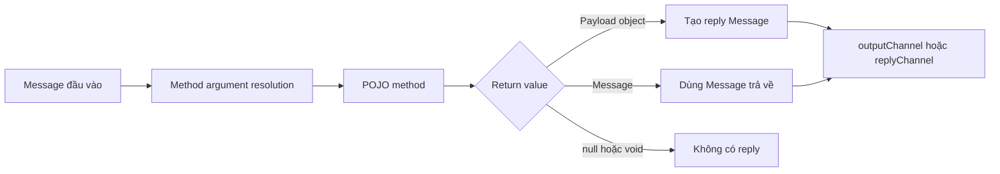

# Return value và message conversion

## Mục tiêu

Trong Spring Integration, POJO adapter gọi phương thức Java để xử lý message. Giá trị phương thức trả về quyết định dữ liệu nào được chuyển tiếp, còn message conversion giúp ánh xạ payload và header sang kiểu mà phương thức cần. Sau bài học, bạn có thể:

- Giải thích cách return value của `@ServiceActivator`, `@Transformer` và `@InboundChannelAdapter` đi vào luồng message.
- Phân biệt trả về một payload, một `Message<?>`, `null` và `void`.
- Dùng `@Payload`, `@Header`, `@Headers` và `Message<?>` để lấy dữ liệu đầu vào.
- Cấu hình `ConversionService` và converter tùy chỉnh cho kiểu payload của ứng dụng.
- Nhận biết khi nào cần chuyển đổi định dạng message như JSON và cách xử lý lỗi chuyển đổi.

## Return value trở thành message như thế nào?

Một POJO endpoint được Spring Integration gọi khi message đến input channel hoặc khi poller kích hoạt inbound adapter. Với endpoint tạo đầu ra, giá trị trả về của phương thức thường trở thành payload của message tiếp theo. Kết quả được gửi tới `outputChannel` đã cấu hình; nếu endpoint hoạt động theo request/reply, kết quả có thể được gửi về reply channel trong header `replyChannel`.



Với một `@ServiceActivator`, phương thức có thể nhận payload, thực hiện nghiệp vụ và trả về kết quả:

```java
@Component
public class OrderHandler {

    @ServiceActivator(inputChannel = "orders.in",
                      outputChannel = "orders.accepted")
    public OrderReceipt accept(@Payload Order order,
                               @Header(name = "source", required = false) String source) {
        return new OrderReceipt(order.id(), "accepted", source);
    }
}
```

Nếu phương thức trả về `OrderReceipt`, endpoint đóng gói đối tượng đó làm payload của reply message và gửi tới `orders.accepted`. Phía nhận channel tiếp theo xử lý `OrderReceipt`, không phải đối tượng `Order` đầu vào. Đây là cách một service activator vừa thực hiện hành động vừa tạo kết quả cho flow.

Nếu phương thức cần tự quyết định header hoặc reply metadata, có thể trả về một `Message<?>`:

```java
@ServiceActivator(inputChannel = "orders.in",
                  outputChannel = "orders.accepted")
public Message<OrderReceipt> accept(Message<Order> request) {
    Order order = request.getPayload();
    OrderReceipt receipt = new OrderReceipt(order.id(), "accepted", null);

    return MessageBuilder.withPayload(receipt)
            .copyHeaders(request.getHeaders())
            .setHeader("processing-status", "validated")
            .build();
}
```

Khi trả về `Message<?>`, phương thức kiểm soát cả payload và header của message đầu ra. `MessageHeaders` là bất biến; muốn thay đổi header, hãy tạo message mới bằng `MessageBuilder`, không sửa trực tiếp map header của message đầu vào. Chỉ sao chép các header thực sự cần thiết nếu không muốn mang metadata nội bộ hoặc dữ liệu nhạy cảm sang chặng tiếp theo.

## Ý nghĩa return value theo từng loại endpoint

Không phải mọi annotation đều diễn giải giá trị trả về theo cùng một cách. Hãy chọn chữ ký phương thức theo hợp đồng của endpoint:

| Endpoint | Return value thường có ý nghĩa |
|---|---|
| `@ServiceActivator` | Payload của reply message; nếu trả về `Message<?>` thì message đó là reply. |
| `@Transformer` | Payload đã chuyển đổi; trả về `Message<?>` khi cần kiểm soát cả header. |
| `@InboundChannelAdapter` | Dữ liệu được tạo ở mỗi lần poll và gửi vào output channel; có thể trả về payload hoặc message. |
| `@Filter` | Giá trị `boolean` quyết định message có được chuyển tiếp hay bị loại bỏ. |
| `@Router` | Tên channel, `MessageChannel` hoặc tập đích định tuyến theo hợp đồng router. |
| `@Splitter` | Collection, array hoặc các phần tử mà splitter phát thành nhiều message. |
| `@Aggregator` | Kết quả tổng hợp được phát thành message khi nhóm message hoàn tất. |

Vì vậy, không nên đổi một phương thức router hoặc filter sang trả về DTO chỉ vì muốn “có response”. Giá trị trả về phải tuân theo vai trò của endpoint.

### `null` và `void`

`void` biểu thị phương thức không tạo kết quả trả về. Với các endpoint tạo reply, `null` cũng có nghĩa không có reply message để phát. Ví dụ, một service activator có thể thực hiện thao tác ghi dữ liệu rồi kết thúc mà không cần output channel.

Nếu flow bắt buộc phải nhận kết quả, cấu hình `requiresReply = "true"` trên service activator tương ứng. Khi phương thức không tạo reply, framework phát sinh `ReplyRequiredException`; lỗi này có thể được xử lý qua error channel. Không bật `requiresReply` cho endpoint mà `null` là kết quả hợp lệ theo nghiệp vụ.

Với `@Filter`, `false` không phải lỗi hay reply rỗng: nó có nghĩa message bị loại khỏi luồng đầu ra của filter. Với `@Router`, trả về `null` không thể được hiểu như một payload thông thường; hãy định nghĩa rõ default output channel hoặc chính sách xử lý trường hợp không có route.

## Lấy payload, header và toàn bộ message

Spring Integration phân giải tham số phương thức dựa trên kiểu tham số và annotation:

```java
@ServiceActivator(inputChannel = "orders.in")
public OrderReceipt inspect(
        @Payload Order order,
        @Header("correlationId") UUID correlationId,
        @Headers Map<String, Object> headers) {

    String source = (String) headers.get("source");
    return new OrderReceipt(order.id(), "accepted", source);
}
```

- `@Payload` lấy phần body của message. Có thể khai báo trực tiếp kiểu payload mong muốn, chẳng hạn `Order`.
- `@Header("correlationId")` lấy một header cụ thể. Dùng `required = false` nếu header có thể vắng mặt; nếu bắt buộc mà không có, việc phân giải tham số thất bại.
- `@Headers` nhận tập header dưới dạng map.
- `Message<?>` hoặc `Message<Order>` cho phép truy cập cả payload lẫn headers. Dùng cách này khi logic cần kiểm tra metadata hoặc tạo reply có header tùy chỉnh.
- `MessageHeaders` cung cấp góc nhìn chỉ đọc về headers.

Nếu chữ ký phương thức chỉ có một tham số payload, framework thường có thể suy ra đó là payload mà không cần ghi `@Payload`. Với nhiều tham số, nên dùng annotation tường minh để chữ ký dễ đọc và tránh nhầm giữa payload với header.

## Message conversion và ConversionService

Message nhận được có thể mang payload kiểu `String`, `byte[]`, JSON text hoặc một domain object. POJO method thường muốn nhận kiểu Java cụ thể. Spring sử dụng cơ chế chuyển đổi để đưa giá trị về kiểu tham số tương thích; khi không có converter phù hợp, việc phân giải tham số thất bại trước khi phần thân phương thức chạy.

`ConversionService` chịu trách nhiệm chuyển đổi giữa các kiểu Java, ví dụ `String` sang `Order`, `String` sang `BigDecimal` hoặc kiểu ứng dụng sang kiểu khác. Spring cung cấp nhiều phép chuyển đổi phổ biến qua `DefaultConversionService`. Ứng dụng có thể đăng ký `Converter<S, T>` riêng cho domain type.

Ví dụ, payload đầu vào là chuỗi `A-17|125.50`, trong khi POJO cần một `Order`:

```java
public record Order(String id, BigDecimal amount) { }

@Configuration
public class IntegrationConversionConfiguration {

    @Bean("integrationConversionService")
    public ConversionService integrationConversionService() {
        DefaultConversionService service = new DefaultConversionService();
        service.addConverter(String.class, Order.class, value -> {
            String[] fields = value.split("\\|", -1);
            if (fields.length != 2 || fields[0].isBlank()) {
                throw new IllegalArgumentException("Invalid order payload");
            }
            return new Order(fields[0], new BigDecimal(fields[1]));
        });
        return service;
    }
}
```

Sau khi converter được đăng ký trong conversion service mà Spring Integration sử dụng, phương thức có thể khai báo kiểu domain trực tiếp:

```java
@ServiceActivator(inputChannel = "rawOrders",
                  outputChannel = "orders.accepted")
public OrderReceipt accept(@Payload Order order) {
    return new OrderReceipt(order.id(), "accepted", null);
}
```

Ví dụ trên tập trung vào ánh xạ kiểu dữ liệu. Trong ứng dụng thực tế, hãy kiểm tra dữ liệu đầu vào trước khi tạo đối tượng, xử lý `NumberFormatException` từ `BigDecimal` và trả lỗi có ngữ cảnh để người vận hành biết payload nào không hợp lệ. Nếu ứng dụng đã có `integrationConversionService`, hãy bổ sung converter vào cấu hình hiện có theo cơ chế quản lý bean của ứng dụng thay vì khai báo thêm một bean trùng tên.

## ConversionService khác MessageConverter ở đâu?

Hai cơ chế có liên quan nhưng giải quyết hai bài toán khác nhau:

| Cơ chế | Mục đích | Ví dụ |
|---|---|---|
| `ConversionService` | Chuyển một giá trị Java từ kiểu này sang kiểu khác. | `String` thành `Order`, `String` thành `BigDecimal`. |
| `MessageConverter` | Chuyển đổi nội dung message theo định dạng hoặc media type mà converter hỗ trợ. | JSON payload thành DTO hoặc object thành JSON message. |
| Serializer | Biến đổi object thành dạng byte để lưu trữ hoặc truyền qua giao thức cụ thể. | Java value thành byte array khi ghi vào Redis hoặc broker. |

Ví dụ, header `contentType` có thể cho biết payload là `application/json`, nhưng chỉ đặt header này không tự biến JSON text thành `Order`. Flow cần một bước chuyển đổi thực sự, chẳng hạn JSON-to-object transformer hoặc message converter được cấu hình ở endpoint phù hợp. Tương tự, serializer của một adapter Redis hay broker không đồng nghĩa với converter dùng để phân giải tham số POJO.

Với payload JSON, có thể đặt bước chuyển đổi tường minh trước service activator:

```java
@Bean
IntegrationFlow jsonOrderFlow() {
    return IntegrationFlow.from("jsonOrders")
            .transform(new JsonToObjectTransformer(Order.class))
            .handle(orderHandler, "accept")
            .channel("orders.accepted")
            .get();
}
```

`JsonToObjectTransformer` chuyển JSON payload thành `Order` trước khi gọi `accept`. Cấu hình object mapper, module cho Java time hoặc kiểu dữ liệu tùy chỉnh nếu cấu trúc JSON yêu cầu. Khi cần phát JSON ra ngoài, dùng bước chuyển đổi object-to-JSON tương ứng và thống nhất `contentType` với hợp đồng của hệ thống nhận.

## Header và payload khi tạo reply

Khi POJO trả về payload đơn giản, framework tạo reply message để gửi kết quả theo cơ chế output/reply của endpoint. Nếu logic cần giữ hoặc bổ sung metadata, trả về một `Message<?>` được tạo rõ ràng:

```java
public Message<OrderReceipt> enrich(Message<Order> request) {
    Order order = request.getPayload();
    OrderReceipt receipt = new OrderReceipt(order.id(), "accepted", null);

    return MessageBuilder.withPayload(receipt)
            .copyHeadersIfAbsent(request.getHeaders())
            .setHeader("result-version", 1)
            .build();
}
```

`copyHeadersIfAbsent` giúp không ghi đè header đã có trong builder. Nếu cần bỏ một header, không copy nó hoặc dùng `MessageBuilder` tạo message mới với danh sách header được chọn. Tránh sao chép các header như `replyChannel` hay `errorChannel` sang một message được lưu lâu dài hoặc gửi sang hệ thống ngoài nếu chúng không còn ý nghĩa ở ranh giới đó.

Header correlation, sequence và routing có thể ảnh hưởng tới các endpoint phía sau. Khi transformer hoặc service activator tạo message mới, hãy xác định header nào phải được giữ để splitter/aggregator, router hoặc request-reply flow tiếp tục hoạt động đúng.

## Lỗi chuyển đổi và xử lý lỗi

Chuyển đổi dữ liệu là một phần của hợp đồng tích hợp, vì vậy lỗi cần được quan sát và phân loại:

- Không tìm thấy converter cho kiểu tham số đích: kiểm tra payload thực tế, kiểu tham số và conversion service đang được dùng.
- Payload sai định dạng: kiểm tra schema hoặc cấu trúc dữ liệu trước khi tạo domain object; không thay lỗi bằng một object mặc định có thể làm sai nghiệp vụ.
- Header bắt buộc bị thiếu: kiểm tra bên gửi, tên header và cấu hình `required`.
- Giá trị header không thể chuyển sang kiểu tham số: xác minh kiểu header ở đầu vào hoặc chuyển đổi rõ ràng.
- Phương thức trả về `null` trong flow yêu cầu reply: kiểm tra `requiresReply` và nhánh xử lý kết quả rỗng.
- Gửi reply thất bại: kiểm tra `outputChannel`, `replyChannel`, giới hạn dung lượng của channel và timeout gửi message.

Các lỗi khi phân giải tham số hoặc gọi phương thức thường được bọc trong exception của tầng message handling. Có thể dùng error channel, `errorChannel` header, error flow hoặc advice phù hợp để ghi log, đưa message lỗi vào dead-letter flow và thông báo cho hệ thống nguồn. Khi xử lý lại, giữ lại thông tin correlation và nguồn gốc message để truy vết.

Không nên bắt mọi exception rồi trả `null`: cách đó biến lỗi chuyển đổi thành trường hợp không có reply, khiến upstream khó phân biệt dữ liệu không hợp lệ với xử lý thành công nhưng không có kết quả. Hãy để lỗi được chuyển tới error handling hoặc chuyển thành một kiểu kết quả lỗi có hợp đồng rõ ràng.

## Thực hành

1. Tạo một service activator nhận `Order` và trả về `OrderReceipt`; quan sát payload tại output channel.
2. Sửa phương thức để nhận `Message<Order>`, bổ sung một header `processing-status` vào reply và kiểm tra các header cần thiết còn được giữ.
3. Gửi payload `String` vào endpoint nhận `Order`. Đăng ký converter tùy chỉnh và kiểm tra trường hợp chuỗi hợp lệ, thiếu trường và số tiền sai định dạng.
4. Gửi JSON text qua một flow có `JsonToObjectTransformer`, sau đó gọi cùng POJO method. So sánh với việc chỉ đặt header `contentType` mà không chuyển đổi payload.
5. Thử phương thức trả `null` với `requiresReply` tắt và bật. Xác minh error flow nhận được lỗi khi reply là bắt buộc.

## Lỗi thường gặp

- Cho rằng mọi kiểu trả về đều được gửi đi như payload, kể cả router, filter và splitter vốn có hợp đồng riêng.
- Trả `void` hoặc `null` nhưng vẫn kỳ vọng downstream nhận message.
- Nhầm payload conversion với JSON serialization hoặc byte serialization.
- Đặt `contentType` rồi kỳ vọng framework tự parse JSON trong mọi endpoint.
- Khai báo domain type trong chữ ký POJO nhưng chưa đăng ký converter tương ứng.
- Sao chép toàn bộ header vào message gửi qua ranh giới hệ thống mà không đánh giá header nội bộ.
- Nuốt exception chuyển đổi và trả `null`, làm mất dấu nguyên nhân dữ liệu không hợp lệ.

## Kết luận

Return value xác định dữ liệu mà POJO endpoint đưa trở lại flow; loại endpoint quyết định cách framework diễn giải kết quả. Dùng payload object cho reply thông thường, trả `Message<?>` khi cần kiểm soát header, và xác định rõ ý nghĩa của `null` hoặc `void`. Với message conversion, phân biệt chuyển đổi kiểu Java bằng `ConversionService` với chuyển đổi định dạng message bằng `MessageConverter` hoặc transformer chuyên biệt. Hợp đồng kiểu dữ liệu và chính sách lỗi rõ ràng giúp các adapter trao đổi message ổn định qua những hệ thống khác nhau.

## Tài liệu tham khảo

- [Spring Integration Reference — Message Handling and POJO Method Invocation](https://docs.spring.io/spring-integration/reference/handle-message.html)
- [Spring Integration Reference — Message Transformation](https://docs.spring.io/spring-integration/reference/message-transformation.html)
- [Spring Framework Reference — Type Conversion](https://docs.spring.io/spring-framework/reference/core/validation/convert.html)
