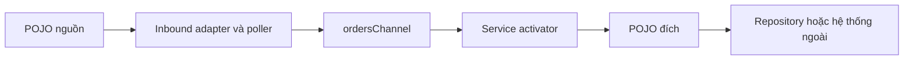
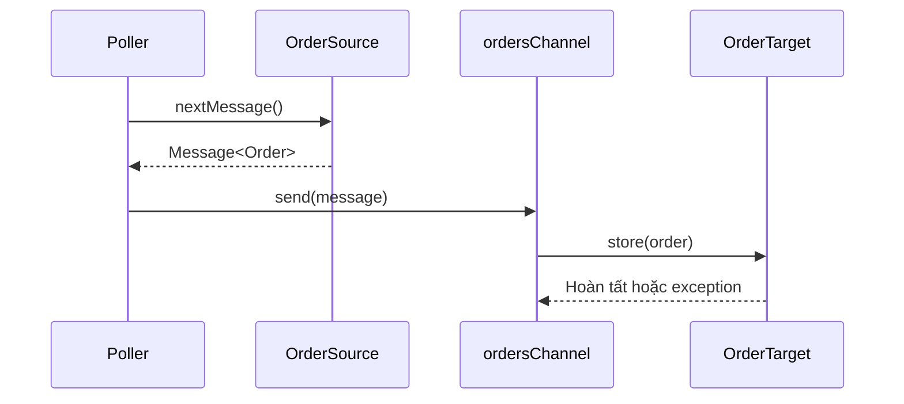

# Đăng ký bean nguồn và bean đích

Trong Spring Integration, một POJO chỉ tham gia vào luồng message khi nó được Spring quản lý và được gắn với một endpoint phù hợp. Bean nguồn tạo message để đưa dữ liệu từ bên ngoài vào hệ thống; bean đích nhận message từ channel và thực hiện công việc như lưu dữ liệu, gọi dịch vụ hoặc ghi ra hệ thống khác.

Đăng ký đúng hai loại bean này giúp ứng dụng tách biệt phần nghiệp vụ khỏi cơ chế truyền message. POJO có thể tập trung vào việc đọc hoặc xử lý dữ liệu, còn Spring Integration quản lý poller, channel, chuyển đổi message và vòng đời endpoint.

Trong phạm vi module Spring Integration Adapters, cách tổ chức này là nền tảng để kết nối các hệ thống ngoài qua file, SFTP, HTTP, JMS, AMQP, Kafka hoặc cơ sở dữ liệu. Dù nguồn dữ liệu thay đổi, ứng dụng vẫn có thể giữ một hợp đồng message nhất quán ở bên trong.

## 1. Bean nguồn và bean đích là gì?

**Bean nguồn (source bean)** cung cấp dữ liệu cho một inbound endpoint. Với nguồn được thăm dò theo lịch, Spring Integration gọi `MessageSource.receive()` thông qua poller. Với nguồn đẩy sự kiện, adapter tương ứng nhận callback hoặc sự kiện từ hệ thống ngoài rồi tạo message.

**Bean đích (target bean)** là đối tượng thực hiện công việc khi nhận message. Một phương thức POJO có thể được đăng ký làm service activator, transformer, router hoặc handler khác. Loại endpoint quyết định ý nghĩa của giá trị trả về và cách message tiếp tục đi trong flow.

Ví dụ một luồng đơn giản:



Hai vai trò có thể nằm trong hai lớp riêng hoặc được đăng ký từ các phương thức cấu hình. Trong cả hai trường hợp, các đối tượng phải thuộc Spring `ApplicationContext` để hạ tầng tích hợp phát hiện và quản lý chúng.

## 2. Đăng ký bean trong ApplicationContext

Có hai cách phổ biến để đăng ký một POJO:

- Dùng `@Component` và component scanning để Spring tự phát hiện lớp.
- Dùng phương thức `@Bean` trong một lớp `@Configuration` để tạo và đăng ký đối tượng.

Ví dụ đăng ký bằng Java configuration:

```java
@Configuration
@EnableIntegration
public class OrderIntegrationConfiguration {

    @Bean
    public MessageChannel ordersChannel() {
        return new DirectChannel();
    }

    @Bean
    public OrderSource orderSource() {
        return new OrderSource();
    }

    @Bean
    public OrderTarget orderTarget(OrderRepository repository) {
        return new OrderTarget(repository);
    }
}
```

`@Configuration` đánh dấu lớp cấu hình. `@Bean` đưa các đối tượng trả về vào ApplicationContext. Tên phương thức mặc định trở thành tên bean, ví dụ `orderSource`, `orderTarget` và `ordersChannel`.

`@EnableIntegration` bật hạ tầng annotation của Spring Integration trong cấu hình Spring thông thường. Nếu ứng dụng dùng Spring Boot cùng starter Spring Integration, hãy kiểm tra auto-configuration đã cung cấp hạ tầng tương ứng trước khi khai báo cấu hình trùng lặp.

Một cách khác là đánh dấu lớp POJO bằng `@Component` và đặt chúng trong vùng component scan:

```java
@Component
public class OrderTarget {
    // Các phương thức xử lý message.
}
```

Không tự tạo đối tượng bằng `new` ở một nơi nằm ngoài Spring rồi kỳ vọng endpoint annotation được tự động phát hiện. Nếu một đối tượng cần tham gia flow, hãy đăng ký nó như bean hoặc cung cấp nó qua một cơ chế cấu hình mà Spring quản lý.

## 3. Đăng ký bean nguồn cho inbound adapter

Với nguồn dạng polling, `MessageSource<T>` là hợp đồng cung cấp message cho inbound channel adapter. Poller quyết định thời điểm gọi nguồn và số message lấy trong mỗi lần poll.

Trước hết, viết POJO nguồn chỉ tập trung tạo message:

```java
import java.util.concurrent.atomic.AtomicLong;

import org.springframework.messaging.Message;
import org.springframework.messaging.support.MessageBuilder;

public class OrderSource {

    private final AtomicLong sequence = new AtomicLong();

    public Message<Order> nextMessage() {
        long id = sequence.incrementAndGet();
        Order order = new Order("ORD-" + id, "NEW");

        return MessageBuilder.withPayload(order)
                .setHeader("sourceSystem", "legacy-pojo")
                .build();
    }
}
```

Đăng ký một inbound adapter dùng `MessageSource` để gọi POJO:

```java
import org.springframework.context.annotation.Bean;
import org.springframework.integration.annotation.InboundChannelAdapter;
import org.springframework.integration.annotation.Poller;
import org.springframework.integration.core.MessageSource;

@Bean
@InboundChannelAdapter(
        channel = "ordersChannel",
        poller = @Poller(fixedDelay = "5000", maxMessagesPerPoll = "1"))
public MessageSource<Order> orderMessageSource(OrderSource source) {
    return source::nextMessage;
}
```

Trong cấu hình trên:

- `OrderSource` là bean nghiệp vụ cung cấp dữ liệu.
- `orderMessageSource` là bean endpoint nguồn được Spring Integration đăng ký.
- `channel = "ordersChannel"` xác định channel nhận message.
- `fixedDelay = "5000"` yêu cầu poller chờ khoảng 5 giây sau khi một lần poll kết thúc trước khi bắt đầu lần tiếp theo.
- `maxMessagesPerPoll = "1"` giới hạn mỗi lần poll lấy một message.

Phương thức tham chiếu `source::nextMessage` tương thích với phương thức `receive()` của `MessageSource`. Nếu nguồn không có dữ liệu, một `MessageSource` có thể trả về `null`; adapter sẽ không phát message cho lần poll đó. Nếu nguồn là một hàng đợi, cần xác định rõ thời điểm xác nhận hoặc xóa bản ghi để tránh mất dữ liệu khi xử lý thất bại.

`fixedDelay` phù hợp khi muốn có khoảng nghỉ sau khi công việc của lần poll trước hoàn tất. `fixedRate` lên lịch theo nhịp thời gian cố định. Chọn giá trị dựa trên khả năng đáp ứng của nguồn và thời gian xử lý, tránh poll quá dày gây tải lên hệ thống ngoài.

## 4. Đăng ký bean đích bằng service activator

Service activator liên kết một phương thức xử lý với input channel. Phương thức POJO có thể nhận payload đã được chuyển đổi sang kiểu tham số tương ứng, hoặc nhận cả `Message<?>` nếu cần đọc headers.

Ví dụ bean đích:

```java
public class OrderTarget {

    private final OrderRepository repository;

    public OrderTarget(OrderRepository repository) {
        this.repository = repository;
    }

    @ServiceActivator(inputChannel = "ordersChannel")
    public void store(Order order) {
        repository.save(order);
    }
}
```

Bean `OrderTarget` đã được đăng ký bằng phương thức `@Bean` trong cấu hình trước đó. Spring Integration phát hiện phương thức `store` được đánh dấu `@ServiceActivator` và tạo endpoint lắng nghe `ordersChannel`.

Nếu cần đọc cả payload và headers, hãy nhận `Message<Order>`:

```java
@ServiceActivator(inputChannel = "ordersChannel")
public void store(Message<Order> message) {
    Order order = message.getPayload();
    String source = message.getHeaders().get("sourceSystem", String.class);

    repository.save(order, source);
}
```

Nếu phương thức service activator trả về một giá trị khác `void`, giá trị đó có thể trở thành reply message và tiếp tục qua output channel hoặc reply channel phù hợp. Nếu phương thức trả về `void`, endpoint chỉ thực hiện công việc và không tạo reply từ giá trị trả về.

Một phương thức đích có thể nhận payload đơn giản khi nghiệp vụ không cần metadata. Dùng `Message<T>` khi cần correlation ID, thông tin nguồn, thời điểm phát sinh hoặc các header điều khiển khác.

## 5. Kết nối nguồn và đích qua channel

Trong ví dụ, inbound adapter phát message vào `ordersChannel`, còn service activator nhận từ chính channel đó. `DirectChannel` chuyển lời gọi tới subscriber trong cùng luồng thực thi của lần gửi message. Vì vậy, lỗi từ handler có thể truyền ngược tới bên gửi trong một flow đồng bộ.



Channel là một phần của hợp đồng wiring giữa các endpoint. Tên channel trong adapter và tên channel trong service activator phải khớp chính xác. Khi channel được khai báo tường minh bằng `@Bean`, kiểu channel cũng quyết định cách phân phối message:

| Channel | Hành vi | Trường hợp thường dùng |
|---|---|---|
| `DirectChannel` | Gọi subscriber đồng bộ; thường phân phối tới một subscriber theo cơ chế dispatch | Flow đơn giản, cần truyền lỗi trực tiếp |
| `PublishSubscribeChannel` | Phát message tới nhiều subscriber | Nhiều nhánh cùng nhận một sự kiện |
| `QueueChannel` | Lưu message trong hàng đợi để consumer nhận sau | Tách thời điểm gửi và nhận |
| `ExecutorChannel` | Gửi qua executor để xử lý bất đồng bộ | Tách luồng thực thi, tăng khả năng xử lý song song |

Không nên đổi kiểu channel chỉ để tăng thông lượng mà chưa xem xét thứ tự xử lý, khả năng back-pressure và cách truyền lỗi. Với channel bất đồng bộ, exception không nhất thiết truyền ngược tới thread gửi; cần thiết kế error channel hoặc cơ chế giám sát tương ứng.

## 6. Dùng `@Component` cho POJO endpoint

Thay vì đăng ký bean đích trong phương thức `@Bean`, có thể dùng component scanning. Đây là cách ngắn gọn khi lớp POJO là một thành phần độc lập:

```java
@Component
public class OrderTarget {

    private final OrderRepository repository;

    public OrderTarget(OrderRepository repository) {
        this.repository = repository;
    }

    @ServiceActivator(inputChannel = "ordersChannel")
    public void store(Order order) {
        repository.save(order);
    }
}
```

Với bean nguồn, có thể tách phần tạo dữ liệu và endpoint adapter tương tự: đăng ký POJO nguồn bằng `@Component` hoặc `@Bean`, sau đó cung cấp một `MessageSource` cho inbound adapter. Việc tách này hữu ích khi muốn kiểm thử POJO mà không cần khởi động poller.

Chỉ nên chọn một cách đăng ký cho mỗi đối tượng. Nếu cùng một lớp vừa được component scan vừa được khai báo bằng `@Bean`, ứng dụng có thể tạo hai instance và vô tình đăng ký hai endpoint xử lý cùng một channel.

## 7. Quản lý tên bean, dependency và vòng đời

Tên bean và tên channel là hai khái niệm khác nhau. Tên bean xác định đối tượng trong ApplicationContext; tên channel xác định điểm kết nối message. Một bean endpoint có thể sử dụng channel được khai báo ở bean khác.

Khi có nhiều bean cùng kiểu, dùng tên rõ ràng và tiêm dependency bằng constructor hoặc `@Qualifier`:

```java
@Bean
public OrderSource partnerOrderSource() {
    return new OrderSource();
}

@Bean
public OrderTarget localOrderTarget(
        @Qualifier("orderRepository") OrderRepository repository) {
    return new OrderTarget(repository);
}
```

Không dựa vào thứ tự khai báo phương thức `@Bean` để điều khiển thứ tự xử lý message. Hãy thể hiện quan hệ bằng dependency injection, channel và cấu hình endpoint.

Spring quản lý vòng đời bean, bao gồm khởi tạo dependency và gọi các callback hoặc destroy method đã cấu hình. Với source kết nối tới hệ thống ngoài, hãy đóng tài nguyên như client, session hoặc connection khi bean bị hủy. Với poller, cần cấu hình tốc độ và thời gian chờ phù hợp để khi ứng dụng dừng, tác vụ không tiếp tục giữ tài nguyên ngoài ý muốn.

Các POJO nên ưu tiên dependency injection qua constructor và tránh tự tạo kết nối trong mỗi lần gọi phương thức. Nếu client kết nối có vòng đời dài, đăng ký client thành bean riêng để có thể cấu hình timeout, retry, xác thực và đóng kết nối tập trung.

## 8. Kiểm thử bean nguồn và bean đích

Nên kiểm thử logic POJO độc lập trước, sau đó mới kiểm thử việc wiring của Spring Integration.

**Kiểm thử nguồn:** gọi `nextMessage()` và xác nhận payload, header, định dạng ID. Nếu nguồn đọc từ một hệ thống ngoài, dùng mock hoặc fake để mô phỏng trường hợp có dữ liệu, không có dữ liệu và lỗi đọc.

**Kiểm thử đích:** gọi trực tiếp phương thức `store()` với payload hợp lệ và xác nhận repository hoặc client được gọi đúng. Kiểm tra riêng dữ liệu thiếu hoặc lỗi nghiệp vụ.

**Kiểm thử tích hợp:** khởi động ApplicationContext, gửi một message vào channel hoặc kích hoạt nguồn trong cấu hình kiểm thử, rồi xác nhận endpoint đích nhận đúng payload và headers. Khi kiểm thử poller, có thể dùng cấu hình thời gian ngắn hoặc thay nguồn bằng `MessageSource` kiểm thử để tránh phụ thuộc vào lịch thực tế.

Ví dụ kiểm thử đơn vị cho POJO đích:

```java
@Test
void storesOrder() {
    OrderRepository repository = mock(OrderRepository.class);
    OrderTarget target = new OrderTarget(repository);
    Order order = new Order("ORD-42", "NEW");

    target.store(order);

    verify(repository).save(order);
}
```

Kiểm thử này xác nhận hành vi nghiệp vụ của POJO. Nó chưa chứng minh endpoint đã được Spring phát hiện hoặc channel đã được nối đúng; các điểm đó cần một kiểm thử ApplicationContext riêng.

## 9. Lỗi thường gặp khi đăng ký source và target

| Triệu chứng | Nguyên nhân có thể | Cách kiểm tra |
|---|---|---|
| Không có message được phát | Bean nguồn chưa được Spring quản lý hoặc adapter chưa được đăng ký | Kiểm tra ApplicationContext, `@Bean`, component scan và annotation endpoint |
| Poller chạy nhưng channel không nhận message | `MessageSource` trả về `null`, channel sai tên hoặc nguồn không có dữ liệu | Kiểm tra kết quả `receive()`, tên channel và log của poller |
| Bean đích không được gọi | Không có subscriber trên input channel hoặc `@ServiceActivator` không được phát hiện | Kiểm tra channel, bean target và annotation infrastructure |
| Một message bị xử lý hai lần | Cùng endpoint được đăng ký qua cả `@Component` và `@Bean`, hoặc nguồn đọc lại bản ghi chưa xác nhận | Kiểm tra số instance và chiến lược acknowledge của nguồn |
| Lỗi từ target không quay về nguồn | Flow dùng channel bất đồng bộ hoặc poller xử lý lỗi qua cơ chế riêng | Kiểm tra error channel, executor và cấu hình xử lý lỗi |
| Ứng dụng khó dừng | Poller hoặc client ngoài còn giữ tài nguyên | Kiểm tra lifecycle, timeout và destroy method của bean |

Khi xử lý sự cố, hãy xác nhận từng mắt xích theo thứ tự: bean đã tồn tại, endpoint đã được đăng ký, poller hoặc event source đã phát message, channel đã nhận message và bean đích đã được gọi. Cách kiểm tra theo từng ranh giới giúp khoanh vùng lỗi nhanh hơn việc chỉ xem log tổng quát.

## 10. Bài tập thực hành

Xây dựng một flow nhận đơn hàng từ một POJO nguồn và ghi đơn hàng qua một POJO đích.

1. Tạo `OrderSource` sinh một `Message<Order>` có ID duy nhất và header `sourceSystem`.
2. Đăng ký `OrderSource` thành bean bằng `@Bean` hoặc `@Component`.
3. Tạo inbound adapter dùng `MessageSource<Order>` và poller có chu kỳ 5 giây.
4. Khai báo `DirectChannel` tên `ordersChannel`.
5. Tạo `OrderTarget` có phương thức `store(Order order)` được đánh dấu `@ServiceActivator` trên channel đó.
6. Đăng ký repository qua constructor injection và xác nhận đơn hàng được lưu đúng.
7. Viết kiểm thử cho POJO nguồn, POJO đích và một kiểm thử ApplicationContext xác nhận wiring.
8. Thử thay `DirectChannel` bằng `QueueChannel`; mô tả khác biệt về thời điểm gửi, nhận và cách xử lý lỗi.

## 11. Checklist trước khi đưa vào ứng dụng

- [ ] Bean nguồn và bean đích được đăng ký trong đúng ApplicationContext.
- [ ] Annotation infrastructure của Spring Integration đã được bật hoặc được auto-configuration cung cấp.
- [ ] Inbound adapter dùng `MessageSource` phù hợp và poller có chu kỳ hợp lý.
- [ ] Tên channel của source và target khớp nhau.
- [ ] Kiểu channel phù hợp với yêu cầu đồng bộ, bất đồng bộ và phân phối message.
- [ ] Payload và headers có hợp đồng rõ ràng.
- [ ] Dependency của POJO được tiêm qua Spring, không tự tạo ngoài container.
- [ ] Không vô tình đăng ký trùng cùng một endpoint.
- [ ] Tài nguyên kết nối có vòng đời và cơ chế đóng rõ ràng.
- [ ] Có kiểm thử riêng cho logic POJO và kiểm thử tích hợp cho wiring.

Khi bean nguồn và bean đích được đăng ký đúng cách, Spring Integration có thể điều phối việc tạo, truyền và xử lý message trong khi POJO giữ phần nghiệp vụ đơn giản. Đây là cấu trúc cơ bản để thay một nguồn hoặc đích cụ thể mà không phải viết lại toàn bộ flow tích hợp.
