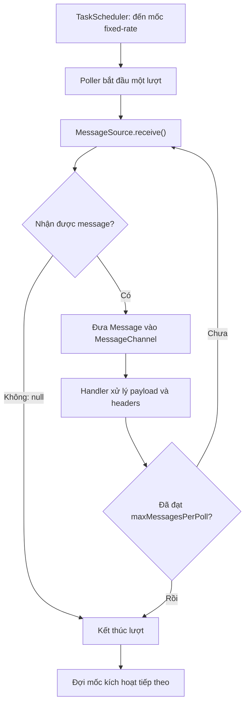

# Trigger fixed-rate cho polling adapter trong Spring Integration

## 1. Bối cảnh: vì sao một inbound adapter cần poller?

Nhiều hệ thống bên ngoài không tự đẩy sự kiện vào ứng dụng khi có dữ liệu mới. Ví dụ, một thư mục nhận file CSV từ đối tác, một bảng cơ sở dữ liệu chứa bản ghi cần đồng bộ hoặc một máy chủ SFTP lưu những file mới tải lên. Ứng dụng phải **chủ động kiểm tra định kỳ** xem nguồn có dữ liệu để lấy hay không. Trong Spring Integration, đây là mô hình *polling*.

Một **polling inbound adapter** kết hợp hai trách nhiệm:

- **Message source / inbound adapter:** đọc nguồn bên ngoài và chuyển dữ liệu nhận được thành `Message<?>` theo hợp đồng message của Spring Integration. Với `FileReadingMessageSource`, payload là một đối tượng `File`.
- **Poller:** quyết định *khi nào* gọi `receive()` của message source và *mỗi lượt* được lấy tối đa bao nhiêu message. Poller phối hợp với `TaskScheduler` để thực hiện các lượt kiểm tra.

`fixed-rate` là một cách cấu hình trigger cho poller: đặt **chu kỳ giữa các thời điểm bắt đầu được lên lịch**. Chẳng hạn, `fixed-rate = 5000 ms` có nghĩa là scheduler cố gắng bắt đầu một lượt polling mỗi 5 giây, tính theo nhịp của lịch, nếu tài nguyên thực thi cho phép.

Kiến thức này áp dụng trực tiếp cho các inbound adapter kiểu pull trong module **SPRING_INTEGRATION_ADAPTERS**, bao gồm file, SFTP và những nguồn dữ liệu cần thăm dò định kỳ. Với HTTP/JMS/AMQP/Kafka, cần phân biệt adapter nhận dữ liệu chủ động bằng cơ chế lắng nghe/đẩy sự kiện với adapter thật sự cần poller; **không phải adapter nào cũng cần cấu hình `fixed-rate`**.

**Mục tiêu sau bài học:** giải thích chính xác fixed-rate, triển khai polling inbound file bằng annotation, chọn chu kỳ và giới hạn message hợp lý, đồng thời nhận diện tác động của xử lý chậm, lỗi và trùng lặp.

## 2. Fixed-rate hoạt động như thế nào?

Giả sử thời gian polling là 5 giây (`fixedRate = "5000"`). Nếu công việc ở mỗi lượt hoàn tất nhanh và scheduler đủ khả năng đáp ứng, lịch dự kiến là:

```text
Thời gian (giây):   0         5        10        15        20
                    |---------|---------|---------|---------|
Lượt polling:       P1        P2        P3        P4        P5
                    ^         ^         ^         ^         ^
                    các mốc bắt đầu theo nhịp fixed-rate
```

Mỗi lượt polling có thể gọi `receive()` nhiều lần tùy cấu hình `maxMessagesPerPoll`. Nếu không có dữ liệu, message source trả về `null` và lượt đó kết thúc sớm; lịch kiểm tra tiếp theo vẫn tồn tại.

### Fixed-rate khác fixed-delay và cron ở đâu?

| Trigger | Quy tắc lên lịch | Ví dụ phù hợp |
| --- | --- | --- |
| **Fixed-rate** | Các lần bắt đầu được lên lịch theo nhịp chu kỳ kể từ mốc bắt đầu trước đó. | Cần kiểm tra hộp thư mục đầu vào với nhịp tương đối đều. |
| **Fixed-delay** | Chờ một khoảng sau **khi lượt trước hoàn tất** mới bắt đầu lượt kế tiếp. | Muốn chắc chắn có thời gian nghỉ giữa hai lần truy vấn nguồn tốn tài nguyên. |
| **Cron** | Chạy vào những mốc trên đồng hồ theo biểu thức cron. | Đồng bộ vào phút đầu mỗi giờ hoặc theo khung giờ nghiệp vụ. |

Ví dụ một lượt tốn 7 giây và chu kỳ là 5 giây:

```text
Fixed-rate (dự kiến):  0s ---- 5s ---- 10s ---- 15s ---- 20s
Thực tế:               [xử lý 7s][lượt kế tiếp có thể đến sát ngay]

Fixed-delay 5s:        [xử lý 7s] -- chờ 5s -- [xử lý tiếp]
                       0         7            12
```

Đây là sơ đồ minh họa, không phải cam kết về thời điểm thực thi. **Fixed-rate không bảo đảm tất cả lượt chạy đúng giờ tuyệt đối**. Khi một lượt chạy lâu hơn chu kỳ, tác vụ có thể bị trễ và lượt tiếp theo được thực hiện sát lượt trước; không được dựa vào fixed-rate như một cam kết thời gian thực. Một tác vụ định kỳ trong cấu hình scheduler đồng bộ thông thường không tự động chạy song song với chính nó, nhưng xử lý có thể chồng lấn nếu bạn chuyển công việc sang `TaskExecutor`, dùng luồng bất đồng bộ hoặc thiết kế các poller độc lập.

## 3. Chu trình của một lượt polling



Cần phân biệt ba thông số thường bị nhầm:

1. **`fixedRate`** quyết định nhịp kích hoạt các lượt polling, ví dụ mỗi 5.000 mili giây.
2. **`maxMessagesPerPoll`** giới hạn số message được nhận **trong một lượt**, không phải số message mỗi giây hay số tác vụ chạy song song.
3. **Thời gian xử lý thực tế** gồm thời gian đọc nguồn, gửi message qua channel và thực thi handler (nếu đường xử lý đồng bộ). Phần này có thể khiến chu kỳ thực tế khác lịch dự kiến.

Với `fixedRate = 5000` và `maxMessagesPerPoll = 10`, giả sử thư mục đã có 25 file, mỗi file được xử lý rất nhanh và không có file mới: lượt đầu có thể lấy 10 file, lượt thứ hai lấy 10 file, lượt thứ ba lấy 5 file. Thứ tự file cụ thể còn phụ thuộc cách nguồn liệt kê/lọc file. Nếu lượt đầu chỉ tìm được 3 file, poller dừng sau 3 message thay vì tạo thêm 7 message giả.

## 4. Ví dụ hoàn chỉnh: quét thư mục CSV mỗi 5 giây

Ứng dụng nhận file `.csv` do hệ thống khác đặt vào `data/inbox`. Cứ mỗi 5 giây, nó kiểm tra thư mục, lấy tối đa 10 file trong một lượt và chuyển từng file vào một `DirectChannel` để xử lý. Đây là ví dụ về **file inbound adapter**; cùng ý tưởng poller có thể áp dụng cho những message source hỗ trợ polling khác.

### 4.1. Dependency

Trong một dự án Spring Boot quản lý version dependency bằng BOM, cần có Spring Integration và module file adapter, ví dụ với Maven:

```xml
<dependencies>
    <dependency>
        <groupId>org.springframework.boot</groupId>
        <artifactId>spring-boot-starter-integration</artifactId>
    </dependency>
    <dependency>
        <groupId>org.springframework.integration</groupId>
        <artifactId>spring-integration-file</artifactId>
    </dependency>
</dependencies>
```

Ví dụ dưới đây dùng cấu hình annotation quen thuộc của Spring Integration. Trước khi chạy, tạo thư mục `data/inbox` tương đối với working directory của ứng dụng và đặt vào đó vài file `.csv` hợp lệ.

### 4.2. Cấu hình inbound adapter, channel và handler

```java
import java.io.File;
import java.io.IOException;
import java.nio.charset.StandardCharsets;

import org.springframework.context.annotation.Bean;
import org.springframework.context.annotation.Configuration;
import org.springframework.integration.annotation.InboundChannelAdapter;
import org.springframework.integration.annotation.Poller;
import org.springframework.integration.annotation.ServiceActivator;
import org.springframework.integration.channel.DirectChannel;
import org.springframework.integration.config.EnableIntegration;
import org.springframework.integration.core.MessageSource;
import org.springframework.integration.file.FileReadingMessageSource;
import org.springframework.integration.file.filters.AcceptOnceFileListFilter;
import org.springframework.messaging.MessageChannel;

@Configuration
@EnableIntegration
public class FilePollingConfiguration {

    @Bean
    public MessageChannel incomingFiles() {
        return new DirectChannel();
    }

    @Bean
    @InboundChannelAdapter(
        channel = "incomingFiles",
        poller = @Poller(fixedRate = "5000", maxMessagesPerPoll = "10")
    )
    public MessageSource<File> csvFileSource() {
        FileReadingMessageSource source = new FileReadingMessageSource();
        source.setDirectory(new File("data/inbox"));
        source.setFilter(new AcceptOnceFileListFilter<>());
        return source;
    }

    @ServiceActivator(inputChannel = "incomingFiles")
    public void processCsv(File file) throws IOException {
        if (!file.getName().endsWith(".csv")) {
            return;
        }

        String content = java.nio.file.Files.readString(
            file.toPath(), StandardCharsets.UTF_8
        );
        System.out.printf("Processed %s (%d chars)%n",
            file.getName(), content.length());
    }
}
```

**Giải thích từng phần:**

- `FileReadingMessageSource` quét thư mục và trả từng `Message<File>`. Nó đảm nhiệm việc lấy dữ liệu, còn poller quyết định thời điểm gọi `receive()`.
- `@InboundChannelAdapter` liên kết source với channel `incomingFiles`; `@Poller(fixedRate = "5000", maxMessagesPerPoll = "10")` cấu hình nhịp 5 giây và giới hạn 10 message mỗi lượt. Đơn vị mặc định của chu kỳ ở đây là **mili giây**.
- `AcceptOnceFileListFilter` giúp một instance đang chạy không liên tục chọn lại cùng một file đã chấp nhận. Đây là filter lưu trạng thái trong bộ nhớ; nó **không** cung cấp bảo đảm chống trùng lặp bền vững sau restart.
- `DirectChannel` gọi handler trên cùng luồng gửi message theo mô hình đồng bộ. Vì vậy, handler chạy lâu có thể làm lượt polling lâu hơn dự tính.
- `@ServiceActivator` xử lý payload `File`. Phần `readString()` chỉ mô phỏng nghiệp vụ; hệ thống thật nên phân tích nội dung CSV, validate và chuyển file sang khu vực hoàn thành hoặc lỗi theo chính sách riêng.

Ví dụ cố ý kiểm tra phần mở rộng ở handler để dễ đọc. Trong ứng dụng thật, nên **lọc file ngay ở message source** (chẳng hạn filter theo pattern kết hợp filter chống trùng) để file không liên quan không chiếm lượt polling và không bị đánh dấu là đã nhận.

### 4.3. Quan sát hành vi

1. Khởi động ứng dụng khi `data/inbox` trống. Poller vẫn được kích hoạt định kỳ; nếu source trả `null`, handler không nhận message.
2. Thêm `order-001.csv` và `order-002.csv` vào thư mục. Ở một lượt polling kế tiếp, console in thông tin xử lý của hai file.
3. Giữ ứng dụng chạy, không đổi file: filter `AcceptOnceFileListFilter` ngăn việc xử lý lặp lại hai file đã chấp nhận.
4. Thêm nhiều hơn 10 file trước một lượt mới: quan sát số file được xử lý theo từng lượt; không được mặc định rằng mọi file sẽ được xử lý ngay một lúc.
5. Thử đặt handler xử lý chậm hơn 5 giây để thấy nhịp thực tế có thể trễ và ảnh hưởng đến lượng dữ liệu tồn đọng.

Không dùng timestamp của log ở mức giây để kết luận scheduler chạy chính xác đến mili giây: thời gian khởi động, độ trễ hệ điều hành, hoạt động của nguồn và tải của thread pool đều có thể ảnh hưởng.

## 5. Cấu hình nhịp polling theo môi trường

Trong môi trường phát triển có thể quét 2–5 giây một lần; trong môi trường thật, nhịp phụ thuộc SLA, giới hạn tài nguyên nguồn và tốc độ xử lý. Để tránh sửa code khi đổi cấu hình, có thể sử dụng property placeholder:

```yaml
# application.yml
app:
  file-poller:
    fixed-rate-ms: 5000
    max-messages-per-poll: 10
```

```java
@InboundChannelAdapter(
    channel = "incomingFiles",
    poller = @Poller(
        fixedRate = "${app.file-poller.fixed-rate-ms:5000}",
        maxMessagesPerPoll = "${app.file-poller.max-messages-per-poll:10}"
    )
)
```

Đoạn annotation thứ hai **thay thế** annotation tương ứng trong cấu hình Java ở trên, không đặt hai `@InboundChannelAdapter` cùng lúc lên một source. Các giá trị placeholder được resolve khi khởi tạo context; thay đổi `application.yml` thường cần khởi động lại ứng dụng để có hiệu lực, trừ khi chủ động xây dựng cơ chế cấu hình động.

Với Java DSL, tư tưởng tương đương là khai báo poller ngay khi tạo flow từ nguồn, chẳng hạn:

```java
IntegrationFlow.from(
    Files.inboundAdapter(new File("data/inbox")).patternFilter("*.csv"),
    endpoint -> endpoint.poller(
        Pollers.fixedRate(java.time.Duration.ofSeconds(5))
               .maxMessagesPerPoll(10)
    )
);
```

Đây là **đoạn cấu hình phần đầu của flow** để minh họa vị trí `Pollers.fixedRate(...)`, chưa phải một `IntegrationFlow` hoàn chỉnh; cần nối tiếp handler/channel phù hợp rồi gọi `.get()` trong bean flow. `Files` ở đây là factory `org.springframework.integration.file.dsl.Files`, còn `Pollers` thuộc `org.springframework.integration.dsl.Pollers`; không nhầm `Files` này với `java.nio.file.Files`.

## 6. Chọn fixed-rate và maxMessagesPerPoll theo tải

### Hai giới hạn điều khiển hai chiều khác nhau

| Tình huống | Lựa chọn ban đầu | Điều cần kiểm tra |
| --- | --- | --- |
| Nguồn ít dữ liệu, cần phản hồi sớm | Chu kỳ ngắn, ví dụ 1–2 giây; giới hạn message vừa phải | Chi phí mỗi lần gọi nguồn khi không có dữ liệu. |
| Nguồn có batch hàng trăm file | Chu kỳ phù hợp, `maxMessagesPerPoll` đủ lớn để rút backlog | Thời gian xử lý một lượt có vượt quá chu kỳ không. |
| SFTP/DB có giới hạn truy cập | Giảm tần suất kiểm tra hoặc dùng fixed-delay | Request rate, kết nối, timeout, quota phía nguồn. |
| Handler tốn CPU/I/O | Giảm số message mỗi lượt hoặc thiết kế xử lý bất đồng bộ có giới hạn | Độ dài hàng chờ, thông lượng, khả năng chồng lấn và thứ tự xử lý. |

Một ước lượng **chỉ để lập kế hoạch** là `maxMessagesPerPoll / chu kỳ`. Ví dụ, 10 message trong mỗi 5 giây tương ứng trần danh nghĩa khoảng 2 message/giây **nếu** mỗi lượt thực sự lấy đủ 10 message và xử lý nhanh. Đây không phải throughput được bảo đảm: tốc độ nhận dữ liệu, thời gian handler, network I/O, lỗi và năng lực `TaskScheduler` đều có thể làm thấp hơn.

Một cấu hình nhịp nhanh kèm batch lớn có thể dồn nhiều công việc vào luồng poller. Nếu nhiều polling adapter dùng chung scheduler, một tác vụ chặn lâu có thể ảnh hưởng các tác vụ còn lại; cần thiết kế kích thước scheduler, xử lý bất đồng bộ và backpressure theo tải thực tế.

### Những điều fixed-rate không tự giải quyết

- **Không bảo đảm exactly-once:** poller quyết định thời điểm đọc, không quản lý giao dịch đầu cuối giữa hệ thống ngoài và nghiệp vụ.
- **Không thay thế retry:** nếu adapter đã chấp nhận một file nhưng handler lỗi, lần polling kế tiếp chưa chắc nhận lại file đó; đặc biệt với filter accept-once.
- **Không tránh đọc file đang được ghi:** đối tác nên ghi vào thư mục tạm rồi đổi tên/di chuyển nguyên tử sang inbox khi hoàn thành, hoặc dùng cơ chế xác nhận file đã sẵn sàng.
- **Không tự duy trì thứ tự nghiệp vụ:** thứ tự quét file, xử lý song song và các lần retry có thể thay đổi thứ tự nhận/hoàn tất.
- **Không biến nguồn thành push-based:** dù cấu hình chu kỳ ngắn, ứng dụng vẫn gọi thăm dò định kỳ và phải chịu chi phí của polling.

## 7. Lỗi, trạng thái file và vòng đời kết nối

Khi dùng fixed-rate với file, SFTP hoặc cơ sở dữ liệu, cần quyết định rõ ba trạng thái: **đã phát hiện**, **đã tiếp nhận vào message flow** và **đã hoàn tất nghiệp vụ**. Ba thời điểm này không luôn trùng nhau.

**Ví dụ rủi ro:** message source chấp nhận `order-123.csv` rồi đưa vào `DirectChannel`; handler gặp lỗi ghi DB. `AcceptOnceFileListFilter` có thể đã ghi nhận file trong bộ nhớ. Đến chu kỳ 5 giây tiếp theo, source không tự động phát lại file đó. Chỉ tăng tốc `fixedRate` không giải quyết mất cơ hội xử lý lại.

Với hệ thống có yêu cầu độ tin cậy cao:

1. Xác định điều kiện file sẵn sàng (ghi xong, tên đúng pattern, không đang thay đổi); nhận file bằng cơ chế an toàn phù hợp với nguồn.
2. Dùng bộ lọc hoặc metadata store có trạng thái **bền vững** nếu cần nhận diện file sau restart. Trạng thái chấp nhận file cần được thiết kế cùng chính sách retry, không xem filter là xác nhận nghiệp vụ thành công.
3. Thiết kế handler **idempotent** theo định danh nghiệp vụ, ví dụ mã đơn hàng hoặc khóa file, để xử lý lặp không tạo đơn hàng trùng.
4. Cấu hình retry/backoff và tuyến lỗi (thường thông qua cơ chế `errorChannel`/error flow của Spring Integration) sao cho lỗi được ghi nhận và có đường xử lý lại rõ ràng.
5. Sau khi xử lý thành công, chuyển file sang thư mục archive hoặc đánh dấu trạng thái một cách có kiểm soát. Với SFTP, theo dõi cả phiên kết nối, timeout và hành vi khôi phục khi mạng gián đoạn.

**Lưu ý:** `maxMessagesPerPoll` không phải kích thước transaction. Một lượt lấy 10 message không có nghĩa cả 10 message cùng commit hoặc cùng rollback. Transaction boundary phụ thuộc cấu hình adapter, channel, handler và transaction advice cụ thể.

## 8. Quan sát và chẩn đoán

Khi triển khai production, cần đo **thời gian thực tế giữa các lần poll**, số message được nhận trong mỗi lượt, độ dài backlog, thời gian xử lý, số lỗi và tỉ lệ retry. Một số dấu hiệu thường gặp:

| Hiện tượng | Nguyên nhân cần kiểm tra | Hướng xử lý |
| --- | --- | --- |
| Poller chạy nhưng không có message | Thư mục sai, filter loại hết file, nguồn chưa có dữ liệu hoặc kết nối ngoài thất bại. | Kiểm tra cấu hình source, đường dẫn, filter, quyền truy cập và log lỗi. |
| File có sẵn nhưng được nhận rất chậm | `fixedRate` dài, backlog cao, `maxMessagesPerPoll` quá nhỏ hoặc handler chậm. | Đo thời gian xử lý thực tế rồi điều chỉnh chu kỳ/batch. |
| Log xuất hiện gần như liên tục dù fixed-rate là 5 giây | Lượt trước chạy lâu hơn chu kỳ, hoặc có nhiều poller/luồng chạy độc lập. | Xem timestamp từng endpoint và mức sử dụng scheduler. |
| File được nhận lại sau restart | Filter chỉ lưu trong RAM hoặc cơ chế lưu metadata chưa đúng. | Bổ sung trạng thái bền vững và nghiệp vụ idempotent. |
| File lỗi không được đọc lại | Đã được filter chấp nhận trước lúc handler lỗi. | Xây chính sách retry/recovery theo vòng đời file. |

Nên theo dõi cả **tuổi của dữ liệu cũ nhất còn tồn** (lag) thay vì chỉ đếm số lần scheduler được kích hoạt. Một poller chạy đều 5 giây nhưng backlog tăng liên tục vẫn là một pipeline không theo kịp tải.

## 9. Bài thực hành tự kiểm tra

**Bài 1 — Dự đoán lịch polling.** Poller chạy `fixedRate = 3000 ms`, `maxMessagesPerPoll = 4`. Một lượt nhận đủ 4 file và xử lý trong 500 ms. Giả sử scheduler không bị nghẽn, mốc bắt đầu được lên lịch kế tiếp cách mốc trước bao lâu? **Đáp án:** khoảng 3 giây, không phải 3,5 giây. Nếu chọn fixed-delay 3 giây, lần sau bắt đầu khoảng 3 giây *sau khi lượt trước kết thúc*.

**Bài 2 — Tính lượt tối thiểu.** Có 23 file sẵn sàng, filter không loại file nào, `maxMessagesPerPoll = 5`, handler xử lý nhanh và không phát sinh lỗi. Cần ít nhất bao nhiêu lượt polling để nhận hết? **Đáp án:** 5 lượt (5 + 5 + 5 + 5 + 3). `fixedRate` quyết định khoảng cách lên lịch giữa những lượt đó.

**Bài 3 — Xử lý lỗi.** Handler thất bại với một file sau khi `AcceptOnceFileListFilter` đã chấp nhận file. Có thể kỳ vọng poller tự đọc lại file sau 5 giây không? **Đáp án:** không; cần chính sách retry/recovery và trạng thái tiếp nhận phù hợp.

**Bài 4 — Thiết kế.** Một máy chủ SFTP giới hạn tần suất truy cập, mỗi lần đồng bộ có thể mất 20 giây. Hãy cân nhắc fixed-delay hoặc chu kỳ fixed-rate dài hơn, đặt timeout và retry hợp lý, đồng thời giám sát backlog. Nhịp poller phải được chọn theo đặc tính nguồn và độ trễ chấp nhận được, không chỉ theo mong muốn “càng nhanh càng tốt”.

## 10. Ghi nhớ

`fixed-rate` cấu hình **nhịp bắt đầu được lên lịch** cho một polling endpoint trong Spring Integration. `MessageSource` lấy dữ liệu, poller điều phối việc lấy dữ liệu, `MessageChannel` và handler xử lý `Message`. Dùng `maxMessagesPerPoll` để giới hạn khối lượng mỗi lượt, giám sát thời gian thực thi khi handler chậm, và thiết kế riêng cơ chế retry/idempotency nếu dữ liệu cần xử lý đáng tin cậy. Với fixed-rate, mục tiêu là nhịp kiểm tra đều khi điều kiện cho phép — không phải thời điểm chính xác tuyệt đối hay bảo đảm không mất/trùng message.
