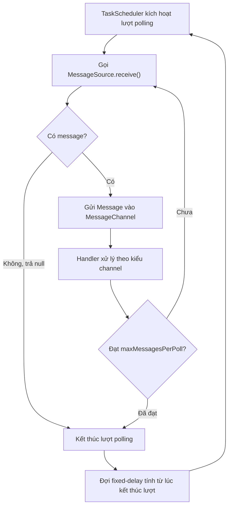

# Trigger fixed-delay và khác biệt với fixed-rate trong Spring Integration

## 1. Bài toán: kiểm tra nguồn ngoài nhưng không gây quá tải

Một ứng dụng Spring Integration cần lấy file mới từ thư mục đối tác, đồng bộ dữ liệu từ máy chủ SFTP hoặc đọc các bản ghi chưa xử lý trong cơ sở dữ liệu. Những nguồn này thường không chủ động gửi message đến ứng dụng; ứng dụng phải **thăm dò (poll)** theo lịch. Nếu kiểm tra quá thường xuyên, hệ thống có thể tạo quá nhiều yêu cầu lên nguồn. Nếu mỗi lượt xử lý lâu nhưng lịch vẫn cố duy trì tần suất cao, các lượt kế tiếp có thể diễn ra sát nhau và khiến backlog khó kiểm soát.

Trong module **SPRING_INTEGRATION_ADAPTERS**, inbound adapter làm nhiệm vụ nhận dữ liệu từ hệ thống ngoài và đưa vào **MessageChannel** dưới dạng **Message**; **poller** quyết định lúc nào gọi message source để nhận dữ liệu. Với các adapter kiểu polling (ví dụ file, SFTP, JDBC), một lựa chọn quan trọng là dùng trigger **fixed-delay** hay **fixed-rate**.

**Fixed-delay** nghĩa là: sau khi **một lượt polling kết thúc**, đợi đủ một khoảng thời gian đã cấu hình rồi mới bắt đầu lượt kế tiếp. Nhờ vậy, khoảng nghỉ giữa hai lượt không bị rút ngắn chỉ vì lượt trước xử lý chậm.

Sau bài học, bạn có thể:

- Phân biệt mốc lên lịch của fixed-delay và fixed-rate bằng timeline cụ thể.
- Cấu hình `@Poller(fixedDelay = "...")` cho một inbound adapter.
- Hiểu vì sao `maxMessagesPerPoll`, channel đồng bộ/bất đồng bộ và thời gian handler ảnh hưởng nhịp thực tế.
- Chọn trigger phù hợp cho file, SFTP, cơ sở dữ liệu; xử lý các vấn đề backlog, retry và trùng lặp message.

## 2. Fixed-delay được tính từ thời điểm nào?

Gọi:

- `D`: khoảng trễ cố định được cấu hình, ví dụ 5 giây.
- `Tₙ`: thời gian từ lúc lượt polling thứ `n` bắt đầu đến khi lượt đó **kết thúc**.
- `Sₙ`: thời điểm lượt thứ `n` bắt đầu.

Trong điều kiện scheduler có thể thực thi đúng lịch:

\[
S_{n+1} = S_n + T_n + D
\]

Ví dụ, poller dùng fixed-delay 5 giây, lượt đầu bắt đầu lúc giây 0 và mất 2 giây:

```text
Giây:       0    2         7    9        14   16       21
            |----|---------|----|---------|----|--------|
Lượt poll:  [ P1 ]-- 5s --[ P2 ]-- 5s --[ P3 ]-- 5s --[P4...]
            bắt  kết       bắt  kết       bắt  kết
            đầu thúc       đầu thúc       đầu thúc
```

Thời điểm bắt đầu dự kiến là **0, 7, 14, 21 giây**, bởi mỗi lượt làm việc trong 2 giây rồi nghỉ 5 giây. Nếu một lượt kéo dài 8 giây thì khoảng cách giữa hai lần bắt đầu tương ứng là 13 giây, không phải 5 giây.

**Điểm mấu chốt:** fixed-delay chỉ bảo đảm cách tính thời gian *giữa lần kết thúc tác vụ được lên lịch và lần bắt đầu tác vụ kế tiếp*. Đây không phải cam kết hệ thống sẽ chạy chính xác đến mili giây; luồng scheduler có thể bận, hệ điều hành có thể trì hoãn, nguồn dữ liệu có thể phản hồi chậm.

Với Spring Integration, một “lượt polling” có thể gồm **nhiều lần gọi `MessageSource.receive()`**, đến khi đạt `maxMessagesPerPoll` hoặc nguồn trả `null`. Thời điểm kết thúc lượt vì vậy phụ thuộc toàn bộ công việc thực hiện trong lượt đó.

## 3. So sánh fixed-delay và fixed-rate

### 3.1. Khác nhau về lịch

| Tiêu chí | Fixed-delay | Fixed-rate |
| --- | --- | --- |
| Mốc để tính lần kế tiếp | Sau khi **lượt trước hoàn tất** | Theo **nhịp chu kỳ giữa các mốc bắt đầu được lên lịch** |
| Chu kỳ cấu hình 5 giây, lượt xử lý 2 giây | Bắt đầu dự kiến ở 0, 7, 14, 21 giây | Bắt đầu dự kiến ở 0, 5, 10, 15 giây |
| Nếu lượt trước mất 8 giây | Lượt sau không sớm hơn 13 giây tính từ lúc bắt đầu lượt trước | Mốc 5 giây bị trễ; lượt kế tiếp có thể chạy ngay/sát khi tác vụ trước kết thúc, tùy scheduler |
| Khoảng nghỉ sau lượt trước | Cố gắng giữ đủ khoảng trễ cấu hình | Có thể ngắn hoặc gần bằng 0 khi lượt trước chạy chậm |
| Mục tiêu thường gặp | Giữ thời gian nghỉ cho nguồn bên ngoài | Duy trì nhịp kiểm tra tương đối đều |
| Hạn chế | Tần suất polling giảm nếu xử lý lâu | Lượt chạy chậm có thể làm trễ lịch và các lượt đến sát nhau |

Giả sử `D = 5 giây` và cả ba lượt đều xử lý trong 8 giây:

```text
FIXED-DELAY
0s       8s    13s      21s   26s       34s
|-- P1 --|.....|-- P2 --|.....|-- P3 --|
         nghỉ 5s       nghỉ 5s

FIXED-RATE (các mốc lịch 0s, 5s, 10s, 15s, ...)
0s       8s       16s      24s
|-- P1 --|-- P2 --|-- P3 --|
        P2, P3 bắt đầu muộn so với mốc dự kiến
```

Trong cách chạy định kỳ thông thường của `TaskScheduler`, các lần thực thi liên tiếp của **cùng một tác vụ** không mặc nhiên chồng lấn lên nhau. Dù vậy, nhiều polling endpoint độc lập, channel sử dụng executor hoặc xử lý được chuyển sang luồng khác vẫn có thể chạy đồng thời; việc chọn fixed-delay **không thay thế cơ chế giới hạn concurrency**.

### 3.2. Fixed-rate có phải luôn nhanh hơn?

Không. Khi công việc nhẹ và ổn định, fixed-rate thường tạo ra nhiều lượt polling hơn trong cùng một khoảng thời gian vì không cộng thêm thời gian xử lý vào chu kỳ. Tuy nhiên, nếu nguồn mạng chậm hoặc scheduler quá tải, tần suất thực tế có thể thấp hơn lịch kỳ vọng.

Ví dụ, một lượt gọi SFTP mất 12 giây, mỗi lượt dùng fixed-delay 5 giây sẽ bắt đầu sau khoảng 17 giây (nếu không có độ trễ scheduler bổ sung). Fixed-rate 5 giây có thể cố chạy lượt kế tiếp ngay sau lúc lượt trước kết thúc để theo kịp lịch. Kiểu hành vi này có thể không phù hợp nếu máy chủ ngoài cần thời gian nghỉ giữa các lượt.

### 3.3. Còn cron thì sao?

Trigger cron chạy theo **mốc thời gian trên đồng hồ**, ví dụ đầu giờ hoặc mỗi ngày lúc 01:00. Chọn cron khi có yêu cầu thời điểm nghiệp vụ; chọn fixed-delay khi yêu cầu khoảng nghỉ sau xử lý; chọn fixed-rate khi muốn nhịp kiểm tra định kỳ từ mốc bắt đầu theo lịch. Cả ba đều phụ thuộc vào năng lực thực thi của scheduler.

## 4. Poller điều phối inbound adapter như thế nào?



Ba khái niệm cần tách biệt:

1. **`fixedDelay`** là thời gian nghỉ giữa hai *lượt* polling, không phải thời gian nghỉ giữa từng message. Đơn vị thường dùng trong `@Poller` là mili giây.
2. **`maxMessagesPerPoll`** là số message tối đa được nhận trong **một lượt**, không phải số luồng xử lý, throughput hay số lần retry.
3. **`MessageChannel`** quyết định cách message được chuyển đi. Với `DirectChannel`, việc gọi handler thường diễn ra đồng bộ trên luồng poller; với channel được cấu hình xử lý bất đồng bộ, poller có thể hoàn tất việc gửi message trước khi nghiệp vụ xử lý xong.

Như vậy, “lượt polling kết thúc” **không nhất thiết đồng nghĩa** “mọi tác vụ nghiệp vụ phía sau đã hoàn thành”. Cần xem topology thực tế trước khi dựa vào fixed-delay để điều tiết nguồn ngoài.

## 5. Thực hành: quét file CSV bằng fixed-delay

Giả sử đối tác đặt file đơn hàng vào thư mục `data/inbox`. Ứng dụng cần kiểm tra file mới, nhưng phải nghỉ ít nhất 5 giây sau **mỗi lượt quét và chuyển message** trước khi quét tiếp.

### 5.1. Dependencies

Với một ứng dụng Spring Boot có quản lý dependency version bằng BOM:

```xml
<dependencies>
    <dependency>
        <groupId>org.springframework.boot</groupId>
        <artifactId>spring-boot-starter-integration</artifactId>
    </dependency>
    <dependency>
        <groupId>org.springframework.integration</groupId>
        <artifactId>spring-integration-file</artifactId>
    </dependency>
</dependencies>
```

Tạo sẵn thư mục `data/inbox` tương đối với working directory của ứng dụng. Mỗi file có nội dung CSV để mô phỏng đơn hàng đầu vào.

### 5.2. Cấu hình Spring Integration

```java
import java.io.File;
import java.io.IOException;
import java.nio.charset.StandardCharsets;
import java.nio.file.Files;

import org.springframework.context.annotation.Bean;
import org.springframework.context.annotation.Configuration;
import org.springframework.integration.annotation.InboundChannelAdapter;
import org.springframework.integration.annotation.Poller;
import org.springframework.integration.annotation.ServiceActivator;
import org.springframework.integration.channel.DirectChannel;
import org.springframework.integration.config.EnableIntegration;
import org.springframework.integration.core.MessageSource;
import org.springframework.integration.file.FileReadingMessageSource;
import org.springframework.integration.file.filters.AcceptOnceFileListFilter;
import org.springframework.integration.file.filters.CompositeFileListFilter;
import org.springframework.integration.file.filters.SimplePatternFileListFilter;
import org.springframework.messaging.MessageChannel;

@Configuration
@EnableIntegration
public class CsvInboundPollingConfig {

    @Bean
    public MessageChannel csvInputChannel() {
        return new DirectChannel();
    }

    @Bean
    @InboundChannelAdapter(
        channel = "csvInputChannel",
        poller = @Poller(
            fixedDelay = "5000",
            maxMessagesPerPoll = "5"
        )
    )
    public MessageSource<File> csvFileSource() {
        FileReadingMessageSource source = new FileReadingMessageSource();
        source.setDirectory(new File("data/inbox"));

        CompositeFileListFilter<File> filters =
            new CompositeFileListFilter<>();
        filters.addFilter(new SimplePatternFileListFilter("*.csv"));
        filters.addFilter(new AcceptOnceFileListFilter<>());
        source.setFilter(filters);

        return source;
    }

    @ServiceActivator(inputChannel = "csvInputChannel")
    public void handleCsv(File file) throws IOException {
        String csv = Files.readString(
            file.toPath(), StandardCharsets.UTF_8);

        System.out.printf(
            "Received %s (%d chars)%n",
            file.getName(), csv.length()
        );

        // TODO: parse, validate và lưu đơn hàng theo nghiệp vụ.
    }
}
```

**Cách đọc cấu hình:**

- `FileReadingMessageSource` là inbound message source đọc file. Nó không tự quyết định khi nào được gọi.
- `@InboundChannelAdapter` tạo polling endpoint và đẩy message nhận được vào `csvInputChannel`.
- `@Poller(fixedDelay = "5000", maxMessagesPerPoll = "5")` đặt khoảng nghỉ **5.000 ms sau khi lượt trước hoàn tất**, với tối đa **5 file/message mỗi lượt**.
- `SimplePatternFileListFilter` lọc tên file `*.csv`; `AcceptOnceFileListFilter` tránh phát lại những file đã được filter chấp nhận trong vòng đời instance theo trạng thái lưu trong RAM. Filter này **không thay thế** cơ chế xử lý thành công có xác nhận.
- `DirectChannel` và `@ServiceActivator` cho phép minh họa thời gian handler ảnh hưởng thời lượng lượt polling. Việc đọc và xử lý từng file chạy trên đường xử lý đồng bộ mặc định.

Ví dụ trên đủ cho môi trường thực hành. Ở production, cần kiểm tra file đã được ghi hoàn chỉnh, xác định chính sách archive/retry và tránh chạy handler nghiệp vụ với file đang được đối tác sửa dở.

### 5.3. Quan sát từng tình huống

**Trường hợp A — không có file.** Mỗi lượt gọi source, không tìm thấy dữ liệu và kết thúc sớm. Lịch kế tiếp được đặt sau khoảng 5 giây tính từ khi lượt đó hoàn tất. Không sinh ra message rỗng để đẩy xuống handler.

**Trường hợp B — có ba file, xử lý mất tổng cộng 1,5 giây.** Trong một lượt, source có thể chuyển cả ba file qua `DirectChannel`; khi lượt kết thúc, poller mới bắt đầu đếm thêm 5 giây trước lượt kế tiếp. Khoảng cách giữa hai mốc bắt đầu xấp xỉ **6,5 giây** (chưa tính overhead).

**Trường hợp C — có 14 file, mỗi lượt nhận tối đa 5 file.** Nếu source tiếp tục cung cấp file và không phát sinh lỗi, cần ít nhất **3 lượt** để nhận đủ (5 + 5 + 4 file). Mỗi lượt chỉ bắt đầu sau khoảng nghỉ cấu hình kể từ lúc lượt trước kết thúc.

**Trường hợp D — handler tốn 2 giây mỗi file.** Lượt lấy 5 file có thể chạy khoảng 10 giây (chưa tính I/O khác), sau đó đợi 5 giây mới bắt đầu lượt tiếp. Tức khoảng cách giữa hai lần bắt đầu có thể vào khoảng **15 giây**, dù cấu hình `fixedDelay` chỉ là 5 giây.

## 6. Cấu hình bằng property và Java DSL

### 6.1. Đưa khoảng trễ ra application.yml

```yaml
app:
  adapters:
    file:
      poll-delay-ms: 5000
      batch-size: 5
```

Trong method `csvFileSource()`, thay annotation `@InboundChannelAdapter` bằng phiên bản tham chiếu property:

```java
@InboundChannelAdapter(
    channel = "csvInputChannel",
    poller = @Poller(
        fixedDelay = "${app.adapters.file.poll-delay-ms:5000}",
        maxMessagesPerPoll = "${app.adapters.file.batch-size:5}"
    )
)
```

Dấu `:` trong placeholder cung cấp giá trị mặc định nếu property không được khai báo. Thông thường giá trị được resolve khi tạo application context; sửa file cấu hình sau khi ứng dụng chạy không có nghĩa lịch poller tự động cập nhật.

### 6.2. Java DSL

Với Java DSL của Spring Integration, cấu hình trigger theo cùng nguyên tắc:

```java
import java.io.File;
import java.time.Duration;

import org.springframework.context.annotation.Bean;
import org.springframework.integration.dsl.IntegrationFlow;
import org.springframework.integration.dsl.Pollers;
import org.springframework.integration.file.dsl.Files;

@Bean
IntegrationFlow fixedDelayFileFlow() {
    return IntegrationFlow
        .from(
            Files.inboundAdapter(new File("data/inbox"))
                 .patternFilter("*.csv"),
            endpoint -> endpoint.poller(
                Pollers.fixedDelay(Duration.ofSeconds(5))
                       .maxMessagesPerPoll(5)
            )
        )
        .handle(message -> {
            File file = (File) message.getPayload();
            System.out.println("Received: " + file.getName());
        })
        .get();
}
```

Đoạn DSL minh họa cách nối source, poller và handler trong một flow. `org.springframework.integration.file.dsl.Files` là factory cho file inbound adapter, khác `java.nio.file.Files`. Khi sử dụng DSL và annotation trong cùng một ứng dụng, chỉ khai báo **một polling endpoint** cho cùng luồng xử lý nếu không có chủ đích nhận trùng.

## 7. Khi nào nên chọn fixed-delay?

| Bối cảnh adapter | Vì sao có thể chọn fixed-delay | Cần xem xét thêm |
| --- | --- | --- |
| **SFTP inbound** | Cho phép có khoảng nghỉ giữa các lượt truy cập máy chủ ngoài. | Giới hạn kết nối, session timeout, reconnect, tốc độ tải file. |
| **Database inbound** | Tránh gọi truy vấn liên tục ngay sau một batch truy vấn/xử lý nặng. | Transaction, lock, chỉ mục, batch size và trạng thái bản ghi đã nhận. |
| **File inbound** | Thích hợp khi quét thư mục hoặc xử lý từng batch file tốn thời gian. | File chưa ghi xong, filter chống trùng, thư mục archive. |
| **HTTP polling tới API ngoài** | Có khoảng cách nghỉ giữa các lượt request hoặc đồng bộ. | Rate limit, retry/backoff, timeout và mã phản hồi. |

Với JMS, AMQP hoặc Kafka, nhiều cấu hình inbound phổ biến hoạt động bằng **listener/event-driven**, không sử dụng poller định kỳ. Đừng thêm fixed-delay vào một adapter chỉ vì nó nhận dữ liệu từ hệ thống ngoài; cần kiểm tra adapter đó thuộc loại polling hay message-driven. Với outbound adapter có đầu vào là `PollableChannel`, poller cũng có thể điều phối việc lấy message từ channel, nhưng đó là bài toán khác với inbound message source.

**Quy tắc lựa chọn thực tế:**

- Chọn **fixed-delay** khi ưu tiên khoảng nghỉ ổn định sau lượt xử lý, tránh quét dồn khi nguồn chậm.
- Chọn **fixed-rate** khi muốn nhịp bắt đầu định kỳ tương đối đều và thời gian xử lý thường nhỏ so với chu kỳ.
- Chọn **cron** khi thời điểm theo đồng hồ là một phần của yêu cầu nghiệp vụ.

Không có trigger nào tự bảo đảm SLA. Phải đo độ trễ nhận message, backlog và thông lượng xử lý trên dữ liệu thực.

## 8. Bẫy thường gặp trong hệ thống thực tế

### 8.1. Nhầm fixed-delay là nghỉ giữa từng message

Nếu `maxMessagesPerPoll = 5`, poller có thể gọi `receive()` rồi gửi message qua channel **tối đa năm lần trong cùng một lượt** mà không chèn khoảng nghỉ 5 giây giữa mỗi message. Fixed-delay chỉ bắt đầu đếm khi **toàn bộ lượt** kết thúc.

Nếu nguồn yêu cầu tối đa một request mỗi 5 giây, cần điều chỉnh cách source được gọi, giới hạn `maxMessagesPerPoll`, hoặc dùng cơ chế rate limiting phù hợp; cấu hình fixed-delay đơn lẻ với batch 5 có thể vẫn gọi nhiều lần sát nhau trong một lượt.

### 8.2. Cho rằng fixed-delay chờ đến khi xử lý bất đồng bộ xong

Sơ đồ dưới đây cho thấy hai topology khác nhau:

```text
ĐỒNG BỘ:
Poller -> MessageSource -> DirectChannel -> Handler (3 giây)
                                              |
                                              +-- handler xong
                                                  -> lượt poll xong
                                                      -> đợi delay

BẤT ĐỒNG BỘ:
Poller -> MessageSource -> ExecutorChannel -> giao việc vào executor
                                              |
                                              +-- poller có thể xong sớm
                                                  -> đợi delay
          Worker khác xử lý handler (có thể vẫn đang chạy)
```

Do đó, fixed-delay đợi đến khi **polling task kết thúc**, không tự hiểu được lúc một background worker hoàn tất nghiệp vụ. Nếu cần hạn chế tổng số công việc đồng thời, hãy đặt giới hạn executor/queue, dùng backpressure, hoặc thiết kế acknowledgement theo yêu cầu.

### 8.3. Cho rằng polling đồng nghĩa xử lý exactly-once

Giả sử `AcceptOnceFileListFilter` đã chấp nhận `order-001.csv`, nhưng handler ghi database thất bại. File có thể không được phát lại trong các lượt sau, bởi filter đã nhớ file. Fixed-delay chỉ quyết định lịch, không phục hồi trạng thái nghiệp vụ.

Trong pipeline cần độ tin cậy:

1. Xác nhận dữ liệu nguồn đã sẵn sàng (ví dụ file được đổi tên hoặc di chuyển vào inbox sau khi ghi xong).
2. Thiết kế **idempotency** dựa trên khóa nghiệp vụ hoặc định danh nguồn.
3. Chọn cách lưu metadata bền vững nếu cần theo dõi file qua restart.
4. Thiết lập retry/backoff, tuyến xử lý lỗi và quy trình phục hồi dữ liệu bị lỗi.
5. Phân biệt trạng thái **đã phát hiện**, **đã gửi message**, **đã xử lý thành công**.

### 8.4. Số lượng tồn đọng tăng khi thời gian xử lý dài

Fixed-delay không dồn tác vụ để “bắt kịp” mốc lịch, nên với cùng tốc độ xử lý và batch size, tốc độ lấy dữ liệu trung bình có thể thấp hơn fixed-rate. Nếu dữ liệu đến nhanh hơn khả năng xử lý, backlog sẽ tăng dù các lượt poll vẫn được kích hoạt bình thường.

Một ước lượng đơn giản cho xử lý đồng bộ là:

\[
\text{Throughput lý thuyết (message/s)}
\approx \frac{N}{T + D}
\]

Trong đó `N` là số message thực sự lấy được mỗi lượt, `T` là thời gian lượt đó và `D` là fixed-delay. Ví dụ, mỗi lượt nhận 5 message, mất 10 giây để xử lý và nghỉ 5 giây, tốc độ trung bình danh nghĩa là **5 / 15 ≈ 0,33 message/giây**. Công thức chỉ dùng để ước lượng trong điều kiện ổn định; không phản ánh hết scheduler contention, network jitter, retry và chạy bất đồng bộ.

### 8.5. Không đo lỗi và độ trễ scheduler

Cần quan sát thời gian bắt đầu/kết thúc từng lượt, số message mỗi lượt, thời gian `receive()`, độ dài backlog, tỉ lệ lỗi và thời gian xử lý toàn chuỗi. Nếu một poller dùng chung scheduler với nhiều tác vụ khác, các tác vụ chặn lâu có thể gây trễ lịch. Khi một lượt phát sinh exception, hành vi xử lý lỗi và tiếp tục lên lịch phụ thuộc vào error handler, advice và cấu hình endpoint; phải thử nghiệm chính sách phục hồi thay vì cho rằng fixed-delay tự retry.

## 9. Bài tập có đáp án

**Bài 1 — Tính thời điểm bắt đầu.** Poller chạy với `fixedDelay = 4000 ms`. Lượt thứ nhất bắt đầu ở giây 0, mất 3 giây; lượt thứ hai mất 6 giây. Bỏ qua mọi độ trễ khác, lượt thứ hai và thứ ba bắt đầu vào lúc nào?

**Đáp án:** Lượt 2 ở giây **7** (0 + 3 + 4); lượt 3 ở giây **17** (7 + 6 + 4).

**Bài 2 — Thay fixed-delay bằng fixed-rate.** Với `fixedRate = 4000 ms` và các lượt đều mất 3 giây, lịch bắt đầu dự kiến là gì?

**Đáp án:** Giây **0, 4, 8, 12...**. Khác fixed-delay 4 giây với thời gian xử lý 3 giây, vốn bắt đầu ở **0, 7, 14, 21...**.

**Bài 3 — Giới hạn batch.** Source có 11 file hợp lệ, `maxMessagesPerPoll = 4`, mỗi lượt xử lý nhanh và không có lỗi. Cần ít nhất bao nhiêu lượt?

**Đáp án:** **3 lượt**: 4 + 4 + 3 file. Không có khoảng fixed-delay bắt buộc giữa từng file bên trong cùng lượt.

**Bài 4 — Phân tích topology.** Poller fixed-delay 5 giây gửi file qua `ExecutorChannel`. Handler chạy 20 giây. Liệu lượt kế tiếp chỉ bắt đầu khi handler xong?

**Đáp án:** **Không nhất thiết.** Polling task có thể kết thúc ngay sau khi gửi vào executor. Khoảng 5 giây được tính từ lúc task kết thúc; handler bất đồng bộ có thể còn chạy.

**Bài 5 — Quyết định kỹ thuật.** Hệ thống SFTP chỉ cho phép truy vấn theo nhịp thưa và một lượt có thể mất 30 giây. Chọn fixed-delay hay fixed-rate?

**Gợi ý:** Ưu tiên **fixed-delay** khi cần khoảng nghỉ chắc chắn sau lượt truy cập, đồng thời kiểm soát timeout, batch, rate limit và retry. Nếu SLA yêu cầu độ trễ thấp hơn nhịp này, phải cân bằng bằng số liệu thực và năng lực máy chủ.

## 10. Ghi nhớ

**Fixed-delay = chạy xong một lượt, nghỉ đủ khoảng cấu hình rồi mới lên lịch lượt tiếp theo.** **Fixed-rate = cố duy trì các mốc bắt đầu theo chu kỳ cấu hình**, nên khi tác vụ xử lý chậm, lịch thực tế có thể bị trễ và lượt tiếp theo đến sát lượt trước. Trong Spring Integration, khoảng nghỉ được tính theo **toàn bộ lượt polling**; nó chịu ảnh hưởng của `maxMessagesPerPoll`, loại `MessageChannel` và thời gian của downstream handler khi xử lý đồng bộ. Hãy chọn trigger theo SLA, tải của hệ thống ngoài, backlog và cơ chế xử lý lỗi; lịch polling không thể tự bảo đảm exactly-once, retry hay hoàn tất nghiệp vụ.
