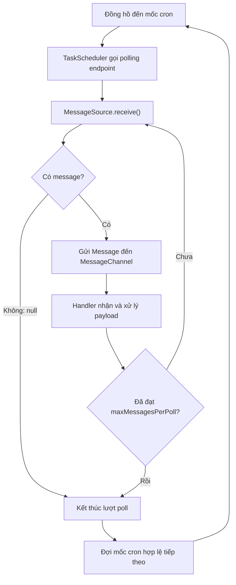

# Trigger cron cho lịch lấy dữ liệu trong Spring Integration

## 1. Bài toán: nhận dữ liệu đúng thời điểm nghiệp vụ

Một hệ thống đặt hàng nhận file đối soát vào đầu mỗi giờ; một dịch vụ tài chính lấy báo cáo lúc 02:00 hằng ngày; một nhóm vận hành chỉ cho phép quét dữ liệu vào 08:30 từ thứ Hai đến thứ Sáu. Các yêu cầu này gắn với **thời điểm trên đồng hồ**, khác với yêu cầu “cứ nghỉ 5 giây rồi kiểm tra tiếp”.

Trong module **SPRING_INTEGRATION_ADAPTERS**, một **polling inbound adapter** lấy dữ liệu từ hệ thống ngoài như thư mục file, SFTP hoặc cơ sở dữ liệu. Adapter hoặc `MessageSource` quyết định *cách* nhận dữ liệu, còn **poller** quyết định *khi nào* gọi `receive()` rồi gửi `Message` đến `MessageChannel`. Với lịch gắn vào thời gian thực tế, Spring Integration hỗ trợ **cron trigger**.

Ví dụ: cron `0 0 2 * * *` yêu cầu kích hoạt lúc **02:00:00 hằng ngày theo múi giờ của trigger**. Lệnh này không có nghĩa là công việc sẽ hoàn thành lúc 02:00 hoặc mọi dữ liệu sẽ được nhận trong một lần; nó quy định **mốc kích hoạt poller**.

Sau bài học, bạn có thể đọc và viết biểu thức cron sáu trường của Spring, khai báo `@Poller(cron = "...")`, dùng Java DSL, chọn múi giờ phù hợp và xử lý các tình huống dữ liệu tồn đọng, handler chậm, lỗi và thay đổi giờ theo mùa.

## 2. Spring cron gồm sáu trường

Biểu thức cron được Spring sử dụng cho polling thường có định dạng:

```text
┌───────────── giây              (0-59)
│ ┌─────────── phút              (0-59)
│ │ ┌───────── giờ               (0-23)
│ │ │ ┌─────── ngày trong tháng  (1-31)
│ │ │ │ ┌───── tháng             (1-12 hoặc JAN-DEC)
│ │ │ │ │ ┌─── ngày trong tuần   (0-7 hoặc MON-SUN; 0 và 7 là Chủ nhật)
│ │ │ │ │ │
* * * * * *
```

**Lưu ý:** cú pháp cron của Spring có **sáu trường, bắt đầu bằng giây**. Cron phổ biến trên Linux thường có năm trường và bắt đầu bằng phút. Không sao chép trực tiếp lịch năm trường từ `crontab` vào `@Poller(cron = ...)` khi chưa chuyển đổi. Một số biến thể Quartz còn có trường năm ở cuối, không thuộc định dạng cơ bản này.

Những ký tự thường dùng:

| Ký hiệu | Ý nghĩa | Ví dụ |
| --- | --- | --- |
| `*` | Mọi giá trị hợp lệ của trường | `*` ở trường tháng = mọi tháng |
| `,` | Danh sách giá trị | `MON,WED,FRI` |
| `-` | Một dải giá trị | `MON-FRI` |
| `/` | Bước nhảy | `*/15` ở trường phút = phút 0, 15, 30, 45 |
| `?` | Không chỉ định ngày cụ thể trong trường ngày của tháng hoặc ngày của tuần | `0 0 9 ? * MON-FRI` |

Spring hỗ trợ thêm một số cú pháp theo lịch như `L`, `W`, `#` trong các phiên bản hiện đại. Chỉ sử dụng khi đã kiểm tra ngữ nghĩa và khả năng tương thích của phiên bản Spring thực tế, nhất là với lịch cuối tháng.

### Các biểu thức có thể dùng ngay

| Cron | Khi nào poller được lên lịch? |
| --- | --- |
| `0 */5 * * * *` | Mỗi 5 phút, vào giây 0: 00, 05, 10, 15... |
| `0 0 * * * *` | Đầu mỗi giờ, phút 0 giây 0 |
| `0 30 8 * * MON-FRI` | 08:30:00 từ thứ Hai đến thứ Sáu |
| `0 0 2 * * *` | 02:00:00 mỗi ngày |
| `0 0 0 1 * *` | 00:00:00 ngày đầu tiên của mỗi tháng |
| `0 0 9,17 * * MON-FRI` | 09:00 và 17:00 vào các ngày trong tuần |
| `0 */15 9-17 * * MON-FRI` | Mỗi 15 phút trong các giờ 09 đến 17 của ngày làm việc |

Diễn giải dòng cuối: thời điểm có thể là `09:00`, `09:15`, ..., `17:45`. Nếu nghiệp vụ cần **kết thúc lúc 17:00**, hãy thiết kế lịch tránh những mốc `17:15`/ `17:30`/ `17:45`; không nên chỉ nhìn `9-17` và tự cho rằng toàn bộ cửa sổ là từ 09:00 đến 17:00.

## 3. Một mốc cron kích hoạt những gì?



Khi cron kích hoạt một lượt, poller có thể thực hiện **nhiều lần `receive()` trong cùng lượt** tùy `maxMessagesPerPoll`. Nếu source không có message, `receive()` trả `null` và lượt đó kết thúc sớm. Nếu còn backlog vượt quá giới hạn mỗi lượt, dữ liệu còn lại đợi các lượt kế tiếp hoặc cơ chế xử lý riêng.

Ví dụ, `cron = "0 */15 * * * *"` và `maxMessagesPerPoll = "10"`: lịch thăm dò rơi vào phút 00, 15, 30, 45 của từng giờ; mỗi lượt có thể nhận tối đa 10 message. Nếu ban đầu có 25 file và không có dữ liệu mới, về mặt số lượng tối thiểu cần ba lượt (10 + 10 + 5), với điều kiện source cung cấp file, handler hoạt động bình thường và không có lỗi. **Cron không tự chuyển toàn bộ backlog thành một lần nhận không giới hạn.**

### Nếu handler chạy lâu hơn khoảng giữa hai mốc cron?

Giả sử lịch chạy mỗi phút, nhưng một lượt xử lý mất 90 giây. Với một cron trigger thông thường, scheduler không bảo đảm chạy đủ từng mốc đã trôi qua; các mốc có thể bị bỏ lỡ. Không nên tự giả định cứ trễ một phút là sẽ có một lượt bù tự động. Hành vi cụ thể còn tùy `CronTrigger`, cách tính mốc tiếp theo, cấu hình scheduler và việc xử lý có được chuyển sang executor hay không.

Cron cung cấp lịch **theo thời gian trên đồng hồ**, không phải hàng đợi công việc hay bộ lưu lịch sử các lần chạy. Nếu cần bảo đảm mọi khoảng dữ liệu đều được xử lý, hãy lưu checkpoint, xử lý phần còn tồn trong dữ liệu nguồn và xây dựng chiến lược chạy bù (*catch-up*).

## 4. Ví dụ: lấy file CSV vào phút 0, 15, 30, 45

Giả sử một ứng dụng Spring Boot nhận file CSV mà đối tác ghi vào `data/inbox`. Yêu cầu là quét thư mục **mỗi 15 phút**, lấy tối đa 10 file trong một lượt và chuyển `File` vào một handler qua `DirectChannel`.

### 4.1. Dependencies

Với Maven và dự án đang dùng Spring Boot BOM để quản lý version:

```xml
<dependencies>
    <dependency>
        <groupId>org.springframework.boot</groupId>
        <artifactId>spring-boot-starter-integration</artifactId>
    </dependency>
    <dependency>
        <groupId>org.springframework.integration</groupId>
        <artifactId>spring-integration-file</artifactId>
    </dependency>
</dependencies>
```

Tạo thư mục `data/inbox` theo working directory ứng dụng và đặt vào đó vài file `.csv` trước khi chạy.

### 4.2. Cấu hình annotation

```java
import java.io.File;
import java.io.IOException;
import java.nio.charset.StandardCharsets;
import java.nio.file.Files;

import org.springframework.context.annotation.Bean;
import org.springframework.context.annotation.Configuration;
import org.springframework.integration.annotation.InboundChannelAdapter;
import org.springframework.integration.annotation.Poller;
import org.springframework.integration.annotation.ServiceActivator;
import org.springframework.integration.channel.DirectChannel;
import org.springframework.integration.config.EnableIntegration;
import org.springframework.integration.core.MessageSource;
import org.springframework.integration.file.FileReadingMessageSource;
import org.springframework.integration.file.filters.AcceptOnceFileListFilter;
import org.springframework.integration.file.filters.CompositeFileListFilter;
import org.springframework.integration.file.filters.SimplePatternFileListFilter;
import org.springframework.messaging.MessageChannel;

@Configuration
@EnableIntegration
public class CronFileAdapterConfig {

    @Bean
    public MessageChannel csvInputChannel() {
        return new DirectChannel();
    }

    @Bean
    @InboundChannelAdapter(
        channel = "csvInputChannel",
        poller = @Poller(
            cron = "0 */15 * * * *",
            maxMessagesPerPoll = "10"
        )
    )
    public MessageSource<File> csvFileSource() {
        FileReadingMessageSource source = new FileReadingMessageSource();
        source.setDirectory(new File("data/inbox"));

        CompositeFileListFilter<File> filter =
            new CompositeFileListFilter<>();
        filter.addFilter(new SimplePatternFileListFilter("*.csv"));
        filter.addFilter(new AcceptOnceFileListFilter<>());
        source.setFilter(filter);

        return source;
    }

    @ServiceActivator(inputChannel = "csvInputChannel")
    public void processCsv(File file) throws IOException {
        String data = Files.readString(
            file.toPath(), StandardCharsets.UTF_8
        );
        System.out.printf(
            "Received %s, length=%d%n",
            file.getName(), data.length()
        );

        // TODO: parse, validate, persist và xác nhận xử lý thành công.
    }
}
```

**Vai trò của từng phần:**

- `@InboundChannelAdapter` biến `csvFileSource()` thành endpoint lấy message theo lịch.
- `@Poller(cron = "0 */15 * * * *")` quy định giờ/phút/giây cần đánh thức endpoint; `maxMessagesPerPoll = "10"` giới hạn lượng message **trong mỗi lượt**.
- `FileReadingMessageSource` tìm file trong thư mục. `SimplePatternFileListFilter` nhận file khớp `*.csv`, còn `AcceptOnceFileListFilter` tránh chọn lặp những file đã được chấp nhận trong trạng thái bộ nhớ của instance.
- `DirectChannel` chuyển message đồng bộ đến `@ServiceActivator`. Nếu handler chậm, lượt polling có thể kéo dài qua mốc cron kế tiếp.

Ví dụ dùng để học về **cron trigger**, nên phần xử lý file chỉ ghi log. Trong hệ thống thực, không được xem việc source tìm thấy file hoặc filter đánh dấu file là bằng chứng nghiệp vụ đã xử lý thành công.

### 4.3. Thay đổi lịch bằng application.yml

```yaml
app:
  polling:
    file-cron: "0 */15 * * * *"
    max-messages: 10
```

Thay annotation trên method tạo source bằng:

```java
@InboundChannelAdapter(
    channel = "csvInputChannel",
    poller = @Poller(
        cron = "${app.polling.file-cron:0 */15 * * * *}",
        maxMessagesPerPoll = "${app.polling.max-messages:10}"
    )
)
```

Spring giải quyết property placeholder lúc khởi tạo cấu hình. Không đặt thêm một `@InboundChannelAdapter` thứ hai trên cùng source; phần trên **thay thế** annotation của ví dụ trước. Thay đổi file YAML của ứng dụng đang chạy không mặc nhiên làm poller đổi lịch; cần cơ chế cập nhật endpoint/trigger phù hợp hoặc khởi động lại theo quy trình vận hành.

### 4.4. Java DSL

Spring Integration Java DSL cũng cho phép đặt cron ngay tại polling endpoint:

```java
import java.io.File;

import org.springframework.context.annotation.Bean;
import org.springframework.integration.dsl.IntegrationFlow;
import org.springframework.integration.dsl.Pollers;
import org.springframework.integration.file.dsl.Files;

@Bean
IntegrationFlow cronFileFlow() {
    return IntegrationFlow
        .from(
            Files.inboundAdapter(new File("data/inbox"))
                 .patternFilter("*.csv"),
            endpoint -> endpoint.poller(
                Pollers.cron("0 */15 * * * *")
                       .maxMessagesPerPoll(10)
            )
        )
        .handle(message -> {
            File file = (File) message.getPayload();
            System.out.println("Received: " + file.getName());
        })
        .get();
}
```

`org.springframework.integration.file.dsl.Files` trong DSL khác với `java.nio.file.Files`. Đây là cách thay thế cho cấu hình annotation, **không khởi tạo đồng thời hai endpoint** cho cùng thư mục trong ví dụ nếu không chủ đích cấu hình cạnh tranh hoặc duplicate processing.

## 5. Múi giờ, lịch mùa hè và lịch nghiệp vụ

### 5.1. “02:00 hằng ngày” theo múi giờ nào?

Biểu thức `0 0 2 * * *` không chứa thông tin múi giờ. Khi triển khai trên hai máy có cấu hình timezone khác nhau, hai poller có thể được kích hoạt ở **hai thời điểm tuyệt đối khác nhau**.

Nếu nghiệp vụ yêu cầu 08:30 giờ Việt Nam, cần chỉ rõ timezone `Asia/Ho_Chi_Minh` trong cấu hình trigger hoặc thống nhất rõ timezone của môi trường vận hành. Đặc biệt, **`@Poller` không nên được hiểu là có thuộc tính `zone` giống hệt `@Scheduled`**.

Với Spring Framework hiện đại, có thể tạo `CronTrigger` chỉ rõ `ZoneId`:

```java
import java.time.ZoneId;

import org.springframework.context.annotation.Bean;
import org.springframework.scheduling.Trigger;
import org.springframework.scheduling.support.CronTrigger;

@Bean
Trigger businessTimeCronTrigger() {
    return new CronTrigger(
        "0 30 8 * * MON-FRI",
        ZoneId.of("Asia/Ho_Chi_Minh")
    );
}
```

Khi muốn dùng trigger này cho inbound adapter, cấu hình endpoint tham chiếu trigger bean, ví dụ:

```java
@InboundChannelAdapter(
    channel = "csvInputChannel",
    poller = @Poller(
        trigger = "businessTimeCronTrigger",
        maxMessagesPerPoll = "10"
    )
)
```

Trong đoạn trên, annotation thay thế `@Poller(cron = "...")` ở mục trước. `trigger` trỏ đến bean `Trigger` đã định nghĩa; không cấu hình đồng thời `cron` và `trigger` cho cùng một endpoint.

### 5.2. Khi dùng múi giờ có DST

Ở khu vực có chuyển đổi giờ mùa hè (Daylight Saving Time), một thời điểm như `02:30` có thể **không tồn tại** vào ngày đồng hồ nhảy tới hoặc có thời điểm bị lặp khi đồng hồ quay lùi. Một cron theo giờ địa phương vì thế có khả năng bỏ qua hoặc gặp mốc thời gian lặp; hành vi phụ thuộc quy tắc timezone và scheduler.

Nếu xử lý dữ liệu tài chính quan trọng, hãy lưu checkpoint/idempotency key theo định danh dữ liệu, log mốc theo chuẩn UTC kèm timezone nghiệp vụ, và kiểm tra những ngày chuyển đổi giờ. Việt Nam hiện không dùng DST, nhưng nguồn SFTP/đối tác quốc tế có thể ở vùng áp dụng DST.

### 5.3. Cron không biết ngày nghỉ công ty

`MON-FRI` chỉ biểu diễn thứ Hai đến thứ Sáu, không tự loại trừ ngày lễ hoặc ngày nghỉ bù. Nếu yêu cầu “chỉ lấy dữ liệu vào **ngày làm việc của tổ chức**”, cần bổ sung lịch nghiệp vụ, điều kiện kiểm tra trước khi xử lý hoặc một giải pháp scheduler có calendar/exclusion phù hợp.

## 6. Phân biệt cron, fixed-rate và fixed-delay

| Đặc điểm | Cron | Fixed-rate | Fixed-delay |
| --- | --- | --- | --- |
| Cách xác định lần kích hoạt | Mốc lịch theo giờ/ngày/tháng | Nhịp định kỳ từ các mốc bắt đầu được lên lịch | Sau khi lượt trước kết thúc một khoảng |
| Ví dụ | 08:30 từ thứ Hai đến thứ Sáu | Mỗi 5 phút theo chu kỳ | Nghỉ 5 phút sau mỗi lượt |
| Phù hợp khi | Đồng bộ theo lịch đối soát, khung giờ nghiệp vụ | Kiểm tra tương đối đều | Cần khoảng nghỉ cho nguồn hoặc handler chậm |
| Nếu handler chạy chậm | Có thể lỡ mốc cron; không mặc định chạy bù mọi mốc | Lịch có thể bị trễ và các lượt sát nhau | Lượt sau được đặt sau khoảng nghỉ tính từ kết thúc |
| Quan tâm múi giờ | Rất quan trọng | Thường ít phụ thuộc giờ trên đồng hồ | Thường ít phụ thuộc giờ trên đồng hồ |

Ví dụ khi ứng dụng chạy từ 08:11, “mỗi 15 phút” có thể được hiểu theo hai cách khác nhau:

- **Cron** `0 */15 * * * *`: dự kiến kích hoạt lúc **08:15, 08:30, 08:45, 09:00**...
- **Fixed-rate** 15 phút: nhịp bắt đầu dự kiến thường dựa trên thời điểm khởi tạo lịch, chẳng hạn khoảng **08:11, 08:26, 08:41**... nếu trigger bắt đầu ngay và không có initial delay.

Vì vậy, cron phù hợp khi các mốc **:00, :15, :30, :45** có ý nghĩa với đối tác; fixed-rate phù hợp khi chỉ cần chu kỳ kể từ khi ứng dụng hoạt động.

## 7. Lập kế hoạch số lượng và xử lý backlog

Khi cron chạy mỗi 15 phút và một lượt lấy tối đa 10 message, mức nhận **danh nghĩa** trong một giờ là 4 × 10 = **40 message/giờ** nếu cả bốn lượt diễn ra, luôn có ít nhất 10 message sẵn sàng tại mỗi lượt và mỗi lượt xử lý kịp. Đây là năng lực *đầu vào theo lịch*, chưa phải thông lượng đã xử lý thành công.

Giả sử đối tác đẩy 200 file lúc 08:01, lịch chạy 08:15, 08:30, 08:45, 09:00..., mỗi lượt chỉ lấy 10 file. Nếu các điều kiện khác không đổi, cần ít nhất 20 lượt để nhận 200 file, tức backlog có thể kéo dài nhiều giờ. Các hướng giải quyết gồm:

1. Tăng `maxMessagesPerPoll` có giới hạn, dựa trên thời gian xử lý thực tế và khả năng của nguồn ngoài.
2. Để cron chỉ kích hoạt **một job đồng bộ**, còn bản thân job rút dữ liệu theo batch/checkpoint đến khi đạt mục tiêu, có timeout và rate limit rõ ràng.
3. Chuyển xử lý nặng sang hàng đợi/worker riêng có giới hạn đồng thời, trong khi poller duy trì hợp đồng nhận dữ liệu và trạng thái đã tiếp nhận.
4. Tách **lịch phát hiện dữ liệu** khỏi **lịch xử lý nghiệp vụ** khi cần quan sát backlog hoặc vận hành theo cửa sổ bảo trì.

Không chọn `maxMessagesPerPoll` rất lớn chỉ để “đọc hết cho nhanh”: nếu đường xử lý là `DirectChannel`, toàn bộ handler đồng bộ có thể kéo dài lượt polling qua những mốc cron tiếp theo và gây tải lên scheduler.

## 8. Vòng đời, lỗi và nhận dữ liệu đáng tin cậy

Cron là **trigger**, không phải cơ chế giao dịch hay bảo đảm *exactly-once*. Những rủi ro quan trọng gồm:

**File chưa được ghi xong:** đối tác có thể tạo file trước khi hoàn tất nội dung. Nên thống nhất giao thức ghi vào tên/thư mục tạm rồi đổi tên hoặc di chuyển sang inbox khi file sẵn sàng; với nguồn từ xa cần kiểm tra cơ chế chuyển file phù hợp.

**Một file được nhận rồi handler lỗi:** `AcceptOnceFileListFilter` có thể đã nhớ file khi handler thất bại. Cron ở mốc sau không tự làm file xuất hiện lại. Cần chiến lược retry, tuyến lỗi, vùng cách ly file và chính sách xử lý lại gắn với trạng thái nghiệp vụ.

**Restart trước mốc đối soát:** scheduler in-process không mặc nhiên lưu lại tất cả mốc cron đã lỡ khi ứng dụng tắt. Dữ liệu còn tồn tại trong nguồn chỉ được phát hiện ở các lượt sau nếu filter/checkpoint cho phép; muốn chạy bù phải thiết kế riêng.

**Nhiều instance cùng lịch:** nếu ba replica đều có inbound poller cron `0 0 * * * *`, cả ba có thể cùng quét nguồn vào đầu giờ. Hệ thống đa instance cần cơ chế phân vùng, leader election, distributed lock, claim/checkpoint theo dữ liệu hoặc nguyên tắc idempotency phù hợp. Một cron expression không tự đảm bảo cluster chỉ chạy một lần.

**SFTP hoặc DB có lỗi kết nối:** đặt timeout, chính sách backoff/retry và quản lý session/transaction. Khi lỗi, phải ghi nhận cả mốc dự kiến, mốc thực tế và trạng thái batch; không dựa vào cron để tự sửa mọi lỗi.

**MessageChannel xử lý bất đồng bộ:** với `ExecutorChannel` hoặc luồng worker riêng, poller có thể đã kết thúc sau khi giao message, trong khi nghiệp vụ còn đang chạy. Mốc cron kế tiếp có thể đến khi batch trước vẫn chưa hoàn tất. Cần giới hạn hàng đợi và khả năng xử lý đồng thời.

## 9. Quan sát, chẩn đoán và vận hành

Nên giám sát theo **cả lịch lẫn kết quả nghiệp vụ**:

| Chỉ số / dấu hiệu | Ý nghĩa |
| --- | --- |
| Mốc cron dự kiến và mốc poll thực tế | Phát hiện scheduler bị trễ, task bị chặn hoặc timezone sai |
| Thời gian một lượt poll | Xác định nguy cơ lượt xử lý kéo dài qua mốc kế tiếp |
| Số message được nhận mỗi lượt | Phát hiện source rỗng, filter loại dữ liệu hoặc batch bị giới hạn |
| Tuổi của message/file cũ nhất chưa xử lý | Đo backlog và độ trễ nghiệp vụ thực, thay vì chỉ đếm lượt cron |
| Số lỗi, retry, file quarantine | Kiểm tra cơ chế phục hồi |
| Mức sử dụng scheduler/executor và thời gian chờ hàng đợi | Xác định khả năng nghẽn khi nhiều endpoint chạy cùng lịch |

Một số tình huống cần kiểm tra:

- **Cron có chạy nhưng không nhận file:** kiểm tra đường dẫn, quyền truy cập, pattern filter, trạng thái accept-once, thời điểm file được hoàn tất và kết nối nguồn.
- **Chạy lệch giờ đối tác:** kiểm tra timezone của JVM/scheduler, `ZoneId` cấu hình trên `CronTrigger`, DST và giờ hệ thống.
- **Mất một lượt đúng lịch:** xem log thời gian thực thi, lỗi, độ bận của task scheduler và tình trạng ứng dụng lúc đó. Đừng kết luận cron “làm mất dữ liệu” nếu chưa đối chiếu checkpoint và nguồn.
- **Cùng một batch xuất hiện hai lần:** xem có nhiều endpoint/replica cùng polling hay không, idempotency và metadata store của adapter.
- **Backlog tăng dù cron đúng giờ:** tăng năng lực xử lý hoặc thay đổi chiến lược chia batch/catch-up; chỉnh cron một mình có thể không đủ.

## 10. Bài thực hành có đáp án

**Bài 1 — Viết lịch.** Cần đồng bộ lúc 07:45:00 từ thứ Hai đến thứ Sáu. Viết cron sáu trường.

**Đáp án:** `0 45 7 * * MON-FRI`.

**Bài 2 — Đọc lịch.** `0 0 6,18 * * *` kích hoạt khi nào?

**Đáp án:** Lúc **06:00 và 18:00 hằng ngày** theo timezone của trigger.

**Bài 3 — Phân biệt cron và fixed-rate.** Ứng dụng khởi động lúc 10:07. Đối tác chỉ muốn nhận yêu cầu vào đúng phút 00, 15, 30, 45. Chọn cơ chế nào?

**Đáp án:** **Cron** `0 */15 * * * *` vì mốc phút theo đồng hồ là một phần yêu cầu. Fixed-rate 15 phút tính từ thời điểm khởi động có thể tạo nhịp 10:07, 10:22, 10:37...

**Bài 4 — Số lượt.** Cron mỗi 30 phút, `maxMessagesPerPoll = 6`, có 20 file đã sẵn sàng, không phát sinh file mới và không có lỗi. Số lượt tối thiểu để nhận hết là bao nhiêu?

**Đáp án:** **4 lượt**: 6 + 6 + 6 + 2. Thời gian chờ trước lượt đầu phụ thuộc mốc cron gần nhất trong tương lai.

**Bài 5 — Triển khai nhiều server.** Hai replica cùng chạy cron đầu giờ và đều đọc một bảng DB. Có thể chỉ tin cron để tránh trùng record không?

**Đáp án:** **Không.** Cron chỉ quyết định lịch của từng replica; cần thiết kế claim/lock/checkpoint và idempotency phù hợp.

**Bài 6 — Lịch nghiệp vụ.** Đặt `0 30 8 * * MON-FRI` có bảo đảm bỏ qua tất cả ngày lễ quốc gia không?

**Đáp án:** **Không.** Cron chỉ dựa trên các trường ngày trong tuần, ngày trong tháng, tháng; phải bổ sung lịch ngày nghỉ nghiệp vụ.

## 11. Ghi nhớ

**Cron trigger điều khiển lịch bắt đầu một lượt polling theo đồng hồ**, phù hợp với đồng bộ đầu giờ, cuối ngày và những khung giờ nghiệp vụ. Trong Spring Integration, `@Poller(cron = "...")` hoặc `Pollers.cron(...)` gắn lịch vào polling endpoint; `MessageSource` nhận dữ liệu, `MessageChannel` chuyển message, còn `maxMessagesPerPoll` giới hạn số message trong một lượt. Luôn xác định **timezone**, năng lực xử lý backlog, giới hạn concurrency và cách phục hồi khi bỏ lỡ mốc cron hoặc lỗi nghiệp vụ. Cron xác định *khi nào thử nhận dữ liệu*, không bảo đảm *mọi dữ liệu đã được xử lý thành công*.
