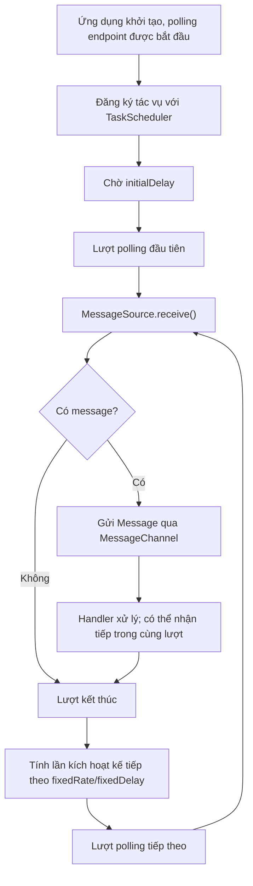

# initial-delay và thời điểm chạy lần đầu của poller trong Spring Integration

## 1. Bối cảnh: vì sao cần trì hoãn lượt polling đầu tiên?

Một dịch vụ vừa khởi động có thể chưa sẵn sàng nhận dữ liệu ngay lập tức: hệ thống SFTP của đối tác chưa mở phiên, thư mục đầu vào chưa được mount, dữ liệu khởi tạo chưa hoàn tất, hoặc nhiều instance đang đồng thời triển khai phiên bản mới. Nếu polling inbound adapter bắt đầu lấy dữ liệu quá sớm, lần gọi đầu tiên có thể không có kết quả, phát sinh lỗi kết nối hoặc tạo tải đột ngột lên hệ thống ngoài.

Trong module **SPRING_INTEGRATION_ADAPTERS**, inbound adapter và `MessageSource` đọc dữ liệu bên ngoài (file, SFTP, cơ sở dữ liệu...), chuyển thành `Message` rồi gửi qua `MessageChannel` để xử lý. Một **poller** lên lịch gọi `MessageSource.receive()`. Với các trigger định kỳ, thuộc tính **`initialDelay`** quyết định khoảng chờ **trước lượt polling đầu tiên** sau khi endpoint được bắt đầu lên lịch.

Ví dụ, `initialDelay = "10000"` có nghĩa là lượt poll đầu tiên được dự kiến kích hoạt **sau khoảng 10 giây** tính từ lúc tác vụ polling bắt đầu được scheduler đăng ký/sắp lịch; giá trị trong `@Poller` mặc định dùng **mili giây**. Nó không có nghĩa là “chờ 10 giây từ lúc người dùng gọi API” hay “chờ 10 giây sau khi tất cả hệ thống ngoài đã sẵn sàng”.

Sau bài học, bạn sẽ:

- Hiểu `initialDelay` tác động đến lượt đầu và các lượt tiếp theo như thế nào.
- So sánh lịch lần đầu khi kết hợp với `fixedRate` và `fixedDelay`.
- Cấu hình inbound file adapter dùng `@Poller(initialDelay = ...)`.
- Phân biệt trì hoãn poller với kiểm tra readiness, retry, timeout và lịch theo đồng hồ.
- Tính toán ảnh hưởng của khởi động lại, nhiều replica, tồn đọng và xử lý bất đồng bộ.

## 2. initial-delay thực sự điều khiển điều gì?

Giả sử một polling endpoint được khởi động vào thời điểm `T₀`, lúc scheduler nhận tác vụ và bắt đầu tính lịch. Với `initialDelay = 10000 ms`:

```text
Thời gian từ khi endpoint bắt đầu lên lịch
   T₀                                    T₀ + 10 s
   |-----------------------------------------|
   đăng ký poller                          lượt poll đầu tiên
                  initialDelay = 10 giây
```

**Chỉ lượt đầu** chịu khoảng chờ khởi tạo này. Những lượt sau phụ thuộc vào **trigger chính** như fixed-rate hoặc fixed-delay. Nếu `maxMessagesPerPoll = 5`, poller có thể nhận tối đa 5 message **trong cùng lượt đầu tiên**; `initialDelay` không chèn khoảng nghỉ giữa từng message.

Một lượt polling thông thường có các bước sau:



Cần phân biệt ba thời điểm:

1. **Thời điểm ứng dụng khởi động**: JVM và Spring Boot bắt đầu tạo application context.
2. **Thời điểm endpoint được bắt đầu/lên lịch (`T₀`)**: scheduler có thể tính `initialDelay` từ đây.
3. **Thời điểm thực thi thực tế (`T₁`)**: khi scheduler có luồng và thực sự gọi poller; có thể muộn hơn `T₀ + initialDelay`.

Vì các mốc này khác nhau, không nên đo `initialDelay` bằng cách lấy timestamp của log “Starting application” rồi đòi hỏi lượt đầu phải trùng chính xác đến mili giây. Độ trễ khởi tạo context, lịch thực thi của `TaskScheduler`, độ bận của luồng và hệ điều hành đều ảnh hưởng kết quả thực tế.

## 3. initial-delay kết hợp với fixed-rate

Với `fixedRate = 5000 ms`, `initialDelay = 10000 ms` và các lượt xử lý nhanh, scheduler cố gắng lên lịch theo các mốc:

```text
Giây tương đối:      0         5        10        15        20        25
                     |---------|---------|---------|---------|---------|
Endpoint bắt đầu:    ^
                                 P1        P2        P3        P4
                                 ^         ^         ^         ^
                        đợi 10s    tiếp tục theo nhịp fixed-rate 5s
```

Các lần bắt đầu được lên lịch **xấp xỉ** ở giây 10, 15, 20 và 25 tính từ `T₀`. Fixed-rate ưu tiên khoảng cách giữa các **mốc bắt đầu dự kiến**.

Nếu lượt đầu mất 8 giây nhưng chu kỳ chỉ 5 giây, lần tiếp theo có thể bị trễ và được thực hiện sát khi lượt trước kết thúc. `initialDelay` không làm giảm áp lực của các lượt sau; nó chỉ dời thời điểm bắt đầu chuỗi polling.

Ví dụ annotation:

```java
@InboundChannelAdapter(
    channel = "incomingFiles",
    poller = @Poller(
        initialDelay = "10000",
        fixedRate = "5000",
        maxMessagesPerPoll = "5"
    )
)
```

Khi chọn fixed-rate, hãy quan sát liệu thời gian xử lý của một lượt có thường xuyên vượt quá 5 giây hay không. Dù cấu hình nhịp 5 giây, không có bảo đảm mọi lượt đều bắt đầu đúng mốc; scheduler và tác vụ thực tế có thể làm lịch trễ.

## 4. initial-delay kết hợp với fixed-delay

Với `fixedDelay = 5000 ms`, `initialDelay = 10000 ms` và mỗi lượt mất 2 giây, lịch dự kiến như sau:

```text
Giây:              0          10  12       17  19       24
                   |----------|---|--------|---|--------|
Endpoint bắt đầu:  ^
Lượt poll:                    [P1]          [P2]          [P3...]
                   chờ 10s       chờ 5s        chờ 5s
```

- **Lượt đầu:** bắt đầu khoảng giây 10.
- **Lượt hai:** lượt một hoàn tất lúc giây 12, chờ thêm 5 giây, bắt đầu khoảng giây 17.
- **Lượt ba:** lượt hai hoàn tất khoảng giây 19, chờ 5 giây, bắt đầu khoảng giây 24.

Công thức minh họa khi scheduler không trễ:

\[
S_1 \approx T_0 + D_0
\]

\[
S_{n+1} \approx S_n + T_n + D
\]

Trong đó `Sₙ` là thời điểm bắt đầu lượt `n`, `Tₙ` là thời gian thực hiện lượt đó, `D₀` là initial delay, và `D` là fixed delay.

Đây là cấu hình phù hợp khi muốn **vừa chờ một lần lúc bắt đầu**, vừa duy trì một khoảng nghỉ sau mỗi lượt để bảo vệ hệ thống file/SFTP/database.

```java
@InboundChannelAdapter(
    channel = "incomingFiles",
    poller = @Poller(
        initialDelay = "10000",
        fixedDelay = "5000",
        maxMessagesPerPoll = "5"
    )
)
```

Hai ví dụ annotation ở mục 3 và 4 là **hai lựa chọn thay thế nhau** cho cùng một inbound adapter. Không cấu hình đồng thời fixed-rate và fixed-delay để mong poller tự chọn một trong hai.

### Bảng so sánh nhanh

| Tiêu chí | `initialDelay + fixedRate` | `initialDelay + fixedDelay` |
| --- | --- | --- |
| Lượt đầu | Sau khoảng initial delay | Sau khoảng initial delay |
| Cách tính lượt sau | Theo nhịp khoảng cách giữa các mốc bắt đầu dự kiến | Sau khi lượt trước kết thúc, chờ đủ fixed delay |
| Nếu handler xử lý lâu hơn chu kỳ | Lịch có thể trễ, các lượt đến sát nhau | Lượt sau vẫn chờ fixed delay sau khi lượt trước hoàn tất |
| Phù hợp | Muốn nhịp lấy dữ liệu tương đối đều | Muốn có khoảng nghỉ giữa các lần kiểm tra nguồn |
| initialDelay có lặp lại mỗi lượt không? | Không | Không |

## 5. Ví dụ hoàn chỉnh: polling file CSV, chờ 10 giây sau khi khởi động

Giả sử ứng dụng đọc file CSV từ `data/inbox`. Đối tác có thể bắt đầu copy file ngay khi ứng dụng triển khai, nên ta muốn trì hoãn lượt quét đầu **10 giây**. Sau đó, ứng dụng quét lại sau mỗi **5 giây kể từ khi lượt trước hoàn tất**, tối đa **5 file/message mỗi lượt**.

### 5.1. Dependencies

Trong ứng dụng Spring Boot dùng BOM để quản lý phiên bản dependency, khai báo:

```xml
<dependencies>
    <dependency>
        <groupId>org.springframework.boot</groupId>
        <artifactId>spring-boot-starter-integration</artifactId>
    </dependency>
    <dependency>
        <groupId>org.springframework.integration</groupId>
        <artifactId>spring-integration-file</artifactId>
    </dependency>
</dependencies>
```

Trước khi chạy, tạo thư mục `data/inbox` tính từ working directory. Đây là ví dụ thực hành về lịch polling; hệ thống thật cần giao thức file hoàn tất trước khi đọc.

### 5.2. Cấu hình inbound adapter, channel và handler

```java
import java.io.File;
import java.io.IOException;
import java.nio.charset.StandardCharsets;
import java.nio.file.Files;
import java.time.Instant;

import org.springframework.context.annotation.Bean;
import org.springframework.context.annotation.Configuration;
import org.springframework.integration.annotation.InboundChannelAdapter;
import org.springframework.integration.annotation.Poller;
import org.springframework.integration.annotation.ServiceActivator;
import org.springframework.integration.channel.DirectChannel;
import org.springframework.integration.config.EnableIntegration;
import org.springframework.integration.core.MessageSource;
import org.springframework.integration.file.FileReadingMessageSource;
import org.springframework.integration.file.filters.AcceptOnceFileListFilter;
import org.springframework.integration.file.filters.CompositeFileListFilter;
import org.springframework.integration.file.filters.SimplePatternFileListFilter;
import org.springframework.messaging.MessageChannel;

@Configuration
@EnableIntegration
public class DelayedFilePollingConfig {

    @Bean
    public MessageChannel incomingFiles() {
        return new DirectChannel();
    }

    @Bean
    @InboundChannelAdapter(
        channel = "incomingFiles",
        poller = @Poller(
            initialDelay = "10000",
            fixedDelay = "5000",
            maxMessagesPerPoll = "5"
        )
    )
    public MessageSource<File> csvFileSource() {
        FileReadingMessageSource source = new FileReadingMessageSource();
        source.setDirectory(new File("data/inbox"));

        CompositeFileListFilter<File> filter =
            new CompositeFileListFilter<>();
        filter.addFilter(new SimplePatternFileListFilter("*.csv"));
        filter.addFilter(new AcceptOnceFileListFilter<>());
        source.setFilter(filter);

        return source;
    }

    @ServiceActivator(inputChannel = "incomingFiles")
    public void processCsv(File file) throws IOException {
        String csv = Files.readString(
            file.toPath(), StandardCharsets.UTF_8
        );
        System.out.printf(
            "[%s] Processed %s (%d chars)%n",
            Instant.now(), file.getName(), csv.length()
        );

        // TODO: phân tích CSV, validate và lưu theo nghiệp vụ.
    }
}
```

Giải thích các thành phần:

- `FileReadingMessageSource` được gọi mỗi khi poller đến lượt; payload là `File`.
- `@InboundChannelAdapter` kết nối nguồn vào `incomingFiles` thông qua polling endpoint.
- `@Poller(initialDelay = "10000", fixedDelay = "5000")` trì hoãn **lượt đầu** khoảng 10 giây, rồi chờ 5 giây sau **mỗi lượt** tiếp theo.
- `maxMessagesPerPoll = "5"` giới hạn số file/message trong một lượt; không chèn delay giữa 5 message.
- `SimplePatternFileListFilter` chỉ chấp nhận tên `*.csv`, còn `AcceptOnceFileListFilter` tránh đọc lặp file đã được chọn trong bộ nhớ của instance đang chạy. Đây không phải bảo đảm idempotency hoặc exactly-once.
- `DirectChannel` xử lý đồng bộ, nên thời gian handler ảnh hưởng thời điểm **lượt polling** kết thúc và do đó ảnh hưởng lịch fixed-delay kế tiếp.

**Cách quan sát:** khởi động ứng dụng, thêm một file CSV hợp lệ ngay sau đó rồi theo dõi log. Handler chỉ log **khi nhận được file**, vì vậy không có dòng log handler không đồng nghĩa poller không được kích hoạt. Để đo chính xác mốc poll kể cả khi thư mục trống, cần bật logging/metrics của endpoint hoặc instrument `MessageSource.receive()` thay vì chỉ dựa vào log của handler.

## 6. Đưa initialDelay ra cấu hình

Giá trị khởi tạo nên được cấu hình theo môi trường, đặc biệt khi thời gian mount thư mục hoặc khởi động hệ thống đối tác thay đổi.

```yaml
# application.yml
app:
  polling:
    initial-delay-ms: 10000
    fixed-delay-ms: 5000
    max-messages-per-poll: 5
```

Thay annotation ở ví dụ trên bằng:

```java
@InboundChannelAdapter(
    channel = "incomingFiles",
    poller = @Poller(
        initialDelay = "${app.polling.initial-delay-ms:10000}",
        fixedDelay = "${app.polling.fixed-delay-ms:5000}",
        maxMessagesPerPoll = "${app.polling.max-messages-per-poll:5}"
    )
)
```

Các giá trị được resolve khi Spring tạo cấu hình endpoint. Thông thường, sửa `application.yml` khi ứng dụng đang chạy **không tự đổi** lịch của poller đang hoạt động; cần quy trình restart hoặc cơ chế quản trị cấu hình động được thiết kế riêng.

### Chọn giá trị khởi tạo như thế nào?

| Hoàn cảnh | Cân nhắc cấu hình | Điều cần xác minh |
| --- | --- | --- |
| Thư mục file được mount hơi chậm | initial delay vài giây | Thư mục có tồn tại và đọc được tại thời điểm source được tạo không? |
| SFTP cần thời gian ổn định sau deploy | delay trước lượt đầu, giới hạn batch và connection timeout | Việc kết nối có xảy ra trước lịch poll hay không? |
| Nhiều replica khởi động đồng thời | Dàn trải thời điểm khởi động bằng điều phối triển khai hoặc cơ chế giãn tải có chủ đích | Mọi replica có vẫn cùng initial delay và cùng poll hay không? |
| Ứng dụng cần phản hồi dữ liệu ngay | initial delay nhỏ hoặc bằng 0 nếu thích hợp | SLA và mức sẵn sàng thực tế của nguồn |
| Nguồn chỉ hoạt động theo giờ nghiệp vụ | Dùng trigger cron theo timezone | Mốc trên đồng hồ, ngày nghỉ và quy tắc cron |

Giá trị lớn giúp tránh thăm dò sớm, nhưng cũng **tăng độ trễ nhận dữ liệu đầu tiên**. Không có một con số 10 giây đúng cho mọi ứng dụng.

## 7. initialDelay khác gì với các cơ chế thời gian khác?

| Cơ chế | Điều khiển điều gì? | Không giải quyết được điều gì? |
| --- | --- | --- |
| `initialDelay` | Chờ trước khi bắt đầu lượt poll đầu tiên của tác vụ định kỳ | Không kiểm tra service ngoài đã sẵn sàng |
| `fixedRate` | Nhịp giữa các mốc bắt đầu được lên lịch | Không tự bảo đảm handler xử lý xong trước mốc mới |
| `fixedDelay` | Khoảng nghỉ sau khi một lượt polling hoàn tất | Không bảo đảm mọi message phía downstream bất đồng bộ đã hoàn tất |
| `cron` | Lịch theo ngày/giờ/phút/giây trên đồng hồ | Không lưu các lần lịch bị bỏ lỡ khi ứng dụng ngừng chạy |
| Connection/read timeout | Giới hạn thời gian chờ của lời gọi I/O | Không thay thế khoảng chờ trước lượt đầu |
| Retry/backoff | Quyết định lúc thử lại sau lỗi | Không đồng nghĩa với lịch của một poller mới khởi tạo |
| Readiness/lifecycle control | Quyết định khi nào endpoint có thể hoạt động dựa trên điều kiện thật | Không thay thế chính sách lấy dữ liệu định kỳ |

**Cron và initialDelay có hai ý nghĩa khác nhau.** Nếu yêu cầu là “chạy lần đầu lúc đúng 08:00”, hãy dùng cron trigger theo timezone thích hợp; delay tính từ startup sẽ cho giờ thực tế thay đổi theo lúc ứng dụng được triển khai. Với cron, mốc đầu được xác định theo biểu thức lịch và trạng thái trigger, nên không tự suy ra rằng `initialDelay` sẽ được áp dụng giống một `PeriodicTrigger`.

## 8. Những hiểu nhầm dễ gây lỗi

### 8.1. initialDelay không bảo đảm nguồn ngoài đã sẵn sàng

Giả sử bạn đặt initial delay 10 giây để chờ SFTP, nhưng ngày hôm đó SFTP khởi động mất 45 giây. Lượt đầu vẫn có thể gặp lỗi. Ngoài ra, một số adapter khởi tạo resource hoặc kiểm tra cấu hình khi tạo bean, **trước cả lượt polling đầu tiên**; delay không bắt buộc hoãn mọi hoạt động khởi tạo resource.

Giải pháp tùy hệ thống: xác thực dependency readiness, đặt connect/read timeout, retry và backoff phù hợp, hoặc điều khiển vòng đời endpoint (`SmartLifecycle`, cơ chế điều khiển endpoint) để chỉ bắt đầu poll khi điều kiện đã đạt. Với file, kiểm tra thư mục tồn tại và có quyền đọc là điều kiện độc lập với thời điểm polling.

### 8.2. initialDelay không có nghĩa là startup sleep

Khi sử dụng `@Poller(initialDelay = "...")`, Spring lên lịch tác vụ; cấu hình này **không yêu cầu chặn toàn bộ luồng khởi động ứng dụng bằng `Thread.sleep(...)`**. Những thành phần khác vẫn có thể hoàn tất khởi tạo và phục vụ request trong thời gian chờ. Nếu nghiệp vụ cần ngăn ứng dụng nhận traffic trước khi hoàn thành khởi tạo, đó là bài toán readiness riêng.

### 8.3. initialDelay không phải timeout

Một lời gọi `MessageSource.receive()` hoặc một lời gọi mạng có thể treo lâu hơn mong muốn nếu thiếu timeout. Chờ 10 giây trước lượt đầu không hề giới hạn thời gian chờ kết nối hoặc xử lý. Với các nguồn SFTP/HTTP/DB, cần cấu hình timeout của client/session, transaction và xử lý lỗi theo hợp đồng của adapter.

### 8.4. initialDelay không giãn cách từng message

Nếu lượt đầu diễn ra sau 10 giây và `maxMessagesPerPoll = 5`, 5 message đầu có thể được chuyển nhanh trong **cùng một lượt**. Nếu muốn giảm tần suất từng lời gọi ngoài, cần xem lại batch size, rate limiting hoặc thiết kế message source; chỉ tăng initial delay không làm những lời gọi bên trong mỗi lượt chậm hơn.

### 8.5. Khởi động lại làm tính lại lượt đầu

Khi polling endpoint được đăng ký/lên lịch lại sau restart, initial delay thường được tính lại cho tác vụ mới. Ví dụ, cấu hình 10 giây có thể gây khoảng chờ **mỗi lần khởi động instance**. Không có cơ chế lưu “đã chờ initial delay từ lần chạy trước” mặc định.

Nếu nhiều pod restart đồng thời, các pod có thể đồng loạt poll sau cùng một khoảng delay. Muốn tránh bùng tải đầu vào, xem xét triển khai so le, điều phối theo cluster, lock/claim dữ liệu hoặc thiết kế dàn tải an toàn. Chỉ dùng một giá trị `initialDelay` giống nhau ở tất cả replica không tự tạo jitter.

### 8.6. Channel bất đồng bộ thay đổi ý nghĩa “lượt kết thúc”

```text
Luồng đồng bộ:
Poller -> MessageSource -> DirectChannel -> Handler (đọc/ghi DB)
                                     handler hoàn tất -> lượt poll hoàn tất

Luồng bất đồng bộ:
Poller -> MessageSource -> ExecutorChannel -> hàng đợi worker
                                     giao việc xong -> lượt poll có thể hoàn tất
                                     worker vẫn đang xử lý về sau
```

Với `ExecutorChannel`, initial delay vẫn chỉ áp dụng trước lượt **poll đầu tiên**; các lượt sau có thể diễn ra trong lúc message đã gửi trước đó vẫn đang được worker xử lý. Cần giới hạn queue, concurrency và thiết kế acknowledgement/idempotency nếu không muốn backlog âm thầm tăng.

## 9. initialDelay trong xử lý lỗi, retry và độ tin cậy

Hãy xét một dòng file CSV: sau khi ứng dụng khởi động 10 giây, message source phát hiện `orders-001.csv`, filter accept-once chấp nhận file rồi gửi message vào handler. Handler thất bại khi ghi đơn hàng.

```text
T₀                      T₀+10s
|-------------------------|
endpoint start          poll lần 1 -> nhận orders-001.csv
                                      -> handler lỗi
                                            |
                                            +-> cần retry/recovery có chủ đích
```

Tăng `initialDelay` lên 20 giây chỉ đẩy lỗi sang thời điểm muộn hơn. Nó không làm lần xử lý lỗi được retry tự động; `AcceptOnceFileListFilter` có thể đã ghi nhận file, khiến poller lượt sau không chọn lại file đó.

Đối với luồng tích hợp thực tế:

1. Quy định khi nào dữ liệu đã **sẵn sàng nhận**: ví dụ đối tác chuyển file từ thư mục tạm sang inbox sau khi ghi xong.
2. Tách trạng thái **đã phát hiện**, **đã chuyển thành message**, **đã hoàn thành nghiệp vụ**.
3. Thiết kế xử lý idempotent theo mã đơn hàng hoặc định danh file/batch.
4. Cấu hình retry/backoff, xử lý exception và tuyến lỗi thích hợp của Spring Integration.
5. Nếu cần sống sót qua restart, quản lý metadata/checkpoint bền vững thay vì chỉ dựa vào filter trong bộ nhớ.
6. Với nhiều instance, giải quyết cạnh tranh/claim dữ liệu ở nguồn hoặc ở lớp nghiệp vụ.

Trong các adapter JMS, AMQP hoặc Kafka thường dùng listener/message-driven, cơ chế kích hoạt dữ liệu khác polling endpoint. **Không áp dụng initial delay của poller cho mọi loại inbound adapter** nếu adapter đó không sử dụng poller.

## 10. Đo đạc và xác minh thời điểm chạy lần đầu

### Kịch bản quan sát

Đặt `initialDelay = 10000 ms`, `fixedDelay = 5000 ms`, `maxMessagesPerPoll = 3`:

| Diễn biến | Kỳ vọng ở mức scheduler |
| --- | --- |
| Endpoint bắt đầu lên lịch tại `T₀` | Chưa gọi poll ngay nếu cấu hình initial delay 10 giây |
| `T₀ + 4s`: thả 2 file CSV vào inbox | File đang chờ, không làm initial delay ngắn lại |
| Khoảng `T₀ + 10s` | Poll đầu: có thể xử lý 2 file trong cùng một lượt |
| Lượt đầu mất 2 giây | Lượt sau dự kiến khoảng `T₀ + 17s` với fixed-delay 5 giây |
| Không còn file | Lượt đó kết thúc sau khi `receive()` trả `null`; không có log handler |
| Restart instance | Tác vụ mới lại chịu thời gian chờ khởi tạo của nó |

Nên ghi nhận:

- **Thời điểm endpoint được khởi động** và **thời điểm poll thực tế**, tính bằng `Instant` để không nhầm timezone.
- Thời lượng mỗi lượt, số message trong mỗi lượt, thời gian `receive()` và độ trễ giữa các lượt.
- Backlog và tuổi của dữ liệu cũ nhất; số lỗi kết nối, timeout, retry và file lỗi.
- Mức sử dụng `TaskScheduler`/executor khi có nhiều polling endpoint hoặc worker cùng chạy.

Lưu ý: `@ServiceActivator` chỉ thấy message đã được nhận, nên log trong handler **không đo được** những lượt polling trả `null`. Để xác minh lịch đầu trong trường hợp nguồn rỗng, instrument `MessageSource.receive()` hoặc sử dụng metrics/logging của poller phù hợp với phiên bản Spring Integration.

### Ba phép tính đơn giản

**Ví dụ 1:** initial delay 15 giây, fixed-rate 10 giây, handler nhanh. Nếu endpoint bắt đầu lúc 09:00:00, các mốc bắt đầu dự kiến là **09:00:15, 09:00:25, 09:00:35**.

**Ví dụ 2:** initial delay 15 giây, fixed-delay 10 giây, lượt đầu xử lý 3 giây. Nếu endpoint bắt đầu lúc 09:00:00, lượt đầu dự kiến ở **09:00:15**, lượt sau ở **09:00:28**.

**Ví dụ 3:** initial delay 15 giây, fixed-delay 10 giây và `maxMessagesPerPoll = 4`. Đúng lúc lượt đầu có 9 file hợp lệ, không lỗi và không có thêm file. Cần tối thiểu **3 lượt** để nhận hết (4 + 4 + 1). initial delay chỉ áp dụng trước lượt thứ nhất; hai lượt tiếp theo chờ theo fixed-delay sau khi mỗi lượt hoàn tất.

## 11. Bài tập thực hành có đáp án

**Bài 1 — Phân biệt lần đầu và các lần sau.** `initialDelay = 8000 ms`, `fixedRate = 4000 ms`; thời gian mỗi lượt ngắn. Nếu endpoint bắt đầu lúc giây 0, ba mốc bắt đầu theo lịch là gì?

**Đáp án:** Giây **8, 12, 16**. initial delay không được cộng lặp lại vào mỗi chu kỳ 4 giây.

**Bài 2 — Thời gian xử lý chậm.** `initialDelay = 6000 ms`, `fixedDelay = 3000 ms`. Lượt đầu mất 7 giây. Bỏ qua scheduler jitter, lượt hai bắt đầu ở giây nào?

**Đáp án:** Giây **16** (6 giây chờ đầu + 7 giây xử lý + 3 giây nghỉ sau lượt đầu).

**Bài 3 — Đọc nhiều message trong một lượt.** `initialDelay = 10000 ms`, `maxMessagesPerPoll = 5`. Có 12 file sẵn sàng. Poller có chờ 10 giây giữa từng file không?

**Đáp án:** **Không.** initial delay chỉ trước **lượt đầu**. Poller có thể nhận 5 file trong cùng lượt đầu; số lượt tối thiểu để nhận 12 file là 3 nếu nguồn và xử lý bình thường.

**Bài 4 — Nguồn không sẵn sàng.** SFTP đôi khi sẵn sàng sau 5 giây, đôi khi mất 1 phút. Liệu initial delay cố định 20 giây đủ để bảo đảm không gặp lỗi kết nối?

**Đáp án:** **Không.** Cần timeout, retry/backoff và/hoặc readiness gate. initial delay chỉ là một khoảng chờ dự kiến.

**Bài 5 — Khởi động nhiều replica.** Bốn instance cùng khởi động lúc 10:00 và cùng đặt `initialDelay = 10000 ms`. Các instance có tự động được trải đều lịch poll trong 10 giây không?

**Đáp án:** **Không.** Chúng có thể cùng thực thi gần 10:00:10. Cần chính sách điều phối cluster và chống xử lý trùng.

**Bài 6 — Yêu cầu đồng hồ.** Nghiệp vụ yêu cầu lấy dữ liệu đúng 07:30 mỗi ngày bất kể ứng dụng khởi động lúc nào. Có nên dùng `initialDelay` để đợi tới 07:30 không?

**Đáp án:** **Không nên.** Dùng cron trigger theo timezone nghiệp vụ, ví dụ `0 30 7 * * *`, đồng thời thiết kế khả năng xử lý mốc bị bỏ lỡ.

## 12. Ghi nhớ

**`initialDelay` là khoảng đợi trước lượt polling đầu tiên**, tính khi polling endpoint bắt đầu được scheduler lên lịch. Nó kết hợp với `fixedRate` để dời điểm bắt đầu chuỗi nhịp định kỳ, hoặc với `fixedDelay` để vừa chờ lúc đầu vừa giữ khoảng nghỉ giữa các lượt. Khoảng chờ này không được cộng vào từng message, không chặn toàn bộ ứng dụng khởi động và không chứng minh hệ thống ngoài đã sẵn sàng. Khi thiết kế inbound adapter trong Spring Integration, hãy kết hợp lịch polling với timeout, readiness, retry, idempotency, xử lý backlog và quan sát mốc thực thi thực tế.
