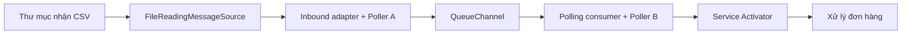
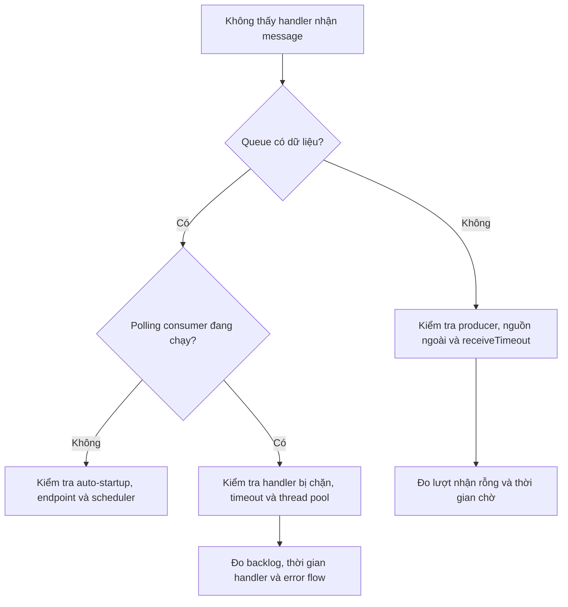

# receive-timeout khi nguồn không có dữ liệu trong Spring Integration

## 1. Vấn đề thực tế: poller cần làm gì khi chưa có message?

Giả sử hệ thống nhận file đơn hàng từ đối tác. Một inbound adapter theo lịch đưa file vào hàng đợi, còn một thành phần xử lý nghiệp vụ lấy message từ hàng đợi đó. Có những thời điểm hàng đợi trống: chưa có file mới, file đã được xử lý hết, hoặc đối tác tạm ngừng gửi dữ liệu. Thành phần tiêu thụ message có hai lựa chọn: kiểm tra hàng đợi và trả về ngay, hoặc **chờ một khoảng ngắn** để xem có message mới xuất hiện hay không.

Trong Spring Integration, thuộc tính **`receiveTimeout`** của poller giúp điều khiển thời gian chờ khi polling endpoint nhận message từ **`PollableChannel`**, chẳng hạn `QueueChannel`. Với kênh hỗ trợ chờ, poller có thể đợi một khoảng thời gian tối đa ở lần gọi `receive(timeout)`. Nếu không có message trước khi hết thời gian, lời gọi thường trả về `null`, lượt polling dừng nhận thêm dữ liệu và scheduler tính lịch tiếp theo.

Điểm cần nắm chính xác trong module **SPRING_INTEGRATION_ADAPTERS**: **`receiveTimeout` không mặc nhiên là timeout của mọi inbound adapter**. Với một polling inbound adapter dùng `MessageSource` như `FileReadingMessageSource`, giao diện chuẩn là `MessageSource.receive()` **không nhận đối số timeout**. Nguồn trả `null` khi không có dữ liệu, còn thời gian kết nối/đọc I/O của nguồn ngoài phải được cấu hình theo khả năng riêng của adapter hoặc client.

Bài này tập trung vào sự khác biệt quan trọng đó, cách dùng `receiveTimeout` hợp lý và cách nhận biết một pipeline đang chờ message, đang quét nguồn rỗng hay đang mắc kẹt ở I/O.

**Mục tiêu học tập**

- Phân biệt timeout chờ message ở `PollableChannel` với thời gian giữa các lượt polling.
- Hiểu khi nào `@Poller(receiveTimeout = "...")` thực sự có ý nghĩa.
- Cấu hình `QueueChannel` và polling consumer có timeout chờ nhận message.
- Biết cách điều chỉnh `fixedDelay`, `fixedRate`, `maxMessagesPerPoll` cùng `receiveTimeout`.
- Thiết kế kiểm soát lỗi, kết nối, backlog và quan sát vận hành khi nguồn tạm thời không có dữ liệu.

## 2. Phân biệt polling inbound adapter với polling consumer

Spring Integration có nhiều cách lấy message; hai mô hình dễ bị nhầm là:

| Thành phần | Đọc dữ liệu từ đâu? | Lời gọi nhận dữ liệu | `receiveTimeout` có tác dụng gì? |
| --- | --- | --- | --- |
| **Polling inbound adapter** qua `MessageSource` | Nguồn ngoài như file, SFTP, JDBC | `MessageSource.receive()` | Không tự áp một deadline chung lên `receive()` của mọi source. |
| **Polling consumer** đọc từ `PollableChannel` | Hàng đợi message, ví dụ `QueueChannel` | `PollableChannel.receive(timeout)` | Quy định thời gian chờ để nhận message từ channel hỗ trợ timeout. |
| **Message-driven consumer** đọc từ `SubscribableChannel` | Message được đẩy tới subscriber, ví dụ `DirectChannel` | Handler được gọi khi có message | Không cần poller để nhận message từ channel. |

Mô hình thực tế có thể kết hợp inbound adapter và polling consumer:



- **Poller A** quyết định lúc nào quét thư mục và có thể phát tối đa bao nhiêu file/message mỗi lượt. Nếu thư mục trống, `FileReadingMessageSource.receive()` thường trả `null`.
- **Poller B** quyết định lúc nào consumer kiểm tra hàng đợi. Khi `QueueChannel` trống, `receiveTimeout` của Poller B có thể khiến thao tác nhận **chờ một khoảng xác định** trước khi trả `null`.

Vì vậy, khi nói “nguồn không có dữ liệu”, cần hỏi rõ: **nguồn bên ngoài không có file/bản ghi** hay **message queue bên trong đang trống**? Hai trường hợp có cách điều tiết và timeout khác nhau.

## 3. Cơ chế receive-timeout hoạt động như thế nào?

Một `PollableChannel` cung cấp lời gọi:

```java
Message<?> message = channel.receive(timeoutMillis);
```

Ví dụ, khi `channel` là `QueueChannel`:

- Nếu message đã có sẵn trong queue, `receive(300)` thường trả message ngay.
- Nếu queue đang trống nhưng message đến sau 100 ms, lời gọi có thể nhận được message đó trước khi hết hạn.
- Nếu queue vẫn trống sau khoảng 300 ms, lời gọi trả `null` (thời gian thực tế có thể lệch do scheduling).
- Lời gọi không tự tạo message rỗng, không tự ném lỗi chỉ vì queue không có dữ liệu và không tự thực hiện retry nghiệp vụ.

```text
Ví dụ: receiveTimeout = 300 ms

Trường hợp A: queue có message
0 ms  --> nhận ngay --> xử lý

Trường hợp B: queue ban đầu trống, message xuất hiện lúc 100 ms
0 ms  --------- 100 ms --> nhận message --> xử lý

Trường hợp C: queue luôn trống
0 ms  ------------------------------ 300 ms --> receive() trả null
```

**Timeout là giới hạn chờ của một thao tác nhận message**, không phải giới hạn thời gian toàn bộ lượt poll hoặc thời gian tối đa cho handler.

Với `maxMessagesPerPoll = 5`, consumer có thể gọi nhận nhiều lần trong **cùng một lượt**. Nếu hai message đầu có sẵn, consumer lấy chúng ngay; lần nhận thứ ba thấy queue trống có thể chờ thêm tới 300 ms rồi mới kết thúc lượt. Vì thế, `receiveTimeout = 300` không có nghĩa toàn bộ lượt polling luôn kết thúc trong 300 ms.

### Kết hợp với lịch fixed-delay

Giả sử poller tiêu thụ queue có:

```text
fixedDelay = 1000 ms
receiveTimeout = 300 ms
maxMessagesPerPoll = 1
```

Nếu queue luôn trống và scheduler không bị trễ:

```text
0 ms       300 ms           1300 ms       1600 ms
|--- đợi ---|-- nghỉ 1000ms --|--- đợi ---|-- nghỉ ... -->
receive(300) trả null         receive(300) trả null
```

Khoảng cách giữa **hai lần bắt đầu** có thể gần 1.300 ms: 300 ms chờ receive rồi 1.000 ms fixed-delay sau khi lượt trước kết thúc. Nếu message có sẵn và handler chạy nhanh, lượt đầu kết thúc sớm hơn, nên lượt kế tiếp cũng đến sớm hơn.

Đối với `fixedRate`, các mốc bắt đầu được lên lịch theo chu kỳ. Nếu receive bị chặn quá lâu hoặc handler xử lý chậm, lượt sau có thể bị trễ. **`fixedRate` không làm `receive(timeout)` tự trả về trước hạn**.

## 4. Ví dụ hoàn chỉnh: file inbound adapter kết hợp QueueChannel

Bài thực hành dưới đây mô phỏng hai công đoạn:

1. **File inbound adapter** quét `data/inbox` mỗi 5 giây, lấy tối đa 10 file `.csv` mỗi lượt.
2. **Polling consumer** lấy tối đa 4 message mỗi lượt từ queue, chờ tối đa 300 ms ở từng lần `receive()` khi queue trống, rồi nghỉ 1 giây sau lượt trước.

Đây là ví dụ minh họa trực tiếp việc `receiveTimeout` nằm **ở phía đọc `QueueChannel`**.

### 4.1. Dependencies

Với Maven trong dự án Spring Boot dùng BOM để quản lý phiên bản:

```xml
<dependencies>
    <dependency>
        <groupId>org.springframework.boot</groupId>
        <artifactId>spring-boot-starter-integration</artifactId>
    </dependency>
    <dependency>
        <groupId>org.springframework.integration</groupId>
        <artifactId>spring-integration-file</artifactId>
    </dependency>
</dependencies>
```

Tạo thư mục `data/inbox` theo working directory của ứng dụng trước khi khởi chạy. Thả các file CSV hợp lệ vào đó để quan sát.

### 4.2. Cấu hình Java

```java
import java.io.File;
import java.io.IOException;
import java.nio.charset.StandardCharsets;
import java.nio.file.Files;

import org.springframework.context.annotation.Bean;
import org.springframework.context.annotation.Configuration;
import org.springframework.integration.annotation.InboundChannelAdapter;
import org.springframework.integration.annotation.Poller;
import org.springframework.integration.annotation.ServiceActivator;
import org.springframework.integration.channel.QueueChannel;
import org.springframework.integration.config.EnableIntegration;
import org.springframework.integration.core.MessageSource;
import org.springframework.integration.file.FileReadingMessageSource;
import org.springframework.integration.file.filters.AcceptOnceFileListFilter;
import org.springframework.integration.file.filters.CompositeFileListFilter;
import org.springframework.integration.file.filters.SimplePatternFileListFilter;

@Configuration
@EnableIntegration
public class ReceiveTimeoutExample {

    // QueueChannel là PollableChannel; sức chứa 100 message.
    @Bean
    public QueueChannel pendingCsvFiles() {
        return new QueueChannel(100);
    }

    // Poller A: kiểm tra nguồn file định kỳ.
    @Bean
    @InboundChannelAdapter(
        channel = "pendingCsvFiles",
        poller = @Poller(
            fixedRate = "5000",
            maxMessagesPerPoll = "10"
        )
    )
    public MessageSource<File> csvFileSource() {
        FileReadingMessageSource source = new FileReadingMessageSource();
        source.setDirectory(new File("data/inbox"));

        CompositeFileListFilter<File> filters =
            new CompositeFileListFilter<>();
        filters.addFilter(new SimplePatternFileListFilter("*.csv"));
        filters.addFilter(new AcceptOnceFileListFilter<>());
        source.setFilter(filters);

        return source;
    }

    // Poller B: đợi message từ QueueChannel trong tối đa 300 ms/lần nhận.
    @ServiceActivator(
        inputChannel = "pendingCsvFiles",
        poller = @Poller(
            fixedDelay = "1000",
            receiveTimeout = "300",
            maxMessagesPerPoll = "4"
        )
    )
    public void processCsv(File file) throws IOException {
        String csv = Files.readString(
            file.toPath(), StandardCharsets.UTF_8
        );
        System.out.printf(
            "Processed %s (%d chars)%n",
            file.getName(), csv.length()
        );

        // TODO: phân tích, validate, lưu đơn hàng và ghi nhận hoàn tất.
    }
}
```

**Giải thích kết quả:**

- `FileReadingMessageSource` quét thư mục và trả từng `Message<File>` khi có file phù hợp. Các file đã được filter chấp nhận được ghi nhớ bởi `AcceptOnceFileListFilter` trong instance đang chạy.
- `QueueChannel(100)` lưu message chờ xử lý trong bộ nhớ với sức chứa 100. Đây là **buffer có giới hạn**, không phải durable broker. Khi queue đầy, luồng gửi cần chính sách timeout/backpressure và xử lý lỗi riêng.
- `@InboundChannelAdapter` tạo Poller A với `fixedRate = 5000`: mỗi 5 giây theo nhịp lịch, gọi message source và chuyển tối đa 10 file/message vào queue.
- `@ServiceActivator` có `poller` tạo **polling consumer** lấy message từ queue. `receiveTimeout = 300` giúp lần nhận chờ tối đa khoảng 300 ms nếu chưa có message.
- `maxMessagesPerPoll = 4` giới hạn lượng công việc consumer nhận trong mỗi lượt. `fixedDelay = 1000` tính khoảng nghỉ **sau khi lượt consumer hoàn tất**.

Vì queue được tiêu thụ bởi polling consumer, handler nhận payload `File` rồi đọc nội dung. Các lời gọi `receive()` có thể được thực hiện liên tiếp trong một lượt cho đến khi đạt 4 message hoặc không còn message sau thời gian chờ.

### 4.3. Thử các tình huống

**Tình huống A — thư mục và queue đều trống:** Poller A quét file rồi không phát ra message. Poller B chờ tối đa khoảng 300 ms trên queue mỗi lượt; handler không được gọi. Để biết poller B thực sự chạy, phải đo/log tại bước poll hoặc channel, không chỉ log trong handler.

**Tình huống B — thả hai file:** Một lượt Poller A phát hiện và gửi hai message vào queue. Poller B nhận hai message và xử lý; sau đó có thể chờ thêm tối đa 300 ms ở lần `receive()` thứ ba trước khi kết thúc lượt (nếu chưa đạt giới hạn 4 message).

**Tình huống C — có 12 file đã sẵn sàng:** Poller A có `maxMessagesPerPoll = 10`, nên cần ít nhất hai lượt nguồn để phát hết 12 file vào queue. Poller B lấy tối đa 4 message/lượt; nó có thể cần ít nhất ba lượt xử lý, tùy tốc độ đưa vào queue và xử lý.

**Tình huống D — handler đọc/ghi chậm:** Nếu xử lý một file mất 2 giây và mỗi lượt consumer nhận 4 file, lượt Poller B có thể chạy khoảng 8 giây hoặc lâu hơn; `receiveTimeout = 300` **không cắt ngang handler** sau 300 ms.

**Tình huống E — queue đầy:** Khi inbound adapter nhanh hơn consumer, `QueueChannel(100)` cuối cùng có thể đầy. Poller B chờ 300 ms lúc queue trống không giúp giải quyết queue đầy; cần quan sát backlog và cơ chế chặn/gửi lỗi ở phía producer.

## 5. Khi nào receiveTimeout không giải quyết vấn đề?

### 5.1. Inbound adapter đọc nguồn bên ngoài không có dữ liệu

Ví dụ chỉ có inbound adapter đọc file:

```java
@InboundChannelAdapter(
    channel = "incomingFiles",
    poller = @Poller(
        fixedDelay = "5000",
        maxMessagesPerPoll = "10"
    )
)
public MessageSource<File> inboundFiles() {
    // Trả về FileReadingMessageSource đã cấu hình.
}
```

Khi thư mục trống, `FileReadingMessageSource.receive()` thường trả `null`. Poller kết thúc lượt rồi đợi theo `fixedDelay`. Không có thao tác `QueueChannel.receive(300)` nào trong đoạn này, nên **thêm `receiveTimeout = "300"` vào poller của inbound file source không phải cách đặt timeout cho thao tác tìm file**.

Tương tự, với inbound SFTP hoặc database:

- Timeout **kết nối SFTP** phụ thuộc session/client, thiết lập kết nối và remote file operation.
- Timeout **truy vấn SQL** phụ thuộc JDBC driver, transaction, query timeout và cơ chế truy vấn của adapter.
- Timeout **HTTP request** phụ thuộc HTTP client và cấu hình connect/read/response timeout.

Không được giả định `receiveTimeout` của polling endpoint tự giới hạn toàn bộ I/O này. Cần dùng timeout tương ứng của từng adapter hoặc thư viện kết nối.

### 5.2. DirectChannel hoặc kênh nhận theo push

`DirectChannel` là `SubscribableChannel`: khi producer gửi message, subscriber được gọi đồng bộ theo cơ chế dispatch. Handler nhận message qua `DirectChannel` **không dùng `PollableChannel.receive(timeout)`**.

Vì vậy, không cần gắn poller với `receiveTimeout` để tiêu thụ một `DirectChannel`. Hãy sử dụng đúng loại endpoint/channel cho mô hình message-driven; trong trường hợp cần buffer và polling consumer, hãy dùng `PollableChannel` phù hợp.

### 5.3. Queue trống không phải là một lỗi nghiệp vụ

Nếu `QueueChannel.receive(300)` hết thời gian mà không nhận được message, kết quả `null` là trạng thái **không có dữ liệu để xử lý trong lần nhận đó**, không mặc nhiên là exception. Các cơ chế retry/backoff thường được dùng khi có lỗi thực sự (kết nối hỏng, ghi DB thất bại...), trong khi queue trống có thể là trạng thái bình thường cần được đo đạc và quản lý tần suất kiểm tra.

## 6. Bốn thông số hay bị nhầm

| Thông số | Ý nghĩa | Ví dụ | Không có nghĩa là |
| --- | --- | --- | --- |
| `receiveTimeout` | Thời gian tối đa chờ **một lần nhận từ channel** có hỗ trợ blocking receive | `300 ms` trên `QueueChannel` | Timeout toàn bộ handler hoặc API bên ngoài |
| `fixedDelay` | Đợi sau khi **một lượt poll hoàn tất** rồi mới bắt đầu lượt kế tiếp | `1000 ms` | Đợi giữa từng message trong cùng lượt |
| `fixedRate` | Nhịp của các mốc **bắt đầu được lên lịch** | `1000 ms` | Cam kết tác vụ luôn khởi chạy đúng từng mốc |
| `maxMessagesPerPoll` | Số message tối đa được nhận trong **một lượt** | `4` | Độ lớn queue hoặc số thread |

Ngoài ra cần phân biệt:

- **`sendTimeout`**: thời gian chờ ở phía **gửi** message vào channel có thể chặn; ví dụ producer gửi vào `QueueChannel` đã đầy.
- **Network I/O timeout**: giới hạn thời gian một client chờ kết nối/đọc/ghi với dịch vụ ngoài, độc lập với việc poller đợi message.
- **Handler timeout / transaction timeout**: giới hạn hoặc điều phối phần nghiệp vụ sau khi đã có message, tùy công nghệ và cấu hình xử lý.

Không nên dùng cùng một giá trị cho mọi timeout chỉ vì chúng đều đo bằng mili giây. Chúng bảo vệ các bước khác nhau trong pipeline.

## 7. Chọn receiveTimeout theo tải và độ trễ mong muốn

### 7.1. Đợi ngắn hay kiểm tra ngay?

Với `QueueChannel`, giá trị chờ dương như 100–500 ms thường phù hợp cho bài thực hành khi muốn cho message có cơ hội đến trong khoảng rất ngắn mà không chặn luồng scheduler quá lâu. Đây chỉ là ví dụ, không phải giá trị mặc định hay khuyến nghị chung cho production.

Một số cân nhắc:

- **Timeout ngắn:** lượt polling trống kết thúc sớm; poller kiểm tra lại theo lịch, nhưng cần theo dõi tổng số lần nhận rỗng và độ trễ chờ message.
- **Timeout dài:** consumer có thể phản hồi nhanh khi message đến trong khoảng đang đợi, nhưng giữ một luồng thực thi bận chờ lâu hơn và có thể làm trì hoãn lượt khác dùng chung scheduler.
- **Timeout bằng 0:** với `QueueChannel`, nhận ngay nếu có message và trả `null` nếu queue trống; cần kết hợp lịch poll phù hợp để tránh thiết kế kiểm tra quá dày.
- **Chờ vô hạn:** không phù hợp cho nhiều poller được lập lịch định kỳ, vì có nguy cơ giữ luồng và gây khó khăn khi shutdown hoặc theo dõi. Nếu hệ thống thực sự cần nhận liên tục, nên cân nhắc kiến trúc listener/broker/consumer chuyên dụng.

Các hành vi timeout đặc biệt có thể khác nhau giữa implementation của `PollableChannel`, nên cần xem hợp đồng của channel đang sử dụng. Ví dụ trong bài dùng `QueueChannel` với **giá trị không âm** để dễ quan sát.

### 7.2. Ảnh hưởng của maxMessagesPerPoll

Giả sử queue trống và consumer có:

```text
fixedDelay = 1000 ms
receiveTimeout = 300 ms
maxMessagesPerPoll = 5
```

Lần nhận đầu chờ tối đa 300 ms rồi trả `null`; poller thường **kết thúc lượt ngay khi nhận `null`**, thay vì tiếp tục chờ thêm bốn lần nữa. Do đó, trong tình huống không có message, không phải cứ lấy 5 × 300 = 1500 ms.

Ngược lại, nếu nhận được 4 message liên tiếp và lần thứ năm chưa có message, thời lượng lượt gồm **thời gian xử lý 4 message** cộng thêm tối đa 300 ms cho lần nhận cuối. Nếu cả 5 message đều có sẵn, lượt có thể kết thúc mà không cần chờ đủ timeout.

### 7.3. Backlog không được giải quyết bằng receiveTimeout

Giả sử nguồn đưa vào queue trung bình 20 message/giây, consumer chỉ xử lý được 5 message/giây. Dù `receiveTimeout` đặt 0, 100 hay 500 ms, backlog vẫn tăng khi tốc độ nhận vào vượt năng lực xử lý lâu dài.

Để xử lý backlog, cần xem `maxMessagesPerPoll`, thời gian handler, số worker, capacity của queue, cơ chế phản hồi áp lực (backpressure) và tính idempotent. **Timeout chờ queue trống chủ yếu ảnh hưởng thời gian chờ khi chưa có message**, không tăng tốc độ xử lý từng message.

## 8. Lỗi, trạng thái và vòng đời kết nối

Sự kiện “chưa có dữ liệu” có thể xuất phát từ nhiều nguyên nhân, cần phân loại trước khi quyết định retry:

| Quan sát | Ý nghĩa có thể xảy ra | Cần kiểm tra |
| --- | --- | --- |
| `QueueChannel.receive(timeout)` trả `null` | Queue thực sự trống đến lúc hết hạn | Tốc độ producer, thời gian nhận và queue depth |
| `MessageSource.receive()` trả `null` | Nguồn file/DB chưa có dữ liệu phù hợp hoặc filter loại hết | Đường dẫn, query, filter, trạng thái metadata |
| Lời gọi SFTP/HTTP/DB mất nhiều thời gian | Chậm I/O, timeout client hoặc nguồn đang quá tải | Connect/read/query timeout và network |
| Handler nhận message rồi lỗi | Lỗi nghiệp vụ hay phụ thuộc downstream | Retry, error flow, transaction, idempotency |
| Không có message sau restart | Có thể do filter/metadata, checkpoint hoặc producer chưa phát | Lưu trạng thái bền vững, phục hồi và quan sát |

**Những điều `receiveTimeout` không bảo đảm:**

1. **Không bảo đảm exactly-once.** Message có thể được nhận nhưng xử lý thất bại, hoặc producer có thể phát trùng.
2. **Không tự khôi phục file đã lọc.** `AcceptOnceFileListFilter` có thể đã đánh dấu file trước khi handler lỗi. Cần cơ chế retry/recovery rõ ràng.
3. **Không lưu bền queue.** `QueueChannel` thông thường trong ví dụ sử dụng bộ nhớ; nếu cần tồn tại qua restart, dùng cơ chế lưu bền hoặc broker phù hợp.
4. **Không quản lý giao dịch đầu cuối.** Nhận khỏi queue, ghi DB và xác nhận nghiệp vụ là các bước cần xác định ranh giới transaction/acknowledgement.
5. **Không chống trùng trên nhiều instance.** Khi nhiều replica cùng đọc nguồn hoặc xử lý message, cần idempotency key, claim/checkpoint hoặc phân vùng thích hợp.

Với nguồn bên ngoài có vòng đời kết nối (SFTP/HTTP/JMS/AMQP/Kafka), phân biệt adapter polling với listener nhận message đẩy từ broker. Không cố đưa `receiveTimeout` của polling consumer vào một adapter vốn hoạt động bằng listener và không sử dụng `PollableChannel.receive(timeout)`.

## 9. Quan sát để biết consumer đang chờ hay thực sự bị nghẽn

Log của `@ServiceActivator` chỉ xuất hiện **sau khi nhận được message**. Khi queue trống, handler không chạy, vì thế chỉ nhìn log handler không thể kết luận polling consumer đã dừng.

Các chỉ số nên có:

- **Số lượt poll** và thời gian bắt đầu/kết thúc từng lượt.
- **Số lần nhận thành công / nhận `null` do hết thời gian chờ**, cùng thời lượng `receive()`.
- **Độ dài queue, số message bị từ chối gửi hoặc producer bị chặn**.
- **Thời gian xử lý handler**, số lỗi, retry và độ tuổi message cũ nhất chưa hoàn tất.
- **Độ trễ scheduler**, số poller dùng chung executor, khả năng bão hòa thread và thời gian shutdown.

Sơ đồ chẩn đoán đơn giản:



Nếu có nhiều polling endpoint trên cùng một `TaskScheduler`, đợi message quá lâu có thể chiếm luồng lịch và làm trễ những endpoint khác. Cấu hình thread pool và loại bỏ thao tác chặn vô hạn cần đi cùng quan sát tải thực tế.

## 10. Bài tập thực hành có đáp án

**Bài 1 — Queue trống.** Polling consumer đọc `QueueChannel` với `receiveTimeout = 400 ms`, `fixedDelay = 1000 ms`, `maxMessagesPerPoll = 1`. Queue luôn trống. Bỏ qua scheduler jitter, khoảng cách giữa hai lần bắt đầu xấp xỉ bao nhiêu?

**Đáp án:** Khoảng **1400 ms**: lần nhận chờ 400 ms, lượt kết thúc rồi mới nghỉ 1000 ms theo fixed-delay.

**Bài 2 — Message xuất hiện giữa lúc chờ.** Consumer bắt đầu `receive(400)` lúc 0 ms; producer gửi message vào queue lúc 150 ms. Khi nào lời gọi có thể trả message?

**Đáp án:** Xấp xỉ **150 ms** khi message tới và consumer được đánh thức, không cần chờ hết 400 ms.

**Bài 3 — Hai message có sẵn.** `maxMessagesPerPoll = 5`, `receiveTimeout = 300 ms`, ban đầu queue có 2 message và không có message mới. Consumer có nhất thiết chờ 5 × 300 ms không?

**Đáp án:** **Không.** Hai lần nhận đầu thành công nhanh; lần tiếp theo có thể chờ khoảng 300 ms rồi nhận `null`, kết thúc lượt.

**Bài 4 — File source rỗng.** Một `FileReadingMessageSource` chưa có file. Thêm `receiveTimeout = 300` vào `@Poller` của inbound adapter có làm `MessageSource.receive()` chờ đúng 300 ms không?

**Đáp án:** **Không có bảo đảm như vậy.** Giao diện `MessageSource.receive()` không truyền tham số timeout. Nguồn file trả `null` khi không tìm được dữ liệu; lịch lượt kế tiếp được điều khiển bởi trigger như fixed-delay/fixed-rate.

**Bài 5 — Handler chậm.** `receiveTimeout = 200 ms`, handler mất 8 giây để ghi database. Poller có tự dừng handler sau 200 ms không?

**Đáp án:** **Không.** Timeout áp dụng cho thao tác nhận từ channel, không giới hạn thời gian thực thi handler.

**Bài 6 — Thiết kế an toàn.** Producer đang gửi nhanh hơn consumer, queue thường xuyên đầy. Nên tăng `receiveTimeout` để tránh tràn queue hay không?

**Đáp án:** **Không.** Khi queue đầy, consumer đã có dữ liệu để nhận ngay; cần tăng năng lực xử lý, giảm tốc độ producer, điều chỉnh batch/concurrency hoặc áp dụng backpressure và chính sách gửi lỗi.

**Bài 7 — Phân biệt kiến trúc.** `DirectChannel` chuyển message từ HTTP inbound gateway đến handler đồng bộ. Có cần poller với `receiveTimeout` cho handler không?

**Đáp án:** **Không.** `DirectChannel` là channel kiểu publish/subscribe đồng bộ, handler được gọi khi có message; polling consumer chỉ dùng khi kênh nguồn hỗ trợ polling như `QueueChannel`.

## 11. Ghi nhớ

**`receiveTimeout` điều khiển thời gian chờ cho một lần nhận message từ `PollableChannel` có hỗ trợ timeout**, điển hình là `QueueChannel` trong polling consumer. Khi channel không có message đến hết khoảng chờ, lời gọi nhận trả `null`, lượt poll kết thúc và trigger quyết định lịch tiếp theo. `fixedRate`/`fixedDelay` điều khiển **khi nào bắt đầu lượt**, `maxMessagesPerPoll` điều khiển **bao nhiêu message trong lượt**, còn timeout kết nối/đọc của file, SFTP, HTTP hoặc database được cấu hình riêng theo nguồn. Kết hợp các thông số đó với quan sát queue, quản lý backlog, retry và idempotency để luồng tích hợp vận hành đáng tin cậy.
