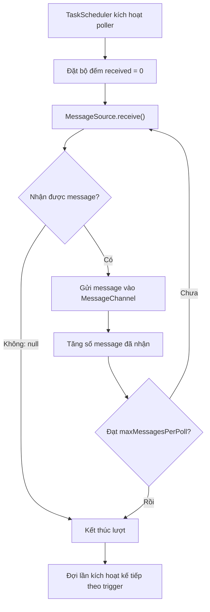

# max-messages-per-poll: giới hạn số message trong một chu kỳ polling

## 1. Vì sao một lượt polling cần giới hạn số message?

Một ứng dụng nhận hàng nghìn file CSV từ đối tác. Sau khi phát hiện file mới, inbound adapter có thể tiếp tục lấy file và đưa vào luồng xử lý. Nếu không giới hạn khối lượng mỗi lượt, một lần được scheduler kích hoạt có thể xử lý quá lâu, chiếm luồng của poller và làm trễ các endpoint khác. Ngược lại, đặt giới hạn quá nhỏ có thể khiến file tồn đọng lâu, không đáp ứng thời gian xử lý mà nghiệp vụ yêu cầu.

Trong module **SPRING_INTEGRATION_ADAPTERS**, các inbound adapter, gateway, poller và `MessageChannel` kết nối hệ thống bên ngoài với luồng message nội bộ. Với các adapter **lấy dữ liệu bằng cách thăm dò** như file, SFTP hoặc cơ sở dữ liệu, poller quyết định *khi nào* gọi nguồn và *mỗi lần được gọi theo lịch có thể nhận bao nhiêu message*. Thuộc tính **`maxMessagesPerPoll`** điều khiển giới hạn thứ hai.

Ví dụ, cấu hình:

```java
@Poller(fixedDelay = "5000", maxMessagesPerPoll = "10")
```

có nghĩa là **mỗi lượt poll** có thể nhận **tối đa 10 message** từ nguồn, sau đó endpoint chờ lịch tiếp theo. Số lượng thực tế có thể thấp hơn 10 khi nguồn hết dữ liệu, bộ lọc loại dữ liệu hoặc xảy ra lỗi.

**Mục tiêu của bài học:** đọc đúng ý nghĩa của `maxMessagesPerPoll`, dự đoán số lượt cần thiết để rút dữ liệu, viết cấu hình annotation/Java DSL, hiểu cách trigger và channel ảnh hưởng thông lượng, đồng thời tránh nhầm giới hạn mỗi lượt với concurrency hoặc kích thước batch giao dịch.

## 2. Một lượt poll là gì?

Một **lượt poll (polling cycle)** là một lần polling endpoint được scheduler kích hoạt. Trong lượt này, endpoint thường gọi `receive()` của nguồn, gửi message nhận được đến `MessageChannel` và tiếp tục nhận cho đến khi đạt điều kiện dừng.



Sơ đồ mô tả trường hợp bình thường. Lỗi ở nguồn, khi gửi message hoặc trong handler đồng bộ có thể khiến lượt bị gián đoạn và được xử lý theo error flow/advice của endpoint.

Hai điều kiện kết thúc thường gặp:

1. **Đủ giới hạn:** đã nhận số message bằng `maxMessagesPerPoll`.
2. **Nguồn hết message tại thời điểm kiểm tra:** `receive()` trả về `null` trước khi đạt giới hạn.

Nếu nguồn có đúng ba message, `maxMessagesPerPoll = 10`, lượt có thể nhận cả ba rồi dừng khi lần `receive()` kế tiếp trả `null`. Poller không tạo thêm bảy message rỗng để cho đủ mười.

### Chữ “chu kỳ” có thể gây hiểu nhầm

Trong bài này, “chu kỳ polling” là **một lượt được trigger kích hoạt**, không phải toàn bộ thời gian ứng dụng chạy, không phải một transaction, cũng không nhất thiết là một khoảng đúng bằng `fixedRate` hoặc `fixedDelay`.

```text
Giả sử fixedDelay=5 giây, maxMessagesPerPoll=3:

Lượt 1: [receive M1][receive M2][receive M3] -- kết thúc
                                                  |
                                               nghỉ 5s
                                                  |
Lượt 2: [receive M4][receive M5][receive null] -- kết thúc
                                                  |
                                               nghỉ 5s
                                                  |
Lượt 3: [receive null] ------------------------- kết thúc
```

Điểm quan trọng: **không có khoảng fixed-delay tự động giữa M1, M2 và M3**. Khoảng delay áp dụng giữa *hai lượt*, sau khi lượt trước hoàn tất.

## 3. Các giá trị thường dùng

| Giá trị | Diễn giải | Cần lưu ý |
| --- | --- | --- |
| Số nguyên dương `1` | Mỗi lượt nhận tối đa một message | Dễ kiểm soát một lượt, nhưng backlog có thể tăng nhanh. |
| Số nguyên dương `10` | Mỗi lượt nhận tối đa mười message | Hữu ích với nguồn có nhiều file/bản ghi. |
| `-1` | Không đặt giới hạn theo số lượng; tiếp tục nhận cho tới khi nguồn trả `null` hoặc một điều kiện khác kết thúc lượt | Có nguy cơ lượt kéo dài rất lâu nếu nguồn liên tục có message. |
| `0` | Trong các phiên bản Spring Integration hỗ trợ, tạm không nhận message tại poller | Phải kiểm tra hợp đồng phiên bản đang dùng và cách quản trị endpoint. |

**Không dựa vào giá trị mặc định khi thiết kế tải.** Default của `maxMessagesPerPoll` có thể khác theo loại endpoint và phiên bản Spring Integration; ghi rõ giới hạn mong muốn trong cấu hình để người vận hành hiểu được thông lượng dự kiến. Ở những bài toán dùng `-1`, nên xác định rõ nguồn có thể trả `null` và giới hạn thời gian/khối lượng bằng cơ chế khác nếu cần.

Giá trị này cũng **không phải**:

- Số thread xử lý song song.
- Sức chứa của `QueueChannel`.
- Giới hạn số bản ghi trong một truy vấn SQL hoặc số file SFTP được liệt kê bởi thư viện client.
- Số lần retry khi handler gặp lỗi.
- Kích thước transaction hoặc số message được commit cùng nhau.

## 4. So sánh maxMessagesPerPoll với trigger và timeout

| Thuộc tính | Câu hỏi mà nó trả lời | Ví dụ |
| --- | --- | --- |
| `maxMessagesPerPoll` | Một lượt nhận tối đa bao nhiêu message? | 5 message/lượt. |
| `fixedRate` | Các mốc bắt đầu được lên lịch cách nhau bao lâu? | Khoảng 5 giây giữa các mốc bắt đầu dự kiến. |
| `fixedDelay` | Sau khi lượt trước hoàn tất, đợi bao lâu mới bắt đầu lượt tiếp? | Nghỉ 5 giây sau mỗi lượt. |
| `cron` | Những mốc thời gian nào trên đồng hồ sẽ kích hoạt lượt? | Phút 0, 15, 30, 45 của mỗi giờ. |
| `initialDelay` | Chờ bao lâu trước lượt đầu ở các lịch định kỳ hỗ trợ thuộc tính này? | Chờ 10 giây lúc khởi tạo. |
| `receiveTimeout` | Khi polling một `PollableChannel` hỗ trợ chờ, một lần `receive(timeout)` được chờ trong bao lâu? | Đợi 300 ms nếu queue trống. |

### Ví dụ với fixed-delay

Giả sử:

```text
fixedDelay = 5000 ms
maxMessagesPerPoll = 4
thời gian xử lý đồng bộ = 500 ms/message
nguồn luôn có >= 4 message
```

Một lượt có thể mất khoảng `4 × 0,5 = 2` giây để nhận và xử lý. Sau đó poller chờ thêm 5 giây rồi bắt đầu lượt mới. Khi scheduler không bị nghẽn, khoảng cách giữa hai lần bắt đầu là khoảng **7 giây**. Đặt `maxMessagesPerPoll = 1` trong cùng điều kiện tạo khoảng cách bắt đầu khoảng **5,5 giây**, nhưng xử lý ít message hơn mỗi lượt.

Với `fixedRate = 5000 ms`, thời điểm bắt đầu được lên lịch theo nhịp khoảng 5 giây nếu công việc hoàn thành kịp. Nếu một lượt nhận và xử lý nhiều message đến mức kéo dài hơn 5 giây, các mốc tiếp theo có thể bị trễ. Vì vậy, **tăng `maxMessagesPerPoll` có thể làm một lượt dài hơn**, chứ không luôn tăng thông lượng thực tế.

### Khi nguồn không có dữ liệu

Với polling inbound adapter dùng `MessageSource`, `receive()` thường trả `null` nếu chưa có dữ liệu phù hợp. Khi đó lượt dừng sớm, dù `maxMessagesPerPoll` là 1, 10 hay 100.

Với polling consumer lấy message từ `PollableChannel` như `QueueChannel`, một lời gọi `receive(timeout)` có thể chờ cho đến khi có message hoặc timeout; `maxMessagesPerPoll` vẫn giới hạn **số message nhận được trong lượt**, chứ không tự áp timeout lên mọi loại nguồn.

## 5. Ví dụ Java: giới hạn 5 file CSV mỗi lượt

Tình huống: đối tác đặt file đơn hàng vào `data/inbox`; ứng dụng kiểm tra thư mục theo lịch fixed-delay 3 giây, mỗi lượt nhận tối đa năm file CSV và gửi qua `DirectChannel` đến handler. Nếu có 12 file sẵn sàng, cần tối thiểu ba lượt để tiếp nhận (5 + 5 + 2), giả sử không có lỗi và nguồn luôn cung cấp file theo dự kiến.

### 5.1. Dependencies

Với Maven và Spring Boot BOM quản lý phiên bản:

```xml
<dependencies>
    <dependency>
        <groupId>org.springframework.boot</groupId>
        <artifactId>spring-boot-starter-integration</artifactId>
    </dependency>
    <dependency>
        <groupId>org.springframework.integration</groupId>
        <artifactId>spring-integration-file</artifactId>
    </dependency>
</dependencies>
```

Trước khi chạy, tạo thư mục `data/inbox` theo working directory của ứng dụng và đặt các file có đuôi `.csv` vào đó.

### 5.2. Cấu hình annotation

```java
import java.io.File;
import java.io.IOException;
import java.nio.charset.StandardCharsets;
import java.nio.file.Files;

import org.springframework.context.annotation.Bean;
import org.springframework.context.annotation.Configuration;
import org.springframework.integration.annotation.InboundChannelAdapter;
import org.springframework.integration.annotation.Poller;
import org.springframework.integration.annotation.ServiceActivator;
import org.springframework.integration.channel.DirectChannel;
import org.springframework.integration.config.EnableIntegration;
import org.springframework.integration.core.MessageSource;
import org.springframework.integration.file.FileReadingMessageSource;
import org.springframework.integration.file.filters.AcceptOnceFileListFilter;
import org.springframework.integration.file.filters.CompositeFileListFilter;
import org.springframework.integration.file.filters.SimplePatternFileListFilter;
import org.springframework.messaging.MessageChannel;

@Configuration
@EnableIntegration
public class BoundedFilePollingConfiguration {

    @Bean
    public MessageChannel csvInboundChannel() {
        return new DirectChannel();
    }

    @Bean
    @InboundChannelAdapter(
        channel = "csvInboundChannel",
        poller = @Poller(
            fixedDelay = "3000",
            maxMessagesPerPoll = "5"
        )
    )
    public MessageSource<File> csvSource() {
        FileReadingMessageSource source = new FileReadingMessageSource();
        source.setDirectory(new File("data/inbox"));

        CompositeFileListFilter<File> filters =
            new CompositeFileListFilter<>();
        filters.addFilter(new SimplePatternFileListFilter("*.csv"));
        filters.addFilter(new AcceptOnceFileListFilter<>());
        source.setFilter(filters);
        return source;
    }

    @ServiceActivator(inputChannel = "csvInboundChannel")
    public void handleCsv(File file) throws IOException {
        String csv = Files.readString(
            file.toPath(), StandardCharsets.UTF_8
        );

        System.out.printf(
            "Received: %s, chars=%d%n",
            file.getName(), csv.length()
        );

        // TODO: parse, validate và ghi trạng thái xử lý thành công.
    }
}
```

**Giải thích chi tiết:**

- `FileReadingMessageSource` đọc các file từ thư mục. Mỗi `receive()` thành công tạo một message mang payload `File`.
- `SimplePatternFileListFilter` chỉ nhận file `*.csv`; `AcceptOnceFileListFilter` tránh chọn lại những file đã được chấp nhận trong bộ nhớ của instance.
- `@Poller(fixedDelay = "3000", maxMessagesPerPoll = "5")` giữ khoảng nghỉ 3 giây **sau khi lượt polling hoàn tất** và giới hạn tối đa 5 message nhận được mỗi lượt.
- `DirectChannel` gửi message đồng bộ tới `@ServiceActivator`; khi handler mất thời gian xử lý, lượt poll cũng mất thời gian tương ứng.
- Handler ở đây chỉ đọc nội dung và log. Production cần thêm kiểm tra file đã ghi xong, xác thực CSV, lưu dữ liệu và chính sách archive/retry.

### 5.3. Quan sát kịch bản có 12 file

Khi có 12 file hợp lệ chờ sẵn trước lượt đầu:

| Lượt | Số message tối đa nhận | Số file còn chờ sau lượt (theo giả định) |
| --- | ---: | ---: |
| 1 | 5 | 7 |
| 2 | 5 | 2 |
| 3 | 2 | 0 |
| 4 | 0 (nếu không phát sinh file mới) | 0 |

Với source hiện tại, lần thứ tư có thể trả `null` ngay từ lời gọi `receive()` đầu tiên. Bảng chỉ minh họa số lượng khi không có lỗi và không có file mới; thứ tự file cụ thể phụ thuộc logic liệt kê và filter.

**Quan sát đúng lịch:** Log của `@ServiceActivator` chỉ xuất hiện **khi có message**, không phản ánh các lượt polling rỗng. Nếu muốn xác định mỗi lượt đã thực sự kích hoạt, instrument `MessageSource.receive()` hoặc dùng logging/metrics của poller phù hợp.

## 6. Cấu hình qua application.yml và Java DSL

### 6.1. Không chôn giới hạn vào mã nguồn

```yaml
# application.yml
app:
  file-polling:
    delay-ms: 3000
    max-per-poll: 5
```

Thay annotation `@InboundChannelAdapter` ở ví dụ Java bằng:

```java
@InboundChannelAdapter(
    channel = "csvInboundChannel",
    poller = @Poller(
        fixedDelay = "${app.file-polling.delay-ms:3000}",
        maxMessagesPerPoll = "${app.file-polling.max-per-poll:5}"
    )
)
```

Dấu `:` trong placeholder cung cấp giá trị mặc định khi thiếu property. Các giá trị thường được resolve lúc application context khởi tạo; sửa YAML sau khi chạy không mặc nhiên làm endpoint thay đổi ngay. Nếu cần điều chỉnh động khi vận hành, phải sử dụng cơ chế quản trị endpoint/poller phù hợp với phiên bản Spring Integration.

### 6.2. Cách viết tương đương bằng Java DSL

```java
import java.io.File;
import java.time.Duration;

import org.springframework.context.annotation.Bean;
import org.springframework.integration.dsl.IntegrationFlow;
import org.springframework.integration.dsl.Pollers;
import org.springframework.integration.file.dsl.Files;

@Bean
IntegrationFlow boundedCsvFlow() {
    return IntegrationFlow
        .from(
            Files.inboundAdapter(new File("data/inbox"))
                 .patternFilter("*.csv"),
            endpoint -> endpoint.poller(
                Pollers.fixedDelay(Duration.ofSeconds(3))
                       .maxMessagesPerPoll(5)
            )
        )
        .handle(message -> {
            File file = (File) message.getPayload();
            System.out.println("Received " + file.getName());
        })
        .get();
}
```

Đây là **một lựa chọn thay thế** cho cấu hình annotation, không chạy đồng thời hai endpoint cùng quét thư mục ví dụ. `org.springframework.integration.file.dsl.Files` là factory DSL cho file adapter, khác với `java.nio.file.Files` dùng để đọc nội dung file.

## 7. Dùng maxMessagesPerPoll với PollableChannel

Không chỉ inbound adapter, một **polling consumer** cũng có thể lấy message từ `PollableChannel` như `QueueChannel`. Khi đó `maxMessagesPerPoll` quy định số message được poll từ queue trong mỗi lượt.

```java
import org.springframework.context.annotation.Bean;
import org.springframework.integration.annotation.Poller;
import org.springframework.integration.annotation.ServiceActivator;
import org.springframework.integration.channel.QueueChannel;

@Bean
public QueueChannel pendingOrders() {
    return new QueueChannel(100);
}

@ServiceActivator(
    inputChannel = "pendingOrders",
    poller = @Poller(
        fixedDelay = "1000",
        maxMessagesPerPoll = "4",
        receiveTimeout = "200"
    )
)
public void consumeOrder(String order) {
    System.out.println("Processing " + order);
}
```

Đây là **đoạn cấu hình minh họa** cần đặt trong lớp `@Configuration` có `@EnableIntegration`. Khi `QueueChannel` ban đầu rỗng, `receiveTimeout = "200"` có thể làm một lần nhận chờ đến khoảng 200 ms trước khi trả `null`. Nếu queue đã có bốn message, poller có thể lấy cả bốn ngay trong cùng lượt. Với ba message, lần nhận thứ tư có thể chờ 200 ms rồi kết thúc lượt.

Ba giới hạn hoàn toàn độc lập:

- `QueueChannel(100)` đặt **sức chứa** queue là 100 message.
- `maxMessagesPerPoll = 4` đặt tối đa **bốn message mỗi lượt polling consumer**.
- `receiveTimeout = 200` đặt thời gian chờ **mỗi lần nhận từ queue** hỗ trợ blocking receive.

Với `DirectChannel`, handler được gọi khi message được gửi đến subscriber; không cần cấu hình một polling consumer đọc `DirectChannel` vì đây là `SubscribableChannel`, không phải `PollableChannel`.

## 8. Backlog, thông lượng và giới hạn thời gian của một lượt

### 8.1. Ước lượng năng lực tiếp nhận

Nếu một poller chạy bằng fixed-rate 5 giây và nhận đủ 10 message ở mọi lượt, trần số message **danh nghĩa theo lịch** là:

\[
\frac{10\ \text{message}}{5\ \text{giây}}
= 2\ \text{message/giây}
\]

Điều này **không phải throughput được bảo đảm**. Khi source chỉ có 3 message, handler mất nhiều thời gian, hoặc network I/O chậm, tốc độ thực tế thấp hơn. Với fixed-delay, thời gian xử lý mỗi lượt cộng vào khoảng nghỉ:

\[
\text{Thông lượng xấp xỉ}
=\frac{N}{T + D}
\]

Trong đó `N` là số message đã nhận trong một lượt, `T` là thời gian nhận và xử lý trong lượt, `D` là fixed delay. Ví dụ, 10 message được xử lý đồng bộ trong 4 giây và chờ thêm 5 giây thì tốc độ danh nghĩa gần `10/9 ≈ 1,11 message/giây` khi liên tục có backlog.

### 8.2. Vì sao tăng maxMessagesPerPoll chưa chắc nhanh hơn?

Nếu một handler mất 2 giây/message và `maxMessagesPerPoll = 100` trên `DirectChannel`, một lượt có thể chiếm khoảng **200 giây** xử lý đồng bộ. Điều này có thể trì hoãn các lần polling tiếp theo, giữ luồng scheduler lâu và tăng thời gian phục hồi khi có lỗi giữa lượt.

Đặt giới hạn nhỏ hơn giúp tạo điểm kiểm soát thường xuyên hơn, nhưng nếu quá nhỏ và fixed-delay dài, backlog sẽ rút rất chậm. Hãy chọn số lượng dựa vào:

1. **SLA**: dữ liệu cũ nhất được phép chờ bao lâu?
2. **Tốc độ dữ liệu vào**: bao nhiêu file/bản ghi xuất hiện mỗi phút?
3. **Thời gian một message**: I/O, CPU, truy vấn, gọi API và retry tốn bao lâu?
4. **Tài nguyên nguồn**: SFTP/API/DB có quota, rate limit hoặc giới hạn kết nối không?
5. **Khả năng downstream**: handler đồng bộ hay được giao sang executor/queue? Có backpressure không?

### 8.3. Bất đồng bộ có thể làm lượt kết thúc sớm

```text
Đồng bộ:
MessageSource -> DirectChannel -> Handler xử lý
                                  |
                                  +-- handler xong mới chuyển tiếp trong lượt

Bất đồng bộ:
MessageSource -> ExecutorChannel -> đưa việc vào executor
                                   |
                                   +-- poller có thể nhận message tiếp
                                       khi handler trước chưa xử lý xong
```

Do đó, `maxMessagesPerPoll = 10` giới hạn **số message được nhận bởi poller**, không giới hạn tổng số công việc đang chạy trong executor. Nếu lịch poll nhanh và worker xử lý chậm, hàng đợi executor vẫn có thể tăng. Cần cấu hình bounded queue, concurrency, rejection/backpressure và cơ chế xác nhận hoàn tất.

## 9. Rủi ro với các adapter cụ thể

| Nguồn | maxMessagesPerPoll giúp gì? | Không thể tự giải quyết điều gì? |
| --- | --- | --- |
| File inbound | Giới hạn số file được phát thành message mỗi lượt. | Không bảo đảm file đã ghi xong, không xác nhận đã lưu nghiệp vụ. |
| SFTP inbound | Giới hạn số message được source trả về và adapter xử lý trong lượt. | Không thay thế giới hạn download/connection/session hoặc xử lý file trùng. |
| JDBC/database inbound | Giới hạn số message do polling source phát ra trong lượt. | Không tự giới hạn số dòng trả về trong **một** `receive()` hoặc commit theo từng dòng. |
| PollableChannel/QueueChannel | Giới hạn số message consumer nhận trong lượt. | Không thay thế capacity của queue, timeout nhận, concurrency hay giao dịch. |

Đặc biệt với cơ sở dữ liệu: nếu một `receive()` tạo **một message chứa danh sách 500 bản ghi**, `maxMessagesPerPoll = 5` chỉ giới hạn năm **message**, không tự biến danh sách thành các message riêng cho từng bản ghi. Muốn giới hạn số dòng của truy vấn, hãy cấu hình pagination/fetch size/batch size trên nguồn JDBC phù hợp.

Các inbound adapter phổ biến cho JMS, AMQP hay Kafka thường sử dụng **message listener** và không cần poller theo lịch. Đừng áp đặt `maxMessagesPerPoll` của polling source lên một listener mà không xem cơ chế adapter đó. Với HTTP inbound gateway nhận request theo kiểu push, mỗi yêu cầu cũng theo vòng đời HTTP riêng.

## 10. Lỗi, retry và ranh giới transaction

Một ngộ nhận nguy hiểm là “`maxMessagesPerPoll = 10` nghĩa là mười message sẽ được xử lý đúng một lần và commit cùng nhau”. Thực tế, giới hạn poller **không tạo transaction boundary chung cho mười message**. Nếu handler xử lý thành công bốn file rồi lỗi ở file thứ năm, những file đã nhận không tự động quay lại nguồn chỉ nhờ có `maxMessagesPerPoll`.

Với `AcceptOnceFileListFilter`, file có thể được đánh dấu đã chấp nhận **trước khi** nghiệp vụ lưu database thành công. Khi lỗi, lượt poll sau có thể không chọn lại file đó. Để tránh mất khả năng xử lý lại hoặc phát trùng không kiểm soát:

- Phân biệt trạng thái **đã phát hiện → đã nhận thành message → đã xử lý thành công**.
- Dùng khóa idempotency theo mã đơn hàng, tên file có phiên bản hoặc định danh batch.
- Thiết kế retry/backoff và error flow có thể vận hành, ví dụ chuyển file lỗi sang vùng quarantine hoặc đưa message lỗi vào một hàng đợi retry.
- Chọn metadata store bền vững nếu cần theo dõi file sau restart; filter trong bộ nhớ không bảo đảm bền vững.
- Nếu cần atomicity giữa nhiều message, thiết kế transaction/batch xử lý theo hợp đồng nguồn và downstream, không suy ra từ số lần `receive()`.

**Giá trị `-1` cần thận trọng:** khi nguồn liên tục có message, poller có thể kéo dài một lượt quá mức. Giữ giới hạn hữu hạn là một biện pháp phân chia công việc đơn giản nhưng chưa đủ để kiểm soát timeout, backpressure hay retry.

## 11. Theo dõi và chẩn đoán

Để biết giới hạn đang phù hợp hay không, nên đo:

| Chỉ số | Cách diễn giải |
| --- | --- |
| Message nhận được mỗi lượt | Thường đạt đúng `maxMessagesPerPoll` có thể cho thấy còn backlog. |
| Lượt nhận 0 message | Có thể nguồn rỗng, filter loại dữ liệu hoặc nguồn không truy cập được. |
| Thời gian một lượt poll | Lượt quá dài có thể khiến scheduler trễ nhịp và nguồn khác bị ảnh hưởng. |
| Tuổi của message/file cũ nhất còn chờ | Phản ánh khả năng đáp ứng SLA tốt hơn chỉ đếm số lượt polling. |
| Queue depth, executor saturation | Đánh giá có đang đẩy công việc vào downstream nhanh hơn khả năng xử lý không. |
| Tỷ lệ lỗi, retry và thời gian khôi phục | Phân biệt nghẽn do tải và nghẽn do lỗi. |

Nếu cứ mỗi lượt nhận đúng năm file, đừng vội tăng `maxMessagesPerPoll` lên 500. Hãy xác định tồn đọng bao nhiêu, mỗi file cần xử lý bao lâu, scheduler có đang bị giữ lâu, và đích nhận có rate limit hay không.

Nếu nhiều lượt nhận 0 message trong khi thư mục có file, kiểm tra path, quyền truy cập, pattern filter, accept-once metadata và trạng thái file sẵn sàng. Tăng giới hạn sẽ không giúp nếu `receive()` luôn trả `null`.

Nếu inbound adapter phát 10 message/lượt nhưng queue downstream liên tục đầy, cần cân đối tốc độ producer/consumer và giới hạn queue. Chỉ tăng `maxMessagesPerPoll` của producer thường làm vấn đề nặng hơn.

## 12. Bài tập có đáp án

**Bài 1 — Số lượt.** Có 23 file hợp lệ, `maxMessagesPerPoll = 6`, không có file mới và không phát sinh lỗi. Cần ít nhất bao nhiêu lượt để nhận hết?

**Đáp án:** **4 lượt**: 6 + 6 + 6 + 5.

**Bài 2 — Nguồn rỗng.** Đặt `maxMessagesPerPoll = 10`, nhưng `MessageSource.receive()` trả `null` ngay lần đầu. Có tạo thêm mười message rỗng không?

**Đáp án:** **Không.** Lượt dừng sau `null`; số message nhận được trong lượt bằng 0.

**Bài 3 — Fixed-delay.** Poller có `fixedDelay = 4000 ms`, `maxMessagesPerPoll = 5`; xử lý đồng bộ 300 ms/message, mỗi lượt đủ 5 message. Bỏ qua overhead, khoảng cách giữa hai lần bắt đầu xấp xỉ bao nhiêu?

**Đáp án:** `5 × 0,3 + 4 = 5,5` giây.

**Bài 4 — Đếm message và bản ghi.** Một `Message<List<Order>>` chứa 100 `Order`. Nếu poller nhận đúng một message như vậy, số message được tính vào giới hạn là 1 hay 100?

**Đáp án:** **1 message**. Muốn giới hạn số `Order` phải cấu hình nguồn hoặc tách payload thành từng message.

**Bài 5 — QueueChannel.** `QueueChannel(50)`, `maxMessagesPerPoll = 5`, `receiveTimeout = 200 ms`. Khi queue đã chứa 30 message, consumer có thể nhận tối đa bao nhiêu message trong lượt?

**Đáp án:** **5 message**. Sức chứa 50 là thuộc tính của queue, không phải batch size của poller.

**Bài 6 — Lượt kéo dài.** Một handler đồng bộ mất 3 giây/message, `maxMessagesPerPoll = 40`. Nếu mỗi lượt đủ 40 message, tác vụ có thể kéo dài bao lâu (bỏ qua I/O khác)?

**Đáp án:** Khoảng **120 giây**. Nên cân nhắc giảm giới hạn, tối ưu handler hoặc chuyển sang xử lý bất đồng bộ được kiểm soát.

**Bài 7 — Xử lý lỗi.** File thứ ba trong lượt gồm năm file bị lỗi ghi DB. `maxMessagesPerPoll = 5` có bảo đảm cả lượt được rollback không?

**Đáp án:** **Không.** Transaction và retry phải được cấu hình riêng; giới hạn message mỗi lượt không đồng nghĩa một transaction.

**Bài 8 — Giá trị -1.** Nguồn luôn phát message và chưa bao giờ trả `null`. Tại sao `maxMessagesPerPoll = -1` tiềm ẩn rủi ro?

**Đáp án:** Lượt poll có thể kéo dài liên tục, giữ luồng scheduler và gây khó kiểm soát tài nguyên, công bằng giữa các endpoint và thời điểm dừng.

## 13. Ghi nhớ

**`maxMessagesPerPoll` giới hạn số message được nhận trong một lượt polling**, không phải tốc độ mỗi giây, số thread, kích thước transaction hay số dòng trong một payload. Lượt kết thúc khi đã đủ số message được cho phép hoặc nguồn trả `null`; việc xử lý lỗi còn tùy error flow và ranh giới transaction. Khi kết hợp với `fixedRate`, `fixedDelay`, `cron` và `MessageChannel`, hãy chọn giới hạn theo khả năng xử lý thực tế, tốc độ dữ liệu đến, backlog, SLA và cơ chế retry/idempotency của hệ thống tích hợp.
