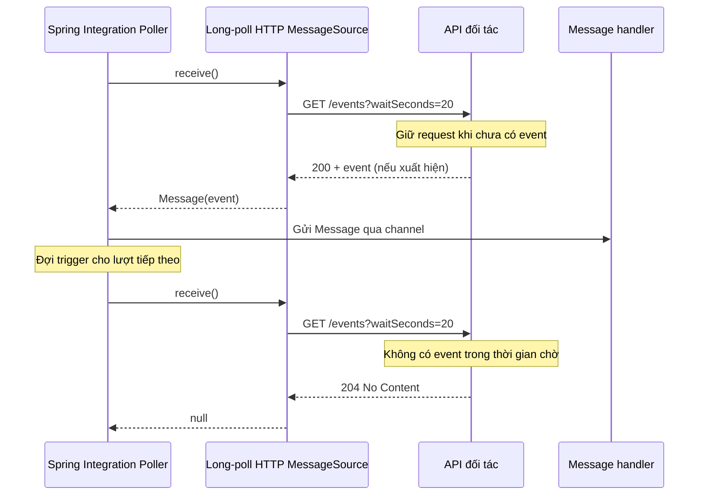

# Long polling cho nguồn có thao tác chờ trong Spring Integration

## 1. Bối cảnh: khi nguồn chưa có dữ liệu nhưng có thể chờ

Một dịch vụ xử lý đơn hàng thường xuyên cần nhận sự kiện từ API của đối tác. Nếu ứng dụng gọi API mỗi giây và phần lớn lần gọi trả lời “chưa có sự kiện”, hệ thống phải tạo nhiều request không mang dữ liệu. Một số API cho phép **giữ request mở để chờ sự kiện**: nếu sự kiện đến trong thời gian chờ, server trả ngay; nếu hết thời gian mà chưa có dữ liệu, server trả một phản hồi “không có sự kiện”. Cách trao đổi này gọi là **long polling**.

Chương **Poller** của module **SPRING_INTEGRATION_ADAPTERS** đặt long polling vào đúng kiến trúc Spring Integration: một **polling inbound adapter** gọi `MessageSource.receive()` để nhận dữ liệu ngoài, đưa kết quả thành `Message` và chuyển tới `MessageChannel`. Điểm khác biệt là thao tác đọc nguồn **có thể chặn luồng trong một khoảng thời gian** trước khi trả message hoặc `null`.

Long polling cũng xuất hiện ở một số hệ thống hàng đợi hoặc broker khi lời gọi lấy message cho phép chờ. Tuy nhiên, cần phân biệt **thao tác chờ của nguồn ngoài** với việc **polling consumer chờ trên `PollableChannel` nội bộ**. Hai cơ chế có timeout và vị trí cấu hình khác nhau.

Sau bài này, bạn có thể:

- Giải thích vòng đời một request long polling và vì sao nó giúp giảm số request rỗng.
- Phân biệt short polling, long polling, listener/push và streaming.
- Tích hợp nguồn HTTP có long polling bằng `MessageSource` và `@InboundChannelAdapter`.
- Chọn `fixedDelay`, `maxMessagesPerPoll` và timeout phù hợp với thời gian chờ phía server.
- Nhận diện nguy cơ giữ luồng scheduler, xử lý trùng/lỗi, retry, checkpoint và dừng ứng dụng.

## 2. Long polling hoạt động thế nào?

Giả sử API `GET /events?waitSeconds=20` có hợp đồng:

1. Nếu đã có sự kiện sẵn sàng, server phản hồi ngay bằng HTTP `200` và payload sự kiện.
2. Nếu chưa có sự kiện, server giữ request tối đa khoảng 20 giây.
3. Nếu có sự kiện xuất hiện trong lúc chờ, server trả `200` ngay khi có thể.
4. Nếu hết thời gian chờ mà vẫn chưa có sự kiện, server trả `204 No Content`.
5. Client tiếp tục gửi request mới theo chính sách scheduling/backoff của mình.

Đây là **hợp đồng API giả định để học**, không phải quy tắc bắt buộc của mọi API long polling: có hệ thống trả `200` với danh sách rỗng, có hệ thống trả một batch hoặc kèm cursor/receipt.



### Một tình huống theo trục thời gian

```text
Server cho phép chờ tối đa 20 giây

Lượt 1:
00s    Client mở GET /events
07s    Event A xuất hiện, server trả 200 ngay -> nhận A

Lượt 2 (sau khoảng nghỉ cấu hình):
08s    Client mở GET /events
28s    Hết thời gian chờ, server trả 204 -> source trả null

Lượt 3 (sau khoảng nghỉ cấu hình):
29s    Client mở GET /events
29s+   Event B đã có sẵn -> server có thể trả 200 nhanh
```

Ví dụ trên dùng khoảng nghỉ 1 giây giữa các lượt. Thời điểm thực tế phụ thuộc network, thời gian xử lý và scheduler. Lợi ích chính là ứng dụng **không cần gửi một request mỗi giây trong suốt 20 giây rỗng**; server chủ động trả lời sớm khi có dữ liệu. Đổi lại, request và kết nối mạng tồn tại lâu hơn, chiếm tài nguyên phía client, proxy và server.

## 3. Phân biệt bốn cơ chế nhận dữ liệu

| Cơ chế | Ai khởi tạo trao đổi? | Khi chưa có dữ liệu | Lưu ý |
| --- | --- | --- | --- |
| **Short polling** | Client gửi request theo chu kỳ | Server trả nhanh “rỗng” | Đơn giản, nhưng có thể nhiều request không mang dữ liệu. |
| **Long polling** | Client gửi request có thể chờ | Server giữ request tới khi có dữ liệu hoặc hết hạn chờ | Ít request rỗng hơn; cần timeout, retry và quản lý tài nguyên. |
| **Push/listener** | Nguồn hoặc broker chủ động chuyển sự kiện tới subscriber | Listener không cần tạo request kiểm tra tuần hoàn | Phù hợp khi hệ thống ngoài hỗ trợ cơ chế đăng ký/subscribe. |
| **Streaming** | Client thiết lập kết nối luồng dữ liệu dài hạn | Kết nối tiếp tục mở, có thể phát nhiều sự kiện | Cần giao thức streaming và xử lý kết nối/luồng riêng. |

Long polling vẫn là **pull**: sau một phản hồi, client phải quyết định khi nào gửi request tiếp theo. Nó không tự biến HTTP API thành giao thức WebSocket hay listener JMS.

Trong hệ sinh thái Spring Integration, các **inbound adapter kiểu polling** đọc dữ liệu theo lịch; các adapter JMS/AMQP/Kafka phổ biến lại sử dụng listener hoặc consumer loop riêng. Không áp đặt `@Poller` lên mọi adapter chỉ vì chúng cùng nhận dữ liệu từ hệ thống ngoài.

## 4. Hai vị trí có thể chờ: nguồn ngoài và PollableChannel

Đây là ranh giới kỹ thuật quan trọng nhất của bài.

### 4.1. Nguồn ngoài chờ ở bên trong MessageSource.receive()

```text
TaskScheduler -> Polling endpoint
                     |
                     v
              MessageSource.receive()
                     |
                     +--> HTTP GET có server wait 20 giây
                     |      hoặc lệnh nhận từ broker có wait timeout
                     |
              Message<?> hoặc null
                     |
                     v
                MessageChannel -> Handler
```

Giao diện `MessageSource<T>` định nghĩa lời gọi **`receive()` không có tham số timeout**. Do đó, với một source gọi API long polling, thời gian chờ được thiết kế **bên trong implementation của source hoặc client giao thức**, ví dụ timeout request HTTP và tham số `waitSeconds` mà server hỗ trợ.

Giả sử bạn thêm `receiveTimeout = "200"` vào `@Poller` của inbound adapter đọc HTTP bằng `MessageSource.receive()`. Không thể dựa vào giá trị này để khẳng định HTTP request sẽ bị cắt sau 200 ms: thao tác I/O của source cần timeout riêng.

### 4.2. Polling consumer chờ trên PollableChannel

```text
Producer --> QueueChannel (PollableChannel) --> Polling consumer
                                                 |
                                            receive(3000)
                                                 |
                                 chờ message hoặc timeout 3 giây
```

Trong trường hợp consumer lấy message từ `QueueChannel`, `@Poller(receiveTimeout = "3000")` có thể được dùng để truyền thời gian chờ cho **`PollableChannel.receive(timeout)`**. Queue đang trống có thể giữ luồng tối đa khoảng 3 giây trước khi trả `null`.

| Thuộc tính | Long poll ở source ngoài | Chờ nhận từ QueueChannel |
| --- | --- | --- |
| Lời gọi | `MessageSource.receive()` | `PollableChannel.receive(timeout)` |
| Nơi quy định thời gian chờ | API/server protocol + HTTP/JMS/client timeout | `@Poller(receiveTimeout = "...")` khi polling consumer |
| Không có dữ liệu | Source có thể trả `null` sau request timeout bình thường của giao thức | Channel có thể trả `null` khi hết thời gian chờ |
| Tài nguyên bị giữ | Luồng poller và request/connection của client; server có thể giữ request | Luồng poller chờ trong channel |
| Có thể bị ảnh hưởng bởi mạng? | Có | Không nếu queue nội bộ ở cùng process; tùy channel implementation |

Tên “long polling” có thể dùng mô tả cả hai hành vi chờ, nhưng **không được nhầm timeout của channel với timeout của kết nối ngoài**.

## 5. Ví dụ đầy đủ: HTTP long-polling MessageSource

Giả sử đối tác cung cấp API:

```http
GET /api/events?waitSeconds=20
Accept: application/json
```

Hợp đồng ví dụ:

- `200 OK` và body JSON không rỗng: có một **message nghiệp vụ** cần xử lý.
- `204 No Content`: không có message trong lần chờ này.
- `429`, `5xx` hoặc lỗi mạng: cần thực thi chính sách lỗi/backoff; **không được xem như nguồn rỗng bình thường**.

Để demo, ta dùng Java `HttpClient` dạng đồng bộ trong `MessageSource`. Nếu API thực trả **một danh sách nhiều event trong một phản hồi**, mỗi `Message` tạo ra từ cả response vẫn chỉ được tính **một message đối với `maxMessagesPerPoll`**; muốn xử lý từng event riêng, cần tách payload bằng splitter hoặc thiết kế source tương ứng.

### 5.1. Dependency

Với Spring Boot quản lý version thông qua BOM, thêm Spring Integration:

```xml
<dependencies>
    <dependency>
        <groupId>org.springframework.boot</groupId>
        <artifactId>spring-boot-starter-integration</artifactId>
    </dependency>
</dependencies>
```

Ví dụ sử dụng `java.net.http.HttpClient` có trong Java hiện đại; không cần một HTTP library bổ sung. URL đối tác dưới đây chỉ là placeholder, cần thay bằng endpoint thực tế với contract tương ứng.

### 5.2. Tạo MessageSource có thao tác chờ

```java
import java.io.IOException;
import java.net.URI;
import java.net.http.HttpClient;
import java.net.http.HttpRequest;
import java.net.http.HttpResponse;
import java.nio.charset.StandardCharsets;
import java.time.Duration;

import org.springframework.integration.core.MessageSource;
import org.springframework.messaging.Message;
import org.springframework.messaging.support.MessageBuilder;

public final class LongPollingHttpMessageSource
        implements MessageSource<String> {

    private final HttpClient client;
    private final URI endpoint;

    public LongPollingHttpMessageSource(HttpClient client, URI endpoint) {
        this.client = client;
        this.endpoint = endpoint;
    }

    @Override
    public Message<String> receive() {
        HttpRequest request = HttpRequest.newBuilder(endpoint)
            .timeout(Duration.ofSeconds(25))
            .header("Accept", "application/json")
            .GET()
            .build();

        try {
            HttpResponse<String> response = client.send(
                request,
                HttpResponse.BodyHandlers.ofString(StandardCharsets.UTF_8)
            );

            if (response.statusCode() == 204) {
                return null; // Hết thời gian server wait, không có event.
            }

            if (response.statusCode() == 200
                    && response.body() != null
                    && !response.body().isBlank()) {
                return MessageBuilder.withPayload(response.body())
                    .setHeader("event_source", "partner-http-long-poll")
                    .build();
            }

            throw new IllegalStateException(
                "Unexpected long-poll HTTP response: "
                    + response.statusCode()
            );
        } catch (InterruptedException ex) {
            Thread.currentThread().interrupt();
            throw new IllegalStateException(
                "Long polling was interrupted", ex
            );
        } catch (IOException ex) {
            throw new IllegalStateException(
                "Cannot receive events from partner API", ex
            );
        }
    }
}
```

**Điểm quan trọng trong source:**

1. `client.send(...)` là lời gọi **blocking**. Nó giữ luồng được dùng để thực thi poller cho đến khi phản hồi hoặc gặp lỗi/timeout.
2. Server được đề nghị chờ tối đa 20 giây qua URL; `HttpRequest.timeout(25 giây)` lớn hơn mức chờ phía server để có chỗ cho độ trễ mạng và xử lý. Con số chênh lệch phải chọn theo SLA, proxy và hành vi đối tác.
3. `204` là trạng thái **không có event** theo hợp đồng ví dụ nên source trả `null`, cho phép lượt polling kết thúc bình thường.
4. Lỗi mạng và status bất thường được **báo thành exception**; cần xử lý ở error flow/poller advice. Đừng chuyển mọi exception thành `null`, vì như vậy hệ thống có thể âm thầm bỏ qua lỗi.
5. Đoạn code trả một `Message<String>` với JSON nguyên dạng. Handler cần parse, validate, gắn idempotency key và xử lý trạng thái nghiệp vụ.

Ở hệ thống thật, có thể cần header xác thực (token lấy từ secret store), cursor hoặc acknowledgement. Không log token hoặc payload nhạy cảm. Nếu API sử dụng mã phản hồi hoặc định dạng JSON khác, phải sửa source theo đúng contract của API đó.

### 5.3. Đăng ký inbound adapter với poller

```java
import java.net.URI;
import java.net.http.HttpClient;
import java.time.Duration;

import org.springframework.beans.factory.annotation.Value;
import org.springframework.context.annotation.Bean;
import org.springframework.context.annotation.Configuration;
import org.springframework.integration.annotation.InboundChannelAdapter;
import org.springframework.integration.annotation.Poller;
import org.springframework.integration.annotation.ServiceActivator;
import org.springframework.integration.channel.DirectChannel;
import org.springframework.integration.config.EnableIntegration;
import org.springframework.integration.core.MessageSource;
import org.springframework.messaging.MessageChannel;

@Configuration
@EnableIntegration
public class PartnerLongPollingConfig {

    @Bean
    public MessageChannel partnerEvents() {
        return new DirectChannel();
    }

    @Bean
    @InboundChannelAdapter(
        channel = "partnerEvents",
        poller = @Poller(
            fixedDelay = "1000",
            maxMessagesPerPoll = "1"
        )
    )
    public MessageSource<String> partnerEventSource(
            @Value("${app.partner.events-url}") String url) {
        HttpClient client = HttpClient.newBuilder()
            .connectTimeout(Duration.ofSeconds(3))
            .build();

        return new LongPollingHttpMessageSource(
            client, URI.create(url)
        );
    }

    @ServiceActivator(inputChannel = "partnerEvents")
    public void handleEvent(String json) {
        // TODO: parse JSON, validate, xử lý idempotent,
        // lưu checkpoint/acknowledgement sau khi thành công.
        System.out.println("Event received, chars=" + json.length());
    }
}
```

```yaml
# application.yml
app:
  partner:
    events-url: "https://partner.example/api/events?waitSeconds=20"
```

Cấu hình này tạo ra **một** HTTP long-poll request cho mỗi lượt:

- `maxMessagesPerPoll = "1"` giới hạn **một lần nhận thành công** trong lượt, do đó tránh vô tình mở nhiều request chờ liên tiếp trong cùng một lượt khi server liên tục có sự kiện.
- `fixedDelay = "1000"` đợi khoảng 1 giây **sau khi toàn bộ lượt kết thúc** rồi mới bắt đầu lượt tiếp theo. Nếu request mất 20 giây và không có dữ liệu, khoảng cách giữa hai lần bắt đầu có thể khoảng 21 giây.
- `DirectChannel` chuyển message đồng bộ tới handler. Vì vậy, nếu handler tốn 2 giây, khoảng 1 giây fixed-delay chỉ bắt đầu sau khi lượt cùng handler đồng bộ hoàn tất.

**Đây là bản mẫu học tập.** Production cần quyết định cách duy trì cursor, ack, retry, xác thực, lưu trạng thái qua restart và cách đảm bảo một hoặc nhiều instance cùng đọc nguồn. Không thể suy ra exactly-once từ việc API hỗ trợ long polling.

## 6. Ví dụ riêng: consumer chờ trong QueueChannel

Nếu sự chờ nằm **bên trong ứng dụng** thay vì ở API ngoài, có thể cấu hình polling consumer của `QueueChannel`:

```java
import org.springframework.context.annotation.Bean;
import org.springframework.context.annotation.Configuration;
import org.springframework.integration.annotation.Poller;
import org.springframework.integration.annotation.ServiceActivator;
import org.springframework.integration.channel.QueueChannel;
import org.springframework.integration.config.EnableIntegration;

@Configuration
@EnableIntegration
public class QueueWaitingConsumerConfig {

    @Bean
    public QueueChannel bufferedEvents() {
        return new QueueChannel(100);
    }

    @ServiceActivator(
        inputChannel = "bufferedEvents",
        poller = @Poller(
            fixedDelay = "500",
            receiveTimeout = "3000",
            maxMessagesPerPoll = "1"
        )
    )
    public void process(String eventPayload) {
        System.out.println("Received: " + eventPayload);
    }
}
```

Giả sử producer khác đã gửi message vào `bufferedEvents`:

- Nếu queue đã có message, consumer thường lấy được ngay.
- Nếu queue trống, thao tác `receive(3000)` có thể chờ đến 3 giây; nếu message xuất hiện giữa chừng thì trả sớm.
- Nếu 3 giây trôi qua mà queue vẫn rỗng, `receive()` trả `null`, lượt kết thúc và lịch fixed-delay bắt đầu đếm 500 ms.

Đây là **waiting receive trên một PollableChannel**, không phải HTTP long polling tới nguồn ngoài. Tăng `receiveTimeout` trên consumer này không làm request HTTP hoặc SFTP của một adapter khác chờ lâu hơn.

## 7. Chọn thời gian chờ và trigger

Những thông số dưới đây điều khiển các phần **khác nhau**:

| Thông số | Ở đâu? | Điều khiển |
| --- | --- | --- |
| `waitSeconds=20` | Hợp đồng API ví dụ | Thời gian server sẵn sàng giữ request chờ event. |
| `HttpRequest.timeout(25 s)` | HTTP client | Thời hạn request phía client trước khi coi là timeout/lỗi. |
| `connectTimeout(3 s)` | HTTP client | Thời gian tối đa thiết lập kết nối trong những điều kiện áp dụng. |
| `fixedDelay=1000` | Spring Integration poller | Khoảng nghỉ sau khi lượt trước kết thúc. |
| `maxMessagesPerPoll=1` | Spring Integration poller | Số message nhận thành công tối đa trong một lượt. |
| `receiveTimeout=3000` | Polling consumer đọc `PollableChannel` | Thời gian chờ một lần nhận từ channel hỗ trợ timeout. |

Với API có **server wait 20 giây**, nên cân nhắc timeout phía HTTP client dài hơn thời gian này, có đủ biên cho network/proxy. Nếu một reverse proxy ngắt request sau 15 giây, đặt client timeout 25 giây **không ngăn được proxy ngắt sớm**. Phải kiểm tra giới hạn của toàn bộ đường đi từ client đến server.

### Fixed-delay thường dễ hiểu hơn với tác vụ chờ dài

```text
fixedDelay = 1 giây
API server wait = tối đa 20 giây
maxMessagesPerPoll = 1

00s  mở request R1 -------------------- 20s (204)
20s  kết thúc lượt R1
20s  nghỉ 1 giây
21s  mở request R2 ----- 25s (200, có event)
25s  xử lý event; handler có thể tốn thêm thời gian
...  nghỉ 1 giây sau khi lượt hoàn tất
```

Nếu dùng `fixedRate=1000` trong khi mỗi request có thể chờ 20 giây, các mốc theo chu kỳ 1 giây sẽ liên tục bị trễ. Fixed-rate không tự chạy đồng thời 20 request của **cùng một tác vụ định kỳ** theo kiểu scheduler thông thường, nhưng không nên dựa vào việc đó làm cơ chế giới hạn concurrency toàn hệ thống. Nhiều endpoint/replica hoặc xử lý async vẫn có thể tạo nhiều request song song.

### Mối quan hệ với maxMessagesPerPoll

Nếu đặt `maxMessagesPerPoll = 5`, một lượt có thể gọi `MessageSource.receive()` **nhiều lần**. Giả sử mỗi lần API đều giữ request 20 giây rồi trả `204`, lượt đầu trả `null` sẽ dừng sớm, không tiếp tục cố đủ năm lần. Nhưng nếu API lần lượt trả bốn sự kiện nhanh rồi lần thứ năm giữ 20 giây, lượt đó sẽ kéo dài thêm 20 giây trước khi kết thúc.

Đối với long-poll HTTP source đơn giản, `maxMessagesPerPoll = 1` thường giúp kiểm soát số request tuần tự trong mỗi lượt. Nếu cần thông lượng cao hơn, thiết kế concurrency có giới hạn cùng batch/cursor/ack rõ ràng thay vì tăng giới hạn mù quáng.

## 8. Vì sao không nên chờ vô hạn?

Một tác vụ có thể bị chặn trong `receive()` lâu hơn mong muốn nếu thiếu timeout. Khi đó:

1. **Luồng TaskScheduler bị giữ:** những polling endpoint khác dùng chung scheduler có thể trễ, nhất là khi thread pool quá nhỏ.
2. **Khó dừng ứng dụng:** shutdown hoặc stop endpoint cần chờ lời gọi đang chặn trở về hoặc được interrupt/cancel theo cơ chế client.
3. **Lỗi mạng khó phát hiện:** nếu không có timeout và giám sát, trạng thái “đang chờ event” có thể bị nhầm với “mất kết nối hoặc treo”.
4. **Tài nguyên phía đối tác bị chiếm:** mỗi request đang chờ tiêu thụ connection, giới hạn concurrency và tài nguyên server/proxy.
5. **Tăng nguy cơ quá tải khi triển khai nhiều replica:** 10 pod × 5 long-poll endpoint/pod có thể cùng duy trì 50 request đang mở.

Với nguồn có thao tác chờ dài, nên bố trí `TaskScheduler` đủ năng lực hoặc cô lập scheduler cho nhóm endpoint chờ, tùy kiến trúc. Chuyển `MessageSource.receive()` sang một worker pool có giới hạn cũng cần thiết kế cẩn thận: asynchronous handoff không tự bảo đảm thứ tự hay xác nhận xử lý.

**Không dùng polling blocking vô hạn để giả lập streaming.** Nếu nguồn cung cấp WebSocket, SSE, broker consumer hoặc API streaming phù hợp, có thể chọn cơ chế đó cho kết nối dài hạn; khi cần HTTP long polling thì phải cấu hình deadline rõ ràng và có cách khôi phục kết nối.

## 9. Xử lý lỗi, retry và bảo đảm dữ liệu

Một lượt long polling có thể kết thúc theo ba nhóm kết quả:

| Kết quả | Ví dụ | Hành vi đúng |
| --- | --- | --- |
| **Có dữ liệu** | HTTP `200` + event | Tạo message, xử lý nghiệp vụ, ghi nhận idempotency/ack/checkpoint theo contract. |
| **Hết thời gian chờ bình thường** | HTTP `204` theo API ví dụ | Trả `null`, đợi lượt kế tiếp. Đây không phải lỗi. |
| **Lỗi** | Timeout client, HTTP `429/500`, lỗi mạng, auth `401` | Phân loại lỗi, ghi nhận, áp dụng backoff hoặc khắc phục cấu hình, không im lặng biến thành `null`. |

### Retry và backoff

- Với `429 Too Many Requests`, nếu API hỗ trợ `Retry-After` hãy tôn trọng giới hạn hoặc dùng backoff phù hợp.
- Với `5xx` hoặc network timeout, dùng retry có giới hạn, exponential backoff và jitter khi phù hợp để tránh nhiều instance đồng thời tấn công lại dịch vụ đang lỗi.
- Với `401/403`, kiểm tra token, quyền hoặc cấu hình; retry liên tục với cùng thông tin xác thực hỏng thường không giúp ích.
- Với kết quả **không có event**, tiếp tục lịch polling bình thường; không biến trạng thái này thành exception để kích hoạt retry lỗi.

Trong ví dụ Java, exception từ source cần được xử lý thông qua error handling của polling endpoint (chẳng hạn `errorChannel`, advice hoặc error flow theo phiên bản Spring Integration). Không dựa vào `fixedDelay` để thay thế toàn bộ chính sách backoff khi lỗi: nếu request hỏng ngay trong vài mili giây, một lịch retry quá dày có thể tạo vòng lặp lỗi áp lực cao.

### Cơ chế cursor, ack và idempotency

Long polling **không tự bảo đảm exactly-once**. Hãy xem một ví dụ có cursor:

```text
GET /events?cursor=C10&waitSeconds=20
       |
       v
200 event E11, nextCursor=C11
       |
       v
Xử lý nghiệp vụ E11 thành công?
   | Có: lưu checkpoint C11 sau khi commit
   | Không: giữ C10 để phát hiện/xử lý lại theo contract
```

Nếu client cập nhật cursor **trước** khi ghi DB thành công, một sự cố có thể khiến event không được xử lý. Nếu client ghi DB thành công nhưng chưa lưu cursor rồi bị restart, event có thể bị phát lại. Vì vậy cần **idempotency key** (ví dụ `eventId`) và chiến lược commit/checkpoint phù hợp. Việc gửi ack/receipt phải tuân thủ contract riêng của nhà cung cấp.

Nếu API trả **batch 100 event trong một HTTP response**, đừng giả định `maxMessagesPerPoll = 1` có nghĩa chỉ có một event nghiệp vụ: nó đếm một `Message` đại diện cho batch. Hãy xác định rõ cách split, lưu từng kết quả, retry từng event và cập nhật checkpoint.

### Nhiều instance và vòng đời endpoint

Nếu mỗi replica đều dùng cùng cursor và gọi long-poll API, kết quả có thể cạnh tranh hoặc trùng nhau tùy nguồn. Cần đánh giá contract về **consumer group, lock/lease, partition, cursor per consumer, visibility timeout và acknowledgement**. Không suy ra Spring Integration tự phân phối công việc chỉ vì đã dùng `@InboundChannelAdapter`.

Khi ứng dụng dừng, lời gọi blocking có thể vẫn đang chờ. Đặt timeout hữu hạn, cấu hình shutdown phù hợp, xử lý interruption đúng cách và kiểm tra việc kết nối có được đóng/giải phóng. Nếu source chứa tài nguyên client hoặc phiên kết nối cần đóng, quản lý chúng theo vòng đời bean/adapter thay vì tạo connection mới cho từng poll không kiểm soát.

## 10. Quan sát và điều tra sự cố

Long polling có thể **không tạo log handler trong 20 giây** nhưng vẫn hoạt động bình thường. Chỉ quan sát handler là chưa đủ; cần đo cả những lượt `receive()` trả `null`.

| Chỉ số | Giúp phát hiện |
| --- | --- |
| Số request long poll bắt đầu và thời gian kết thúc | Request có bị giữ quá lâu hoặc kết thúc quá sớm? |
| Số kết quả có event / không có event / lỗi | Nguồn thật sự rỗng hay đang lỗi? |
| Thời lượng `receive()`, p50/p95/p99 | Timeout, network jitter, proxy ngắt sớm, server quá tải. |
| Thời gian handler và backlog event | Downstream có xử lý kịp số event nhận được? |
| Số luồng scheduler bận, queue của executor, số request đồng thời | Có bị nghẽn tài nguyên do tác vụ blocking? |
| Cursor đã lưu, tuổi của event cũ nhất, số event retry/trùng | Có mất tiến độ, replay bất thường hoặc sai hợp đồng ack? |
| HTTP `429`, `5xx`, timeout và retry delay | Có vi phạm rate limit hoặc vòng retry quá nhanh? |

### Một số triệu chứng thường gặp

**Không có log handler suốt 20 giây.** Có thể là trạng thái bình thường khi server đang giữ request; kiểm tra thời điểm mở request và số lượt `204` thay vì coi endpoint đã hỏng.

**Cứ 15 giây nhận lỗi dù server wait là 20 giây.** Kiểm tra reverse proxy, ingress, load balancer hoặc timeout trung gian; tăng client timeout một mình không giải quyết mọi điểm ngắt kết nối.

**Số request tăng nhanh khi đối tác lỗi.** `MessageSource.receive()` có thể trả exception tức thì, khiến poller bắt đầu lại sau khoảng `fixedDelay` ngắn. Cần error backoff, giới hạn retry và cảnh báo.

**Nhiều endpoint khác bị trễ.** Các long-poll request blocking có thể đang giữ hết luồng scheduler chung. Kiểm tra thread pool, số long-poll task và cách phân tách scheduler.

**Event được nhận lại sau restart.** Kiểm tra cursor, ack sau commit, trạng thái idempotency, nhiều replica cùng đọc và giới hạn visibility timeout của nguồn.

## 11. Bài tập có đáp án

**Bài 1 — Nhận diện long polling.** API giữ request tối đa 30 giây, trả sớm khi có event và trả phản hồi rỗng khi hết hạn. Đây là short polling hay long polling?

**Đáp án:** **Long polling**, vì request được giữ mở để chờ event thay vì phản hồi ngay khi nguồn chưa có dữ liệu.

**Bài 2 — Timeout nào điều khiển HTTP?** `@Poller(receiveTimeout = "500")` được đặt trên một inbound adapter tự gọi `HttpClient.send()` trong `MessageSource.receive()`. Liệu HTTP request chắc chắn dừng trong 500 ms?

**Đáp án:** **Không.** `receiveTimeout` không tự đặt request timeout cho implementation của `MessageSource.receive()`. Cần đặt timeout của HTTP client và thực hiện theo contract server.

**Bài 3 — Lịch khi không có event.** Server giữ request đủ 20 giây rồi trả `204`; poller dùng `fixedDelay = 1000 ms`, `maxMessagesPerPoll = 1`. Bỏ qua overhead, khoảng cách giữa hai lần mở request gần bao nhiêu?

**Đáp án:** Khoảng **21 giây**, vì lượt đầu chờ 20 giây rồi đợi 1 giây fixed-delay.

**Bài 4 — Event tới sớm.** Server wait tối đa 20 giây, nhưng event đến sau 2 giây. Client có phải chờ hết 20 giây mới lấy được event?

**Đáp án:** **Không** nếu API đúng hợp đồng long polling; server có thể trả event ngay lúc đó, cộng thêm network/scheduling overhead.

**Bài 5 — Một response chứa nhiều event.** Một HTTP response có JSON array gồm 50 event. `maxMessagesPerPoll = 1` có tự giới hạn thành một event không?

**Đáp án:** **Không.** Nếu source trả một `Message<List<Event>>` hoặc một `Message<String>` chứa toàn bộ array, poller đã nhận **một message**. Muốn giới hạn từng event cần tách payload và thiết kế batch phù hợp.

**Bài 6 — Queue nội bộ.** `QueueChannel.receive(3000)` ban đầu không có message, nhưng producer gửi vào sau 600 ms. Lời gọi có cần chờ hết 3000 ms không?

**Đáp án:** **Không.** Với queue hỗ trợ blocking receive, lời gọi có thể trả ngay sau khoảng 600 ms khi message được đưa vào.

**Bài 7 — API trả lỗi 500.** Source có nên trả `null` để che lỗi và khiến poller nghĩ nguồn đang rỗng?

**Đáp án:** **Không.** Cần báo lỗi, ghi nhận và retry/backoff theo chính sách; `null` chỉ dùng cho trạng thái không có dữ liệu đúng hợp đồng.

**Bài 8 — Bảo đảm không trùng.** Ứng dụng lưu cursor mới ngay khi HTTP `200` đến, nhưng ghi DB thất bại. Long polling có giúp hệ thống tự khôi phục event không?

**Đáp án:** **Không.** Có thể mất cơ hội xử lý lại tùy contract API. Lưu cursor/ack theo điểm commit phù hợp và dùng handler idempotent.

**Bài 9 — Năng lực scheduler.** Có 20 endpoint long polling, mỗi endpoint có thể chặn 20 giây trên scheduler với ít luồng. Tại sao những endpoint khác có thể chạy trễ?

**Đáp án:** Những lời gọi `receive()` đang chờ có thể giữ luồng scheduler; khi pool không đủ luồng, task khác phải đợi. Cần điều chỉnh kiến trúc concurrency và kích thước scheduler theo tải thực tế.

## 12. Ghi nhớ

**Long polling cho phép một lần nhận dữ liệu chờ đến khi có message hoặc hết thời gian cho phép.** Trong Spring Integration, nếu nguồn bên ngoài có request chờ dài, logic đó thường nằm trong `MessageSource.receive()` và timeout của client/giao thức; `@Poller` vẫn điều khiển lúc bắt đầu từng lượt, số message trong lượt và cách gửi qua `MessageChannel`. Nếu sự chờ nằm ở `QueueChannel` hay một `PollableChannel`, `receiveTimeout` của polling consumer mới điều khiển thao tác `receive(timeout)`. Hãy giới hạn thời gian chờ, tài nguyên scheduler và concurrency; phân biệt “không có dữ liệu” với “đã lỗi”, đồng thời thiết kế retry, cursor/checkpoint và idempotency để nhận dữ liệu đáng tin cậy.
