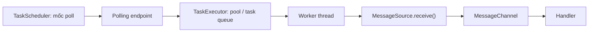

# task-executor và xử lý polling bất đồng bộ trong Spring Integration

## 1. Bài toán: tránh để một lượt polling chiếm luồng lập lịch

Một ứng dụng nhận file CSV định kỳ từ thư mục đối tác, tải file SFTP hoặc kiểm tra bản ghi trong cơ sở dữ liệu. Mỗi lượt polling có thể gọi nguồn nhiều lần rồi đưa message vào luồng xử lý. Nếu đọc nguồn hoặc xử lý handler mất vài chục giây, một luồng của bộ lập lịch có thể bị giữ lâu; các tác vụ dùng chung scheduler dễ bị trễ khi tài nguyên không đủ.

Trong module **SPRING_INTEGRATION_ADAPTERS**, `TaskScheduler` và `TaskExecutor` có trách nhiệm khác nhau:

- **`TaskScheduler`** xác định *khi nào* cần kích hoạt endpoint theo fixed-rate, fixed-delay, cron hoặc trigger tùy chỉnh.
- **`TaskExecutor`** thực hiện *công việc* đã được giao, có thể trên worker thread hoặc một thread pool có hàng đợi.
- **`MessageSource`** lấy dữ liệu từ hệ thống ngoài rồi trả `Message<?>`; **`MessageChannel`** truyền message đến handler hoặc endpoint tiếp theo.

Spring Integration cho phép cấu hình `taskExecutor` **ngay trên poller**. Khi đó, tác vụ polling có thể được giao cho worker thay vì thực hiện toàn bộ trên luồng scheduler. Cách làm này giúp tách hai nhiệm vụ, nhưng cũng đưa thêm hàng đợi, khả năng chạy chồng lấn và ranh giới lỗi hoặc transaction.

Sau bài học, bạn có thể phân biệt scheduler với executor, viết `@Poller(taskExecutor = "...")`, dùng pool hữu hạn, giải thích vì sao `ExecutorChannel` khác với task executor trên poller, và bảo vệ pipeline khi nguồn hoặc handler xử lý chậm.

## 2. Điều gì diễn ra khi poller hoạt động đồng bộ?

Khi không chỉ định executor riêng cho một polling task, luồng thực thi được scheduler cung cấp có thể trực tiếp thực hiện các bước đọc source và gửi message:

```text
TaskScheduler kích hoạt endpoint
         |
         v
   MessageSource.receive()
         |
         v
   MessageChannel.send(message)
         |
         v
   Handler xử lý nghiệp vụ
         |
         +--> tiếp tục receive() trong cùng lượt nếu còn quota
```

Với `DirectChannel`, lời gọi handler là đồng bộ theo mặc định. Giả sử `maxMessagesPerPoll = 4` và một handler mất 3 giây cho mỗi file, một lượt polling có thể cần xấp xỉ 12 giây xử lý, chưa tính I/O. Nếu bộ lập lịch chỉ có rất ít luồng, những endpoint khác có thể phải chờ.

Nhưng **scheduler có thể được cấu hình nhiều luồng**: không nên suy ra cứ một poller xử lý lâu là tất cả endpoint đều bị chặn. Cần xem số thread, thời gian tác vụ và loại channel của topology thực tế.

## 3. TaskExecutor gắn vào poller thay đổi điều gì?

Khi poller có `taskExecutor`, scheduler có thể giao tác vụ polling vào executor; worker thực hiện `receive()`, gửi message và, nếu dùng channel đồng bộ, thực thi handler.



Đừng nhầm **đã submit tác vụ** với **đã xử lý xong một lượt**. Khi queue của executor đang bận, tác vụ có thể nằm chờ; khi executor từ chối tác vụ, lượt polling có thể không được thực thi. Scheduler vẫn lên lịch nhưng thông lượng thực phụ thuộc vào worker.

Nếu executor có nhiều worker, các lượt polling có thể **chồng lấn** khi lượt mới được giao lúc lượt trước còn chạy. Một số `MessageSource`, file filter, session SFTP hoặc logic claim dữ liệu không thích hợp để gọi `receive()` đồng thời. Trước khi tăng pool size, cần hiểu thread safety và hợp đồng xử lý trùng.

### Timeline minh họa

Một poller được kích hoạt mỗi 5 giây, một lượt làm việc 8 giây:

```text
Lịch dự kiến:          0s        5s       10s       15s
                       |---------|---------|---------|

Không chuyển việc sang executor:
Luồng thực thi:        [Poll 1: 8s][Poll 2: ...]
                               lượt thứ hai có thể bị trễ

Executor có 2 worker, cho phép submit thêm tác vụ:
Worker 1:              [Poll 1: 8s]
Worker 2:                       [Poll 2: 8s]
                               hai lượt có thể chồng lấn
```

Đây là **khả năng**, không phải lịch thời gian thực được bảo đảm. Kết quả còn phụ thuộc trigger, implementation, số worker, queue, mức tải và chính sách rejection.

## 4. Phân biệt TaskScheduler, poller taskExecutor và ExecutorChannel

| Cơ chế | Phần công việc chạy ở đâu? | Hệ quả chính |
| --- | --- | --- |
| `TaskScheduler` nhiều thread | Các polling task được thực thi bằng những luồng scheduler | Giảm tranh chấp giữa các endpoint độc lập, nhưng mỗi lượt vẫn có thể giữ một luồng scheduler. |
| `@Poller(taskExecutor = "...")` | Nhận từ source và gửi message trên worker được giao | Scheduler ít trực tiếp xử lý hơn; queue/rejection và concurrency cần được kiểm soát. |
| `ExecutorChannel` | Chuyển **phần downstream** sang worker khi message được gửi đến channel | `receive()` có thể vẫn chạy trên luồng poller, trong khi handler đã bất đồng bộ. |

```text
Phương án A — taskExecutor trên poller:
Scheduler --> Worker A --> Source.receive() --> DirectChannel --> Handler
                                      (handler đồng bộ cùng worker A)

Phương án B — ExecutorChannel:
Scheduler --> Source.receive() --> ExecutorChannel --> Worker B --> Handler
                                 (giao việc)        (xử lý sau)
```

Phương án A hữu ích nếu **bản thân việc đọc nguồn có thể chặn**, chẳng hạn SFTP/HTTP long polling hoặc truy vấn DB chậm. Phương án B hữu ích nếu nguồn đọc nhanh nhưng handler CPU/I/O nặng. Cũng có thể kết hợp cả hai, nhưng nên làm khi có số liệu và mục tiêu cụ thể vì việc theo dõi hoàn tất, thứ tự và lỗi trở nên phức tạp hơn.

## 5. Ví dụ: file inbound adapter chạy qua task-executor

Ứng dụng đọc file CSV trong `data/inbox`, kích hoạt polling mỗi 5 giây và nhận tối đa 3 file mỗi lượt. Công việc polling được giao cho **một worker** có queue hữu hạn. Một worker giúp minh họa việc tách scheduler mà vẫn tránh chủ ý chạy đồng thời nhiều lượt đọc cùng nguồn.

### 5.1. Dependencies

Với dự án Spring Boot dùng BOM để quản lý version:

```xml
<dependencies>
    <dependency>
        <groupId>org.springframework.boot</groupId>
        <artifactId>spring-boot-starter-integration</artifactId>
    </dependency>
    <dependency>
        <groupId>org.springframework.integration</groupId>
        <artifactId>spring-integration-file</artifactId>
    </dependency>
</dependencies>
```

Tạo sẵn `data/inbox` theo working directory của ứng dụng.

### 5.2. Bean executor có giới hạn

```java
import java.util.concurrent.ThreadPoolExecutor;

import org.springframework.context.annotation.Bean;
import org.springframework.context.annotation.Configuration;
import org.springframework.scheduling.concurrent.ThreadPoolTaskExecutor;

@Configuration
public class PollingWorkerConfiguration {

    @Bean("filePollingExecutor")
    public ThreadPoolTaskExecutor filePollingExecutor() {
        ThreadPoolTaskExecutor executor = new ThreadPoolTaskExecutor();
        executor.setCorePoolSize(1);
        executor.setMaxPoolSize(1);
        executor.setQueueCapacity(2);
        executor.setThreadNamePrefix("file-poll-worker-");
        executor.setRejectedExecutionHandler(
            new ThreadPoolExecutor.AbortPolicy()
        );
        executor.setWaitForTasksToCompleteOnShutdown(true);
        executor.setAwaitTerminationSeconds(30);
        executor.initialize();
        return executor;
    }
}
```

Trong ví dụ:

- `corePoolSize = maxPoolSize = 1`: tối đa một tác vụ polling **đang chạy** trong pool này.
- `queueCapacity = 2`: nhiều nhất hai tác vụ **chờ worker**. Queue này chứa *tác vụ poll*, không chứa trực tiếp file hay message nghiệp vụ.
- `AbortPolicy`: khi pool/queue đầy, việc submit bị từ chối. Ứng dụng cần log, cảnh báo và quyết định cách xử lý mốc poll bị mất; không nên giả định scheduler tự phát lại tác vụ bị reject.
- `setAwaitTerminationSeconds(30)` hỗ trợ shutdown có giới hạn chờ; **không** phải timeout mạng hoặc giới hạn thời gian handler.

Nếu một lượt tốn 20 giây nhưng lịch nộp việc mỗi 5 giây, pool một worker cùng queue hai tác vụ có thể bão hòa. Bất đồng bộ chuyển điểm nghẽn sang hàng đợi; nó không làm xử lý tự nhanh hơn.

### 5.3. Poller gắn taskExecutor và handler

```java
import java.io.File;
import java.io.IOException;
import java.nio.charset.StandardCharsets;
import java.nio.file.Files;

import org.springframework.context.annotation.Bean;
import org.springframework.context.annotation.Configuration;
import org.springframework.integration.annotation.InboundChannelAdapter;
import org.springframework.integration.annotation.Poller;
import org.springframework.integration.annotation.ServiceActivator;
import org.springframework.integration.channel.DirectChannel;
import org.springframework.integration.config.EnableIntegration;
import org.springframework.integration.core.MessageSource;
import org.springframework.integration.file.FileReadingMessageSource;
import org.springframework.integration.file.filters.AcceptOnceFileListFilter;
import org.springframework.integration.file.filters.CompositeFileListFilter;
import org.springframework.integration.file.filters.SimplePatternFileListFilter;
import org.springframework.messaging.MessageChannel;

@Configuration
@EnableIntegration
public class AsyncFilePollingConfiguration {

    @Bean
    public MessageChannel incomingCsvFiles() {
        return new DirectChannel();
    }

    @Bean
    @InboundChannelAdapter(
        channel = "incomingCsvFiles",
        poller = @Poller(
            fixedRate = "5000",
            maxMessagesPerPoll = "3",
            taskExecutor = "filePollingExecutor"
        )
    )
    public MessageSource<File> csvFileSource() {
        FileReadingMessageSource source = new FileReadingMessageSource();
        source.setDirectory(new File("data/inbox"));

        CompositeFileListFilter<File> filter =
            new CompositeFileListFilter<>();
        filter.addFilter(new SimplePatternFileListFilter("*.csv"));
        filter.addFilter(new AcceptOnceFileListFilter<>());
        source.setFilter(filter);
        return source;
    }

    @ServiceActivator(inputChannel = "incomingCsvFiles")
    public void processCsv(File file) throws IOException {
        String csv = Files.readString(
            file.toPath(), StandardCharsets.UTF_8
        );
        System.out.printf(
            "[%s] Processed %s (%d chars)%n",
            Thread.currentThread().getName(),
            file.getName(), csv.length()
        );
        // TODO: parse/validate CSV, lưu đơn hàng và archive.
    }
}
```

**Đọc cấu hình:**

1. `@InboundChannelAdapter` khai báo nguồn phát message vào `incomingCsvFiles`.
2. `fixedRate = "5000"` đặt nhịp kích hoạt dự kiến mỗi 5 giây; `maxMessagesPerPoll = "3"` giới hạn số message trong **một lượt**.
3. `taskExecutor = "filePollingExecutor"` tham chiếu tên bean executor. Việc đọc file và gửi message diễn ra trên worker được giao.
4. `DirectChannel` thực thi handler đồng bộ với thao tác gửi, nên log handler thường có tiền tố thread `file-poll-worker-`.
5. `AcceptOnceFileListFilter` giúp tránh chọn lại file đã được filter chấp nhận trong bộ nhớ instance; nó không chứng minh xử lý nghiệp vụ đã thành công và không tạo exactly-once.

Với 10 file hợp lệ sẵn sàng, `maxMessagesPerPoll = 3` yêu cầu ít nhất 4 lượt thành công để nhận hết (3 + 3 + 3 + 1), giả sử không có lỗi hoặc file mới. Thời điểm các lượt **thực sự chạy** còn phụ thuộc queue của executor.

### 5.4. Thử nghiệm

1. Khởi động khi `data/inbox` rỗng: source có thể trả `null`; handler không log, nhưng poller vẫn có thể hoạt động.
2. Thêm 2 file CSV: ở lượt tiếp nhận phù hợp, handler in tên file và tên thread worker.
3. Thêm hơn 10 file: quan sát số message mỗi lượt và thời gian tồn đọng.
4. Trong môi trường thực hành, mô phỏng handler chậm: quan sát queue executor và rejection khi tốc độ lịch vượt tốc độ xử lý.
5. Restart ứng dụng: đánh giá việc file có được chọn lại không và chính sách retry/idempotency. Filter lưu RAM không tự bảo đảm metadata bền vững.

Để thấy những lượt polling rỗng, cần log/metrics tại `MessageSource.receive()` hoặc polling endpoint. Log trong handler chỉ xuất hiện khi có message.

## 6. Cấu hình tương đương bằng Java DSL

Nếu dùng IntegrationFlow DSL, executor được gắn vào poller:

```java
import java.io.File;
import java.time.Duration;
import org.springframework.context.annotation.Bean;
import org.springframework.integration.dsl.IntegrationFlow;
import org.springframework.integration.dsl.Pollers;
import org.springframework.integration.file.dsl.Files;
import org.springframework.scheduling.concurrent.ThreadPoolTaskExecutor;

@Bean
IntegrationFlow asynchronousFileFlow(
        ThreadPoolTaskExecutor filePollingExecutor) {
    return IntegrationFlow
        .from(
            Files.inboundAdapter(new File("data/inbox"))
                 .patternFilter("*.csv"),
            endpoint -> endpoint.poller(
                Pollers.fixedRate(Duration.ofSeconds(5))
                       .maxMessagesPerPoll(3)
                       .taskExecutor(filePollingExecutor)
            )
        )
        .handle(message -> {
            File file = (File) message.getPayload();
            System.out.println(
                Thread.currentThread().getName() + ": " + file.getName()
            );
        })
        .get();
}
```

Đây là **cách viết thay thế** cho annotation ở mục 5, không chạy đồng thời hai endpoint cùng quét thư mục ví dụ. Bean `filePollingExecutor` đã được tạo ở mục 5.2. Nếu có nhiều bean cùng kiểu `ThreadPoolTaskExecutor`, dùng `@Qualifier("filePollingExecutor")` để tiêm đúng bean.

## 7. ExecutorChannel: chuyển riêng phần downstream sang worker

Nếu thao tác `MessageSource.receive()` nhanh nhưng handler tốn CPU/I/O, có thể giữ poller đọc nguồn theo scheduler và chuyển message qua `ExecutorChannel`:

```java
import org.springframework.context.annotation.Bean;
import org.springframework.integration.channel.ExecutorChannel;
import org.springframework.messaging.MessageChannel;
import org.springframework.scheduling.concurrent.ThreadPoolTaskExecutor;

@Bean
MessageChannel processingChannel(
        ThreadPoolTaskExecutor processingExecutor) {
    return new ExecutorChannel(processingExecutor);
}
```

Ví dụ này cần một bean `processingExecutor` phù hợp với tải thực; khi dùng, inbound adapter sẽ gửi vào `processingChannel` và handler đăng ký nhận từ channel đó. Nó là một **topology thay thế**:

```text
Poller taskExecutor:
Scheduler -> Worker A -> Source.receive() -> DirectChannel -> Handler

ExecutorChannel:
Scheduler -> Source.receive() -> ExecutorChannel -> Worker B -> Handler
```

Khi `ExecutorChannel.send()` thành công, message có thể chỉ mới **được giao vào executor**, chưa hoàn thành nghiệp vụ. Lỗi từ handler bất đồng bộ không còn truyền theo cùng stack call tới poller như với `DirectChannel`. Nếu queue đầy hoặc ứng dụng crash, cần chính sách xử lý lỗi/nhận lại, durable queue khi có yêu cầu và trạng thái idempotency phù hợp.

## 8. maxMessagesPerPoll, trigger và giới hạn concurrency

| Thông số | Điều khiển | Không giới hạn trực tiếp |
| --- | --- | --- |
| `fixedRate` / `fixedDelay` | Thời điểm scheduler muốn kích hoạt polling task | Số worker và message in-flight |
| `maxMessagesPerPoll` | Tối đa số message **trong một lượt** | Số lượt poll đang chạy đồng thời |
| Pool size | Số tác vụ worker có thể thực thi đồng thời | Dữ liệu còn tồn ở nguồn |
| Executor queue capacity | Số tác vụ được phép chờ | Tổng số message được xử lý thành công |
| `receiveTimeout` của PollableChannel consumer | Thời gian chờ một lần nhận từ channel | Timeout HTTP/SFTP/DB hoặc thời gian handler |

### 8.1. Tăng executor pool có thể làm nhiều lượt overlap

Nếu `maxMessagesPerPoll = 5` và có 3 lượt polling chạy đồng thời, toàn hệ thống có thể có **hơn 5 message** đang được xử lý. Giới hạn này áp dụng **riêng mỗi lượt**, không phải toàn bộ ứng dụng.

Đặc biệt với SFTP, file và database, nhiều lượt đồng thời có thể cạnh tranh tài nguyên, chọn trùng bản ghi hoặc đẩy vượt quota. Cần đánh giá thread safety của source, file filters, session factory, cách claim dữ liệu và giới hạn số kết nối.

### 8.2. fixed-delay có còn chờ đến khi worker xử lý xong?

Khi scheduler giao tác vụ sang executor, thời điểm thao tác giao việc hoàn tất có thể **khác** thời điểm công việc thực sự hoàn tất. Vì vậy, không nên mặc định `fixedDelay` vẫn tạo khoảng nghỉ chính xác giữa hai lần nguồn ngoài thực sự được truy cập sau khi gắn executor.

Nếu API/SFTP yêu cầu khoảng nghỉ ít nhất 10 giây **sau khi một request hoàn tất**, cần điều tiết tại chính nơi phát request, dùng một luồng tuần tự với trigger phù hợp hoặc rate limiter có trạng thái. Hãy xác minh trên topology thực tế, kể cả tình huống executor bão hòa.

### 8.3. Executor bị đầy và tác vụ bị reject

Một worker và queue capacity 2 có thể chứa **một tác vụ đang chạy và hai tác vụ đang đợi**. Nếu lịch còn nộp thêm công việc, `AbortPolicy` từ chối tác vụ mới. Điều đó có thể làm bỏ lỡ một lượt poll; các file còn trên nguồn vẫn có thể được đọc ở lượt khác nếu filter/checkpoint cho phép, nhưng **không có bảo đảm tự chạy bù**.

| Chính sách rejection | Ảnh hưởng | Rủi ro |
| --- | --- | --- |
| Abort/reject | Báo lỗi khi không nhận được tác vụ mới | Cần quan sát, cảnh báo và catch-up rõ ràng |
| Caller-runs | Buộc thread nộp tác vụ tự xử lý khi pool đầy | Có thể giữ luồng scheduler và làm trễ endpoint khác |
| Discard | Bỏ tác vụ | Dễ mất lượt poll âm thầm nếu không có quan sát |

Đối với hệ thống nghiệp vụ quan trọng, nên sử dụng queue hữu hạn, hạn chế các kiểu bỏ tác vụ âm thầm, đo số rejection và thiết kế khả năng xử lý dữ liệu còn tồn ở nguồn.

## 9. Transaction, xử lý lỗi và ngữ cảnh theo thread

### 9.1. Thread boundary và transaction

Transaction của Spring thường dựa trên ngữ cảnh gắn với thread. Khi việc polling được giao sang executor, một transaction ở luồng khác **không tự di chuyển** sang worker. Khi dùng `ExecutorChannel`, transaction của luồng gửi cũng không mặc nhiên bao trùm handler ở worker downstream.

Ví dụ hai worker cùng đọc bản ghi `NEW` ở database khi chưa có cơ chế claim nguyên tử có thể cùng xử lý một đơn hàng. Muốn tránh trùng, cần transaction phù hợp và claim/lock hoặc cập nhật trạng thái có điều kiện; chỉ tăng thread pool không giải quyết được sự cạnh tranh.

Để thiết kế đúng:

1. Xác định transaction bắt đầu và kết thúc ở thread nào; nó bao phủ `receive()`, `send()` và handler nào.
2. Đảm bảo nguồn có cơ chế phân phối/claim dữ liệu an toàn khi chạy đồng thời.
3. Lưu checkpoint hoặc ack sau mốc xử lý thành công theo contract.
4. Thiết kế handler idempotent để có thể xử lý lại khi crash hoặc retry.

`maxMessagesPerPoll` **không** biến toàn bộ message trong lượt thành một transaction chung.

### 9.2. Lỗi ở từng vị trí

| Vị trí | Biểu hiện | Cần xử lý |
| --- | --- | --- |
| `MessageSource.receive()` trên worker | Lỗi nguồn file, SFTP, HTTP hoặc DB | Error handling/advice của polling endpoint và backoff phù hợp |
| Gửi message vào channel | Timeout, channel bị từ chối hoặc lỗi gửi | Quan sát lỗi, giới hạn queue, retry/recovery |
| Handler qua `DirectChannel` | Exception đồng bộ trên worker gửi | Transaction, rollback và error flow trong luồng đồng bộ |
| Handler sau `ExecutorChannel` | Exception xảy ra ở worker downstream | Error channel, retry, DLQ/quarantine riêng |
| Executor từ chối tác vụ | Submit thất bại khi pool bão hòa | Theo dõi rejection, điều tiết lịch và catch-up |

Với `AcceptOnceFileListFilter`, file có thể được đánh dấu đã chấp nhận trước khi handler ghi DB thành công. Một message đã gửi vào executor **không đồng nghĩa** đã hoàn thành nghiệp vụ. Nếu cần độ tin cậy cao, dùng checkpoint/metadata bền vững và idempotency key theo file hoặc đơn hàng.

### 9.3. Context theo luồng không tự lan truyền

Các ngữ cảnh dựa trên `ThreadLocal` như transaction, MDC log, request context hoặc một số security context không được đảm bảo đi theo worker. Nên truyền correlation ID bằng **message headers**; cấu hình context propagation có chủ đích nếu cần, đồng thời tránh ghi secret ra log hoặc để lộ qua headers không kiểm soát.

## 10. Backpressure và sizing cho môi trường thực

```text
Dữ liệu bên ngoài (file/SFTP/API/DB)
             |
             v
  MessageSource và poller
    (lịch, maxMessagesPerPoll)
             |
             v
   Executor / Channel queue
    (pool size, queue size, reject)
             |
             v
      Handler và DB/API đích
    (thời gian xử lý, retry, quota)
```

Số worker nên được chọn theo **khả năng chịu tải của từng tầng**. Nếu SFTP chỉ cho phép hai phiên, tăng pool lên 20 có thể làm tăng timeout. Nếu DB đích đã dùng hết connection pool, tăng concurrency có thể làm thời gian xử lý dài hơn.

Cần đo thời gian từ lúc dữ liệu **sẵn sàng ở nguồn** đến khi nghiệp vụ **commit thành công**. Việc log “poller đã chạy” hoặc “message đã gửi” chỉ phản ánh một giai đoạn. Các chỉ số quan trọng gồm lượng dữ liệu đến, số message/giây hoàn tất, tuổi dữ liệu tồn lâu nhất và queue backlog.

Nếu nguồn cần đảm bảo thứ tự, cân nhắc giữ một worker đọc và dùng hàng đợi xử lý có cơ chế bảo toàn thứ tự phù hợp. Nếu cần tăng throughput, nên bắt đầu từ nút nghẽn thực tế và xác định rõ ranh giới chia công việc, retry và idempotency.

## 11. Giám sát và chẩn đoán

| Chỉ số | Ý nghĩa |
| --- | --- |
| Thời điểm scheduler kích hoạt so với worker bắt đầu | Độ trễ chờ trong executor |
| Số task đang chạy, queue depth và rejection | Executor có đang bão hòa? |
| Thời lượng `receive()` và thời gian toàn lượt | Nghẽn nằm ở nguồn hay handler? |
| Số message nhận trong mỗi lượt | Nguồn rỗng hay thường chạm giới hạn? |
| Độ tuổi file/message cũ nhất chưa hoàn tất | SLA xử lý thực tế có đạt? |
| Số lần retry, timeout, lỗi transaction và trùng message | Vấn đề reliability khi tăng concurrency |
| Thời gian shutdown, số task còn chờ | Việc thoát ứng dụng có giải phóng và hoàn tất công việc an toàn? |

**Tình huống 1:** Poller kích hoạt đều nhưng không thấy handler log. Source có thể trả `null` hoặc tác vụ còn ở queue worker; cần log cả đầu/cuối `receive()` và queue executor.

**Tình huống 2:** Backlog tăng dù worker thread đang hoạt động. Năng lực xử lý thực thấp hơn tốc độ dữ liệu đến; điều chỉnh topology hoặc giới hạn nguồn sau khi đo tải, không chỉ thay tên thread.

**Tình huống 3:** Gặp `TaskRejectedException` hoặc lỗi rejection. Pool/queue đang bão hòa; cần giảm tốc độ submit, tăng năng lực an toàn hoặc thay đổi cơ chế backpressure. Kiểm tra dữ liệu còn ở nguồn để xử lý bù.

**Tình huống 4:** Một file được xử lý hai lần. Xem concurrency, filter/checkpoint, nhiều replica cùng đọc, retry và khóa nghiệp vụ; không quy ngay mọi lỗi cho task executor.

## 12. Bài tập có đáp án

**Bài 1 — Scheduler khác executor.** `TaskScheduler` và `TaskExecutor` có vai trò giống nhau không?

**Đáp án:** Không. Scheduler quyết định **lúc kích hoạt**, executor quyết định **nơi thực thi công việc** và quản lý pool/queue.

**Bài 2 — Handler trên DirectChannel.** Poller dùng `taskExecutor="filePollingExecutor"` và gửi đến `DirectChannel`. Handler mặc định chạy trên thread nào?

**Đáp án:** Trên worker thực hiện việc polling và gửi message, vì `DirectChannel` gọi handler đồng bộ.

**Bài 3 — ExecutorChannel.** Poller không có task executor nhưng gửi message vào `ExecutorChannel`. `MessageSource.receive()` có tự chạy trong downstream worker không?

**Đáp án:** Không. Source vẫn được gọi trên luồng poller; phần sau channel mới được giao sang executor.

**Bài 4 — maxMessagesPerPoll.** `maxMessagesPerPoll = 5` và executor có ba lượt poll chạy đồng thời. Có thể có hơn 5 message đang xử lý không?

**Đáp án:** Có. Giới hạn năm message là **theo từng lượt**, không phải giới hạn concurrency cho toàn hệ thống.

**Bài 5 — Pool đầy.** Một worker đang bận, hai tác vụ đang đợi trong queue capacity 2, một tác vụ mới được submit với `AbortPolicy`. Điều gì có thể xảy ra?

**Đáp án:** Executor có thể reject tác vụ mới. Cần log/cảnh báo và cơ chế đọc bù ở lượt khác; không giả định tác vụ reject sẽ tự chạy lại.

**Bài 6 — Transaction.** Handler ở worker sau `ExecutorChannel` có mặc nhiên nằm trong transaction của thread gửi không?

**Đáp án:** Không. Transaction context thường gắn thread; cần định nghĩa ranh giới transaction ở downstream worker.

**Bài 7 — Nguồn không thread-safe.** Một adapter tái sử dụng session không an toàn cho truy cập đồng thời. Tăng poller executor từ 1 lên 16 worker có phù hợp không?

**Đáp án:** Không khi chưa thiết kế lại session/claim hoặc phân vùng nguồn. Có thể dùng một worker cho thao tác đọc hoặc cơ chế bảo vệ tài nguyên được kiểm chứng.

**Bài 8 — Đo SLA.** Scheduler chạy đúng lịch nhưng executor queue giữ message 15 phút, SLA xử lý là 1 phút. Đã đạt SLA chưa?

**Đáp án:** Chưa. Cần đo từ lúc dữ liệu sẵn sàng cho đến khi nghiệp vụ commit, điều chỉnh năng lực, backpressure và chính sách hàng đợi.

**Bài 9 — Xử lý lại.** File đã được filter accept-once chấp nhận nhưng handler bất đồng bộ thất bại. Lượt sau có tự nhận lại file không?

**Đáp án:** Không có bảo đảm. Phải thiết kế retry, trạng thái bền vững và handler idempotent.

## 13. Ghi nhớ

**`taskExecutor` trên poller tách thực thi polling khỏi `TaskScheduler`**; scheduler vẫn kích hoạt theo lịch. Với `DirectChannel`, phần handler đồng bộ thường chạy trên worker của poller; với `ExecutorChannel`, xử lý downstream lại được chuyển qua ranh giới bất đồng bộ khác. `maxMessagesPerPoll` giới hạn message theo *mỗi lượt*, không giới hạn tổng concurrency hoặc queue. Khi cấu hình cho file, SFTP, HTTP hay database, hãy dùng executor hữu hạn, đảm bảo nguồn an toàn khi chạy đồng thời, quản lý backpressure, timeout, transaction, retry và idempotency.
