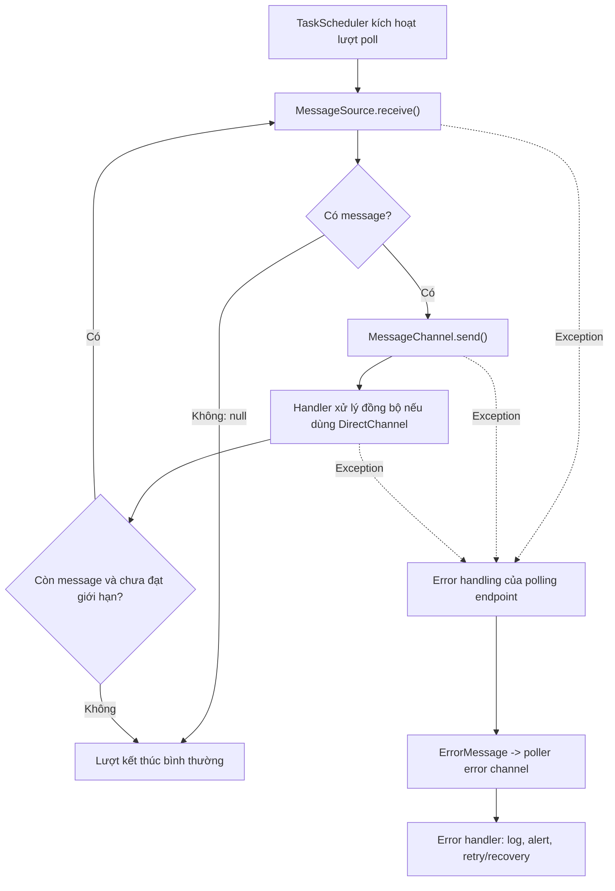
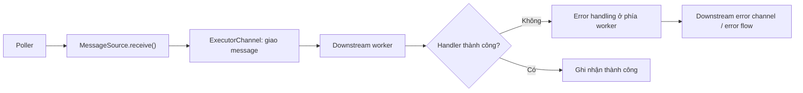

# Poller error-channel khi tác vụ thất bại trong Spring Integration

## 1. Bối cảnh: poller chạy đúng lịch nhưng việc lấy dữ liệu thất bại

Ứng dụng nhận file CSV từ đối tác qua thư mục chung. Cứ 5 giây, một inbound adapter gọi `MessageSource.receive()` để tìm file mới rồi gửi `Message<File>` qua `MessageChannel` cho handler ghi dữ liệu vào cơ sở dữ liệu. Một ngày, file có nội dung sai định dạng hoặc DB không thể kết nối. Poller vẫn được kích hoạt theo lịch, nhưng **một thao tác trong lượt polling đã phát sinh exception**.

Cần trả lời rõ: lỗi đó đi đâu, ai biết có file xử lý thất bại, và lượt polling kế tiếp có tự sửa được lỗi không?

Trong module **SPRING_INTEGRATION_ADAPTERS**, các inbound/outbound adapter, gateway, poller và MessageChannel cùng tạo luồng tích hợp với hệ thống ngoài như file, SFTP, HTTP, JMS, AMQP, Kafka và database. Với **polling endpoint**, Spring Integration hỗ trợ tuyến lỗi thông qua **error channel**: khi công việc polling thất bại và lỗi được cơ chế xử lý lỗi của endpoint chuyển thành message, một `ErrorMessage` được gửi đến channel dành cho lỗi.

Một `ErrorMessage` giúp ghi nhận, cảnh báo hoặc chuyển dữ liệu sang quy trình phục hồi. Tuy nhiên, **đưa exception vào error channel không đồng nghĩa xử lý lại thành công**, không tạo transaction tự động và không bảo đảm exactly-once.

Sau bài này, bạn có thể:

- Phân biệt lỗi trong `MessageSource.receive()`, `MessageChannel.send()` và handler đồng bộ/bất đồng bộ.
- Cấu hình `@Poller(errorChannel = "...")` cho polling inbound adapter.
- Nhận `ErrorMessage`, đọc exception và `failedMessage` khi có.
- Phân biệt error channel của poller với `errorChannel` gắn ở message header và global `errorChannel`.
- Thiết kế retry, backoff, idempotency, quarantine và quan sát lỗi mà không đánh mất dữ liệu.

## 2. Lỗi xuất hiện tại những bước nào?

Một lượt polling thông thường gồm nhiều bước:



Các lỗi có thể xuất hiện ở những vị trí khác nhau:

| Nơi xảy ra lỗi | Ví dụ | Lỗi có thể đến poller error channel? |
| --- | --- | --- |
| `MessageSource.receive()` | Không kết nối được SFTP, SQL timeout, lỗi đọc file | Có, khi exception phát sinh trong tác vụ poll và được cơ chế xử lý lỗi của endpoint bắt. |
| Gửi vào `MessageChannel` | Channel không có subscriber, queue đầy hoặc gửi bị từ chối | Có, nếu exception phát sinh trong đường gửi đồng bộ của poller. |
| Handler sau `DirectChannel` | Parse CSV thất bại, ghi DB lỗi | Thường có: `DirectChannel` gọi handler đồng bộ và lỗi có thể truyền ngược đến poller. |
| Handler sau `ExecutorChannel` | Worker bất đồng bộ ghi DB lỗi | Không mặc nhiên đi ngược về poller; cần cấu hình tuyến lỗi của **bước bất đồng bộ**. |
| Executor của poller từ chối task | Thread pool/queue bão hòa | Phụ thuộc nơi và cách rejection xảy ra; cần giám sát cả scheduler/executor, không giả định mọi rejection đều trở thành `ErrorMessage` cùng channel. |
| Consumer message-driven không có poller | Listener JMS/AMQP/Kafka xử lý message lỗi | Theo error handling và acknowledgement của listener/adapter đó, không dùng cơ chế poller của bài này. |

**Nguồn trả về `null` vì không có dữ liệu là trạng thái bình thường**, không phải exception cần gửi đến error channel. Đây là khác biệt quan trọng giữa “không có message” và “không lấy được message vì hệ thống lỗi”.

## 3. ErrorMessage chứa những gì?

Error channel của Spring Integration nhận một message lỗi. Loại thường thấy là `org.springframework.messaging.support.ErrorMessage`; payload của nó là một `Throwable` (exception hoặc một lỗi được framework bao gói).

```java
import org.springframework.messaging.Message;
import org.springframework.messaging.MessagingException;
import org.springframework.messaging.support.ErrorMessage;

public void inspectError(ErrorMessage errorMessage) {
    Throwable failure = errorMessage.getPayload();
    System.err.println("Failure type: " + failure.getClass().getName());
    System.err.println("Failure message: " + failure.getMessage());

    if (failure instanceof MessagingException messagingException) {
        Message<?> failedMessage = messagingException.getFailedMessage();
        if (failedMessage != null) {
            System.err.println(
                "Failed message ID: " + failedMessage.getHeaders().getId()
            );
        }
    }
}
```

**Không mặc định mọi lỗi đều có `failedMessage`.** Khi `MessageSource.receive()` thất bại trước khi tạo được message, chưa có payload nghiệp vụ để gắn vào exception. Ngay cả khi exception là `MessagingException`, phương thức `getFailedMessage()` có thể trả `null`. Với lỗi handler, exception đôi khi được bọc nhiều lớp; thông tin message có thể nằm trong `MessagingException` của chuỗi nguyên nhân.

Nên ghi log có cấu trúc gồm:

- Tên polling endpoint hoặc flow, thời điểm lỗi và loại exception.
- Correlation ID, file name, business key hoặc message ID **nếu có và được phép log**.
- Nhóm lỗi: nguồn ngoài, channel, handler, transaction, executor.
- Số lần retry, thời gian backoff và kết quả cuối cùng của recovery.

Không log toàn bộ nội dung file, access token, mật khẩu hoặc payload nhạy cảm chỉ vì `ErrorMessage` có thể giữ thông tin về message thất bại.

## 4. Poller error channel, header errorChannel và global errorChannel

Ba khái niệm có tên gần nhau nhưng phạm vi khác nhau:

| Khái niệm | Được dùng ở đâu? | Ý nghĩa |
| --- | --- | --- |
| **Poller error channel** | `@Poller(errorChannel = "filePollErrors")` hoặc cấu hình tương đương | Tuyến xuất bản lỗi của **tác vụ polling** khi lỗi được xử lý theo cơ chế này. |
| **Header `errorChannel`** | Header của một `Message<?>` | Địa chỉ nhận lỗi được truyền theo message, hữu ích ở nhiều flow bất đồng bộ và cơ chế error handling có hỗ trợ header. |
| **Global `errorChannel`** | Channel dùng chung trong application context khi được framework cấu hình | Nơi tập trung các lỗi không được định tuyến tới channel cụ thể, tùy loại endpoint và cấu hình. |

Khi muốn vận hành độc lập luồng lấy file, luồng SFTP và luồng database, nên đặt **error channel riêng cho poller tương ứng**. Việc này giúp cảnh báo và phục hồi đúng nguồn dữ liệu, tránh biến mọi exception thành một hàng chờ lỗi không phân biệt được nguyên nhân.

Nếu không cấu hình error channel riêng, framework có thể dùng error handling/global channel mặc định tùy endpoint và phiên bản. Không nên chỉ dựa vào một logging subscriber mặc định để đáp ứng nghiệp vụ retry hoặc quarantine. Hãy chủ động tạo error flow và kiểm tra bằng cách gây lỗi có kiểm soát.

**Lỗi của handler nằm sau ranh giới bất đồng bộ** (ví dụ `ExecutorChannel`) cần được cấu hình error flow riêng hoặc header `errorChannel` thích hợp. Tùy đường xử lý, exception có thể xuất hiện ở worker khác **sau khi poller đã hoàn tất**, nên poller không còn trực tiếp bắt được exception đó.

## 5. Ví dụ đầy đủ: inbound file poller đưa lỗi vào channel riêng

Giả sử đối tác đặt CSV vào `data/inbox`. Ứng dụng quét mỗi 5 giây, xử lý tối đa 3 file mỗi lượt. Để dễ quan sát luồng lỗi, handler cố ý ném exception khi tên file bắt đầu bằng `fail-`.

### 5.1. Dependencies

Với dự án Spring Boot có BOM quản lý phiên bản dependency:

```xml
<dependencies>
    <dependency>
        <groupId>org.springframework.boot</groupId>
        <artifactId>spring-boot-starter-integration</artifactId>
    </dependency>
    <dependency>
        <groupId>org.springframework.integration</groupId>
        <artifactId>spring-integration-file</artifactId>
    </dependency>
</dependencies>
```

Tạo thư mục `data/inbox` theo working directory của ứng dụng và bảo đảm ứng dụng có quyền đọc. Các file trong bài chỉ là dữ liệu thực hành.

### 5.2. Cấu hình Java

```java
import java.io.File;
import java.io.IOException;
import java.nio.charset.StandardCharsets;
import java.nio.file.Files;

import org.springframework.context.annotation.Bean;
import org.springframework.context.annotation.Configuration;
import org.springframework.integration.annotation.InboundChannelAdapter;
import org.springframework.integration.annotation.Poller;
import org.springframework.integration.annotation.ServiceActivator;
import org.springframework.integration.channel.DirectChannel;
import org.springframework.integration.config.EnableIntegration;
import org.springframework.integration.core.MessageSource;
import org.springframework.integration.file.FileReadingMessageSource;
import org.springframework.integration.file.filters.AcceptOnceFileListFilter;
import org.springframework.integration.file.filters.CompositeFileListFilter;
import org.springframework.integration.file.filters.SimplePatternFileListFilter;
import org.springframework.messaging.Message;
import org.springframework.messaging.MessageChannel;
import org.springframework.messaging.MessagingException;
import org.springframework.messaging.support.ErrorMessage;

@Configuration
@EnableIntegration
public class FilePollErrorConfiguration {

    @Bean
    public MessageChannel incomingCsvFiles() {
        return new DirectChannel();
    }

    // Tuyến lỗi riêng của polling endpoint đọc file.
    @Bean
    public MessageChannel filePollErrors() {
        return new DirectChannel();
    }

    @Bean
    @InboundChannelAdapter(
        channel = "incomingCsvFiles",
        poller = @Poller(
            fixedDelay = "5000",
            maxMessagesPerPoll = "3",
            errorChannel = "filePollErrors"
        )
    )
    public MessageSource<File> csvFileSource() {
        FileReadingMessageSource source = new FileReadingMessageSource();
        source.setDirectory(new File("data/inbox"));

        CompositeFileListFilter<File> filters =
            new CompositeFileListFilter<>();
        filters.addFilter(new SimplePatternFileListFilter("*.csv"));
        filters.addFilter(new AcceptOnceFileListFilter<>());
        source.setFilter(filters);
        return source;
    }

    @ServiceActivator(inputChannel = "incomingCsvFiles")
    public void processCsv(File file) throws IOException {
        // Mô phỏng lỗi nghiệp vụ để kiểm tra error channel.
        if (file.getName().startsWith("fail-")) {
            throw new IllegalStateException(
                "Simulated CSV processing failure"
            );
        }

        String content = Files.readString(
            file.toPath(), StandardCharsets.UTF_8
        );
        System.out.printf(
            "Processed %s: %d chars%n",
            file.getName(), content.length()
        );
    }

    @ServiceActivator(inputChannel = "filePollErrors")
    public void handlePollingFailure(ErrorMessage errorMessage) {
        Throwable failure = errorMessage.getPayload();
        System.err.printf(
            "File polling failed: %s: %s%n",
            failure.getClass().getSimpleName(),
            failure.getMessage()
        );

        if (failure instanceof MessagingException messagingException) {
            Message<?> failed = messagingException.getFailedMessage();
            if (failed != null) {
                System.err.println(
                    "Failed message id: " + failed.getHeaders().getId()
                );
            }
        }

        // Production: gửi metric/cảnh báo và chuyển tới recovery flow.
    }
}
```

**Cách hoạt động của ví dụ:**

1. `@InboundChannelAdapter` tạo endpoint nhận message từ `FileReadingMessageSource`.
2. `@Poller(fixedDelay = "5000", maxMessagesPerPoll = "3")` đặt lịch giữa các lượt và giới hạn tối đa ba message trong một lượt.
3. `errorChannel = "filePollErrors"` chỉ rõ channel nhận lỗi được publish bởi cơ chế xử lý lỗi của polling endpoint.
4. `incomingCsvFiles` là `DirectChannel`, nên handler được gọi đồng bộ trong đường gửi message của poller. Nếu handler ném exception, lỗi có thể truyền đến cơ chế xử lý lỗi polling.
5. `filePollErrors` cũng là `DirectChannel`: một service activator nhận `ErrorMessage` và ghi nhận nguyên nhân. Trong ứng dụng thật, nơi này cần có chính sách phục hồi.

Đoạn ví dụ chủ động không xử lý CSV sâu và chỉ mô phỏng lỗi theo tên file. Nó giúp thấy **đường chuyển exception thành ErrorMessage**, không chứng minh cơ chế retry hay giao dịch đầy đủ.

### 5.3. Thử nghiệm từng tình huống

**Trường hợp A — thư mục trống:** `MessageSource.receive()` trả `null`; lượt poll kết thúc bình thường. Error handler không được gọi, vì không có exception.

**Trường hợp B — file bình thường:** đặt `orders-001.csv` trong inbox; poller chọn file, chuyển qua `DirectChannel` và handler log xử lý thành công.

**Trường hợp C — file cố tình gây lỗi:** đặt `fail-orders.csv`; handler ném `IllegalStateException`, exception được cơ chế polling xử lý và phát dưới dạng `ErrorMessage` tới `filePollErrors` khi cấu hình phù hợp. Error handler log loại lỗi và thông tin message nếu có.

**Trường hợp D — nhiều file trong cùng lượt:** nếu một file lỗi khi xử lý đồng bộ, lượt hiện tại có thể kết thúc sớm thay vì tiếp tục đủ `maxMessagesPerPoll`. **Số message đã xử lý thành công trước đó không tự bị rollback** chỉ vì có chung một lượt poll.

**Trường hợp E — chạy lại sau lỗi:** `AcceptOnceFileListFilter` có thể đã ghi nhớ file `fail-orders.csv` trước khi handler thất bại. Lượt tiếp theo **không mặc nhiên đọc lại** file này. Cần recovery riêng, chẳng hạn lưu trạng thái retry/quarantine hoặc thiết kế cơ chế tiếp nhận/hoàn tất phù hợp.

**Lưu ý quan sát:** Log ở handler chỉ xuất hiện khi có file. Nếu muốn biết cả những lượt poll rỗng, cần log/metric tại polling endpoint hoặc `MessageSource.receive()`.

## 6. Lỗi đọc nguồn khác lỗi xử lý message

### 6.1. Lỗi xảy ra trước khi có Message

Ví dụ SFTP server mất kết nối ngay trong `MessageSource.receive()`, hoặc JDBC query ném exception trước khi tạo được dữ liệu. Khi đó chưa chắc có `Message<?>`, và error handler nên dựa vào exception cùng metadata của endpoint thay vì buộc phải có `failedMessage`.

```text
Scheduler -> SftpMessageSource.receive()
                          |
                          +-- IOException / connection failure
                                       |
                                       v
                              Poller error handling
                                       |
                                       v
                            ErrorMessage(error)
                                       |
                                       v
                               sftpPollErrors
```

Đối với nguồn SFTP/HTTP/database, cần cấu hình connect/read/query timeout và chiến lược reconnect theo client/adapter. `@Poller(errorChannel = "...")` **không tự đặt timeout I/O** và không sửa được sự cố mạng.

### 6.2. Lỗi xảy ra sau khi đã phát Message

Với `DirectChannel`, handler có thể thất bại vì dữ liệu không hợp lệ hoặc DB từ chối ghi. Exception thường được Spring Integration bao gói thành `MessagingException` có tham chiếu message thất bại. Dù vậy, error handler vẫn phải xử lý trường hợp message vắng mặt hoặc exception bị bọc nhiều lớp.

```text
MessageSource.receive() -> Message<File>
                             |
                             v
                          DirectChannel
                             |
                             v
                       Handler ghi database
                             |
                             +-- lỗi nghiệp vụ
                                      |
                                      v
                           Poller error handling
                                      |
                                      v
                             ErrorMessage(Throwable)
```

Không nên lưu `failedMessage` nguyên trạng trong một kho lỗi không giới hạn nếu payload lớn hoặc nhạy cảm. Tốt hơn là lưu **định danh dữ liệu, vị trí file, mã lỗi, thời điểm và quyết định retry**, đồng thời tuân thủ chính sách bảo mật/retention của hệ thống.

## 7. Lỗi với polling consumer và PollableChannel

`errorChannel` trên poller không chỉ có thể dùng cho inbound adapter. Một **polling consumer** đọc message từ `PollableChannel`, ví dụ `QueueChannel`, cũng có thể phát sinh lỗi trong quá trình xử lý.

```java
import org.springframework.context.annotation.Bean;
import org.springframework.context.annotation.Configuration;
import org.springframework.integration.annotation.Poller;
import org.springframework.integration.annotation.ServiceActivator;
import org.springframework.integration.channel.QueueChannel;
import org.springframework.integration.config.EnableIntegration;

@Configuration
@EnableIntegration
public class QueueConsumerConfig {

    @Bean
    public QueueChannel pendingOrders() {
        return new QueueChannel(100);
    }

    @ServiceActivator(
        inputChannel = "pendingOrders",
        poller = @Poller(
            fixedDelay = "1000",
            receiveTimeout = "300",
            maxMessagesPerPoll = "4",
            errorChannel = "filePollErrors"
        )
    )
    public void handleOrder(String order) {
        if (order.isBlank()) {
            throw new IllegalArgumentException("Empty order payload");
        }
        System.out.println("Processed order: " + order);
    }
}
```

Đây là **ví dụ độc lập** cần một bean `filePollErrors` và error consumer tương ứng như ở mục 5, hoặc thay bằng tên channel riêng cho queue consumer. `receiveTimeout = "300"` là thời gian chờ một lần đọc từ `PollableChannel`, không phải timeout của handler.

Điểm cần thận trọng: một message bị lấy khỏi `QueueChannel` không mặc nhiên được đưa trở lại queue khi handler lỗi. Nếu dùng queue trong bộ nhớ, message cũng có thể mất khi ứng dụng restart. Hãy thiết kế retry, kho lưu bền vững và transaction phù hợp thay vì coi error channel là nơi tự trả lại message.

## 8. Đường xử lý bất đồng bộ: lỗi có thể nằm ngoài phạm vi poller

Khi downstream dùng `ExecutorChannel` hoặc một worker bất đồng bộ:



Poller có thể hoàn tất `send()` ngay khi message được nhận vào executor. Nếu handler trên worker gặp lỗi sau đó, exception **không đi ngược qua một call stack đồng bộ** tới `@Poller(errorChannel = "...")`. Tùy cơ chế dispatch/error handling của channel, lỗi có thể được chuyển bằng header `errorChannel`, global `errorChannel` hoặc cơ chế riêng của downstream.

Muốn đảm bảo quan sát được lỗi downstream, cần:

1. Quy định rõ error channel dành cho downstream worker hoặc flow riêng.
2. Truyền correlation ID/business key qua message headers và giữ khả năng truy vết.
3. Thiết kế handler retry/idempotent, xác định khi nào được ack hoặc cập nhật checkpoint.
4. Có nơi lưu các lỗi không thể phục hồi (*dead-letter/quarantine*) cùng công cụ xử lý lại an toàn.

Tương tự, cấu hình `taskExecutor` trên poller có thể làm thay đổi luồng thực thi và vị trí exception được bắt. Phải kiểm tra error handling của endpoint trong topology và phiên bản đang chạy. Không nên tin rằng tất cả lỗi của mọi worker tự dồn về một channel tên giống nhau.

## 9. Error-channel không thay thế retry và giao dịch

**Error channel là tuyến thông báo và xử lý lỗi.** Quyết định có thử lại hay không, thử lại khi nào và xác nhận hoàn tất dữ liệu là những trách nhiệm riêng.

### 9.1. Ba nhóm lỗi cần hành động khác nhau

| Nhóm lỗi | Ví dụ | Hướng xử lý |
| --- | --- | --- |
| **Tạm thời** | SFTP/HTTP mất kết nối, DB timeout, dịch vụ ngoài 503 | Retry có giới hạn, exponential backoff, timeout và cảnh báo. |
| **Không hợp lệ về dữ liệu** | CSV sai schema, thiếu field bắt buộc | Quarantine/dead-letter, báo đối tác hoặc cần sửa dữ liệu; retry y hệt thường không hữu ích. |
| **Cấu hình và quyền** | Sai credentials, không có quyền truy cập thư mục | Cảnh báo khẩn và sửa cấu hình/quyền; hạn chế retry liên tục gây bão lỗi. |

**Không biến mọi exception thành `null`**: nguồn trả `null` nghĩa là chưa có dữ liệu theo hợp đồng; exception là sự cố cần phân loại và theo dõi. Nếu cố tình nuốt exception trong `MessageSource.receive()`, error channel không còn biết đã có lỗi.

### 9.2. Retry trước hoặc sau error channel?

Hai mô hình phục hồi có mục đích khác nhau:

```text
Mô hình A — retry có giới hạn trong cùng công việc:
receive/send/handle -> lỗi -> Retry advice/policy -> thử lại
                                                |
                                          hết số lần thử
                                                |
                                                v
                                         Poller error channel

Mô hình B — tách phục hồi:
receive/send/handle -> lỗi -> Poller error channel
                                    |
                                    v
                       Quarantine / retry queue / vận hành
                                    |
                                    v
                         Chạy lại theo chính sách riêng
```

Nếu dùng retry advice trên endpoint hoặc handler, cần kiểm tra **điều kiện retry**, transaction boundary và thời điểm phát `ErrorMessage`. Khi một advice đã khôi phục lỗi và trả kết quả bình thường, có thể không còn exception để đưa ra error channel. Ngược lại, nếu vẫn ném exception sau khi hết retry, cơ chế poller error handling mới có cơ hội công bố lỗi.

Đừng thực hiện retry liên tục trong chính error handler mà không có giới hạn thời gian/số lần. Nếu handler xử lý lỗi chạy đồng bộ, nó cũng có thể giữ luồng của poller hoặc kéo dài lượt hiện tại.

### 9.3. maxMessagesPerPoll không tạo transaction chung

Giả sử một lượt nhận 5 file, bốn file đầu được xử lý thành công và file thứ năm lỗi. `maxMessagesPerPoll = 5` chỉ giới hạn số message trong lượt; **không có nghĩa cả năm file nằm trong một transaction**. Bốn file đã commit không tự rollback. Nếu cần tính nguyên tử, phải thiết kế transaction ở tầng database, batch hoặc nguồn theo hợp đồng riêng.

### 9.4. Không đồng nhất “đã tiếp nhận” với “đã xử lý thành công”

Với file/SFTP, bộ lọc accept-once thường đánh dấu file là đã chọn **khi phát hiện/nhận**, trước khi nghiệp vụ commit. Error channel nhận được thông báo lỗi nhưng không tự hủy trạng thái filter đó. Một file đã lỗi có thể không xuất hiện lại ở lượt poll tiếp theo, kể cả nếu poller vẫn chạy đều.

Quy trình đáng tin cậy cần phân biệt:

- **Discovered:** file hoặc bản ghi đã được thấy ở nguồn.
- **Claimed/received:** một worker đã nhận quyền xử lý hoặc adapter đã phát message.
- **Processed:** nghiệp vụ đã commit, có bằng chứng hoàn tất.
- **Failed/retryable:** lỗi đã được ghi nhận, có chính sách xử lý lại và giới hạn số lần thử.

Khóa idempotency dựa trên mã đơn hàng, event ID hoặc file version giúp chống tạo dữ liệu trùng khi retry hoặc restart. Một error handler chỉ ghi log mà không bảo toàn thông tin phục hồi có thể khiến lỗi bị phát hiện nhưng dữ liệu vẫn không được xử lý lại.

## 10. Xử lý error channel an toàn khi vận hành

### 10.1. Error handler có thể tự thất bại

Error handler cũng là một handler. Nếu nó ném exception, gửi thông báo lỗi sang channel không có subscriber hoặc gọi mạng chậm vô hạn, xử lý lỗi của poller có thể trở nên phức tạp hơn, thậm chí mất khả năng quan sát sự cố gốc.

Nên giữ bước ghi nhận lỗi ban đầu ngắn và an toàn; đưa các công việc nặng như gửi cảnh báo, phân tích payload hoặc gọi dịch vụ quản trị sang queue/worker có giới hạn và có khả năng phục hồi. Khi phải dùng xử lý bất đồng bộ, ghi rõ ranh giới giao message, lỗi và việc lưu bền.

### 10.2. Một error channel có nhiều subscriber

`DirectChannel` thường chuyển một message đến **một** subscriber theo cơ chế dispatch. Nếu muốn nhiều hệ thống cùng nhận thông tin lỗi (logging, metrics, alert), có thể dùng `PublishSubscribeChannel` với nhiều subscriber, hoặc tạo một handler điều phối rõ ràng. Đừng giả định gắn hai consumer vào một `DirectChannel` làm cả hai đều nhận cùng một `ErrorMessage`.

```text
Poller errorChannel
        |
        v
PublishSubscribeChannel
   |           |           |
  Log        Metrics      Alert
```

Nếu một subscriber gặp lỗi, ảnh hưởng đến các subscriber khác và hành vi propagates phụ thuộc cách channel được cấu hình (đồng bộ hay executor, error handler...). Cần đo/test thực tế thay vì xem phát lỗi như giao dịch xuất bản chắc chắn đến mọi nơi.

### 10.3. Không vô tình tạo vòng lặp lỗi

Tránh thiết kế error handler cứ gửi lại nguyên message vào cùng endpoint mà không có giới hạn. Với lỗi dữ liệu không hợp lệ, retry vô hạn chỉ làm tăng log và chiếm tài nguyên.

Một chính sách recovery hữu ích gồm số lần thử tối đa, khoảng backoff, điều kiện bỏ qua, quarantine, khả năng thao tác thủ công và audit trail. Đối với dữ liệu có thể mất sau restart, nên lưu thông tin retry ở nơi bền vững.

## 11. Quan sát và chẩn đoán lỗi

| Chỉ số/triệu chứng | Ý nghĩa cần kiểm tra |
| --- | --- |
| Số lượt polling và số message nhận/lượt | Poller có chạy và nguồn có dữ liệu hay không? |
| Số `ErrorMessage` theo endpoint và loại lỗi | Nguồn đang lỗi kết nối hay downstream xử lý lỗi? |
| Tỷ lệ lỗi trên số message được xử lý | Lỗi có tăng cùng với tải hoặc một loại file? |
| Lỗi có `failedMessage` / lỗi không có message | Phân biệt lỗi trong source với lỗi sau khi message đã hình thành. |
| Thời gian xử lý error handler | Tuyến lỗi có đang giữ luồng hoặc làm chậm lượt poll? |
| Retry count và khoảng backoff | Có vòng retry quá dày hoặc đã vượt giới hạn chưa? |
| Tuổi dữ liệu cũ nhất chưa hoàn tất, quarantine count | Có backlog nghiệp vụ dù poller vẫn chạy? |
| Executor rejection và queue depth | Lỗi phát sinh tại scheduler/worker hay tại handler? |

**Tình huống: file không được nhận lại sau lỗi.** Kiểm tra file filter, metadata store, cách đánh dấu trạng thái và retry flow. Việc error channel đã log lỗi không đồng nghĩa file đã được đặt lại trạng thái.

**Tình huống: lỗi chỉ xuất hiện trong log worker.** Xem flow có `ExecutorChannel`, task executor hoặc listener async hay không; định nghĩa error flow ở đúng phía phát sinh exception.

**Tình huống: nguồn SFTP không có file.** Nếu `receive()` trả `null` thì đó là lượt rỗng, không nhất thiết có error message. Nếu source ném exception vì mất kết nối, mới cần xử lý như lỗi.

**Tình huống: poller không còn chạy sau lỗi.** Kiểm tra cấu hình scheduler/trigger, trạng thái endpoint, exception của error handler, executor rejection và cơ chế quản lý lifecycle. Đừng giả định error channel luôn bảo đảm poller tiếp tục mãi.

## 12. Bài tập có đáp án

**Bài 1 — Phân biệt rỗng và lỗi.** Một `FileReadingMessageSource.receive()` trả `null` vì thư mục chưa có file. Có cần tạo `ErrorMessage` không?

**Đáp án:** Không. `null` là trạng thái không có dữ liệu theo hợp đồng source, không phải exception.

**Bài 2 — Lỗi khi đọc source.** SFTP connection bị ngắt trước khi tạo `Message<?>`. Error handler có thể luôn lấy tên file từ `MessagingException.getFailedMessage()` không?

**Đáp án:** Không. Lỗi có thể xảy ra trước khi có message; `failedMessage` có thể không tồn tại.

**Bài 3 — DirectChannel.** Inbound file poller gửi qua `DirectChannel`; handler ném `IllegalStateException`. Lỗi có thể được poller error channel xử lý không?

**Đáp án:** Có, khi exception truyền đồng bộ về polling task và cơ chế xử lý lỗi được cấu hình phát `ErrorMessage` tới channel đó.

**Bài 4 — ExecutorChannel.** Poller đã gửi message thành công vào `ExecutorChannel`, sau đó handler ở worker khác thất bại. Có thể chỉ cấu hình error channel của poller để chắc chắn nhận lỗi không?

**Đáp án:** Không. Phải xác định error handling của luồng bất đồng bộ downstream, chẳng hạn error channel/header hoặc error flow tương ứng.

**Bài 5 — Có tự retry không?** Error handler ghi log exception nhưng không tạo retry flow. File lỗi có tự được xử lý lại ở lần poll kế tiếp không?

**Đáp án:** Không có bảo đảm. Filter/checkpoint có thể đã đánh dấu file; muốn retry phải thiết kế trạng thái và cơ chế xử lý lại riêng.

**Bài 6 — Năm message một lượt.** `maxMessagesPerPoll = 5`; handler xử lý bốn message thành công rồi message thứ năm lỗi. Cả năm có mặc định rollback chung không?

**Đáp án:** Không. `maxMessagesPerPoll` giới hạn số lượng, không định nghĩa transaction boundary.

**Bài 7 — Hai subscriber.** Hai handler cùng subscribe vào `DirectChannel` lỗi. Mỗi `ErrorMessage` có được gửi đến cả hai handler không?

**Đáp án:** Không mặc định. `DirectChannel` dispatch đến một subscriber; nếu cần fan-out, dùng `PublishSubscribeChannel` hoặc một handler điều phối.

**Bài 8 — Lỗi tạm thời.** Poller gọi API ngoài và liên tục nhận HTTP 503. Nên tăng tốc poller hay áp dụng retry có backoff?

**Đáp án:** Nên phân loại lỗi, sử dụng retry có giới hạn và backoff/jitter theo SLA và rate limit; poll nhanh hơn có thể làm quá tải thêm hệ thống ngoài.

**Bài 9 — Message đã có idempotency key.** Một lần ghi DB đã commit nhưng checkpoint chưa được cập nhật trước khi ứng dụng restart. Sau đó message được phát lại. Cơ chế nào giúp tránh tạo đơn hàng trùng?

**Đáp án:** Handler idempotent dựa trên khóa nghiệp vụ/event ID, kết hợp checkpoint/ack theo điểm commit thích hợp.

## 13. Ghi nhớ

**Poller error channel là tuyến nhận `ErrorMessage` khi một tác vụ polling thất bại và exception được cơ chế xử lý lỗi của endpoint công bố.** Lỗi có thể phát sinh khi đọc `MessageSource`, gửi qua `MessageChannel` hoặc chạy handler đồng bộ; lỗi ở downstream bất đồng bộ cần tuyến xử lý riêng. `ErrorMessage` mang `Throwable` và có thể có `failedMessage` nếu message đã hình thành, nhưng không phải lúc nào cũng có. Error channel giúp quan sát và điều phối phục hồi; để bảo đảm dữ liệu, vẫn phải thiết kế timeout, retry/backoff, transaction, checkpoint, idempotency, quarantine và kiểm thử lỗi theo topology thật.
