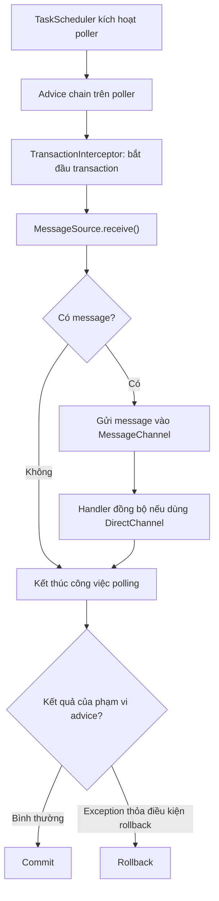

# Transaction advice trên poller trong Spring Integration

## 1. Bài toán: nhận được message nhưng xử lý thất bại

Một ứng dụng định kỳ đọc các bản ghi đơn hàng mới từ database. Poller chọn bản ghi, đánh dấu đang xử lý, tạo `Message` rồi chuyển sang handler lưu kết quả. Giả sử thao tác đầu tiên cập nhật trạng thái bản ghi thành `CLAIMED` thành công, nhưng handler sau đó ném exception. Nếu hai thao tác không thuộc cùng một transaction, bản ghi có thể kẹt ở `CLAIMED` mà không được xử lý xong.

Trong module **SPRING_INTEGRATION_ADAPTERS**, các polling inbound adapter nhận dữ liệu từ bên ngoài (file, SFTP, HTTP, cơ sở dữ liệu...), chuyển thành message và đưa vào `MessageChannel`. Đối với một nguồn database có thể tham gia transaction, **transaction advice trên poller** cho phép mở transaction quanh phần công việc polling được advice bao phủ. Khi lỗi truyền ra khỏi phạm vi đó, transaction manager có thể rollback các thao tác tài nguyên tham gia cùng transaction.

Điều này khác với việc chỉ đặt `@Transactional` ở handler: nếu transaction chỉ bắt đầu ở handler, thao tác claim bản ghi của `MessageSource.receive()` **trước đó** có thể đã nằm ngoài transaction đó.

**Mục tiêu học tập:**

- Phân biệt lịch poll, số message một lượt và transaction boundary.
- Cấu hình `TransactionInterceptor` làm advice cho `@Poller(adviceChain = "...")`.
- Quan sát commit/rollback khi nguồn JDBC và handler đồng bộ cùng dùng một `DataSource`.
- Hiểu điểm cắt transaction bởi `ExecutorChannel`, `QueueChannel`, `taskExecutor` và các lời gọi bất đồng bộ.
- Biết giới hạn của transaction local khi poller thao tác với file, SFTP, HTTP và broker ngoài.
- Thiết kế retry, idempotency, checkpoint, error flow và xử lý bản ghi lỗi lâu dài.

## 2. Transaction advice nằm ở đâu?

Spring Integration sử dụng cơ chế advice (AOP) để bổ sung hành vi quanh công việc của polling endpoint. Khi có transaction advice, phần xử lý được advice bao phủ sẽ thực hiện trong transaction do `PlatformTransactionManager` quản lý.



**Phạm vi transaction phụ thuộc vào vị trí advice và đường thực thi đồng bộ.** Một transaction chỉ bao trùm thao tác sử dụng đúng transaction manager/tài nguyên đã tham gia; nó không tự bao trùm mọi endpoint trong IntegrationFlow hay mọi worker thread của ứng dụng.

Một số thuật ngữ:

| Thành phần | Chức năng |
| --- | --- |
| `TaskScheduler` | Xác định thời điểm chạy lượt polling theo trigger. |
| `TransactionInterceptor` | Advice tạo, tham gia, commit hoặc rollback transaction theo chính sách. |
| `PlatformTransactionManager` | Cung cấp ranh giới transaction với tài nguyên cụ thể, ví dụ JDBC. |
| `MessageSource.receive()` | Lấy dữ liệu từ nguồn và trả `Message<?>` hoặc `null`. |
| `DirectChannel` | Chuyển message đồng bộ; exception handler thường có thể truyền về người gửi. |
| `ExecutorChannel` | Giao downstream cho worker khác; tạo ranh giới bất đồng bộ. |
| `maxMessagesPerPoll` | Giới hạn số message được nhận trong một lượt; không tự quy định commit hay rollback. |

**Quan trọng:** rollback chỉ xảy ra khi transaction advice *nhìn thấy* một lỗi thỏa rollback rule. Nếu handler bắt rồi nuốt exception, hoặc một bước bất đồng bộ báo lỗi sau khi poller đã kết thúc, advice không thể tự biết phải rollback.

## 3. Vì sao chỉ dùng @Transactional ở handler thường chưa đủ?

Xét hai thiết kế:

```text
Thiết kế A — Transaction chỉ ở handler:
Poller -> MessageSource: SELECT + UPDATE state='CLAIMED'
       -> DirectChannel
       -> @Transactional Handler: xử lý DB -> exception

     Handler rollback phần của handler.
     UPDATE trước handler có thể đã commit độc lập.

Thiết kế B — Transaction advice trên poller:
Poller -> [ BEGIN
            MessageSource: SELECT + UPDATE state='CLAIMED'
            DirectChannel -> Handler: UPDATE state='DONE'
            COMMIT hoặc ROLLBACK khi exception
          ]
```

Với thiết kế B, nếu các câu SQL dùng **cùng transaction manager và cùng nguồn dữ liệu có tham gia transaction**, thao tác claim và thao tác hoàn tất có thể được commit hoặc rollback cùng nhau.

Sơ đồ trên chỉ đúng khi handler được gọi **đồng bộ trong phạm vi advice** và exception không bị che mất. Nếu dùng `ExecutorChannel`, transaction của poller không tự theo sang worker xử lý nghiệp vụ.

### @Transactional vẫn hữu ích khi nào?

`@Transactional` ở handler rất hữu ích khi handler là **ranh giới transaction đúng**: ví dụ message đã được nhận từ broker/queue độc lập, handler chỉ cần một transaction DB để ghi các bảng. Vấn đề chỉ xuất hiện khi nghiệp vụ đòi hỏi **bước nhận/claim của nguồn** và **bước xử lý tiếp theo** phải nằm trong cùng phạm vi giao dịch.

## 4. Ví dụ có thể chạy: polling bảng inbox với H2

Bài thực hành giả lập một inbound database adapter bằng `MessageSource<Long>` tự viết, sử dụng `JdbcTemplate`. Đây là cách đơn giản để nhìn thấy transaction advice; khi dùng JDBC inbound adapter có sẵn của Spring Integration, nguyên tắc về advice/transaction vẫn tương tự, nhưng query, checkpoint và contract message phụ thuộc adapter thực tế.

Giả sử bảng `integration_inbox` có ba bản ghi đơn hàng đang chờ. Poller:

1. Tìm bản ghi đầu tiên có trạng thái `NEW`.
2. Cập nhật có điều kiện sang `CLAIMED`.
3. Phát message chứa `id`.
4. Handler trên `DirectChannel` chuyển `CLAIMED` sang `DONE` hoặc ném exception để thử rollback.

Ta đặt `maxMessagesPerPoll = 1` để tập trung vào **một message trong một lượt**, tránh nhầm lẫn transaction với ý niệm batch nhiều message.

### 4.1. Dependencies

Với dự án Spring Boot dùng BOM để quản lý phiên bản, thêm:

```xml
<dependencies>
    <dependency>
        <groupId>org.springframework.boot</groupId>
        <artifactId>spring-boot-starter-integration</artifactId>
    </dependency>
    <dependency>
        <groupId>org.springframework.boot</groupId>
        <artifactId>spring-boot-starter-jdbc</artifactId>
    </dependency>
    <dependency>
        <groupId>com.h2database</groupId>
        <artifactId>h2</artifactId>
        <scope>runtime</scope>
    </dependency>
</dependencies>
```

Ví dụ này dùng `JdbcTemplate` làm nguồn dữ liệu nên chưa cần `spring-integration-jdbc`. Nếu thay bằng adapter JDBC có sẵn, khai báo dependency thích hợp với phiên bản Spring Integration đang sử dụng.

### 4.2. Dữ liệu mẫu

Trong `src/main/resources/schema.sql` của ứng dụng thực hành:

```sql
CREATE TABLE integration_inbox (
    id BIGINT PRIMARY KEY,
    state VARCHAR(16) NOT NULL,
    content VARCHAR(255) NOT NULL
);
```

Trong `src/main/resources/data.sql`:

```sql
INSERT INTO integration_inbox (id, state, content)
VALUES (1, 'NEW', 'order-001');

INSERT INTO integration_inbox (id, state, content)
VALUES (2, 'NEW', 'order-002');

INSERT INTO integration_inbox (id, state, content)
VALUES (3, 'NEW', 'order-003');
```

Để chạy với H2 trong bộ nhớ:

```yaml
# application.yml
spring:
  datasource:
    url: jdbc:h2:mem:integration-poll;DB_CLOSE_DELAY=-1
    username: sa
    password: ""
  sql:
    init:
      mode: always
```

SQL `LIMIT 1` bên dưới tương thích với H2 của ví dụ; khi chuyển sang Oracle, SQL Server hoặc một database khác, cú pháp chọn một dòng và cơ chế khóa/claim cần thay đổi tương ứng.

### 4.3. TransactionInterceptor làm advice

Trong Java configuration:

```java
import org.springframework.context.annotation.Bean;
import org.springframework.transaction.PlatformTransactionManager;
import org.springframework.transaction.TransactionDefinition;
import org.springframework.transaction.interceptor.DefaultTransactionAttribute;
import org.springframework.transaction.interceptor.TransactionInterceptor;

@Bean("inboxTransactionAdvice")
public TransactionInterceptor inboxTransactionAdvice(
        PlatformTransactionManager transactionManager) {

    DefaultTransactionAttribute attributes =
        new DefaultTransactionAttribute();
    attributes.setPropagationBehavior(
        TransactionDefinition.PROPAGATION_REQUIRED
    );

    return new TransactionInterceptor(transactionManager, attributes);
}
```

Đây là **đoạn method** sẽ nằm trong lớp `@Configuration` đầy đủ ở mục tiếp theo. `TransactionInterceptor` triển khai advice có thể được dùng trong `adviceChain` của poller. `PROPAGATION_REQUIRED` tham gia transaction hiện có nếu có, hoặc mở transaction mới trong tình huống thông thường.

Với Spring Boot JDBC và một `DataSource`, framework thường tự cấu hình transaction manager thích hợp. Nếu ứng dụng có nhiều transaction manager, phải chọn đúng bean và bảo đảm `JdbcTemplate` của source và handler dùng datasource phù hợp; đừng phó mặc việc inject khi có nhiều bean cùng kiểu.

### 4.4. Cấu hình Java hoàn chỉnh

```java
import java.util.List;

import org.springframework.context.annotation.Bean;
import org.springframework.context.annotation.Configuration;
import org.springframework.integration.annotation.InboundChannelAdapter;
import org.springframework.integration.annotation.Poller;
import org.springframework.integration.annotation.ServiceActivator;
import org.springframework.integration.channel.DirectChannel;
import org.springframework.integration.config.EnableIntegration;
import org.springframework.integration.core.MessageSource;
import org.springframework.jdbc.core.JdbcTemplate;
import org.springframework.messaging.MessageChannel;
import org.springframework.messaging.support.MessageBuilder;
import org.springframework.transaction.PlatformTransactionManager;
import org.springframework.transaction.TransactionDefinition;
import org.springframework.transaction.interceptor.DefaultTransactionAttribute;
import org.springframework.transaction.interceptor.TransactionInterceptor;

@Configuration
@EnableIntegration
public class TransactionalInboxPollingConfiguration {

    private final JdbcTemplate jdbcTemplate;

    public TransactionalInboxPollingConfiguration(
            JdbcTemplate jdbcTemplate) {
        this.jdbcTemplate = jdbcTemplate;
    }

    @Bean
    public MessageChannel inboxEvents() {
        return new DirectChannel();
    }

    @Bean("inboxTransactionAdvice")
    public TransactionInterceptor inboxTransactionAdvice(
            PlatformTransactionManager transactionManager) {

        DefaultTransactionAttribute attributes =
            new DefaultTransactionAttribute();
        attributes.setPropagationBehavior(
            TransactionDefinition.PROPAGATION_REQUIRED
        );
        return new TransactionInterceptor(transactionManager, attributes);
    }

    @Bean
    @InboundChannelAdapter(
        channel = "inboxEvents",
        poller = @Poller(
            fixedDelay = "2000",
            maxMessagesPerPoll = "1",
            adviceChain = "inboxTransactionAdvice"
        )
    )
    public MessageSource<Long> orderIdSource() {
        return () -> {
            List<Long> ids = jdbcTemplate.query(
                """
                SELECT id
                FROM integration_inbox
                WHERE state = 'NEW'
                ORDER BY id
                LIMIT 1
                """,
                (rs, rowNum) -> rs.getLong("id")
            );

            if (ids.isEmpty()) {
                return null;
            }

            Long id = ids.get(0);
            int claimed = jdbcTemplate.update(
                """
                UPDATE integration_inbox
                SET state = 'CLAIMED'
                WHERE id = ? AND state = 'NEW'
                """,
                id
            );

            // Có thể thua một worker khác khi claim cạnh tranh.
            if (claimed != 1) {
                return null;
            }

            return MessageBuilder.withPayload(id).build();
        };
    }

    @ServiceActivator(inputChannel = "inboxEvents")
    public void processOrder(Long orderId) {
        // Tạo "poison message" để quan sát rollback.
        if (orderId == 2L) {
            throw new IllegalStateException(
                "Simulated failure for order " + orderId
            );
        }

        int updated = jdbcTemplate.update(
            """
            UPDATE integration_inbox
            SET state = 'DONE'
            WHERE id = ? AND state = 'CLAIMED'
            """,
            orderId
        );
        if (updated != 1) {
            throw new IllegalStateException(
                "Unexpected inbox state for order " + orderId
            );
        }

        System.out.println("Completed order " + orderId);
    }
}
```

**Đọc cấu hình:**

- `@InboundChannelAdapter` tạo polling endpoint từ `MessageSource<Long>`; một lời gọi `receive()` đọc và claim một dòng.
- `@Poller(adviceChain = "inboxTransactionAdvice")` gắn transaction advice vào công việc polling.
- `maxMessagesPerPoll = "1"` giới hạn tối đa một message trong mỗi lượt để việc quan sát ranh giới giao dịch rõ ràng.
- `DirectChannel` gọi `processOrder` đồng bộ trên đường gửi message của poller.
- Source và handler dùng cùng `JdbcTemplate`/`DataSource`, do đó thao tác JDBC có thể cùng tham gia transaction do advice quản lý.
- `fixedDelay = "2000"` lên lịch lượt sau khi lượt trước hoàn tất và trải qua khoảng nghỉ cấu hình; đây **không** phải timeout của transaction.

Java text block (`"""`) cần phiên bản Java hỗ trợ tính năng này, ví dụ Java 17. Nếu chương trình dùng Java cũ, thay text block bằng chuỗi SQL thông thường.

### 4.5. Quan sát commit và rollback

Với ba dòng dữ liệu mẫu và một endpoint chạy tuần tự:

| Lượt | Bản ghi được chọn | Kết quả nghiệp vụ | Trạng thái sau transaction |
| --- | --- | --- | --- |
| 1 | `id = 1` | Handler cập nhật `DONE` thành công | `id=1` ở `DONE` sau commit |
| 2 | `id = 2` | Handler cố ý ném exception | Cập nhật `CLAIMED` được rollback, `id=2` trở lại `NEW` |
| 3... | `id = 2` | Tiếp tục thất bại trong ví dụ | `id=2` tiếp tục ở `NEW`; `id=3` có thể bị đói công việc |

Bạn có thể truy vấn:

```sql
SELECT id, state
FROM integration_inbox
ORDER BY id;
```

**Hai kết luận quan trọng:** rollback giúp không để một dòng mắc kẹt ở `CLAIMED` khi lỗi đồng bộ, nhưng **không làm dữ liệu sai tự được sửa**. Ví dụ cố ý tạo một bản ghi lỗi vĩnh viễn khiến các dòng phía sau có thể không được chọn. Production cần giới hạn retry, chuyển sang `FAILED` hoặc quarantine, và chính sách không để một bản ghi lỗi chặn cả hàng đợi.

Ví dụ chỉ minh họa transaction local với DB; câu `SELECT ... LIMIT 1` chưa phải giải pháp claim cạnh tranh đầy đủ cho nhiều replica. Cần khóa, optimistic claim, `SKIP LOCKED` (nếu DB hỗ trợ) hoặc một cơ chế claim/lease được thiết kế có chủ đích.

## 5. Java DSL và thứ tự advice

Trong Java DSL, poller có thể khai báo transaction theo API tương ứng của phiên bản Spring Integration:

```java
import java.time.Duration;
import org.springframework.integration.dsl.IntegrationFlow;
import org.springframework.integration.dsl.Pollers;
import org.springframework.transaction.PlatformTransactionManager;

// Minh họa: message source đã được khai báo nơi khác.
@Bean
IntegrationFlow transactionalInboxFlow(
        MessageSource<Long> orderIdSource,
        PlatformTransactionManager transactionManager) {
    return IntegrationFlow
        .from(
            orderIdSource,
            endpoint -> endpoint.poller(
                Pollers.fixedDelay(Duration.ofSeconds(2))
                       .maxMessagesPerPoll(1)
                       .transactional(transactionManager)
            )
        )
        .channel("inboxEvents")
        .get();
}
```

Đây là **một lựa chọn thay thế** cách khai báo endpoint bằng `@InboundChannelAdapter`, không được bật cả hai cho cùng source trong ứng dụng ví dụ. Khi cấu hình DSL riêng, cần có `MessageSource`, channel và handler tương ứng; đoạn code cố ý chỉ minh họa phần poller transaction để không lặp toàn bộ ví dụ.

Một poller có thể có nhiều advice như transaction, retry hoặc logic theo dõi. **Thứ tự advice rất quan trọng**: transaction bao trùm một retry hay mỗi lần retry nằm trong một transaction khác nhau là hai hành vi khác nhau. Đối với lỗi có thể retry, hãy quy định rõ mong muốn rollback/commit của từng lần thử và kiểm thử thực tế bằng dữ liệu có trạng thái.

Không dùng cả `@Transactional`, một `TransactionInterceptor` trên poller và retry advice theo kiểu tùy tiện mà chưa xác định propagation và thứ tự; nhiều advice có thể dẫn tới transaction lồng nhau hoặc các ranh giới khác kỳ vọng.

## 6. maxMessagesPerPoll có quyết định transaction boundary không?

**Không.** `maxMessagesPerPoll` giới hạn số message một lượt polling, không tự xác định rollback rule hay số transaction. Phạm vi chính xác của transaction phụ thuộc cấu hình advice, cách endpoint thực thi thao tác nhận/gửi và phiên bản triển khai.

Trong ví dụ, `maxMessagesPerPoll = 1` và `DirectChannel` đồng bộ giúp nhìn rõ một giao dịch quanh việc claim và xử lý một message.

Nếu đổi thành `maxMessagesPerPoll = 10`, không được tự suy diễn:

- Mười message chắc chắn tạo thành một transaction batch duy nhất.
- Mỗi message chắc chắn có một transaction riêng.
- Một message lỗi tự rollback mọi message đã xử lý trước đó.

Muốn bảo đảm **batch atomicity**, hãy định nghĩa rõ ranh giới transaction/batch tại tầng nghiệp vụ hoặc adapter tương ứng, xác minh cách advice được gọi và tạo bài kiểm thử rollback nhiều message. Nếu yêu cầu chỉ cần mỗi đơn hàng commit riêng, xử lý từng message trong transaction riêng có thể an toàn hơn một giao dịch rất dài.

## 7. Ranh giới đồng bộ và bất đồng bộ

### 7.1. DirectChannel giữ được call stack đồng bộ

```text
Poller transaction advice: BEGIN
  Source.receive()  -> DB UPDATE state='CLAIMED'
  DirectChannel.send(message)
    Handler            -> DB UPDATE state='DONE'
Poller transaction advice: COMMIT hoặc ROLLBACK
```

Khi handler dùng cùng nguồn JDBC, và exception truyền về trong cùng thread, transaction advice có cơ hội nhìn thấy lỗi và rollback.

### 7.2. ExecutorChannel tách công việc sang thread khác

```text
Poller thread                     Executor worker
-------------------------------   ----------------------------
BEGIN
Source.receive()
ExecutorChannel.send()
COMMIT                            Handler xử lý sau khi nhận
                                  Handler lỗi/rollback riêng
```

Một `ExecutorChannel` có thể trả về sau khi message đã được giao vào executor, trước khi handler hoàn tất. Spring transaction thông thường gắn với thread nên **transaction của poller không tự xuyên sang worker**. Khi worker lỗi sau đó, poller có thể đã commit việc claim dữ liệu.

Giải pháp tùy bài toán:

- Giữ thao tác cần cùng transaction trên một đường xử lý đồng bộ, nếu có thể.
- Nếu cần worker riêng, thiết kế **claim/lease + ack/checkpoint** hoặc transactional outbox/inbox để xử lý theo ít nhất một lần và chống trùng.
- Mở transaction riêng tại handler/worker và xác định khi nào trạng thái nhận dữ liệu được xác nhận.
- Dùng retry queue hoặc durable broker khi cần sống sót qua restart, thay vì dựa vào queue RAM.

### 7.3. QueueChannel không tự là một phần của DB transaction

`QueueChannel` thông thường lưu message trong bộ nhớ. Một lời gọi `send()` vào channel này không nhất thiết tham gia transaction JDBC và không được rollback chỉ vì database rollback. Với polling consumer đọc queue, cần xem channel implementation, transaction synchronization và ranh giới xử lý riêng.

Không hiểu “cả hai đều nằm trong Spring Integration” là đủ để có một transaction phân tán.

### 7.4. taskExecutor trên poller

`taskExecutor` trên poller giao công việc polling sang worker. Transaction advice chỉ bao phủ các thao tác **được thực thi bên trong phạm vi advice trên worker phù hợp**, không tự mang transaction từ thread scheduler sang thread khác.

Tăng số worker còn có thể khiến nhiều lượt đồng thời claim dữ liệu. Cần bảo đảm transaction isolation, locking/claim và thread safety của `MessageSource`. Nếu executor quá tải hoặc từ chối tác vụ, có thể xảy ra lượt poll bị bỏ lỡ dù chưa có thao tác database nào được mở.

## 8. Transaction local không rollback được file, SFTP hoặc HTTP

Một transaction manager cho JDBC chỉ quản lý tài nguyên JDBC tham gia giao dịch. Nó **không tự đảo ngược** các side effect ở hệ thống ngoài.

| Tình huống | Có thể rollback cùng transaction JDBC? | Ghi chú |
| --- | --- | --- |
| Hai câu `JdbcTemplate.update(...)` cùng datasource, cùng thread và transaction | Có, nếu DB hỗ trợ và không có commit độc lập | Phù hợp để minh họa poller advice. |
| Đọc file local | Không “trả lại” hành vi đọc file theo nghĩa giao dịch DB | Filter có thể đã đánh dấu file đã nhận. |
| Xóa hoặc di chuyển file | Không tự undo bởi JDBC rollback | Cần quy trình archive/quarantine/phục hồi riêng. |
| Download/rename file SFTP | Không tự đảo ngược bởi transaction local | Theo dõi trạng thái từ xa và metadata bền vững. |
| HTTP POST gửi sang hệ thống đối tác | Không tự hủy request đã thành công | Sử dụng idempotency key, outbox hoặc compensation tùy contract. |
| Publish message lên broker ngoài | Không mặc nhiên tham gia transaction JDBC | Cần xem hỗ trợ transaction/ack của broker, outbox hoặc giải pháp phối hợp giao dịch. |

**Ví dụ rủi ro:** poller đọc file và handler gọi API đối tác thành công, sau đó một câu SQL lỗi khiến transaction JDBC rollback. API đối tác vẫn có thể đã tạo đơn hàng. Khi ứng dụng retry, nếu API không hỗ trợ idempotency, đơn hàng có thể được tạo lần hai.

Do đó, khi tích hợp file, SFTP, HTTP, JMS, AMQP hoặc Kafka, hãy phân biệt **transaction local** với các bảo đảm của giao thức ngoài. Các hệ thống muốn phối hợp transaction nhiều tài nguyên phải có mô hình rõ ràng; không nên mặc định transaction advice trên poller tạo XA hay exactly-once end-to-end.

## 9. Retry, error-channel và poison messages

### 9.1. Một exception không tự quyết định retry

`TransactionInterceptor` quyết định commit/rollback theo kết quả và rollback rule; nó không phải một bộ retry tự động. Với một exception ném từ handler đồng bộ, transaction có thể rollback, nhưng lượt poll kế tiếp có chọn lại message hay không còn phụ thuộc trạng thái nguồn.

- Với **JDBC source** trong bài, rollback trả trạng thái `CLAIMED` về `NEW`, nên bản ghi có thể được thấy lại.
- Với **FileReadingMessageSource` + accept-once filter**, bộ lọc có thể đã nhớ file ngay cả khi DB rollback; file không tự được phát lại.
- Với nguồn **SFTP/JMS/AMQP/Kafka**, cơ chế trả lại hoặc redelivery phụ thuộc adapter, ack, session, transaction và broker.

### 9.2. Error channel ghi nhận, không thay thế rollback

Một polling endpoint có thể công bố exception qua error channel, nhưng cần xác định **lỗi đã đi qua transaction advice chưa**, transaction đã rollback/commit thế nào và error handler có ném exception tiếp hay không.

```text
Poller work -> exception
    |
    v
Transaction advice quan sát lỗi
    |
    +--> rollback theo rule
    |
    v
Polling error handling
    |
    v
ErrorMessage -> error channel -> log / alert / retry workflow
```

Đây là sơ đồ luồng logic; vị trí thực tế của error handling và advice tùy cấu hình. Không được đưa việc “error channel đã nhận message” thành bằng chứng chắc chắn mọi resource đã rollback. **Thử nghiệm rollback bằng cách đọc trạng thái DB hoặc nguồn sau lỗi.**

### 9.3. Poison message và starvation

Trong ví dụ ở mục 4, `id=2` luôn ném exception. Transaction rollback đúng, nhưng vì source tiếp tục chọn dòng `NEW` có `id` nhỏ nhất, `id=3` có thể không bao giờ được xử lý.

Một hệ thống đáng tin cậy cần:

1. Giới hạn số lần thử và lưu `attemptCount` hoặc trạng thái lỗi ở nơi bền vững.
2. Áp dụng backoff và thời điểm `nextAttemptAt` cho lỗi tạm thời.
3. Chuyển lỗi dữ liệu cố định sang `FAILED` hoặc quarantine mà không làm chặn mọi bản ghi khác.
4. Giữ idempotency key để xử lý lại mà không tạo kết quả trùng.
5. Cho phép quản trị viên xem, sửa dữ liệu hoặc phát lại có kiểm soát.

Nếu update `attemptCount` trong cùng transaction rồi luôn rollback, bộ đếm đó cũng rollback. Vì vậy **metadata retry phải được ghi theo ranh giới giao dịch thích hợp** (ví dụ giao dịch quản lý lỗi riêng), không chỉ thêm một cột rồi hy vọng số lần thử luôn tăng.

## 10. Transaction isolation và xử lý nhiều instance

Đặt transaction advice không tự giải quyết cạnh tranh giữa nhiều poller/replica. Hai worker có thể cùng đọc một ứng viên `NEW` trước khi một worker claim thành công.

Trong mã ví dụ, `UPDATE ... WHERE state = 'NEW'` là phép claim có điều kiện. Chỉ một worker có thể cập nhật thành công với cùng một dòng trong các điều kiện isolation phù hợp, nhưng worker còn lại có thể nhận 0 dòng được cập nhật, phải thử lại ở lượt sau. **Nó chưa tối ưu hóa việc bỏ qua dòng đang bị khóa** và có thể gặp lock wait/deadlock hoặc starvation khi tải cao.

Với production, cần cân nhắc:

- Cơ chế đọc và claim nguyên tử, row lock hoặc `SELECT ... FOR UPDATE SKIP LOCKED` nếu database hỗ trợ.
- Transaction isolation, deadlock timeout và thứ tự khóa.
- Lease/visibility timeout khi công việc kéo dài hoặc chuyển xử lý sang worker bất đồng bộ.
- Khóa idempotency ở bảng kết quả để tránh ghi trùng khi retry.
- Phân vùng, consumer group hay single-active worker cho nguồn không phù hợp xử lý đồng thời.

**Không sử dụng transaction database kéo dài qua HTTP/SFTP call chậm nếu không có lý do rất mạnh.** Transaction dài giữ connection và có thể giữ lock, gây nghẽn các endpoint khác. Trong nhiều bài toán, transactional outbox/inbox và xử lý bất đồng bộ theo trạng thái bền vững hiệu quả hơn transaction ôm toàn bộ luồng ngoài.

## 11. Theo dõi và chẩn đoán

| Chỉ số hoặc dấu hiệu | Câu hỏi cần trả lời |
| --- | --- |
| Số lượt poll, số message nhận và thời gian mỗi lượt | Poller có đang chạy quá lâu hoặc bỏ lỡ lịch? |
| Số transaction commit / rollback | Lỗi là bình thường hay đang tạo vòng rollback liên tục? |
| Thời gian giữ connection và database lock | Transaction có làm nghẽn pool hoặc các truy vấn khác? |
| Số lần claim thất bại vì cạnh tranh | Có nhiều worker/replica cùng chọn một bản ghi không? |
| Trạng thái `NEW/CLAIMED/DONE/FAILED` | Có bản ghi kẹt giữa các bước không? |
| Retry count, độ trễ backoff và tuổi bản ghi cũ nhất | Một poison message có gây starvation không? |
| Lỗi từ error channel và downstream async | Error handler có nhận được lỗi ở đúng ranh giới không? |
| Số lần xử lý trùng và vi phạm unique constraint | Idempotency có thực sự bảo vệ kết quả nghiệp vụ? |

**Tình huống: trạng thái vẫn ở CLAIMED sau exception.** Kiểm tra transaction advice đã được gắn đúng endpoint chưa, thao tác claim có đang dùng cùng datasource/transaction manager không, và có ranh giới async hoặc commit riêng trước khi handler lỗi không. Cũng cần kiểm tra exception có bị catch/nuốt trước khi ra khỏi advice.

**Tình huống: bản ghi lỗi cứ xuất hiện lại.** Rollback có thể hoạt động đúng; cần retry budget/quarantine thay vì tắt transaction để “đỡ lỗi”.

**Tình huống: handler async lỗi nhưng source đã claim xong.** Poller transaction có thể đã commit; cần transaction/checkpoint ở worker và cơ chế recovery dữ liệu đang `CLAIMED`.

**Tình huống: file bị mất khỏi luồng dù DB rollback.** Kiểm tra accept-once filter và chính sách archive/quarantine; rollback JDBC không trả lại bộ lọc file hoặc thao tác file đã xảy ra.

## 12. Bài tập có đáp án

**Bài 1 — Lỗi handler đồng bộ.** Poller advice mở transaction JDBC, source chuyển `NEW → CLAIMED`, handler qua `DirectChannel` ném `RuntimeException`. Nếu cả hai dùng cùng transaction manager và exception truyền ra advice, trạng thái sau rollback là gì?

**Đáp án:** Thao tác claim bị rollback, nên dòng quay về `NEW` (giả định không có transaction độc lập và rollback rule mặc định áp dụng).

**Bài 2 — Handler @Transactional.** Nếu chỉ handler có `@Transactional`, còn source đã update `CLAIMED` và tự commit trước khi gửi message, rollback của handler có đảo ngược claim không?

**Đáp án:** Không. Transaction được mở trong handler không thể rollback một thao tác đã commit trước đó.

**Bài 3 — ExecutorChannel.** Poller transaction commit sau khi `ExecutorChannel.send()` nhận message; worker xử lý sau và thất bại. Lỗi đó có tự rollback claim của poller không?

**Đáp án:** Không. Handler bất đồng bộ chạy ngoài transaction/thread trước đó; cần transaction và recovery độc lập.

**Bài 4 — Năm message một lượt.** Đặt `maxMessagesPerPoll = 5` có đủ để bảo đảm cả năm message được commit/rollback như một batch nguyên tử không?

**Đáp án:** Không. Giới hạn này chỉ điều khiển số message; phải xác định và kiểm chứng phạm vi advice và transaction riêng.

**Bài 5 — File source.** Poller có transaction JDBC nhưng đã đổi tên file trên SFTP, sau đó DB lỗi. SFTP rename có tự quay về tên cũ không?

**Đáp án:** Không. Transaction JDBC không tự đảo ngược side effect của giao thức SFTP.

**Bài 6 — Nuốt exception.** Handler catch mọi exception, log rồi trả thành công. TransactionInterceptor có mặc nhiên rollback không?

**Đáp án:** Không. Nếu exception không thoát ra và transaction không bị đánh dấu rollback-only, advice có thể coi công việc là thành công và commit.

**Bài 7 — Retry vô hạn.** Bản ghi `id=2` luôn sai dữ liệu và được chọn đầu tiên sau rollback. Điều gì có thể xảy ra với `id=3`?

**Đáp án:** `id=3` có thể bị starvation. Cần giới hạn retry và chuyển bản ghi lỗi sang trạng thái riêng hoặc trì hoãn retry.

**Bài 8 — Nhiều replica.** Hai instance cùng chọn dòng `NEW`. Transaction advice tự bảo đảm chỉ một instance xử lý không?

**Đáp án:** Không. Phải có cơ chế claim/lock hoặc phân vùng an toàn, transaction isolation và idempotency.

**Bài 9 — Error channel.** Error handler nhận được `ErrorMessage`. Có thể khẳng định mọi tác động lên hệ thống ngoài đã rollback không?

**Đáp án:** Không. Error message cho biết có lỗi được công bố; rollback phụ thuộc transaction advice, tài nguyên tham gia và ranh giới đồng bộ.

**Bài 10 — Đếm retry.** Nếu bộ đếm attempts được tăng trong transaction mà luôn rollback khi xử lý thất bại, attempts có luôn tăng qua các lượt không?

**Đáp án:** Không. Việc tăng attempts cũng có thể bị rollback; trạng thái retry cần ghi bằng cơ chế transaction phù hợp.

## 13. Ghi nhớ

**Transaction advice trên poller tạo ranh giới giao dịch quanh công việc polling được advice bao phủ**, đặc biệt hữu ích khi `MessageSource.receive()` và handler đồng bộ cùng thao tác với một database. Với `@Poller(adviceChain = "inboxTransactionAdvice")`, `TransactionInterceptor` và `PlatformTransactionManager` có thể phối hợp commit/rollback khi exception truyền ra khỏi phạm vi advice. Nhưng `maxMessagesPerPoll` không tự quy định transaction boundary; `ExecutorChannel`, queue bất đồng bộ và tài nguyên ngoài như file, SFTP, HTTP hoặc broker không mặc nhiên tham gia cùng giao dịch JDBC. Muốn luồng nhận dữ liệu đáng tin cậy, phải kết hợp transaction với claim an toàn, retry/backoff, error handling, checkpoint, idempotency và khả năng phục hồi sau restart.
