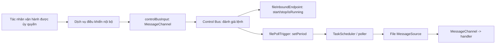

# Thay đổi poller động bằng Control Bus trong Spring Integration

## 1. Bài toán: điều chỉnh lịch lấy dữ liệu mà không khởi động lại ứng dụng

Một ứng dụng Spring Integration kiểm tra thư mục đơn hàng của đối tác mỗi 5 giây. Vào giờ cao điểm, dữ liệu tới liên tục và cần lấy nhanh hơn; trong lúc bảo trì, đội vận hành muốn **tạm dừng** việc nhận file nhưng vẫn giữ ứng dụng hoạt động. Sau khi hệ thống đối tác ổn định, họ muốn **chạy lại** polling và có thể chuyển khoảng cách giữa các lượt sang 15 giây. Nếu mọi thay đổi đều buộc sửa `application.yml` rồi restart, thao tác vận hành sẽ chậm và dễ làm gián đoạn những luồng tích hợp khác.

Trong module **SPRING_INTEGRATION_ADAPTERS**, polling inbound adapter dùng `MessageSource` để đọc dữ liệu từ file, SFTP, database hoặc hệ thống ngoài, tạo `Message` rồi gửi qua `MessageChannel`. **Poller** quyết định thời điểm gọi `receive()`. Spring Integration có **Control Bus** để gửi các lệnh điều khiển tới những bean/endpoint trong application context; khi kết hợp với một **trigger có thể thay đổi động**, ta có thể điều chỉnh trạng thái hoặc nhịp polling khi ứng dụng vẫn đang chạy.

Bài học tập trung vào hai thao tác **khác nhau**:

1. **Quản lý vòng đời**: dừng, chạy lại hoặc truy vấn trạng thái của polling endpoint thông qua Control Bus.
2. **Thay đổi lịch**: cập nhật chu kỳ của một trigger có hỗ trợ thay đổi khi chạy, chẳng hạn `DynamicPeriodicTrigger`. Control Bus là đường **gửi lệnh**; trigger mới là thành phần **lưu và áp dụng khoảng thời gian**.

Sau bài này, bạn có thể thiết lập một luồng inbound adapter dùng trigger động, gửi lệnh Control Bus, giải thích hiệu lực của thay đổi đối với các tác vụ đã được lên lịch, và vận hành an toàn với xác thực, audit log, retry, idempotency và nhiều instance.

## 2. Control Bus trong Spring Integration là gì?

**Control Bus** là một endpoint nhận các message chứa **biểu thức điều khiển**, thường sử dụng Spring Expression Language (SpEL). Thay vì chỉ mang dữ liệu nghiệp vụ, message được Control Bus đánh giá để gọi thao tác trên một bean được quản lý bởi Spring.

Ví dụ về ý định điều khiển:

```text
@fileInboundEndpoint.stop()
@fileInboundEndpoint.start()
@fileInboundEndpoint.isRunning()
@filePollTrigger.setPeriod(15000)
```

Trong các biểu thức này:

- `@fileInboundEndpoint` là tham chiếu đến **bean endpoint** có ID tương ứng trong application context.
- `stop()`, `start()` và `isRunning()` là các thao tác vòng đời/trạng thái khi endpoint hỗ trợ.
- `@filePollTrigger` là bean trigger có khả năng điều chỉnh lịch; `setPeriod(15000)` yêu cầu đổi chu kỳ thành **15.000 mili giây** trong cấu hình mẫu.
- Việc một biểu thức có thực thi được hay không phụ thuộc vào bean, kiểu phương thức, cấu hình Control Bus, phiên bản framework và chính sách truy cập biểu thức.

Control Bus **không phải** một REST API quản trị công khai mặc định. Nó là một **message endpoint nằm trong application context**. Nếu muốn điều khiển từ hệ thống quản trị bên ngoài, cần xây thêm tầng giao tiếp có xác thực và giới hạn lệnh rõ ràng.

### Vị trí Control Bus trong kiến trúc



**Tầng điều khiển** và **tầng dữ liệu nghiệp vụ** được tách nhau. Lệnh `stop()` không phải message đơn hàng; message đơn hàng không nên được gửi vào channel điều khiển.

## 3. Hai dạng thay đổi: lifecycle và lịch polling

| Nhu cầu | Thao tác tiêu biểu | Điều gì thực sự thay đổi? |
| --- | --- | --- |
| Tạm ngừng quét nguồn | `@fileInboundEndpoint.stop()` | Trạng thái hoạt động/lịch thực thi của endpoint. |
| Tiếp tục quét | `@fileInboundEndpoint.start()` | Endpoint được khởi động/lên lịch lại theo trigger của nó. |
| Hỏi trạng thái | `@fileInboundEndpoint.isRunning()` | Trả thông tin trạng thái lifecycle, không phải trạng thái xử lý toàn bộ message. |
| Giảm tần suất từ 5s xuống 15s | `@filePollTrigger.setPeriod(15000)` | Giá trị chu kỳ của **trigger động**. |
| Chỉ muốn đổi `@Poller(fixedDelay = "5000")` | Không có phép đổi tự động chỉ vì đã có Control Bus | Cấu hình hằng số thường cần thay bằng trigger hỗ trợ cập nhật hoặc cơ chế cấu hình endpoint khác. |

Control Bus không tự biến mọi `PeriodicTrigger` hay chuỗi cấu hình `fixedDelay` thành thuộc tính có thể thay đổi động. Nếu nhu cầu là đổi chu kỳ khi chạy, cần **thiết kế trước một trigger động** hoặc một giải pháp điều phối phù hợp.

**Điểm dễ hiểu sai:** thay đổi chu kỳ không phải là tạo thêm một poller mới. Trong một ứng dụng đang chạy, nên **duy trì một polling endpoint** cho một luồng nguồn đã xác định, rồi đổi trạng thái hoặc trigger được endpoint đó sử dụng. Tạo nhiều endpoint cùng quét thư mục/SFTP/database mà không có cơ chế claim có thể dẫn đến xử lý trùng.

## 4. DynamicPeriodicTrigger: phần tạo ra lịch có thể đổi

Spring Integration có thành phần `DynamicPeriodicTrigger`, cho phép cập nhật chu kỳ khi ứng dụng hoạt động. Với trigger này, `period` là thời lượng giữa các mốc được tính theo kiểu fixed-delay hoặc fixed-rate mà trigger được cấu hình.

Ví dụ tạo bean:

```java
import org.springframework.context.annotation.Bean;
import org.springframework.integration.util.DynamicPeriodicTrigger;

@Bean("filePollTrigger")
public DynamicPeriodicTrigger filePollTrigger() {
    DynamicPeriodicTrigger trigger = new DynamicPeriodicTrigger(5000);
    trigger.setFixedRate(false); // Minh họa kiểu fixed-delay.
    return trigger;
}
```

Đoạn trên được đặt trong lớp `@Configuration`. Giá trị khởi tạo `5000` có ý nghĩa **5 giây** đối với cấu hình thời gian mẫu. Trước khi đổi thời gian, cần chắc chắn phiên bản đang sử dụng có phương thức và đơn vị đo tương ứng; việc truyền nhầm giây thành mili giây có thể làm hệ thống gọi nguồn quá dày.

Khi gọi:

```text
@filePollTrigger.setPeriod(15000)
```

trigger được yêu cầu đổi chu kỳ thành **15 giây**. Tuy nhiên:

- **Không nhất thiết dời ngay** một tác vụ đã được scheduler tính và xếp lịch từ trước. Giá trị mới thường có tác dụng khi trigger được hỏi để tính lần thực thi tiếp theo.
- Nếu một lượt polling đang chạy, phương thức `setPeriod` **không hủy ngang** lượt đó.
- Nếu poller đang dừng, thay đổi trigger **không đồng nghĩa tự gọi `start()`**; lịch mới sẽ được sử dụng khi endpoint hoạt động/lên lịch trở lại.
- Nếu ứng dụng restart, bean trigger thường được tạo lại với giá trị ban đầu, trừ khi có cơ chế lưu và nạp cấu hình động.

### Fixed-delay và fixed-rate sau khi đổi

Giả sử một lượt kết thúc tại giây 10 và trigger đang chạy fixed-delay:

```text
Ban đầu: period = 5 giây
10s: lượt kết thúc
15s: lượt kế tiếp dự kiến

Điều chỉnh: period = 15 giây
10s: lượt kết thúc và trigger tính lịch với giá trị mới
25s: lượt kế tiếp dự kiến
```

Đây là phép tính **minh họa**, với giả định lệnh thay đổi được áp dụng **trước khi scheduler tính mốc tiếp theo**. Nếu mốc 15 giây đã được tính và đặt vào lịch trước lúc phát lệnh, không được coi việc đổi `period` là bảo đảm hủy mốc đó tức thì.

Với fixed-rate, các mốc dự kiến dựa trên nhịp định kỳ; khi một lượt xử lý quá lâu, các mốc có thể bị trễ. Đổi chu kỳ không thay thế khả năng giới hạn concurrent tasks, timeout hoặc backpressure.

## 5. Ví dụ hoàn chỉnh: đổi poller đọc file qua Control Bus

### 5.1. Kịch bản

Ứng dụng đọc các file `*.csv` trong thư mục `data/inbox`, mỗi lượt nhận tối đa 5 file. Ban đầu trigger dùng fixed-delay **5 giây**; người vận hành có thể dừng endpoint, chạy lại hoặc đổi chu kỳ thành **15 giây** mà không phải khởi động lại toàn bộ ứng dụng.

Ta dùng:

- Spring Integration File inbound adapter.
- Java DSL để gán **ID rõ ràng** cho polling endpoint.
- Bean `DynamicPeriodicTrigger` có tên `filePollTrigger`.
- Một `DirectChannel` chỉ dùng để đưa **lệnh nội bộ** vào Control Bus.

### 5.2. Dependencies

Với dự án Spring Boot dùng BOM quản lý phiên bản:

```xml
<dependencies>
    <dependency>
        <groupId>org.springframework.boot</groupId>
        <artifactId>spring-boot-starter-integration</artifactId>
    </dependency>
    <dependency>
        <groupId>org.springframework.integration</groupId>
        <artifactId>spring-integration-file</artifactId>
    </dependency>
</dependencies>
```

Tạo sẵn `data/inbox` theo working directory của ứng dụng. Các file thử nghiệm chỉ nên có nội dung CSV không nhạy cảm.

### 5.3. Cấu hình polling endpoint và Control Bus

```java
import java.io.File;

import org.springframework.context.annotation.Bean;
import org.springframework.context.annotation.Configuration;
import org.springframework.integration.channel.DirectChannel;
import org.springframework.integration.config.EnableIntegration;
import org.springframework.integration.dsl.IntegrationFlow;
import org.springframework.integration.dsl.Pollers;
import org.springframework.integration.file.dsl.Files;
import org.springframework.integration.util.DynamicPeriodicTrigger;
import org.springframework.messaging.MessageChannel;

@Configuration
@EnableIntegration
public class DynamicFilePollingConfiguration {

    @Bean("filePollTrigger")
    public DynamicPeriodicTrigger filePollTrigger() {
        DynamicPeriodicTrigger trigger = new DynamicPeriodicTrigger(5000);
        trigger.setFixedRate(false);
        return trigger;
    }

    @Bean
    public IntegrationFlow inboundCsvFlow(
            DynamicPeriodicTrigger filePollTrigger) {

        return IntegrationFlow
            .from(
                Files.inboundAdapter(new File("data/inbox"))
                     .patternFilter("*.csv"),
                endpoint -> endpoint
                    .id("fileInboundEndpoint")
                    .poller(
                        Pollers.trigger(filePollTrigger)
                               .maxMessagesPerPoll(5)
                    )
            )
            .handle(message -> {
                File file = (File) message.getPayload();
                System.out.printf(
                    "Processed by %s: %s%n",
                    Thread.currentThread().getName(),
                    file.getName()
                );
                // TODO: validate, persist, archive và xử lý lỗi.
            })
            .get();
    }

    @Bean
    public MessageChannel controlBusInput() {
        return new DirectChannel();
    }

    @Bean
    public IntegrationFlow controlBusFlow() {
        return IntegrationFlow
            .from("controlBusInput")
            .controlBus()
            .get();
    }
}
```

**Giải thích:**

1. `filePollTrigger` là bean trigger có thể điều chỉnh, ban đầu với khoảng cách 5.000 ms giữa những lượt phù hợp.
2. `Files.inboundAdapter(...)` tạo nguồn phát message từ file. `patternFilter("*.csv")` chỉ chọn file phù hợp.
3. `endpoint.id("fileInboundEndpoint")` gán **ID endpoint** để Control Bus có thể tham chiếu. Cần phân biệt ID endpoint này với tên bean `inboundCsvFlow` chứa IntegrationFlow.
4. `Pollers.trigger(filePollTrigger)` đưa trigger động vào poller; `maxMessagesPerPoll(5)` giới hạn số file/message mỗi lượt, không phải số lượng xử lý đồng thời.
5. `.handle(...)` là handler đồng bộ trong ví dụ; thời lượng xử lý có thể ảnh hưởng thời điểm lượt fixed-delay hoàn tất.
6. `controlBusInput` là channel cho lệnh điều khiển; `.controlBus()` là endpoint đánh giá các lệnh phù hợp trong application context.

**Không tạo thêm một adapter tương tự** với `@InboundChannelAdapter` cho cùng thư mục khi đang chạy ví dụ DSL này: hai polling endpoint cùng đọc một nguồn có thể tạo cạnh tranh, trùng hoặc thay đổi thứ tự file.

### 5.4. Gửi lệnh từ một dịch vụ quản trị nội bộ

Ví dụ một lớp service chỉ gửi các **lệnh cố định, đã được cho phép**; không nhận một chuỗi SpEL tùy ý từ người dùng bên ngoài:

```java
import org.springframework.beans.factory.annotation.Qualifier;
import org.springframework.messaging.MessageChannel;
import org.springframework.messaging.support.MessageBuilder;
import org.springframework.stereotype.Service;

@Service
public class FilePollerControlService {

    private final MessageChannel controlBusInput;

    public FilePollerControlService(
            @Qualifier("controlBusInput") MessageChannel controlBusInput) {
        this.controlBusInput = controlBusInput;
    }

    public void pause() {
        sendCommand("@fileInboundEndpoint.stop()");
    }

    public void resume() {
        sendCommand("@fileInboundEndpoint.start()");
    }

    public void changePeriodTo15Seconds() {
        sendCommand("@filePollTrigger.setPeriod(15000)");
    }

    private void sendCommand(String expression) {
        boolean accepted = controlBusInput.send(
            MessageBuilder.withPayload(expression).build()
        );
        if (!accepted) {
            throw new IllegalStateException(
                "Control Bus did not accept the command"
            );
        }
    }
}
```

Phương thức `pause()`, `resume()` và `changePeriodTo15Seconds()` chỉ nên được gọi bởi **tầng vận hành đã xác thực, phân quyền và ghi audit log**. Ví dụ cố tình không có REST controller. Không public trực tiếp một endpoint nhận mọi chuỗi SpEL rồi chuyển nguyên vẹn vào Control Bus.

Kết quả `send()` thành công chỉ xác nhận quá trình giao message theo hợp đồng channel tương ứng; để biết endpoint **thực sự đã dừng/chạy và đang dùng period nào**, nên truy vấn trạng thái bean, kiểm tra metric và quan sát lịch thực thi. Trường hợp endpoint điều khiển dùng `DirectChannel`, lỗi đánh giá biểu thức có thể truyền đồng bộ về phía gửi; cần log và xử lý có kiểm soát.

### 5.5. Truy vấn trạng thái qua Control Bus

Các biểu thức đọc trạng thái thường có dạng:

```text
@fileInboundEndpoint.isRunning()
@filePollTrigger.getPeriod()
```

Nếu muốn nhận **giá trị trả về** từ Control Bus, sử dụng tương tác request-reply có `replyChannel` hoặc một `MessagingTemplate` với reply timeout phù hợp, thay vì chỉ gửi message một chiều rồi suy luận từ boolean của `send()`. Kiểu giá trị trả về và khả năng đánh giá phương thức phụ thuộc bean/phiên bản Spring Integration. Có thể đồng thời đọc metric endpoint và dùng một service quản trị được giới hạn quyền để xác minh kết quả.

## 6. Kịch bản vận hành theo mốc thời gian

Giả sử application context khởi động lúc 10:00:00 và trigger ban đầu là fixed-delay 5 giây. Bỏ qua thời gian khởi tạo, scheduler jitter và thời gian đọc file:

| Thời điểm | Hành động | Kỳ vọng |
| --- | --- | --- |
| 10:00 | Endpoint đã chạy với period 5 giây | Poller được lập lịch theo trigger ban đầu. |
| 10:02 | Đội vận hành yêu cầu `stop()` | Endpoint chuyển về trạng thái dừng theo lifecycle; không lên lịch lượt mới như bình thường. |
| 10:03 | Gửi `setPeriod(15000)` | Trigger thay đổi giá trị period; endpoint chưa tự chạy lại. |
| 10:04 | Gửi `start()` | Endpoint được lên lịch trở lại, dùng trigger đã cập nhật theo cơ chế của nó. |
| 10:05 | Dữ liệu vào nhiều hơn dự đoán | Backlog có thể tăng do nhịp polling thưa; cần đo và cân chỉnh. |

**Cần lưu ý một lượt đã bắt đầu:** `stop()` không nhất thiết hủy ngay những thao tác `receive()` đang chặn do HTTP/SFTP hay một handler đang ghi DB. Việc dừng hoàn toàn còn phụ thuộc khả năng interrupt/timeout của nguồn, lifecycle và scheduler. Vì vậy, nút “Pause” trên giao diện quản trị không nên hứa rằng toàn bộ công việc nghiệp vụ đang chạy đã rollback hoặc dừng tức thì.

### Cách xác minh thay đổi period

Một phép thử có thể thực hiện trong môi trường phát triển:

1. Chuẩn bị một nguồn file mẫu và đo thời điểm polling thực tế, **kể cả khi không có file**.
2. Cho endpoint chạy với period 5 giây và ghi lại các mốc bắt đầu/kết thúc.
3. Dừng endpoint, đổi period sang 15 giây, rồi chạy lại.
4. Quan sát những lượt tiếp theo; chấp nhận tác động của trigger/scheduler lên thời điểm đầu sau restart.
5. Đưa một vài file mới vào `data/inbox` và kiểm tra mỗi lượt không vượt quá `maxMessagesPerPoll(5)`.

Vì handler chỉ được gọi khi có file, **chỉ đọc log handler không đủ để đo chu kỳ polling**. Nên instrument `MessageSource.receive()` hoặc bật metrics/logging của polling endpoint.

## 7. Control Bus có thay đổi mọi thuộc tính poller được không?

Không. Control Bus có thể gửi lệnh gọi **phương thức có sẵn trên bean** và được phép truy cập; nó không mặc nhiên:

- Thay mọi giá trị annotation `@Poller` đã được khởi tạo từ cấu hình tĩnh.
- Biến bất kỳ `Trigger` nào thành trigger chỉnh period động.
- Đổi `cron`, `maxMessagesPerPoll`, transaction advice, error channel hoặc concurrency của mọi endpoint theo cùng một cú pháp.
- Tự lưu lại các giá trị sau khi JVM restart.
- Tự thêm xác thực/ủy quyền cho một giao diện quản trị bên ngoài.

Nếu muốn thay đổi thuộc tính khác, cần kiểm tra endpoint/trigger cụ thể có setter hoặc API quản trị **được hỗ trợ** trong phiên bản framework đang chạy. Đừng dùng phản chiếu hoặc lệnh SpEL tùy ý chỉ để sửa các field nội bộ mà không có hợp đồng ổn định.

### Khi yêu cầu là đổi lịch cron

`DynamicPeriodicTrigger` phục vụ lịch định kỳ, không biểu diễn một cron tùy ý như “08:30 từ thứ Hai đến thứ Sáu”. Nếu nghiệp vụ cần đổi cron động, chọn một `Trigger`/scheduler hỗ trợ cập nhật biểu thức hoặc quản lý lại endpoint với quy trình dừng–cấu hình–khởi động có kiểm soát. Cần xác định múi giờ, DST, tính bền vững của lịch và cách xử lý những mốc bị bỏ lỡ; không thể chỉ gọi `setPeriod(...)` để chuyển từ fixed-delay sang cron.

## 8. Bảo mật: Control Bus là một bề mặt điều khiển nhạy cảm

Control Bus dùng biểu thức để tương tác với bean của Spring application context. Khả năng này rất mạnh, vì các bean có thể đại diện cho kết nối DB, nguồn dữ liệu, endpoint nhận/gửi message hoặc thành phần vòng đời.

**Không cho client không đáng tin cậy gửi trực tiếp biểu thức điều khiển.** Nếu ứng dụng cần giao diện admin qua HTTP, chỉ định nghĩa một tập lệnh nghiệp vụ cố định và kiểm tra quyền tương ứng:

| Thao tác quản trị | Quyền/kiểm tra cần có | Dữ liệu audit nên ghi |
| --- | --- | --- |
| Tạm dừng poller | Chỉ role vận hành được phép | Người yêu cầu, endpoint, lúc bắt đầu, kết quả |
| Chạy lại poller | Kiểm tra dependency readiness và trạng thái nguồn | Ai bật, giá trị period, lúc bật |
| Đổi chu kỳ | Ràng buộc period min/max và tải nguồn ngoài | Period cũ/mới, lý do và kết quả |
| Xem trạng thái | Quyền read-only | Endpoint, timestamp truy vấn |

Ví dụ, thay vì một API nhận `{"expression":"..."}`, tầng ứng dụng có thể chỉ có các thao tác đã định nghĩa sẵn như `pauseFilePolling()` hoặc `setFilePollingPeriod(15_000)` với validation rõ ràng. Một chức năng chỉnh chu kỳ tổng quát phải từ chối các giá trị âm/0 hoặc chu kỳ quá nhỏ nếu không phù hợp hợp đồng của trigger và khả năng chịu tải.

Khi có nhiều môi trường (dev/staging/production), không dùng chung một endpoint quản trị không phân biệt mục tiêu. Cần phân quyền theo môi trường và có cách khôi phục cấu hình an toàn.

## 9. Nhiều instance, cấu hình bền vững và triển khai

Một lời gọi Control Bus trên **một JVM** chỉ trực tiếp thay đổi bean trong **JVM đó**. Nếu ứng dụng có ba replica:

```text
Replica A: fileInboundEndpoint (period = 5s)
Replica B: fileInboundEndpoint (period = 5s)
Replica C: fileInboundEndpoint (period = 5s)

Gửi Control Bus lệnh tới Replica A:
    @filePollTrigger.setPeriod(15000)

Kết quả trực tiếp:
Replica A: period = 15s
Replica B: period = 5s
Replica C: period = 5s
```

Nếu cần điều chỉnh **toàn cụm**, phải có cơ chế fan-out có xác thực, cấu hình trung tâm, controller/operator hoặc một workflow vận hành khác bảo đảm mỗi instance nhận đúng lệnh. Không suy ra Spring Integration sẽ đồng bộ trigger giữa các pod.

Đồng thời, ba poller đang chạy có thể cùng quét nguồn file/SFTP/DB. **Việc điều chỉnh period không thay thế distributed lock, leader election, partition hoặc cơ chế claim/idempotency** để tránh xử lý trùng.

### Giá trị sau restart

Trong ví dụ, bean `filePollTrigger` được tạo với period `5000`. Sau khi gọi `setPeriod(15000)` và restart ứng dụng, period quay lại giá trị khởi tạo trừ khi có cơ chế lưu lại thay đổi.

Đối với production, nên xác định:

1. Nguồn sự thật của cấu hình động: kho cấu hình bền vững, database quản trị hay hệ thống triển khai.
2. Quy trình khởi tạo: nạp period cuối cùng **trước khi endpoint bắt đầu hoạt động**, hoặc có workflow pause/apply/resume.
3. Chính sách khi cấu hình ngoài không khả dụng: fallback an toàn, giới hạn tần suất, báo lỗi rõ ràng.
4. Cơ chế version/audit: ai đổi, đổi lúc nào, từ giá trị nào sang giá trị nào, vì lý do gì.
5. Quy trình khôi phục: có thể quay lại period trước hoặc trạng thái hoạt động trước đó.

## 10. Ảnh hưởng đến backlog, dữ liệu trùng và vòng đời kết nối

### 10.1. Pause không xóa dữ liệu nguồn

Khi dừng một polling inbound adapter, file hoặc bản ghi chưa đọc thường **vẫn tồn tại tại nguồn** nếu nguồn và chính sách retention giữ chúng. Khi chạy lại, endpoint có thể đọc phần tồn đọng theo filter/claim/checkpoint của nó. Nhưng điều này không được bảo đảm nếu:

- Đối tác xóa file quá sớm hoặc dữ liệu API chỉ có retention ngắn.
- Một replica khác đã đọc và đánh dấu dữ liệu.
- Filter hoặc metadata store ngăn nhận lại một file đã từng được chấp nhận.
- Lời gọi ngoài trước khi dừng đã nhận dữ liệu nhưng chưa hoàn thành nghiệp vụ.

Vì vậy, tạm dừng poller cần đi kèm kiểm tra retention, backlog và SLA.

### 10.2. Đổi từ 5 giây sang 15 giây có thể làm backlog tăng

Giả sử `maxMessagesPerPoll = 5`, mỗi lượt xử lý nhanh, liên tục có dữ liệu:

| Period cố định | Số lượt danh nghĩa/phút | Trần nhận theo lịch (5 message/lượt) |
| --- | ---: | ---: |
| 5 giây | Khoảng 12 | Khoảng 60 message/phút |
| 15 giây | Khoảng 4 | Khoảng 20 message/phút |

Đây là **ước lượng danh nghĩa** khi scheduler chạy đủ mốc, nguồn luôn có dữ liệu, các lượt xử lý kịp và không phát sinh lỗi. Với fixed-delay, thời gian xử lý trong lượt được cộng thêm vào thời gian chờ nên throughput thực tế có thể thấp hơn.

Nếu đối tác gửi 40 file/phút mà bạn giảm khả năng tiếp nhận xuống khoảng 20 file/phút, backlog sẽ tăng dù thay đổi Control Bus được thực thi thành công. Vì vậy, lệnh đổi period nên được đi kèm cảnh báo khi độ tuổi dữ liệu cũ nhất vượt SLA.

### 10.3. Source có thể không thread-safe

Thay đổi trigger không tạo concurrency mới nếu bạn chỉ đổi chu kỳ của một endpoint, nhưng khi các thao tác stop/start diễn ra cùng lúc với tác vụ đang chạy hoặc có executor/replica khác, vẫn cần xem ranh giới truy cập nguồn.

Với SFTP, phiên kết nối và các lệnh download/rename cần được quản lý theo lifecycle; với database, claim/transaction cần chống nhiều worker chọn cùng bản ghi; với file, nên bảo đảm file được ghi hoàn tất trước khi poller chọn. Control Bus không tự cung cấp exactly-once hay giao dịch xuyên hệ thống.

### 10.4. Thao tác pause không đồng nghĩa kết thúc transaction

Nếu handler đã mở transaction JDBC hoặc đang gọi API, việc yêu cầu endpoint dừng không tự commit/rollback transaction đó. Cần timeout, shutdown strategy và cách giải phóng kết nối phù hợp. Nếu một lượt đã được nhận nhưng xử lý thất bại, retry/idempotency vẫn phải xử lý ở tầng nghiệp vụ.

## 11. Quan sát và chẩn đoán

Để xác minh công cụ điều khiển hoạt động, ghi nhận cả **lệnh quản trị** và **hành vi polling**:

| Chỉ số hoặc sự kiện | Điều cần xác nhận |
| --- | --- |
| Lệnh pause/resume/setPeriod | Ai gửi, đến instance/endpoint nào, có thành công không? |
| Giá trị period trước/sau | Trigger có giữ giá trị mới không? |
| Trạng thái `isRunning()` | Endpoint đang chạy theo lifecycle hay đã dừng? |
| Thời điểm bắt đầu/kết thúc mỗi lượt poll | Trigger có thực tế đổi nhịp sau lần tính lịch tiếp theo? |
| Số message nhận mỗi lượt | Source có dữ liệu hay filter đang loại hết? |
| Tuổi file/message cũ nhất chưa hoàn tất | Pause hoặc tăng period có làm chậm xử lý vượt SLA? |
| Lỗi network/DB/handler và số retry | Đổi lịch có đang che giấu sự cố nguồn ngoài? |
| Queue/executor saturation | Backpressure có tăng do những thay đổi nhịp nhận? |

**Không thấy handler log ngay sau resume:** có thể chưa đến mốc schedule, source chưa có dữ liệu hoặc source trả `null`. Muốn xác minh poller thực sự được kích hoạt, phải instrument `receive()` hoặc thu thập endpoint metrics, không chỉ đếm log handler.

**Đã gọi setPeriod nhưng lần kế tiếp vẫn theo mốc cũ:** một lượt có thể đã được đặt lịch trước lúc lệnh thay đổi. Kiểm tra các lượt *sau khi trigger được tính lịch lại*, thay vì kết luận lệnh thất bại chỉ từ một mốc.

**Endpoint báo running nhưng không còn nhận file:** kiểm tra thread pool scheduler, filter accept-once, trạng thái nguồn, permission, channel subscriber và error flow.

**Lệnh chỉ tác động một pod:** Control Bus là local theo instance. Kiểm tra service routing và chính sách đồng bộ cấu hình toàn cụm.

**Sau restart chu kỳ trở về 5 giây:** bean mới khởi tạo lại từ mặc định; cần kho cấu hình bền vững và quy trình nạp period đã duyệt.

## 12. Bài tập thực hành có đáp án

**Bài 1 — Phân biệt trách nhiệm.** Control Bus và `DynamicPeriodicTrigger` có vai trò giống nhau không?

**Đáp án:** Không. Control Bus tiếp nhận/đánh giá lệnh điều khiển; trigger lưu và tính lịch polling. Control Bus chỉ gọi API tương ứng trên bean.

**Bài 2 — Dừng poller.** Bạn muốn tạm dừng endpoint có ID `fileInboundEndpoint`. Biểu thức Control Bus nào phù hợp?

**Đáp án:** `@fileInboundEndpoint.stop()`, với điều kiện bean đó hỗ trợ lifecycle và Control Bus được phép gọi phương thức.

**Bài 3 — Đổi chu kỳ.** Trigger `filePollTrigger` có phương thức `setPeriod(long)` và dùng đơn vị mili giây. Muốn đổi thành 12 giây, viết lệnh nào?

**Đáp án:** `@filePollTrigger.setPeriod(12000)`.

**Bài 4 — Endpoint đang dừng.** Bạn gửi `@filePollTrigger.setPeriod(12000)` trong lúc endpoint đã stop. Lệnh này có tự resume việc nhận file không?

**Đáp án:** Không. Thay giá trị trigger không tự gọi `start()`; cần khởi động endpoint theo quy trình riêng.

**Bài 5 — Mốc đã được xếp lịch.** Poller đã được scheduler hẹn chạy ở giây 10. Tại giây 9, bạn đổi period. Có thể bảo đảm mốc giây 10 bị hủy ngay không?

**Đáp án:** Không. Tác vụ đã được tính lịch có thể chưa bị dời tức thì; cần quan sát các lần tính lịch tiếp theo và hành vi trigger.

**Bài 6 — Chênh lệch throughput.** Poller nhận tối đa 5 message/lượt, xử lý rất nhanh, liên tục có dữ liệu. Đổi period từ 5s sang 15s có thể làm trần tiếp nhận danh nghĩa mỗi phút từ bao nhiêu xuống bao nhiêu?

**Đáp án:** Xấp xỉ từ **60 message/phút** xuống **20 message/phút**; đó là trần danh nghĩa, chưa tính xử lý và scheduler jitter.

**Bài 7 — Ba replica.** Lệnh setPeriod gửi đến Control Bus của replica A có tự đổi bean trigger trên B và C không?

**Đáp án:** Không. Cần cơ chế điều phối hoặc phân phối cấu hình/lệnh tới từng instance.

**Bài 8 — Security.** Có nên tạo một public HTTP endpoint nhận chuỗi SpEL bất kỳ rồi gửi thẳng vào Control Bus không?

**Đáp án:** Không. Cần xác thực, phân quyền, lệnh allowlist, kiểm tra giá trị và audit; tránh cho client tùy ý gọi phương thức bean.

**Bài 9 — Shutdown.** Bạn gửi `stop()` khi một lượt poll đang giữ HTTP request 30 giây. Có thể khẳng định request bị hủy ngay và không còn transaction nào đang mở không?

**Đáp án:** Không. Cần timeout/interrupt và lifecycle management của nguồn; stop không mặc nhiên hoàn tất hay rollback mọi việc đang chạy.

**Bài 10 — Restart.** Trigger được tạo với period 5000 ms, sau đó Control Bus đổi sang 15000 ms. Ứng dụng restart mà không có cơ chế lưu cấu hình. Giá trị period lúc khởi động mới là gì?

**Đáp án:** Thông thường quay về **5000 ms** theo code tạo bean. Muốn giữ 15000 ms cần lưu cấu hình và nạp lại.

## 13. Ghi nhớ

**Control Bus cho phép điều khiển polling endpoint khi ứng dụng đang hoạt động**, điển hình là `start()`, `stop()` và truy vấn trạng thái. Để **đổi chu kỳ polling thực sự**, hãy sử dụng một trigger hỗ trợ cập nhật như `DynamicPeriodicTrigger` và gửi lệnh gọi `setPeriod(...)` đến bean trigger. Thay đổi có thể chỉ được áp dụng từ lần tính lịch tiếp theo; không nhất thiết hủy ngay tác vụ đã lên lịch, không tự lưu qua restart và không lan truyền sang các replica khác. Trong hệ thống tích hợp file, SFTP, HTTP hoặc database, phải bảo vệ Control Bus bằng phân quyền, lệnh giới hạn, audit và quản lý backlog, timeout, idempotency, retry cùng vòng đời kết nối.
