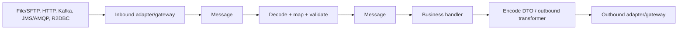
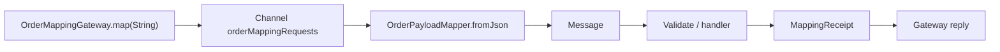
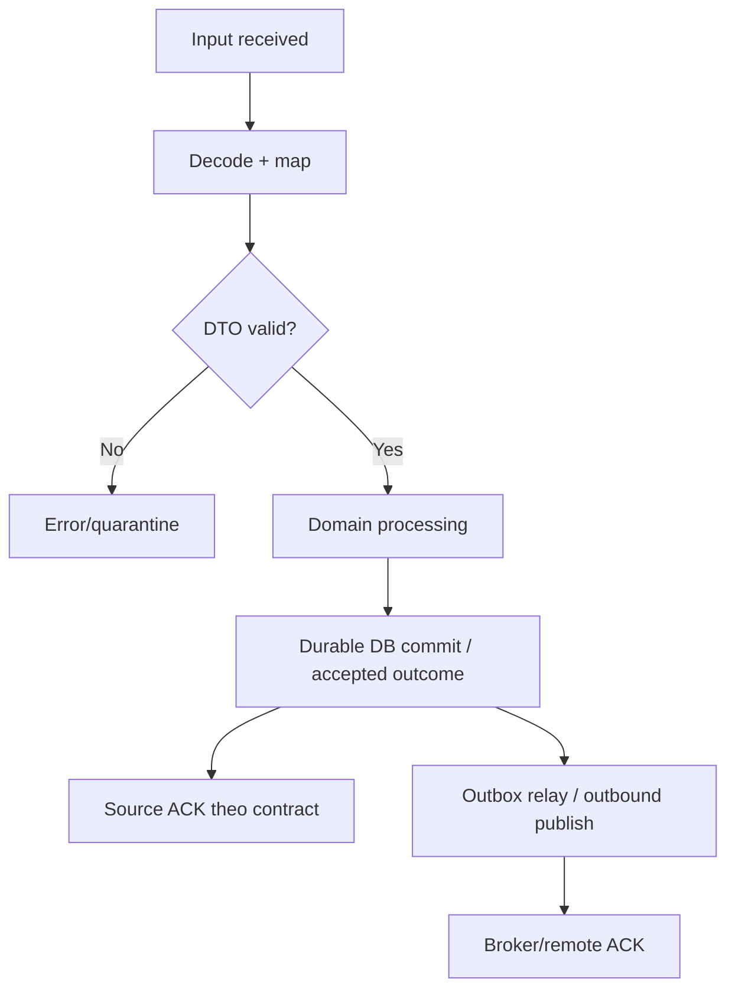

# Payload mapping theo loại dữ liệu

> **Chương:** Mapping message  
> **Module:** SPRING_INTEGRATION_ADAPTERS  
> **Ngữ cảnh:** Kết nối các hệ thống ngoài vào Spring Integration bằng inbound/outbound adapter, gateway, poller và `MessageChannel`. Thực hành luồng trao đổi qua file, SFTP, HTTP, JMS, AMQP, Kafka và cơ sở dữ liệu; quản lý hợp đồng message, lỗi, trạng thái xử lý và vòng đời kết nối.

## 1. Mục tiêu học tập

Sau bài học, bạn có thể:

- Giải thích ý nghĩa của **payload mapping**: chuyển một biểu diễn dữ liệu ở biên tích hợp sang biểu diễn phù hợp với bước xử lý tiếp theo.
- Phân biệt **payload Java type**, **wire format**, **MIME/content type**, **schema version** và **message headers**.
- Tạo, đọc và chuyển đổi `Message<T>` mà không đánh mất business identity/correlation metadata cần thiết.
- Xử lý đúng các loại payload thường gặp: `String`, `byte[]`, `Map<String,Object>`, `JsonNode`, Java record/POJO, `List<T>`, `File`, `Resource`, `InputStream`, `Flux<T>`/`Mono<T>`.
- Thiết kế Java DSL `transform(...)`, `filter(...)` và `handle(...)` giữa inbound adapter, gateway, `MessageChannel` và outbound adapter.
- Xây pipeline JSON UTF-8 → DTO → validation → domain result, và pipeline DTO → JSON bytes cho hệ thống khác.
- Lựa chọn rõ **converter do transport sử dụng** hay **transformer trong Spring Integration flow**.
- Biết tại sao Kafka deserializer, HTTP message converter, JMS/AMQP message converter và R2DBC row mapper có thể tạo **payload types khác nhau từ cùng một dữ liệu nghiệp vụ**.
- Xử lý SQL NULL, JSON null, thiếu field, numeric precision, timestamp/zone, danh sách có generic type và dữ liệu nhị phân mà không âm thầm làm sai nội dung.
- Áp dụng schema validation, định tuyến lỗi và idempotency; kiểm tra mapper bằng JUnit, `StepVerifier` và gateway/flow integration tests.

## 2. Payload mapping nằm ở đâu?

Một message Spring thường có **payload** và **headers**:

```java
import org.springframework.messaging.Message;

Message<?> message =
        org.springframework.messaging.support.MessageBuilder
                .withPayload("example")
                .build();
Object payload = message.getPayload();
var headers = message.getHeaders();
```

`Message<?>` là hợp đồng vận chuyển **bên trong ứng dụng**, không phải wire protocol. Một Kafka record có thể chứa bytes, một HTTP request có body JSON, một file adapter có thể gửi `File`, còn database có thể trả `Flux<DTO>`. Tất cả đều có thể được chuyển thành Spring Message, nhưng **kiểu payload ở đầu vào khác nhau**.



### 2.1. Bốn loại “kiểu” không được trộn lẫn

| Tầng | Câu hỏi | Ví dụ |
| --- | --- | --- |
| **Kiểu Java tại một endpoint** | `getPayload()` là class gì? | `byte[]`, `String`, `OrderCreated`, `File`. |
| **Wire format** | Hệ thống bên ngoài gửi byte như thế nào? | JSON UTF-8, XML, CSV, raw binary, Avro, Protobuf. |
| **Content type/MIME** | Metadata khai báo cách hiểu body? | `application/json`, `text/csv`, `application/octet-stream`. |
| **Schema/contract nghiệp vụ** | Field bắt buộc, version, domain semantics là gì? | `eventId`, `orderId`, `amount`, `occurredAt`, `schemaVersion`. |

Ví dụ một `byte[]` có header `contentType=application/json` **vẫn là byte[]** cho tới khi có decoder/converter/transformer. Header không tự biến bytes thành `OrderCreated` khi không có thành phần thực hiện phép đổi.

### 2.2. Một message đi qua nhiều lớp biểu diễn

```text
Kafka value bytes:
  7B 22 65 76 65 6E 74 49 64 22 ... 7D
             |
             | Kafka ByteArrayDeserializer
             v
Message<byte[]>
  contentType = application/json
             |
             | UTF-8 decode + Jackson
             v
Message<OrderCreated>
  eventId = "evt-501"
  orderId = "ord-101"
             |
             | business processing
             v
Message<PublishReceipt>
             |
             | JSON encoder cho HTTP response
             v
JSON wire bytes
```

Không cần biến payload thành JSON ở **mọi** channel. Ở giữa các business handlers trong JVM, DTO được kiểm tra kiểu thường dễ bảo trì hơn chuỗi JSON.

## 3. Ma trận payload type thường gặp

| Nguồn/định dạng | Payload Java có thể gặp | Mapper cần cân nhắc |
| --- | --- | --- |
| File inbound | `java.io.File` | Đọc bytes/stream, decode charset, parse CSV/JSON/XML. |
| SFTP inbound đồng bộ hóa về local | `File` | Xử lý local file và quy tắc file hoàn tất/ACK. |
| HTTP inbound gateway | `String`, `byte[]`, DTO hoặc `Map` tùy converter | Content negotiation, JSON DTO conversion, validation. |
| Kafka inbound | `String`, `byte[]`, Avro/Protobuf object, POJO tùy deserializer | Không giả định payload luôn `String`. |
| JMS/AMQP inbound | `String`, `byte[]`, DTO tùy MessageConverter | Converter, trusted packages/schema, headers/properties. |
| R2DBC read | `Map`/entity bên trong `Flux` hoặc `Mono` | Row mapping rồi consume Publisher/split. |
| Raw TCP/UDP | Thường `byte[]` hoặc `String` tùy serializer | Framing, charset, message boundaries và binary codec. |
| WebSocket/STOMP/MQTT | Thường `String`/`byte[]`/message object tùy adapter | Text/binary codec, content type, schema. |
| Internal service | `OrderCreated`, `List<OrderCreated>`, domain command | Không serialize rồi deserialize không cần thiết. |

Bảng này mô tả **các khả năng**, không khẳng định mọi adapter có cùng default. Kiểu thực tế phải kiểm tra từ **cấu hình adapter/deserializer/converter** và contract endpoint.

### 3.1. Chọn type an toàn tại ranh giới

Quy tắc gợi ý:

1. Nếu bên ngoài gửi JSON, giải mã thành **DTO có schema được công bố** ở biên phù hợp.
2. Nếu xử lý tệp rất lớn, tránh đọc toàn bộ vào `String`/`byte[]` chỉ để map một vài trường.
3. Nếu định dạng binary (ảnh, PDF, Protobuf), không tự chuyển thành UTF-8 text.
4. Nếu payload gồm nhiều records, xác định rõ **batch vs one event** trước khi splitter.
5. Nếu payload là `Publisher<T>`, xác định **ai subscribe**, khi nào complete/error/cancel và việc xử lý từng row xảy ra ở đâu.

## 4. Message<T>: payload và headers

### 4.1. Tạo Message có payload typed

```java
import java.math.BigDecimal;
import java.time.OffsetDateTime;

import org.springframework.messaging.Message;
import org.springframework.messaging.support.MessageBuilder;

OrderCreated event = new OrderCreated(
        "evt-501",
        "ord-101",
        new BigDecimal("125.50"),
        OffsetDateTime.parse("2026-11-23T08:30:00+07:00"),
        1
);

Message<OrderCreated> message = MessageBuilder
        .withPayload(event)
        .setHeader("eventId", event.eventId())
        .setHeader("schemaVersion", event.schemaVersion())
        .build();
```

`Message<OrderCreated>` giúp code biết type ở compile time tại điểm tạo message. Nhưng khi đi qua một `MessageChannel` có generic type erased hoặc adapter boundary, runtime vẫn phải kiểm tra type và schema.

### 4.2. Copy message khi đổi metadata

```java
Message<OrderCreated> withSource = MessageBuilder
        .fromMessage(message)
        .setHeader("sourceSystem", "kafka-payments")
        .build();
```

`fromMessage(...)` thuận tiện để giữ payload/header gốc khi cần bổ sung metadata. Không xem mọi header là dữ liệu đáng tin cậy từ caller: có header transport-specific, correlation/reply, routing, trace hoặc security-sensitive.

### 4.3. Header nào cần giữ?

| Header/metadata | Mục đích | Chính sách |
| --- | --- | --- |
| `MessageHeaders.ID` | Nhận diện **một Spring Message** | Không dùng thay stable business event ID. |
| `MessageHeaders.TIMESTAMP` | Thời điểm Spring Message được tạo | Không thay event occurrence time. |
| `MessageHeaders.CONTENT_TYPE` | Gợi ý content type của payload | Phải khớp biểu diễn mới; không giữ nhãn JSON nếu đã đổi sang binary tùy ý. |
| `correlationId` | Ghép request-reply/trace | Giữ khi hợp đồng downstream cần. |
| `replyChannel` | Đường trả lời của gateway | Không xóa vô ý khi vẫn muốn reply. |
| `errorChannel` | Định tuyến lỗi | Không sao chép mù qua trust boundary. |
| `eventId` / `idempotencyKey` | Business dedup giữa retries | Ổn định, được validate, không tạo lại ở từng lần thử. |
| `schemaVersion` | Giúp chọn parser/schema | Phải xác minh phù hợp body và allowlist. |
| Transport-specific headers | Kafka topic/partition/offset, JMS IDs, HTTP headers | Chỉ giữ khi cần; không trộn với payload nghiệp vụ. |

**Lưu ý:** header name và Java type cụ thể phụ thuộc adapter. Ví dụ Kafka consumer offset là metadata nguồn, không trở thành ACK chỉ vì bạn đã copy nó sang message mới.

### 4.4. Không phát payload null

Spring `Message` thông thường yêu cầu payload khác `null`. Nếu JSON có field null, **field bên trong DTO** có thể null theo contract, nhưng không đồng nghĩa ta nên tạo `Message<null>`.

Nếu cần bỏ một event không hợp lệ, dùng `filter(...)` với lý do/metrics hoặc đưa vào error/quarantine flow; không âm thầm trả null từ transformer rồi mặc định rằng đã thành công.

## 5. Thiết kế hợp đồng payload trước khi code

Bài dùng event đặt hàng:

```json
{
  "eventId": "evt-501",
  "orderId": "ord-101",
  "amount": 125.50,
  "occurredAt": "2026-11-23T08:30:00+07:00",
  "schemaVersion": 1
}
```

### 5.1. DTO bất biến

Tạo `OrderCreated.java`:

```java
import java.math.BigDecimal;
import java.time.OffsetDateTime;

public record OrderCreated(
        String eventId,
        String orderId,
        BigDecimal amount,
        OffsetDateTime occurredAt,
        int schemaVersion
) {
}
```

Những quyết định cần giải thích:

- `eventId` là business event ID ổn định qua redelivery; không dùng Spring Message ID hay Kafka offset thay thế.
- `orderId` dùng để đối chiếu aggregate/domain object.
- `amount` dùng `BigDecimal`, không dùng `double` nếu cần độ chính xác thập phân.
- `occurredAt` dùng `OffsetDateTime` để giữ offset thời gian được gửi; khi lưu DB nên chuẩn hóa theo chính sách UTC.
- `schemaVersion` biểu diễn version của payload contract, **không** dựa vào tên class Java.

### 5.2. Validation policy

| Field | Yêu cầu tối thiểu | Ví dụ sai |
| --- | --- | --- |
| `eventId` | Không trống; độ dài và ký tự cho phép | `""` hoặc ID mới mỗi retry |
| `orderId` | Không trống, hợp quy tắc domain | `null` |
| `amount` | Khác null; dương; scale/precision phù hợp | `-3.50`, `1e400` |
| `occurredAt` | Khác null; thời gian hợp lý | Chuỗi không có timezone, offset không hợp lệ |
| `schemaVersion` | Version được hỗ trợ, ví dụ `1` | `999` không có mapper |

Một DTO có field/type đúng **không tự hợp lệ**. Jackson có thể tạo record với các reference fields bị null nếu payload thiếu field; phải kiểm tra sau parse.

### 5.3. Schema evolution

- **Additive optional field:** có thể tương thích nếu các consumers chịu được field mới.
- **Rename/remove required field:** thường là breaking change hoặc cần mapper version cũ.
- **Change numeric/time semantic:** rủi ro ngay cả khi JSON vẫn parse được.
- **Change meaning of eventId:** ảnh hưởng idempotency và dedup.
- **Multiple versions:** dùng version router hoặc các DTO/converter riêng, có danh sách version hỗ trợ.

Không để một business service phải đoán schema bằng cách thử parse nhiều versions cho tới khi không còn exception.

## 6. Dependencies và cấu hình lab

Ví dụ hướng tới **Java 17+, Spring Boot 3.x, Spring Integration 6.x và Spring Framework 6.x**, quản lý versions qua Spring Boot BOM. Với phiên bản mới hơn, đối chiếu API tương thích trước khi áp dụng.

### 6.1. Maven dependencies

```xml
<dependencies>
    <dependency>
        <groupId>org.springframework.boot</groupId>
        <artifactId>spring-boot-starter-integration</artifactId>
    </dependency>
    <dependency>
        <groupId>org.springframework.boot</groupId>
        <artifactId>spring-boot-starter-json</artifactId>
    </dependency>
    <dependency>
        <groupId>org.springframework.boot</groupId>
        <artifactId>spring-boot-starter-test</artifactId>
        <scope>test</scope>
    </dependency>
    <dependency>
        <groupId>io.projectreactor</groupId>
        <artifactId>reactor-test</artifactId>
        <scope>test</scope>
    </dependency>
</dependencies>
```

`spring-boot-starter-json` cung cấp Jackson và các modules phổ biến, bao gồm Java Time hỗ trợ `OffsetDateTime` qua cấu hình phù hợp. Trong Spring Boot, thường có `ObjectMapper` bean được auto-configured; khi tự cấu hình phải chắc chắn đã đăng ký Java Time module.

Các dependencies Kafka/AMQP/JMS/SFTP/R2DBC cụ thể chỉ thêm khi thực hành adapter tương ứng; không cần tất cả để chạy ví dụ Java DSL core ở mục 7.

### 6.2. Bài lab không cần external broker

Ví dụ chính dùng internal `MessageChannel` và `@MessagingGateway`, giúp học mapping mà không cần Kafka, JMS hoặc PostgreSQL đang chạy.

Khi đưa vào production, mapping layer có thể được tái sử dụng giữa các adapters, nhưng **wire boundary** (serializer/deserializer, ACK mode, headers) vẫn cần cấu hình riêng.

## 7. Ví dụ chạy được: JSON String → OrderCreated → MappingReceipt

### 7.1. Chương trình sẽ làm gì?



Ở demo này, **business success** là đã parse/validate event và tạo receipt trong JVM; **chưa** có database commit hoặc Kafka publish. Không dùng receipt này để ACK một broker message có delivery guarantee cao hơn khi chưa bổ sung durable processing.

### 7.2. Mapper component

Tạo `OrderPayloadMapper.java`:

```java
import java.math.BigDecimal;
import java.nio.charset.StandardCharsets;
import java.time.OffsetDateTime;

import com.fasterxml.jackson.core.JsonProcessingException;
import com.fasterxml.jackson.databind.ObjectMapper;
import org.springframework.stereotype.Component;

@Component
public class OrderPayloadMapper {

    private final ObjectMapper objectMapper;

    public OrderPayloadMapper(ObjectMapper objectMapper) {
        this.objectMapper = objectMapper;
    }

    public OrderCreated fromJson(String json) {
        if (json == null || json.isBlank()
                || json.length() > 64_000) {
            throw new IllegalArgumentException(
                    "Empty or oversized order JSON");
        }

        try {
            OrderCreated event = objectMapper.readValue(
                    json, OrderCreated.class);
            validate(event);
            return event;
        }
        catch (JsonProcessingException ex) {
            throw new IllegalArgumentException(
                    "Invalid order JSON", ex);
        }
    }

    public OrderCreated fromJsonBytes(byte[] bytes) {
        if (bytes == null || bytes.length == 0
                || bytes.length > 64_000) {
            throw new IllegalArgumentException(
                    "Empty or oversized order bytes");
        }

        // Jackson đọc byte[] JSON và nhận diện encoding theo contract.
        // Lab yêu cầu nguồn bên ngoài gửi JSON UTF-8.
        try {
            OrderCreated event = objectMapper.readValue(
                    bytes, OrderCreated.class);
            validate(event);
            return event;
        }
        catch (JsonProcessingException ex) {
            throw new IllegalArgumentException(
                    "Invalid order JSON bytes", ex);
        }
    }

    public byte[] toJsonBytes(OrderCreated event) {
        validate(event);
        try {
            return objectMapper.writeValueAsBytes(event);
        }
        catch (JsonProcessingException ex) {
            throw new IllegalStateException(
                    "Cannot serialize order", ex);
        }
    }

    public String toJson(OrderCreated event) {
        return new String(
                toJsonBytes(event), StandardCharsets.UTF_8);
    }

    public void validate(OrderCreated event) {
        if (event == null
                || !validId(event.eventId(), 80)
                || !validId(event.orderId(), 80)
                || event.amount() == null
                || event.amount().compareTo(BigDecimal.ZERO) <= 0
                || event.amount().scale() > 2
                || event.amount().precision() > 12
                || event.occurredAt() == null
                || event.schemaVersion() != 1) {
            throw new IllegalArgumentException(
                    "Invalid OrderCreated event");
        }
    }

    private static boolean validId(String s, int max) {
        return s != null
                && s.length() <= max
                && s.matches("[A-Za-z0-9_-]+");
    }
}
```

**Các lựa chọn có chủ đích:**

1. `fromJson` kiểm tra kích thước trước khi parse, tránh tiêu tốn bộ nhớ với chuỗi cực lớn.
2. Jackson chuyển JSON thành record typed; JavaTime module hỗ trợ `OffsetDateTime` theo cấu hình Boot.
3. `validate` kiểm tra domain invariants, không dựa riêng vào việc parse thành công.
4. `fromJsonBytes` nhận **JSON bytes**, không phải file nhị phân tùy ý.
5. `toJsonBytes` tạo UTF-8 bytes theo Jackson; không dùng `event.toString()` làm JSON.
6. Mapper là phép chuyển biểu diễn thuần, **không gọi Kafka, JDBC/R2DBC hoặc HTTP**.
7. Giới hạn size/precision trong lab là **hợp đồng demo**, production phải xác định giới hạn bytes, JSON nesting, schema/amount scale và authorization riêng.

### 7.3. DTO kết quả

Tạo `MappingReceipt.java`:

```java
public record MappingReceipt(
        String eventId,
        String orderId,
        String result
) {
}
```

### 7.4. Java DSL flow

Tạo `OrderMappingFlowConfiguration.java`:

```java
import org.springframework.context.annotation.Bean;
import org.springframework.context.annotation.Configuration;
import org.springframework.integration.config.EnableIntegration;
import org.springframework.integration.dsl.IntegrationFlow;

@Configuration
@EnableIntegration
public class OrderMappingFlowConfiguration {

    @Bean
    IntegrationFlow orderMappingFlow(OrderPayloadMapper mapper) {
        return IntegrationFlow
                .from("orderMappingRequests")
                .transform(String.class, mapper::fromJson)
                .handle(OrderCreated.class, (event, headers) ->
                        new MappingReceipt(
                                event.eventId(),
                                event.orderId(),
                                "VALIDATED"))
                .get();
    }
}
```

**Giải thích:**

- Gateway đưa `String` vào channel `orderMappingRequests`.
- `transform(String.class, mapper::fromJson)` ánh xạ payload String → `OrderCreated`.
- `handle(OrderCreated.class, ...)` xử lý DTO và trả `MappingReceipt` làm **reply payload**.
- Vì flow theo gateway/DirectChannel sync trong lab và handler trả result, gateway có thể nhận reply.
- Nếu mapper phát exception, gateway **không nhận success receipt**; exception có thể được wrap trong Spring Messaging exception, cần kiểm tra cause.
- Khi thay bằng async channel, timeout/reply channel và threading semantics sẽ khác; không giả định gateway luôn nhận reply ngay.

### 7.5. Messaging gateway

Tạo `OrderMappingGateway.java`:

```java
import org.springframework.integration.annotation.MessagingGateway;

@MessagingGateway(defaultRequestChannel = "orderMappingRequests")
public interface OrderMappingGateway {

    MappingReceipt map(String json);
}
```

Khi `@EnableIntegration` có hiệu lực và gateway được đăng ký, Spring tạo proxy giao tiếp với flow qua channel.

### 7.6. Spring Boot main và demo

Tạo `MappingApplication.java`:

```java
import org.springframework.boot.CommandLineRunner;
import org.springframework.boot.SpringApplication;
import org.springframework.boot.autoconfigure.SpringBootApplication;
import org.springframework.context.annotation.Bean;

@SpringBootApplication
public class MappingApplication {

    public static void main(String[] args) {
        SpringApplication.run(MappingApplication.class, args);
    }

    @Bean
    CommandLineRunner runDemo(OrderMappingGateway gateway) {
        return args -> {
            String json = """
                    {
                      "eventId":"evt-501",
                      "orderId":"ord-101",
                      "amount":125.50,
                      "occurredAt":"2026-11-23T08:30:00+07:00",
                      "schemaVersion":1
                    }
                    """;

            MappingReceipt receipt = gateway.map(json);
            System.out.println(receipt);
        };
    }
}
```

Kết quả **dự kiến**:

```text
MappingReceipt[eventId=evt-501, orderId=ord-101, result=VALIDATED]
```

Ví dụ các class nên đặt trong cùng package hoặc packages nằm dưới root của `@SpringBootApplication` để component scanning phát hiện. Nếu đã có Boot application chính trong dự án thực, **không tạo thêm main application trùng**; chỉ đăng ký mapper/flow/gateway phù hợp.

### 7.7. Biến thể: nguồn phát byte[] thay vì String

Có thể xây flow khác:

```java
@Bean
IntegrationFlow byteOrderMappingFlow(OrderPayloadMapper mapper) {
    return IntegrationFlow
            .from("orderByteRequests")
            .transform(byte[].class, mapper::fromJsonBytes)
            .handle(OrderCreated.class, (event, headers) ->
                    new MappingReceipt(
                            event.eventId(),
                            event.orderId(),
                            "VALIDATED"))
            .get();
}
```

Đây là bean method trong `@Configuration`, dùng **input channel khác** để không xung đột channel của flow String.

Không nên cast `(String) message.getPayload()` khi Kafka deserializer đang tạo `byte[]`; chọn mapper overload phù hợp hoặc cấu hình deserializer/converter trước.


## 8. String, byte[] và JSON: mapping phải rõ encoding

### 8.1. String không phải JSON object

```java
String jsonText = "{\"eventId\":\"evt-501\"}";
String plainText = "hello world";
```

Cả hai đều là `String`. Một Java type không cho biết liệu nội dung là JSON, CSV, XML hay text tự do. Khi nguồn là HTTP/Kafka, cần kết hợp **contract endpoint** và metadata như `contentType`; không chỉ dựa vào dấu `{` đầu tiên để đoán format.

Sai:

```java
OrderCreated order = (OrderCreated) (Object) jsonText;
```

Cast không deserialize. Đúng là gọi mapper/converter:

```java
OrderCreated order = payloadMapper.fromJson(jsonText);
```

### 8.2. byte[] cần biết format

```java
import java.nio.charset.StandardCharsets;

byte[] jsonBytes = jsonText.getBytes(StandardCharsets.UTF_8);

String restored = new String(
        jsonBytes, StandardCharsets.UTF_8);
```

Dùng UTF-8 **khi wire contract nói UTF-8**. Không dùng `new String(bytes)` không chỉ định charset vì dễ phụ thuộc default charset. Khi body là ảnh, PDF, ZIP, Protobuf hoặc encrypted bytes, **không** decode như text.

### 8.3. JSON null khác không có payload message

JSON có thể chứa:

```json
{
  "note": null,
  "amount": 125.50
}
```

Một DTO có thể biểu diễn `note=null` nếu schema cho phép. Nhưng:

- JSON literal `null` được deserialize thành Java null, **không** tạo một item `Flux` hợp lệ nếu phát trực tiếp.
- Transformer không nên âm thầm biến một bản ghi nghiệp vụ thành payload null.
- Thiếu field `eventId` cần được phân loại validation error, không gán một event ID random để “cho chạy”.
- Nếu muốn biểu diễn không có giá trị, dùng một domain outcome có ý nghĩa, `Optional` ở API phù hợp hoặc filter có policy tường minh.

### 8.4. JSON serialization cũng là phần của contract

```java
byte[] outboundBytes = payloadMapper.toJsonBytes(order);
String outboundJson = payloadMapper.toJson(order);
```

Đọc lại JSON có thể cho cùng **ngữ nghĩa** nhưng không nhất thiết cùng bytes:

- Thứ tự các properties có thể khác.
- `125.5` và `125.50` khác representation, dù bằng nhau về số học.
- Timestamp có thể được chuẩn hóa offset/precision.
- Null fields có thể được bỏ qua tùy serialization configuration.
- Unicode escape hoặc whitespace có thể khác.

Nếu cần ký payload, hash/dedup theo nội dung, phải định nghĩa **canonicalization/versioning**; không giả định `JSON.stringify`/Jackson đều cho byte-identical output.

### 8.5. Kích thước và giới hạn parser

Giới hạn input trên từng tầng:

| Lớp | Mối nguy | Biện pháp |
| --- | --- | --- |
| HTTP server | Body quá lớn | Request size limit, timeout, authentication. |
| Kafka/AMQP/JMS | Message vượt quota | Broker limits, compression policy, DLQ. |
| Byte-array mapper | Cấp phát RAM lớn | Kiểm tra `bytes.length` trước parse. |
| JSON tree | Nesting sâu và fields quá nhiều | Jackson stream constraints và schema limits. |
| Output encoder | Payload phình to khi chuyển format | Giới hạn response/event size, measure bytes. |

Giới hạn `json.length()` tính Java characters, **không** thay thế giới hạn số byte UTF-8 trên transport; người dùng gửi Unicode nhiều byte cần kiểm tra riêng.

## 9. Map, JsonNode và Java DTO

### 9.1. Map linh hoạt nhưng không type-safe

```java
import java.util.Map;

Map<String, Object> fields = Map.of(
        "eventId", "evt-501",
        "orderId", "ord-101",
        "amount", "125.50"
);
```

`Map.of(...)` trong ví dụ không nhận null, còn một Map do JSON/JDBC mapper tạo ra có thể có null values tùy implementation. Map tránh phải tạo class cho các projections động nhưng khiến consumer phải tự kiểm tra key và value types.

Không nên viết:

```java
BigDecimal amount = (BigDecimal) fields.get("amount");
```

Trong Map trên, `amount` đang là **String**, cast trực tiếp sẽ thất bại. Nếu Map từ Jackson JSON number không có target type, giá trị số có thể là `Integer`, `Long`, `Double` hoặc `BigDecimal` tùy cấu hình; không được giả định một class duy nhất.

### 9.2. Map → DTO bằng ObjectMapper có ràng buộc

```java
import com.fasterxml.jackson.databind.ObjectMapper;
import java.util.Map;

public OrderCreated mapToOrder(
        Map<String, Object> map,
        ObjectMapper mapper,
        OrderPayloadMapper payloadMapper) {

    OrderCreated event = mapper.convertValue(
            map, OrderCreated.class);
    payloadMapper.validate(event);
    return event;
}
```

Đoạn trên là **method minh họa trong một class**, với `validateOrder(...)` là domain validator cần được cài đặt (có thể dùng `payloadMapper.validate(event)` của mục 7). Đừng giả định `convertValue` tự xác minh required fields hoặc schemaVersion.

Có thể cấu hình mapper báo lỗi khi gặp unknown properties nhằm bắt schema drift; policy strict hay forward-compatible phải được quyết định và test.

### 9.3. JsonNode cho JSON chưa xác định schema

```java
import com.fasterxml.jackson.databind.JsonNode;
import com.fasterxml.jackson.databind.ObjectMapper;

JsonNode tree = mapper.readTree(jsonText);
JsonNode eventIdNode = tree.path("eventId");

if (!eventIdNode.isTextual()) {
    throw new IllegalArgumentException(
            "eventId must be text");
}

String eventId = eventIdNode.textValue();
```

`JsonNode` giúp kiểm tra structure linh hoạt; tuy nhiên `path("eventId")` có thể trả **MissingNode**, không phải Java null. `asText()` có thể làm mất sự khác biệt giữa giá trị sai kiểu và thiếu giá trị nếu dùng thiếu kiểm tra.

Nên dùng `isTextual()`/`isNumber()`/`isNull()`/`isMissingNode()` theo schema trước khi lấy value. Với contract ổn định, DTO vẫn là lựa chọn rõ ràng hơn.

### 9.4. Chuyển JsonNode sang DTO

```java
OrderCreated event = mapper.treeToValue(
        tree, OrderCreated.class);
payloadMapper.validate(event);
```

`treeToValue` có thể ném checked/processing exception tùy API; đoạn này giả định nằm trong method có `throws JsonProcessingException` hoặc xử lý exception. **Dữ liệu cây đã parse vẫn cần validation nghiệp vụ.**

### 9.5. Khi nào dùng Map, JsonNode hay DTO?

| Nhu cầu | Lựa chọn chính |
| --- | --- |
| API có schema và version được công bố | DTO/record typed. |
| JSON có extension fields cho phép | DTO + extension map được kiểm soát. |
| Connector generic cần inspect dynamic properties | `JsonNode` hoặc `Map`. |
| Data cleansing trước khi chọn schema | `JsonNode`/structured intermediate representation. |
| Business logic phức tạp | DTO typed + domain validation. |
| JSON array cần List<OrderCreated> | Generic `TypeReference` hoặc explicit collection DTO. |

Đừng dùng `Map<String, Object>` như cách né việc **thiết kế hợp đồng dữ liệu** giữa các service.

## 10. List<T>, arrays, batch và Java generics

### 10.1. Một message chứa List không phải N messages

```text
Message<List<OrderCreated>>
       |
       | Payload gồm 3 elements
       v
Message payload = [event1, event2, event3]

Sau splitter:
       +--> Message<OrderCreated> event1
       +--> Message<OrderCreated> event2
       +--> Message<OrderCreated> event3
```

Khi inbound adapter nhận một JSON array, cần quyết định **xử lý cả batch** hay **tách từng event**. Hai lựa chọn có ACK và partial-failure semantics khác nhau.

### 10.2. Deserialize JSON array đúng generic type

```java
import com.fasterxml.jackson.core.type.TypeReference;
import java.util.List;

List<OrderCreated> events = mapper.readValue(
        jsonArray,
        new TypeReference<List<OrderCreated>>() {});
```

Đây là snippet trong method xử lý `JsonProcessingException` với biến `mapper`/`jsonArray` đã có. `TypeReference` giữ thông tin phần tử generic khi deserialize.

Sai/khó kiểm soát:

```java
List raw = mapper.readValue(jsonArray, List.class);
OrderCreated first = (OrderCreated) raw.get(0);
```

Khi dùng raw `List.class`, phần tử object trong JSON thường được map thành `LinkedHashMap`, không tự biến thành `OrderCreated`. Cố cast sẽ lỗi.

### 10.3. Splitter trong Spring Integration

```java
import org.springframework.context.annotation.Bean;
import org.springframework.integration.dsl.IntegrationFlow;

@Bean
IntegrationFlow splitOrderBatch(OrderHandler handler) {
    return IntegrationFlow
            .from("orderBatchRequests")
            .split()
            .handle(OrderCreated.class, (order, headers) -> {
                handler.accept(order);
                return null;
            })
            .get();
}
```

Đây là bean method; `OrderHandler` là interface/service người học tự cài đặt có method `void accept(OrderCreated)`. Với `List<OrderCreated>`, splitter có thể tạo một `Message<OrderCreated>` mỗi element.

**Lưu ý về ACK:** nếu mỗi event gây side effect quan trọng, `handler.accept(...)` phải thực sự hoàn tất tương ứng với delivery contract; việc splitter tạo N messages không chứng minh tất cả đã được xử lý bền vững. Khi handler asynchronous, cần dùng reactive completion/ACK orchestration đúng topology.

### 10.4. Batch vs per-item acknowledgement

| Thiết kế | Ưu điểm | Nhược điểm |
| --- | --- | --- |
| Một message chứa List, ACK toàn batch | Ít overhead, đơn giản khi all-or-nothing. | Một item lỗi có thể khiến xử lý lại cả batch. |
| Split N messages, ACK từng item | Quan sát/ retry theo event ID. | Cần quản lý correlation, partial success và progress. |
| Durable batch with item ledger | Khôi phục chính xác hơn, chịu crash. | Phức tạp hơn; cần storage/transaction. |

Không tự coi `sequenceNumber` từ splitter là business event ID; sequence/correlation headers chỉ phục vụ điều phối một lần split.

## 11. File, Resource và InputStream: lifecycle quan trọng như type

### 11.1. File inbound adapter thường mang File

```java
import java.io.File;

File file = (File) message.getPayload();
```

Với file adapter, đây có thể là một **đường dẫn/file handle** đã được phát hiện, **không** phải toàn bộ file bytes nằm trong message.

Ưu điểm: có thể stream; ít copy memory ở bước nhận message.

Rủi ro: file có thể bị di chuyển/xóa/ghi tiếp hoặc chỉ được đọc một phần. Cần thiết kế **file ready filter, exclusive ownership, xử lý thành công rồi archive/rename** và retry theo nguồn.

### 11.2. File → String JSON bằng charset xác định

```java
import java.io.File;
import java.io.IOException;
import java.nio.charset.StandardCharsets;
import java.nio.file.Files;

public final class FilePayloadMapping {

    private FilePayloadMapping() {
    }

    public static String readSmallJson(File file) {
        if (file == null || !file.isFile()) {
            throw new IllegalArgumentException("Not a regular file");
        }

        try {
            long size = Files.size(file.toPath());
            if (size > 64_000) {
                throw new IllegalArgumentException(
                        "File too large for in-memory JSON mapping");
            }

            return Files.readString(
                    file.toPath(), StandardCharsets.UTF_8);
        }
        catch (IOException ex) {
            throw new IllegalStateException(
                    "Cannot read JSON file", ex);
        }
    }
}
```

Ví dụ chỉ áp dụng **file JSON nhỏ** có kích thước kiểm soát. `Files.readString` đọc toàn bộ file, không phù hợp với video/binary/CSV nhiều GB.

### 11.3. Java DSL File → JSON DTO

```java
import java.io.File;
import org.springframework.context.annotation.Bean;
import org.springframework.integration.dsl.IntegrationFlow;

@Bean
IntegrationFlow localFileMappingFlow(OrderPayloadMapper mapper) {
    return IntegrationFlow
            .from("localJsonFiles")
            .transform(File.class, FilePayloadMapping::readSmallJson)
            .transform(String.class, mapper::fromJson)
            .handle(OrderCreated.class, (event, headers) -> {
                System.out.println("Parsed event: " + event.eventId());
                return null;
            })
            .get();
}
```

Trong đoạn này `localJsonFiles` là **channel do file inbound adapter đưa dữ liệu vào**, chưa phải cấu hình file watcher/poller. Khi triển khai phải nối channel này với adapter đã kiểm soát file completion và retry.

**Không xóa/di chuyển file trước khi handler nghiệp vụ cuối cùng hoàn tất bền vững.** Nếu flow chỉ log rồi mất process, không có bằng chứng event đã được giao ra hệ thống khác.

### 11.4. Resource và InputStream

`org.springframework.core.io.Resource` cho phép mở `InputStream` từ nhiều nguồn. Tuy nhiên một số `Resource` có stream chỉ đọc một lần hoặc metadata khác nhau tùy implementation.

```java
import java.io.InputStream;
import org.springframework.core.io.Resource;

public byte[] readResource(Resource resource) throws Exception {
    try (InputStream in = resource.getInputStream()) {
        // Chỉ demo: production cần giới hạn bytes trước khi cấp phát.
        return in.readNBytes(64_001);
    }
}
```

Đoạn code trên đọc **tối đa 64.001 bytes** và trả bytes, kể cả khi nguồn lớn hơn. Caller phải kiểm tra kết quả dài `>64_000` rồi reject; nếu cần biết file thực sự hết dữ liệu, phải thiết kế limit/stream consumption phù hợp.

Không đưa một `InputStream` đã bị đóng làm payload downstream và mong handler khác vẫn đọc được. **Ownership của close/cancel** phải rõ khi một message đi qua các channels bất đồng bộ.

### 11.5. File/SFTP chỉ map khi file ổn định

Trong SFTP inbound synchronization, inbound adapter có thể download file về local rồi gửi `File`, tùy chế độ/cấu hình. Remote streaming adapter có semantics payload khác.

Bên nhận phải xác định:

- File nguồn đã upload xong chưa?
- Ai sở hữu file khi hai pollers cùng thấy nó?
- File đang được ghi có bị đọc một nửa không?
- Làm sao retry nếu mapping hoặc HTTP/Kafka downstream lỗi?
- Khi nào archive/rename/delete để biểu thị success?
- Có persistent accept filter hay idempotency key theo path/checksum không?

Không suy ra `Message<File>` đồng nghĩa “tệp đã được xử lý và ACK”.

## 12. R2DBC: Row mapping và payload kiểu Publisher

### 12.1. DatabaseClient là mapping nguồn SQL → DTO

```java
import org.springframework.r2dbc.core.DatabaseClient;
import reactor.core.publisher.Flux;

Flux<OrderCreated> events = db.sql(
                "SELECT event_id, order_id, amount, " +
                "occurred_at, schema_version " +
                "FROM outbox_events WHERE status='NEW' " +
                "ORDER BY id LIMIT 25")
        .map((row, metadata) -> new OrderCreated(
                row.get("event_id", String.class),
                row.get("order_id", String.class),
                row.get("amount", java.math.BigDecimal.class),
                row.get("occurred_at",
                        java.time.OffsetDateTime.class),
                row.get("schema_version", Integer.class)
        ))
        .all();
```

Đoạn code nằm trong repository có `DatabaseClient db`, sử dụng bảng `outbox_events` minh họa cần được tạo trong lab riêng. `Flux<OrderCreated>` không tự thực thi SELECT trước khi subscribe.

### 12.2. R2dbcMessageSource: Message<Flux<T>> khác Message<T>

```text
R2dbcMessageSource.receive()
           |
           v
Message<Flux<OrderCreated>>
           |
           v
FluxMessageChannel
           |
           v
Splitter
           |
           +-- Message<OrderCreated> #1
           +-- Message<OrderCreated> #2
           +-- ...
```

Một lần poll có thể tạo **một Spring Message chứa một Publisher**. Nếu handler muốn `OrderCreated`, phải có splitter hoặc consumer Publisher phù hợp.

`payloadType(OrderCreated.class)` (nếu schema/mapping class tương thích với Spring Data R2DBC) chỉ quyết định kiểu từng row bên trong Publisher, **không tự tách một row thành một Spring Message**.

#### 12.2.1. Bảng và entity cho ví dụ R2DBC

Để chạy riêng phần database mapping, bổ sung `spring-boot-starter-data-r2dbc`, `spring-integration-r2dbc`, PostgreSQL R2DBC driver và thông tin `spring.r2dbc.*` trong application config. Tạo bảng lab:

```sql
CREATE TABLE outbox_events (
    id             BIGSERIAL PRIMARY KEY,
    event_id       VARCHAR(80) NOT NULL UNIQUE,
    order_id       VARCHAR(80) NOT NULL,
    amount         NUMERIC(12, 2) NOT NULL,
    occurred_at    TIMESTAMPTZ NOT NULL,
    schema_version INTEGER NOT NULL,
    status         VARCHAR(16) NOT NULL DEFAULT 'NEW'
);

INSERT INTO outbox_events(
    event_id, order_id, amount, occurred_at, schema_version, status)
VALUES (
    'evt-db-501', 'ord-db-101', 125.50,
    '2026-11-23T08:30:00+07:00', 1, 'NEW');
```

Tạo `OrderRowEntity.java`:

```java
import java.math.BigDecimal;
import java.time.OffsetDateTime;
import org.springframework.data.annotation.Id;
import org.springframework.data.relational.core.mapping.Column;
import org.springframework.data.relational.core.mapping.Table;

@Table("outbox_events")
public record OrderRowEntity(
        @Id Long id,
        @Column("event_id") String eventId,
        @Column("order_id") String orderId,
        BigDecimal amount,
        @Column("occurred_at") OffsetDateTime occurredAt,
        @Column("schema_version") Integer schemaVersion
) {
    public OrderCreated toDomainEvent() {
        if (schemaVersion == null) {
            throw new IllegalArgumentException(
                    "Missing schema version in database row");
        }

        return new OrderCreated(
                eventId,
                orderId,
                amount,
                occurredAt,
                schemaVersion);
    }
}
```

Ở đây entity là biểu diễn **một row SQL**, còn `OrderCreated` là **hợp đồng nghiệp vụ**. Khi thêm cột nội bộ như `status`, `claim_owner`, `attempt_count`, outbound event không nhất thiết phải lộ các cột đó.

### 12.3. R2DBC inbound Java DSL

```java
import org.springframework.context.annotation.Bean;
import org.springframework.data.r2dbc.core.R2dbcEntityTemplate;
import org.springframework.integration.dsl.IntegrationFlow;
import org.springframework.integration.dsl.MessageChannels;
import org.springframework.integration.r2dbc.dsl.R2dbc;

@Bean
IntegrationFlow readMappedRows(
        R2dbcEntityTemplate template,
        OrderPayloadMapper mapper) {
    return IntegrationFlow
            .from(
                    R2dbc.inboundChannelAdapter(
                            template,
                            "SELECT id, event_id, order_id, amount, " +
                            "occurred_at, schema_version " +
                            "FROM outbox_events WHERE status='NEW' " +
                            "ORDER BY id LIMIT 25")
                            .payloadType(OrderRowEntity.class)
                            .expectSingleResult(false),
                    endpoint -> endpoint.poller(p ->
                            p.fixedDelay(2_000)
                             .maxMessagesPerPoll(1)))
            .channel(MessageChannels.flux())
            .split()
            .channel(MessageChannels.flux())
            .transform(OrderRowEntity.class,
                    OrderRowEntity::toDomainEvent)
            .transform(OrderCreated.class, event -> {
                mapper.validate(event);
                return event;
            })
            .handle(OrderCreated.class, (event, headers) -> {
                System.out.println("Mapped row: " + event.eventId());
                return null;
            })
            .get();
}
```

Ở đây `OrderRowEntity` được khai báo ở mục 12.2.1. Flow minh họa cách chuyển `row entity → domain DTO` rồi validate trước handler. Khi chạy cần đúng dependencies, schema, database connection và subscriber như hướng dẫn. Flow **chỉ SELECT rồi log**, chưa thực hiện claim/ACK, nên các lần poll có thể đọc lại cùng row.

`maxMessagesPerPoll(1)` giới hạn số lần gọi `receive()` trong một poll cycle, **không giới hạn SELECT một row**. `LIMIT 25` mới là giới hạn số rows mỗi query.

### 12.4. Không ACK từ mapping callback

```text
SQL Row -> RowMapper (copy field vào DTO) -> Flux<DTO>
```

Row mapper chỉ nên **đọc/copy/validate cột SQL**. Nó chưa biết Kafka/HTTP downstream đã publish thành công hay chưa. Không cập nhật `status=DONE` trong mapper rồi coi đó là ACK.

Nếu cần delivery tin cậy, dùng **atomic claim + lease + ACK sau downstream completion**, transactional outbox, event ID ổn định và retry/idempotency phù hợp.

### 12.5. Publisher lifecycle và backpressure

- `Flux<T>` có `onNext`/`onError`/`onComplete` và subscriber demand.
- `request(n)` không tương đương SQL `LIMIT n` hoặc driver fetch exactly n rows.
- Một `Flux` được subscribe nhiều lần có thể chạy lại SELECT.
- Retry sau partial emission có thể phát lại rows đã gửi.
- Cancellation phải cleanup connection/result/transaction theo driver/Spring contract.
- `collectList()` trên SELECT không giới hạn có thể tăng RAM rất lớn.
- `FluxMessageChannel` hỗ trợ reactive subscription nhưng không tự giải quyết broker ACK/DB claim.

## 13. Adapter boundary: HTTP, Kafka, JMS/AMQP và TCP/SFTP

### 13.1. Tại sao cùng JSON nhưng payload khác type?

```text
HTTP content-type application/json
       | HttpMessageConverter được cấu hình
       v
POJO / Map / String

Kafka value bytes
       | Kafka Deserializer
       v
byte[] / String / POJO

JMS/AMQP message
       | MessageConverter
       v
String / byte[] / POJO

SFTP/local file
       | File adapter + file reading transformer
       v
File -> String / byte[]

R2DBC SELECT
       | Row mapper
       v
Flux<Entity> / Flux<Map>
```

Payload là kết quả của **cấu hình ở từng adapter**, không chỉ của MIME type.

### 13.2. HTTP inbound gateway

Một HTTP inbound gateway có thể dùng Spring MVC/HTTP message converters để map JSON request body thành DTO (tùy request mapping/target type), rồi tạo Spring Message.

Cần phân biệt:

- HTTP body byte/string trên wire.
- Content-Type client khai báo.
- Type mà server/controller/gateway cho phép.
- Converter thực được chọn.
- DTO validation và status trả lỗi (`400`/`415`/`422` theo API contract).
- Response serialization và `Accept` negotiation.

Không tin rằng chỉ set `Content-Type: application/json` đã bảo đảm client gửi JSON hợp lệ hoặc event schemaVersion được hỗ trợ.

### 13.3. Kafka inbound adapter

Kafka `StringDeserializer` tạo `String`, `ByteArrayDeserializer` tạo `byte[]`, còn JSON/Avro/Protobuf deserializers có thể tạo POJO/record hoặc type chuyên biệt.

Đặt mapper đúng chỗ:

- Nếu payload đã là `OrderCreated`, **không parse JSON lần nữa**.
- Nếu là `String` JSON, dùng `fromJson`.
- Nếu là `byte[]` JSON UTF-8, dùng `fromJsonBytes`.
- Với Avro/Protobuf, dùng schema-aware mapping; không ép vào Jackson JSON.
- Business event ID phải ổn định qua redelivery, Kafka offset là source metadata riêng.

**ACK/commit consumer offset phải chờ durable processing** theo contract, không ACK chỉ sau mapping sang DTO. Một DTO được tạo không có nghĩa database đã commit.

### 13.4. JMS và AMQP converters

JMS `TextMessage` thường đại diện text, `BytesMessage` đại diện bytes; AMQP broker cũng lưu byte payload cùng properties. Message converter của framework có thể tạo `String`/`byte[]`/domain object tùy cấu hình.

Nếu converter đã trả typed `OrderCreated`, transformer không nên cố cast `String`. Khi dùng converter JSON cần:

- Trusted packages/type allowlist, không deserialize class do untrusted header tự chỉ định.
- Schema version và content-type validation.
- DLQ/error policy với payload không hợp lệ.
- Correlation/reply metadata phù hợp với request-reply.
- ACK/NACK/redelivery chỉ sau khi hoàn tất công việc nghiệp vụ.

### 13.5. File/SFTP outbound

Nếu adapter outbound nhận `File`/`Resource` và upload file, mapping trước đó cần tạo file ổn định, xác định name, encoding, checksum và atomic rename/upload completion nếu yêu cầu.

Nếu adapter outbound nhận bytes, phải làm rõ:

- Bytes là original binary hay JSON UTF-8?
- Filename/contentType headers có bị mất không?
- Có cần stream/chunk hay buffering?
- Remote upload thành công trước khi đánh dấu source processed chưa?
- Retry có tạo duplicate file và cần stable filename/manifest không?

### 13.6. TCP/UDP, WebSocket, STOMP, MQTT

Với transport này, framing và codec là hai vấn đề khác nhau:

- TCP là byte stream, cần delimiter/length header/serializer để xác định message boundary.
- UDP là datagram, không có bảo đảm nhận/ordering mặc định.
- WebSocket text/binary frames có payload types khác nhau.
- STOMP/MQTT có headers/properties phù hợp protocol.

**Payload mapper chỉ hiểu content sau khi adapter/codec đã xác định đúng khung dữ liệu.** Không giao nhiệm vụ TCP frame splitting cho Jackson DTO mapper.


## 14. Content-Type, schemaVersion và header routing

### 14.1. Content-Type mô tả biểu diễn, không thay mapper

```java
import org.springframework.messaging.Message;
import org.springframework.messaging.MessageHeaders;
import org.springframework.messaging.support.MessageBuilder;
import org.springframework.util.MimeTypeUtils;

Message<byte[]> outbound = MessageBuilder
        .withPayload(payloadMapper.toJsonBytes(order))
        .setHeader(MessageHeaders.CONTENT_TYPE,
                MimeTypeUtils.APPLICATION_JSON)
        .setHeader("eventId", order.eventId())
        .setHeader("schemaVersion", order.schemaVersion())
        .build();
```

`contentType=application/json` trong ví dụ phù hợp vì payload **là JSON bytes**. Một typed `OrderCreated` trong internal channel có thể chưa cần header biểu diễn wire; khi encode outbound, xác định content type cho bytes.

Không copy một header `text/plain` cũ rồi phát JSON bytes mà không cập nhật metadata; receiver có thể chọn decoder sai.

### 14.2. Không tin client chỉ vì header nói application/json

Một HTTP/Kafka client có thể đặt `contentType=application/json` nhưng gửi ZIP bytes, JSON không hợp lệ hoặc dữ liệu sai schema.

Tại ingress cần:

1. Kiểm tra transport đã cho phép content type nào.
2. Giới hạn byte size và decoding work.
3. Decode theo charset/format.
4. Parse bằng JSON/XML/CSV/Protobuf parser đúng.
5. Validate DTO/schema version/domain contract.
6. Xác thực nguồn/người gửi và quyền xử lý.
7. Chỉ sau đó chuyển vào business handler.

Nội dung sai không trở thành an toàn vì mang nhãn MIME đúng.

### 14.3. Ví dụ định tuyến theo payload type

Có thể tách các đường xử lý khi một ingress thật sự chấp nhận nhiều Java payload types:

```java
import org.springframework.integration.annotation.Router;
import org.springframework.messaging.Message;
import org.springframework.stereotype.Component;

@Component
public class PayloadTypeRouter {

    @Router(inputChannel = "mixedInboundPayloads")
    public String route(Message<?> message) {
        Object value = message.getPayload();

        if (value instanceof OrderCreated) {
            return "typedOrderEvents";
        }
        if (value instanceof String) {
            return "jsonTextOrders";
        }
        if (value instanceof byte[]) {
            return "jsonByteOrders";
        }

        throw new IllegalArgumentException(
                "Unsupported payload type: " +
                value.getClass().getName());
    }
}
```

Đây là router annotation-based. Các output channel names phải được kết nối với **transformers/handlers phù hợp**, chẳng hạn:

```java
import org.springframework.integration.annotation.Transformer;
import org.springframework.stereotype.Component;

@Component
public class OrderTypeTransformers {

    private final OrderPayloadMapper mapper;

    public OrderTypeTransformers(OrderPayloadMapper mapper) {
        this.mapper = mapper;
    }

    @Transformer(
            inputChannel = "jsonTextOrders",
            outputChannel = "typedOrderEvents")
    public OrderCreated fromString(String json) {
        return mapper.fromJson(json);
    }

    @Transformer(
            inputChannel = "jsonByteOrders",
            outputChannel = "typedOrderEvents")
    public OrderCreated fromBytes(byte[] bytes) {
        return mapper.fromJsonBytes(bytes);
    }
}
```

Ví dụ minh họa **một kiến trúc thay thế** cho Java DSL ở mục 7, không nên cùng kích hoạt mọi flow với cùng input channel/handler trùng lặp nếu chưa chủ động chọn topology. `typedOrderEvents` cần subscriber/service activator riêng để xử lý DTO.

### 14.4. Khi nào nên route theo content type?

Nếu một `byte[]` có thể là JSON hoặc Protobuf, Java type không giúp phân biệt. Có thể route theo **trusted format metadata**:

```text
Message<byte[]>
    |
    +-- contentType=application/json
    |      -> JSON decoder -> OrderCreated
    |
    +-- contentType=application/x-protobuf
    |      -> Protobuf decoder -> OrderCreated
    |
    +-- unsupported/missing
           -> reject/quarantine
```

Không chỉ route theo `schemaVersion` rồi cho Jackson deserialize arbitrary Java class. Phải có **whitelist** các format/version được hỗ trợ và xác minh nội dung thực tế.

### 14.5. Schema version nên đi cùng payload

Một event `schemaVersion=1` được nhận đúng nhưng gateway header báo `schemaVersion=2` là mâu thuẫn. Cần policy rõ:

- Giữ authoritative version trong payload và validate metadata khớp.
- Hoặc authoritative version trong envelope/header đã được xác thực và payload schema cố định.
- Với payload version khác nhau, dùng mapper riêng và chuẩn hóa về **internal DTO/version hiện hành**.
- Đặt error khi không hỗ trợ version, không tự bỏ field bắt buộc.

Business code càng ít biết phiên bản wire format thì càng dễ thay adapter mà không sửa domain logic.

## 15. Transformer, converter và serializer: vai trò khác nhau

### 15.1. Converter ở adapter boundary

**MessageConverter** trong HTTP/JMS/AMQP hoặc **Deserializer/Serializer** trong Kafka thường chạy khi message **đi vào/ra transport**.

Ví dụ Kafka có thể deserialize JSON bytes thành `OrderCreated` ngay ở consumer boundary. Nếu đã như vậy, một transformer `String → OrderCreated` phía sau không cần thiết và có thể gây type mismatch.

### 15.2. Transformer trong Spring Integration flow

`Transformer` chuyển một Spring Message/payload thành message/payload khác **giữa các endpoints**, thường để chuẩn hóa dữ liệu.

Java DSL:

```java
return IntegrationFlow
        .from("orderMappingRequests")
        .transform(String.class, mapper::fromJson)
        .handle(OrderCreated.class, (order, headers) ->
                new MappingReceipt(
                        order.eventId(), order.orderId(), "VALIDATED"))
        .get();
```

Annotation tương đương về mục đích:

```java
@Transformer(
        inputChannel = "jsonTextOrders",
        outputChannel = "typedOrderEvents")
public OrderCreated parse(String json) {
    return mapper.fromJson(json);
}
```

Trong flow dùng **một** trong các điểm mapping phù hợp; nhiều transformer deserialize nối tiếp nhau thường là dấu hiệu không rõ type contract.

### 15.3. Serializer tạo wire representation

Một outbound Kafka/HTTP/SFTP adapter có thể yêu cầu `String` hoặc `byte[]`. Lúc đó chuyển domain DTO thành format đích:

```java
byte[] json = payloadMapper.toJsonBytes(order);
Message<byte[]> outbound = MessageBuilder
        .withPayload(json)
        .setHeader(MessageHeaders.CONTENT_TYPE,
                MimeTypeUtils.APPLICATION_JSON)
        .setHeader("eventId", order.eventId())
        .build();
```

Nếu Kafka producer đã có JSON serializer nhận `OrderCreated`, việc tự serialize thành `byte[]` trước có thể khiến serializer xử lý **sai tầng hoặc double serialization**. Kiểm tra type mà producer serializer thực sự nhận.

### 15.4. So sánh nhanh

| Thành phần | Tầng | Ví dụ |
| --- | --- | --- |
| Kafka `Deserializer` | Kafka bytes → Java object | JSON bytes → `OrderCreated`. |
| HTTP `HttpMessageConverter` | HTTP body ↔ Java object | JSON request → DTO, DTO → JSON response. |
| JMS/AMQP `MessageConverter` | Broker body ↔ Java object | Text/byte message → DTO. |
| Spring Integration `Transformer` | Internal Spring Message | `Message<String>` → `Message<OrderCreated>`. |
| R2DBC `RowMapper`/converter | SQL result → Java object | `Row` → entity/DTO. |
| File charset/codec | Filesystem bytes ↔ text/objects | UTF-8 file → String → DTO. |

**Đừng đồng nhất “message converter” của transport với Spring Integration transformer** chỉ vì cả hai đều thay type.

## 16. Envelope, metadata và hợp đồng qua adapters

### 16.1. Domain data vs transport metadata

Một thiết kế có thể dùng envelope JSON:

```json
{
  "schemaVersion": 1,
  "eventId": "evt-501",
  "eventType": "ORDER_CREATED",
  "occurredAt": "2026-11-23T08:30:00+07:00",
  "data": {
    "orderId": "ord-101",
    "amount": 125.50
  }
}
```

Ưu điểm:

- Metadata event mang theo khi chuyển qua Kafka → SFTP file → HTTP, không lệ thuộc từng broker header.
- Dễ versioning và tracing.
- `eventId` ổn định qua retries.

Nhược điểm:

- Mỗi adapter phải giữ envelope chính xác.
- Có thể trùng thông tin với transport headers.
- Cần validation và định nghĩa cách xử lý khi header và payload mâu thuẫn.

### 16.2. Không serialize Spring Message object thẳng ra wire

`org.springframework.messaging.Message<?>` thường chứa nhiều headers **nội bộ** như reply/error channel, runtime IDs hoặc transport-specific metadata.

Không tự động JSON serialize nguyên `Message<?>` rồi gửi cho external service nếu contract chỉ muốn event. Hãy:

1. Chọn payload/domain event cần xuất.
2. Thêm metadata public được allowlist.
3. Serialize theo schema đã công bố.
4. Chuyển các headers transport-specific cần thiết qua header mapper chính thức.
5. Loại bỏ secrets, Java class metadata và nội bộ framework state.

### 16.3. Business identity không phụ thuộc Message ID

Một nguồn Kafka redeliver cùng event có thể tạo **Spring Message mới** với ID/timestamp khác. Nếu consumer dedup bằng `MessageHeaders.ID`, nó có thể xử lý hai lần.

Sử dụng `eventId`/`operationId` hoặc stable business key trong **data contract**. Khi retry HTTP, dùng cùng idempotency key; khi retry file/SFTP có thể dùng stable filename+checksum hoặc event ID trong nội dung.

### 16.4. Correlation và request-reply

Ở Spring Integration gateway:

- `replyChannel` giúp nhận response tương ứng.
- `errorChannel` giúp định tuyến lỗi theo topology.
- `correlationId` có thể hỗ trợ tương quan request và response.
- Một splitter/aggregator có thể bổ sung sequence headers.

Đừng xóa các header phục vụ reply khi tự tạo message mới ở giữa flow. Đồng thời **không cho untrusted inbound headers tự quyết định arbitrary replyChannel hoặc bean/class để gọi**.

### 16.5. Header propagation không phải cam kết tuyệt đối

Transformer/handler/framework thường có cơ chế bảo toàn hoặc sao chép headers thích hợp, nhưng **không nên giả định mọi custom converter, outbound adapter và mapping step giữ nguyên tất cả headers**.

Một integration test nên xác minh:

- Business event ID/correlation ID còn sau mapping.
- Content type đổi đúng khi payload representation đổi.
- Kafka/JMS/HTTP headers cần thiết được map sang transport properties đúng.
- Internal-only headers không rò rỉ ra external system.
- Gateway reply còn đường trở về.
- Error path vẫn chứa context đủ để điều tra.

## 17. Validation, filter và error contract

### 17.1. Mapping thành công khác validation thành công

`ObjectMapper.readValue(...)` có thể tạo một `OrderCreated` với:

```text
eventId = null
orderId = "ord-101"
amount = -10.00
occurredAt = null
schemaVersion = 0
```

JSON cú pháp hợp lệ không đồng nghĩa event đủ hợp đồng. Bài lab gọi `validate` trong mapper để bảo đảm DTO chỉ đi tiếp khi các invariants tối thiểu đúng.

### 17.2. Không dùng filter như cách bỏ dữ liệu quan trọng

Một filter đơn giản:

```java
@Bean
IntegrationFlow filterHighValueOrders() {
    return IntegrationFlow
            .from("validatedOrders")
            .filter(OrderCreated.class,
                    order -> order.amount()
                            .compareTo(new java.math.BigDecimal("1000"))
                            > 0)
            .handle(OrderCreated.class, (order, headers) -> {
                System.out.println(order.eventId());
                return null;
            })
            .get();
}
```

Flow trên **chỉ phát các đơn hàng lớn hơn 1000**, không phải policy xử lý tất cả order events. Nếu event bị filter phải được ACK/quarantine/ghi nhận, cần cấu hình discard path/metrics theo contract.

Không dùng filter cho các lỗi dữ liệu nguy hiểm theo kiểu “không có gì xảy ra = success” nếu nguồn cần redelivery.

### 17.3. Phân loại lỗi mapping

| Lỗi | Cách xử lý điển hình |
| --- | --- |
| JSON syntax không hợp lệ | Reject + quarantine/DLT khi event bắt buộc lưu lại. |
| Không đúng contentType | Reject/415 hoặc error route phù hợp. |
| Schema version chưa hỗ trợ | Version error/DLT và alert compatibility. |
| Field thiếu/null sai hợp đồng | Validation error, không retry mù như network outage. |
| Numeric overflow/precision sai | Reject, review producer và precision contract. |
| Byte[] không đúng encoding | Decode error, giữ raw sample bảo mật cho điều tra. |
| File không đọc được do permission | I/O error, có thể retry sau khi sửa quyền. |
| DB connection reset khi xử lý DTO | Lỗi hạ tầng; retry **business operation** có idempotency. |
| Broker publish timeout | Chưa biết side effect đã xảy ra; stable event ID/reconcile. |

**Permanent mapping error** khác **transient transport/database error**. Bật `retryWhen` trên mọi `IllegalArgumentException` có thể tạo poison-message loop.

### 17.4. Một exception trong transformer đi đâu?

Với flow sync `DirectChannel` + gateway, mapper exception thường lan tới caller, có thể được bọc thành `MessageTransformationException`/`MessageHandlingException` phù hợp.

Với inbound poller/async channel, exception có thể được đưa đến error channel hoặc subscriber error path của topology. **Không** chỉ viết `try/catch` quanh `MessageChannel.send(...)` rồi kết luận đã xử lý mọi lỗi phát sinh sau đó.

Khi cần reliable ingestion:

- Giữ source message ID + business event ID + source location/offset.
- Route lỗi vĩnh viễn tới durable DLT/quarantine.
- Chỉ ACK/commit nguồn khi đã có durable business completion hoặc recovery đã lưu bền.
- Retry transient với backoff, giới hạn attempts/deadline.
- Theo dõi redelivery và partial completion.

### 17.5. Null return của transformer

Đoạn này **không nên dùng** cho bản ghi nghiệp vụ có nghĩa:

```java
// KHÔNG LÀM: thiếu field thì trả null, làm mất event trong flow.
OrderCreated unsafeMapper(String json) {
    if (json == null || json.isBlank()) {
        return null;
    }
    return payloadMapper.fromJson(json);
}
```

Spring Integration có những semantics riêng khi transformer không tạo reply; null không phải **một payload type hợp lệ** và không thay thế chính sách reject, discard hoặc retry. Nếu cần bỏ message có chủ đích, dùng filter/discard handler và ghi rõ tác động tới ACK upstream.

## 18. Type safety và lỗi runtime hay gặp

### 18.1. Không cast từ Object một cách mù quáng

```java
Object payload = message.getPayload();

if (payload instanceof String json) {
    OrderCreated event = payloadMapper.fromJson(json);
    // xử lý event
}
else if (payload instanceof byte[] bytes) {
    OrderCreated event = payloadMapper.fromJsonBytes(bytes);
    // xử lý event
}
else {
    throw new IllegalArgumentException(
            "Unsupported payload type");
}
```

Đây là ví dụ pattern matching cho `instanceof` Java 17+.

### 18.2. Một số lỗi phổ biến

| Lỗi | Nguyên nhân | Sửa |
| --- | --- | --- |
| `ClassCastException: byte[] → String` | Adapter được cấu hình ByteArrayDeserializer. | Dùng byte mapper hoặc đổi deserializer đúng mục đích. |
| `LinkedHashMap cannot be cast to OrderCreated` | Deserialize JSON object vào raw Map/List. | `convertValue`/`TypeReference` typed. |
| `Message<Flux<T>>` bị cast sang `Message<T>` | Nhầm Publisher với từng item. | Splitter/reactive consumer phù hợp. |
| Jackson không parse `OffsetDateTime` | Thiếu JavaTime module hoặc format sai. | Đăng ký module và chốt ISO-8601 contract. |
| Số tiền sai khi dùng `double` | Mất precision thập phân. | Dùng `BigDecimal` + scale policy. |
| CSV cột chứa dấu phẩy bị split sai | Dùng `String.split(",")` thay parser CSV. | Dùng CSV parser chuẩn hỗ trợ quote/escape. |
| Binary payload bị chuyển thành text rác | Decode bytes như UTF-8 dù không phải text. | Dựa trên contentType/codec thực. |
| Map field missing trả null | Không validate contract. | Kiểm tra required fields trước business logic. |
| Gateway không nhận reply | Handler không trả result hoặc replyChannel bị mất. | Kiểm tra request-reply flow/header propagation. |
| DLT không chứa source metadata | Transformer/adapter làm mất headers. | Giữ event ID/source pointer trong error envelope. |

### 18.3. Dynamic type routing phải có allowlist

Một số hệ thống đọc field `"className":"com.example.SomeClass"` từ JSON rồi phản chiếu class này để deserialize. Với payload không đáng tin cậy, điều đó là bề mặt rủi ro nghiêm trọng.

Thay vào đó dùng:

```text
switch (schemaVersion) {
    case 1 -> parseVersionOne(bytes);
    case 2 -> parseVersionTwo(bytes);
    default -> throw new UnsupportedOperationException(
            "Unknown schema version");
}
```

Đây là **pseudocode Java fragment**, cần các methods `parseVersionOne/Two` ở context. Quan trọng là chỉ những schema/classes đã đăng ký trước mới được phép sử dụng, không deserialize class tùy ý từ input.

## 19. Mapping dữ liệu lớn, backpressure và memory

### 19.1. Chọn stream hay buffer

```text
Nhỏ, <=64 KiB JSON event
    -> byte[] / String -> DTO

CSV nhiều GB
    -> stream parser -> từng row DTO -> xử lý bounded

R2DBC SELECT nhiều rows
    -> Flux<T> + SQL LIMIT + bounded concurrency

Binary lớn (PDF/video)
    -> File/Resource/InputStream + lifecycle + checksum
```

**Không** áp dụng một cách cứng nhắc: JSON có thể rất lớn, CSV nhỏ có thể đọc toàn bộ, và policy phụ thuộc SLO/size contract.

### 19.2. collectList() nguy hiểm khi không giới hạn

```java
Flux<OrderCreated> records = Flux.empty(); // Thay bằng nguồn thật.
Mono<java.util.List<OrderCreated>> all = records.collectList();
```

Nếu `records` là luồng không giới hạn, `collectList()` có thể làm tăng RAM đến OOM. Với batch nhỏ có SQL `LIMIT 25` và size field bị giới hạn, nó có thể hợp lý.

### 19.3. Reactive demand không đổi SQL LIMIT

- `request(10)` giới hạn item được phát theo subscription demand, không tự đặt SQL `LIMIT 10`.
- `limitRate(16)` thay demand giữa operators, không thay đổi khả năng server đã prefetch.
- `flatMap(...,4)` giới hạn inner publishers đồng thời trong pipeline đó, không giới hạn toàn ứng dụng.
- `maxMessagesPerPoll(1)` giới hạn source receives, không giới hạn một Flux chứa N rows.

Cần phối hợp SQL batch, R2DBC pool, broker consumer prefetch, HTTP concurrency và file sizes.

### 19.4. Streaming lifecycle

Nếu payload là `InputStream`:

- Chỉ một thành phần rõ ràng sở hữu việc close.
- Không sử dụng stream sau khi đóng.
- Khi async handler chưa hoàn tất, adapter không được xóa/move resource quá sớm.
- Khi subscriber cancel/timeout, cleanup phải thực hiện.
- Không gửi một raw InputStream sang Kafka serializer trừ khi serializer hỗ trợ rõ ràng, vì thường broker cần materialized bytes/frame.

### 19.5. Retry có thể replay payload

Một `Flux` cold bị resubscribe có thể đọc lại file/query. Một `InputStream` đã đọc hết có thể **không replayable**. Trước retry phải xác định nguồn có thể tạo stream mới không, và side effects trước đó đã hoàn tất tới đâu.

Với sự kiện phải giao đủ, cần **persistent source ID/offset/claim** và consumer idempotency; backpressure một mình không bảo đảm delivery.

## 20. Security khi mapping payload

### 20.1. Deserialize input như dữ liệu không tin cậy

- Không bật Jackson default typing rộng cho payload không xác thực.
- Không dùng arbitrary Java class name/type headers do client gửi để tạo object.
- Giới hạn payload size/depth/number of fields.
- Validate enum/amount/timestamp/identifier/schemaVersion.
- Dùng allowlist media types và schema versions.
- Với binary, validate format/magic bytes khi policy yêu cầu, không chỉ dựa filename.
- Tránh path traversal nếu payload chứa filename/relative path.
- Tránh XML external entity (XXE) nếu parse XML; cấu hình parser an toàn.
- Không thực thi expression/SQL/script lấy trực tiếp từ payload.

### 20.2. Headers không phải bằng chứng xác thực

`eventId`, `userId`, `tenantId` trong headers có thể do bên ngoài tự khai báo. Identity và authorization phải đến từ nguồn tin cậy như authenticated security context, chữ ký message hoặc hệ thống permission đã kiểm tra.

Khi chuyển qua adapters, không vô tình tin một `tenantId` đã bị sửa ở channel khác. Cần rõ những fields nào là **trusted business context** và những fields nào chỉ để observability.

### 20.3. Không log payload nhạy cảm

Khi mapping lỗi, nên log:

- Event ID, source, schemaVersion, type đã được phát hiện.
- Error class/categorization và trace ID.
- Size, encoding, hash/checksum nếu hợp đồng cho phép.
- Source offset/file path đã lọc theo policy.

Không log raw payment payload, credentials, tokens, PII hoặc byte arrays lớn. Nếu cần lưu dữ liệu lỗi để replay, dùng **quarantine store có quyền truy cập/retention/encryption**.


## 21. Observability và định nghĩa mapping success

### 21.1. Chọn đúng điểm đo

| Metric gợi ý | Điều muốn biết |
| --- | --- |
| `message_mapping_started_total` | Có bao nhiêu input đi qua mapper? |
| `message_mapping_succeeded_total` | Bao nhiêu payload được parse/validate thành DTO? |
| `message_mapping_failed_total` | Lỗi theo source, format, schemaVersion, error class đã lọc. |
| `message_mapping_duration_p95` | Parse/validation có trở thành bottleneck không? |
| `message_mapping_payload_bytes_p95` | Payload size có tăng gây memory pressure không? |
| `message_mapping_unsupported_schema_total` | Có producer gửi schema version mới? |
| `message_mapping_null_field_total` | Có schema regressions ở các field bắt buộc? |
| `message_mapping_quarantined_total` | Bao nhiêu bản ghi lỗi được lưu bền? |
| `source_redelivery_total` | Nguồn đang gửi lại bao nhiêu event? |
| `outbound_publish_ack_latency_p95` | Bottleneck ở mapper hay hệ thống đích? |
| `r2dbc_pool_pending` | Database downstream có nghẽn không? |
| `inflight_mapping_operations` | Bao nhiêu mappings/handlers đang xử lý? |

Các tên trên **chỉ là gợi ý instrumentation**, không khẳng định Spring/Micrometer tự cung cấp đầy đủ. Đừng đặt mỗi `eventId` thành metric label: cardinality sẽ tăng theo số sự kiện.

### 21.2. Mapping success chưa phải delivery success



Một metric `message_mapping_succeeded_total` tăng chỉ chứng minh **đã chuyển dữ liệu thành DTO hợp lệ**, không chứng minh `source_ack_total` hoặc `broker_publish_success_total`.

### 21.3. Log an toàn

```text
source=kafka eventId=evt-501
  payloadType=byte[] contentType=application/json
  schemaVersion=1 stage=mapping outcome=VALID

source=kafka eventId=evt-502
  payloadType=String contentType=application/json
  schemaVersion=3 stage=validation outcome=UNSUPPORTED_VERSION
```

Đây là log minh họa, không phải output mặc định. Thực tế cần cân nhắc event IDs có chứa dữ liệu nhạy cảm hay không, và che/giới hạn theo chính sách logging.

## 22. Kiểm thử payload mapper và IntegrationFlow

### 22.1. Unit test String → DTO

Tạo `OrderPayloadMapperTest.java` với `ObjectMapper` được cấu hình JavaTime:

```java
import com.fasterxml.jackson.databind.ObjectMapper;
import com.fasterxml.jackson.datatype.jsr310.JavaTimeModule;

import org.junit.jupiter.api.Test;
import static org.junit.jupiter.api.Assertions.*;

class OrderPayloadMapperTest {

    private final OrderPayloadMapper mapper;

    OrderPayloadMapperTest() {
        ObjectMapper objectMapper = new ObjectMapper();
        objectMapper.registerModule(new JavaTimeModule());
        mapper = new OrderPayloadMapper(objectMapper);
    }

    @Test
    void parsesValidJsonIntoTypedRecord() {
        String json = """
                {
                  "eventId": "evt-501",
                  "orderId": "ord-101",
                  "amount": 125.50,
                  "occurredAt": "2026-11-23T08:30:00+07:00",
                  "schemaVersion": 1
                }
                """;

        OrderCreated event = mapper.fromJson(json);

        assertEquals("evt-501", event.eventId());
        assertEquals("ord-101", event.orderId());
        assertEquals(
                0,
                new java.math.BigDecimal("125.50")
                        .compareTo(event.amount()));
        assertNotNull(event.occurredAt());
        assertEquals(1, event.schemaVersion());
    }

    @Test
    void rejectsMissingEventId() {
        String json = """
                {
                  "orderId":"ord-101",
                  "amount":125.50,
                  "occurredAt":"2026-11-23T08:30:00+07:00",
                  "schemaVersion":1
                }
                """;

        assertThrows(IllegalArgumentException.class,
                () -> mapper.fromJson(json));
    }

    @Test
    void rejectsUnsupportedSchemaVersion() {
        String json = """
                {
                  "eventId":"evt-501",
                  "orderId":"ord-101",
                  "amount":125.50,
                  "occurredAt":"2026-11-23T08:30:00+07:00",
                  "schemaVersion":999
                }
                """;

        assertThrows(IllegalArgumentException.class,
                () -> mapper.fromJson(json));
    }

    @Test
    void rejectsInvalidJsonSyntax() {
        assertThrows(IllegalArgumentException.class,
                () -> mapper.fromJson("{ not-json }"));
    }
}
```

Test tạo ObjectMapper riêng và đăng ký `JavaTimeModule`, nên không phụ thuộc vào Boot context. Với Spring Boot integration test, dùng chính `ObjectMapper` bean được cấu hình để kiểm tra production behavior.

### 22.2. Test JSON bytes round-trip

```java
@Test
void convertsJsonBytesBothDirections() {
    OrderCreated event = new OrderCreated(
            "evt-501",
            "ord-101",
            new java.math.BigDecimal("125.50"),
            java.time.OffsetDateTime.parse(
                    "2026-11-23T08:30:00+07:00"),
            1);

    byte[] bytes = mapper.toJsonBytes(event);
    OrderCreated restored = mapper.fromJsonBytes(bytes);

    assertEquals(event.eventId(), restored.eventId());
    assertEquals(event.orderId(), restored.orderId());
    assertEquals(0,
            event.amount().compareTo(restored.amount()));
    assertEquals(event.occurredAt(), restored.occurredAt());
}
```

Đây là method thêm vào `OrderPayloadMapperTest` ở mục 22.1. Kiểm tra **giá trị nghiệp vụ sau round-trip**, không yêu cầu JSON output phải có property order/whitespace giống input.

### 22.3. Test gateway và Java DSL flow

```java
import org.junit.jupiter.api.Test;
import org.springframework.beans.factory.annotation.Autowired;
import org.springframework.boot.test.context.SpringBootTest;

import static org.junit.jupiter.api.Assertions.*;

@SpringBootTest
class OrderMappingGatewayTest {

    @Autowired
    OrderMappingGateway gateway;

    @Test
    void gatewayReturnsValidatedReceipt() {
        String json = """
                {
                  "eventId":"evt-777",
                  "orderId":"ord-777",
                  "amount":50.00,
                  "occurredAt":"2026-11-23T08:30:00+07:00",
                  "schemaVersion":1
                }
                """;

        MappingReceipt receipt = gateway.map(json);

        assertEquals("evt-777", receipt.eventId());
        assertEquals("ord-777", receipt.orderId());
        assertEquals("VALIDATED", receipt.result());
    }

    @Test
    void invalidPayloadDoesNotReturnSuccess() {
        String json = """
                {"eventId":"","orderId":"ord-777",
                 "amount":50.00,
                 "occurredAt":"2026-11-23T08:30:00+07:00",
                 "schemaVersion":1}
                """;

        // Spring Integration có thể wrap mapper exception.
        assertThrows(RuntimeException.class,
                () -> gateway.map(json));
    }
}
```

Test này cần đúng các beans/gateway của mục 7 trong application context. **Không** chạy đồng thời các flow demo có cùng input/output channel và handler trùng nếu chưa tổ chức topology rõ.

### 22.4. Test Map conversion và numeric precision

```java
import com.fasterxml.jackson.core.type.TypeReference;
import java.math.BigDecimal;
import java.util.Map;

@Test
void mapConversionRequiresValidation() {
    String json = """
            {
              "eventId":"evt-880",
              "orderId":"ord-880",
              "amount":99.90,
              "occurredAt":"2026-11-23T08:30:00+07:00",
              "schemaVersion":1
            }
            """;

    Map<String, Object> fields =
            objectMapper.readValue(
                    json,
                    new TypeReference<Map<String, Object>>() {});

    OrderCreated event = objectMapper.convertValue(
            fields, OrderCreated.class);
    mapper.validate(event);

    assertEquals(0,
            new BigDecimal("99.90").compareTo(event.amount()));
}
```

Snippet này giả định test class có `objectMapper` và `mapper` fields, và test method cho phép xử lý `JsonProcessingException` (ví dụ `throws Exception`). Khi muốn đảm bảo decimal precision từ Map, nên cấu hình mapper để đọc floating numbers thành `BigDecimal` hoặc deserialize **thẳng vào DTO có BigDecimal field**; không mặc định số trong raw Map luôn giữ precision.

### 22.5. Test File payload

```java
import java.nio.charset.StandardCharsets;
import java.nio.file.Files;
import java.nio.file.Path;

import org.junit.jupiter.api.Test;
import org.junit.jupiter.api.io.TempDir;

import static org.junit.jupiter.api.Assertions.*;

@Test
void readsSmallJsonFile(@TempDir Path folder) throws Exception {
    Path file = folder.resolve("event.json");

    Files.writeString(file,
            "{\"eventId\":\"evt-file\"}",
            StandardCharsets.UTF_8);

    String text = FilePayloadMapping.readSmallJson(
            file.toFile());

    assertTrue(text.contains("evt-file"));
}
```

Test này chỉ kiểm tra **file-to-text mapping**, không xác minh event JSON đầy đủ qua domain validator. Muốn integration test cuối, gọi `payloadMapper.fromJson(text)` với đầy đủ fields và test quy tắc archive/ACK sau xử lý.

### 22.6. StepVerifier cho reactive payload

```java
import org.junit.jupiter.api.Test;
import reactor.core.publisher.Flux;
import reactor.test.StepVerifier;

@Test
void reactiveMappingEmitsOneDtoPerItem() {
    Flux<OrderCreated> events = Flux.just(
            new OrderCreated("evt-1", "ord-1",
                    new java.math.BigDecimal("1.00"),
                    java.time.OffsetDateTime.parse(
                            "2026-11-23T08:30:00+07:00"),
                    1),
            new OrderCreated("evt-2", "ord-2",
                    new java.math.BigDecimal("2.00"),
                    java.time.OffsetDateTime.parse(
                            "2026-11-23T08:31:00+07:00"),
                    1)
    );

    StepVerifier.create(events, 0)
            .thenRequest(1)
            .expectNextMatches(e -> "evt-1".equals(e.eventId()))
            .thenRequest(1)
            .expectNextMatches(e -> "evt-2".equals(e.eventId()))
            .verifyComplete();
}
```

Test này minh họa Reactive Streams demand với nguồn trong bộ nhớ. Nó **không** chứng minh R2DBC driver chỉ fetch một row mỗi network round trip, cũng không kiểm tra Spring Integration splitter. Với R2DBC flow thực, dùng PostgreSQL/Testcontainers và kiểm tra `Message<Flux<T>>` → splitter → handler.

## 23. Ma trận kiểm thử cần có

| Kịch bản | Kết quả kỳ vọng |
| --- | --- |
| JSON String hợp lệ | DTO đúng field/type, validation PASS. |
| JSON byte[] UTF-8 hợp lệ | Decode/parse thành DTO tương đương. |
| Byte[] là PDF nhưng header JSON | Reject, không decode thành text/DTO. |
| Content type không hỗ trợ | Reject/error route đúng contract. |
| Header content type khớp payload | Outbound adapter chọn encoder đúng. |
| JSON thiếu eventId | Validation error. |
| JSON eventId null | Validation error, không tạo random ID. |
| JSON amount = -10 | Validation error. |
| JSON amount quá precision/scale | Reject theo schema. |
| JSON timestamp không có offset | Reject hoặc dùng explicit timezone policy. |
| JSON schemaVersion không hỗ trợ | Error/quarantine, không silently downgrade. |
| JSON thừa unknown field | Tuân thủ policy strict/forward-compatible đã test. |
| JSON lồng quá sâu / input lớn | Size/depth limit xử lý có kiểm soát. |
| Map amount là String thay BigDecimal | Conversion explicit, không cast sai. |
| Raw List JSON object | Không cast LinkedHashMap sang DTO. |
| TypeReference List<OrderCreated> | Các phần tử đúng generic type. |
| Message<List<T>> không splitter | Handler nhận List, không tự có N messages. |
| Có splitter | N item messages, xử lý partial failure/ACK rõ. |
| File JSON nhỏ ổn định | Đọc UTF-8, parse/validate đúng. |
| File vượt size limit | Reject mà không load toàn file. |
| InputStream đã close | Lỗi lifecycle được nhận diện/cleanup. |
| SFTP file chưa upload xong | Ready/rename filter ngăn đọc nửa chừng. |
| R2DBC SELECT 0 row | Publisher complete rỗng, không phát null item. |
| R2DBC SELECT N rows | Flux có N DTO items khi subscribe. |
| R2DBC inbound không splitter | Handler nhận Publisher, không giả DTO. |
| R2DBC inbound có splitter | Từng row thành message riêng. |
| Kafka StringDeserializer | Payload String cần JSON mapping. |
| Kafka ByteArrayDeserializer | Payload byte[] cần byte parser. |
| Kafka typed JsonDeserializer | Không double-deserialize DTO. |
| JMS/AMQP MessageConverter khác | Type mapping theo converter thực, không cast mù. |
| Gateway reply | Trả đúng MappingReceipt, giữ reply channel. |
| Mapper ném exception | Không trả VALIDATED; error path có source metadata. |
| Mapping thành công nhưng DB lỗi | Chưa ACK nguồn, retry/idempotency. |
| Retried source event | Business event ID ổn định, không double effect. |
| Binary outbound | Không chuyển raw binary thành UTF-8 String. |
| Header có untrusted className | Không reflection/deserialization class tùy ý. |
| High-volume input | Concurrency/buffer bounded, metrics báo nghẽn. |

## 24. Troubleshooting theo triệu chứng

| Triệu chứng | Nguyên nhân thường gặp | Kiểm tra |
| --- | --- | --- |
| `ClassCastException` khi nhận Kafka | Payload type khác deserializer contract. | Log class payload an toàn, xem Kafka value deserializer. |
| JSON parse fail với `byte[]` | Không phải JSON UTF-8, sai content type. | Xem codec/transport header và sample đã lọc. |
| `OffsetDateTime` không deserialize | Java Time module chưa đăng ký. | Kiểm tra ObjectMapper bean/Jackson modules. |
| Money số thập phân bị sai | Map/double conversion mất precision. | Dùng BigDecimal/SQL NUMERIC và test round-trip. |
| JSON thiếu trường mà DTO vẫn tạo | Deserializer cho null/default; thiếu validation. | Check validator sau parse. |
| `LinkedHashMap` cast sang record lỗi | JSON array/map chưa convert typed. | TypeReference/convertValue. |
| Handler muốn DTO nhưng nhận `Flux` | R2dbcMessageSource phát Publisher. | Xem payloadType/splitter/subscription. |
| File mapper báo missing file | File bị di chuyển hoặc xóa trước processing. | Ownership/archive/retention. |
| Mapping mất contentType | Header không được cập nhật/copy. | Kiểm tra transform/header mapper và outbound representation. |
| Gateway timeout | Handler không reply, reply channel mất, async xử lý lâu. | Xem flow synchronous vs async, reply/error channels. |
| Source offset đã commit nhưng database thiếu row | ACK trước durable processing. | Rà broker container/DB transaction boundary. |
| Mapper error liên tục vì schema version mới | Producer/consumer không tương thích. | Schema registry/version policy, DLQ. |
| Log quá lớn chứa PII | In payload thô trong exception. | Redaction, logging policy, quarantine access. |
| OOM trong file/CSV pipeline | Đọc toàn bộ file/collectList không giới hạn. | Stream parser, bounded batch/concurrency. |

## 25. Checklist trước khi đưa payload mapper vào production

- [ ] Có bảng hợp đồng payload type tại **mỗi ingress/egress**.
- [ ] Xác định wire format, charset, content type và schema version.
- [ ] Chọn rõ decoder/converter ở adapter hay transformer trong flow.
- [ ] Không deserialize hai lần khi payload đã là DTO.
- [ ] Có DTO typed cho domain contract ổn định.
- [ ] Có validation required fields, domain ranges, version và precision.
- [ ] Có size/depth/number-of-fields limits trước parser.
- [ ] Không tin contentType/className/header untrusted.
- [ ] Không bật Jackson default typing rộng với input ngoài.
- [ ] Giữ business event ID/correlation đủ để retry/tracing.
- [ ] Không dùng Spring Message ID thay business idempotency key.
- [ ] Không phát null message; filter/reject có policy rõ.
- [ ] Biết List/batch payload có bị splitter hay không.
- [ ] Biết Publisher payload có ai subscribe và hoàn tất khi nào.
- [ ] File/SFTP có ready filter, ownership và archive/ACK sau xử lý.
- [ ] R2DBC row mapper không ACK thay downstream.
- [ ] Broker ACK/offset commit chờ kết quả durable theo contract.
- [ ] Error route chứa source pointer + business ID, không lộ dữ liệu nhạy cảm.
- [ ] Có tests cho String, byte[], Map, List, File và DTO.
- [ ] Có tests cho invalid JSON/schema, wrong contentType, payload lớn.
- [ ] Có observability tách mapping success khỏi delivery success.

## 26. Bài tập thực hành

**Bài 1 — Phân loại payload.** Nhận ba Spring Messages có payload lần lượt `String` JSON, `byte[]` JSON và `OrderCreated`. Thiết kế router đưa tất cả về channel `typedOrderEvents`.

**Bài 2 — DTO contract.** Thêm trường `currency` cho `OrderCreated` và định nghĩa default/required policy khi nâng schemaVersion từ 1 lên 2; giải thích trường hợp nào breaking change.

**Bài 3 — JSON bytes.** Viết `byte[] → OrderCreated → byte[]` và kiểm tra round-trip bằng test; so sánh value equality với byte equality.

**Bài 4 — Precision.** Parse số tiền `125.50` vào `BigDecimal`, thử `125.555` và giá trị overflow; ghi rõ chính sách scale/precision.

**Bài 5 — Map conversion.** Deserialize JSON thành Map, thử cast raw value và so với `convertValue` + validation. Giải thích lỗi `LinkedHashMap`.

**Bài 6 — Generic List.** Map một JSON array 50 events vào `List<OrderCreated>` bằng `TypeReference`, tách từng message bằng splitter và đo partial-failure semantics.

**Bài 7 — File/SFTP.** Thiết kế inbound file pipeline đọc JSON UTF-8, rename sang processing, sau DB success mới archive, lỗi thì retry/quarantine.

**Bài 8 — CSV.** Dùng CSV parser đúng (quote/escape), map mỗi record thành DTO và kiểm tra cột rỗng; không dùng `split(",")` cho CSV có quotes.

**Bài 9 — Content type.** Cho Kafka value bytes nhưng header `application/json` chứa dữ liệu ZIP. Bảo đảm parser reject và error path có source topic/partition/offset.

**Bài 10 — HTTP gateway.** So sánh HTTP inbound gateway nhận JSON body theo String, DTO và Map; chỉ rõ converter/validation ở từng cách.

**Bài 11 — JMS/AMQP.** Thay message converter, quan sát payload trước mapper, kiểm tra ACK/requeue khi mapping exception.

**Bài 12 — R2DBC.** Dùng `R2dbcMessageSource` đọc 25 rows, chứng minh `Message<Flux<Entity>>` không phải 25 messages; thêm splitter và đo số handler invocations.

**Bài 13 — Reactive backpressure.** Thử `flatMap(...,4)` so với `concatMap` khi downstream gửi API chậm; quan sát memory/in-flight/ordering.

**Bài 14 — Gateway reply.** Bỏ response ở handler và quan sát request-reply gateway timeout/no reply; sửa flow để trả MappingReceipt đúng.

**Bài 15 — Header preservation.** Giữ `eventId`/`correlationId` từ source qua transformer, chặn untrusted internal-only headers khi gửi ra Kafka/HTTP.

**Bài 16 — Security.** Gửi payload có `className` tùy ý; bảo đảm parser chỉ chấp nhận schemaVersions có allowlist, không tạo class bằng reflection.

**Bài 17 — Replay.** Gửi lại cùng eventId từ Kafka và từ file SFTP; dùng stable business ID + DB unique constraint để chứng minh idempotent processing.

**Bài 18 — Chaos test.** Cho mapper thành công nhưng DB commit thất bại, hoặc broker ACK mất. Ghi rõ đâu là mapping success, đâu là delivery success và khi nào ACK nguồn.

## 27. Câu hỏi tự kiểm tra và đáp án

1. `Message<T>` khác wire format như thế nào?
2. Header `contentType=application/json` có tự chuyển `byte[]` thành DTO không?
3. Vì sao không thể cast `String` JSON thành `OrderCreated`?
4. Khi nào dùng `String`, khi nào dùng `byte[]`?
5. Vì sao không decode PDF/Protobuf bytes bằng `new String(bytes, UTF_8)`?
6. `BigDecimal` có ưu điểm gì so với `double` cho amount?
7. `OffsetDateTime` cần thêm cấu hình gì trong Jackson nếu ObjectMapper mặc định chưa hỗ trợ?
8. Java record có tự validate `eventId` và `schemaVersion` không?
9. `ObjectMapper.convertValue` có tự kiểm tra quyền xử lý event không?
10. `JsonNode.path("missing")` thường trả loại node nào?
11. Tại sao raw `List.class` dễ tạo `LinkedHashMap`?
12. `TypeReference<List<OrderCreated>>` giải quyết vấn đề gì?
13. `Message<List<T>>` có mặc định tạo N Spring Messages không?
14. Vì sao phải cân nhắc ACK sau splitter khi có nhiều items?
15. Khi file adapter phát `File`, payload có phải toàn bộ bytes nằm trong RAM không?
16. Ai chịu trách nhiệm đóng `InputStream` payload?
17. Vì sao `R2dbcMessageSource` có thể phát `Message<Flux<T>>`?
18. `payloadType(T.class)` có tự khiến một poll tạo N messages không?
19. `maxMessagesPerPoll(1)` có bằng SQL `LIMIT 1` không?
20. Kafka `StringDeserializer` khác `ByteArrayDeserializer` ở Java payload type thế nào?
21. MessageConverter ở JMS/AMQP khác transformer trong flow ở đâu?
22. Header `MessageHeaders.ID` có phù hợp làm idempotency key không?
23. Khi convert DTO thành JSON bytes, content type cần phản ánh gì?
24. Khi gặp schemaVersion chưa hỗ trợ, có nên tự fallback parse bằng class tùy ý không?
25. Transformer trả null để bỏ event có thể gây rủi ro gì?
26. Vì sao validation error thường không nên retry như network timeout?
27. Nếu mapping thành công nhưng DB rollback, có nên ACK nguồn như success không?
28. Cách nào giúp giữ tính type-safe với một integration contract ổn định?
29. Những metrics nào tách mapping success khỏi downstream publish success?
30. Khi nào cần stream thay vì `Files.readString`/`collectList()`?

**Đáp án gợi ý:** (1) `Message<T>` là object nội bộ chứa payload/headers; wire format là representation trên network/file. (2) Không, phải có converter/transformer. (3) Cast không deserialize. (4) Theo transport format/contract; `byte[]` cho raw bytes, `String` cho text đã decode. (5) Binary không phải văn bản. (6) Giữ precision thập phân. (7) Java Time module/cấu hình phù hợp. (8) Không, phải validate. (9) Không. (10) MissingNode. (11) Generic element type bị xóa. (12) Giữ type phần tử khi deserialize. (13) Không, cần splitter hoặc consumer list. (14) Partial-failure và ACK mỗi item/batch phải rõ. (15) Không, thường là reference tới file. (16) Thành phần sở hữu stream/lifecycle đã quy định. (17) Source payload là reactive Publisher của rows. (18) Không. (19) Không, lượt receive khác row count. (20) String so với byte[]. (21) Converter ở transport boundary, transformer trong IntegrationFlow. (22) Không, message mới có ID mới. (23) Biểu diễn JSON của bytes, thường application/json. (24) Không, dùng allowlist phiên bản/schema. (25) Mất dữ liệu âm thầm/không ACK đúng. (26) Dữ liệu sai sẽ không tự sửa khi retry. (27) Không, phải recovery/retry. (28) DTO/record + schema/validation rõ. (29) Mapping success/error, DB commit, source ACK, publish ACK latency. (30) Payload lớn hoặc luồng không giới hạn, cần bounded memory.

## 28. Tài liệu tham khảo

- [Spring Integration Reference — Message](https://docs.spring.io/spring-integration/reference/message.html).
- [Spring Integration Reference — Message Transformation](https://docs.spring.io/spring-integration/reference/transformer.html).
- [Spring Integration Reference — Java DSL](https://docs.spring.io/spring-integration/reference/dsl.html).
- [Spring Integration Reference — Message Routing](https://docs.spring.io/spring-integration/reference/router.html).
- [Spring Integration Reference — Splitter](https://docs.spring.io/spring-integration/reference/splitter.html).
- [Spring Integration Reference — File Support](https://docs.spring.io/spring-integration/reference/file.html).
- [Spring Integration Reference — SFTP Support](https://docs.spring.io/spring-integration/reference/sftp.html).
- [Spring Integration Reference — HTTP Support](https://docs.spring.io/spring-integration/reference/http.html).
- [Spring Integration Reference — JMS Support](https://docs.spring.io/spring-integration/reference/jms.html).
- [Spring Integration Reference — AMQP Support](https://docs.spring.io/spring-integration/reference/amqp.html).
- [Spring Integration Reference — Kafka Support](https://docs.spring.io/spring-integration/reference/kafka.html).
- [Spring Integration Reference — R2DBC Support](https://docs.spring.io/spring-integration/reference/r2dbc.html).
- [Spring Integration Reference — Reactive Streams](https://docs.spring.io/spring-integration/reference/reactive-streams.html).
- [Jackson Databind Project](https://github.com/FasterXML/jackson-databind).
- [Project Reactor Reference](https://projectreactor.io/docs/core/release/reference/).

**Điểm cần nhớ:** **Payload mapping theo loại dữ liệu** là việc chọn đúng phép chuyển đổi giữa **wire/native representation** (`String`, `byte[]`, `File`, `Map`, `Flux<T>`...) và **domain contract** (`OrderCreated`), kết hợp validation, schema version và headers có kiểm soát. Kafka deserializer, HTTP/JMS/AMQP converter, R2DBC row mapper và Spring Integration transformer có các trách nhiệm khác nhau. Cần tránh cast mù, deserialize hai lần, null payload, mất precision, mất correlation, đọc hết dữ liệu lớn vào RAM hoặc ACK nguồn chỉ vì DTO đã parse thành công. Một flow tin cậy còn phải quản lý **subscription, error propagation, durable processing, retry và idempotency** theo từng adapter.
