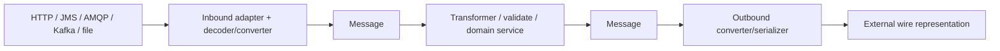
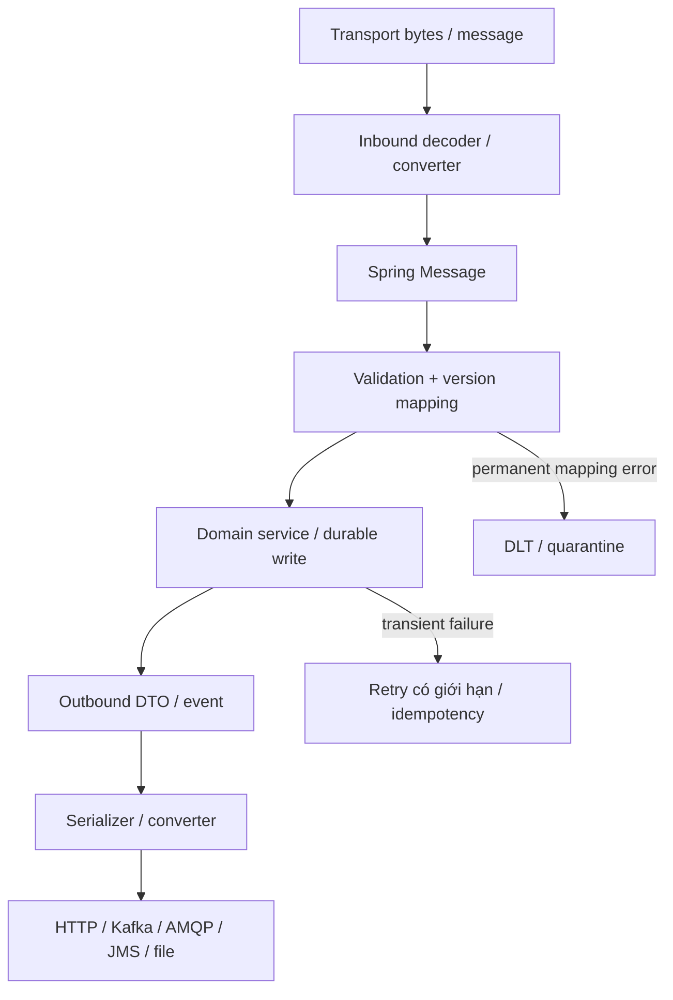
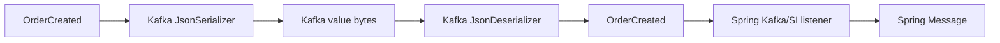
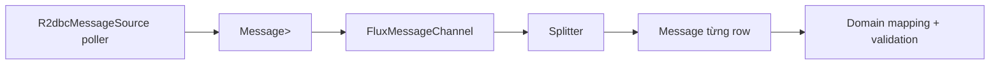
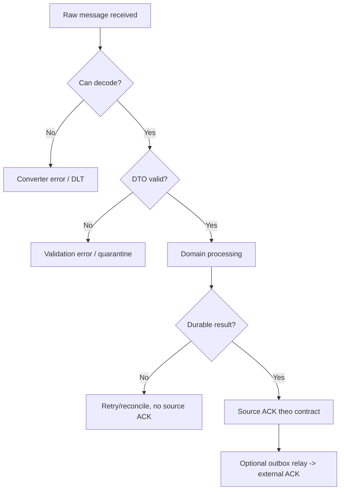

# Message converter cho adapter

> **Chương:** Mapping message  
> **Module:** SPRING_INTEGRATION_ADAPTERS  
> **Ngữ cảnh:** Kết nối các hệ thống ngoài vào Spring Integration bằng inbound/outbound adapter, gateway, poller và `MessageChannel`; thực hành luồng trao đổi qua file, SFTP, HTTP, JMS, AMQP, Kafka và cơ sở dữ liệu. Bài tập trung vào **converter tại ranh giới adapter**, tính tương thích payload, message headers, lỗi, bảo mật và vòng đời kết nối.

## 1. Mục tiêu học tập

Sau bài học, bạn có thể:

- Giải thích **message converter** chuyển đổi dữ liệu giữa biểu diễn ngoài hệ thống và object Java ở **đúng ranh giới adapter**.
- Phân biệt `MessageConverter` của **Spring Messaging**, **Spring JMS**, **Spring AMQP**, HTTP `HttpMessageConverter`, Kafka `Serializer/Deserializer` và `RecordMessageConverter`, với `Transformer` trong Spring Integration.
- Xác định chính xác **payload type** của message sau inbound adapter và **type mong đợi** của outbound adapter trước khi cấu hình mapper.
- Áp dụng JSON UTF-8 ↔ Java record/POJO, điều khiển `Content-Type`, charset, schema version, enum, `BigDecimal` và timestamp một cách rõ ràng.
- Cấu hình các converter phổ biến bằng Spring Boot và Java: Jackson `ObjectMapper`, JMS `MappingJackson2MessageConverter`, AMQP `Jackson2JsonMessageConverter`, Kafka JSON deserializer/serializer.
- Biết trường hợp **không tồn tại một converter thống nhất**: File/SFTP cần đọc/ghi resource, R2DBC cần row mapper, TCP cần framing serializer/codec, JMS/AMQP/Kafka có protocol riêng.
- Hiểu vai trò của `MessageHeaders`, transport-specific headers/properties, trusted type metadata và `correlationId` qua biến đổi.
- Tránh **double conversion**, ép kiểu sai, Java class name từ input không tin cậy, mất precision và “ACK sớm” sau parse.
- Thiết kế lỗi chuyển đổi: parsing, unknown schema, size limit, poison message, DLQ/quarantine, retry/backoff, idempotency và nguồn ACK sau xử lý bền vững.
- Viết unit/integration tests kiểm tra round-trip, wire body, Java payload type, header mapping và phản ứng khi conversion thất bại.

## 2. Message converter nằm ở đâu trong Spring Integration?

Trong thực tế, một message trải qua ít nhất hai thế giới:

1. **Thế giới transport:** HTTP body, Kafka record value, JMS TextMessage/BytesMessage, AMQP body/properties, file bytes, TCP frame.
2. **Thế giới Spring Messaging:** `Message<?>` với `payload` Java và `MessageHeaders`, chạy qua `MessageChannel`, transformer, router, gateway và handler.



**Ví dụ:** cùng một JSON biểu diễn đơn hàng, nhưng Kafka `StringDeserializer` có thể tạo `String`, AMQP JSON converter tạo `OrderCreated`, HTTP inbound gateway tạo `Map` hoặc DTO tùy message converters và request payload type, còn file inbound adapter có thể tạo `File`.

### 2.1. Converter là cơ chế, không phải một lớp dùng chung cho mọi adapter

**Những tên API tương tự nhưng khác contract:**

| Hệ sinh thái | Kiểu/khái niệm | Trách nhiệm |
| --- | --- | --- |
| Spring Messaging | `org.springframework.messaging.converter.MessageConverter` | Chuyển đổi giữa payload và Spring `Message<?>` theo cơ chế messaging. |
| Spring JMS | `org.springframework.jms.support.converter.MessageConverter` | Chuyển Java object ↔ Jakarta JMS `Message`. |
| Spring AMQP | `org.springframework.amqp.support.converter.MessageConverter` | Chuyển Java object ↔ AMQP `Message` (body + message properties). |
| Spring MVC HTTP | `org.springframework.http.converter.HttpMessageConverter<T>` | Đọc/ghi HTTP body theo Java target type/media type. |
| Spring Kafka | `org.apache.kafka.common.serialization.Serializer/Deserializer` | Chuyển key/value giữa Java object và Kafka `byte[]`. |
| Spring Kafka | `RecordMessageConverter` / `MessagingMessageConverter` | Bọc record vào Spring Message hoặc map payload/message headers; khác value deserializer. |
| Spring Integration | `Transformer` hoặc Java DSL `transform(...)` | Biến đổi Spring Message **sau khi** adapter đã giao payload và **trước** handler/outbound. |
| Spring Integration File/SFTP | File transformer/reader | `File`/`Resource`/stream ↔ bytes/text/DTO; phụ thuộc file lifecycle. |
| Spring R2DBC | `RowMapper`, `DatabaseClient.map(...)`, converters của Spring Data | Ánh xạ SQL `Row` ↔ Java object; **không** phải JMS/AMQP MessageConverter. |
| Spring Integration IP | `Serializer/Deserializer`, framing codec | Tách khung TCP/UDP và mã hóa bytes; không mặc định parse JSON thành DTO. |

Các interface trong các hàng **không hoán đổi cho nhau** dù cùng tên `MessageConverter`. Không truyền một Spring JMS converter vào `RabbitTemplate` hoặc Kafka producer và mong hoạt động.

### 2.2. Ba phép biến đổi khác nhau

```text
Wire bytes / transport message
        |
        | transport decoder / MessageConverter / Deserializer
        v
Spring Message<String> hoặc Message<byte[]> hoặc Message<DTO>
        |
        | Spring Integration Transformer
        v
Spring Message<DomainDTO>
        |
        | outbound converter / Serializer
        v
Wire bytes / transport message
```

**Câu hỏi đúng khi thiết kế:** adapter đã làm phép biến đổi nào? Type contract của channel phía sau là gì? Outbound adapter nhận loại payload nào? Nếu không trả lời được, dễ parse hai lần hoặc cast nhầm `byte[]` thành `String`.

### 2.3. Message object ≠ wire format

```java
import org.springframework.messaging.Message;
import org.springframework.messaging.support.MessageBuilder;

Message<String> inProcess = MessageBuilder
        .withPayload("{\"eventId\":\"evt-101\"}")
        .build();
```

Một Spring `Message<String>` ở trong JVM **không đồng nghĩa** một JMS `TextMessage` hay Kafka record đã được tạo. Chỉ khi outbound adapter/converter/serializer chạy mới có biểu diễn wire của đích.

## 3. Định nghĩa hợp đồng dữ liệu xuyên transport

Bài dùng một business event đơn giản:

```json
{
  "eventId": "evt-101",
  "orderId": "ord-501",
  "amount": 125.50,
  "currency": "VND",
  "occurredAt": "2026-11-23T08:30:00+07:00",
  "schemaVersion": 1
}
```

### 3.1. DTO Java

Tạo `OrderCreated.java`:

```java
import java.math.BigDecimal;
import java.time.OffsetDateTime;

public record OrderCreated(
        String eventId,
        String orderId,
        BigDecimal amount,
        String currency,
        OffsetDateTime occurredAt,
        int schemaVersion
) {
}
```

Chọn `BigDecimal` để bảo toàn precision thập phân. `OffsetDateTime` giữ explicit offset từ sender; lưu DB/đối soát thời gian cần chính sách timezone thống nhất. `eventId` là **business event identity ổn định qua retry**, không dùng Spring `MessageHeaders.ID` hoặc Kafka offset thay thế.

### 3.2. Contract khác Java type

| Khía cạnh | Quy tắc demo | Lý do |
| --- | --- | --- |
| `eventId` | Chuỗi không trống, tối đa 80 ký tự | Dedup/correlation business. |
| `orderId` | Chuỗi không trống, tối đa 80 ký tự | Nhận diện aggregate. |
| `amount` | `>0`, precision ≤ 12, scale ≤ 2 | Chống sai số/overflow. |
| `currency` | `VND` trong lab | Không suy đoán tiền tệ từ locale. |
| `occurredAt` | ISO-8601 có offset; không null | Thời gian có ngữ cảnh. |
| `schemaVersion` | Bằng `1` trong lab | Có đường xử lý khi version thay đổi. |
| `Content-Type` | `application/json` cho JSON body | Xác định representation, không tự validate body. |
| Encoding | UTF-8 | Không dựa vào default platform charset. |

**Lưu ý domain:** VND thực tế thường biểu diễn theo đơn vị không có phần thập phân; bài dùng `125.50` để minh họa precision của converter. Production phải chốt amount unit (đồng, xu, minor units), currency scale, rounding và ISO code theo hợp đồng thực sự.

### 3.3. Parse thành công chưa phải validation thành công

Jackson có thể tạo một record với field tham chiếu null hoặc giá trị `schemaVersion` mặc định nếu thiếu trường, tùy mapper configuration. Vì vậy business validation phải chạy **sau conversion**, trước khi thực thi side effect.

Một converter không thay thế authentication, authorization, schema registry hoặc idempotency.

## 4. Chuẩn bị Spring Boot và ObjectMapper

Ví dụ hướng tới **Java 17+, Spring Boot 3.x, Spring Integration 6.x, Spring Framework 6.x**, với Spring Kafka/AMQP/JMS cùng thế hệ do Boot BOM quản lý. Một số tên class và package converter thay đổi giữa những major versions mới hơn; phải kiểm tra API với phiên bản project.

### 4.1. Maven cho core example

```xml
<dependencies>
    <dependency>
        <groupId>org.springframework.boot</groupId>
        <artifactId>spring-boot-starter-integration</artifactId>
    </dependency>
    <dependency>
        <groupId>org.springframework.boot</groupId>
        <artifactId>spring-boot-starter-json</artifactId>
    </dependency>
    <dependency>
        <groupId>org.springframework.boot</groupId>
        <artifactId>spring-boot-starter-test</artifactId>
        <scope>test</scope>
    </dependency>
</dependencies>
```

Để chạy các ví dụ Kafka/JMS/Rabbit/R2DBC riêng, thêm đúng starter/module/driver được nêu ở từng mục. Không cần cấu hình tất cả brokers chỉ để chạy core converter unit test.

### 4.2. Jackson ObjectMapper dùng chung một JSON contract

Trong Spring Boot, thường đã có `ObjectMapper` được Boot auto-configure với các modules và customization. **Ưu tiên inject bean đó** nếu phải đồng bộ format qua các adapters:

```java
import com.fasterxml.jackson.databind.ObjectMapper;
import org.springframework.stereotype.Component;
import java.nio.charset.StandardCharsets;

@Component
public class OrderJsonCodec {

    private final ObjectMapper mapper;

    public OrderJsonCodec(ObjectMapper mapper) {
        this.mapper = mapper;
    }

    public OrderCreated fromJson(String json) {
        if (json == null || json.isBlank()
                || json.length() > 64_000
                || json.getBytes(StandardCharsets.UTF_8).length > 64_000) {
            throw new IllegalArgumentException(
                    "Empty or oversized JSON text");
        }
        try {
            return mapper.readValue(json, OrderCreated.class);
        }
        catch (com.fasterxml.jackson.core.JsonProcessingException ex) {
            throw new IllegalArgumentException(
                    "Invalid order JSON", ex);
        }
    }

    public OrderCreated fromJsonBytes(byte[] bytes) {
        if (bytes == null || bytes.length == 0
                || bytes.length > 64_000) {
            throw new IllegalArgumentException(
                    "Empty or oversized JSON bytes");
        }
        try {
            return mapper.readValue(bytes, OrderCreated.class);
        }
        catch (com.fasterxml.jackson.core.JsonProcessingException ex) {
            throw new IllegalArgumentException(
                    "Invalid order JSON bytes", ex);
        }
    }

    public byte[] toJsonBytes(OrderCreated event) {
        try {
            byte[] bytes = mapper.writeValueAsBytes(event);
            if (bytes.length > 64_000) {
                throw new IllegalArgumentException(
                        "Serialized JSON exceeds size limit");
            }
            return bytes;
        }
        catch (com.fasterxml.jackson.core.JsonProcessingException ex) {
            throw new IllegalStateException(
                    "Cannot serialize OrderCreated", ex);
        }
    }
}
```

Đây là **codec JSON** có giới hạn 64.000 bytes cho bài lab, chưa kiểm tra domain invariants. Nó không thay thế giới hạn request/broker, parser nesting/decompression hay schema validation ở production. Trong production, validate trước khi phát sang downstream.

### 4.3. Validator tách khỏi decoder

Tạo `OrderContract.java`:

```java
import java.math.BigDecimal;
import org.springframework.stereotype.Component;

@Component
public class OrderContract {

    public OrderCreated requireValid(OrderCreated e) {
        if (e == null
                || !validId(e.eventId())
                || !validId(e.orderId())
                || e.amount() == null
                || e.amount().compareTo(BigDecimal.ZERO) <= 0
                || e.amount().precision() > 12
                || e.amount().scale() > 2
                || !"VND".equals(e.currency())
                || e.occurredAt() == null
                || e.schemaVersion() != 1) {
            throw new IllegalArgumentException(
                    "Invalid OrderCreated contract");
        }
        return e;
    }

    private static boolean validId(String value) {
        return value != null
                && !value.isBlank()
                && value.length() <= 80
                && value.matches("[A-Za-z0-9_-]+");
    }
}
```

`OrderContract` dùng một method trả chính DTO sau validation, dễ compose vào `transform`/`filter`. Validation phải diễn ra **trước** DB write, HTTP call hoặc Kafka publish có side effect.

### 4.4. Charset phải là một quyết định explicit

```java
import java.nio.charset.StandardCharsets;

String jsonText =
        new String(jsonBytes, StandardCharsets.UTF_8);

byte[] utf8 = jsonText.getBytes(StandardCharsets.UTF_8);
```

Chỉ decode UTF-8 khi wire contract là text UTF-8. Với PDF, ZIP, image, Protobuf hoặc encrypted bytes, không convert thành `String` trước vì sẽ làm sai dữ liệu.

### 4.5. Xử lý JSON tree và dynamic Map

`ObjectMapper.readTree(...)` trả `JsonNode`; `convertValue(map, OrderCreated.class)` chuyển dữ liệu từ Map sang DTO. Chúng là **Jackson conversions**, khác với `MessageConverter` của JMS/AMQP/HTTP.

```java
import com.fasterxml.jackson.databind.JsonNode;

JsonNode tree = mapper.readTree(json);
if (!tree.path("eventId").isTextual()) {
    throw new IllegalArgumentException("eventId must be a string");
}

OrderCreated event = mapper.treeToValue(
        tree, OrderCreated.class);
contract.requireValid(event);
```

Đoạn này thuộc method có `ObjectMapper mapper`, `String json`, `OrderContract contract` và xử lý `JsonProcessingException` tương ứng. Với schema ổn định, đọc thẳng vào record rồi validate thường đơn giản hơn tree trung gian.

## 5. MessageHeaders và Content-Type trong adapter

### 5.1. Content-Type mô tả cách biểu diễn payload

```java
import org.springframework.messaging.Message;
import org.springframework.messaging.MessageHeaders;
import org.springframework.messaging.support.MessageBuilder;
import org.springframework.util.MimeTypeUtils;

Message<byte[]> outbound = MessageBuilder
        .withPayload(jsonCodec.toJsonBytes(validOrder))
        .setHeader(MessageHeaders.CONTENT_TYPE,
                MimeTypeUtils.APPLICATION_JSON)
        .setHeader("eventId", validOrder.eventId())
        .setHeader("schemaVersion", validOrder.schemaVersion())
        .build();
```

Biến `jsonCodec`, `validOrder` phải có sẵn ở phạm vi chứa snippet. Header `application/json` phù hợp vì body là JSON bytes. Nhưng header **không tự decode bytes** nếu không có converter được cấu hình thực sự đọc header này.

### 5.2. Spring headers khác transport properties

| Metadata | Trong Spring Message | Bên ngoài |
| --- | --- | --- |
| Content type | `MessageHeaders.CONTENT_TYPE` | HTTP `Content-Type`, AMQP contentType, Kafka/JMS header/property tùy mapping. |
| Event ID | Header `eventId` hoặc field payload | Có thể đi qua Kafka header, JMS property, JSON envelope. |
| Correlation | `correlationId` | Kafka/JMS/AMQP correlation properties tùy adapter. |
| Reply channel | `replyChannel` trong JVM | Không serialize thành Java bean/class name cho external system. |
| Message ID | `MessageHeaders.ID` | Không là business ID bền qua redelivery. |
| Transport position | Kafka topic/partition/offset | Không là JMS delivery tag hoặc DB checkpoint. |
| Schema version | Header hoặc payload field | Phải định nghĩa vị trí authoritative và kiểm tra khớp. |

Không có bảo đảm header mapper của mọi adapter tự sao chép tất cả headers. Cần allowlist headers được gửi ra ngoài và integration test mapping đi-về.

### 5.3. Khi payload đổi format, cập nhật metadata

Ví dụ inbound `Message<String>` là text JSON, transformer đổi thành DTO:

```text
Message<String> + contentType=application/json
             |
             | Jackson parse + validation
             v
Message<OrderCreated> ở internal domain channel
             |
             | encode JSON UTF-8
             v
Message<byte[]> + contentType=application/json
```

Giữa JVM, `Message<OrderCreated>` không cần bị hiểu như JSON bytes. Một số converter dùng content type để chọn xử lý; giữ một header stale/wrong type có thể gây lỗi.

### 5.4. Không tin type headers từ untrusted source

Một JMS/AMQP/Kafka message có thể mang metadata ám chỉ tên class. Không nên cho external sender quyết định class Java tùy ý bằng cách truyền `"@class"` hoặc `"__TypeId__"` và bật polymorphic deserialization quá rộng.

Ưu tiên:

- Type allowlist/alias do server cấu hình.
- Một target DTO rõ ràng cho mỗi consumer.
- Schema version router kiểm tra trước deserialize.
- Giới hạn packages được tin cậy.
- Không bật Jackson default typing rộng cho payload ngoài.
- Xác minh thông tin nguồn, chữ ký/ACL và dữ liệu thực tế.

## 6. Conversion inbound, outbound và vị trí đặt validation

### 6.1. Flow điển hình



### 6.2. Ba nơi có thể deserialize JSON

Ví dụ Kafka source gửi JSON bytes:

1. **Kafka `JsonDeserializer`** tạo `OrderCreated` trước khi Spring Integration nhận.
2. Kafka `StringDeserializer` tạo `String`; Spring Integration `transform(...)` dùng `OrderJsonCodec` tạo DTO.
3. Kafka `ByteArrayDeserializer` tạo `byte[]`; transformer dùng Jackson `readValue(byte[], DTO.class)`.

**Chọn một cách có chủ đích.** Không để `JsonDeserializer` đã tạo DTO rồi phía sau vẫn chạy `transform(String.class, ...)`; lỗi có thể biểu hiện là type mismatch hoặc transformer không xử lý.

### 6.3. Converter tạo Java object chưa xác thực

Sau deserialize, kiểm tra:

- Required fields và schema version.
- Size/depth/array-length limits.
- Timezone/currency/decimal precision.
- Event ID ổn định, authorization và tenant identity.
- Tính tương thích với business transition.
- Các headers/properties cần giữ để ACK hoặc trả reply.

Một `MessageConverter` có thể trả về object hợp lệ về cú pháp nhưng **không có nghĩa** operation nghiệp vụ đã hoàn tất.

## 7. HTTP: HttpMessageConverter và Spring Integration HTTP adapter

### 7.1. HTTP content negotiation

Để chạy ví dụ `@RestController` phía dưới, thêm `spring-boot-starter-web` ngoài các dependencies core của mục 4:

```xml
<dependency>
    <groupId>org.springframework.boot</groupId>
    <artifactId>spring-boot-starter-web</artifactId>
</dependency>
```

HTTP body conversion thường dựa trên:

- HTTP `Content-Type` để biết **request entity** được gửi theo media type nào.
- Target Java type của endpoint (DTO, `String`, `byte[]`, `Map`).
- `Accept`/produces để chọn representation của response.
- Danh sách `HttpMessageConverter` đã đăng ký (chẳng hạn Jackson JSON converter, String converter, byte array converter).

Ví dụ Spring MVC:

```java
import org.springframework.http.MediaType;
import org.springframework.web.bind.annotation.PostMapping;
import org.springframework.web.bind.annotation.RequestBody;
import org.springframework.web.bind.annotation.RequestMapping;
import org.springframework.web.bind.annotation.RestController;

@RestController
@RequestMapping("/api/orders")
public class OrderHttpEndpoint {

    private final OrderContract contract;

    public OrderHttpEndpoint(OrderContract contract) {
        this.contract = contract;
    }

    @PostMapping(
            path = "/events",
            consumes = MediaType.APPLICATION_JSON_VALUE,
            produces = MediaType.APPLICATION_JSON_VALUE)
    public AcceptedReceipt accept(@RequestBody OrderCreated event) {
        OrderCreated validated = contract.requireValid(event);
        return new AcceptedReceipt(validated.eventId(), "VALIDATED");
    }
}

record AcceptedReceipt(String eventId, String status) {
}
```

Đây là **HTTP boundary demo**: JSON → `OrderCreated` nhờ Spring MVC HTTP converter, rồi validation. Response `VALIDATED` chưa chứng minh event đã được lưu bền hoặc gửi broker. Trong một hệ thống cần ACK đáng tin cậy, phải thêm durable write/idempotency trước khi trả 2xx theo hợp đồng.

### 7.2. HTTP inbound gateway trong Spring Integration

Spring Integration HTTP inbound gateway cũng xử lý request và phát Spring Message vào flow, nhưng:

- Có converter/target request payload type riêng được áp dụng ở endpoint.
- Một HTTP body JSON có thể thành `String` hoặc DTO tùy configuration, không phụ thuộc vào media type duy nhất.
- Java DSL handler sau đó nhận **Java payload type thực**.
- Reply message phải được chuyển thành HTTP response qua converter phù hợp.
- `replyChannel`/timeout/error response phải được bảo toàn đúng topology.

Không đặt thêm một JSON converter trong business flow khi inbound gateway đã convert trực tiếp thành DTO.

### 7.3. HTTP lỗi conversion

| Trường hợp | Kết quả nên cân nhắc |
| --- | --- |
| Unsupported media type | HTTP 415 theo API contract. |
| JSON sai cú pháp | HTTP 400, không gọi business handler. |
| Required field/domain value sai | 400/422 theo contract, có lỗi field rõ. |
| Schema version mới chưa được hỗ trợ | 400/422 hoặc version-specific error. |
| Body vượt kích thước cho phép | 413 hoặc limit error theo server. |
| Downstream R2DBC/Kafka tạm ngưng | 503/202/timeout theo semantic, không giả “validation failed”. |

Không dùng HTTP 2xx chỉ vì JSON đã deserialize xong nếu API contract định nghĩa 2xx là nghiệp vụ **đã được lưu bền**.

## 8. Converter và Transformer: chọn nơi nào hợp lý?

### 8.1. Converter ở transport boundary

Ưu điểm:

- Inbound code và message channels nhận **DTO typed** ngay.
- Tránh nhiều handlers tự parse JSON.
- Sớm loại payload sai wire format/schema.
- Có thể tái sử dụng HTTP/JMS/AMQP/Kafka converter configuration.

Nhược điểm:

- Serializer/converter ràng buộc với transport framework.
- Type metadata từ bên ngoài phải được kiểm soát kỹ.
- Converter error có thể phát sinh **trước khi Spring Integration flow nhận message**, đòi hỏi xử lý lỗi ở adapter/listener container.

### 8.2. Transformer trong Spring Integration

Ưu điểm:

- Có thể giữ `String`/`byte[]` ở ingress rồi route theo `contentType`/schemaVersion.
- Dễ ghi lỗi/quarantine kèm source metadata.
- Áp dụng cùng mapper cho nhiều transports.
- Đơn vị thử nghiệm rõ ràng là Java function/bean.

Nhược điểm:

- Cần thêm bước conversion rõ ràng trong flow.
- Phải biết chính xác payload type từ adapter.
- Nếu converter inbound đã tạo DTO, transformer có thể bị thừa hoặc double-convert.
- Cần tự quản lý header propagation/content type sau biến đổi.

### 8.3. Quy tắc chọn

| Tình huống | Gợi ý |
| --- | --- |
| HTTP endpoint contract một DTO cố định | HTTP converter → DTO → validate. |
| Kafka topic chỉ chứa một event type đã versioned | Kafka JSON deserializer có allowlist hoặc bytes → transformer. |
| Shared topic chứa nhiều message types | Envelope/schema router trước khi tạo domain DTO. |
| JMS/AMQP đã bật trusted JSON converter | Không parse JSON lần nữa trong handler. |
| File/SFTP nhận `File` hoặc `Resource` | Đọc/stream file rồi parse theo format; quản lý lifecycle. |
| TCP nhận custom length-delimited binary | Framing serializer trước; protobuf/JSON codec phía sau. |
| R2DBC trả `Flux<Row>` | Row mapping/`payloadType`/splitter, không dùng HTTP converter. |

**Không có lựa chọn chung tốt nhất** cho mọi hệ thống; hợp đồng ở mỗi ranh giới quyết định.


## 9. JMS: MappingJackson2MessageConverter

### 9.1. JMS là message format/protocol riêng

JMS (Jakarta Messaging) có các loại message như `TextMessage`, `BytesMessage`, `MapMessage` và `ObjectMessage`. Một consumer Spring JMS có thể dùng `MessageConverter` để chuyển từ JMS message thành Java object trước khi business handler xử lý.

**Không đồng nhất**:

- JMS `TextMessage` chứa JSON text.
- Spring `Message<String>` chứa Java String.
- Spring `Message<OrderCreated>` chứa DTO.
- JSON `"@class"`/JMS type ID property chỉ là metadata, không được phép ra lệnh tạo arbitrary class.

### 9.2. Bổ sung dependency

```xml
<dependency>
    <groupId>org.springframework.boot</groupId>
    <artifactId>spring-boot-starter-activemq</artifactId>
</dependency>
<dependency>
    <groupId>org.springframework.integration</groupId>
    <artifactId>spring-integration-jms</artifactId>
</dependency>
```

Đây là **ví dụ khi dùng ActiveMQ Classic** với Spring Boot 3.x; nếu dùng Artemis hoặc một JMS provider khác, chọn starter/driver Jakarta tương ứng, **không thêm cả hai provider vô cớ**. Spring Integration JMS không tự tạo broker.

### 9.3. Converter bean JSON ↔ JMS TextMessage

Tạo `JmsOrderConversionConfiguration.java`:

```java
import java.util.Map;

import com.fasterxml.jackson.databind.ObjectMapper;
import org.springframework.context.annotation.Bean;
import org.springframework.context.annotation.Configuration;
import org.springframework.jms.support.converter.MappingJackson2MessageConverter;
import org.springframework.jms.support.converter.MessageType;

@Configuration
public class JmsOrderConversionConfiguration {

    @Bean
    MappingJackson2MessageConverter orderJmsMessageConverter(
            ObjectMapper mapper) {

        var converter = new MappingJackson2MessageConverter();

        converter.setObjectMapper(mapper);
        converter.setTargetType(MessageType.TEXT);
        converter.setTypeIdPropertyName("_type");
        converter.setTypeIdMappings(
                Map.of("order-created-v1", OrderCreated.class));

        return converter;
    }
}
```

Ý nghĩa:

1. `MessageType.TEXT` yêu cầu encode JSON vào JMS `TextMessage` ở outbound.
2. `ObjectMapper` được inject để dùng cùng Java Time/amount conventions.
3. `_type` là **JMS property** chỉ định type alias cho conversion, **không phải tên class tùy ý do sender gửi**.
4. `setTypeIdMappings(...)` tạo mapping allowlist alias `order-created-v1` → `OrderCreated`.
5. Converter có thể phát exception khi JMS message type/metadata/body không đúng; xử lý lỗi ở JMS adapter/container.

**Bảo mật:** Không lấy chuỗi `_type` từ untrusted sender rồi dùng `Class.forName(...)`. Mỗi type ID được chấp nhận phải có mapping tường minh và một message schema đáng tin.

### 9.4. Dùng cùng converter ở JmsTemplate

```java
import jakarta.jms.ConnectionFactory;
import org.springframework.context.annotation.Bean;
import org.springframework.jms.core.JmsTemplate;

@Bean
JmsTemplate orderJmsTemplate(
        ConnectionFactory factory,
        MappingJackson2MessageConverter converter) {

    JmsTemplate template = new JmsTemplate(factory);
    template.setMessageConverter(converter);
    return template;
}
```

Đây là bean method trong `@Configuration`, giả định provider đã tạo `jakarta.jms.ConnectionFactory`. Gửi:

```java
jmsTemplate.convertAndSend("orders.created", validatedOrder);
```

Nếu converter được gắn vào template, Java DTO sẽ được mã hóa thành JMS message phù hợp. Khi dùng Spring Integration JMS inbound/outbound adapter, phải cấu hình **converter ở chính JMS endpoint/container hoặc JmsTemplate được adapter sử dụng**; việc tạo bean riêng **không đảm bảo mọi endpoint tự dùng nó**.

### 9.5. Phía nhận cần cùng alias/schema

```text
Producer:
  OrderCreated DTO
      |
      | MappingJackson2MessageConverter
      v
  JMS TextMessage:
    text = JSON
    property _type = order-created-v1

Consumer:
  JMS TextMessage
      |
      | Matching trusted type mapping
      v
  OrderCreated DTO
      |
      | Spring Integration channel
      v
  Business handler
```

Một JMS sender không dùng Spring có thể không gửi `_type` theo đúng alias. Trong trường hợp này cần **contract rõ**: consumer cấu hình fixed type/route, custom converter hoặc chuẩn hóa JMS properties, không hy vọng converter tự đoán đúng Java class.

### 9.6. Lỗi và ACK ở JMS

JMS redelivery phụ thuộc session transacted/ack mode và listener-container error handling, **không** chỉ phụ thuộc JSON converter.

- Conversion có thể lỗi trước khi Spring Integration service activator chạy.
- Một exception parse phải được listener container xử lý bằng rollback/recovery/DLQ đúng policy.
- Nếu validation hoàn tất nhưng DB write lỗi, không ACK JMS như đã thành công.
- Với transacted JMS session và DB R2DBC transaction riêng, không tự có distributed atomicity.
- Nếu DB commit rồi JMS ACK mất, event có thể redeliver; dùng stable `eventId` và dedup.

### 9.7. Tránh JMS ObjectMessage deserialization tùy ý

`ObjectMessage` có thể đòi Java serialization và type/class trust, phát sinh rủi ro interop/security. Khi có lựa chọn, JSON/Avro/Protobuf với schema/allowlist tường minh dễ quản lý hơn cho tích hợp nhiều hệ thống. Không vô hiệu hóa deserialization trust checks để “chữa lỗi converter”.

## 10. AMQP/RabbitMQ: Jackson2JsonMessageConverter

### 10.1. Phân biệt AMQP body và properties

AMQP message thường có:

```text
AMQP Message
  body: byte[] (JSON UTF-8)
  properties:
    contentType: application/json
    contentEncoding: UTF-8
    headers:
      __TypeId__: order-created-v1 (khi được cấu hình phù hợp)
```

`Jackson2JsonMessageConverter` thuộc **Spring AMQP**, không phải Spring JMS converter. Nó cần phối hợp body, message properties và type mapping/trust để tạo Java object.

### 10.2. Dependencies RabbitMQ

```xml
<dependency>
    <groupId>org.springframework.boot</groupId>
    <artifactId>spring-boot-starter-amqp</artifactId>
</dependency>
<dependency>
    <groupId>org.springframework.integration</groupId>
    <artifactId>spring-integration-amqp</artifactId>
</dependency>
```

Spring AMQP/Rabbit client và Spring Integration AMQP phải dùng versions phù hợp theo Boot BOM.

### 10.3. Converter bean

Tạo `RabbitOrderConversionConfiguration.java`:

```java
import com.fasterxml.jackson.databind.ObjectMapper;
import org.springframework.amqp.support.converter.Jackson2JsonMessageConverter;
import org.springframework.context.annotation.Bean;
import org.springframework.context.annotation.Configuration;

@Configuration
public class RabbitOrderConversionConfiguration {

    @Bean
    Jackson2JsonMessageConverter orderAmqpMessageConverter(
            ObjectMapper mapper) {
        return new Jackson2JsonMessageConverter(mapper);
    }
}
```

Đoạn này biểu thị **conversion JSON**, chưa phải cấu hình đầy đủ trust/alias cho external untrusted messages. Cách gắn `ClassMapper`/`JavaTypeMapper`, trusted packages/type precedence khác nhau theo major version Spring AMQP. **Phải hạn chế concrete target types** theo schema phù hợp, không để untrusted header chỉ định arbitrary Java classes.

### 10.4. Gắn với RabbitTemplate

```java
import org.springframework.amqp.rabbit.core.RabbitTemplate;
import org.springframework.amqp.rabbit.connection.ConnectionFactory;
import org.springframework.context.annotation.Bean;

@Bean
RabbitTemplate orderRabbitTemplate(
        ConnectionFactory connectionFactory,
        Jackson2JsonMessageConverter converter) {

    RabbitTemplate template =
            new RabbitTemplate(connectionFactory);
    template.setMessageConverter(converter);
    return template;
}
```

Gửi một event:

```java
rabbitTemplate.convertAndSend(
        "orders.exchange",
        "orders.created",
        validatedOrder);
```

Ở đây `orders.exchange` và routing key `orders.created` là ví dụ; exchange/queue/bindings phải được provision riêng theo kiến trúc. RabbitTemplate không mặc định đảm bảo publisher confirm hay outbox semantics chỉ vì đã encode JSON.

### 10.5. Consumer cần cùng convention

Ví dụ listener dạng Spring AMQP:

```java
import org.springframework.amqp.rabbit.annotation.RabbitListener;
import org.springframework.stereotype.Component;

@Component
public class OrderRabbitConsumer {

    private final OrderContract contract;

    public OrderRabbitConsumer(OrderContract contract) {
        this.contract = contract;
    }

    @RabbitListener(queues = "orders.created")
    public void consume(OrderCreated order) {
        OrderCreated validated = contract.requireValid(order);

        // Thực tế: gọi durable service; không ACK chỉ vì validate.
        System.out.println(validated.eventId());
    }
}
```

Listener cần container factory/converter được cấu hình để `@RabbitListener` nhận `OrderCreated`. Bean converter tồn tại không đảm bảo một **custom listener container** tự sử dụng nó; Boot có thể auto-configure một số thành phần khi có duy nhất bean phù hợp, nhưng phải kiểm tra cấu hình thực tế.

**Quan trọng:** đoạn listener chỉ log, **không phải reliable production consumer**. Với durable workflow, handler phải thực hiện DB transaction/outbox/idempotency trước khi ACK hoàn tất.

### 10.6. Type metadata và không tin arbitrary class headers

Một producer có thể gửi header `__TypeId__`. Consumer phải quyết định có chấp nhận type alias nào, không dùng toàn bộ class name tùy ý từ broker. Với shared queue nhiều event types, cần:

1. Public event envelope/type name được công bố.
2. Allowlists giữa alias và DTO class.
3. SchemaVersion để chọn parser.
4. Validation sau conversion.
5. DLQ/quarantine khi unknown type hoặc malformed payload.

Nếu chỉ xử lý một loại event, cấu hình **fixed target type** ở boundary thường dễ kiểm soát hơn suy luận arbitrary types.

### 10.7. Chế độ text/raw fallback

Khi AMQP message không có `contentType=application/json`, converter có thể không deserialize như mong đợi hoặc trả raw bytes tùy phiên bản/config. Không cast mù `(OrderCreated) message.getPayload()` khi adapter thực tế nhận `byte[]`.

Khi debug, log **class của payload, contentType, safe event ID và converter class** thay vì log nguyên body chứa dữ liệu nhạy cảm.

## 11. Kafka: Serializer/Deserializer trước, RecordMessageConverter sau

### 11.1. Kafka value conversion thường nằm ở serializer/deserializer

Kafka record có key/value bytes và headers. Kafka client dùng `Serializer<T>` khi gửi, `Deserializer<T>` khi đọc. Chúng không phải HTTP/JMS/AMQP MessageConverter.



Nếu deserializer là `StringDeserializer`, output sẽ là `String`; nếu `ByteArrayDeserializer`, output là `byte[]`. Spring Integration không tự thay đổi điều đó chỉ vì payload JSON.

### 11.2. Tạo typed JSON consumer bằng Spring Kafka config

Dependency:

```xml
<dependency>
    <groupId>org.springframework.kafka</groupId>
    <artifactId>spring-kafka</artifactId>
</dependency>
<dependency>
    <groupId>org.springframework.integration</groupId>
    <artifactId>spring-integration-kafka</artifactId>
</dependency>
```

application.yml cho **một topic chỉ có OrderCreated v1**, ví dụ package DTO `com.example.events`:

```yaml
spring:
  kafka:
    bootstrap-servers: localhost:9092
    consumer:
      group-id: order-mapping-demo
      enable-auto-commit: false
      key-deserializer: org.apache.kafka.common.serialization.StringDeserializer
      value-deserializer: org.springframework.kafka.support.serializer.ErrorHandlingDeserializer
      properties:
        spring.deserializer.value.delegate.class: org.springframework.kafka.support.serializer.JsonDeserializer
        spring.json.value.default.type: com.example.events.OrderCreated
        spring.json.trusted.packages: com.example.events
        spring.json.use.type.headers: false
```

**Điểm quan trọng:**

- Package/class `com.example.events.OrderCreated` là **ví dụ**, phải thay đúng class đã biên dịch trong ứng dụng.
- `ErrorHandlingDeserializer` bọc delegate để framework xử lý tốt hơn các lỗi deserialize đã xảy ra **trước listener**; vẫn phải cấu hình error handler/DLT.
- `spring.json.value.default.type` xác định target class nếu không lấy type info từ headers.
- `spring.json.use.type.headers=false` không tin type headers để chọn arbitrary Java class.
- `spring.json.trusted.packages` nên càng hẹp càng tốt, không bật `*` cho dữ liệu bên ngoài.
- `enable-auto-commit=false` **chưa đủ** để thiết lập ACK sau durable processing; còn listener container ack mode và error handler.

### 11.3. Kafka producer JSON

```yaml
spring:
  kafka:
    producer:
      key-serializer: org.apache.kafka.common.serialization.StringSerializer
      value-serializer: org.springframework.kafka.support.serializer.JsonSerializer
      properties:
        spring.json.add.type.headers: false
```

Ví dụ `KafkaTemplate<String, OrderCreated>` khi cấu hình type phù hợp:

```java
import org.springframework.kafka.core.KafkaTemplate;

public class OrderPublisher {

    private final KafkaTemplate<String, OrderCreated> kafka;

    public OrderPublisher(KafkaTemplate<String, OrderCreated> kafka) {
        this.kafka = kafka;
    }

    public void send(OrderCreated event) {
        kafka.send("orders.created", event.orderId(), event);
    }
}
```

**Đây là fire-and-forget demo, không phải publish ACK:** `KafkaTemplate.send(...)` trả một future trong Spring Kafka 3.x; method `void send` ở trên không chờ broker confirmation. Production cần xử lý success/failure, retry với stable event ID và transactional outbox khi yêu cầu nhất quán DB-broker.

### 11.4. Vì sao Kafka RecordMessageConverter lại khác JsonDeserializer?

`JsonDeserializer` biến Kafka **value bytes** thành Java object. Sau đó Spring Kafka có thể dùng `RecordMessageConverter`/`MessagingMessageConverter` để biến toàn bộ `ConsumerRecord` thành Spring `Message<?>`, gồm payload và Kafka metadata headers.

Có những converter ở tầng record có thể chuyển payload JSON từ String/byte[] vào một target object, **tùy converter/handler target type và version**. Tuy nhiên không được mặc định rằng việc đăng ký một `RecordMessageConverter` sẽ thay thế `Deserializer` đã chọn.

**Mô hình quyết định:**

```text
Kafka value bytes
    |
    +-- JsonDeserializer -> OrderCreated
    |                       |
    |                       +-- RecordMessageConverter -> Spring Message<OrderCreated>
    |
    +-- StringDeserializer -> String
    |                         |
    |                         +-- optional record JSON converter -> DTO
    |
    +-- ByteArrayDeserializer -> byte[]
                              |
                              +-- SI Transformer -> DTO
```

Khi muốn phân biệt lỗi:

- Deserializer error phát sinh **trước khi listener được gọi**.
- RecordMessageConverter error có thể xảy ra trong giai đoạn chuyển record sang message.
- Spring Integration transformer error xảy ra **sau khi message đã vào flow**.

Ba vị trí đòi hỏi cách recover/DLT khác nhau.

### 11.5. Headers và schema registry

Kafka headers có thể mang content type, schema ID/version, event type, correlation ID. Với Avro/Protobuf hoặc schema registry, dùng **schema-aware serializers/deserializers** tương thích; không dùng Jackson JSON để “giải mã” bytes mà không theo đúng format.

Nếu cùng topic chứa nhiều event types, cân nhắc envelope + schema ID/trusted type mappings. Không dùng `spring.json.trusted.packages=*` như cách chữa nhanh khi consumer nhận type header lạ.

### 11.6. Conversion OK ≠ offset commit

Ví dụ event JSON đã thành `OrderCreated` nhưng R2DBC transaction lỗi. Không commit Kafka consumer offset như đã xử lý xong chỉ vì conversion thành công.

Ngược lại, khi broker redelivery sau DB commit nhưng offset chưa commit, converter có thể tạo **Spring Message mới** với một `MessageHeaders.ID` khác: business `eventId` và database unique constraint phải nhận ra duplicate.

## 12. Spring Integration Java DSL: một contract cho nhiều adapter

### 12.1. Tách conversion khỏi business handler

Giả định inbound Kafka được cấu hình `StringDeserializer` hoặc HTTP/JMS inbound adapter đã cung cấp Java `String` JSON. Tạo flow:

```java
import org.springframework.context.annotation.Bean;
import org.springframework.context.annotation.Configuration;
import org.springframework.integration.config.EnableIntegration;
import org.springframework.integration.dsl.IntegrationFlow;

@Configuration
@EnableIntegration
public class OrderMappingIntegrationConfiguration {

    @Bean
    IntegrationFlow jsonOrderMappingFlow(
            OrderJsonCodec codec, OrderContract contract) {

        return IntegrationFlow
                .from("incomingOrderJson")
                .transform(String.class, codec::fromJson)
                .transform(OrderCreated.class, contract::requireValid)
                .handle(OrderCreated.class, (event, headers) ->
                        new MappingReceipt(
                                event.eventId(),
                                event.orderId(),
                                "VALIDATED"))
                .get();
    }

    @Bean
    IntegrationFlow byteOrderMappingFlow(
            OrderJsonCodec codec, OrderContract contract) {

        return IntegrationFlow
                .from("incomingOrderBytes")
                .transform(byte[].class, codec::fromJsonBytes)
                .transform(OrderCreated.class, contract::requireValid)
                .handle(OrderCreated.class, (event, headers) ->
                        new MappingReceipt(
                                event.eventId(),
                                event.orderId(),
                                "VALIDATED"))
                .get();
    }
}
```

Tạo `MappingReceipt.java`:

```java
public record MappingReceipt(
        String eventId,
        String orderId,
        String result
) {
}
```

Hai flows nhận **hai Java payload types khác nhau** qua hai input channels để tránh một handler cast sai.

### 12.2. Gateway kiểm tra flow không cần external broker

```java
import org.springframework.integration.annotation.MessagingGateway;

@MessagingGateway(defaultRequestChannel = "incomingOrderJson")
public interface OrderMappingGateway {

    MappingReceipt map(String json);
}
```

Gọi:

```java
String json = """
        {
          "eventId":"evt-101",
          "orderId":"ord-501",
          "amount":125.50,
          "currency":"VND",
          "occurredAt":"2026-11-23T08:30:00+07:00",
          "schemaVersion":1
        }
        """;

MappingReceipt result = gateway.map(json);
System.out.println(result);
```

Kết quả kỳ vọng:

```text
MappingReceipt[eventId=evt-101, orderId=ord-501, result=VALIDATED]
```

Ví dụ chỉ xác nhận JSON mapping và validation trong JVM. Nó **không** chứng minh Kafka offset đã commit, JMS ACK hoặc database đã lưu.

### 12.3. Chọn nguồn phát đã-convert hay raw

| Nguồn gửi vào Spring Integration channel | Chọn flow |
| --- | --- |
| `Message<String>` chứa JSON | `incomingOrderJson`. |
| `Message<byte[]>` chứa JSON UTF-8 | `incomingOrderBytes`. |
| `Message<OrderCreated>` đã được converter tạo DTO | Bỏ bước JSON parse, chỉ validation + business handler. |
| `Message<File>` từ File/SFTP adapter | File reader/stream → format parser → DTO. |
| `Message<Flux<OrderRow>>` từ R2DBC source | Subscribe/splitter → row/entity mapping → DTO. |

Đừng dùng `instanceof String` ở mọi handler để đoán nguồn. Ở hệ thống lớn, **document type contract tại mỗi channel** và chỉ route theo type khi thật sự phục vụ nhiều formats.

### 12.4. Typed DTO khác MessageHeaders.ID

Bản thân converter có thể tạo Spring Message mới hoặc gateway tạo message mới. Không dùng `MessageHeaders.ID` để nhận diện cùng event qua redelivery. `OrderCreated.eventId()` phải giữ ổn định, được validation và lưu vào processed ledger/outbox khi xử lý bền vững.

### 12.5. Outbound mapping với header nhất quán

Khi một API ngoài cần JSON bytes:

```java
import org.springframework.messaging.Message;
import org.springframework.messaging.MessageHeaders;
import org.springframework.messaging.support.MessageBuilder;
import org.springframework.util.MimeTypeUtils;

public Message<byte[]> encodeForOutbound(
        OrderCreated event, OrderJsonCodec codec) {

    byte[] bytes = codec.toJsonBytes(event);

    return MessageBuilder.withPayload(bytes)
            .setHeader(MessageHeaders.CONTENT_TYPE,
                    MimeTypeUtils.APPLICATION_JSON)
            .setHeader("eventId", event.eventId())
            .setHeader("schemaVersion", event.schemaVersion())
            .build();
}
```

Đoạn method minh họa; converter/serializer của **outbound adapter cụ thể** phải nhận loại payload tương ứng. Đừng double-encode: nếu Kafka producer đã dùng `JsonSerializer<OrderCreated>` thì gửi DTO, không ép nó parse lại JSON bytes.


## 13. Spring Messaging MessageConverter: còn một lớp khác

### 13.1. Tên giống, contract khác

`org.springframework.messaging.converter.MessageConverter` làm việc với **Spring Message** (và target Java class). Nó **không** đồng nghĩa JMS `MessageConverter`, AMQP `MessageConverter` hoặc HTTP `HttpMessageConverter`.

Một ứng dụng có thể dùng `MappingJackson2MessageConverter` của Spring Messaging để chuyển payload JSON bytes/String thành DTO khi một messaging handler cần một target type cụ thể.

### 13.2. Test minh họa converter của Spring Messaging

```java
import com.fasterxml.jackson.databind.ObjectMapper;

import org.springframework.messaging.Message;
import org.springframework.messaging.MessageHeaders;
import org.springframework.messaging.converter.MappingJackson2MessageConverter;
import org.springframework.messaging.support.MessageBuilder;
import org.springframework.util.MimeTypeUtils;

public OrderCreated springMessageToDto(
        byte[] jsonBytes, ObjectMapper mapper) {

    MappingJackson2MessageConverter converter =
            new MappingJackson2MessageConverter();
    converter.setObjectMapper(mapper);

    Message<byte[]> incoming = MessageBuilder
            .withPayload(jsonBytes)
            .setHeader(MessageHeaders.CONTENT_TYPE,
                    MimeTypeUtils.APPLICATION_JSON)
            .build();

    Object result = converter.fromMessage(
            incoming, OrderCreated.class);

    if (!(result instanceof OrderCreated order)) {
        throw new IllegalArgumentException(
                "Cannot convert Spring Message payload");
    }
    return order;
}
```

Đây là một **method minh họa**, dùng trong class phù hợp. Converter phụ thuộc target type và headers; conversion failure có thể trả `null` hoặc ném exception tùy implementation/policy. Đừng ép kết quả null thành một Spring Message payload hợp lệ.

### 13.3. Converter không mặc định chạy trên mọi MessageChannel

Có bean `MappingJackson2MessageConverter` không có nghĩa mọi `DirectChannel` hoặc `FluxMessageChannel` sẽ tự chuyển đổi message payload khi gửi.

`MessageChannel` chủ yếu vận chuyển Spring Message; các **method-invoking handlers/gateways** có cơ chế resolve/convert arguments riêng khi cấu hình. Trong `IntegrationFlow`, `transform(...)` là chỗ explicit, dễ kiểm chứng.

**Cần kiểm tra bằng test:** handler thực nhận `String`, `byte[]` hay DTO? Không chỉ dựa vào tên bean MessageConverter trong application context.

### 13.4. Khi nào nên dùng?

- Có method handler với target type rõ và messaging conversion cần thiết.
- Cần message content type negotiation trong Spring Messaging layer.
- Muốn centralize cơ chế message-to-method conversion trong một cấu hình được kiểm soát.

Nếu flow chỉ có một conversion JSON/String → DTO, một transformer explicit sử dụng `OrderJsonCodec` thường dễ hiểu hơn và ít chồng chéo so với nhiều converter đăng ký toàn cục.

## 14. File và SFTP: resource/stream transformer, không phải broker converter

### 14.1. File inbound thường mang File, không tự chứa JSON DTO

```text
Local/SFTP file inbound
    |
    v
Message<File> hoặc Message<Resource>/stream tùy mode
    |
    v
File reader / streaming transformer
    |
    v
String / byte[] / CSV records
    |
    v
JSON/CSV/XML parser + validator
    |
    v
Message<Domain DTO>
```

Một **SFTP inbound synchronizing adapter** thường tải file về local rồi đưa `File` vào flow; remote streaming adapter có kiểu/lifecycle khác. Không áp dụng `MappingJackson2MessageConverter` của JMS cho một `Message<File>` rồi mong đọc trực tiếp file.

### 14.2. Hàm đọc file JSON nhỏ có giới hạn

```java
import java.io.File;
import java.io.IOException;
import java.nio.charset.StandardCharsets;
import java.nio.file.Files;

public final class FileJsonReader {

    private static final long MAX_BYTES = 64_000;

    private FileJsonReader() {
    }

    public static String readUtf8(File file) {
        if (file == null || !file.isFile()) {
            throw new IllegalArgumentException(
                    "Expected a readable regular file");
        }
        try {
            if (Files.size(file.toPath()) > MAX_BYTES) {
                throw new IllegalArgumentException(
                        "JSON file exceeds size limit");
            }
            return Files.readString(
                    file.toPath(), StandardCharsets.UTF_8);
        }
        catch (IOException ex) {
            throw new IllegalStateException(
                    "Cannot read JSON file", ex);
        }
    }
}
```

Lưu ý giới hạn size là lab, không tính đến race nếu file thay đổi giữa lúc `Files.size(...)` và `Files.readString(...)`. Production nên dùng readiness/atomic rename, file ownership và byte-limited reading nếu input không tin cậy.

### 14.3. Flow File → String → DTO

```java
import java.io.File;
import org.springframework.context.annotation.Bean;
import org.springframework.integration.dsl.IntegrationFlow;

@Bean
IntegrationFlow fileToOrderFlow(
        OrderJsonCodec codec, OrderContract contract) {

    return IntegrationFlow
            .from("localOrderFiles")
            .transform(File.class, FileJsonReader::readUtf8)
            .transform(String.class, codec::fromJson)
            .transform(OrderCreated.class, contract::requireValid)
            .handle(OrderCreated.class, (event, headers) -> {
                // Lab: chỉ log, production phải lưu/xử lý bền.
                System.out.println(event.eventId());
                return null;
            })
            .get();
}
```

`localOrderFiles` là **input channel từ một File/SFTP inbound adapter**, không phải cấu hình file watcher. Như vậy mapping layer dễ tái sử dụng; adapter quản lý poller, filters và file ready semantics riêng.

### 14.4. Khi nào ACK/rename file?

Nếu file chứa một event:

1. Adapter nhận và lock/claim file hợp lệ.
2. Đọc/parse/validate.
3. Ghi DB transaction/outbox hoặc hoàn tất yêu cầu downstream.
4. Chỉ khi có bằng chứng đã xử lý đủ bền, rename/archive/mark accepted.
5. Nếu parse lỗi vĩnh viễn, quarantine kèm lý do và source identity.
6. Nếu DB/broker tạm lỗi, giữ file/metadata để retry.

Không xóa file ngay sau `Files.readString(...)` vì converter success không đồng nghĩa delivery success.

### 14.5. InputStream và Resource

Khi payload là `InputStream` hoặc `Resource`:

- Xác định thành phần chịu trách nhiệm đóng stream.
- Không gửi stream đã close sang channel bất đồng bộ.
- Tránh đọc toàn bộ video/CSV lớn vào RAM.
- Streaming parser phải có schema, giới hạn row/bytes và error recovery.
- Retry phải tạo được stream mới hoặc có nguồn replayable.
- Không nhận một `InputStream` rồi cast thành `String`.

### 14.6. CSV/XML/Protobuf không phải JSON

Nếu tệp là CSV, dùng CSV parser hiểu quote/escape/charset/headers, **không** dùng `String.split(",")` với CSV có dấu phẩy trong field. Với XML cần cấu hình parser chống XXE; với Protobuf/Avro cần schema-aware codec.

**Converter theo adapter** phải tuân theo wire contract, không gắn mọi loại file vào Jackson JSON chỉ vì Java code dễ viết.

## 15. TCP/UDP, WebSocket, MQTT: framing và payload conversion

### 15.1. TCP là byte stream, phải phân khung trước

```text
TCP bytes stream
   |
   | length header / CRLF / custom frame serializer
   v
One complete logical message (byte[])
   |
   | JSON / Protobuf / custom DTO decoder
   v
Domain event
```

Nếu TCP serializer chưa xác định đúng frame boundary, Jackson có thể nhận **một nửa JSON** hoặc hai JSON nối nhau và báo parse error. Đó là lỗi **framing**, không phải lỗi “converter JSON kém”.

Spring Integration IP có các serializers/deserializers phục vụ delimiter/length-header framing; chúng **không thay thế** schema validation của domain DTO.

### 15.2. UDP datagram khác TCP

UDP có datagram boundaries nhưng không mặc định bảo đảm delivery, ordering hay dedup. Message converter chỉ xử lý một datagram payload; không thể tạo transport reliability bằng cách deserialize JSON thành DTO.

### 15.3. WebSocket text và binary frame

WebSocket text frame có thể map String JSON; binary frame có thể map bytes/Protobuf. STOMP có headers và payload converter; MQTT có byte payload + QoS/retained semantics.

Quy tắc:

- Chọn codec đúng text/binary/protocol.
- Kiểm tra framing và size limits trước decode.
- Giữ correlation/session metadata khi gateway cần reply.
- Với retry/redelivery, dùng business ID và idempotency.
- Không lẫn TLS/security state của connection với payload validation.

### 15.4. External adapter lifecycle

Một converter thất bại không có nghĩa connection cần bị mở lại. Ví dụ JSON sai schema trong một TCP frame hợp lệ là **permanent payload error**; kết nối vẫn có thể sống. Ngược lại socket EOF/partial message là lỗi connection/framing, không nên retry lại logic parse trên bytes thiếu vô hạn.

## 16. R2DBC: row conversion thay vì transport MessageConverter

### 16.1. R2DBC inbound lấy rows từ database

`DatabaseClient` thường map `io.r2dbc.spi.Row` sang DTO/entity:

```java
import org.springframework.r2dbc.core.DatabaseClient;
import reactor.core.publisher.Flux;

public Flux<OrderCreated> findPending(
        DatabaseClient db) {

    return db.sql(
                    "SELECT event_id, order_id, amount, currency, " +
                    "occurred_at, schema_version " +
                    "FROM order_outbox WHERE status='NEW' " +
                    "ORDER BY id LIMIT 25")
            .map((row, metadata) -> new OrderCreated(
                    row.get("event_id", String.class),
                    row.get("order_id", String.class),
                    row.get("amount", java.math.BigDecimal.class),
                    row.get("currency", String.class),
                    row.get("occurred_at",
                            java.time.OffsetDateTime.class),
                    row.get("schema_version", Integer.class)))
            .all();
}
```

Đây là method trong repository, giả định bảng `order_outbox` và SQL schema phù hợp đã được tạo. `DatabaseClient` map dữ liệu **SQL row** chứ không deserialize Kafka/JMS/HTTP body.

### 16.2. Spring Data R2dbcEntityTemplate

`R2dbcEntityTemplate` dùng converters mapping giữa entity Java và relational data types. Khi cần mapping động, `DatabaseClient.map(...)` giúp kiểm soát cột; với domain schema ổn định, entity + typed projections có thể phù hợp hơn.

Lưu ý:

- SQL `NULL` có thể tạo Java null; validate required fields.
- PostgreSQL `NUMERIC` → `BigDecimal`, tránh qua `double`.
- `TIMESTAMPTZ` và UTC/timezone representation cần chính sách nhất quán.
- Driver/database types (UUID, JSONB, arrays) có converter đặc thù.
- Row mapper không được dùng để ACK external Kafka/File source trước downstream completion.

### 16.3. R2dbcMessageSource có thể phát Publisher payload



Khi nguồn trả `Message<Flux<T>>`, `payloadType(T.class)` xác định **kiểu item trong Publisher** (theo config), nhưng không tự biến một poll thành N Spring Messages. Splitter/reactive consumer xử lý chuyện tách và subscription.

### 16.4. Một lần poll không phải một ACK cho N rows

`maxMessagesPerPoll(1)` giới hạn số `receive()` mỗi polling task, không giới hạn SQL `LIMIT`. Nếu một `Flux` chứa 25 rows, worker có thể xử lý thành công 12 rồi lỗi.

Muốn reliable ingestion:

- Claim batch DB với ownership/lease; không SELECT NEW trùng nhau giữa workers.
- Split items hoặc xử lý reactive batch có backpressure.
- Chỉ ACK từng row sau downstream side effect đủ bền.
- Khi SQL/transaction lỗi, retry có giới hạn, giữ business event ID.
- Outbox relay phải idempotent vì publish có thể hoàn tất trước ACK DB bị mất.

### 16.5. R2DBC outbound adapter không phải JDBC MessageConverter

`R2dbcMessageHandler` nhận Spring Message và thực hiện SQL statement theo bảng/query config. Nó không nhận `MappingJackson2MessageConverter` JMS để tạo rows. Với UPDATE cần kiểm tra `rowsUpdated` strict/transaction nhiều bảng, cân nhắc custom reactive service trả `Mono<BusinessOutcome>`.

Một câu SQL chạy thành công với **0 affected rows** vẫn có thể complete bình thường; không gọi đó là “converter failed”.

## 17. Content-Type, charset và versioning sâu hơn

### 17.1. Bẫy Content-Type

| Input | Header | Lỗi nếu tin header vô điều kiện |
| --- | --- | --- |
| Bytes ZIP | `application/json` | JSON parser báo lỗi hoặc tiêu hao resources. |
| JSON không đúng schema | `application/json` | DTO null/default sai contract. |
| JSON UTF-16 | `application/json; charset=UTF-8` | Sai decoding. |
| Binary Protobuf | `application/octet-stream` | Không thể suy ra schema ID chỉ từ media type. |
| Text JSON | Không có content type | Converter có thể không được chọn, fallback bytes/String. |
| DTO Java nội bộ | Header `application/json` còn sót | Converter downstream có thể double-serialize. |

Bảo vệ ở biên gồm allowlist media types, kiểm tra actual format, schema version, size limits, validation và error classification.

### 17.2. Charset/canonicalization

Hai producers có thể tạo JSON tương đương về nghĩa nhưng khác bytes:

```json
{"eventId":"evt-101","amount":125.50}
```

và:

```json
{"amount":125.5,"eventId":"evt-101"}
```

Nếu dùng checksum để dedup/sign, cần một **canonicalization algorithm/version**; không mặc định cùng ObjectMapper có thể tái tạo đúng bytes gốc, đặc biệt khi thay serializer settings.

### 17.3. Schema evolution

Ví dụ `schemaVersion=1` chứa `currency` bắt buộc; version 2 thêm `paymentMethod`:

- Producer/consumer phải thống nhất **required vs optional**.
- Trường mới có thể được ignore có chủ đích hoặc reject để phát hiện schema drift.
- Trường bị rename/đổi meaning là breaking change nếu không có mapper version cũ.
- Có thể route theo event envelope type/version rồi map về **domain DTO hiện hành**.
- Không tự tạo class theo external Java class name.

### 17.4. Numeric/time semantics

`BigDecimal("125.50")` và `BigDecimal("125.5")` có thể bằng nhau về giá trị số học (qua `compareTo`) nhưng khác scale. Nếu định nghĩa signature/digest trên canonical JSON, phải chuẩn hóa cách biểu diễn.

`OffsetDateTime` giữ offset được sender cung cấp; chuyển sang UTC/`Instant` khi muốn so sánh thời điểm tuyệt đối. Không parse timestamp không có zone rồi tự áp máy chủ timezone một cách ngầm định.

### 17.5. Headers: trust và allowlist

Transport header nên được map qua một **header mapper được kiểm soát**. Không gửi Spring `replyChannel`, `errorChannel` (object references) hay arbitrary Java class name ra broker chỉ vì tiện copy Map.

Với Kafka/JMS/AMQP, transport headers/properties có giới hạn tên/type/size khác nhau. Cần test giá trị string/binary và serialization của header trước khi đi qua môi trường heterogeneous.

## 18. Conversion error, retry và redelivery

### 18.1. Ba điểm phát sinh lỗi

```text
Transport receive
     |
     +-- Deserializer/MessageConverter error
     |      => adapter/container error handler
     |
     v
Spring Message created
     |
     +-- SI Transformer/validator error
     |      => flow error channel / subscriber error
     |
     v
Domain processing
     |
     +-- DB/HTTP/broker error
            => business retry/idempotency
```

**Đừng chỉ catch exception quanh `MessageChannel.send(...)`** nếu lỗi phát sinh sau khi channel giao việc bất đồng bộ cho một subscriber/handler khác.

### 18.2. Permanent vs transient

| Lỗi | Ví dụ | Chính sách |
| --- | --- | --- |
| Permanent wire error | JSON malformed, unsupported media type, corrupted schema | Reject/quarantine/DLT có lý do; không retry mù. |
| Permanent domain error | Missing event ID, currency sai, amount âm | Validation error, không đổi thành transient. |
| Security/type error | Type header không trong allowlist, authorization fail | Reject + security alert phù hợp. |
| Transient infrastructure | Connection refused, DB failover, broker temporarily unavailable | Retry/backoff/deadline + idempotency. |
| Unknown commit outcome | DB/broker đã nhận nhưng response bị mất | Đối soát stable operation ID; không kết luận rollback. |
| Outbound permanent format error | Converter không hỗ trợ DTO/codec | Sửa code/schema; không retry vô hạn cùng payload. |

### 18.3. Khi converter lỗi trước listener, xử lý thế nào?

- Kafka: `ErrorHandlingDeserializer` và container error handler có thể chuyển deserialization failure thành event được recovery/DLT. Cần kiểm tra hành vi thực tế phiên bản đang dùng.
- JMS: listener container/session ACK/transaction policy quyết định redelivery; parse lỗi không tự tạo dead letter message.
- AMQP: listener container error handler, reject/requeue/DLX policy quyết định số lần xử lý. Nếu requeue mãi một JSON hỏng, hệ thống tạo poison-message loop.
- HTTP: lỗi converter thường trả client error (như 400/415) theo handler config; không “retry server” vô hạn.
- File/SFTP: giữ file/quarantine/rename theo policy thay vì phát hiện lại mãi mà không ghi lý do.
- R2DBC: row mapping error có thể làm reactive Publisher `onError`; phải giữ state ownership và không ACK row như đã xử lý.

### 18.4. Lỗi sau converter thành công

Giả sử Kafka value JSON đã map thành `OrderCreated`, nhưng R2DBC transaction chưa commit:

```text
Kafka record -> DTO success -> Database transaction fails
                                         |
                                         v
                    Không commit offset như business success
```

Không xây ACK ở transformer. Khi DB commit rồi offset commit thất bại, Kafka record có thể redeliver; business event ID/unique ledger phải nhận diện `ALREADY_APPLIED`.

### 18.5. DLQ không phải thùng rác vô điều kiện

Một event sai schema có thể được coi "đã xử lý đủ" **chỉ khi** chính sách cho phép quarantine/DLT và event được lưu bền với metadata để khôi phục/điều tra.

DLQ envelope thường cần:

- Source system/topic/partition/offset hoặc file identity.
- Business event ID nếu parse được an toàn.
- Error category, schemaVersion, format/contentType.
- Dấu vết trace/correlation không nhạy cảm.
- Payload giữ riêng dưới encryption/access control và retention policy.
- Replay procedure và version compatibility.

Không ACK source trước khi DLT persistence đã hoàn tất nếu yêu cầu chống mất event.

## 19. Bảo mật deserialize và hạn chế tài nguyên

### 19.1. Không cho input quyết định arbitrary Java class

Rủi ro điển hình: sender đính kèm `__TypeId__: com.internal.SecretClass`, receiver cho phép trust mọi package rồi deserializes. Đó không phải schema evolution mà là **mở rộng bề mặt deserialize nguy hiểm**.

Giải pháp:

- Fixed target DTO cho mỗi endpoint.
- Alias/class mapping allowlist có version.
- Trusted packages hẹp khi cần.
- Disable default polymorphic typing không kiểm soát.
- Không dùng Java serialization cho untrusted external messages.
- Xác thực/ủy quyền nguồn và hạn chế ACL.

### 19.2. Chống payload lớn và JSON sâu

Một body nhỏ về byte cũng có thể có nesting sâu hoặc số field lớn gây tốn CPU/stack. Cấu hình parser stream constraints/size/number-of-fields theo Jackson version; giới hạn body tại HTTP/broker/file adapter, sau đó kiểm tra business limits.

`json.length()` đo Java characters, không thay thế `bytes.length` hoặc HTTP Content-Length. Nếu transport nén payload, giới hạn cả **decompressed size**.

### 19.3. Đừng biến conversion thành thực thi code

Không chạy reflection class loader, SpEL, dynamic SQL, OS command hoặc arbitrary script lấy từ payload/header để quyết định mapper. Chỉ sử dụng explicit registered converter/routing policy.

### 19.4. Không log nguyên raw payload

Khi conversion lỗi, log:

- Adapter/source identifier.
- Java payload class (nếu đã tạo).
- Expected vs detected contentType/schemaVersion.
- Error class/category.
- Stable event ID nếu có và được phép log.
- Kích thước payload, checksum đã lọc nếu hữu ích.

Không log credentials, PII, financial details, binary blobs hoặc full HTTP/JMS/Kafka headers chứa secrets.

## 20. Backpressure, memory và converter CPU

### 20.1. Converter không có vô hạn throughput

Jackson parsing là công việc CPU/memory; khi payload lớn hoặc số messages cao, converter có thể trở thành bottleneck trước khi DB/network nghẽn.

```text
Broker high throughput
        |
        v
Message conversion (CPU, memory)
        |
        v
Validation / business handler
        |
        v
R2DBC pool / HTTP downstream (bounded capacity)
```

Nếu nguồn nhanh hơn consumer, cần backpressure/buffers/queue và concurrency limits phù hợp topology. Không tăng number-of-consumers vô hạn để khắc phục parsing chậm.

### 20.2. Batch và List

Một `Message<List<OrderCreated>>` **khác** N `Message<OrderCreated>`. Với batch JSON array, cần `TypeReference<List<OrderCreated>>` khi deserialize bằng Jackson:

```java
import com.fasterxml.jackson.core.type.TypeReference;
import java.util.List;

List<OrderCreated> items = mapper.readValue(
        jsonArray,
        new TypeReference<List<OrderCreated>>() {});
```

Snippet trong method xử lý `JsonProcessingException`. Nếu dùng raw `List.class`, JSON objects bên trong thường thành `LinkedHashMap`; cast thành `OrderCreated` sẽ thất bại.

### 20.3. Splitter và ACK từng item

`Spring Integration .split()` có thể tách một List thành nhiều Spring Messages. Nhưng nếu một item lỗi, cần xác định:

- ACK cả batch hay từng record?
- Có business event ID riêng mỗi item không?
- Những items đã complete có thể được redeliver không?
- Có aggregator/correlation state cần dọn dẹp sau timeout không?
- Làm sao tránh gửi lại Kafka/HTTP side effect hai lần?

Converter chuyển JSON array → List **không trả lời thay** những câu hỏi delivery đó.

### 20.4. R2DBC Flux và memory

`Flux<T>` có subscription demand; nhưng `collectList()` trên query không giới hạn có thể tải hết rows vào RAM. Cần SQL `LIMIT`, keyset pagination, bounded concurrency và claim/ACK khi nguồn là work queue.

Không nhầm `maxMessagesPerPoll(1)` với `LIMIT 1`, hoặc Reactor `request(10)` với SQL fetch exactly 10 rows.

### 20.5. InputStream không replayable mặc định

Nếu inbound File/SFTP payload là stream đã đọc hết, `retry()` trên transformer có thể không phát lại bytes gốc. Muốn retry phải có khả năng **mở stream mới** hoặc giữ nguồn bền vững và side effect idempotent.

## 21. Quan sát converter và wire contract

### 21.1. Metrics gợi ý

| Metric | Dùng để |
| --- | --- |
| `adapter_conversion_started_total` | Số attempts convert theo adapter. |
| `adapter_conversion_success_total` | Số chuyển đổi cú pháp thành công. |
| `adapter_conversion_failure_total` | Lỗi theo nguồn/format/schema/type (labels giới hạn). |
| `adapter_conversion_duration_p95` | CPU latency của parse/encode. |
| `adapter_payload_bytes_p95` | Kích thước dữ liệu qua adapter. |
| `adapter_unsupported_schema_total` | Schema drift khi producer nâng version. |
| `adapter_poison_message_total` | Payload permanent được phát hiện. |
| `adapter_quarantined_total` | DLT/quarantine đã lưu bền. |
| `business_db_commit_total` | Số event được xử lý bền vững. |
| `source_ack_total` | Số message/offset được ACK. |
| `outbox_backlog_oldest_age` | Tuổi event chưa publish. |
| `broker_publish_ack_latency_p95` | Latency đích sau converter. |

Tên metric ở đây **mang tính thiết kế**, không khẳng định tất cả được Spring/Micrometer tạo sẵn. Không đặt mỗi event ID thành metric label do cardinality cao.

### 21.2. Conversion success và business success khác nhau



Dashboard phải tách `converter_success` khỏi `business_committed` và `source_ack`, nếu không đội vận hành có thể tưởng mọi sự kiện đã được giao đủ chỉ vì parser success rate cao.

### 21.3. Log mẫu

```text
source=kafka.orders eventId=evt-101
  wireType=byte[] converter=JsonDeserializer
  javaType=OrderCreated schemaVersion=1
  stage=conversion outcome=SUCCESS

source=amqp.orders eventId=unknown
  wireType=byte[] converter=Jackson2JsonMessageConverter
  contentType=application/json
  stage=conversion outcome=UNSUPPORTED_SCHEMA
```

Đây là format log minh họa. Log thực tế nên lưu trace/span IDs có ích và che thông tin nhạy cảm. Không chỉ đọc `exception.getMessage()` rồi log nguyên vì message có thể chứa payload.


## 22. Kiểm thử MessageConverter theo từng tầng

Các test bên dưới là các **phương án độc lập**: core JSON test chạy không cần broker; JMS/AMQP/Kafka tests cần đúng dependencies và cấu hình tương ứng. Không ghép mọi ví dụ vào một application context có nhiều provider/converter beans rồi kết luận type mismatch nếu thiếu qualifiers.

### 22.1. Unit test JSON codec: String và byte[]

Tạo `OrderJsonCodecTest.java`:

```java
import java.math.BigDecimal;
import java.time.OffsetDateTime;

import com.fasterxml.jackson.databind.ObjectMapper;
import com.fasterxml.jackson.datatype.jsr310.JavaTimeModule;
import org.junit.jupiter.api.BeforeEach;
import org.junit.jupiter.api.Test;

import static org.junit.jupiter.api.Assertions.*;

class OrderJsonCodecTest {

    private OrderJsonCodec codec;
    private OrderContract contract;

    @BeforeEach
    void setUp() {
        ObjectMapper mapper = new ObjectMapper()
                .registerModule(new JavaTimeModule());
        codec = new OrderJsonCodec(mapper);
        contract = new OrderContract();
    }

    @Test
    void roundTripJsonBytes() {
        OrderCreated event = new OrderCreated(
                "evt-101",
                "ord-501",
                new BigDecimal("125.50"),
                "VND",
                OffsetDateTime.parse(
                        "2026-11-23T08:30:00+07:00"),
                1);

        byte[] bytes = codec.toJsonBytes(event);
        OrderCreated restored = contract.requireValid(
                codec.fromJsonBytes(bytes));

        assertEquals(event.eventId(), restored.eventId());
        assertEquals(event.orderId(), restored.orderId());
        assertEquals(0,
                event.amount().compareTo(restored.amount()));
        assertEquals(event.currency(), restored.currency());
        assertEquals(event.occurredAt(), restored.occurredAt());
    }

    @Test
    void invalidSyntaxFails() {
        assertThrows(IllegalArgumentException.class,
                () -> codec.fromJson("{ bad-json }"));
    }

    @Test
    void unsupportedSchemaFailsValidation() {
        String json = """
                {
                  "eventId":"evt-102",
                  "orderId":"ord-502",
                  "amount":125.50,
                  "currency":"VND",
                  "occurredAt":"2026-11-23T08:30:00+07:00",
                  "schemaVersion":999
                }
                """;

        OrderCreated converted = codec.fromJson(json);

        assertThrows(IllegalArgumentException.class,
                () -> contract.requireValid(converted));
    }
}
```

Test này kiểm tra **conversion** và **validation** độc lập. Jackson có thể deserialize event sai `schemaVersion` mà không ném exception; `OrderContract.requireValid(...)` mới từ chối theo domain policy.

### 22.2. Test gateway của Spring Integration

Giả định các beans ở mục 12 được đăng ký trong Spring Boot test context:

```java
import org.junit.jupiter.api.Test;
import org.springframework.beans.factory.annotation.Autowired;
import org.springframework.boot.test.context.SpringBootTest;

import static org.junit.jupiter.api.Assertions.*;

@SpringBootTest
class OrderMappingGatewayTest {

    @Autowired
    OrderMappingGateway gateway;

    @Test
    void returnsValidatedReceipt() {
        String json = """
                {
                  "eventId":"evt-201",
                  "orderId":"ord-501",
                  "amount":125.50,
                  "currency":"VND",
                  "occurredAt":"2026-11-23T08:30:00+07:00",
                  "schemaVersion":1
                }
                """;

        MappingReceipt receipt = gateway.map(json);

        assertEquals("evt-201", receipt.eventId());
        assertEquals("ord-501", receipt.orderId());
        assertEquals("VALIDATED", receipt.result());
    }

    @Test
    void rejectsMalformedJson() {
        assertThrows(RuntimeException.class,
                () -> gateway.map("{ bad-json }"));
    }
}
```

Gateway/transformer exception có thể được Spring Messaging wrap thành `MessagingException`; không nên assert quá chặt outer exception class nếu mục tiêu chỉ là kiểm tra không trả success. Với integration test chuyên sâu, xác minh nguyên nhân (cause) và error channel.

### 22.3. Test Spring Messaging MappingJackson2MessageConverter

```java
import com.fasterxml.jackson.databind.ObjectMapper;
import com.fasterxml.jackson.datatype.jsr310.JavaTimeModule;
import org.junit.jupiter.api.Test;
import org.springframework.messaging.Message;
import org.springframework.messaging.MessageHeaders;
import org.springframework.messaging.converter.MappingJackson2MessageConverter;
import org.springframework.messaging.support.MessageBuilder;
import org.springframework.util.MimeTypeUtils;

import static org.junit.jupiter.api.Assertions.*;

@Test
void messagingConverterReadsJsonBytePayload() {
    ObjectMapper mapper = new ObjectMapper()
            .registerModule(new JavaTimeModule());

    MappingJackson2MessageConverter converter =
            new MappingJackson2MessageConverter();
    converter.setObjectMapper(mapper);

    String json = """
            {
              "eventId":"evt-301",
              "orderId":"ord-501",
              "amount":125.50,
              "currency":"VND",
              "occurredAt":"2026-11-23T08:30:00+07:00",
              "schemaVersion":1
            }
            """;

    Message<byte[]> wire = MessageBuilder
            .withPayload(
                    json.getBytes(java.nio.charset.StandardCharsets.UTF_8))
            .setHeader(MessageHeaders.CONTENT_TYPE,
                    MimeTypeUtils.APPLICATION_JSON)
            .build();

    Object decoded =
            converter.fromMessage(wire, OrderCreated.class);

    assertInstanceOf(OrderCreated.class, decoded);
    assertEquals("evt-301",
            ((OrderCreated) decoded).eventId());
}
```

Đây là **method trong JUnit test class**, không phải file chạy độc lập. Mục đích là kiểm tra Spring Messaging converter **trên Spring Message**, khác kiểm tra JMS/Rabbit wire message.

### 22.4. Test JMS converter với mock JMS Session

Khi dùng Spring JMS dependencies và Mockito/JUnit:

```java
import jakarta.jms.Session;
import jakarta.jms.TextMessage;

import org.junit.jupiter.api.Test;
import org.springframework.jms.support.converter.MappingJackson2MessageConverter;

import static org.mockito.ArgumentMatchers.anyString;
import static org.mockito.Mockito.*;
import static org.junit.jupiter.api.Assertions.*;

@Test
void jmsConverterUsesTrustedAlias() throws Exception {
    Session session = mock(Session.class);
    TextMessage textMessage = mock(TextMessage.class);

    when(session.createTextMessage(anyString()))
            .thenReturn(textMessage);

    MappingJackson2MessageConverter converter =
            jmsConversionConfiguration
                    .orderJmsMessageConverter(objectMapper);

    OrderCreated event = validOrderFixture();

    converter.toMessage(event, session);

    verify(textMessage).setStringProperty(
            "_type", "order-created-v1");
}
```

`jmsConversionConfiguration`, `objectMapper` và `validOrderFixture()` là **test fixture dependencies** do test class khởi tạo hoặc inject; code minh họa assertion ở cấp JMS wire metadata, không tạo broker connection.

Để kiểm tra chiều inbound, cần mock `textMessage.getStringProperty("_type")`, `getText()` rồi gọi `converter.fromMessage(textMessage)`, sau đó validate DTO. Với provider thật, bổ sung JMS integration test cho TextMessage/BytesMessage, redelivery và ACK.

### 22.5. Test AMQP body và contentType

```java
import com.fasterxml.jackson.databind.ObjectMapper;
import org.junit.jupiter.api.Test;
import org.springframework.amqp.core.Message;
import org.springframework.amqp.core.MessageProperties;
import org.springframework.amqp.support.converter.Jackson2JsonMessageConverter;

import static org.junit.jupiter.api.Assertions.*;

@Test
void amqpConverterCreatesJsonBody() {
    Jackson2JsonMessageConverter converter =
            new Jackson2JsonMessageConverter(objectMapper);

    OrderCreated event = validOrderFixture();

    Message wire = converter.toMessage(
            event, new MessageProperties());

    assertNotNull(wire.getBody());
    assertEquals("application/json",
            wire.getMessageProperties().getContentType());

    // Chiều ngược lại cần cấu hình trusted type/alias rõ ràng
    // và phải được kiểm thử với producer/consumer thực tế.
}
```

`objectMapper`/`validOrderFixture()` là fixture từ test class. Đây là **Spring AMQP Message**, không phải `org.springframework.messaging.Message`. Kiểm tra actual body bytes, contentType, type headers và type trust ở integration test với RabbitMQ/Testcontainers.

### 22.6. Kafka serializer/deserializer integration test

Một test thực tế cần xác minh:

1. Producer Kafka `JsonSerializer<OrderCreated>` tạo bytes JSON đúng.
2. Consumer `ErrorHandlingDeserializer` + `JsonDeserializer<OrderCreated>` tạo record value đúng Java type.
3. Headers lạ không ép deserializer tạo arbitrary class.
4. Record hỏng đi tới recovery/DLT, không biến mất âm thầm.
5. Schema version không được hỗ trợ bị validation từ chối.
6. Khi DB commit rồi offset chưa commit, redelivery tạo lại cùng `eventId` và consumer dedup.
7. Không ACK source chỉ vì `JsonDeserializer` không ném exception.

Nếu dùng embedded Kafka/Testcontainers, cấu hình test listener container/group riêng để không nhận record từ broker production. Chỉ mock converter/DTO không đủ chứng minh Kafka offset semantics.

### 22.7. Test contentType và header propagation

Tạo Spring Message từ JSON bytes:

```java
import org.springframework.messaging.Message;
import org.springframework.messaging.MessageHeaders;
import org.springframework.messaging.support.MessageBuilder;
import org.springframework.util.MimeTypeUtils;

Message<byte[]> msg = MessageBuilder
        .withPayload(codec.toJsonBytes(validOrder))
        .setHeader(MessageHeaders.CONTENT_TYPE,
                MimeTypeUtils.APPLICATION_JSON)
        .setHeader("eventId", validOrder.eventId())
        .setHeader("correlationId", "corr-301")
        .build();

assertEquals(validOrder.eventId(),
        msg.getHeaders().get("eventId"));
assertEquals(MimeTypeUtils.APPLICATION_JSON,
        msg.getHeaders().get(MessageHeaders.CONTENT_TYPE));
```

Đây là snippet trong JUnit method/class có `codec`/`validOrder` đã tạo. Bước tiếp theo cần gửi qua **chính converter/adapter thật** và kiểm tra header mapper vẫn giữ `eventId/correlationId`, đồng thời loại nội bộ `replyChannel/errorChannel` khi ra ngoài.

### 22.8. Fault injection cho conversion vs delivery

Kiểm thử kịch bản:

- Bật converter đúng nhưng schemaVersion mới chưa hỗ trợ.
- Gửi payload lớn hơn limit.
- Gửi JSON sai UTF-8 hoặc nested quá sâu.
- Gửi type header lạ.
- Converter thành công nhưng DB outage.
- DB commit thành công rồi broker ACK mất.
- File được đọc xong nhưng chưa archive thì process crash.
- Kafka deserialization error trước listener.
- JMS/AMQP conversion error và redelivery/DLQ policy.
- R2DBC row mapper exception giữa nhiều rows.

Với mỗi case, ghi rõ **conversion success/failure**, **durable processing status** và **source ACK/redelivery outcome** — không đánh đồng ba loại kết quả.

## 23. Ma trận kiểm thử theo adapter

| Adapter/biên | Dữ liệu test | Kỳ vọng |
| --- | --- | --- |
| HTTP inbound | `application/json` + DTO hợp lệ | Tạo `OrderCreated` rồi validate. |
| HTTP inbound | `text/plain` khi chỉ accept JSON | Reject media type, không business processing. |
| HTTP inbound | JSON sai | Client error, không phát success receipt. |
| HTTP outbound | DTO + produces JSON | Serialize response đúng contract. |
| JMS outbound | OrderCreated | `TextMessage` JSON, `_type` alias đúng. |
| JMS inbound | Trusted alias | Tạo DTO, validation chạy. |
| JMS inbound | Unknown alias | Conversion error + recovery/DLQ policy. |
| JMS redelivery | Cùng event ID | Idempotency business không ghi trùng. |
| AMQP outbound | OrderCreated | Body JSON bytes, contentType phù hợp. |
| AMQP inbound | Trusted type header/target | DTO đúng type. |
| AMQP inbound | Untrusted type header | Reject/quarantine, không arbitrary deserialize. |
| AMQP inbound | Missing contentType | Xử lý rõ raw bytes/fallback hoặc reject. |
| Kafka StringDeserializer | JSON bytes từ broker | Java `String`, transformer JSON → DTO. |
| Kafka ByteArrayDeserializer | JSON bytes | Java `byte[]`, byte mapper. |
| Kafka JsonDeserializer | JSON bytes | Java `OrderCreated` theo allowed target. |
| Kafka ErrorHandlingDeserializer | Invalid JSON | Recovery/DLT theo container policy. |
| Kafka producer JsonSerializer | OrderCreated | JSON bytes, không double-serialize. |
| Kafka type header disabled | External type header lạ | Fixed target DTO không bị override. |
| Spring Messaging converter | `Message<byte[]>` + JSON MIME | `OrderCreated` khi target type rõ. |
| Spring Integration transformer | `Message<String>` JSON | `Message<OrderCreated>` và validation. |
| Spring Integration wrong channel type | `byte[]` vào String-only flow | Fail rõ, không cast sai. |
| MessageHeaders | eventId/correlationId | Giữ đủ để trace/reply. |
| File inbound | JSON UTF-8 nhỏ | `File` → String → DTO. |
| File inbound | File quá lớn | Reject/quarantine, không OOM. |
| File/SFTP inbound | File đang upload | Ready/filter không phát file nửa chừng. |
| File/SFTP outbound | JSON file | Bytes/charset/name/rename đúng. |
| R2DBC inbound | `Row` hợp lệ | Entity/DTO typed mapping. |
| R2DBC source nhiều rows | `Message<Flux<T>>` | Splitter tạo item messages phù hợp. |
| R2DBC row NULL | Required column thiếu | Validation error, không ACK. |
| TCP inbound | Length/CRLF frame thiếu | Framing failure, không parse JSON sai. |
| TCP inbound | Frame hoàn chỉnh JSON đúng | DTO đúng type. |
| Binary/Protobuf | Bytes không phải JSON | Không decode như UTF-8 String. |
| Converter timeout/backpressure | High-volume input | Bounded resources, metrics/alerts. |
| Poison event | Schema mismatch | Quarantine/DLT bền, không retry vô hạn. |
| DB failure sau parse | DTO đã tạo | Chưa ACK nguồn nếu business chưa durable. |
| Duplicate delivery | eventId không đổi | Exactly-once **business effect** nhờ dedup; không tuyên bố exactly-once broker delivery. |

## 24. Troubleshooting nhanh

| Triệu chứng | Nguyên nhân có thể | Cách điều tra/sửa |
| --- | --- | --- |
| `ClassCastException: [B cannot be cast to String` | ByteArrayDeserializer/AMQP raw body | Kiểm tra payload class, dùng byte mapper. |
| `LinkedHashMap cannot be cast to OrderCreated` | Raw Map/List JSON chưa typed | `TypeReference`/`convertValue`/DTO target. |
| `UnrecognizedPropertyException` | Producer thêm field mới, strict ObjectMapper | Schema evolution policy; version router. |
| `InvalidDefinitionException` với `OffsetDateTime` | Thiếu JavaTime module | Dùng Boot ObjectMapper/đăng ký Java Time module. |
| JMS receiver nhận raw TextMessage thay DTO | Converter chưa gắn vào đúng endpoint | Kiểm tra Spring JMS adapter/JmsTemplate config. |
| JMS converter không tìm type ID | Producer thiếu `_type` hoặc alias khác | Đồng bộ allowlist/type ID mapping. |
| Rabbit consumer nhận byte[] thay DTO | Jackson converter/contentType không được chọn | Kiểm tra listener container factory và properties. |
| Rabbit untrusted package error | Type header không được trust | Xác định fixed target/alias; không bật `*` bừa bãi. |
| Kafka listener chưa chạy đã báo deserialization | Lỗi trước listener | ErrorHandlingDeserializer/container DLT. |
| Kafka listener đã typed nhưng transformer muốn String | Double conversion | Bỏ transformer hoặc đổi deserializer. |
| HTTP 415 | Content-Type không được hỗ trợ | Chốt consumes/media type. |
| HTTP 400 dù body JSON | Field/timestamp invalid, converter error | Log error category an toàn, contract test. |
| MessageHeaders.CONTENT_TYPE stale | DTO ↔ JSON bytes nhưng không cập nhật header | Sửa outbound header/transformer. |
| Converter success nhưng Kafka offset commit trước DB | ACK sai boundary | Chờ durable write/reconcile. |
| File parse EOF bất ngờ | File bị đọc khi đang upload | Ready filter/atomic rename. |
| TCP JSON parse fail theo chunk | Chưa framing đúng | Serializer/deserializer trước DTO converter. |
| R2DBC handler nhận Flux thay row | Message source chứa Publisher | Splitter/reactive consumer. |
| R2DBC NUMERIC bị sai | Đi qua double | BigDecimal/precision tests. |
| JSON null vào Spring Message | Transformer trả null | Domain error/filter/discard policy. |
| CPU spike/GC sau burst | JSON parse lớn, unbounded concurrency | Size/depth limits, concurrency/batching. |
| Source redelivery vô hạn payload sai | Retry permanent error | DLT/quarantine và commit recovery có kiểm chứng. |

## 25. Checklist trước production

- [ ] Liệt kê inbound/outbound adapters đang sử dụng và payload type **thực** sau mỗi conversion.
- [ ] Phân biệt Spring JMS, Spring AMQP, Spring Messaging, HTTP, Kafka converter interfaces.
- [ ] Converter được gắn vào **đúng adapter/container/template**, không chỉ tồn tại như bean rời.
- [ ] Chốt wire format, Content-Type, charset và schema version.
- [ ] Dùng Jackson ObjectMapper nhất quán với Java Time và decimal handling.
- [ ] DTO typed và domain validation chạy sau parse trước side effects.
- [ ] Hạn chế type headers/packages; không nhận arbitrary Java class name từ untrusted input.
- [ ] Không bật unsafe default polymorphic typing/Java Object deserialization.
- [ ] Có giới hạn bytes, depth, field count, array size và decompressed size.
- [ ] Không double serialize/deserialize JSON.
- [ ] Headers `eventId`, correlation, schema version được giữ đúng; internal reply/error channels không leak.
- [ ] Không dùng Spring Message ID để dedup business redelivery.
- [ ] Kafka JsonDeserializer có ErrorHandlingDeserializer/recoverer khi cần.
- [ ] JMS/AMQP listener container có ACK/NACK/redelivery/DLQ policy rõ.
- [ ] HTTP converter lỗi trả client error phù hợp, không gọi domain service.
- [ ] File/SFTP có ready/ownership/stream lifecycle và archive sau durable processing.
- [ ] TCP codec hoàn tất framing trước khi parse domain payload.
- [ ] R2DBC source xử lý Publisher/splitter và row validation đúng.
- [ ] Chỉ ACK/commit nguồn khi outcome durable hoặc DLT được ghi bền theo policy.
- [ ] Outbound broker publish có ACK/retry/idempotency riêng.
- [ ] Test round-trip String/byte[], JMS, AMQP, Kafka, HTTP, file và R2DBC.
- [ ] Fault injection conversion failure trước listener, DB failure sau conversion, broker ACK loss.
- [ ] Có metrics tách conversion success, business commit, source ACK và DLT.
- [ ] Log an toàn, không leak PII/credentials/raw payload.

## 26. Bài tập thực hành

**Bài 1 — Converter mapping.** Với HTTP, Kafka, JMS, AMQP và R2DBC, nêu interface/class tham gia chuyển payload và lý do chúng không thể truyền thay thế cho nhau.

**Bài 2 — JSON event.** Tạo `OrderCreated` record như mục 3, viết ObjectMapper codec String/byte[] và kiểm thử round-trip/precision/timezone.

**Bài 3 — Typed JMS.** Cấu hình `MappingJackson2MessageConverter` xuất `TextMessage`, property `_type` alias. Thử unknown alias và thiết kế DLT.

**Bài 4 — AMQP.** Cấu hình `Jackson2JsonMessageConverter` cho RabbitTemplate/listener, xác minh `contentType` và type trust.

**Bài 5 — Kafka JSON typed.** So sánh consumer `StringDeserializer` + transformer với `JsonDeserializer` typed. Kiểm tra payload ở Spring Integration handler thực tế.

**Bài 6 — Kafka errors.** Gửi một JSON invalid khi dùng ErrorHandlingDeserializer, xác định container error path và khi nào được DLT/commit offset.

**Bài 7 — HTTP.** Tạo JSON HTTP endpoint nhận OrderCreated; thử `Content-Type: text/plain` và JSON invalid, phân biệt conversion/validation errors.

**Bài 8 — Header propagation.** Tạo `Message<byte[]>` chứa contentType/eventId/correlationId, chuyển thành DTO rồi encode outbound; kiểm tra allowed headers còn/không còn.

**Bài 9 — Schema upgrade.** Thêm `currency`/`schemaVersion` vào event version mới, xây version router/mapper chấp nhận v1 và v2, từ chối unsupported versions.

**Bài 10 — Precision.** Thử `125.50`/`125.5`/`125.555`, giải thích `BigDecimal.compareTo` vs scale và tác động lên checksum.

**Bài 11 — Dynamic list.** Deserialize JSON array vào `List<OrderCreated>` với `TypeReference`, dùng splitter và quyết định ACK theo item/batch.

**Bài 12 — File/SFTP.** Dùng File inbound, đọc JSON UTF-8, parse/validate, chỉ archive sau business durable completion; kiểm tra upload dở dang.

**Bài 13 — TCP.** Mô phỏng frame length-header chứa JSON split làm hai TCP reads; xác định lỗi framing nếu parse trước khi frame đủ bytes.

**Bài 14 — R2DBC.** Dùng DatabaseClient map 25 rows thành DTO, phân biệt Message<Flux<T>> với Message<T> rồi thêm splitter.

**Bài 15 — Security.** Gửi `__TypeId__` hoặc `className` chỉ định class ngoài allowlist; đảm bảo không deserialize arbitrary class.

**Bài 16 — Error route.** Thiết kế một bảng quyết định: JSON malformed, unknown schema, DB failover, broker publish timeout và wrong currency. Chọn retry/DLT/reconcile.

**Bài 17 — Backpressure.** Với 1.000 events/s và mỗi conversion+DB operation cần thời gian có hạn, thiết kế bounded concurrency/buffer/producer throttling; không tăng pool vô hạn.

**Bài 18 — End-to-end.** Cho converter hoàn tất, R2DBC commit, rồi Kafka source offset commit lỗi. Restart consumer, chứng minh business ID giúp không tạo duplicate effect.

## 27. Câu hỏi tự kiểm tra và gợi ý trả lời

1. Message converter làm việc ở ranh giới nào?  
2. Spring JMS `MessageConverter` và Spring AMQP `MessageConverter` là một interface không?  
3. Kafka `Deserializer` chạy trước hay sau Spring Integration transformer?  
4. HTTP `Content-Type` có tự chứng minh body JSON hợp lệ không?  
5. Vì sao `byte[]` mang MIME JSON chưa phải DTO?  
6. Khi nào dùng Spring Messaging `MappingJackson2MessageConverter`?  
7. Vì sao tạo bean converter chưa bảo đảm mọi MessageChannel tự dùng?  
8. Java type nào nên dùng cho số tiền thập phân?  
9. Vì sao Jackson deserialize thành record xong vẫn cần validation?  
10. JMS `_type` alias giúp gì?  
11. Vì sao JMS `ObjectMessage` thường có security/interop concerns?  
12. AMQP body JSON thường nằm trong Java type nào ở wire layer?  
13. Header `__TypeId__` nên được xử lý an toàn ra sao?  
14. Kafka `JsonDeserializer` khác `RecordMessageConverter` thế nào?  
15. Vì sao ErrorHandlingDeserializer hữu ích cho Kafka?  
16. Dùng `spring.json.trusted.packages=*` cho untrusted Kafka topics có nên không?  
17. Double conversion là gì?  
18. Converter ở transport có thay validation/domain service không?  
19. Vì sao JSON UTF-8 decoder không phù hợp Protobuf/ZIP bytes?  
20. Khi File inbound phát `File`, có phải file đã nằm trọn trong RAM?  
21. Vì sao một SFTP file có thể bị đọc một phần?  
22. TCP framing codec giải quyết vấn đề gì trước JSON parse?  
23. `DatabaseClient.map(...)` thuộc tầng gì?  
24. `Message<Flux<T>>` từ R2DBC source có nghĩa một poll tạo N messages không?  
25. Vì sao không ACK Kafka/JMS/AMQP ngay khi conversion thành công?  
26. Schema version có thể đặt ở header mà không kiểm tra payload không?  
27. `MessageHeaders.ID` có phù hợp làm business idempotency key không?  
28. Khi converter gặp unknown type, có nên retry mãi không?  
29. Metrics nào tách lỗi converter khỏi lỗi database và broker?  
30. Làm sao chứng minh converter đã được gắn vào đúng adapter?

**Gợi ý trả lời:** (1) Giữa wire/transport representation và Java payload. (2) Không, thuộc packages/contracts khác. (3) Deserializer chạy trước listener/IntegrationFlow. (4) Không. (5) Cần parser có target type. (6) Khi cần conversion trên Spring Message với target type rõ. (7) MessageChannel không tự convert mọi payload. (8) BigDecimal. (9) Required fields/domain invariants không tự được kiểm tra. (10) Map trusted alias tới Java type. (11) Rủi ro Java serialization/trust. (12) Byte array body cùng AMQP properties. (13) Type allowlist/fixed target, không arbitrary class. (14) Deserializer xử lý record value bytes, record converter ánh xạ ConsumerRecord sang Spring Message. (15) Giúp đưa deserialize failures vào recovery path trước listener. (16) Không. (17) DTO đã parse nhưng lại deserialize hoặc encode hai lần. (18) Không. (19) Binary format không phải JSON text. (20) Không, thường là file reference. (21) Chưa có ready/atomic rename/filter. (22) Xác định logical message boundary trong byte stream. (23) SQL row → Java DTO/entity. (24) Không, cần splitter/subscriber. (25) Vì business chưa durable. (26) Không, cần authoritative schema/version policy và kiểm tra khớp. (27) Không, mỗi delivery có thể tạo message ID mới. (28) Không; permanent error cần reject/DLT. (29) Conversion success/error, DB commit, source ACK, outbox backlog, broker publish ACK. (30) Integration test tại adapter boundary, assert wire body/headers và payload class thực sau inbound.

## 28. Tài liệu tham khảo

- [Spring Integration Reference — Messaging Endpoints and Adapters](https://docs.spring.io/spring-integration/reference/endpoint.html).
- [Spring Integration Reference — Message Transformation](https://docs.spring.io/spring-integration/reference/transformer.html).
- [Spring Integration Reference — Java DSL](https://docs.spring.io/spring-integration/reference/dsl.html).
- [Spring Integration Reference — HTTP Support](https://docs.spring.io/spring-integration/reference/http.html).
- [Spring Integration Reference — JMS Support](https://docs.spring.io/spring-integration/reference/jms.html).
- [Spring Integration Reference — AMQP Support](https://docs.spring.io/spring-integration/reference/amqp.html).
- [Spring Integration Reference — Kafka Support](https://docs.spring.io/spring-integration/reference/kafka.html).
- [Spring Integration Reference — File Support](https://docs.spring.io/spring-integration/reference/file.html).
- [Spring Integration Reference — SFTP Support](https://docs.spring.io/spring-integration/reference/sftp.html).
- [Spring Integration Reference — R2DBC Support](https://docs.spring.io/spring-integration/reference/r2dbc.html).
- [Spring Integration Reference — TCP/UDP Support](https://docs.spring.io/spring-integration/reference/ip.html).
- [Spring Framework — HTTP Message Conversion](https://docs.spring.io/spring-framework/reference/web/webmvc/message-converters.html).
- [Spring Framework — Spring Messaging](https://docs.spring.io/spring-framework/reference/integration.html).
- [Spring JMS — Message Conversion](https://docs.spring.io/spring-framework/reference/integration/jms/using.html).
- [Spring AMQP Reference — Message Converters](https://docs.spring.io/spring-amqp/reference/amqp/message-converters.html).
- [Spring for Apache Kafka — Serialization, Deserialization and Message Conversion](https://docs.spring.io/spring-kafka/reference/kafka/serdes.html).
- [Jackson Databind](https://github.com/FasterXML/jackson-databind).
- [Project Reactor Reference](https://projectreactor.io/docs/core/release/reference/).

**Điểm cần nhớ:** **Message converter cho adapter** không phải một API chung cho tất cả transports. Spring JMS và AMQP có `MessageConverter` khác nhau, HTTP dùng `HttpMessageConverter`, Kafka dùng `Serializer/Deserializer` và có lớp `RecordMessageConverter`, Spring Integration dùng `Transformer` ở nội bộ flow; File/SFTP, TCP và R2DBC cần các reader/codec/row mapper theo hợp đồng riêng. Chọn **một ranh giới conversion rõ ràng**, biết Java payload type sau adapter, bảo vệ `Content-Type`/schema/type metadata, validate domain, giữ event ID/correlation và không double-convert. Đặc biệt, **converter success chỉ có nghĩa parse/encode thành công**, không chứng minh database đã commit, broker đã ACK hay file đã được xử lý bền vững: mỗi adapter cần retry, quarantine, ACK và idempotency theo đúng protocol.
