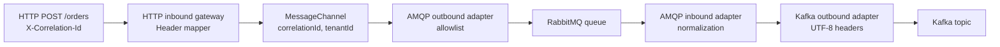

# Header mapper theo giao thức

## 1. Bài toán: một message nội bộ, nhiều giao thức bên ngoài

Trong **Spring Integration Adapters**, mỗi inbound adapter, outbound adapter hoặc gateway đứng tại ranh giới giữa một hệ thống ngoài và luồng xử lý dựa trên `Message<?>`, `MessageChannel`. `Message` có hai phần: `payload` mang dữ liệu nghiệp vụ và `headers` mang thông tin điều phối, định tuyến, tương quan, kiểu nội dung hoặc metadata.

Khi kết nối HTTP, JMS, AMQP, Kafka, SOAP, file/SFTP và các hệ thống khác, tên header, kiểu dữ liệu, giới hạn và ý nghĩa không giống nhau. **Header mapper theo giao thức** chuyển đổi metadata giữa `MessageHeaders` của Spring và biểu diễn native của từng giao thức. Nó giải quyết ba bài toán:

1. **Giữ lại ngữ cảnh cần thiết**: ví dụ `traceparent`, correlation ID, content type, reply destination khi đi qua adapter/gateway.
2. **Tuân thủ hợp đồng truyền tải**: HTTP dùng tên header và giá trị HTTP phù hợp, JMS chỉ chấp nhận những kiểu property hợp lệ, Kafka biểu diễn header dưới dạng byte, AMQP phân biệt property chuẩn và application header.
3. **Kiểm soát ranh giới tin cậy**: không tự động gửi ra ngoài các header nội bộ, thông tin xác thực, đối tượng Java không tương thích hoặc metadata chỉ dành cho phía nhận.

**Sau bài học**, người học có thể phân biệt mapping inbound/outbound và request/reply; chọn, cấu hình và kiểm thử header mapper phù hợp với giao thức; nhận diện lỗi mất header, sai kiểu, nhầm correlation ID và rò rỉ metadata qua adapter.

## 2. Cơ chế chung của header mapping

### 2.1. HeaderMapper và MessageConverter làm hai việc khác nhau

Một mô hình logic:

```text
Hệ thống ngoài                Spring Integration               Hệ thống ngoài
HTTP / JMS / AMQP             Message<?>                      Kafka / SOAP / ...
  native headers ──> [HeaderMapper] ──> MessageHeaders ──> [HeaderMapper] ──> native headers
  native body    ──> [Converter]    ──> payload        ──> [Converter]    ──> native body
                               MessageChannel / IntegrationFlow
```

`HeaderMapper<T>` là chiến lược chung cho một biểu diễn header native `T`. Hai thao tác quan trọng về mặt ý nghĩa:

- `toHeaders(nativeMessage)`: đọc metadata native và tạo các header trong `MessageHeaders`.
- `fromHeaders(messageHeaders, nativeMessage)`: ghi các Spring headers được cho phép vào metadata của message native.

Với giao thức request/reply, `RequestReplyHeaderMapper<T>` phân biệt thêm request và reply (`toHeadersFromRequest`, `fromHeadersToRequest`, `toHeadersFromReply`, `fromHeadersToReply`). Các mapper cụ thể thường do adapter/gateway tự gọi. Tên phương thức và tham số cụ thể phụ thuộc giao diện mapper của giao thức.

**Không đồng nhất header mapper với:**

- `MessageConverter` hoặc serializer/deserializer: chuyển đổi **payload** và đôi khi tham gia chuyển đổi header, nhưng là một hợp đồng khác.
- `HeaderEnricher`: thêm hoặc tính header mới **bên trong** flow; muốn header xuất hiện ở HTTP/JMS/Kafka vẫn phải qua cơ chế mapping ra native.
- `HeaderFilter`: xóa header khỏi `Message<?>` ở một đoạn flow; là bước phòng vệ hữu ích nhưng không thay thế whitelist tại adapter.
- `MessageHeaders.ID` và `MessageHeaders.TIMESTAMP`: metadata Spring tạo cho message; không phải mặc nhiên là ID/timestamp của broker.

### 2.2. Hai chiều truyền và hai vế request/reply

Tên *inbound/outbound* cần được hiểu tương đối với **ứng dụng Spring Integration**:

| Điểm kết nối | Dữ liệu đi qua ranh giới | Việc mapper làm |
|---|---|---|
| Inbound HTTP adapter/gateway | HTTP request → Spring message | Đọc request headers vào `MessageHeaders` |
| Inbound HTTP gateway trả lời | Spring reply → HTTP response | Ghi headers được chọn ra response |
| Outbound HTTP gateway | Spring request → HTTP request | Ghi headers được chọn ra HTTP request |
| Outbound HTTP gateway nhận trả lời | HTTP response → Spring reply | Đọc response headers vào `MessageHeaders` |
| JMS/AMQP/Kafka inbound | Broker record/message → Spring message | Đọc properties và headers native |
| JMS/AMQP/Kafka outbound | Spring message → broker record/message | Ghi properties và headers native |

Ví dụ, **outbound HTTP gateway** vẫn có một bước *native → Spring* khi nhận HTTP response. Vì thế phải kiểm tra cả cấu hình mapped request headers lẫn mapped response headers.

### 2.3. Chính sách header phải có hợp đồng rõ ràng

Trước khi cấu hình mapper, xác định cho từng header:

| Câu hỏi | Ví dụ quyết định |
|---|---|
| Nó phục vụ nghiệp vụ hay chỉ là metadata kỹ thuật? | `tenantId` được dùng trong xử lý; `retryAttemptLocal` chỉ để retry nội bộ |
| Tên native được đối tác chấp nhận? | HTTP `X-Correlation-Id`, JMS `JMSCorrelationID`, Kafka `correlation-id` |
| Giá trị đi qua dây ở kiểu gì? | `String` hoặc giá trị đơn giản cho JMS; `byte[]` cho Kafka |
| Header có được đưa ra ngoài ranh giới tin cậy? | Không chuyển nguyên `Authorization` từ client sang một đối tác khác |
| Chiều nào cần ánh xạ? | `traceparent` phải đi outbound; `X-Request-Id` từ response cần đọc inbound |
| Khi không có header thì làm gì? | Tạo mới correlation ID ở cửa vào hoặc từ chối request theo hợp đồng |
| Ai sở hữu header? | `kafka_receivedTopic` là metadata phía consume; topic outbound phải cấu hình riêng |

Quy tắc thực hành: ưu tiên **allowlist tường minh** ở mỗi adapter, sau đó bổ sung quy tắc chuyển đổi tên/giá trị khi giao thức không tương thích. Dấu `*` hay các token đặc biệt của mapper thường mở rộng phạm vi header; cần hiểu mặc định của đúng phiên bản thư viện trước khi dùng.

## 3. HTTP: ánh xạ request và response headers

Spring Integration cung cấp `DefaultHttpHeaderMapper` cho HTTP inbound/outbound adapter và gateway. Mapper biết nhóm header chuẩn của request/response; có thể cấu hình `inboundHeaderNames` và `outboundHeaderNames`, gồm mẫu có dấu `*`. Tên `inbound` ở đây là **native HTTP → Spring**, `outbound` là **Spring → native HTTP**.

Đối với HTTP outbound gateway, hai cấu hình thường gặp:

- `mapped-request-headers` chọn headers từ Spring message để tạo HTTP request.
- `mapped-response-headers` chọn headers từ HTTP response để tạo Spring reply.

Khi khai báo danh sách tùy chỉnh, danh sách đó **thay thế tập mapping mặc định** tại vị trí được cấu hình. Nếu muốn giữ toàn bộ nhóm header HTTP chuẩn tương ứng, có thể thêm token `HTTP_REQUEST_HEADERS` hoặc `HTTP_RESPONSE_HEADERS`; nếu cần kiểm soát chặt, chỉ liệt kê từng header.

### 3.1. Ví dụ cấu hình HTTP outbound gateway

Ví dụ XML bên dưới tập trung vào phần mapping; namespace `int-http` và các bean/channel cần được khai báo trong cấu hình ứng dụng:

```xml
<int-http:outbound-gateway
    id="partnerOrderGateway"
    channel="ordersToPartner"
    url="https://partner.example/api/orders"
    http-method="POST"
    mapped-request-headers="Content-Type, Accept, X-Correlation-Id"
    mapped-response-headers="Content-Type, X-Correlation-Id"
    expected-response-type="java.lang.String"/>
```

Giả sử message đầu vào có các header:

```text
Content-Type        = application/json
Accept              = application/json
X-Correlation-Id    = order-2026-042
internalRetryCount  = 3
replyChannel        = <DirectChannel ...>
Authorization       = Bearer <incoming-client-token>
```

Chính sách trên chỉ đưa `Content-Type`, `Accept` và `X-Correlation-Id` vào HTTP request. `internalRetryCount`, `replyChannel` và token inbound không thuộc danh sách nên không được chuyển bằng mapper. Thông tin xác thực để gọi đối tác cần được tạo riêng theo danh tính của **dịch vụ gọi ra**.

### 3.2. Thực hành với DefaultHttpHeaderMapper

Đoạn Java minh họa dưới đây cho thấy cách mapper chuyển các Spring headers thành `HttpHeaders`. Trong cấu hình ứng dụng thực tế, adapter/gateway thường thực hiện lời gọi này:

```java
import org.springframework.http.HttpHeaders;
import org.springframework.integration.http.support.DefaultHttpHeaderMapper;
import org.springframework.messaging.Message;
import org.springframework.messaging.support.MessageBuilder;

// Tạo một Spring message với cả header cần xuất và header chỉ dùng nội bộ.
Message<String> message = MessageBuilder
        .withPayload("{\"orderId\":\"O-42\"}")
        .setHeader("X-Correlation-Id", "corr-42")
        .setHeader("Content-Type", "application/json")
        .setHeader("internalRetryCount", 2)
        .build();

// Mapper dành cho phía HTTP outbound.
DefaultHttpHeaderMapper mapper = DefaultHttpHeaderMapper.outboundMapper();
mapper.setOutboundHeaderNames("Content-Type", "X-Correlation-Id");

HttpHeaders httpHeaders = new HttpHeaders();
mapper.fromHeaders(message.getHeaders(), httpHeaders);

// Có correlation ID và content type; không có internalRetryCount.
System.out.println(httpHeaders.getFirst("X-Correlation-Id"));
System.out.println(httpHeaders.getFirst("internalRetryCount")); // null
```

Khi lấy chiều ngược lại (HTTP response → Spring reply), cấu hình `setInboundHeaderNames(...)` tương ứng hoặc dùng `mapped-response-headers` của outbound gateway. Hai nhóm chiều phải được kiểm thử riêng.

**Lưu ý thực tế:**

- Header names của HTTP không phân biệt hoa/thường về mặt giao thức; không tự áp quy tắc này sang JMS/Kafka.
- `Content-Type` ảnh hưởng đến cả chuyển đổi body qua `HttpMessageConverter`; mapper không tự sửa payload JSON sai.
- Những header như `Host`, `Content-Length`, `Transfer-Encoding` được HTTP client/server quản lý theo ngữ cảnh. Không nên lấy giá trị từ request cũ để gán tùy tiện cho request mới.
- Header HTTP có thể đa giá trị (`List<String>`); nếu hệ thống đích chỉ nhận một giá trị, cần quy ước chọn/gộp rõ ràng.
- HTTP header `X-Correlation-Id` là **tên do hệ thống thỏa thuận**, không tự đồng nghĩa với header `correlationId` trong Spring Integration hay broker correlation ID.

## 4. JMS: phân biệt JMS API headers và message properties

JMS message gồm các JMS API headers (`JMSMessageID`, `JMSCorrelationID`, `JMSReplyTo`, `JMSType`, ...) và các **message properties** do ứng dụng đặt. `DefaultJmsHeaderMapper` chuyển các giá trị đó sang Spring message headers và ngược lại.

Ví dụ ánh xạ có ý nghĩa:

| JMS native | Spring Integration | Lưu ý |
|---|---|---|
| `JMSCorrelationID` | `jms_correlationId` | Phục vụ request/reply JMS; khác header `correlationId` chung |
| `JMSReplyTo` | `jms_replyTo` | Đích trả lời JMS, không phải Spring `replyChannel` |
| `JMSType` | `jms_type` | Phân loại thông điệp theo hợp đồng JMS |
| Property `tenantId` | Header `tenantId` nếu được mapper chấp nhận | Phải đúng kiểu và tên property JMS |
| `JMSMessageID` | Header `jms_messageId` phía nhận | Nhà cung cấp JMS thường sinh khi gửi; không tự coi là Spring `id` |

JMS property chỉ hỗ trợ các kiểu được JMS quy định (boolean, byte, short, int, long, float, double và `String`, cùng wrapper tương ứng khi sử dụng API Java). Không thể chuyển một `Map`/POJO tùy ý thành JMS property rồi trông chờ mapper tự serialize. Tên property còn chịu quy tắc định danh và các từ/cụm tiền tố dành riêng của JMS; hãy chọn tên đơn giản như `tenantId` hoặc `traceparent`.

Đặc biệt, `correlationId` trong Spring Integration có thể là `UUID` và mang ý nghĩa nhóm message; `jms_correlationId` là giá trị dùng cho JMS `JMSCorrelationID`. Không đổi tên qua lại bằng quy tắc máy móc khi chưa xác định cách gateway ghép reply. JMS gateway có thể tự sinh/chọn correlation ID theo `correlation-key` và cấu hình reply destination.

**Về QoS:** `JMSPriority`, delivery mode và TTL thường được xác định khi producer gửi message (`MessageProducer.send`), không phải cứ ghi header là đã áp dụng QoS. Khi cần kiểm soát những thuộc tính này, cấu hình template/adapter tương ứng và kiểm tra chế độ explicit QoS.

Một hợp đồng JMS request/reply có thể quy định:

```text
Request Spring:
    payload = "calculate shipping"
    headers["jms_correlationId"] = "req-42"
    headers["tenantId"] = "north"

JMS request:
    JMSCorrelationID = "req-42"
    property tenantId = "north"

JMS reply:
    JMSCorrelationID = "req-42"  (theo hợp đồng responder)
```

Đoạn trên là **sơ đồ dữ liệu mong muốn**; giá trị thật do gateway/mapper và cách cấu hình `correlation-key` quyết định. Không tự sửa header sinh bởi gateway khi cơ chế correlation đã được framework quản lý.

## 5. AMQP/RabbitMQ: MessageProperties và application headers

Trong AMQP, một số thuộc tính có ý nghĩa riêng: `contentType`, `correlationId`, `replyTo`, `messageId`, `deliveryMode`, `expiration`, `receivedRoutingKey`,... Bên cạnh đó là các application headers do publisher đặt.

Spring Integration sử dụng `DefaultAmqpHeaderMapper` với tên header nhóm `amqp_*` (ví dụ `amqp_correlationId`, `amqp_replyTo`, `amqp_receivedRoutingKey`); content type có thể dùng tên chung `contentType` theo Spring. Các thuộc tính `received*` phản ánh metadata phía consumer và không phải lựa chọn hợp lệ để chỉ định lại nguồn routing cho một bản tin outbound mới.

| Nhu cầu | Cách thực hiện |
|---|---|
| Publish đến exchange/routing key | Cấu hình outbound adapter/gateway hoặc header outbound điều khiển routing phù hợp |
| Truyền correlation ID | Sử dụng `amqp_correlationId` hoặc header ứng dụng đã thống nhất |
| Truyền tenant/trace ID | Cho phép application headers tương ứng trong mapper |
| Kiểm tra redelivery | Đọc metadata phía inbound; xử lý retry/DLQ bằng cơ chế broker |
| Giữ content type nhất quán | Đồng bộ `contentType` với body do converter tạo |

Mapper cho AMQP hỗ trợ các nhóm `STANDARD_REQUEST_HEADERS`, `STANDARD_REPLY_HEADERS`, `NON_STANDARD_HEADERS` và tên/mẫu tùy chỉnh. Hành vi mặc định của application headers phụ thuộc hướng request/reply và phiên bản; cấu hình tường minh để tránh ngầm giả định. Ngoài ra, nhiều header AMQP mang tiền tố `x-*` được broker hoặc plugin dành riêng, không nên copy tự do từ message nhận về sang message mới.

Ví dụ biểu diễn **chính sách** cho một kênh outbound AMQP:

```text
Allowed:
    contentType, amqp_correlationId, traceparent, tenantId
Rejected:
    Authorization, internalRetryCount, errorChannel,
    amqp_receivedRoutingKey, x-death, x-first-death-*
```

Tại adapter/gateway, khai báo các tên trên bằng thuộc tính mapper hoặc mapped request/reply headers mà phiên bản sử dụng hỗ trợ. Như vậy một bản tin được đưa sang exchange khác sẽ không mang theo dấu vết retry/dead-letter của broker cũ.

## 6. Kafka: header là các cặp tên và byte[]

Mỗi Kafka record có `key`, `value`, `topic`, `partition`, `timestamp` và một tập `Headers`. Một native Kafka header có dạng `(String key, byte[] value)`; cùng một tên có thể xuất hiện nhiều lần. Vì vậy kiểu dữ liệu và số lượng giá trị cần được quyết định trước khi mapping.

Trong Spring Kafka, các hiện thực của `KafkaHeaderMapper` (như `SimpleKafkaHeaderMapper`, mapper dùng JSON tùy phiên bản) được `MessagingMessageConverter` hoặc thành phần tương ứng sử dụng để chuyển với `MessageHeaders`. Với JSON mapping, có cơ chế ghi metadata loại giá trị trong header đặc biệt `spring_json_header_types`; hai đầu cần thống nhất serializer, converter, charset và chính sách kiểu được tin cậy.

| Spring-side | Kafka-side | Vấn đề cần lưu ý |
|---|---|---|
| `traceparent = "00-..."` | Header `traceparent`, thường là bytes UTF-8 | Đầu nhận phải biết cách giải mã |
| `tenantId = "north"` | Header `tenantId` | Kiểu Java có thể bị thay đổi khi chỉ nhận bytes |
| `KafkaHeaders.KEY` / record key | Kafka record key | Thường là thuộc tính record, không phải ordinary header |
| Metadata received topic/partition/offset | Thông tin của `ConsumerRecord` | Chỉ mô tả record đã nhận, không phải chỉ thị publish mặc định |
| Header trùng tên nhiều lần | Nhiều phần tử trong Kafka `Headers` | Mapper/converter có thể lấy giá trị cuối hoặc cần cấu hình multi-value |

Ví dụ native Kafka header dùng UTF-8:

```java
import java.nio.charset.StandardCharsets;
import org.apache.kafka.common.header.internals.RecordHeaders;

RecordHeaders headers = new RecordHeaders();
headers.add("traceparent",
        "00-4bf92f3577b34da6a3ce929d0e0e4736-00f067aa0ba902b7-01"
                .getBytes(StandardCharsets.UTF_8));
headers.add("tenantId", "north".getBytes(StandardCharsets.UTF_8));
```

Đây là ví dụ API Kafka thuần để nhìn rõ biểu diễn trên dây; nó chưa đi qua Spring `MessageHeaders`. Khi cấu hình Spring Integration Kafka adapter, hãy đặt `KafkaHeaderMapper` phù hợp trên converter/endpoint được hỗ trợ bởi phiên bản sử dụng.

**Các bẫy phổ biến:**

- Đối tác không dùng Spring Kafka có thể không hiểu `spring_json_header_types`; nên trao đổi các header liên hệ thống dưới dạng chuỗi UTF-8 hoặc bytes có schema thống nhất.
- Không nên deserialize lớp tùy ý từ header của nguồn không tin cậy; chỉ tin cậy những kiểu/package thật sự cần.
- Khi tự khai báo mẫu outbound, giữ loại trừ `id` và `timestamp` của Spring và không biến metadata của `ConsumerRecord` thành header tùy tiện.
- Kafka record key quyết định khả năng phân vùng/ordering; một `correlationId` trong header không thay thế record key.
- Header không bảo đảm idempotency. Để xử lý trùng, phải có business ID và logic/dữ liệu chống xử lý lặp.

## 7. SOAP, Mail, File/SFTP và các endpoint khác

### 7.1. SOAP/Web Services

SOAP có `Envelope` chứa `Header` và `Body`. `DefaultSoapHeaderMapper` trong Spring Integration WS xử lý SOAP action và các SOAP headers được cấu hình. Header tùy biến (ví dụ metadata xác thực theo schema SOAP) không tự động được copy theo mọi cấu hình; phải chỉ rõ `requestHeaderNames` / `replyHeaderNames` hoặc `mapped-request-headers` / `mapped-reply-headers` của gateway.

Một SOAP header có thể là **cấu trúc XML**, không phải chuỗi đơn giản. Ví dụ:

```xml
<soap:Header xmlns:soap="http://schemas.xmlsoap.org/soap/envelope/">
    <ctx:Tracking xmlns:ctx="urn:example:tracking">
        <ctx:CorrelationId>order-42</ctx:CorrelationId>
    </ctx:Tracking>
</soap:Header>
```

Nếu hệ thống đích yêu cầu cấu trúc SOAP trên, chỉ đặt Spring header `"X-Correlation-Id" = "order-42"` là chưa đủ. Cần mapper/transformer tương ứng để tạo XML element đúng namespace và schema.

### 7.2. Mail

Email có các trường `From`, `To`, `Subject`, `Reply-To` và MIME content metadata. Spring Integration cung cấp `DefaultMailHeaderMapper` cho inbound mail mapping. Những tên như `mail_from`, `mail_subject`, `mail_replyTo` đại diện cho metadata email; outbound mail adapter cũng dùng các header mail chuyên biệt để xây dựng thư.

Dữ liệu MIME đa phần phức tạp hơn chuỗi đơn, đặc biệt multipart/attachment. Kiểm tra payload/transformer riêng; mapper header không tự biến attachment thành dữ liệu ứng dụng.

### 7.3. File/SFTP

File/SFTP không có một envelope application headers tương đương HTTP/JMS/Kafka cho từng file. Adapter tạo và tiêu thụ `MessageHeaders` phục vụ đặt tên, thư mục đích, metadata file, nhưng chúng không tự xuất hiện như metadata tùy ý của file trên máy chủ SFTP.

Ví dụ, muốn người nhận biết `correlationId` của một tệp, phải thiết kế **hợp đồng** riêng: tên file, manifest/sidecar JSON, metadata trong nội dung hoặc bảng đối soát. Không thể giả định một `HeaderMapper` chung có thể đưa `traceparent` thành thuộc tính của giao thức SFTP.

Đối với TCP/UDP hoặc streaming thuần byte, ranh giới thường có ít metadata native; cần wire format/framing hoặc protocol-specific header mechanism nếu muốn bảo toàn ngữ cảnh liên hệ thống.

## 8. Ví dụ xuyên giao thức: HTTP → AMQP → Kafka

Giả sử dịch vụ nhận HTTP order, gửi qua RabbitMQ để xử lý bất đồng bộ, rồi phát sự kiện kết quả lên Kafka. Quy ước nghiệp vụ là giữ `correlationId` và `tenantId` ở các đoạn flow, nhưng **không** sao chép HTTP Authorization, `replyChannel` hoặc metadata nhận từ broker sang sự kiện outbound.



### 8.1. Đặt hợp đồng header nội bộ ổn định

Thiết kế key theo ngữ nghĩa; tại ranh giới inbound, map/normalize khác biệt tên native về các header nội bộ:

| Ranh giới | Correlation ID | Tenant | Có được chuyển tiếp? |
|---|---|---|---|
| HTTP inbound | `X-Correlation-Id` → `correlationId` nội bộ | Header `X-Tenant-Id` sau xác thực → `tenantId` | Chỉ giá trị đã xác thực/chuẩn hóa |
| AMQP outbound | `correlationId` → `amqp_correlationId` hoặc application header đã thống nhất | `tenantId` → application header | Có, sau allowlist |
| AMQP inbound | `amqp_correlationId`/application header → `correlationId` | application header → `tenantId` | Có, kiểm tra lại |
| Kafka outbound | `correlationId` → header bytes `correlation-id` | `tenantId` → header bytes `tenant-id` | Có, theo schema UTF-8 |

Bảng này mô tả **quy ước do nhóm phát triển tự chọn**. Framework không mặc nhiên đổi `X-Correlation-Id` thành `correlationId`, `amqp_correlationId` hay `correlation-id`. Những phép đổi tên/giá trị cần được cấu hình bằng header enricher, transformer hoặc custom mapper ở nơi tương ứng.

### 8.2. Chuẩn hóa Spring message ở ranh giới nhận

Một cách tạo message mới sau khi đã xác thực và xác định tenant:

```java
import org.springframework.messaging.Message;
import org.springframework.messaging.support.MessageBuilder;

Message<?> normalized = MessageBuilder
        .fromMessage(inboundMessage) // inboundMessage: HTTP request đã chuyển thành Message<?>
        .setHeader("correlationId", validatedCorrelationId)
        .setHeader("tenantId", authenticatedTenantId)
        .removeHeader("Authorization")
        .removeHeader("Cookie")
        .build();
```

Đây là đoạn logic minh họa chạy **trong một handler/transformer**; `validatedCorrelationId` và `authenticatedTenantId` phải được tính trước từ đầu vào đã kiểm tra. Nếu HTTP request không có correlation ID hợp lệ, hệ thống có thể tạo một ID mới rồi ghi vào response theo hợp đồng. Mọi bước outbound vẫn cần allowlist riêng.

### 8.3. Quy tắc đúng ở mỗi chặng

1. **HTTP vào**: đọc trace/correlation từ nguồn được phép; chuẩn hóa giá trị, độ dài, định dạng. Tenant phải lấy từ thông tin đã được xác thực, không tin trực tiếp mọi header do client đặt.
2. **AMQP ra**: chỉ map `correlationId`/`tenantId` đã chuẩn hóa và content type phù hợp; không copy `Authorization` hay `errorChannel`. Nếu cần request/reply, cấu hình `replyTo` và broker correlation ID theo hợp đồng riêng.
3. **AMQP vào**: chấp nhận bản tin theo schema, phân biệt metadata broker với application headers. Không đưa `x-death`/`receivedRoutingKey` sang Kafka.
4. **Kafka ra**: chuyển chuỗi đã thỏa thuận thành UTF-8 bytes hoặc dùng converter có quy ước chung với consumer; không copy `MessageHeaders.ID`/`TIMESTAMP` nội bộ làm event ID.
5. **Lỗi và retry**: dùng error channel, retry advice, DLQ và idempotency ở layer thích hợp. Header chỉ mang ngữ cảnh; không tự triển khai đảm bảo giao hàng.

## 9. Kiểm thử header mapper như một hợp đồng

Tạo các bài kiểm tra ở **biên giao thức**, không chỉ kiểm tra map trong Java. Một chiến lược có thể áp dụng cho từng adapter:

| Ca kiểm thử | Đầu vào | Kết quả mong đợi |
|---|---|---|
| Inbound header chuẩn | HTTP `Content-Type` hoặc JMS `JMSCorrelationID` | Tên/giá trị phù hợp trong `MessageHeaders` |
| Outbound allowlist | `correlationId` và `internalRetryCount` | Chỉ header được cho phép xuất hiện bên native |
| Không có header tùy chọn | Request thiếu `X-Correlation-Id` | Flow dùng fallback được thỏa thuận, không vỡ lỗi null |
| Kiểu không hỗ trợ | JMS property là `Map`, Kafka header là POJO | Chuyển đổi có chủ đích hoặc bị từ chối rõ ràng |
| Request/reply | Một request có correlation ID và một reply tương ứng | Gateway ghép đúng reply; không dùng sai `replyChannel` |
| Trùng header Kafka | Hai header cùng tên, hai byte values | Hành vi parser được kiểm chứng, không âm thầm đoán |
| Bảo mật | Header `Authorization`, `Cookie`, `errorChannel` | Không có ở broker/đối tác ngoài allowlist |
| Retry/DLQ | AMQP message đã từng chết vào DLQ | Metadata broker không bị sao chép thành message mới |
| Encoding | Unicode trong `tenantId`/baggage | Producer và consumer giải mã giống nhau |
| Version compatibility | Client producer/consumer khác thư viện | Cả hai hiểu wire representation thực tế |

Ví dụ kiểm tra trực tiếp HTTP mapper (phần trong `assert` dùng JUnit 5):

```java
import static org.junit.jupiter.api.Assertions.assertEquals;
import static org.junit.jupiter.api.Assertions.assertNull;

import org.junit.jupiter.api.Test;
import org.springframework.http.HttpHeaders;
import org.springframework.integration.http.support.DefaultHttpHeaderMapper;
import org.springframework.messaging.support.MessageBuilder;

class HeaderMappingTest {

    @Test
    void httpOutboundMapperOnlyCopiesExplicitHeaders() {
        var source = MessageBuilder.withPayload("order-42")
                .setHeader("X-Correlation-Id", "corr-42")
                .setHeader("internalRetryCount", 7)
                .setHeader("Authorization", "Bearer should-not-leak")
                .build();

        var mapper = DefaultHttpHeaderMapper.outboundMapper();
        mapper.setOutboundHeaderNames("X-Correlation-Id");

        HttpHeaders nativeHeaders = new HttpHeaders();
        mapper.fromHeaders(source.getHeaders(), nativeHeaders);

        assertEquals("corr-42",
                nativeHeaders.getFirst("X-Correlation-Id"));
        assertNull(nativeHeaders.getFirst("internalRetryCount"));
        assertNull(nativeHeaders.getFirst("Authorization"));
    }
}
```

Bài kiểm thử trên xác nhận chính sách header HTTP của mapper. Ở mức integration, bổ sung test với HTTP mock server, JMS/AMQP broker hoặc Kafka test container tương ứng để kiểm tra converter, adapter và các thành phần ghi metadata thực tế trên dây.

## 10. Những lỗi thiết kế dễ mắc và cách xử lý

| Hiện tượng | Nguyên nhân hay gặp | Cách xử lý |
|---|---|---|
| `traceparent` có ở flow nhưng biến mất khi gửi | Mapper không cho phép header tùy chỉnh ở chiều outbound | Thêm tên vào allowlist tại adapter đúng chiều |
| HTTP response mất correlation ID | Chỉ cấu hình mapped request headers | Cấu hình mapped response headers và ánh xạ reply |
| JMS request/reply không ghép được | Nhầm `correlationId` với `jms_correlationId` hoặc responder trả giá trị sai | Xác định `correlation-key` và kiểm tra native `JMSCorrelationID` của cả hai phía |
| JMS producer lỗi khi set property | Tên property/kiểu dữ liệu không hợp lệ | Dùng tên hợp lệ và các kiểu primitive/String |
| Kafka consumer nhận bytes/JSON lạ | Producer/consumer dùng mapper/charset khác nhau | Thống nhất wire schema, UTF-8 và kiểu header |
| Kafka event mang metadata của consumer trước đó | Copy toàn bộ `MessageHeaders` từ inbound sang outbound | Dựng record mới, allowlist header, chọn topic/key rõ ràng |
| AMQP message mới có thông tin DLQ cũ | Copy `x-*` hoặc received metadata | Loại trừ header dành riêng và phân biệt chiều |
| SOAP header vẫn không xuất hiện | Truyền string nhưng đối tác cần element XML | Tạo SOAP header đúng cấu trúc và namespace |
| Header nội bộ bị lộ ra hệ thống ngoài | Dùng `*` / all-headers mà không kiểm soát | Dùng allowlist, xóa dữ liệu nhạy cảm và kiểm tra native output |

## 11. Bài thực hành

**Yêu cầu:** Xây dựng một luồng nhận HTTP order, xử lý bất đồng bộ qua AMQP hoặc JMS rồi phát Kafka event. Chưa cần cấu hình đầy đủ broker để bắt đầu: có thể mô phỏng message và kiểm tra mapper trực tiếp trước.

1. Thiết kế bảng hợp đồng cho `correlationId`, `tenantId`, `contentType` và `traceparent`: tên native của từng giao thức, hướng truyền, kiểu dữ liệu và quy tắc khi thiếu giá trị.
2. Tạo HTTP outbound mapper chỉ xuất `Content-Type` và `X-Correlation-Id`. Chứng minh `internalRetryCount` và `Authorization` không xuất hiện trong `HttpHeaders`.
3. Chọn một broker: với JMS, xác định rõ `JMSCorrelationID` và property types; với AMQP, phân biệt `amqp_correlationId` và application headers.
4. Mô tả mapping ra Kafka dưới dạng bytes UTF-8 hoặc converter đã thống nhất. Kiểm thử cả trường hợp producer viết String và consumer chỉ đọc byte[].
5. Thêm tình huống reply hoặc retry, kiểm tra rằng giá trị correlation liên hệ nghiệp vụ vẫn được giữ trong khi metadata nội bộ/broker không bị chuyển tiếp bừa bãi.

**Tiêu chí hoàn thành:** mỗi ranh giới có bảng allowlist/định kiểu, test chứng minh header được giữ hoặc bị loại đúng dự kiến, và không lẫn correlation ID của Spring, gateway, JMS/AMQP hay Kafka record key.

## 12. Ghi nhớ

- Header mapper chuyển **metadata giao thức ↔ `MessageHeaders`**; payload converter xử lý dữ liệu nội dung.
- Đọc chiều mapping theo hướng native/Spring và theo vế request/reply; inbound adapter không đồng nghĩa với inbound mapping ở mọi vị trí.
- Với HTTP, tùy chỉnh danh sách mapped headers có thể thay thế mặc định; với JMS, lưu ý property types và correlation; với AMQP, phân biệt broker properties và application headers; với Kafka, hiểu `byte[]` và converter.
- Bảo vệ ranh giới tin cậy bằng allowlist, quy tắc chuyển đổi tên/kiểu và kiểm thử trên giao thức native. Correlation, retry, routing và bảo mật cần chính sách riêng phù hợp từng adapter/gateway.

## Tài liệu tham khảo

- [Spring Integration — HTTP Header Mappings](https://docs.spring.io/spring-integration/reference/http/header-mapping.html)
- [Spring Integration — JMS Support](https://docs.spring.io/spring-integration/reference/jms.html)
- [Spring Integration — AMQP Message Headers](https://docs.spring.io/spring-integration/reference/amqp/message-headers.html)
- [Spring Kafka — Message Headers](https://docs.spring.io/spring-kafka/reference/kafka/headers.html)
- [Spring Integration — Web Services Support](https://docs.spring.io/spring-integration/reference/ws.html)
- [Spring Integration — Mail Support](https://docs.spring.io/spring-integration/reference/mail.html)

*Tên class/phương thức và mặc định mapping có thể khác giữa các nhánh Spring Integration, Spring AMQP và Spring Kafka. Khi áp dụng vào dự án, đối chiếu API của đúng phiên bản dependency, đặc biệt với các mapper/converter Kafka.*
