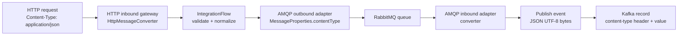

# Content-type và MimeType

## 1. Vì sao Content-Type quan trọng khi tích hợp hệ thống?

Trong module **SPRING_INTEGRATION_ADAPTERS**, một luồng Spring Integration nhận dữ liệu từ HTTP, JMS, AMQP, Kafka, file/SFTP hoặc cơ sở dữ liệu rồi chuyển tiếp qua `MessageChannel`, adapter và gateway. Payload có thể là `String`, `byte[]`, Java object, XML document hoặc file. Để các thành phần hiểu *dữ liệu đó được biểu diễn như thế nào*, chúng thường cần một thông tin mô tả **media type**.

Ví dụ, cùng một mảng byte có thể đại diện cho:

- Văn bản UTF-8: `text/plain; charset=UTF-8`.
- Tài liệu JSON: `application/json`.
- Tài liệu XML: `application/xml`.
- Dữ liệu nhị phân không biết cấu trúc: `application/octet-stream`.
- Tệp PDF: `application/pdf`.

Không có một cơ chế chuyển đổi nào bảo đảm giải mã đúng mọi cách biểu diễn. Khi metadata sai, message converter có thể chọn nhầm bộ đọc, ký tự tiếng Việt bị lỗi, hệ thống trả `415 Unsupported Media Type` hoặc một service âm thầm xử lý nhầm định dạng.

**Mục tiêu của bài học**:

1. Hiểu cú pháp media type/MIME type, phần `type/subtype` và các tham số như `charset`.
2. Phân biệt HTTP `Content-Type`, HTTP `Accept`, Spring header `contentType` và Java type của payload.
3. Dùng `MimeType`, `MimeTypeUtils` và `MediaType` để phân tích, kiểm tra và so sánh media type.
4. Đặt và chuẩn hóa `contentType` tại ranh giới inbound/outbound; kết nối đúng `MessageConverter`, transformer và header mapper.
5. Xử lý khác biệt giữa HTTP, AMQP, JMS, Kafka, file/SFTP và các adapter không có metadata MIME native.
6. Thiết kế kiểm thử bảo đảm **payload, charset, media type và wire representation nhất quán**.

## 2. Thuật ngữ và cú pháp MIME

### 2.1. Media type là nhãn mô tả cách biểu diễn

Một giá trị media type thường có dạng:

```text
type/subtype; parameter=value; parameter=value
```

Ví dụ:

```text
application/json
application/json; charset=UTF-8
text/plain; charset=UTF-8
application/xml
application/problem+json
application/vnd.acme.order.v2+json
multipart/form-data; boundary=----part123
application/octet-stream
```

| Thành phần | Ý nghĩa | Ví dụ |
|---|---|---|
| `type` | Nhóm nội dung cấp cao | `application`, `text`, `image`, `multipart` |
| `subtype` | Cách biểu diễn cụ thể | `json`, `plain`, `xml`, `pdf` |
| Suffix có cấu trúc | Cho biết cú pháp nền | `+json`, `+xml` |
| `charset` | Bảng mã ký tự khi phù hợp | `UTF-8` |
| `boundary` | Dấu ngăn các phần multipart | `boundary=----part123` |
| Tham số riêng | Tùy thuộc hợp đồng của giao thức | `version=2`, `profile=...` |

**MIME type** bắt nguồn từ quy ước MIME, được nhiều giao thức dùng lại. Trong Spring, `MimeType` là một kiểu giá trị biểu diễn media type; trong ngữ cảnh HTTP, `MediaType` bổ sung những khả năng HTTP cần, đặc biệt tham số chất lượng `q` khi đàm phán nội dung. Thuật ngữ *content type* thường chỉ **metadata/header** mang một giá trị media type, chẳng hạn HTTP `Content-Type: application/json`.

MIME không phải phép kiểm tra nội dung. Đặt `application/json` không tự biến một chuỗi bất kỳ thành JSON hợp lệ.

### 2.2. Content-Type khác Accept, Content-Encoding và Java type

| Thông tin | Trả lời câu hỏi | Ví dụ |
|---|---|---|
| HTTP `Content-Type` | Nội dung **đang được gửi** có kiểu gì? | `Content-Type: application/json` |
| HTTP `Accept` | Phía gọi **muốn nhận** những media type nào? | `Accept: application/json, application/problem+json` |
| HTTP `Content-Encoding` | Nội dung có được mã hóa/biến đổi ở tầng HTTP như nén không? | `Content-Encoding: gzip` |
| HTTP `Content-Length` | Độ dài body ở mức HTTP | `Content-Length: 120` |
| Spring `MessageHeaders.CONTENT_TYPE` | Header biểu diễn media type của Spring message | `contentType = application/json` |
| Kiểu Java của payload | Đối tượng runtime đang nằm trong message là gì? | `String`, `byte[]`, `Order` |

**Hai ví dụ đối chiếu:**

```http
POST /orders HTTP/1.1
Content-Type: application/json
Accept: application/problem+json, application/json

{"orderId":"O-42"}
```

Request body là JSON; client nói rằng response có thể là problem JSON hoặc JSON thường. Ngược lại:

```http
HTTP/1.1 200 OK
Content-Type: application/json; charset=UTF-8

{"status":"CREATED"}
```

Response content type mô tả **response body**, không nói gì về định dạng request trước đó.

HTTP thường dùng `415 Unsupported Media Type` khi **request** có media type không được endpoint hỗ trợ; `406 Not Acceptable` khi endpoint không thể cung cấp representation phù hợp với `Accept`. Trạng thái thực tế còn phụ thuộc routing, converter và quy tắc xử lý lỗi của ứng dụng.

### 2.3. Charset là hợp đồng cho dữ liệu văn bản

Bốn giá trị sau có liên quan nhưng **không thay thế lẫn nhau**:

```text
application/json
application/json; charset=UTF-8
text/plain
text/plain; charset=ISO-8859-1
```

Cùng một chuỗi ký tự, mã hóa UTF-8 và ISO-8859-1 sẽ cho các byte khác nhau; một số ký tự tiếng Việt không biểu diễn được bằng ISO-8859-1. Trên ranh giới hệ thống, hãy thống nhất rõ encoding, ưu tiên UTF-8 cho JSON, và kiểm tra payload thực sự đã được encode/decode theo quy ước đó.

**Lưu ý:**

- Tham số `charset` chỉ có ý nghĩa khi định dạng và converter áp dụng nó. Nhiều định dạng nhị phân không dùng `charset`.
- Với JSON hiện đại, UTF-8 là lựa chọn trao đổi liên hệ thống phổ biến. Tránh mặc định charset phụ thuộc máy/OS.
- `Content-Encoding: gzip` là cơ chế nén, không phải `charset`. Một message `application/json` có thể đồng thời được nén gzip.
- Với `multipart/form-data`, `boundary` gắn với byte body đã serialize. Không tự gán một boundary khác nội dung thực tế.

## 3. MimeType, MediaType và những API Spring cốt lõi

### 3.1. Các class cần biết

| Class/constant | Package | Vai trò |
|---|---|---|
| `MimeType` | `org.springframework.util` | Giá trị `type/subtype`, parameters và phép so sánh |
| `MimeTypeUtils` | `org.springframework.util` | Parse MIME string, một số giá trị phổ biến |
| `MediaType` | `org.springframework.http` | Mở rộng `MimeType` cho HTTP, gồm `q` và constants |
| `MediaTypeFactory` | `org.springframework.http` | Suy đoán media type từ filename/resource extension nếu có mapping |
| `MessageHeaders.CONTENT_TYPE` | `org.springframework.messaging` | Tên header chuẩn trong Spring messaging: `contentType` |
| `MessageBuilder` | `org.springframework.messaging.support` | Dựng message, thêm/sửa header theo kiểu bất biến |
| `MessageConverter` | `org.springframework.messaging.converter` | Chuyển payload theo nguồn, đích, media type và converter được chọn |
| `HttpMessageConverter` | `org.springframework.http.converter` | Đọc/ghi HTTP body theo type và media type |

Hệ sinh thái Spring dùng cả `MimeType` và `MediaType`; `MediaType` kế thừa `MimeType`. Nhưng **không phải mọi endpoint đều dùng cùng một converter**, ngay cả khi hai endpoint đều nhìn thấy `application/json`.

### 3.2. Parse và đọc tham số

Đoạn Java sau có thể được đặt trong một phương thức, dùng API phổ biến của Spring Framework:

```java
import java.nio.charset.StandardCharsets;
import org.springframework.util.MimeType;
import org.springframework.util.MimeTypeUtils;

MimeType json = MimeTypeUtils.parseMimeType(
        "application/json; charset=UTF-8");

System.out.println(json.getType());       // application
System.out.println(json.getSubtype());    // json
System.out.println(json.getCharset());    // UTF-8
System.out.println(json.getParameter("charset")); // UTF-8

boolean isJson = MimeTypeUtils.APPLICATION_JSON
        .isCompatibleWith(json);           // true

boolean expectedUtf8 =
        StandardCharsets.UTF_8.equals(json.getCharset()); // true
```

`MimeTypeUtils.parseMimeType(...)` ném `InvalidMimeTypeException` khi chuỗi không hợp lệ. Ở ranh giới nhận request, nên bắt lỗi và trả trạng thái phù hợp hoặc chuyển vào error flow; không để lỗi parse mơ hồ rồi gửi payload đến converter.

### 3.3. includes khác isCompatibleWith

`MimeType.includes(other)` kiểm tra quan hệ **một chiều**: mẫu của đối tượng gọi có bao hàm đối tượng kia không. `isCompatibleWith(other)` kiểm tra **tính tương thích** và mang tính đối xứng.

```java
import org.springframework.util.MimeType;
import org.springframework.util.MimeTypeUtils;

MimeType anyText = MimeTypeUtils.parseMimeType("text/*");
MimeType textPlain = MimeTypeUtils.parseMimeType("text/plain");

System.out.println(anyText.includes(textPlain));        // true
System.out.println(textPlain.includes(anyText));        // false
System.out.println(textPlain.isCompatibleWith(anyText)); // true

MimeType vendorJson = MimeTypeUtils.parseMimeType(
        "application/vnd.acme.order.v2+json");
MimeType jsonSuffix = MimeTypeUtils.parseMimeType(
        "application/*+json");

System.out.println(jsonSuffix.includes(vendorJson));    // true
```

Khi viết chính sách cho message **đi vào**, thường cần kiểm tra `allowedType.includes(actualType)` để không vô tình chấp nhận một wildcard do client cung cấp thay cho định dạng cụ thể. `isCompatibleWith` hữu ích trong so khớp capability, nhưng không nên dùng làm thay thế chính sách allowlist về nội dung.

Một điểm quan trọng: `application/json` và `application/*+json` không hoàn toàn là cùng một pattern. Nếu API chấp nhận cả JSON thường và media type có suffix `+json`, hãy khai báo rõ cả hai và kiểm chứng converter có xử lý chúng hay không.

### 3.4. HTTP Accept dùng MediaType

`Accept` có thể chứa nhiều media type với trọng số:

```http
Accept: application/json; q=1.0, application/xml; q=0.7
```

`MediaType` của Spring hỗ trợ khai báo và đọc `q`:

```java
import java.util.List;
import org.springframework.http.MediaType;

List<MediaType> accepted = MediaType.parseMediaTypes(
        "application/json;q=1.0, application/xml;q=0.7");

for (MediaType type : accepted) {
    System.out.println(type + " -> q=" + type.getQualityValue());
}
```

Đây là ví dụ **phân tích** danh sách `Accept`. Quyết định representation cuối cùng nên dựa trên thuật toán content negotiation và converter thực tế của HTTP endpoint, không chỉ chọn phần tử đầu tiên bằng cách tự đọc chuỗi.

## 4. Spring MessageHeaders.CONTENT_TYPE trong IntegrationFlow

`MessageHeaders.CONTENT_TYPE` có giá trị chuỗi `"contentType"`. Header này nằm trong `MessageHeaders` cùng các metadata như ID, timestamp, correlation hoặc thông tin adapter. Giá trị thường là `MimeType` hoặc chuỗi media type mà converter của thành phần liên quan hiểu được.

Ví dụ tạo một message mang JSON UTF-8:

```java
import java.nio.charset.StandardCharsets;
import org.springframework.messaging.Message;
import org.springframework.messaging.MessageHeaders;
import org.springframework.messaging.support.MessageBuilder;
import org.springframework.util.MimeTypeUtils;

String json = "{\"orderId\":\"O-42\",\"amount\":120000}";

Message<byte[]> message = MessageBuilder
        .withPayload(json.getBytes(StandardCharsets.UTF_8))
        .setHeader(MessageHeaders.CONTENT_TYPE,
                MimeTypeUtils.parseMimeType("application/json;charset=UTF-8"))
        .setHeader("correlationId", "order-42")
        .build();
```

Đoạn trên **thực sự encode** chuỗi JSON thành UTF-8 bytes rồi gắn metadata phù hợp. Nếu payload ban đầu là một POJO `Order`, việc chỉ đặt `contentType = application/json` chưa đủ để biến POJO thành byte JSON. Cần một JSON serializer/transformer hoặc message converter tương thích.

### 4.1. Đọc Content-Type an toàn ở ranh giới

Không nên luôn ép kiểu raw header thẳng sang `String` hoặc `MimeType`; nguồn message khác nhau có thể tạo ra một trong hai biểu diễn.

```java
import org.springframework.messaging.Message;
import org.springframework.messaging.MessageHeaders;
import org.springframework.util.MimeType;
import org.springframework.util.MimeTypeUtils;

static MimeType readContentType(Message<?> message) {
    Object value = message.getHeaders().get(MessageHeaders.CONTENT_TYPE);

    if (value instanceof MimeType mimeType) {
        return mimeType;
    }
    if (value instanceof String text) {
        return MimeTypeUtils.parseMimeType(text);
    }
    if (value == null) {
        throw new IllegalArgumentException("Missing contentType");
    }
    throw new IllegalArgumentException(
            "Unsupported contentType header value: "
                    + value.getClass().getName());
}
```

Hàm này là **một chính sách hợp đồng** chủ động yêu cầu header; trong ứng dụng có những nguồn không mang MIME native (ví dụ file/SFTP) thì cần đặt media type trước khi gọi hoặc quy định fallback từ nguồn dữ liệu tin cậy. Với HTTP, dùng HTTP adapter và converter để xử lý ngữ nghĩa request/response; đoạn trên minh họa logic tại tầng message.

### 4.2. Không sửa MessageHeaders tại chỗ

`MessageHeaders` mang tính bất biến ở cấp bản đồ. Khi đã chuyển payload hoặc xác minh media type, hãy tạo message mới bằng `MessageBuilder`:

```java
import org.springframework.messaging.Message;
import org.springframework.messaging.MessageHeaders;
import org.springframework.messaging.support.MessageBuilder;
import org.springframework.util.MimeTypeUtils;

Message<?> normalized = MessageBuilder.fromMessage(inputMessage)
        .setHeader(MessageHeaders.CONTENT_TYPE,
                MimeTypeUtils.APPLICATION_JSON)
        .build();
```

**Cảnh báo về tính đúng đắn:** thay header này chỉ hợp lệ nếu `inputMessage` đã chứa **JSON thực sự**. Nếu payload vẫn là XML hoặc một POJO chưa serialize, phải chuyển payload tương ứng trước hoặc đồng thời. Metadata chỉ mô tả representation, không chuyển đổi representation.

### 4.3. Content-type trong routing và kiểm tra đầu vào

Một gateway có thể chọn xử lý JSON hoặc XML theo header, nhưng routing phải căn cứ vào các giá trị đã parse/kiểm tra. Logic minh họa:

```text
Message<?> inbound
  ├─ parse contentType
  ├─ application/json           → JSON converter/parser
  ├─ application/*+json         → JSON converter/parser (nếu được hỗ trợ)
  ├─ application/xml, text/xml  → XML converter/parser (nếu được hỗ trợ)
  └─ còn lại                    → reject/errorChannel
```

Một router không thể bảo đảm JSON hợp lệ chỉ vì header có từ `json`. Luôn kiểm tra dữ liệu sau deserialize, xử lý parse failures và đặt giới hạn kích thước payload.

## 5. Content-Type điều khiển MessageConverter như thế nào?

Spring Integration làm việc với hai nhóm chuyển đổi liên quan nhưng khác phạm vi:

1. **Spring messaging `MessageConverter`**: sử dụng `contentType` cùng kiểu payload/kiểu đích để chuyển đổi khi chuyển message cho một handler phù hợp. Spring Integration có `ConfigurableCompositeMessageConverter` để phối hợp nhiều converter (ví dụ Jackson, byte array, string và generic converter khi được cấu hình/có dependency).
2. **HTTP `HttpMessageConverter`**: đọc/ghi HTTP body trong inbound/outbound adapter/gateway. Nó còn chịu ảnh hưởng của HTTP `Content-Type`, `Accept`, kiểu đích, media type supported và cấu hình endpoint.

Vì vậy, cùng một `Message<byte[]>` với `application/json` có thể được xử lý khác nhau tùy endpoint đang gọi converter nào và đã cấu hình converter gì.

### 5.1. Cùng media type, kiểu Java có thể khác

Giả sử HTTP request:

```http
POST /orders HTTP/1.1
Content-Type: application/json

{"orderId":"O-42"}
```

Các trạng thái có thể gặp ở những đoạn flow khác nhau:

| Vị trí | Payload Java | Content type | Ý nghĩa |
|---|---|---|---|
| HTTP trước chuyển đổi | HTTP body bytes | HTTP `application/json` | Dữ liệu trên dây |
| Sau inbound converter | `String` hoặc `Order` | Header `contentType` nếu được map | Tùy target type và converter |
| Sau JSON transformer | `Order` hoặc `String`/`byte[]` | Nên phản ánh representation **mới** | Đã parse hoặc serialize |
| Trước broker outbound | `byte[]` hoặc `String` | Broker-specific content type / app header | Cần converter của broker |
| Sau Kafka consumer | `byte[]`/`String`/`Order` | Metadata ứng dụng nếu có | Phụ thuộc deserializer/converter |

**Không suy luận kiểu Java từ Content-Type một cách tuyệt đối.** JSON trên dây có thể là byte[], String hoặc đã được parse thành object. Ngược lại, một object Java không có sẵn wire representation cho đến khi được serialize.

### 5.2. Ví dụ sai và cách sửa

Trường hợp sai:

```java
// Payload vẫn là một Java object, chưa phải nội dung JSON trên dây.
Message<Order> wrong = MessageBuilder.withPayload(order)
        .setHeader(MessageHeaders.CONTENT_TYPE,
                MimeTypeUtils.APPLICATION_JSON)
        .build();
```

Ví dụ trên không tự bảo đảm outbound adapter gửi JSON: adapter còn cần serializer phù hợp; nếu adapter gửi `order.toString()` hoặc dùng Java serialization thì header và body sẽ mâu thuẫn.

Một cách rõ ràng khi muốn kiểm soát wire bytes:

```java
// objectMapper và order là các đối tượng được cung cấp trong ứng dụng.
String jsonBody = objectMapper.writeValueAsString(order);

Message<byte[]> outbound = MessageBuilder
        .withPayload(jsonBody.getBytes(StandardCharsets.UTF_8))
        .setHeader(MessageHeaders.CONTENT_TYPE,
                MimeTypeUtils.parseMimeType("application/json;charset=UTF-8"))
        .build();
```

Đoạn này giả định `objectMapper` là một JSON serializer đã cấu hình và `order` là dữ liệu nghiệp vụ. Trong thực tế có thể để converter/transformer đảm nhiệm việc serialize; yêu cầu cốt lõi là **header phản ánh dữ liệu sau chuyển đổi**.

### 5.3. Transformer có thể cập nhật Content-Type

Các JSON transformer của Spring Integration có thể tự đặt hoặc cập nhật metadata mô tả JSON. Ví dụ `ObjectToJsonTransformer` mặc định có cơ chế đặt content type JSON khi thích hợp; hành vi ghi đè header có sẵn và kiểu payload đầu ra phụ thuộc cấu hình/phiên bản.

Khi đặt một transformer ở giữa flow, phải kiểm tra ba điểm:

- Payload **trước** và **sau** transformer có kiểu Java gì?
- Header `contentType` trước và sau có còn mô tả đúng representation không?
- Outbound adapter sẽ dùng converter nào để ghi dữ liệu ra hệ thống ngoài?

Không nên dùng `HeaderEnricher` để “sửa” một content type sai nếu chính payload chưa được chuyển đổi.

## 6. Mapping Content-Type theo từng giao thức

### 6.1. HTTP: Content-Type là header chuẩn của request và response

Với HTTP adapter/gateway, `DefaultHttpHeaderMapper` đảm nhiệm mapping giữa HTTP headers và `MessageHeaders`. HTTP inbound còn dùng `HttpMessageConverter` để phân tích body; outbound dùng converter để ghi body. Hai cơ chế liên quan nhưng có mục đích khác nhau.

Ví dụ cấu hình HTTP outbound gateway theo XML:

```xml
<int-http:outbound-gateway
    id="partnerGateway"
    channel="outboundOrders"
    url="https://partner.example/api/orders"
    http-method="POST"
    mapped-request-headers="Content-Type, Accept, X-Correlation-Id"
    mapped-response-headers="Content-Type, X-Correlation-Id"
    expected-response-type="java.lang.String"/>
```

Ở đây:

- `mapped-request-headers` cho phép truyền header vào **HTTP request**.
- `mapped-response-headers` kiểm soát header đọc từ **HTTP response** để đưa vào Spring message.
- `Content-Type` mô tả body được gửi; `Accept` mô tả định dạng mong muốn của response.
- `expected-response-type` liên quan kiểu payload response để converter chọn cách đọc.

Khi cấu hình danh sách header tường minh như trên, phải xét lại những header HTTP chuẩn cần giữ. Đây là lựa chọn có chủ ý tại ranh giới; không nên mặc định copy hết, nhất là `Authorization` hoặc metadata nội bộ.

**Trường hợp Content-Type vắng mặt:** trong HTTP inbound của Spring Integration, request không có `Content-Type` có thể được xử lý theo mặc định của endpoint/converter; tài liệu của Spring Integration cho biết đường inbound mặc định giả định `application/octet-stream` cho trường hợp đó từ phiên bản 4.3. Tuy nhiên, nếu API hợp đồng yêu cầu JSON, nên **kiểm tra và từ chối rõ ràng** thay vì mặc định parse mọi dữ liệu thành JSON.

**Đối với multipart:** `Content-Type: multipart/form-data; boundary=...` phải đi cùng body multipart đúng boundary; hãy để HTTP client/converter thực hiện việc phát sinh boundary nếu payload được xây dựng từ các parts. Media type của từng part có thể khác media type tổng của request.

### 6.2. AMQP/RabbitMQ: contentType và contentEncoding thuộc MessageProperties

AMQP có **basic properties** riêng cho `contentType` và `contentEncoding`, ngoài application headers. Spring AMQP converter hoặc Spring Integration AMQP adapter/gateway có thể đọc/ghi các properties này theo cấu hình.

| AMQP property | Ví dụ | Vai trò |
|---|---|---|
| `contentType` | `application/json` | Mô tả body AMQP |
| `contentEncoding` | `UTF-8` | Thông tin encoding nếu converter/giao thức áp dụng |
| `correlationId` | `order-42` | Liên kết request/reply, khác media type |
| Application header `schemaVersion` | `2` | Quy ước ứng dụng, không thay thế contentType |

Điểm dễ nhầm: `contentEncoding` của Spring AMQP thường được dùng để biểu thị **mã hóa ký tự** cho body văn bản, trong khi HTTP `Content-Encoding` thường mô tả content coding như `gzip`. Dù tên gần giống, cách dùng là theo hợp đồng từng giao thức.

Nếu producer gửi byte JSON với `contentType = application/json`, consumer cần biết charset, JSON converter và target type. Không thể giả định mọi consumer tự parse JSON chỉ nhờ property này.

Đối với broker retry/dead-letter, vẫn phải giữ nguyên hoặc cập nhật metadata theo **body đang tồn tại**, không lấy content type từ một message khác rồi copy vô điều kiện.

### 6.3. JMS: không có header MIME chuẩn đồng nhất cho ứng dụng

JMS có những trường như `JMSMessageID`, `JMSCorrelationID`, `JMSType` và application properties. **`JMSType` không phải HTTP `Content-Type`**; nó là định danh loại message theo quy ước JMS/ứng dụng.

Để truyền media type giữa hai hệ thống dùng JMS, các bên có thể thỏa thuận một property `contentType` dạng `String`:

```text
JMS message body: BytesMessage containing UTF-8 JSON
JMS application property "contentType" = "application/json"
JMS application property "schemaVersion" = "2"
JMSCorrelationID = "order-42"
```

Đây là **hợp đồng ví dụ**, không phải cam kết rằng mọi JMS provider hoặc Spring mapper tự động đặt property giống nhau. Phải bảo đảm mapper/converter thực sự ghi và đọc property, JMS property có kiểu hợp lệ, và phía tiêu thụ parse JSON từ `BytesMessage` đúng cách.

Không sử dụng `JMSType = "application/json"` như một cách thay thế mặc định khi hai phía chưa định nghĩa rõ ý nghĩa trường đó.

### 6.4. Kafka: native headers là byte[], content type là quy ước ứng dụng

Kafka record có key/value, timestamp và native headers `(String key, byte[] value)`. **Kafka không có thuộc tính MIME/Content-Type bắt buộc ở cấp record** giống HTTP. Nếu muốn consumer biết payload là JSON hay Avro, có thể:

- Thỏa thuận rõ schema/serializer ở **topic**.
- Đưa media type vào một Kafka header ứng dụng, ví dụ `content-type` dưới dạng bytes UTF-8.
- Sử dụng schema registry/content schema version theo hạ tầng của hệ thống.

Ví dụ Kafka header thuần:

```java
import java.nio.charset.StandardCharsets;
import org.apache.kafka.common.header.internals.RecordHeaders;

RecordHeaders kafkaHeaders = new RecordHeaders()
        .add("content-type", "application/json"
                .getBytes(StandardCharsets.UTF_8))
        .add("schema-version", "2"
                .getBytes(StandardCharsets.UTF_8));
```

Producer vẫn phải serialize value thành bytes JSON phù hợp. Consumer muốn đọc `content-type` phải giải mã native bytes rồi chọn parser theo allowlist. Nếu dùng Spring Kafka `KafkaHeaderMapper` và message converter, cần kiểm tra cách converter ánh xạ `MessageHeaders.CONTENT_TYPE` thành native header (tên, kiểu, encoding có thể khác cấu hình manual trên đây).

Đừng mặc nhiên coi Spring `contentType` đã hiện diện trong một bản ghi Kafka raw do công cụ khác phát ra.

### 6.5. File/SFTP: không có Content-Type ứng dụng gắn cố hữu vào file

Với File/SFTP adapters, payload có thể là `File`, `Path`, `byte[]` hoặc resource. Giao thức tệp không cung cấp một MIME property ứng dụng chuẩn cho từng tệp giống HTTP `Content-Type`. Có thể áp dụng:

| Nguồn thông tin | Ưu điểm | Giới hạn |
|---|---|---|
| Extension như `.json` / `.csv` | Dễ quy ước và vận hành | Có thể sai, đổi tên file không đổi nội dung |
| File manifest/sidecar `.json` | Chứa content type, charset, schema version | Phải đồng bộ hai file, xử lý thiếu/trễ manifest |
| Metadata trong nội dung | Tự mô tả tốt hơn ở một số định dạng | Cần parser hiểu cấu trúc |
| Cấu hình theo remote directory | Hữu ích khi chỉ một loại dữ liệu | Dễ sai nếu producer đổi định dạng |

`MediaTypeFactory` có thể gợi ý media type dựa vào tên tệp/extension khi có mapping, nhưng không xác minh nội dung thực. Muốn tin cậy cao, cần hợp đồng từ producer và bước parse/validation.

### 6.6. Database, TCP/UDP và Web Services

- **Database inbound/outbound:** JDBC result row không có trường MIME native thống nhất. Nếu cột chứa JSON/XML/BLOB, schema bảng và hợp đồng cột phải chỉ rõ định dạng; header `contentType` chỉ được đặt ở tầng message khi chuyển row sang payload.
- **TCP/UDP:** dữ liệu là dòng/khung byte; muốn trao đổi media type phải tự định nghĩa envelope/framing hoặc mặc định protocol được đôi bên thống nhất. `TcpHeaderMapper` có thể hỗ trợ header content type ở Spring side theo cấu hình, nhưng nó không tạo một HTTP-like header trên dây.
- **SOAP/Web Services:** SOAP dùng XML envelope, còn HTTP transport có `Content-Type` riêng. `text/xml` và `application/soap+xml` có ý nghĩa khác trong các binding SOAP/phiên bản tương ứng; nên dựa vào SOAP version và thư viện WS, không tự đổi nhãn rồi giả định message hợp lệ.
- **Cloud/object storage:** dịch vụ như object storage có thể hỗ trợ metadata `Content-Type` của object; đây là metadata object do adapter/client lưu theo API tương ứng, không đồng nhất với Spring `MessageHeaders.CONTENT_TYPE` nếu chưa cấu hình mapping.

## 7. Ví dụ luồng thực tế: HTTP JSON → AMQP → Kafka

Giả sử một service nhận đơn hàng qua HTTP, đưa sang RabbitMQ để xử lý bất đồng bộ, rồi phát sự kiện `OrderAccepted` lên Kafka. Các hệ thống thống nhất JSON UTF-8, nhưng mỗi ranh giới có cách mang content type khác nhau.



**Hợp đồng ví dụ**:

| Chặng | Payload trên dây | Content type metadata | Kiểm tra |
|---|---|---|---|
| HTTP → service | UTF-8 JSON | HTTP `Content-Type: application/json` | Endpoint yêu cầu JSON, converter parse thành kiểu đích |
| Service → AMQP | JSON UTF-8 bytes | AMQP `MessageProperties.contentType = application/json` | Producer converter output và properties nhất quán |
| AMQP → service | JSON UTF-8 bytes | Đọc AMQP basic properties | Consumer parse bằng converter đúng kiểu |
| Service → Kafka | JSON UTF-8 bytes | Header `content-type` bytes UTF-8 theo quy ước | Serializer, schema và header thống nhất |
| Kafka → downstream | JSON UTF-8 bytes | Consumer đọc header/topic contract | Validate JSON/schema, reject media type lạ |

Header Spring `contentType` là biểu diễn **nội bộ** giúp mapper/converter. Việc nó có mặt trong output native hay không phụ thuộc endpoint; vì thế bảng yêu cầu kiểm tra **metadata thực trên dây**, không chỉ log `MessageHeaders`.

### 7.1. Quy trình xử lý tại mỗi ranh giới

1. **Inbound HTTP**: kiểm tra media type theo hợp đồng API, charset, kích thước body và parser; tạo domain object hoặc JSON payload tùy thiết kế.
2. **Trước AMQP**: serialize ra JSON hoặc để JSON converter thực hiện; ghi `contentType` và mã hóa phù hợp vào AMQP MessageProperties.
3. **Sau AMQP**: đọc properties từ broker; kiểm tra type/encoding; deserialize thành event hoặc DTO; từ chối schema chưa hỗ trợ.
4. **Trước Kafka**: quyết định serializer và schema version, tạo Kafka value bytes và các native headers theo hợp đồng consumer.
5. **Sau Kafka**: kiểm tra việc giải mã và mapping bằng một consumer thật hoặc integration test; không chỉ dựa vào unit test message builder.

### 7.2. Lỗi thực tế: thay representation nhưng giữ nhầm content type

```text
HTTP inbound:
    payload = "<order>...</order>"
    contentType = application/xml

Transformer thực hiện serialize Order thành JSON:
    payload = "{\"orderId\":\"O-42\"}"

Nếu header cũ vẫn là application/xml:
    AMQP/Kafka outbound có thể phát body JSON + nhãn XML
    → consumer chọn XML parser và thất bại
```

Cách sửa: converter/transformer phải **cập nhật content type tại thời điểm đổi representation**; sau đó adapter cần ánh xạ metadata này ra native property/header tương ứng. Nếu transform chỉ biến Java object thành object khác mà chưa serialize, nên làm rõ ở tầng nào media type trên dây được quyết định.

## 8. Validation và xử lý lỗi khi Content-Type sai

### 8.1. Một cổng kiểm tra MIME tối giản

Ví dụ xây dựng validator tại tầng message, hỗ trợ JSON thường và vendor JSON suffix:

```java
import org.springframework.messaging.Message;
import org.springframework.util.MimeType;
import org.springframework.util.MimeTypeUtils;

final class ContentTypePolicy {
    private static final MimeType JSON =
            MimeTypeUtils.APPLICATION_JSON;
    private static final MimeType VENDOR_JSON =
            MimeTypeUtils.parseMimeType("application/*+json");

    static void requireJson(Message<?> message) {
        MimeType actual = readContentType(message);

        boolean supported = JSON.includes(actual)
                || VENDOR_JSON.includes(actual);

        if (!supported) {
            throw new IllegalArgumentException(
                    "Unsupported content type: " + actual);
        }
    }

    // readContentType(Message<?>) được định nghĩa ở mục 4.1.
}
```

Ở đây `readContentType` là hàm được minh họa ở mục 4.1 và có thể chuyển vào class utility dùng chung. Chính sách trên chỉ kiểm tra **media type**; cần kiểm tra payload thực sự là JSON hợp lệ, schema, kích thước và các giá trị nghiệp vụ sau bước parse.

Trường hợp content type không có hoặc sai cú pháp nên được xử lý có chủ đích. Đối với HTTP có thể ánh xạ sang `400`/`415` theo quy tắc API; đối với queue/broker dùng error channel, retry/DLQ có phân loại. **Malformed JSON cố định sẽ không tự trở nên hợp lệ nhờ retry vô hạn.**

### 8.2. Kiểm soát an toàn khi nhận dữ liệu

- **Không tin tưởng nhãn từ nguồn chưa xác thực:** client có thể gắn `application/json` lên dữ liệu không phải JSON; không dùng media type làm cơ chế xác thực người gửi.
- **Allowlist định dạng:** chỉ hỗ trợ các type thật sự được kiểm thử, hạn chế converter tự suy luận với input không rõ định dạng.
- **Giới hạn kích thước:** kiểm soát request body và message size trước hoặc trong parse; ngăn xử lý quá lớn hoặc quá sâu.
- **Hạn chế XML external entity/DTD theo converter:** nếu chấp nhận XML, cấu hình parser an toàn phù hợp.
- **Không deserialize Java native object từ nguồn không tin cậy:** `application/x-java-serialized-object` hoặc header kiểu object không được coi là bằng chứng an toàn.
- **Bảo toàn encoding:** không biến bytes sang String bằng charset mặc định; ghi rõ UTF-8 khi hợp đồng yêu cầu.
- **Tách media type khỏi schema version:** `application/json` mô tả cú pháp, không bảo đảm object đúng schema `OrderV2`.

## 9. Kiểm thử Content-Type cùng payload và converter

Kiểm thử cần chứng minh **header + body + converter** làm việc cùng nhau. Chỉ assert một header bằng `application/json` là chưa đủ để xác nhận dữ liệu trên dây là JSON.

### 9.1. Unit test MimeType và Spring message

Ví dụ JUnit 5 (giả định có Spring Framework và Spring Messaging trong classpath):

```java
import static org.junit.jupiter.api.Assertions.*;

import java.nio.charset.StandardCharsets;
import org.junit.jupiter.api.Test;
import org.springframework.messaging.Message;
import org.springframework.messaging.MessageHeaders;
import org.springframework.messaging.support.MessageBuilder;
import org.springframework.util.InvalidMimeTypeException;
import org.springframework.util.MimeType;
import org.springframework.util.MimeTypeUtils;

class ContentTypeTest {

    @Test
    void parsesJsonAndCharset() {
        MimeType type = MimeTypeUtils.parseMimeType(
                "application/json; charset=UTF-8");

        assertTrue(MimeTypeUtils.APPLICATION_JSON.includes(type));
        assertEquals(StandardCharsets.UTF_8, type.getCharset());
    }

    @Test
    void acceptsStructuredJsonSuffix() {
        MimeType allowed = MimeTypeUtils.parseMimeType(
                "application/*+json");
        MimeType actual = MimeTypeUtils.parseMimeType(
                "application/problem+json");

        assertTrue(allowed.includes(actual));
        assertFalse(MimeTypeUtils.APPLICATION_JSON.includes(actual));
    }

    @Test
    void rejectsMalformedMimeString() {
        assertThrows(InvalidMimeTypeException.class,
                () -> MimeTypeUtils.parseMimeType("application"));
    }

    @Test
    void messageCarriesExpectedMetadataAndBytes() {
        byte[] bytes = "{\"ok\":true}".getBytes(StandardCharsets.UTF_8);
        Message<byte[]> message = MessageBuilder.withPayload(bytes)
                .setHeader(MessageHeaders.CONTENT_TYPE,
                        MimeTypeUtils.APPLICATION_JSON)
                .build();

        Object raw = message.getHeaders()
                .get(MessageHeaders.CONTENT_TYPE);

        assertTrue(raw instanceof MimeType);
        assertTrue(MimeTypeUtils.APPLICATION_JSON.includes((MimeType) raw));
        assertEquals("{\"ok\":true}",
                new String(message.getPayload(), StandardCharsets.UTF_8));
    }
}
```

Các test này kiểm tra semantics của `MimeType` và message header. **Chúng chưa chứng minh** HTTP gateway, AMQP converter hay Kafka serializer hoạt động chính xác; cần integration test tiếp.

### 9.2. Ma trận integration test tại adapter

| Kịch bản | Dữ liệu đầu vào | Kỳ vọng |
|---|---|---|
| HTTP JSON hợp lệ | Body JSON + `application/json` | Handler nhận đúng nội dung và kiểu mong đợi |
| HTTP type không hỗ trợ | Body XML + `application/xml` tại JSON-only API | Phản hồi lỗi hợp đồng, không xử lý như JSON |
| HTTP type thiếu | Không gửi `Content-Type` | Áp dụng chính sách đã chọn (từ chối/fallback) |
| HTTP charset khác | Text có dấu và charset khai báo | Không mất ký tự; hoặc từ chối charset không hỗ trợ |
| HTTP Accept | Client chỉ chấp nhận XML, endpoint chỉ có JSON | Thực hiện content negotiation, xử lý `406` nếu phù hợp |
| AMQP JSON | Body JSON + `contentType=application/json` | Converter bên nhận parse đúng |
| AMQP không khớp | Body JSON + `contentType=application/xml` | Fail rõ ràng, không xử lý sai |
| JMS BytesMessage | Property `contentType=application/json` theo hợp đồng | Consumer đọc đúng property và schema |
| Kafka raw | Header `content-type` bytes UTF-8, value JSON bytes | Consumer giải mã đúng và kiểm tra nội dung |
| Kafka thiếu header | Topic contract có hoặc thiếu media type | Thực hiện fallback theo tài liệu; không đoán bừa |
| File .json giả | Extension `.json` nhưng nội dung không là JSON | Validator phát hiện sai representation |
| Multipart | Boundary trong header và body tương ứng | Mỗi part đọc đúng dữ liệu và metadata |

Với broker, nên quan sát **native AMQP MessageProperties/JMS properties/Kafka Headers**, bởi đó mới là metadata các client không dùng Spring Integration nhận được.

### 9.3. Checklist khi converter lỗi

1. **Đọc raw body:** thực tế là XML, JSON, text, Avro hay bytes tùy ý?
2. **Đọc native headers:** HTTP `Content-Type`, AMQP `contentType`, Kafka `Headers` hay JMS properties hiện chứa gì?
3. **Đọc Spring message:** `payload.getClass()` và `headers[contentType]` có thống nhất không?
4. **Đọc cấu hình converter:** converter nào đang nhận message, hỗ trợ những media type nào và target class là gì?
5. **Đọc charset/encoding:** HTTP charset, AMQP encoding, producer/consumer serializer có trùng nhau không?
6. **Kiểm tra schema:** nội dung JSON hợp lệ vẫn có thể không phù hợp DTO đích.
7. **Kiểm tra lỗi và retry:** lỗi schema/converter mang tính cố định cần phân loại riêng để không retry vô hạn.

## 10. Sai lầm phổ biến và cách sửa

| Sai lầm | Hậu quả | Cách khắc phục |
|---|---|---|
| Cho rằng gắn `contentType=application/json` tự serialize POJO | Body không đúng JSON | Dùng JSON converter hoặc serialize payload thật |
| Dùng `Accept` thay `Content-Type` | Nhầm định dạng request với response | Đọc đúng header và vai trò |
| Ép `headers.get("contentType")` thành `String` | Lỗi `ClassCastException` nếu là `MimeType` | Hỗ trợ cả String/MimeType và parse có kiểm soát |
| Parse MIME qua `contains("json")` | Chấp nhận chuỗi sai hoặc nguy hiểm | Dùng `MimeTypeUtils` và allowlist |
| Chỉ dùng `isCompatibleWith` với media type wildcard từ client | Có thể chấp nhận rộng hơn mong muốn | Kiểm tra `allowed.includes(actual)` và quy tắc cụ thể |
| Copy content type sau khi biến XML thành JSON | Consumer chọn parser sai | Cập nhật header cùng lúc đổi representation |
| Copy HTTP `Content-Encoding` vào AMQP `contentEncoding` | Đảo lộn ngữ nghĩa nén/charset | Chuyển đổi metadata theo hợp đồng từng giao thức |
| Mong Kafka có Content-Type mặc định | Raw consumer không thấy header | Định nghĩa topic/header convention và converter |
| Suy MIME từ extension rồi tin tuyệt đối | File giả dạng gây lỗi parser | Validate nội dung, độ dài và schema |
| Tự gán boundary multipart | Body/header không trùng nhau | Để multipart writer tạo body và Content-Type |
| Đặt `application/json` cho payload đã gzip nhưng không ghi content coding | Parser nhận bytes nén như JSON | Thống nhất xử lý nén và metadata tương ứng |

## 11. Bài thực hành: chuẩn hóa media type ở ba biên

**Bối cảnh:** Một hệ thống xử lý order đi qua HTTP → AMQP → Kafka. Producer và consumer phải đọc được JSON UTF-8, có trường hợp người gọi gửi XML nhầm và một trường hợp Kafka consumer chỉ biết đọc native byte headers.

**Nhiệm vụ:**

1. Viết hợp đồng media type cho từng biên: định dạng chấp nhận, charset, schema version, payload type trong Spring và cách lưu metadata native.
2. Dựng một `Message<byte[]>` từ JSON UTF-8. Thêm `MessageHeaders.CONTENT_TYPE` dạng `MimeType`, rồi kiểm tra bằng `MimeTypeUtils`.
3. Tạo validator chỉ cho phép `application/json` hoặc `application/*+json`. Đảm bảo `application/xml` và chuỗi MIME không hợp lệ bị từ chối.
4. Mô tả cấu hình HTTP inbound/outbound và AMQP converter; chụp native header/properties khi test để đối chiếu với hợp đồng.
5. Tạo Kafka record có native header `content-type` theo UTF-8, rồi viết consumer kiểm tra header và parse value JSON.
6. Cố ý làm một thử nghiệm sai: giữ `application/xml` trong header khi body đã đổi sang JSON, xác định vị trí transformer/mapper cần sửa.
7. Viết ít nhất một ca kiểm thử thiếu Content-Type, một ca charset khác và một ca JSON hợp lệ nhưng schema sai.

**Điều kiện đạt:** không có bước nào dựa vào giả định rằng header tự chuyển đổi body; consumer đọc đúng native metadata và payload; các type không hỗ trợ được xử lý bằng một nhánh lỗi rõ ràng.

## 12. Những điểm cần nhớ

- **Media type mô tả representation**, không chứng minh nội dung hợp lệ; `Content-Type` phải nhất quán với payload trên dây.
- `MimeType`/`MimeTypeUtils` phù hợp cho parse và so khớp MIME trong Spring messaging; `MediaType` phục vụ thêm nhu cầu HTTP như `Accept` với `q`.
- `MessageHeaders.CONTENT_TYPE` mang key `contentType`, khác cách viết của HTTP `Content-Type`; mapper/converter quyết định biến đổi giữa Spring message và native metadata.
- HTTP, AMQP có chỗ chứa content type ở tầng giao thức; JMS/Kafka/File/SFTP thường cần hợp đồng hoặc mapping ứng dụng rõ ràng.
- Chuyển **payload** bằng serializer/converter, cập nhật **metadata** khi representation đổi, và kiểm tra **native output** ở mỗi adapter/gateway.
- Khi xử lý lỗi, phân biệt type không được hỗ trợ, charset sai, bytes lỗi định dạng và schema nghiệp vụ không hợp lệ để có chính sách phản hồi/retry hợp lý.

## Tài liệu tham khảo

- [Spring Integration — Message Endpoints: Content Type Conversion](https://docs.spring.io/spring-integration/reference/endpoint.html)
- [Spring Integration — HTTP Inbound Components](https://docs.spring.io/spring-integration/reference/http/inbound.html)
- [Spring Integration — HTTP Header Mappings](https://docs.spring.io/spring-integration/reference/http/header-mapping.html)
- [Spring Framework — MimeType Javadoc](https://docs.spring.io/spring-framework/docs/current/javadoc-api/org/springframework/util/MimeType.html)
- [Spring Framework — MimeTypeUtils Javadoc](https://docs.spring.io/spring-framework/docs/current/javadoc-api/org/springframework/util/MimeTypeUtils.html)
- [Spring Framework — MediaType Javadoc](https://docs.spring.io/spring-framework/docs/current/javadoc-api/org/springframework/http/MediaType.html)
- [Spring Integration — AMQP Support](https://docs.spring.io/spring-integration/reference/amqp.html)
- [Spring Integration — Kafka Support](https://docs.spring.io/spring-integration/reference/kafka.html)

*Ví dụ tập trung vào hợp đồng và API phổ biến của Spring. Tên converter, tập media type được hỗ trợ và mặc định header mapping còn phụ thuộc phiên bản Spring Integration/Framework/AMQP/Kafka cùng cấu hình adapter; cần đối chiếu dependency của ứng dụng khi triển khai.*
