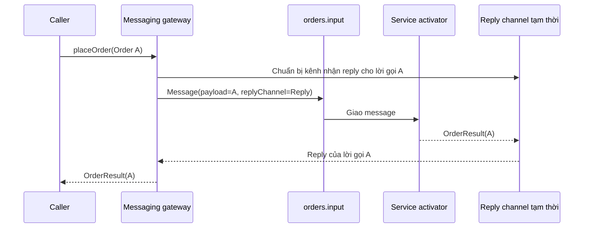
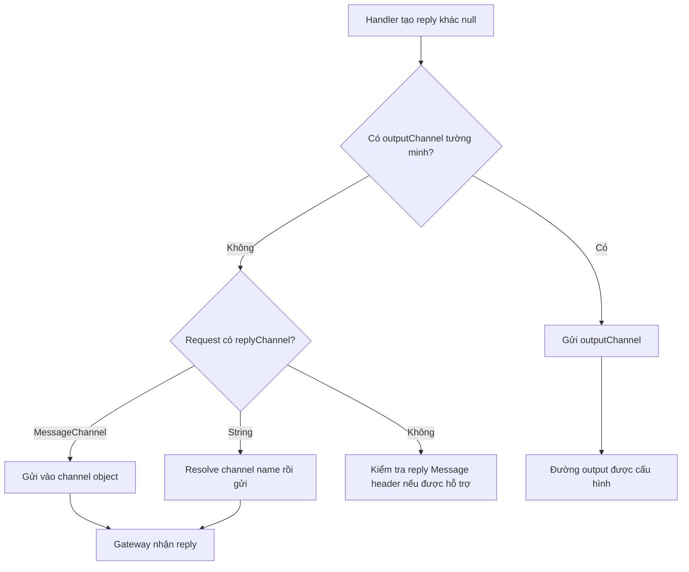
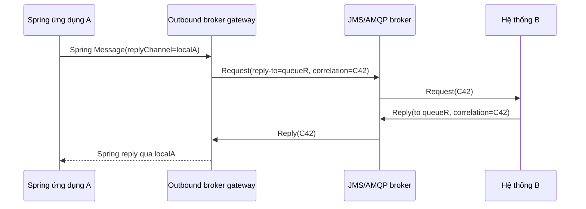
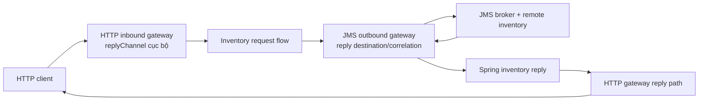

# Reply channel trong gateway

## 1. Reply channel giải quyết bài toán gì?

Trong **SPRING_INTEGRATION_ADAPTERS**, ứng dụng kết nối tới HTTP, JMS, AMQP, Kafka, file/SFTP và các hệ thống khác thông qua inbound/outbound adapter, gateway, poller và `MessageChannel`. Một số luồng chỉ gửi dữ liệu một chiều; những luồng khác cần trả kết quả cho đúng người gọi.

Ví dụ, một REST client gửi yêu cầu tạo đơn hàng. HTTP inbound gateway biến request thành Spring `Message<?>` và đưa vào `orders.input`. Sau khi service xử lý xong, gateway phải tìm được **đường đưa reply trở về cùng HTTP request**. Nếu nhiều request chạy đồng thời, kết quả của đơn `A` không được lẫn sang đơn `B`.

Spring Integration giải quyết việc này bằng mô hình **return address**: một request message có thể mang header `replyChannel` chỉ ra nơi một thành phần downstream phải gửi kết quả.



Sơ đồ mô tả logic request/reply cục bộ. Kênh reply tạm thời không nhất thiết là một bean được khai báo trong application context. Với một gateway kết nối mạng, còn có bước đối chiếu reply ở tầng giao thức (ví dụ JMS correlation ID và `JMSReplyTo`) trước khi kết quả được trả về luồng Spring.

**Sau bài học**, bạn có thể:

1. Giải thích ý nghĩa của `replyChannel`, `requestChannel` và `errorChannel` trong `MessageHeaders`.
2. Hiểu cách messaging gateway tạo kênh reply tạm thời, chờ kết quả và giải quyết nhiều lời gọi đồng thời.
3. Cấu hình `@MessagingGateway`, Java DSL và XML với return path tự động hoặc `default-reply-channel`.
4. Phân biệt `requestTimeout`, `replyTimeout` và timeout thật của HTTP/JMS/AMQP/Kafka.
5. Chẩn đoán các lỗi mất header, handler không trả lời, reply muộn, reply nhầm kênh và sai cách qua broker.
6. Kiểm thử đường request/reply, bao gồm trường hợp thành công, lỗi, timeout và concurrency.

## 2. Nền tảng: Message, MessageChannel và return address

### 2.1. Reply channel là header của Spring message

Mỗi Spring `Message<?>` gồm `payload` và `headers`. Những key hệ thống liên quan đến request/reply bao gồm:

| Thành phần | Ý nghĩa | Giá trị thường gặp |
|---|---|---|
| `requestChannel` của gateway | Kênh **nhận request** mà gateway gửi vào flow | Bean `DirectChannel`, `QueueChannel`, v.v. |
| `MessageHeaders.REPLY_CHANNEL` | Key `replyChannel` chứa nơi cần gửi **reply** | `MessageChannel` hoặc tên channel dạng `String` |
| `MessageHeaders.ERROR_CHANNEL` | Key `errorChannel` chứa địa chỉ xử lý lỗi | `MessageChannel` hoặc tên channel |
| `MessageHeaders.ID` | ID của một Spring message cụ thể | `UUID` |
| `correlationId` theo hợp đồng | Gắn các message cùng một nghiệp vụ hoặc request | `String`, `UUID` hoặc giá trị do ứng dụng chọn |

**Điểm cần nhớ:** `requestChannel` trong cấu hình gateway không phải là tên một header bắt buộc trong mỗi message. Ngược lại, `replyChannel` là header dùng làm *return address* cho các endpoint tạo reply.

Ví dụ nhìn vào header ở handler:

```java
import org.springframework.messaging.Message;
import org.springframework.messaging.MessageHeaders;
import org.springframework.messaging.MessageChannel;

// request là Spring Message<?> do gateway chuyển tới.
Object target = request.getHeaders().get(MessageHeaders.REPLY_CHANNEL);

if (target instanceof MessageChannel channel) {
    System.out.println("Reply target: " + channel.getClass().getSimpleName());
} else if (target instanceof String channelName) {
    System.out.println("Reply target name: " + channelName);
}
```

Đoạn trên chỉ để **quan sát**. Một service activator trả về giá trị Java bình thường thường không cần gửi thủ công vào channel; framework sẽ làm việc đó.

### 2.2. Return address không phải correlation ID

Hai cơ chế thường đi cùng nhau nhưng trả lời hai câu hỏi khác nhau:

- **`replyChannel`**: *Gửi kết quả về đâu trong ứng dụng Spring Integration hiện tại?*
- **Correlation ID**: *Kết quả này thuộc request hoặc nhóm dữ liệu nào?*

Một gateway Java có thể tạo kênh reply tạm thời riêng cho mỗi invocation mà không cần bạn tự quản lý correlation ID. Một JMS/AMQP/Kafka gateway có thể phải gắn thêm correlation ID tại broker để nối reply từ phía remote với request đã gửi.

Đừng thay `replyChannel` bằng một `String correlationId`, đừng dùng `MessageHeaders.ID` của Spring như thể nó luôn là ID của request trong broker, và đừng giả định mọi gateway có cùng chiến lược correlation.

### 2.3. Inbound, outbound adapter và gateway có trách nhiệm khác nhau

| Endpoint | Hướng giao tiếp | Reply được xử lý thế nào? |
|---|---|---|
| Inbound channel adapter | Hệ thống ngoài → Spring | Thường là **một chiều**, không có lời gọi request/reply cần đợi |
| Outbound channel adapter | Spring → hệ thống ngoài | Thường không tạo reply nghiệp vụ trả về flow |
| Messaging gateway (`@MessagingGateway`) | Lời gọi Java → Spring flow → Java result | Thường tạo temporary reply channel và chờ kết quả |
| HTTP inbound gateway | HTTP request → Spring → HTTP response | Chờ Spring reply để tạo response cho client |
| HTTP outbound gateway | Spring → HTTP request → Spring reply | Đợi HTTP response từ remote; đưa reply vào flow nội bộ |
| JMS/AMQP outbound gateway | Spring → broker/remote → Spring reply | Dùng cơ chế request/reply của broker rồi gửi reply vào channel Spring |
| Kafka request/reply gateway | Spring → Kafka → Spring reply | Cần topic/partition/correlation headers hoặc cơ chế reply được cấu hình |

Dấu hiệu nhận biết gateway là **hợp đồng request/reply**. Một chiều thì dùng adapter cho phù hợp, không nên khai báo gateway có kiểu trả về không rỗng rồi để downstream không bao giờ trả lời.

## 3. Đường trả lời tự động của messaging gateway

### 3.1. Temporary reply channel

Khi một phương thức gateway cần trả kết quả, `GatewayProxyFactoryBean` thường thực hiện các bước:

1. Nhận lời gọi Java, ánh xạ tham số thành request `Message<?>`.
2. Tạo hoặc chuẩn bị **reply channel tạm thời, riêng cho lời gọi**, mặc định là địa chỉ anonymous point-to-point.
3. Gắn địa chỉ reply đó vào header `replyChannel` của message.
4. Gửi request tới `requestChannel` đã cấu hình.
5. Nhận kết quả từ reply channel, chuyển payload/header theo hợp đồng kiểu trả về của phương thức Java.
6. Trả kết quả về caller, hoặc áp dụng xử lý timeout/lỗi khi không nhận được reply.

```text
OrderGateway.placeOrder(A)
    |
    | requestChannel = orders.input
    | replyChannel   = temporaryReplyA
    v
  handler(A) ------------------------> temporaryReplyA --> OrderResult(A)

OrderGateway.placeOrder(B)
    |
    | requestChannel = orders.input
    | replyChannel   = temporaryReplyB
    v
  handler(B) ------------------------> temporaryReplyB --> OrderResult(B)
```

Mỗi lời gọi có địa chỉ trả lời riêng. Nếu xử lý B hoàn thành trước A, reply B vẫn phải về đúng gateway invocation B; thứ tự hoàn tất không quyết định thuộc tính của reply.

**Không cần tạo bean tên `replyChannel` chỉ vì message có header `replyChannel`.** Temporary reply channel được gateway quản lý trong ngữ cảnh lời gọi.

### 3.2. Service activator tìm đường gửi reply thế nào?

Một endpoint có khả năng sinh reply, ví dụ service activator, thường chọn đích theo thứ tự:

1. Nếu endpoint có cấu hình **`outputChannel`** tường minh, gửi kết quả tới channel đó.
2. Nếu không có output channel, đọc **`replyChannel` trên request message**:
   - Là `MessageChannel`: gửi trực tiếp.
   - Là tên channel dạng `String`: dùng resolver để tìm bean/channel tương ứng.
3. Nếu request không có `replyChannel` và đối tượng reply là một `Message<?>` có return address, một số endpoint có thể tham chiếu header của chính reply để chọn đích.
4. Nếu không tìm được đích thích hợp, hoặc không tạo được reply, hành vi phụ thuộc endpoint và cấu hình (thường dẫn đến không có reply hoặc lỗi).

Điều này lý giải vì sao một service activator đơn giản **không khai báo output channel** vẫn trả được kết quả về gateway.



**Lưu ý:** Việc khai báo `outputChannel = "otherChannel"` có thể khiến reply đi sang `otherChannel` thay vì temporary reply channel; gateway sẽ không tự nhận được kết quả nếu luồng phía sau không đưa nó quay về đúng return address.

### 3.3. Không tự gửi reply hai lần

Một handler có hai kiểu thực hiện:

- **Cách thông thường:** trả `OrderResult` hoặc `Message<OrderResult>` từ phương thức; Spring Integration tạo/gửi reply.
- **Cách chủ động:** gửi message trực tiếp tới channel đích; phù hợp với một số custom `MessageHandler`, nhưng phải tự chịu trách nhiệm send/error và không đồng thời trả về một kết quả làm endpoint gửi thêm lần nữa.

Không kết hợp `replyChannel.send(reply)` và `return reply` trong một handler reply-producing nếu không có lý do thiết kế rõ ràng. Làm vậy có thể tạo **hai reply** cho một request.

## 4. Ví dụ Java đầy đủ: Gateway → DirectChannel → Service Activator

Giả sử xây một service đặt hàng. Caller muốn gọi phương thức Java và nhận `OrderResult`; luồng messaging vẫn dùng `MessageChannel`.

### 4.1. Mô hình dữ liệu

Ví dụ dùng Java 17 record:

```java
// OrderRequest.java
public record OrderRequest(String orderId, int quantity) {}

// OrderResult.java
public record OrderResult(String orderId, String status) {}
```

### 4.2. Interface Gateway

```java
// OrderGateway.java
import org.springframework.integration.annotation.MessagingGateway;

@MessagingGateway(
        defaultRequestChannel = "orders.input",
        defaultReplyTimeout = "5000")
public interface OrderGateway {

    OrderResult placeOrder(OrderRequest request);
}
```

- `defaultRequestChannel` chọn kênh mà proxy gateway gửi request đến.
- `defaultReplyTimeout` quy định khoảng chờ reply ở phía gateway, đơn vị **mili-giây**.
- Kiểu trả về `OrderResult` cho biết caller đang cần reply; gateway sẽ xử lý request/reply.
- Không khai báo `defaultReplyChannel`: framework dùng reply channel tạm thời cho mỗi lời gọi.

### 4.3. Cấu hình channel và flow

```java
// OrderIntegrationConfig.java
import org.springframework.context.annotation.Bean;
import org.springframework.context.annotation.Configuration;
import org.springframework.integration.annotation.IntegrationComponentScan;
import org.springframework.integration.config.EnableIntegration;
import org.springframework.integration.channel.DirectChannel;
import org.springframework.integration.dsl.IntegrationFlow;
import org.springframework.messaging.MessageChannel;

@Configuration
@EnableIntegration
@IntegrationComponentScan
public class OrderIntegrationConfig {

    @Bean(name = "orders.input")
    public MessageChannel ordersInput() {
        return new DirectChannel();
    }

    @Bean
    public IntegrationFlow orderProcessingFlow() {
        return IntegrationFlow.from("orders.input")
                .handle((payload, headers) -> {
                    OrderRequest request = (OrderRequest) payload;
                    if (request.quantity() <= 0) {
                        throw new IllegalArgumentException(
                                "quantity must be positive");
                    }
                    return new OrderResult(
                            request.orderId(), "ACCEPTED");
                })
                .get();
    }
}
```

Tại `.handle(...)`, handler trả `OrderResult`. Không khai báo channel output riêng ở cuối flow, nên reply-producing endpoint có thể dùng header `replyChannel` gắn từ gateway để trả kết quả.

`@IntegrationComponentScan` cần thiết để tìm interface `@MessagingGateway` trong package được scan; chỉ dùng `@ComponentScan` thông thường có thể không đăng ký gateway interface.

### 4.4. Caller và luồng chạy

```java
// Giả sử Spring đã khởi tạo OrderIntegrationConfig và OrderGateway.
OrderResult result = orderGateway.placeOrder(
        new OrderRequest("O-42", 2));

System.out.println(result.orderId()); // O-42
System.out.println(result.status());  // ACCEPTED
```

Trên `DirectChannel`, handler thường chạy trên **thread gọi gateway**. Sau khi xử lý, reply về địa chỉ tạm thời, rồi phương thức gateway trả `OrderResult` cho caller.

Cách này thể hiện rõ đường reply tự động. Khi chuyển một đoạn flow qua `ExecutorChannel` hoặc `QueueChannel` có poller, việc trả lời có thể xảy ra từ thread khác; cần xem xét timeout, giao dịch và xử lý lỗi.

## 5. Cấu hình bằng XML và default-reply-channel

### 5.1. XML gateway không cần khai báo reply channel riêng

Ví dụ mô tả cấu hình tương đương bằng XML namespace (cần khai báo `int` và bean service tương ứng):

```xml
<int:channel id="ordersInput"/>

<int:gateway id="orderGateway"
             service-interface="com.example.OrderGateway"
             default-request-channel="ordersInput"
             default-reply-timeout="5000"/>

<int:service-activator
        input-channel="ordersInput"
        ref="orderService"
        method="placeOrder"
        requires-reply="true"/>
```

Ở ví dụ này:

- `ordersInput` là request channel.
- Service activator trả dữ liệu Java qua phương thức `placeOrder`.
- Vì không chỉ định `output-channel` của service activator, framework dùng `replyChannel` được gateway thêm vào request.
- `requires-reply="true"` báo lỗi sớm nếu handler trả `null` trong trường hợp hợp đồng yêu cầu kết quả.

Trường hợp interface đã dùng annotation gateway, chọn một chiến lược đăng ký phù hợp để tránh cấu hình trùng tên/bean. Các ví dụ Java và XML ở đây là **hai phương án**, không cần kích hoạt đồng thời.

### 5.2. Khi nào cần default-reply-channel?

Mặc định, temporary reply channel là anonymous và point-to-point nên thuận lợi cho trả lời đúng caller, nhưng khó gắn nhiều subscriber vào để giám sát hoặc kiểm toán.

Đôi khi cần một **channel có tên** để:

- Gắn interceptor/wiretap nhằm quan sát reply.
- Cho một nhánh khác đọc bản sao kết quả mà không “giành” reply với gateway.
- Tích hợp một nhóm endpoint đã được định tuyến qua reply channel dùng chung theo thiết kế.

Spring Integration hỗ trợ `default-reply-channel` của messaging gateway. Khi cấu hình một channel rõ ràng, framework tạo **bridge từ channel cấu hình về temporary reply channel** mà gateway thực sự đang đợi. Đây là lý do có thể dùng một `PublishSubscribeChannel` cho đường reply cần nhiều người nhận.

Ví dụ XML:

```xml
<int:channel id="ordersInput"/>

<int:publish-subscribe-channel id="ordersReplies"/>

<int:gateway id="orderGateway"
             service-interface="com.example.OrderGateway"
             default-request-channel="ordersInput"
             default-reply-channel="ordersReplies"
             default-reply-timeout="5000"/>

<int:service-activator
        input-channel="ordersInput"
        ref="orderService"
        method="placeOrder"/>

<!-- Subscriber dùng để audit, không trả thêm một reply. -->
<int:service-activator
        input-channel="ordersReplies"
        ref="replyAudit"
        method="observe"/>
```

Ở đây `ordersReplies` là publish-subscribe channel, và gateway có nhánh bridge nhận reply. Subscriber `replyAudit` cần chỉ quan sát, tránh chặn luồng hoặc ném lỗi không kiểm soát trên đường trả lời. Khi mục đích chỉ là quan sát, **wiretap/interceptor** thường ít làm thay đổi topology hơn một nhánh nghiệp vụ mới.

**Không đồng nhất `default-reply-channel` với header `replyChannel`**: dù dùng một channel có tên, gateway vẫn quản lý temporary reply channel để phân biệt các invocation.

### 5.3. Output channel có thể chuyển hướng reply

Giả sử đổi service activator thành:

```xml
<int:service-activator
        input-channel="ordersInput"
        output-channel="ordersCompleted"
        ref="orderService"
        method="placeOrder"/>
```

Khi đó reply được gửi vào `ordersCompleted`. Nếu không có endpoint nào từ `ordersCompleted` đưa kết quả về đúng return address, phương thức gateway có thể không nhận được reply và hết thời gian chờ.

Trong một flow phức tạp, nên chọn rõ **ai chịu trách nhiệm route reply về caller**. Chỉ thêm output channel vì muốn quan sát luồng có thể vô tình thay đổi hành vi trả lời.

## 6. Reply channel và các kiểu gateway khác

### 6.1. Gateway Java: caller bên trong ứng dụng

`@MessagingGateway` tạo proxy để code nghiệp vụ gọi như một interface Java:

```java
OrderResult result = orderGateway.placeOrder(request);
```

Đường đi:

```text
Java caller
    |
@MessagingGateway
    |
request Spring Message (replyChannel tạm)
    |
IntegrationFlow
    |
Spring reply
    |
Java method return
```

Gateway là ranh giới giữa **lời gọi phương thức** và **message flow**, không nhất thiết là HTTP hoặc broker.

### 6.2. HTTP inbound gateway: Spring reply thành HTTP response

Với một HTTP inbound gateway:

```text
HTTP POST /orders
    |
HTTP inbound gateway
    |
Message(request payload, replyChannel = return address)
    |
business flow
    |
Message(reply payload + response metadata)
    |
HTTP gateway
    |
HTTP 200/201/4xx/... response
```

Ví dụ cấu hình XML mang tính minh họa:

```xml
<int-http:inbound-gateway
        path="/orders"
        supported-methods="POST"
        request-channel="ordersInput"
        reply-timeout="5000"/>
```

Giá trị `reply-timeout` ở đây quyết định thời gian gateway chờ Spring reply để có thể sinh HTTP response, với ngữ nghĩa do endpoint HTTP quy định. Nếu downstream xử lý bất đồng bộ quá lâu, HTTP request có thể timeout trước khi nghiệp vụ thực sự xong; lúc đó nên cân nhắc hợp đồng trả `202 Accepted` cùng mã theo dõi, thay vì cố giữ HTTP connection mở vô hạn.

Phải phân biệt cả **HTTP client/proxy timeout** và **timeout ở Spring Integration gateway**; cấu hình một phía không bảo đảm phía kia còn kết nối.

### 6.3. HTTP outbound gateway: response từ remote trở thành Spring reply

Một HTTP outbound gateway nhận Spring request và gửi HTTP ra service khác; khi nhận HTTP response, adapter tạo Spring reply rồi đưa vào output channel tường minh hoặc `replyChannel` của request.

```text
Spring flow → HTTP outbound gateway → remote HTTP server
     ^                                   |
     |           HTTP response           |
     +--------- Spring reply ------------+
```

Ở đây `replyChannel` quyết định đích **sau khi HTTP response đã về tới ứng dụng**. Timeout của HTTP client khi kết nối/đọc response là chuyện khác với timeout gửi reply vào Spring channel (đôi khi endpoint gọi các thuộc tính timeout gần giống nhau nhưng ý nghĩa khác nhau).

### 6.4. JMS/AMQP: replyChannel nội bộ khác replyTo của broker

Một request/reply qua broker cần hai cấp:

1. **Cấp Spring**: request đầu vào gateway có `replyChannel` nội bộ (object hoặc tên bean).
2. **Cấp broker/remote**: message được gửi với các thuộc tính tương ứng như `JMSReplyTo` và `JMSCorrelationID`, hay AMQP `reply-to`/`correlation-id`; consumer remote phải gửi response về đúng destination và correlation.



`JMSReplyTo`/`reply-to` của broker là **địa chỉ giao thức**, còn Spring header `replyChannel` có thể giữ một `MessageChannel` Java. Không copy hoặc serialize tùy ý object channel này vào JMS property, AMQP header, Kafka record hoặc HTTP header. Adapter/gateway chuyên biệt chịu trách nhiệm mapping và correlation thích hợp.

**Lưu ý JMS:** thuộc tính `correlation-key` của JMS outbound gateway quyết định cách đối chiếu reply. Trong một số cấu hình, gateway mong remote echo giá trị message ID hoặc correlation property theo quy ước cụ thể. Đọc hợp đồng gateway hiện dùng, không tự giả định `JMSCorrelationID` luôn do ứng dụng đặt và giữ nguyên.

### 6.5. Kafka: topic reply và correlation khác temporary channel

Kafka record có topic, partition, offset, key/value và headers. Cơ chế request/reply (nếu dùng) thường cần thông tin **reply topic** cùng **correlation ID**, rồi một listener/converter ghép record reply về request trong ứng dụng.

Kafka không cung cấp một `MessageChannel` Java native. Nếu chỉ gửi bằng **outbound channel adapter** tới topic, không có một đường reply tự động như messaging gateway. Nếu cần nhận phản hồi, dùng gateway/request-reply abstraction phù hợp hoặc tự thiết kế topic reply, correlation, timeout và idempotency.

### 6.6. File/SFTP, polling và database

File inbound adapter, SFTP inbound adapter hay polling database thường **đưa sự kiện vào flow một chiều**. Chúng không có một caller đang giữ lời gọi đồng bộ chờ response như HTTP gateway.

Nếu muốn phản hồi đối tác:

- Ghi tệp kết quả vào thư mục SFTP đã thỏa thuận.
- Gửi sự kiện trạng thái đến topic/queue phản hồi.
- Cập nhật bảng trạng thái và cung cấp API truy vấn.
- Dùng callback HTTP riêng nếu hệ thống bên ngoài hỗ trợ.

Đây là **hợp đồng nghiệp vụ ở một hệ thống khác**, không phải tiếp tục dùng một temporary `replyChannel` trong JVM trong nhiều giờ hoặc nhiều ngày.

## 7. Timeout: nhận biết sự khác nhau giữa gửi request và chờ reply

### 7.1. requestTimeout và replyTimeout là hai giới hạn khác nhau

| Thuộc tính | Áp dụng khi nào? | Ví dụ có thể bị ảnh hưởng |
|---|---|---|
| `requestTimeout` của messaging gateway | Khi **gửi request vào channel** có khả năng block | `QueueChannel` bị đầy |
| `replyTimeout` của messaging gateway | Khi **chờ nhận reply** sau khi đã gửi/handoff request | Async flow chưa xử lý xong |
| HTTP client connect/read timeout | Khi thực hiện request ra HTTP server bên ngoài | TCP connect, socket đọc response |
| JMS receive timeout | Khi gateway chờ **broker reply** | Không nhận reply ở temporary queue |
| AMQP/Kafka request-reply timeout | Khi chờ **remote response** được correlation | Remote worker không trả lời |
| Reply send timeout của một outbound endpoint | Khi gửi Spring reply vào channel có khả năng block | Channel đích bounded/full |

Các thuộc tính có chữ `replyTimeout` không có nghĩa giống nhau giữa mọi loại endpoint. Đọc đúng tài liệu Java/XML DSL của endpoint đang cấu hình.

### 7.2. Vì sao replyTimeout không giới hạn toàn bộ thời gian DirectChannel?

Đây là một bẫy quan trọng:

```text
Gateway.placeOrder()
    |
    v
DirectChannel.send(...)
    |
    v
handler chạy 20 giây trên chính thread caller
    |
    v
handler trả reply
    |
    v
Gateway nhận reply gần như ngay lập tức
```

Dù `replyTimeout=5000`, phương thức Java có thể vẫn mất khoảng 20 giây. Bởi vì với luồng đồng bộ, thread đang **thực thi handler trong lệnh gửi request**; bộ đếm chờ reply không tự cắt ngang đoạn xử lý đồng bộ đó. Nó bắt đầu có ý nghĩa khi thread quay lại gateway và phải chờ một reply chưa tới.

### 7.3. ExecutorChannel, QueueChannel và reply muộn

```text
Gateway thread                    Worker thread
    |                                  |
    | send vào ExecutorChannel        |
    +--------------------------------->| xử lý 8 giây
    |                                  |
    | chờ reply tối đa 5 giây          |
    | timeout tại giây 5              |
    | (return null hoặc throw)        |
    |                                  | gửi reply ở giây 8
    |                                  | gateway caller đã đi rồi
```

Tại ranh giới bất đồng bộ, `replyTimeout` giúp hạn chế thời gian gateway thread chờ; nó **không hủy** công việc ở worker, không tự rollback giao dịch ở broker và không đảm bảo reply đến sau timeout còn có người nhận.

Một số phiên bản Spring Integration trả `null` nếu chờ quá hạn; từ **6.2**, `@MessagingGateway`/Java DSL hỗ trợ tùy chọn `errorOnTimeout` để có thể ném `MessageTimeoutException` thay vì trả null. Các phiên bản có mặc định khác nhau (các phiên bản cũ có thể chờ vô hạn, bản mới thường có mặc định 30 giây); vì vậy hãy đặt timeout **tường minh theo yêu cầu nghiệp vụ**.

### 7.4. Thiết kế timeout cùng hợp đồng xử lý

Một timeout hiệu quả phải kèm quyết định:

- Caller nhận mã lỗi/thông báo gì khi chờ quá lâu?
- Một request đã được broker nhận nhưng caller timeout có bị gửi lại không?
- Nếu retry, làm sao tránh tạo đơn hàng hoặc thanh toán hai lần? (idempotency key)
- Reply muộn sẽ được log, bỏ qua, lưu trạng thái hay chuyển tới dead-letter/error flow?
- Khi có timeout downstream, có nên dùng mô hình trả **job ID** rồi truy vấn trạng thái thay vì chờ đồng bộ?

Đừng chọn `replyTimeout` bằng thời gian trung bình của handler mà bỏ qua tail latency, pool/thread contention, broker lag và timeout của API caller.

## 8. Điều gì xảy ra khi handler không trả reply?

### 8.1. Handler trả null hoặc void

Một service activator bình thường không bắt buộc trả lời. Nếu handler trả `null` hoặc có kiểu trả về `void`, nó thường không tạo reply message.

```java
// Dành cho flow one-way, không phù hợp với OrderGateway có return OrderResult.
public void process(OrderRequest request) {
    saveOrder(request);
    // Không có return -> không có reply nghiệp vụ.
}
```

Nếu gọi từ gateway kỳ vọng `OrderResult`, kết quả có thể là timeout/hết chờ.

Với endpoint dùng reply-producing handler, cấu hình `requiresReply=true` để một kết quả `null` phát sinh lỗi `ReplyRequiredException` thay vì âm thầm để gateway đợi.

```xml
<int:service-activator
        input-channel="ordersInput"
        ref="orderService"
        method="placeOrder"
        requires-reply="true"/>
```

Nếu nghiệp vụ thật sự một chiều, gateway method có thể trả `void`. Với Spring Integration từ 5.4, framework có thể gắn `nullChannel` làm reply address cho method `void` nếu chưa có địa chỉ cụ thể, giúp bỏ reply ngoài ý muốn. Đừng thiết kế method `void` rồi lại dựa vào một reply nghiệp vụ không được hợp đồng bảo đảm.

### 8.2. Transformer/filter/router làm mất đường trả lời

Một luồng có thể thay request message bằng một `Message<?>` mới. Nếu custom code dựng message lại mà không giữ các header hệ thống, địa chỉ reply có thể mất:

```java
// RỦI RO trong một custom component tự dựng message và định tuyến trực tiếp:
Message<OrderResult> rebuilt = MessageBuilder
        .withPayload(result)
        .build();
// Không mang replyChannel/errorChannel của request gốc.
```

Khi thiết kế custom transformer/handler và cần thay payload, có thể dựng message mới rồi sao chép có chủ đích headers từ request:

```java
Message<OrderResult> rebuilt = MessageBuilder
        .withPayload(result)
        .copyHeaders(requestMessage.getHeaders())
        .build();
```

Cách này giữ các header cần thiết (bao gồm `replyChannel`, `errorChannel`) để downstream tiếp tục biết return address. Khi chỉ muốn giữ lại một số headers, có thể `setReplyChannel(...)` và `setErrorChannel(...)` với giá trị được kiểm tra. **Không phải cứ tạo message mới là mọi service activator sẽ làm mất header**: nhiều endpoint chuẩn của Spring Integration chủ động chuyển tiếp hoặc hợp nhất header request vào reply. Hãy kiểm tra hành vi của đúng loại endpoint đang sử dụng, nhất là khi tự viết `MessageHandler`, transformer hoặc adapter.

Nếu cần loại bỏ metadata nội bộ trước khi gửi broker, thực hiện ở **ranh giới outbound** bằng header mapper/filter phù hợp; đừng xóa `replyChannel` quá sớm rồi mong gateway nhận được reply.

### 8.3. Filter hoặc router không tạo đường ra

Các nguyên nhân phổ biến khiến request không nhận reply:

- Filter từ chối message mà không phát lỗi.
- Router không tìm được destination hoặc đưa message vào `nullChannel`.
- Splitter tạo nhiều message nhưng không aggregator về **một kết quả** cho gateway.
- Poller/worker không chạy hoặc không có subscriber.
- Handler trả `null` nhưng `requiresReply` đang tắt.
- Code thủ công gửi reply vào một channel khác với return address.
- Reply được phát sau timeout, phía caller đã kết thúc chờ.

Với router, có thể dùng cấu hình `resolutionRequired` phù hợp để phát hiện channel không hợp lệ. Với filter, cấu hình `throwExceptionOnRejection` nếu từ chối phải thành lỗi có thể quan sát. Với splitter/aggregator, cần thiết kế correlation/sequence và một kết quả cuối cùng mang return address đúng.

### 8.4. errorChannel khác replyChannel

`replyChannel` nhận **kết quả nghiệp vụ**. `errorChannel` nhận **thông tin về lỗi xử lý** dưới dạng `ErrorMessage` hoặc thông điệp được xử lý trong error flow.

```text
request Message
  |-- headers.replyChannel --> nơi trả OrderResult
  |-- headers.errorChannel --> nơi xử lý MessagingException/ErrorMessage
```

Ở luồng đồng bộ dùng `DirectChannel`, exception từ handler có thể được ném trở lại caller gateway. Ở luồng bất đồng bộ, exception có thể chuyển vào error flow (nếu có header errorChannel hoặc kênh lỗi mặc định phù hợp). Nếu muốn caller nhận một phản hồi lỗi nghiệp vụ có cấu trúc, thiết kế error flow biến lỗi thành **reply hợp lệ** và gửi đúng địa chỉ theo cơ chế của gateway/adapter; không giả định gửi `ErrorMessage` đến bất kỳ channel nào cũng tự biến thành `OrderResult`.

Đối với HTTP inbound gateway, lỗi có thể trở thành HTTP status/body phù hợp. Với JMS/AMQP, lỗi có thể liên quan requeue, DLQ hoặc response lỗi. Chúng không có cùng hành vi chỉ vì đều dùng tên `errorChannel`.

## 9. Giữ đúng reply path trong hệ thống nhiều giao thức

### 9.1. Luồng HTTP → JMS → HTTP response

Giả sử cần yêu cầu kiểm tra tồn kho qua JMS trước khi trả HTTP:



Bảng ánh xạ:

| Chặng | Địa chỉ trả lời | Người quản lý |
|---|---|---|
| HTTP inbound → Spring | Temporary `replyChannel` của HTTP gateway | Spring Integration |
| Spring → JMS | `JMSReplyTo` và correlation key/message ID | JMS outbound gateway + broker |
| JMS remote → Spring | JMS reply destination và correlation ID | JMS gateway |
| Spring → HTTP caller | Reply gửi về return address của HTTP gateway | Spring Integration + HTTP transport |

**Điểm quan trọng:** Tại broker, phải dùng **return address native** của JMS. Một `MessageChannel` Java chỉ sống trong context Spring, không phải kênh giao tiếp giữa các JVM khác nhau. Để giữ correlation qua ranh giới, dùng ID có thể serialize và quy ước echo/đối chiếu rõ ràng.

### 9.2. Đừng dùng chung reply destination như một QueueChannel không có correlation

Một ứng dụng có thể có hàng trăm request cùng chờ. Nếu mọi reply đi vào một queue nội bộ với nhiều consumer độc lập mà không có cơ chế đối chiếu, consumer của request A có thể lấy reply B.

Gateway tạm thời giải quyết vấn đề **trong một invocation**; broker gateway dùng correlation riêng. Nếu viết custom request/reply, phải có dispatcher theo correlation ID, chiến lược timeout, cleanup pending requests và xử lý duplicate/late replies. Không giải quyết bằng cách gán cùng một tên channel `"replies"` cho mọi message rồi giả định thứ tự FIFO luôn khớp thứ tự request.

### 9.3. Khi cần bền vững, tách reply đồng bộ khỏi trạng thái công việc

Một job xử lý file SFTP có thể mất hàng giờ, Kafka consumer có thể retry sau restart, hoặc database batch có thể cần xử lý lại. Không nên lưu temporary reply channel làm trạng thái bền vững.

Thiết kế phù hợp hơn:

```text
Submit request --> tạo jobId/correlationId --> trả ACK ngay
                  |
                  v
             Broker / DB
                  |
                  v
             Worker xử lý
                  |
                  v
        cập nhật trạng thái / phát event
                  |
                  v
           Client hỏi status / nhận callback
```

Giữ `jobId` hoặc business ID qua message headers/body và store; dùng gateway đồng bộ khi request có SLA ngắn và rõ ràng.

## 10. Debugging: khi gateway chờ mãi hoặc trả nhầm reply

### 10.1. Quan sát đúng dữ liệu

Ở mỗi điểm quan sát, phân biệt:

- `payload` request/reply và kiểu Java của chúng.
- Channel mà gateway gửi request.
- Có `replyChannel` trên request hay không, giá trị là channel object hay tên channel.
- Endpoint cuối có `outputChannel` tường minh không.
- Handler trả `null`/`void`, phát exception hay phát reply.
- Có chuyển thread qua `ExecutorChannel`/poller không, timeout bắt đầu khi nào.
- Nếu qua broker, **native reply destination/correlation ID** là gì.
- Reply tới trước hay sau khi gateway đã trả về cho caller.

Có thể thêm wiretap, interceptor hoặc logging handler tại những điểm này; tránh in dữ liệu nhạy cảm như token, nội dung thanh toán hoặc thông tin cá nhân vào log. Khi gắn ID để trace, dùng correlation ID nghiệp vụ có thể truyền qua protocol thay vì cố serialize object `replyChannel`.

### 10.2. Bảng lỗi thường gặp

| Triệu chứng | Nguyên nhân có thể | Cách xác minh và sửa |
|---|---|---|
| Method gateway trả `null` sau timeout | Không có reply hoặc reply đến muộn | Kiểm tra handler trả giá trị, `replyChannel`, handoff async và timeout |
| Gateway chờ lâu dù `replyTimeout` nhỏ | Handler trên `DirectChannel` chạy lâu trước khi control quay lại gateway | Đo thời gian trong `send` và thời gian đợi reply; dùng async/cancellation phù hợp |
| Handler chạy nhưng caller không nhận kết quả | `outputChannel` đã định tuyến reply sang nhánh khác | Kiểm tra thứ tự chọn output channel và return address |
| Chỉ một số request đồng thời bị trả nhầm dữ liệu | Custom reply queue/dispatcher thiếu correlation | Tách per-request reply path hoặc đối chiếu correlation đúng |
| Có reply khi debug nhưng gateway đã timeout | Reply được phát sau thời hạn chờ | Thiết kế late reply policy và idempotency |
| Downstream trả `null` | Handler/filter không tạo reply | Sử dụng `requiresReply` hoặc nhánh lỗi tường minh |
| Message sau custom transformer mất return address | Không giữ `replyChannel` | Dùng `MessageBuilder.fromMessage` khi thích hợp |
| JMS remote trả lời nhưng app không nhận | Sai `JMSReplyTo`/`JMSCorrelationID` hoặc selector | Kiểm tra native broker metadata và `correlation-key` |
| HTTP inbound không trả body | Không có reply Spring hoặc client timeout | Kiểm tra gateway reply timeout, HTTP endpoint response mapping |
| Queue tích lũy reply không ai đọc | Dùng QueueChannel reply có consumer/poller sai hoặc caller đã hết chờ | Xem topology, subscriber, timeout, cleanup |
| Không thấy exception tại caller | Lỗi xảy ra trên worker thread hoặc bị error flow nuốt | Kiểm tra `errorChannel`, logs và error translation |
| Reply bị gửi hai lần | Handler vừa tự send vừa return | Chỉ giữ một cơ chế tạo reply |

### 10.3. Thiết kế quan sát có chủ đích

Có thể dùng cùng một `traceId` và `businessRequestId` từ HTTP inbound qua JMS/AMQP/Kafka (sau khi validate), song mỗi gateway vẫn quản lý return address **cục bộ**. Với monitoring, đo ít nhất latency tổng, latency xử lý downstream, số timeout, số reply muộn, lỗi correlation và queue lag. Kết hợp log cùng ID cho request và reply để tìm đúng cặp trong luồng xử lý đồng thời.

## 11. Kiểm thử đường reply

### 11.1. Unit/integration test flow đơn giản

Với cấu hình Java ở mục 4, một kiểm thử trong Spring test context:

```java
import static org.junit.jupiter.api.Assertions.assertEquals;
import static org.junit.jupiter.api.Assertions.assertNotNull;
import static org.junit.jupiter.api.Assertions.assertThrows;

import org.junit.jupiter.api.Test;
import org.springframework.beans.factory.annotation.Autowired;
import org.springframework.test.context.junit.jupiter.SpringJUnitConfig;

@SpringJUnitConfig(OrderIntegrationConfig.class)
class OrderGatewayTest {

    @Autowired
    private OrderGateway orderGateway;

    @Test
    void gatewayReturnsReplyFromHandler() {
        OrderResult result = orderGateway.placeOrder(
                new OrderRequest("O-42", 2));

        assertNotNull(result);
        assertEquals("O-42", result.orderId());
        assertEquals("ACCEPTED", result.status());
    }

    @Test
    void gatewayPropagatesSynchronousHandlerFailure() {
        assertThrows(IllegalArgumentException.class,
                () -> orderGateway.placeOrder(
                        new OrderRequest("O-43", 0)));
    }
}
```

Kiểm thử cần đúng package để `@IntegrationComponentScan` tìm `OrderGateway`. Exception ở bài test thứ hai minh họa handler đồng bộ; trong một cấu hình cụ thể có thể có wrapper exception của tầng messaging, nên hãy assert chuỗi nguyên nhân phù hợp với ứng dụng thực tế.

### 11.2. Kiểm thử nhiều request cùng lúc

Để kiểm chứng return path, gọi gateway từ nhiều thread:

```java
import java.util.ArrayList;
import java.util.List;
import java.util.concurrent.CompletableFuture;
import java.util.concurrent.ExecutorService;
import java.util.concurrent.Executors;

@Test
void concurrentRequestsReceiveTheirOwnReplies() {
    ExecutorService executor = Executors.newFixedThreadPool(8);
    try {
        List<CompletableFuture<OrderResult>> pending = new ArrayList<>();

        for (int i = 0; i < 20; i++) {
            String id = "O-" + i;
            pending.add(CompletableFuture.supplyAsync(
                    () -> orderGateway.placeOrder(
                            new OrderRequest(id, 1)),
                    executor));
        }

        for (int i = 0; i < pending.size(); i++) {
            OrderResult result = pending.get(i).join();
            assertEquals("O-" + i, result.orderId());
        }
    } finally {
        executor.shutdown();
    }
}
```

Đoạn test này dùng Java 17+. Dù `DirectChannel` vẫn xử lý đồng bộ trong thread gọi, các invocation là độc lập; bài test xác minh kết quả về đúng request. Muốn kiểm tra reply **đảo thứ tự hoàn tất**, thiết lập worker pool bất đồng bộ và delay khác nhau có kiểm soát.

### 11.3. Ma trận hành vi cần kiểm tra

| Ca kiểm thử | Setup | Kỳ vọng |
|---|---|---|
| Reply bình thường | Gateway + service activator trả dữ liệu | Caller nhận đúng payload |
| Không khai báo outputChannel | Handler cuối flow trả object | Reply về temporary reply channel |
| OutputChannel tường minh | Handler gửi sang channel khác | Kiểm tra đường đi mới; tránh gateway timeout ngoài ý muốn |
| Handler trả null | Gateway return type không void | Có lỗi `requiresReply` hoặc timeout theo cấu hình |
| Xử lý chậm trên DirectChannel | Handler sleep lâu hơn reply timeout | Chứng minh timeout không tự ngắt handler đồng bộ |
| Xử lý chậm trên ExecutorChannel | Worker hoàn tất sau reply timeout | Caller timeout theo hợp đồng; reply muộn được xử lý rõ |
| 20–100 request song song | Input ID khác nhau, delay khác nhau | Không lẫn reply giữa invocation |
| Error channel | Handler ném lỗi sync/async | Lỗi được quy về caller hoặc error flow đúng |
| JMS/AMQP gateway | Broker reply có correlation ID | Nhận đúng reply; sai correlation bị phát hiện |
| HTTP inbound | Request cần response | HTTP response đúng body, status và timeout |
| Mất replyChannel trong custom component | Dựng mới message không giữ header | Test phát hiện đường reply bị đứt |
| One-way | Gateway method trả void hoặc adapter | Không cần đợi reply nghiệp vụ |

## 12. Bài thực hành: sửa luồng trả lời bị đứt

**Bối cảnh:** Một REST endpoint nhận request tra cứu tồn kho. Spring Integration sử dụng HTTP inbound gateway, gửi dữ liệu tới `inventory.request`, xử lý bằng service activator. Trong bản thử nghiệm đầu tiên, HTTP client thỉnh thoảng timeout, dù log cho thấy worker đã xử lý xong.

**Bước 1 — Dựng flow đơn giản.** Dùng `@MessagingGateway` và service activator tương tự mục 4. Tạo request với `sku`, return type là `InventoryResult` và một flow `DirectChannel` trả kết quả.

**Bước 2 — Quan sát header.** Ghi lại việc có/không có `replyChannel` ở đầu và cuối flow, đồng thời đo latency xử lý. Giải thích vì sao kết quả được gửi về gateway dù handler không cấu hình output channel.

**Bước 3 — Cố ý gây lỗi.** Thêm một custom transformer tạo `Message<?>` mới không giữ return address, hoặc cấu hình một output channel chưa nối đường về gateway. Quan sát timeout hoặc lỗi nhận reply, rồi sửa bằng giữ header/đấu nối đúng.

**Bước 4 — Chuyển sang bất đồng bộ.** Đưa một đoạn xử lý sang `ExecutorChannel` hoặc pollable channel. Thiết lập `replyTimeout` cụ thể; thực nghiệm hai thời lượng xử lý ngắn hơn và dài hơn timeout.

**Bước 5 — Kiểm chứng concurrency.** Gửi 50 request có ID khác nhau và delay thay đổi. Đảm bảo reply nào cũng ứng với request của nó; không dựa vào thứ tự FIFO của các reply hoàn tất.

**Bước 6 — Thêm một ranh giới broker.** Nếu có JMS/AMQP, dùng outbound gateway đến worker thử nghiệm. Quan sát `JMSReplyTo`/`JMSCorrelationID` hoặc `reply-to`/`correlation-id` native; chỉ ra sự khác biệt với header `replyChannel` trong JVM.

**Bước 7 — Kiểm tra lỗi.** Thử request không có SKU, handler trả `null` và worker trả reply muộn. Quy định phản hồi, timeout, retry và idempotency phù hợp với tính chất nghiệp vụ.

**Điều kiện hoàn thành:** flow trả đúng result cho từng invocation; biết chính xác nơi phát sinh reply channel; hiểu nguyên nhân của timeout; test phát hiện mất return address; không cố đưa Spring `MessageChannel` object xuyên qua broker hoặc mạng.

## 13. Ghi nhớ

- `replyChannel` là **return address trong Spring Integration message**. Giá trị có thể là `MessageChannel` hoặc tên channel.
- Messaging gateway thông thường tạo **temporary reply channel riêng cho mỗi invocation**; service activator có thể tự động gửi kết quả về đó nếu không có `outputChannel` tường minh.
- `default-reply-channel` cho phép dùng named channel khi cần quan sát hoặc chia sẻ reply; gateway vẫn sử dụng bridge về reply channel tạm. Dùng publish-subscribe nếu cần nhiều subscriber độc lập.
- `requestTimeout` ảnh hưởng thao tác gửi request vào channel có thể block; `replyTimeout` ảnh hưởng chờ reply. Trong chuỗi `DirectChannel` đồng bộ, reply timeout **không cắt ngang** thời gian handler đang chạy.
- `null`, `void`, filter loại message, router sai đích, mất header và reply muộn đều có thể khiến gateway không nhận được kết quả. Dùng `requiresReply`, chính sách lỗi và kiểm thử.
- `replyChannel` nội bộ **khác** reply destination/correlation metadata của HTTP/JMS/AMQP/Kafka. Mỗi adapter/gateway chịu trách nhiệm nối hai tầng đúng hợp đồng.
- Với công việc dài, cần phản hồi bền vững, retry hoặc qua nhiều hệ thống, ưu tiên correlation/business ID và mô hình trạng thái công việc thay vì giữ một kênh tạm thời vô hạn.

## Tài liệu tham khảo

1. [Spring Integration Reference — Messaging Gateways](https://docs.spring.io/spring-integration/reference/gateway.html): temporary reply channel, `default-reply-channel`, timeout, cách khai báo gateway.
2. [Spring Integration Reference — Service Activator](https://docs.spring.io/spring-integration/reference/service-activator.html): thứ tự chọn output channel và `replyChannel`, `requiresReply`, sao chép header.
3. [Spring Integration Reference — HTTP Timeout Handling](https://docs.spring.io/spring-integration/reference/http/timeout.html): thời gian chờ ở inbound/outbound HTTP gateway.
4. [Spring Integration Reference — JMS Support](https://docs.spring.io/spring-integration/reference/jms.html): `JMSReplyTo`, correlation key, receive timeout.
5. [Spring Integration Reference — AMQP Support](https://docs.spring.io/spring-integration/reference/amqp.html): inbound/outbound gateway và correlation.
6. [Spring Integration Reference — Kafka Support](https://docs.spring.io/spring-integration/reference/kafka.html): Kafka outbound gateway và headers.

*Các annotation/property mặc định, cách wrap exception và timeout cụ thể thay đổi theo phiên bản Spring Integration và từng adapter. Đặc biệt, các hướng dẫn cũ có thể ghi gateway đợi vô hạn trong khi nhánh mới dùng mặc định 30 giây; vì thế ví dụ sử dụng timeout tường minh. Nội dung bài này tập trung vào request/reply contract và cơ chế reply channel; bài kiểm chứng chuyên môn, build và rà soát trùng lặp được thực hiện ở giai đoạn QA tiếp theo.*
