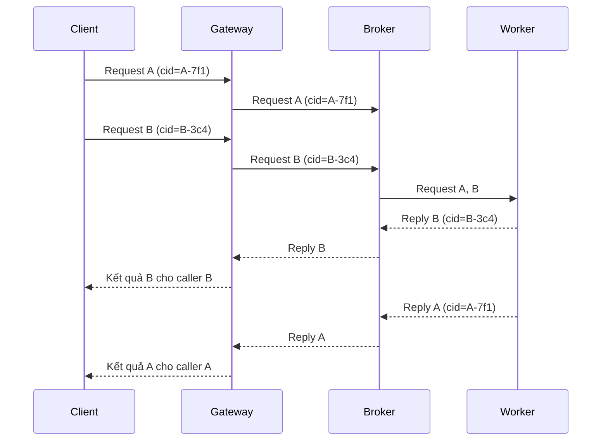
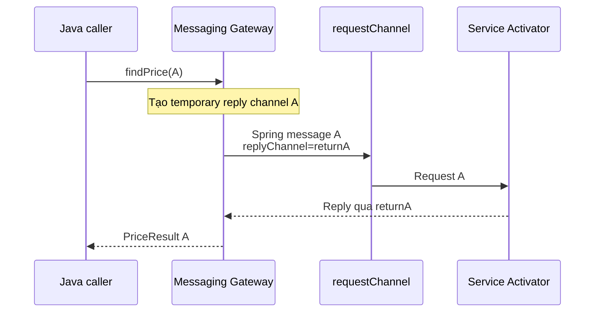
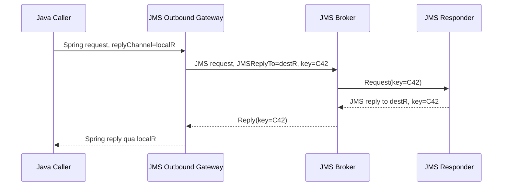
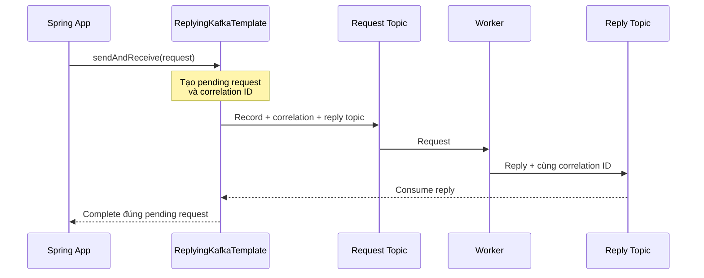
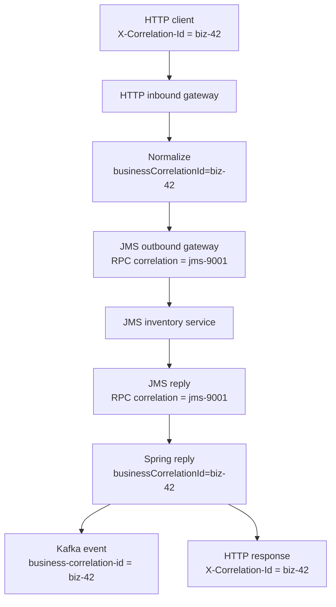

# Correlation ID giữa request và reply

## 1. Vấn đề: làm sao ghép đúng reply với request?

Trong hệ thống sử dụng **Spring Integration Adapters**, một request có thể đi qua `MessageChannel`, gateway, HTTP, JMS, AMQP, Kafka hoặc nhiều dịch vụ trước khi kết quả quay về. Khi xử lý đồng thời hàng trăm request, reply thường **không hoàn tất theo đúng thứ tự gửi**.

Ví dụ dịch vụ báo giá nhận ba yêu cầu:

| Thời điểm gửi | Request | Correlation ID | Thời điểm reply |
|---|---|---|---|
| 10:00:00.000 | Báo giá A | `quote-A-7f1` | 10:00:02.500 |
| 10:00:00.100 | Báo giá B | `quote-B-3c4` | 10:00:00.450 |
| 10:00:00.200 | Báo giá C | `quote-C-9a0` | 10:00:01.100 |

Nếu chỉ lấy reply đầu tiên để trả cho request đầu tiên, A sẽ nhận nhầm kết quả B. Để tránh điều đó, các hệ thống request/reply thường dùng **correlation ID**: một giá trị giúp nhận diện reply tương ứng với request ban đầu.



Sơ đồ biểu diễn hai lời gọi đang xử lý đồng thời. Điều quan trọng là gateway hoặc tầng tiếp nhận reply phải dùng một **quy tắc đối chiếu cụ thể**. Việc reply có một chuỗi tên `correlationId` chưa đủ nếu bên gửi và bên nhận không thống nhất giá trị, nơi lưu và cách sử dụng.

### Mục tiêu học tập

Sau bài này, bạn có thể:

1. Phân biệt correlation ID, message ID, business ID, trace ID, idempotency key và địa chỉ `replyChannel`.
2. Hiểu cách Spring Integration quản lý request/reply cục bộ, cách gateway kết hợp return address và correlation.
3. Thiết kế hợp đồng correlation giữa HTTP, JMS, AMQP và Kafka mà không nhầm lẫn Spring headers với metadata của giao thức.
4. Xử lý reply đến chậm, trùng lặp, sai correlation, timeout và restart.
5. Dùng Java/Spring Integration xây dựng luồng request/reply và kiểm thử nhiều lời gọi đồng thời.

## 2. Correlation ID là gì và không phải là gì?

### 2.1. Correlation ID là khóa liên kết

Một **correlation ID** là một giá trị định danh giúp hai bên liên kết các message trong một tương tác. Phạm vi có thể là:

- **Một cặp request/reply**: cùng một ID xuất hiện ở request và reply hoặc reply tham chiếu request theo quy tắc giao thức.
- **Một nhóm message**: các phần do splitter tạo ra mang correlation ID chung để aggregator gom lại.
- **Một luồng nghiệp vụ phân tán**: nhiều sự kiện hoặc tác vụ cùng chứa ID để đối soát một order, job hoặc transaction ở mức ứng dụng.

Phải xác định **phạm vi** ngay từ đầu. ID của một cặp request/reply ở một gateway không nhất thiết đồng nghĩa với ID cho toàn bộ workflow. Cùng một đơn hàng có thể tạo nhiều lời gọi tồn kho, vận chuyển và thanh toán, mỗi lời gọi có ID request/reply riêng nhưng chia sẻ `orderId`.

### 2.2. Các loại ID thường bị nhầm

| Giá trị | Trả lời câu hỏi | Ai quản lý? | Có dùng để ghép reply không? |
|---|---|---|---|
| Spring `MessageHeaders.ID` (`id`) | Đây là Spring message nào? | Spring Messaging | Không tự động cho mọi gateway; có thể được một thành phần dùng làm nguồn correlation theo hợp đồng |
| Spring `correlationId` | Message thuộc nhóm/tương tác nào? | Flow hoặc component Spring Integration | Chỉ khi flow/gateway/aggregator được cấu hình để đọc nó |
| `MessageHeaders.REPLY_CHANNEL` | Gửi reply vào đâu **trong ứng dụng Spring**? | Gateway/endpoint | Chỉ địa chỉ nhận, không phải ID |
| JMS `JMSMessageID` | Broker định danh JMS message nào? | JMS provider | Có thể làm nguồn cho correlation của reply, tùy gateway |
| JMS `JMSCorrelationID` | JMS message đang liên hệ đến request nào? | Producer/gateway/responder | Có, nếu cả hai phía dùng cùng hợp đồng |
| AMQP `correlation-id` | Bản tin này liên hệ tới tương tác nào? | Publisher/gateway | Có, khi reply echo đúng giá trị |
| Kafka correlation header | Record reply tương ứng request nào? | Replying Kafka component hoặc ứng dụng | Có, với reply topic và bộ đối chiếu thích hợp |
| HTTP `X-Correlation-Id` / `X-Request-Id` | Request HTTP liên quan ID nào? | Client/API gateway/service | Phục vụ quan sát hoặc hợp đồng riêng; HTTP response thường được ghép nhờ kết nối/lời gọi |
| W3C `traceparent` / trace ID | Các span thuộc distributed trace nào? | Tracing system | Thường để tracing, không thay thế map pending requests |
| Idempotency key | Có phải yêu cầu nghiệp vụ đã xử lý trước đây? | API/ứng dụng và kho trạng thái | Phục vụ chống xử lý lặp; có thể ổn định qua retry nhưng khác correlation |

**Một message không tự động được xem là reply đúng chỉ vì có cùng `orderId`.** Trong một order có thể có nhiều request hoàn toàn khác nhau. Ngược lại, correlation ID cho một lời gọi có thể thay đổi khi retry, trong khi idempotency key nên được giữ ổn định để chống tạo lại hiệu ứng nghiệp vụ.

### 2.3. Chọn ID ổn định và duy nhất trong phạm vi cần thiết

Một correlation ID hữu ích cần:

- **Duy nhất trong tập request đang chờ reply** mà bộ đối chiếu quản lý.
- **Có cách biểu diễn thống nhất** trên dây: String, bytes UTF-8 hoặc format đã quy định.
- **Không mang dữ liệu bí mật hoặc thông tin cá nhân**; không dùng email, số điện thoại, access token làm ID.
- **Có giới hạn độ dài và ký tự hợp lệ**, đặc biệt khi đi qua HTTP headers, JMS properties và broker headers.
- **Có quy tắc về vòng đời**: được tạo khi nào, có được đổi ở gateway trung gian không, khi nào xóa khỏi bảng pending requests.
- **Được ghi log cùng trạng thái** request/reply, song không bị dùng như bằng chứng xác thực.

Một UUID ngẫu nhiên là lựa chọn phổ biến:

```java
import java.util.UUID;

String correlationId = UUID.randomUUID().toString();
// Ví dụ: 50b12f80-9835-4b6a-8b5a-e8f96853005b
```

Nếu tổ chức đã có ID có độ duy nhất cao và format chuẩn, không nhất thiết sinh UUID mới ở mọi bước. Quan trọng hơn định dạng là **ai tạo, ai echo và ai đối chiếu**.

## 3. Correlation ID trong Spring Integration MessageHeaders

### 3.1. Header nghiệp vụ và header dùng cho splitter/aggregator

Spring Integration dùng những tên header quen thuộc như `correlationId`, `sequenceNumber`, `sequenceSize` cho việc nhóm message hoặc xử lý thành phần split/aggregate. `IntegrationMessageHeaderAccessor` định nghĩa các tên chuẩn này; ví dụ:

```java
import org.springframework.integration.IntegrationMessageHeaderAccessor;
import org.springframework.messaging.Message;
import org.springframework.messaging.support.MessageBuilder;

Message<String> message = MessageBuilder.withPayload("quote-request")
        .setHeader(
                IntegrationMessageHeaderAccessor.CORRELATION_ID,
                "quote-2026-001")
        .build();

Object id = message.getHeaders().get(
        IntegrationMessageHeaderAccessor.CORRELATION_ID);
System.out.println(id); // quote-2026-001
```

Tên thường dùng tương ứng với chuỗi `"correlationId"`. Tuy nhiên, **không phải mọi gateway đều lấy header này làm khóa ghép reply**, bởi mỗi adapter có cơ chế riêng.

Nhất là với **splitter/aggregator**, `correlationId` có thể biểu thị **nhóm các phần** cần gom, cùng `sequenceNumber` và `sequenceSize`. Nếu đồng thời cần ID xuyên nhiều dịch vụ, có thể dùng thêm `businessCorrelationId` hoặc `orderId` để tránh làm hỏng khóa nhóm aggregator.

### 3.2. Reply channel và correlation ID phối hợp thế nào?

`MessageHeaders.REPLY_CHANNEL` chứa địa chỉ mà endpoint có thể gửi kết quả:

```java
import org.springframework.messaging.Message;
import org.springframework.messaging.MessageHeaders;

Object replyAddress = message.getHeaders()
        .get(MessageHeaders.REPLY_CHANNEL);
Object correlation = message.getHeaders()
        .get("correlationId");
```

Ý nghĩa:

- `replyAddress`: **return address** như một `MessageChannel` nội bộ hoặc tên channel.
- `correlation`: ID dùng để **nhận diện tương tác/nhóm message** khi chính sách luồng sử dụng.

Một `@MessagingGateway` gọi tới `DirectChannel` thường quản lý temporary reply channel của từng invocation. Trong trường hợp đó, gateway **không cần bạn tự tạo một correlation ID để trả đúng caller**: mỗi invocation đã có return address riêng.

Khi phải vượt qua JMS/AMQP/Kafka hoặc tự xây nhiều request chung một reply topic/queue, cần quy tắc native correlation bổ sung. Đừng cố serialize Java `MessageChannel` object từ header `replyChannel` qua network.

### 3.3. Tạo message mới mà vẫn giữ ngữ cảnh

Một custom transformer có thể làm rơi ID hoặc reply address khi dựng message lại:

```java
// Ví dụ dễ gây mất thông tin ở custom component:
// message mới chỉ có payload, không giữ các header của request.
Message<String> careless = MessageBuilder
        .withPayload("processed")
        .build();
```

Khi cần chuyển payload nhưng giữ ngữ cảnh trong flow nội bộ, có thể:

```java
import org.springframework.messaging.Message;
import org.springframework.messaging.support.MessageBuilder;

Message<String> transformed = MessageBuilder
        .withPayload("processed")
        .copyHeaders(requestMessage.getHeaders())
        .build();
```

`copyHeaders(...)` giữ các header phù hợp từ request. Nếu nội dung cần đi ra một giao thức khác, **không copy hết headers ra native message**: outbound header mapper phải lọc những trường chỉ dùng bên trong như `replyChannel`, `errorChannel` hoặc các object không serialize được.

Nhiều endpoint chuẩn Spring Integration chủ động chuyển tiếp/hợp nhất header từ request sang reply. Rủi ro đặc biệt nằm ở custom component, mapping qua DTO, bridge qua broker và code tự dựng message; hãy kiểm tra message **thực tế** tại từng ranh giới.

## 4. Gateway cục bộ: request/reply không nhất thiết cần correlation header

### 4.1. Lời gọi Java đi qua temporary reply channel

Một messaging gateway nối method Java với `MessageChannel`:



Vì reply channel là per-invocation, một gateway có thể phân biệt nhiều lời gọi đồng thời ở cùng `requestChannel`. Đây là **tầng request/reply trong JVM**, khác hệ thống broker dùng các reply destination chung.

### 4.2. Ví dụ Java DSL hoàn chỉnh

Giả sử service nhận lệnh báo giá và trả kết quả. Một `correlationId` được đưa vào theo hợp đồng nghiệp vụ để log/đối chiếu dù chính messaging gateway đã có đường reply riêng.

```java
// QuoteRequest.java
public record QuoteRequest(String quoteId, int quantity) {}

// QuoteReply.java
public record QuoteReply(
        String quoteId, String correlationId, long totalCents) {}
```

Gateway interface:

```java
import org.springframework.integration.annotation.MessagingGateway;
import org.springframework.messaging.handler.annotation.Header;

@MessagingGateway(
        defaultRequestChannel = "quotes.requests",
        defaultReplyTimeout = "5000")
public interface QuoteGateway {

    QuoteReply calculate(
            QuoteRequest request,
            @Header("correlationId") String correlationId);
}
```

Flow:

```java
import org.springframework.context.annotation.Bean;
import org.springframework.context.annotation.Configuration;
import org.springframework.integration.annotation.IntegrationComponentScan;
import org.springframework.integration.config.EnableIntegration;
import org.springframework.integration.channel.DirectChannel;
import org.springframework.integration.dsl.IntegrationFlow;
import org.springframework.messaging.MessageChannel;

@Configuration
@EnableIntegration
@IntegrationComponentScan
public class QuoteFlowConfig {

    @Bean(name = "quotes.requests")
    public MessageChannel quotesRequests() {
        return new DirectChannel();
    }

    @Bean
    public IntegrationFlow quoteFlow() {
        return IntegrationFlow.from("quotes.requests")
                .handle((payload, headers) -> {
                    QuoteRequest request = (QuoteRequest) payload;
                    String correlationId =
                            (String) headers.get("correlationId");

                    if (correlationId == null || correlationId.isBlank()) {
                        throw new IllegalArgumentException(
                                "correlationId is required");
                    }
                    if (request.quantity() <= 0) {
                        throw new IllegalArgumentException(
                                "quantity must be positive");
                    }

                    return new QuoteReply(
                            request.quoteId(),
                            correlationId,
                            request.quantity() * 1_500L);
                })
                .get();
    }
}
```

Caller:

```java
import java.util.UUID;

String cid = UUID.randomUUID().toString();
QuoteReply reply = quoteGateway.calculate(
        new QuoteRequest("Q-42", 3), cid);

System.out.println(reply.quoteId());      // Q-42
System.out.println(reply.correlationId()); // trùng cid của request
System.out.println(reply.totalCents());    // 4500
```

Ở ví dụ này, `@Header("correlationId")` đưa ID vào message request; handler đọc header và trả cùng ID trong DTO. **Reply routing** vẫn do gateway/`replyChannel` quản lý. Việc đưa correlation vào response DTO nhằm minh họa sự liên kết nghiệp vụ, không phải một yêu cầu bắt buộc của `@MessagingGateway` để ghép reply cục bộ.

### 4.3. Khi nào cần tự quản lý bảng pending requests?

Tự quản lý correlation khi luồng không giữ được return address per invocation, chẳng hạn:

- Nhiều request đi tới một broker và cùng nhận reply từ một queue/topic.
- Một ứng dụng gửi request bằng one-way outbound adapter và tự đăng ký consumer nhận reply.
- Các hệ thống khác ngôn ngữ/framework gửi reply bất đồng bộ về một endpoint chung.
- Có yêu cầu lưu và khôi phục giao dịch sau restart, trong khi temporary reply channel trong JVM không còn.

Một thiết kế khái niệm:

```text
send(request, correlationId):
    pending[correlationId] = promise + deadline
    publish(request with correlationId)

onReply(reply):
    id = readProtocolCorrelation(reply)
    pendingRequest = pending.remove(id)
    if pendingRequest != null:
        complete(pendingRequest.promise, reply)
    else:
        handleUnknownOrLateReply(reply)

onTimeout(id):
    pendingRequest = pending.remove(id)
    if pendingRequest != null:
        completeTimeout(pendingRequest.promise)
```

Đây là pseudo-code, không phải triển khai production. Thực tế phải xử lý **race** giữa reply và timeout, cleanup map, duplicate reply, restart, backpressure, giới hạn bộ nhớ và cơ chế khóa/atomic. Gateway chuyên biệt thường đã có phần lớn cơ chế này.

## 5. HTTP: nhận, truyền và trả correlation ID

### 5.1. HTTP response vốn đã gắn với một request

Ở HTTP synchronous call, client/server ghép response với request bằng cơ chế request/connection/protocol; **không cần một `X-Correlation-Id` để HTTP client biết response thuộc lời gọi nào**. Tuy nhiên, header correlation rất hữu ích để:

- Tìm cùng một request qua reverse proxy, API gateway và nhiều microservice.
- Dẫn ID lên trang thông báo lỗi để support truy vết.
- Nối log HTTP với request JMS/AMQP/Kafka được tạo từ HTTP.
- Ghi nhận nhiều bước xử lý cùng một nghiệp vụ, kể cả sau khi HTTP đã trả `202 Accepted`.

Tên `X-Correlation-Id` hoặc `X-Request-Id` là **quy ước ứng dụng**, không phải trường bắt buộc của HTTP. Hãy thống nhất cách viết, nguồn tạo và cách response echo.

### 5.2. Hợp đồng tại HTTP inbound gateway

Ví dụ HTTP request:

```http
POST /quotes HTTP/1.1
Content-Type: application/json
X-Correlation-Id: 50b12f80-9835-4b6a-8b5a-e8f96853005b

{"quoteId":"Q-42","quantity":3}
```

Một chính sách nhận hợp lý:

1. Nếu client gửi ID và được phép đưa ID vào hệ thống, validate độ dài, ký tự và format; tránh tin giá trị như chứng thực.
2. Nếu thiếu ID, sinh một ID mới tại điểm vào và gắn vào request context.
3. Chuẩn hóa về một header Spring nội bộ (ví dụ `businessCorrelationId`), thay vì giả định mapper tự đổi `X-Correlation-Id` thành `correlationId`.
4. Gắn ID vào response metadata theo hợp đồng API:

```http
HTTP/1.1 200 OK
Content-Type: application/json
X-Correlation-Id: 50b12f80-9835-4b6a-8b5a-e8f96853005b

{"quoteId":"Q-42","totalCents":4500}
```

`DefaultHttpHeaderMapper` và cấu hình `mapped-request-headers`/`mapped-response-headers` giúp chọn các tên HTTP cần đi qua gateway. Nhưng **mapping header** và **đổi tên header** là hai nhiệm vụ khác nhau: nếu muốn có key Spring `businessCorrelationId`, phải sử dụng transformer, header enricher hoặc custom mapper tương ứng.

### 5.3. HTTP outbound gateway và remote echo

Khi flow gọi một service HTTP bên ngoài:

```text
Spring request
   headers.businessCorrelationId = "Q-42-abc"
          |
          v
normalize to HTTP X-Correlation-Id
          |
          v
HTTP outbound gateway ----> Remote service
                                  |
                                  v
                       HTTP response X-Correlation-Id
                                  |
                                  v
                     Reply Spring message
```

Đừng giả định remote luôn echo đúng header. Nếu cần kiểm tra, hãy so sánh với ID request mong đợi; nếu remote không có hợp đồng echo, đừng làm ứng dụng thất bại chỉ vì thiếu metadata tùy chọn.

Cần phân biệt timeout của HTTP client/gateway với timeout ở broker. Correlation ID trong HTTP logs vẫn có giá trị ngay cả khi client đã đóng kết nối.

## 6. JMS: JMSMessageID, JMSCorrelationID và JMSReplyTo

### 6.1. Ba trường JMS có vai trò khác nhau

JMS có các native headers:

| Trường | Do ai quản lý? | Vai trò |
|---|---|---|
| `JMSMessageID` | Thường do JMS provider cấp khi gửi message | Định danh JMS message đã publish |
| `JMSCorrelationID` | Ứng dụng/gateway/responder đặt | Liên kết một message với request trước đó |
| `JMSReplyTo` | Producer/gateway đặt | Địa chỉ JMS destination mà reply phải gửi tới |

`JMSReplyTo` là **địa chỉ trả lời**, `JMSCorrelationID` là **khóa liên kết**. Cả hai đều khác Spring `MessageHeaders.REPLY_CHANNEL`.

JMS có nhiều chiến lược correlation request/reply. Hai hợp đồng ví dụ:

**Chiến lược dùng request Message ID**:

```text
Request native:
    JMSMessageID     = ID:broker-9081
    JMSReplyTo       = temporaryReplyQueue

Reply native:
    JMSCorrelationID = ID:broker-9081
    Destination      = temporaryReplyQueue
```

**Chiến lược dùng Correlation ID do ứng dụng/gateway đặt**:

```text
Request native:
    JMSCorrelationID = req-7f1
    JMSReplyTo       = replies.queue

Reply native:
    JMSCorrelationID = req-7f1
    Destination      = replies.queue
```

**Hai sơ đồ là hai hợp đồng khác nhau.** Một responder phải echo giá trị mà gateway đang dùng để đối chiếu; không tự ý chuyển giữa request `JMSMessageID` và `JMSCorrelationID`.

### 6.2. Trong Spring Integration JMS gateway

Spring Integration JMS inbound/outbound gateways phối hợp giữa Spring messages và JMS requests/replies. Chúng có thể dùng `JMSCorrelationID` hoặc message ID theo cấu hình như `correlation-key`. Vì vậy, cần đối chiếu phiên bản và cấu hình gateway trước khi quyết định responder sẽ trả giá trị nào.

Ví dụ sơ đồ:



Trong sơ đồ, `key=C42` chỉ **giá trị correlation mà gateway và responder thống nhất**; ở triển khai thực tế nó có thể được lấy từ JMS message ID hoặc `JMSCorrelationID`.

### 6.3. Mapping JMS headers vào Spring headers

Spring Integration `DefaultJmsHeaderMapper` dùng các header có tiền tố `jms_*` cho metadata JMS, ví dụ `jms_correlationId`, `jms_messageId` và `jms_replyTo`. Tùy mapper, một application property có thể được đưa vào Spring header riêng.

Không đồng nhất:

```text
headers["correlationId"]       // Spring Integration / workflow
headers["jms_correlationId"]   // biểu diễn JMSCorrelationID
headers["jms_messageId"]      // biểu diễn JMSMessageID
headers["replyChannel"]       // MessageChannel nội bộ Spring
headers["jms_replyTo"]        // JMS Destination
```

Nếu hệ thống cần một correlation ID nghiệp vụ xuyên nhiều broker, hãy dùng header/property riêng (ví dụ `businessCorrelationId`) và vẫn để JMS gateway quản lý ID phục vụ request/reply cục bộ.

### 6.4. Các lỗi JMS điển hình

- Request tạo correlation ID mới nhưng responder echo **JMSMessageID** thay vì `JMSCorrelationID` mà gateway đang đợi.
- Responder gửi đúng correlation nhưng sai `JMSReplyTo` destination.
- Nhiều gateway cùng đọc một reply queue nhưng dùng selector/consumer không tương thích hoặc cùng một ID không duy nhất.
- TTL/time-to-live của request nhỏ hơn thời gian xử lý nên request hết hạn trước khi worker xử lý.
- Caller timeout nhưng JMS reply đến sau; cần xử lý reply muộn hoặc bỏ qua có kiểm soát.
- Tự đặt JMS property với kiểu dữ liệu không hợp lệ. Property JMS hỗ trợ kiểu primitive/String theo spec; không serialize trực tiếp `MessageChannel` hoặc object arbitrary.

## 7. AMQP/RabbitMQ: correlation-id và reply-to

### 7.1. Metadata request/reply native

AMQP 0-9-1 có những thuộc tính như `correlation_id` và `reply_to`. Spring AMQP ánh xạ chúng thành các thuộc tính Java `MessageProperties.correlationId` và `MessageProperties.replyTo`. Cách hiển thị tên header trên wire/Java khác nhau nhưng ý nghĩa cốt lõi giống nhau:

```text
AMQP request
    properties.correlationId = "req-42"
    properties.replyTo       = "amq.rabbitmq.reply-to" (nếu dùng direct reply-to)
    body                     = JSON bytes

AMQP reply
    properties.correlationId = "req-42"
    routing destination      = reply-to từ request
    body                     = JSON reply bytes
```

Đây là ví dụ minh họa luồng direct reply-to; tên destination và cách gateway tạo correlation còn phụ thuộc `RabbitTemplate`/Spring Integration endpoint. Không nên hard-code `amq.rabbitmq.reply-to` trong mọi ứng dụng.

### 7.2. Spring Integration và Spring AMQP

Các outbound gateway AMQP thường dựa vào abstraction request/reply của Spring AMQP; framework quản lý việc gửi request, nhận reply và đối chiếu correlation. Một message Spring có thể đồng thời mang:

- `replyChannel`: return address trong integration flow hiện tại.
- `amqp_correlationId`: metadata native của broker nếu mapper cho phép.
- `businessCorrelationId`: ID nghiệp vụ riêng để trace qua nhiều chặng.

**Giữ tách biệt các mục đích:** AMQP gateway có thể đặt/ghi đè ID để quản lý pending request, do đó không đặt cược rằng user header `correlationId` sẽ luôn giữ nguyên qua mọi phiên bản và cấu hình. Khi business ID cần ổn định, truyền nó bằng application header độc lập và chính sách mapping tường minh.

### 7.3. Direct reply-to, temporary queue và fixed reply queue

RabbitMQ có nhiều cách nhận reply:

| Kiểu | Đặc điểm | Cần lưu ý |
|---|---|---|
| Direct reply-to | Cơ chế RPC tối ưu cho reply trực tiếp | Reply mang tính tạm thời; client phải đang đợi |
| Temporary/exclusive reply queue | Mỗi client/gateway có đích reply riêng | Vòng đời queue và consumer |
| Fixed reply queue | Nhiều request dùng chung destination | Correlation, consumer, selectors/dispatch và cleanup |

Không loại nào thay thế correlation ID trong trường hợp nhiều request cùng chờ trên một đường reply chung. Tên reply queue chỉ nói **trả về đâu**, không nói **trả cho request nào**.

Nếu phản hồi có thể đến sau nhiều phút/giờ, cân nhắc mô hình event/callback/status thay vì RPC qua gateway chờ đồng bộ.

## 8. Kafka: reply topic, correlation header và record key

### 8.1. Kafka không có RPC native như HTTP

Kafka broker lưu record vào topic/partition; nó không tự biết record nào là request và record nào là reply. Để có request/reply, các phía phải thỏa thuận:

1. **Request topic** mà producer gửi tới.
2. **Reply topic** (và partition nếu cần) để worker gửi kết quả.
3. **Correlation header** mang ID ghép reply với request.
4. **Timeout** chờ reply, xử lý late/duplicate reply.
5. Serializer/deserializer và schema cho payload.

Spring Kafka cung cấp `ReplyingKafkaTemplate` và những header constants như `KafkaHeaders.REPLY_TOPIC`, `KafkaHeaders.CORRELATION_ID`; Spring Integration Kafka có outbound gateway tích hợp request/reply qua các cơ chế tương ứng.

### 8.2. Record key không phải correlation header

| Trường Kafka | Ví dụ | Vai trò |
|---|---|---|
| Record `key` | `customer-18` | Ảnh hưởng partitioning, affinity, ordering theo key |
| Record `value` | JSON/Avro/Protobuf bytes | Payload nghiệp vụ |
| Native header correlation | Bytes biểu diễn request ID | Để reply được ghép đúng |
| Native header reply topic | Bytes biểu diễn topic đích theo thư viện/giao thức | Để responder biết gửi vào đâu |
| Record offset | 3981 | Vị trí record trong partition, không phải request ID |

Một record có key `customer-18` có thể được dùng cho **nhiều** request trong cùng partition. Do đó, chỉ dựa vào Kafka key để ghép reply có thể gây nhầm khi nhiều request cho cùng khách hàng đang chạy đồng thời.

### 8.3. Đường đi với ReplyingKafkaTemplate



Header correlation native trong Kafka là byte array. Nếu tự implement responder ở ngôn ngữ khác, phải **echo chính xác bytes mà gateway dùng để correlate**, không chỉ log một chuỗi trông giống nhau. Nếu chuẩn hóa ID ở dạng UTF-8 String, hợp đồng phải xác định encoding ở cả hai đầu.

Ví dụ nhìn dữ liệu native bằng Kafka API:

```java
import java.nio.charset.StandardCharsets;
import org.apache.kafka.common.header.internals.RecordHeaders;

byte[] correlationBytes =
        "req-2026-42".getBytes(StandardCharsets.UTF_8);

RecordHeaders headers = new RecordHeaders()
        .add("business-correlation-id", correlationBytes);

// Đây là application header do hai phía tự quy ước.
// ReplyingKafkaTemplate có correlation header riêng của thư viện.
```

Đoạn trên cố ý dùng `business-correlation-id` để phân biệt metadata **nghiệp vụ** với header correlation của thư viện, tránh vô tình ghi đè metadata do `ReplyingKafkaTemplate` quản lý. Khi triển khai gateway, xem cấu hình header names và chuyển đổi bytes ở đúng phiên bản.

### 8.4. Khi có reply topic chung

Nếu nhiều service instance dùng chung reply topic, phải đảm bảo mỗi pending request có **duy nhất một instance sở hữu consumer reply phù hợp** hoặc có chiến lược routing được thiết kế rõ. Nếu reply của instance A bị consumer của instance B lấy nhưng B không giữ pending correlation, A có thể timeout.

Thiết kế thường cần gắn reply partition/instance routing, phân phối consumer và chỉ gửi request sau khi listener reply đã được gán partition sẵn. Không suy ra an toàn chỉ vì correlation ID là duy nhất.

## 9. Mapping ID qua nhiều giao thức

### 9.1. Một hợp đồng xuyên hệ thống rõ ràng

Giả sử luồng nhận đơn hàng HTTP, hỏi tồn kho qua JMS và sau đó phát sự kiện Kafka. Thỏa thuận **businessCorrelationId** từ điểm vào, còn mỗi gateway có ID RPC riêng để ghép reply.



| Ranh giới | Business ID | Request/reply ID của tầng đó | Trách nhiệm |
|---|---|---|---|
| HTTP inbound | `X-Correlation-Id` → `businessCorrelationId` | HTTP request lifecycle | Validate và tạo ID khi cần |
| Spring flow | `businessCorrelationId` trong message headers | Temporary `replyChannel` | Giữ context, trả đúng invocation |
| JMS outbound | Property ứng dụng riêng nếu cần | `JMSMessageID`/`JMSCorrelationID` theo gateway | Gateway + responder đối chiếu |
| JMS inbound reply | Lấy lại business ID theo hợp đồng | JMS native correlation | Gateway ánh xạ reply |
| Kafka event | Header bytes `business-correlation-id` | Không có RPC khi chỉ publish event | Producer/consumer dùng schema/headers thống nhất |
| HTTP response | `X-Correlation-Id` theo hợp đồng echo | HTTP response của request hiện tại | Gửi về client |

Bảng mô tả **thiết kế minh họa**. Spring Integration không tự đổi tên `X-Correlation-Id` thành `businessCorrelationId`, không tự tạo `jms-9001` theo cách này và không tự phát Kafka header nếu mapper chưa cấu hình.

### 9.2. Chuẩn hóa ID tại biên, giữ ổn định qua các bước

Ví dụ custom handler nhận correlation ID từ một header đã được xác minh:

```java
import java.util.UUID;
import org.springframework.messaging.Message;
import org.springframework.messaging.support.MessageBuilder;

// inbound: Message<?> từ một adapter; rawId đã được trích và kiểm tra.
String id = rawId == null || rawId.isBlank()
        ? UUID.randomUUID().toString()
        : rawId;

Message<?> normalized = MessageBuilder
        .fromMessage(inbound)
        .setHeader("businessCorrelationId", id)
        .build();
```

Đoạn trên giả định `rawId` đã qua kiểm tra format/độ dài hoặc đến từ nguồn đáng tin cậy. Nếu client cung cấp ID không hợp lệ, nhiều hệ thống chọn từ chối thay vì âm thầm dùng nguyên giá trị. Khi ghi reply, đặt đúng ID vào response theo hợp đồng.

### 9.3. Đừng sao chép toàn bộ headers xuyên network

Spring headers có thể chứa `replyChannel`, `errorChannel`, `id`, `timestamp`, `sequenceNumber` hoặc object nội bộ. Các header này có thể có ý nghĩa trong một flow nhưng không phù hợp gửi ra broker.

Thiết kế allowlist tại mỗi adapter:

```text
Được xuất ra đối tác:
    businessCorrelationId
    traceparent (nếu áp dụng chuẩn tracing)
    schemaVersion
    contentType (nếu giao thức/mapper hỗ trợ)

Không chuyển nguyên dạng Spring runtime:
    replyChannel
    errorChannel
    các MessageChannel/Throwable/Java object tuỳ ý
    metadata retry/broker received-only
```

Ở JMS, AMQP hoặc Kafka, dùng header mapper/converter đúng giao thức và xác minh metadata **trên dây**. Đặc biệt, correlation ID của gateway có thể do chính gateway sinh/quản lý, nên không dùng header ứng dụng để thay thế một cách vô ý.

## 10. Timeout, late reply, duplicate reply và retry

### 10.1. Correlation ID không bảo đảm reply sẽ về

Gateway chờ reply trong thời hạn, nhưng có thể gặp:

- Worker xử lý lâu hơn `replyTimeout`.
- Broker mất kết nối hoặc message vào DLQ.
- Responder quên echo correlation ID.
- Reply gửi sai topic/queue hoặc tới consumer khác.
- Gateway instance restart làm mất bảng pending trong bộ nhớ.
- Request đã hoàn thành nhưng reply bị lặp lại.

Khi reply đến quá hạn, pending request có thể đã bị xóa. Gateway sẽ không thể trả dữ liệu về caller đang chờ nếu caller đã hết hạn. Tùy thành phần, hệ thống có thể log, bỏ reply, chuyển vào error/late-reply flow hoặc lưu trạng thái nghiệp vụ.

### 10.2. Phân biệt retry và idempotency

Ví dụ một HTTP caller retry vì chưa nhận response:

```text
Business orderId = O-42
Idempotency key  = create-order:O-42

Attempt 1:
    RPC correlation = req-abc
    timeout (kết quả chưa được caller nhận)

Attempt 2:
    RPC correlation = req-def
    có thể hoàn tất nhanh

Nếu cả hai attempt cùng thực sự tạo order:
    hai hiệu ứng nghiệp vụ đã xảy ra!
```

**Correlation ID chỉ giúp ghép reply; nó không ngăn xử lý nghiệp vụ hai lần.** Cần idempotency key ổn định qua các lần retry, cơ chế chống trùng ở DB/service và định nghĩa kết quả khi nhận request lặp.

Có hệ thống giữ correlation ID xuyên retry cho dễ tracing; có hệ thống tạo RPC ID mới cho mỗi lần thử để tránh ghép nhầm reply cũ. Cả hai có thể đúng khi đã thống nhất **hai phạm vi ID**:

- ID của **business operation**, ổn định giữa các attempt liên quan.
- ID của **mỗi attempt/request-reply**, duy nhất trong bảng pending tại thời điểm đó.

### 10.3. Race giữa timeout và reply

Trong custom dispatcher, có thể xảy ra:

```text
t=4.999s  Reply handler tìm pending[id]
t=5.000s  Timeout handler cũng tìm pending[id]
t=5.001s  Hai thread cùng muốn complete promise
```

Một chính sách hợp lý: dùng thao tác atomic `remove(id)` hoặc complete-at-most-once để chỉ **một** phía sở hữu kết quả cuối. Handler còn lại coi là reply muộn/đã xử lý. Nếu chỉ dùng `HashMap` không đồng bộ và thao tác check-then-remove rời rạc, có thể xuất hiện race.

Đối với gateway chuẩn, ưu tiên cơ chế correlation/timeout đã được thư viện triển khai thay vì tự viết pending map chỉ để tiết kiệm cấu hình.

### 10.4. Gateway timeout và lifetime của nghiệp vụ

Hãy tách:

| Thời gian | Giới hạn cho điều gì? |
|---|---|
| `requestTimeout` của messaging gateway | Gửi request vào channel có thể block |
| `replyTimeout` của messaging gateway | Chờ reply sau khi request đã được gửi |
| Network read/connect timeout | Kết nối/đọc reply từ HTTP/broker |
| Broker message TTL | Message có thể tồn tại trong broker bao lâu |
| Business SLA | Công việc thực sự được phép kéo dài bao lâu |

Nếu flow dùng `DirectChannel` và handler chạy lâu trên thread gọi, `replyTimeout` không phải bộ đếm cưỡng chế hủy toàn bộ handler đồng bộ. Với các tác vụ rất dài, nên trả **job ID** rồi thông báo trạng thái qua event, callback hoặc polling.

## 11. Correlation ID, tracing và quan sát vận hành

### 11.1. Distributed tracing không thay thế request/reply matching

W3C Trace Context có `traceparent` chứa trace ID, parent span ID và flags. Một trace có thể gồm nhiều lời gọi downstream song song, retry và message publish/consume. Vì vậy trace ID thường **không duy nhất cho từng request/reply pending** và không phù hợp làm khóa duy nhất của bảng correlation ở mọi gateway.

Một thiết kế quan sát gồm:

```text
traceId             = toàn bộ distributed trace
spanId              = thao tác hiện tại
businessCorrelation = đơn hàng/workflow
rpcCorrelation      = request/reply ở gateway cụ thể
messageId           = ID của message/record riêng lẻ
```

Khi ghi log, dùng các field riêng để không phải giải đoán từ một chuỗi chung. Không in raw request header của đối tác nếu có dữ liệu nhạy cảm.

### 11.2. Các chỉ số hữu ích

- Số lượng request đang chờ reply (`pendingCount`).
- Tỉ lệ reply trước timeout, timeout, late reply và unknown correlation ID.
- Độ trễ p50/p95/p99 theo loại request.
- Số lỗi missing/invalid correlation ID.
- Số duplicate reply, số pending requests bị hủy sau restart.
- Kafka reply consumer lag hoặc JMS/AMQP reply queue backlog.
- Tỉ lệ retry và idempotency conflicts ở tầng nghiệp vụ.

Số lượng pending tăng liên tục có thể do worker chậm, reply sai destination, consumer không được gán partition, hay lỗi cleanup. Dùng correlation logs và broker metrics cùng nhau để tìm nguyên nhân.

### 11.3. Quy tắc bảo mật

- ID là **metadata quan sát**, không cấp quyền cho người mang ID.
- Giới hạn độ dài, charset và ký tự hợp lệ; không đưa trực tiếp ID không tin cậy vào câu truy vấn hoặc format log nguy hiểm.
- Không dùng email, token, session ID hay PII trực tiếp làm correlation ID.
- Nếu client được phép truyền ID, validate trước khi propagate; giữ ID server-side có kiểm soát khi yêu cầu tin cậy cao.
- Đối tác bên ngoài chỉ thấy những ID và headers cần cho hợp đồng, theo nguyên tắc least privilege.

## 12. Kiểm thử correlation giữa request và reply

Kiểm thử đầy đủ phải xem **ID tại cả hai phía**, luồng ghép reply và hành vi khi lỗi. Một test chỉ xác nhận log có chuỗi `correlationId` chưa chứng minh dispatcher trả đúng caller.

### 12.1. Test gateway với một request

Dùng `QuoteFlowConfig`, `QuoteGateway` và model ở mục 4.2 trong cùng Spring context:

```java
import static org.junit.jupiter.api.Assertions.assertEquals;

import org.junit.jupiter.api.Test;
import org.springframework.beans.factory.annotation.Autowired;
import org.springframework.test.context.junit.jupiter.SpringJUnitConfig;

@SpringJUnitConfig(QuoteFlowConfig.class)
class QuoteGatewayTest {

    @Autowired
    QuoteGateway gateway;

    @Test
    void replyCarriesCorrelationFromItsRequest() {
        QuoteReply reply = gateway.calculate(
                new QuoteRequest("Q-42", 3),
                "cid-Q-42");

        assertEquals("Q-42", reply.quoteId());
        assertEquals("cid-Q-42", reply.correlationId());
        assertEquals(4500L, reply.totalCents());
    }
}
```

Đoạn test xác nhận **giá trị nghiệp vụ** được echo. Khi kiểm tra request/reply native ở broker, cần test thêm header `JMSCorrelationID`, AMQP `correlation-id` hoặc Kafka native correlation header.

### 12.2. Test đồng thời với nhiều request

Một kiểm thử hữu ích là gửi nhiều request ID khác nhau, không dựa vào thứ tự hoàn tất:

```java
import static org.junit.jupiter.api.Assertions.assertEquals;

import java.util.ArrayList;
import java.util.List;
import java.util.concurrent.CompletableFuture;
import java.util.concurrent.ExecutorService;
import java.util.concurrent.Executors;
import org.junit.jupiter.api.Test;

@Test
void concurrentRepliesMatchRequestIds() {
    ExecutorService pool = Executors.newFixedThreadPool(8);
    try {
        List<CompletableFuture<QuoteReply>> tasks = new ArrayList<>();

        for (int i = 0; i < 32; i++) {
            final int index = i;
            tasks.add(CompletableFuture.supplyAsync(() -> {
                String quoteId = "Q-" + index;
                String cid = "cid-" + index;
                return gateway.calculate(
                        new QuoteRequest(quoteId, 2), cid);
            }, pool));
        }

        for (int i = 0; i < tasks.size(); i++) {
            QuoteReply result = tasks.get(i).join();
            assertEquals("Q-" + i, result.quoteId());
            assertEquals("cid-" + i, result.correlationId());
        }
    } finally {
        pool.shutdown();
    }
}
```

Với `DirectChannel`, mỗi request vẫn được xử lý đồng bộ trên thread gọi của nó. Để phát hiện lỗi ghép reply theo thứ tự, nên thêm biến thể **bất đồng bộ** với `ExecutorChannel`, delay khác nhau có kiểm soát, một reply queue/topic chung và native correlation; cần bảo đảm các lời gọi cố ý hoàn tất **khác thứ tự gửi**.

### 12.3. Ma trận test tích hợp

| Kịch bản | Setup | Kỳ vọng |
|---|---|---|
| Reply bình thường | Request A, reply chứa ID A | Caller A nhận đúng kết quả |
| Reply đảo thứ tự | Request A, B; trả B trước A | Không lẫn reply |
| Hai request cùng business ID | Hai RPC khác nhau cho cùng order | RPC correlation vẫn phân biệt được |
| Missing ID | Reply thiếu correlation required | Bị từ chối/ghi nhận, không gán nhầm request |
| Unknown ID | Reply có ID không nằm trong pending map | Không hoàn tất request khác |
| Duplicate reply | Gửi lại reply A hai lần | Complete một lần, ghi nhận duplicate |
| Late reply | Reply A đến sau timeout | Caller nhận timeout; late reply theo chính sách |
| Gateway restart | Pending requests biến mất | Không giả định temporary reply path còn tồn tại |
| JMS request ID strategy | Responder echo request `JMSMessageID` | Gateway nhận đúng theo cấu hình |
| JMS correlation strategy | Responder echo `JMSCorrelationID` | Gateway nhận đúng theo cấu hình |
| AMQP RPC | Reply-to và correlation đúng | Không timeout; không ghép sai |
| Kafka reply topic chung | Nhiều instance, nhiều pending requests | Reply tới đúng instance/consumer |
| HTTP propagation | Request có `X-Correlation-Id` | Response và downstream theo hợp đồng |
| Error handler | Worker ném exception, retry/DLQ | ID traceable, lỗi không bị biến thành reply thành công |
| Invalid/oversized ID | Client gửi chuỗi không hợp lệ | Chặn/chuẩn hóa theo chính sách |

Với broker, nên dùng integration test có JMS/AMQP container hoặc Kafka test broker để quan sát **native properties/headers**. Mọi giả định về prefix Spring header và cách gateway chọn ID phải được đối chiếu với phiên bản dependency thật.

## 13. Chẩn đoán lỗi ghép reply

| Triệu chứng | Nguyên nhân thường gặp | Cách xử lý |
|---|---|---|
| Gateway timeout dù worker đã trả lời | Reply sai destination/topic hoặc correlation không khớp | Log native reply-to và correlation ở cả request/reply |
| Reply bị gửi cho caller sai | Custom dispatcher ghép theo FIFO, key không duy nhất | Dùng pending map keyed by per-request ID |
| Reply tới nhưng không có pending request | Timeout/restart hoặc ID bị đổi | Xử lý late/unknown reply, kiểm tra vòng đời |
| JMS gateway không nhận reply | Responder echo sai `JMSMessageID` / `JMSCorrelationID` | Kiểm tra cấu hình `correlation-key` và quy tắc responder |
| AMQP RPC không match | Reply không echo correlation ID gateway mong đợi | Đọc native `MessageProperties` của request/reply |
| Kafka reply bị tiêu thụ bởi instance khác | Reply topic/partition và consumer assignment không phù hợp | Thiết kế reply partition, instance routing và readiness |
| Spring `correlationId` thay đổi khi splitter | Header phục vụ grouping bị sử dụng lẫn nghiệp vụ | Tách `businessCorrelationId` và aggregation correlation |
| Không thấy ID ở HTTP response | Mapper chỉ truyền request header | Cấu hình response mapping/explicit header |
| Reply quá nhiều lần | Retry hoặc worker gửi duplicate | At-most-once completion và idempotency nghiệp vụ |
| Log cùng một trace ID nhưng gateway vẫn timeout | Trace ID không phải RPC correlation key | Đo chính xác ID gateway dùng để match |
| Mất `replyChannel` trong custom transformer | Dựng message mới mà không copy header | Bảo tồn return address trong flow nội bộ |
| ID truyền ra broker bị lỗi kiểu | Cố serialize object hoặc value không được hỗ trợ | Chuẩn hóa String/byte[] và mapper đúng giao thức |

## 14. Bài thực hành

**Bối cảnh:** Viết một dịch vụ nhận request báo giá qua HTTP, xử lý đơn giản trong Spring Integration và có một phiên bản mở rộng gửi request đến worker qua JMS hoặc AMQP. Nhiều client có thể gọi cùng lúc; kết quả phải được trả đúng request. Một request quá hạn có thể được retry.

**Nhiệm vụ thực hiện:**

1. Thiết kế hai ID: `businessCorrelationId` xuyên nhiều bước và một ID RPC theo cơ chế gateway (nếu dùng broker). Viết bảng quy định nguồn tạo, vị trí lưu, format, vòng đời và ứng xử khi thiếu.
2. Dựng `@MessagingGateway` cùng `IntegrationFlow` như mục 4.2. Thêm `@Header("correlationId")` để handler nhận ID và trả giá trị đó trong `QuoteReply`.
3. Gửi ít nhất 32 request đồng thời với ID khác nhau. Assert ID request/reply khớp theo từng invocation, không theo thứ tự phát reply.
4. Thêm `ExecutorChannel` hoặc worker bất đồng bộ. Tạo delay để request B trả nhanh hơn A; đặt `replyTimeout` và kiểm tra cả reply đến trước/sau deadline.
5. Thêm HTTP header `X-Correlation-Id` tại inbound và response mapping ở outbound. Đảm bảo một request thiếu ID được xử lý theo chính sách tạo mới/từ chối đã công bố.
6. Nếu có broker, kiểm tra native `JMSCorrelationID/JMSReplyTo` hoặc AMQP `correlationId/replyTo`. Cấu hình responder echo đúng **ID mà gateway dùng để match**.
7. Mô phỏng reply thiếu ID, trùng ID, sai destination, late reply và duplicate reply. Xác minh gateway không trả reply sai caller.
8. Thử retry tạo đơn hàng với cùng idempotency key nhưng RPC correlation ID khác, chứng minh business action vẫn chỉ thực hiện một lần.

**Tiêu chí đạt:** phân biệt được business ID và per-request correlation; reply không bị lẫn khi xử lý song song; native reply metadata đúng hợp đồng; timeout, duplicate và late reply có chính sách xử lý; không serialize `replyChannel` nội bộ qua broker.

## 15. Ghi nhớ

- **Correlation ID giúp xác định reply thuộc request nào; return address (`replyChannel`, `JMSReplyTo`, `reply_to`, reply topic) cho biết gửi reply về đâu.**
- Trong flow cục bộ, messaging gateway thường quản lý temporary reply channel riêng cho invocation. Không bắt buộc phải tự đặt `correlationId` để gateway trả đúng một Java caller.
- `MessageHeaders.ID`, `IntegrationMessageHeaderAccessor.CORRELATION_ID`, JMS `JMSMessageID/JMSCorrelationID`, AMQP `correlation-id`, Kafka correlation header và tracing ID có **phạm vi và chủ thể quản lý khác nhau**.
- Chọn và kiểm tra một hợp đồng native phù hợp với mỗi protocol; đừng chờ framework tự đổi tên hoặc echo ID giữa HTTP, JMS, AMQP và Kafka khi chưa có cấu hình.
- Cần **uniqueness, timeout, cleanup, late/duplicate reply handling** cho các request/reply bất đồng bộ dùng chung queue/topic.
- Correlation ID không bảo đảm giao hàng, không tự xử lý retry và **không thay thế idempotency**.
- Test phải kiểm tra native metadata và hành vi ghép reply khi concurrency, delay hoặc lỗi, ngoài việc quan sát header trong `Message<?>`.

## Tài liệu tham khảo

- [Spring Integration Reference — Messaging Gateways](https://docs.spring.io/spring-integration/reference/gateway.html): temporary reply channel, reply timeout và kết nối method Java với message flow.
- [Spring Integration Reference — Aggregator](https://docs.spring.io/spring-integration/reference/aggregator.html): correlation strategy, release strategy và sequence headers.
- [Spring Integration Reference — JMS Support](https://docs.spring.io/spring-integration/reference/jms.html): outbound/inbound gateway, correlation key và reply destination.
- [Spring Integration Reference — AMQP Support](https://docs.spring.io/spring-integration/reference/amqp.html): AMQP request/reply gateway và header mapping.
- [Spring Integration Reference — Kafka Support](https://docs.spring.io/spring-integration/reference/kafka.html): Kafka outbound gateway.
- [Spring Kafka Reference — ReplyingKafkaTemplate](https://docs.spring.io/spring-kafka/reference/kafka/sending-messages.html#replying-template): reply topic, correlation header và reply listener.
- [Spring Framework Reference — Integration Messaging](https://docs.spring.io/spring-framework/reference/integration.html): nền tảng messaging và message headers.
- [W3C Trace Context](https://www.w3.org/TR/trace-context/): `traceparent` và trace/span ID.

*Bài học mô tả các hợp đồng và cơ chế phổ biến. Hành vi chi tiết của JMS/AMQP/Kafka gateway, tên header native và mặc định correlation tùy phiên bản Spring Integration, Spring AMQP, Spring Kafka và cấu hình endpoint. Khi triển khai, đối chiếu API/version đang dùng và thực hiện integration test theo chính giao thức trước khi đưa vào production.*
