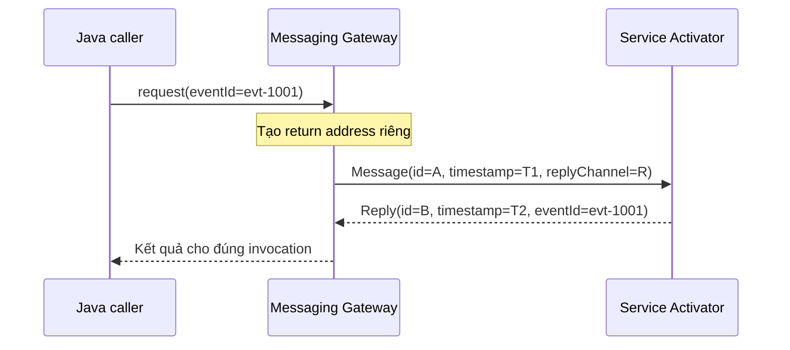
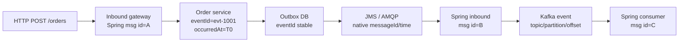

# Message ID và timestamp

## 1. Khi một message đi qua nhiều hệ thống, “ID” và “thời gian” nào là đúng?

Trong **Spring Integration Adapters** (`SPRING_INTEGRATION_ADAPTERS`), ứng dụng kết nối HTTP, JMS, AMQP, Kafka, file/SFTP và cơ sở dữ liệu thông qua inbound/outbound adapter, gateway, poller và `MessageChannel`. Dữ liệu thường được chuyển thành một Spring `Message<?>` gồm `payload` và `headers`.

Mỗi bản tin có thể mang **nhiều ID** và **nhiều mốc thời gian**:

- Spring tạo ID cho `Message<?>` để nhận diện message trong ngữ cảnh Spring Messaging.
- JMS broker có thể cấp `JMSMessageID` cho message được gửi.
- Kafka record có `topic`, `partition`, `offset` và record timestamp.
- AMQP publisher có thể gắn `messageId` và `timestamp` trong message properties.
- File có tên, đường dẫn và thời gian chỉnh sửa; bản ghi database có primary key và cột thời gian.
- Nghiệp vụ có `orderId`/`eventId`, thời điểm sự kiện thực sự xảy ra và correlation ID liên kết nhiều bước.

Các giá trị này **không tự động bằng nhau**. Ví dụ cùng sự kiện “đơn hàng O-42 được tạo” có thể được đọc lại qua Kafka và biến thành hai Spring message khác nhau. Nếu chỉ nhìn Spring message ID, hệ thống có thể tưởng đó là hai sự kiện nghiệp vụ độc lập; nếu dùng Kafka timestamp làm thời điểm đơn hàng được tạo thì báo cáo có thể lệch khi producer gửi muộn.

### Mục tiêu bài học

Sau bài học, bạn có thể:

1. Đọc và giải thích `MessageHeaders.ID`, `MessageHeaders.TIMESTAMP` trong Spring Integration.
2. Phân biệt message ID, correlation ID, business/event ID, trace ID và idempotency key.
3. Phân biệt thời điểm tạo Spring message, thời điểm phát sinh sự kiện, gửi/nhận qua broker và thời điểm xử lý.
4. Giải thích metadata tương ứng trong HTTP, JMS, AMQP, Kafka, File/SFTP và database.
5. Chọn cách truyền ID/timestamp qua adapter/gateway để phục vụ log, retry, deduplication và truy vết.
6. Viết kiểm thử đối chiếu metadata Spring với dữ liệu thực trên giao thức native.

## 2. MessageHeaders.ID và MessageHeaders.TIMESTAMP trong Spring

### 2.1. Hai header hệ thống cơ bản

`MessageHeaders` là tập các header gắn với một Spring `Message<?>`. Hai key quen thuộc được khai báo trong `org.springframework.messaging.MessageHeaders`:

| Hằng số | Key trong map | Kiểu Java thường gặp | Ý nghĩa |
|---|---|---|---|
| `MessageHeaders.ID` | `id` | `java.util.UUID` | Định danh message do cơ chế tạo message của Spring quản lý |
| `MessageHeaders.TIMESTAMP` | `timestamp` | `java.lang.Long` | Thời điểm message được tạo theo epoch milliseconds |
| `MessageHeaders.REPLY_CHANNEL` | `replyChannel` | `MessageChannel` hoặc tên channel | Địa chỉ gửi reply trong Spring Integration |
| `MessageHeaders.ERROR_CHANNEL` | `errorChannel` | `MessageChannel` hoặc tên channel | Địa chỉ xử lý lỗi khi áp dụng |

Trong cấu hình thông thường, Spring tự sinh `id` và `timestamp` khi xây dựng message. Một số cách tạo message hoặc cấu hình đặc biệt có thể chủ động tắt/điều chỉnh metadata này, vì vậy mã xử lý dùng chung không nên mặc định rằng chúng luôn có mặt.

```java
import org.springframework.messaging.Message;
import org.springframework.messaging.MessageHeaders;
import org.springframework.messaging.support.MessageBuilder;

Message<String> message = MessageBuilder.withPayload("order-created")
        .build();

System.out.println(message.getHeaders().getId());
System.out.println(message.getHeaders().getTimestamp());

Object rawId = message.getHeaders().get(MessageHeaders.ID);
Object rawTimestamp = message.getHeaders().get(
        MessageHeaders.TIMESTAMP);
```

`getId()` trả `UUID` hoặc `null` nếu không có; `getTimestamp()` trả `Long` hoặc `null`. Giá trị timestamp thường được hiểu là số **mili-giây tính từ Unix epoch (UTC)**, không chứa múi giờ của máy.

### 2.2. ID trong Spring là danh tính của message, không phải danh tính nghiệp vụ

Giả sử:

```text
Business event:
    eventId = evt-9001
    orderId = O-42

Spring message khi HTTP inbound xử lý:
    headers.id = 7f... (UUID A)

Spring message khi JMS inbound nhận sự kiện tương ứng:
    headers.id = 4b... (UUID B)

Kafka record cùng event được replay:
    headers.id = 9d... (UUID C)
```

Ba ID Spring khác nhau vẫn có thể đang mô tả **cùng một sự kiện nghiệp vụ**. Để deduplicate, dùng một `eventId` ổn định được bên phát sinh sự kiện bảo đảm, hoặc dùng khóa duy nhất có ý nghĩa nghiệp vụ; `MessageHeaders.ID` không phải cơ chế chống xử lý trùng xuyên các hệ thống.

Ngược lại, khi một Spring message được chuyển tiếp nguyên vẹn qua các channel, nó có thể vẫn giữ chính đối tượng message và cùng ID. Đừng hiểu rằng **mỗi lần đi qua channel** luôn sinh một ID mới.

### 2.3. Timestamp là mốc tạo message, không phải event time

`headers.timestamp` cho biết khi nào Spring message tương ứng được tạo trong ngữ cảnh runtime. Nó không mặc định là:

- Thời điểm user đặt hàng.
- Thời điểm một bản ghi database được commit.
- Thời điểm broker ghi record vào log.
- Thời điểm worker bắt đầu xử lý.
- Thời điểm file được sửa trên máy chủ SFTP.
- Thời điểm response đã đến client.

Nếu inbound adapter hôm nay nhận một file được tạo từ hôm qua, `MessageHeaders.TIMESTAMP` có thể là **hôm nay**, còn thời điểm dữ liệu phát sinh lại là **hôm qua**. Hai giá trị trả lời những câu hỏi khác nhau; không nên ghi đè mốc sự kiện gốc bằng mốc tạo message.

## 3. Phân biệt các loại ID

| ID | Mục đích | Phạm vi/vòng đời | Có ổn định qua retry/replay không? |
|---|---|---|---|
| Spring message ID | Nhận diện `Message<?>` cụ thể | Một message trong Spring runtime | Không có bảo đảm xuyên quá trình tạo lại message |
| Broker message ID | Nhận diện đơn vị gửi/nhận của broker | Theo broker và giao thức | Thường thay đổi khi publish thành message mới |
| Kafka topic–partition–offset | Xác định vị trí record trong Kafka log | Trong một topic/partition | Ổn định cho record đã tồn tại, thay đổi khi publish lại |
| Correlation ID | Nối request và reply hoặc một nhóm message | Theo tương tác/nhóm | Tùy hợp đồng và cơ chế gateway |
| Business ID như `orderId` | Nhận diện thực thể nghiệp vụ | Theo domain | Thường ổn định |
| Event ID | Nhận diện một sự kiện logic đã phát sinh | Theo event contract | Nên ổn định khi phát lại cùng event |
| Idempotency key | Ngăn tạo lại cùng hiệu ứng nghiệp vụ | Theo operation và thời hạn lưu | Nên giữ nguyên giữa các lần retry cùng operation |
| Trace ID | Liên kết các span trong distributed trace | Theo trace | Có thể chung cho nhiều RPC và event |

Ví dụ, một client gửi hai request báo giá cho cùng `orderId`. Hai request có thể chung business ID và trace ID, nhưng **correlation ID của hai lời gọi chờ reply nên phân biệt được**. Khi client retry việc tạo order sau timeout, idempotency key có thể giữ nguyên, còn RPC correlation ID có thể được tạo mới cho lần thử sau.

Trong Spring Integration, key `correlationId` cũng có thể được splitter/aggregator dùng để nhóm các message, cùng `sequenceNumber` và `sequenceSize`. Hãy đặt tên riêng như `businessCorrelationId` nếu ID này cần tồn tại độc lập với cơ chế gom nhóm.

## 4. Cơ chế tạo và vòng đời ID khi xây dựng message

### 4.1. Message thường không được sửa tại chỗ

`MessageHeaders` cung cấp view map bất biến; không nên cố sửa trực tiếp `id` hay `timestamp`:

```java
// Không làm như thế này:
// message.getHeaders().put(MessageHeaders.ID, customId);
// MessageHeaders là read-only ở API map công khai.
```

`MessageBuilder` giúp xây dựng message hoặc message phiên bản mới:

```java
import org.springframework.messaging.Message;
import org.springframework.messaging.support.MessageBuilder;

Message<String> original = MessageBuilder
        .withPayload("new-order")
        .setHeader("eventId", "evt-1001")
        .build();

Message<String> enriched = MessageBuilder
        .fromMessage(original)
        .setHeader("sourceSystem", "web-checkout")
        .build();

System.out.println(original.getHeaders().getId());
System.out.println(enriched.getHeaders().getId());
```

**Không đặt giả định cứng** rằng `enriched` bắt buộc có ID mới hoặc bắt buộc giữ ID cũ chỉ vì đã dùng `fromMessage(...)`. Hành vi thực tế phụ thuộc builder/accessor, việc sao chép header và cơ chế tạo message. Nếu mục tiêu là theo dõi **một sự kiện nghiệp vụ** qua các lần biến đổi, dùng `eventId` riêng và kiểm thử tính ổn định của nó.

Một số header hệ thống là read-only và framework quản lý chúng. Không dùng `setHeader(MessageHeaders.ID, ...)` hay `setHeader(MessageHeaders.TIMESTAMP, ...)` như cách tiêu chuẩn để áp đặt ID/timestamp do nghiệp vụ chọn; hãy dùng key ứng dụng khác, hoặc một cơ chế message ID generator được hỗ trợ khi thật sự cần tùy biến.

### 4.2. Giữ business ID khi transform payload

Giả sử handler parse JSON request thành một DTO mới. Tạo message mới và giữ các header nghiệp vụ cần thiết:

```java
import org.springframework.messaging.Message;
import org.springframework.messaging.support.MessageBuilder;

// requestMessage: Message<?> từ inbound adapter.
// parsedOrder: OrderDto do JSON converter tạo.
Message<OrderDto> normalized = MessageBuilder
        .withPayload(parsedOrder)
        .copyHeaders(requestMessage.getHeaders())
        .setHeader("eventId", validatedEventId)
        .build();
```

Ví dụ minh họa trong một custom component. `validatedEventId` được kiểm tra trước và `OrderDto` là class nghiệp vụ. Khi sao chép header ở **bên trong** flow, cần hiểu header nào phải được giữ lại, nhất là `replyChannel` và `errorChannel` của gateway. Khi đi **ra giao thức ngoài**, adapter dùng header mapper/allowlist để tránh gửi các Java object nội bộ hoặc metadata không thuộc hợp đồng.

Nếu muốn một ID riêng **cho mỗi lần xử lý**, có thể thêm `processingAttemptId` khi worker bắt đầu; đừng đổi `eventId` chỉ vì một retry.

### 4.3. Có thể cấu hình IdGenerator nhưng cần biết phạm vi

Spring hỗ trợ `IdGenerator` để tùy biến việc tạo ID cho message ở những điểm được framework cho phép. Đây là cơ chế cấp ID của Spring message, không tự biến ID đó thành JMS `JMSMessageID` hoặc Kafka record ID.

Tùy biến ID generator hiếm khi là giải pháp phù hợp cho deduplication liên hệ thống: khi message được phát lại, những thành phần không dùng generator đó có thể gán ID khác. Hợp đồng event ID/operation ID trong payload hoặc application header ổn định, được lưu trữ ở nơi xử lý, thường rõ ràng hơn.

## 5. Các loại timestamp trong tích hợp

### 5.1. Event time, ingestion time và processing time

| Mốc thời gian | Câu hỏi cần trả lời | Ví dụ |
|---|---|---|
| **Event time** (`occurredAt`) | Sự kiện nghiệp vụ thực sự xảy ra khi nào? | Thời điểm order được tạo |
| Source updated time (`updatedAt`) | Trạng thái bản ghi nguồn thay đổi khi nào? | Database cập nhật `updated_at` |
| Producer send time (`sentAt`) | Producer gửi message khi nào? | Publisher phát sự kiện lên broker |
| Broker append time | Broker ghi record vào log khi nào? | Kafka `LogAppendTime` nếu bật |
| Ingestion/receive time | Consumer/adapter nhận message khi nào? | SFTP poller nhận file hoặc Kafka listener tiêu thụ record |
| Spring message timestamp | Spring `Message<?>` được tạo khi nào? | Inbound adapter tạo Spring message |
| Processing start/end time | Handler bắt đầu/kết thúc xử lý khi nào? | Tính latency, SLA |
| Completion time | Nghiệp vụ hoàn thành và được commit khi nào? | Đơn hàng được xác nhận |

Giả sử một order được tạo lúc 09:00:00, outbox event phát lúc 09:00:03, Kafka lưu record lúc 09:00:04 nhưng consumer tạm ngừng và chỉ xử lý lúc 09:02:10. Đây là những mốc khác nhau, và tất cả đều có thể hợp lệ.

```mermaid
timeline
    title Vòng đời một sự kiện OrderCreated
    09:00:00 : Business event occurredAt
    09:00:03 : Producer publish
    09:00:04 : Kafka record append
    09:02:10 : Consumer tạo Spring Message
    09:02:11 : Handler hoàn thành
```

Với nghiệp vụ báo cáo theo thời điểm phát sinh, dùng event time đã được xác thực. Với monitoring pipeline, tính thêm ingestion delay và processing latency. Không thay `occurredAt` bằng `MessageHeaders.TIMESTAMP` sau một lần retry hoặc replay.

### 5.2. Time zone, precision và định dạng

**Đề xuất hợp đồng liên hệ thống:**

- Ghi event time ở UTC theo ISO 8601, ví dụ `2026-11-23T02:00:00Z`.
- Hoặc dùng epoch milliseconds kiểu số nguyên `long` nếu các phía thống nhất đơn vị.
- Ghi rõ precision: giây, mili-giây, micro-giây hay nano-giây.
- Dùng `Instant` trong Java cho một mốc thời gian tuyệt đối; chỉ chuyển sang múi giờ của user khi hiển thị.
- Nếu nghiệp vụ phải giữ “giờ địa phương đã lên lịch”, lưu thêm time zone/zone ID và các quy tắc DST, không chỉ một offset tùy tiện.

```java
import java.time.Instant;
import java.time.ZoneId;
import java.time.ZonedDateTime;

long epochMillis = 1795399200000L;
Instant instant = Instant.ofEpochMilli(epochMillis);

String utc = instant.toString();
ZonedDateTime localView = instant.atZone(
        ZoneId.of("Asia/Ho_Chi_Minh"));

System.out.println(utc);
System.out.println(localView);
```

Đoạn trên minh họa cách biến đổi **cùng một instant** để quan sát ở múi giờ khác. Giá trị epoch chỉ là dữ liệu ví dụ; không nên dùng thời gian hệ thống để suy luận thời gian nghiệp vụ trong quá khứ.

### 5.3. Wall clock và monotonic clock

`System.currentTimeMillis()` và `Instant.now()` phù hợp để ghi thời điểm thật, nhưng có thể bị ảnh hưởng bởi đồng hồ hệ thống bị hiệu chỉnh (NTP, clock skew) và chênh lệch đồng hồ giữa các máy.

Để đo **khoảng thời gian xử lý trong cùng JVM**, nên dùng đồng hồ đơn điệu:

```java
long startNanos = System.nanoTime();

try {
    processOrder(order);
} finally {
    long elapsedNanos = System.nanoTime() - startNanos;
    long elapsedMillis = java.util.concurrent.TimeUnit
            .NANOSECONDS.toMillis(elapsedNanos);
    System.out.println("processMillis=" + elapsedMillis);
}
```

`System.nanoTime()` dùng cho chênh lệch thời gian, **không** đổi trực tiếp sang Unix timestamp. Nếu lấy `reply.timestamp - request.timestamp` để tính latency qua nhiều máy, kết quả còn bị ảnh hưởng bởi clock skew; phải hiểu giới hạn độ chính xác của phép đo.

## 6. Java: tạo, đọc và bảo toàn metadata có chủ đích

### 6.1. Message với ID nghiệp vụ và thời điểm sự kiện

Ví dụ một event sử dụng Java record:

```java
import java.time.Instant;

public record OrderCreated(
        String eventId,
        String orderId,
        Instant occurredAt) {}
```

Xây message:

```java
import java.time.Instant;
import org.springframework.messaging.Message;
import org.springframework.messaging.MessageHeaders;
import org.springframework.messaging.support.MessageBuilder;

Instant occurredAt = Instant.parse("2026-11-23T02:00:00Z");

OrderCreated event = new OrderCreated(
        "evt-1001", "O-42", occurredAt);

Message<OrderCreated> message = MessageBuilder
        .withPayload(event)
        .setHeader("eventId", event.eventId())
        .setHeader("occurredAt", event.occurredAt().toString())
        .setHeader("businessCorrelationId", "workflow-O-42")
        .build();

System.out.println("springMessageId=" + message.getHeaders().getId());
System.out.println("springCreatedAt=" + message.getHeaders().getTimestamp());
System.out.println("businessEventId=" + message.getHeaders().get("eventId"));
System.out.println("eventOccurredAt=" + message.getPayload().occurredAt());
```

Ở đây `eventId` và `occurredAt` là **hợp đồng nghiệp vụ** do bên tạo sự kiện đặt. `headers.id` và `headers.timestamp` được Spring quản lý theo cơ chế tạo message. Nếu cùng event được deserialize và dựng lại thành message khác trong một tiến trình khác, `eventId` nên giữ nguyên dù Spring ID thay đổi.

### 6.2. Parse timestamp từ Spring headers

`MessageHeaders.getTimestamp()` trả về `Long`, vì vậy có thể cần kiểm tra `null` trước khi chuyển đổi:

```java
import java.time.Instant;
import java.util.Optional;
import org.springframework.messaging.Message;

static Optional<Instant> springCreatedAt(Message<?> message) {
    Long millis = message.getHeaders().getTimestamp();
    return millis == null
            ? Optional.empty()
            : Optional.of(Instant.ofEpochMilli(millis));
}
```

Ví dụ dùng `Optional` nhằm nêu rõ hợp đồng khi không có timestamp. Không nhầm `getTimestamp()` với một `Instant` trả về trực tiếp, và không lặng lẽ gán `Instant.now()` rồi giả vờ đó là thời gian tạo message gốc.

### 6.3. Dữ liệu có thể đi qua converter nhiều lần

Một request HTTP nhận JSON, qua transformer sang Java `OrderCreated`, rồi qua Kafka serializer thành byte JSON. Kiểu payload Java thay đổi, nhưng một **sự kiện nghiệp vụ** không vì vậy mà có ba thời điểm xảy ra khác nhau.

```text
HTTP inbound:
    payload: JSON bytes
    Spring id: A, timestamp: T1
    eventId: evt-1001, occurredAt: T0

Java transformer:
    payload: OrderCreated
    Spring id: có thể đổi hoặc giữ tùy cách tạo message
    eventId: evt-1001, occurredAt: T0

Kafka outbound:
    payload native: serialized bytes
    Kafka record timestamp: TK
    eventId: evt-1001, occurredAt: T0
```

**Nguyên tắc:** khi representation đổi, converter xử lý payload; khi đi qua protocol, header mapper xử lý metadata; hợp đồng `eventId`/`occurredAt` phải được giữ hoặc ánh xạ có chủ ý.

## 7. Message ID và timestamp trong gateway, request/reply

### 7.1. Reply có thể là message khác với request

Một `@MessagingGateway` gọi một service activator, nhận request `Message<?>` và sinh reply. Reply có thể được tạo thành message mới, nên không nên coi:

```text
reply.headers.id == request.headers.id
reply.headers.timestamp == request.headers.timestamp
```

là điều kiện bắt buộc. Thay vào đó, phương thức trả lời đúng caller thường dựa vào **temporary `replyChannel`** hoặc các cơ chế correlation chuyên biệt của gateway.



`id=A` và `id=B` chỉ minh họa trường hợp hai message khác nhau; tính thay đổi ID phụ thuộc cách endpoint tạo reply. Ngay cả khi ID vô tình bằng nhau, **không nên dùng tính bằng nhau đó làm cơ chế ghép reply**.

### 7.2. Correlation ID khác Message ID

| Câu hỏi | Metadata cần xem |
|---|---|
| Đây là Spring message nào? | `MessageHeaders.ID` |
| Reply này gửi về đâu trong JVM? | `MessageHeaders.REPLY_CHANNEL` |
| Reply broker tương ứng request nào? | JMS/AMQP/Kafka correlation theo gateway |
| Hai message có cùng business workflow không? | `businessCorrelationId` |
| Cùng một nghiệp vụ đã xử lý trước đó chưa? | `eventId`/`idempotencyKey`, kiểm tra với storage |
| Handler xử lý message mất bao lâu? | Instrumentation/monotonic elapsed time |

Khi giao tiếp qua broker, `MessageChannel` object trong `replyChannel` là địa chỉ nội bộ và không nên serialize ra dây. Broker gateway dùng các thuộc tính native như JMS `JMSReplyTo`, AMQP `reply-to` hoặc Kafka reply topic/correlation header.

### 7.3. Timeout, retry và reply muộn

Một request có thể timeout rồi được retry. Lần thử mới có thể tạo message ID và RPC correlation ID khác, nhưng vẫn liên quan **cùng một business operation**.

```text
Operation: create O-42
idempotencyKey = create:O-42

Attempt 1:
    SpringMessageId = A
    RpcCorrelation = r1
    request timeout
    Worker vẫn có thể đang xử lý

Attempt 2:
    SpringMessageId = B
    RpcCorrelation = r2
    reply về thành công

Cùng một nghiệp vụ:
    idempotencyKey không đổi
    eventId/orderId theo hợp đồng không đổi
```

Nếu chỉ dùng Spring ID mới để phát hiện trùng, ứng dụng có thể tạo hai đơn hàng. Hãy dùng idempotency key ổn định và một cơ chế giao dịch/unique constraint tương ứng. Message ID và timestamp hữu ích cho log/tracing, nhưng **không tự mang bảo đảm exactly-once nghiệp vụ**.

## 8. JMS: JMSMessageID và JMSTimestamp

JMS có những trường native riêng. `JMSMessageID` thường do provider gán khi producer gửi message, theo định dạng của provider. `JMSTimestamp` ghi thời gian message được provider/producer xác định tại lúc gửi, theo mili-giây từ epoch trong giao diện JMS.

| JMS native field | Ý nghĩa | Spring message tương ứng |
|---|---|---|
| `JMSMessageID` | ID của JMS message được gửi | Mapper có thể đưa vào header `jms_messageId` |
| `JMSTimestamp` | Timestamp của JMS message | Mapper có thể đưa vào header `jms_timestamp` |
| `JMSCorrelationID` | Liên hệ với request trước đó | Mapper có thể đưa vào `jms_correlationId` |
| `JMSReplyTo` | Destination reply | Mapper có thể đưa vào `jms_replyTo` |
| Application property `eventId` | ID nghiệp vụ theo hợp đồng | Có thể map sang header ứng dụng |

**Lưu ý chính:**

1. `JMSMessageID` **không phải** `MessageHeaders.ID`. Sau khi JMS inbound adapter tạo một Spring message, thường có cả hai nếu mapper cho phép.
2. `JMSTimestamp` **không phải** `MessageHeaders.TIMESTAMP`. Một message nằm trong queue lâu có thể có JMS timestamp cũ nhưng Spring timestamp mới.
3. JMS provider có thể bị cấu hình vô hiệu hóa message ID hoặc timestamp theo API/hành vi provider. Không giả định luôn có giá trị hợp lệ.
4. `JMSCorrelationID` dùng cho hợp đồng request/reply của JMS gateway; không nhất thiết trùng JMS message ID hoặc Spring ID.
5. Một JMS message được producer gửi lại có thể có `JMSMessageID` mới dù logical event vẫn là `eventId` cũ.

Ví dụ phân biệt:

```text
JMS inbound receives:
    JMSMessageID     = ID:provider-897
    JMSTimestamp     = 1795399200000
    JMSCorrelationID = rpc-13
    property eventId = evt-1001

Spring Message produced by adapter:
    id              = UUID generated/managed by Spring
    timestamp       = time Spring Message was created
    jms_messageId   = ID:provider-897 (nếu mapper chuyển vào)
    jms_timestamp   = 1795399200000 (nếu mapper chuyển vào)
    jms_correlationId = rpc-13
    eventId         = evt-1001
```

Dữ liệu trên là minh họa mapping; cách biểu diễn và phạm vi các field mà `DefaultJmsHeaderMapper` chuyển thực tế phụ thuộc phiên bản/cấu hình.

## 9. AMQP/RabbitMQ: messageId và timestamp là properties của publisher

AMQP message có **basic properties** như `messageId`, `timestamp` và `correlationId`, bên cạnh application headers. Trong Spring AMQP, có thể quan sát chúng qua `MessageProperties`.

Khác JMS, AMQP `messageId` và `timestamp` thường là **thuộc tính do publisher đặt nếu muốn dùng**; không nên giả định RabbitMQ broker tự sinh một ID ứng dụng cho mọi message.

| AMQP property | Vai trò |
|---|---|
| `messageId` | ID do publisher/ứng dụng khai báo cho message |
| `timestamp` | Mốc thời gian publisher đưa vào basic properties |
| `correlationId` | ID ghép request/reply hoặc liên hệ message |
| `replyTo` | Reply destination cho RPC |
| `receivedExchange` / `receivedRoutingKey` | Metadata broker/consumer phía nhận, không phải thuộc tính tạo sự kiện gốc |
| `x-death` và metadata liên quan | Dấu vết dead-letter do RabbitMQ thêm khi áp dụng |

Ví dụ Spring AMQP (không cần gửi broker trong đoạn minh họa):

```java
import java.util.Date;
import org.springframework.amqp.core.MessageProperties;

MessageProperties properties = new MessageProperties();
properties.setMessageId("evt-1001");
properties.setTimestamp(new Date());
properties.setCorrelationId("rpc-13");

System.out.println(properties.getMessageId());
System.out.println(properties.getTimestamp());
System.out.println(properties.getCorrelationId());
```

Trong hệ thống thực, cân nhắc: `messageId` do publisher đặt có thể trùng logical event ID nếu hợp đồng quy định như vậy; nhưng **không phải mặc định của framework**. Khi DLQ/republish, xác định rõ message mới là **một attempt mới** hay **cùng sự kiện logic** rồi chọn ID nghiệp vụ tương ứng.

### 9.1. Hai trường “timestamp” có ý nghĩa khác

`AMQP MessageProperties.timestamp` mô tả metadata được chuyển cùng message. `Spring MessageHeaders.TIMESTAMP` mô tả Spring message mới tại điểm inbound/outbound. Một AMQP message được lưu trong queue 20 phút có thể được nhận thành một Spring message có timestamp hiện tại; đừng dùng timestamp hiện tại đó để thay event time.

## 10. Kafka: record timestamp, offset và message ID

### 10.1. Kafka không có UUID message ID native bắt buộc

Kafka record được định vị bằng **topic + partition + offset**, ví dụ:

```text
topic     = orders.events
partition = 2
offset    = 1097
key       = order-O-42
value     = JSON bytes
timestamp = 1795399200000 (epoch millis)
```

Bộ ba `(topic, partition, offset)` giúp nhận diện **một record trong một log Kafka cụ thể**. Nó không thay thế `eventId` vì cùng sự kiện nghiệp vụ có thể được producer publish lại thành record khác có offset mới. Offset cũng **không phải** số tăng toàn cục giữa các partition; thứ tự chỉ được đảm bảo theo offset trong cùng partition.

### 10.2. CreateTime và LogAppendTime

Kafka record timestamp có thể phản ánh một trong hai ngữ nghĩa, tùy cấu hình topic/broker:

- `CreateTime`: timestamp do producer cung cấp hoặc mặc định khi record được tạo/produce.
- `LogAppendTime`: timestamp do broker gán khi append record vào log.

Vì vậy, record timestamp **không mặc nhiên** là business event time. Ngay cả `CreateTime` cũng có thể khác thời điểm sự kiện phát sinh: producer có thể phát lại sự kiện cũ hoặc xử lý batch bị trễ.

Trong Spring Kafka/Spring Integration Kafka, các header như `KafkaHeaders.RECEIVED_TIMESTAMP`, `KafkaHeaders.TIMESTAMP`, `KafkaHeaders.RECEIVED_TOPIC`, `KafkaHeaders.RECEIVED_PARTITION` và `KafkaHeaders.OFFSET` có thể đại diện metadata phía consumer/producer theo converter và phiên bản. Hãy kiểm tra những header nào được gắn thực tế; đừng dùng metadata **received** làm lệnh publish outbound.

### 10.3. Gắn eventId và occurredAt riêng cho Kafka

Ví dụ publisher tạo record Kafka có payload JSON và application headers:

```java
import java.nio.charset.StandardCharsets;
import org.apache.kafka.clients.producer.ProducerRecord;
import org.apache.kafka.common.header.Headers;
import org.apache.kafka.common.header.internals.RecordHeaders;

String payload = "{\"eventId\":\"evt-1001\",\"orderId\":\"O-42\","
        + "\"occurredAt\":\"2026-11-23T02:00:00Z\"}";

Headers headers = new RecordHeaders()
        .add("event-id", "evt-1001".getBytes(StandardCharsets.UTF_8))
        .add("content-type",
                "application/json".getBytes(StandardCharsets.UTF_8));

ProducerRecord<String, String> record = new ProducerRecord<>(
        "orders.events",
        null,
        "O-42",
        payload,
        headers);
```

Đây là ví dụ **Kafka Java API native**; serializer của producer phải chấp nhận key/value kiểu `String`, ví dụ `StringSerializer`. Dù có `event-id` header, downstream cần parse/validate payload và xử lý idempotency trên kho trạng thái nếu mục tiêu là ngăn xử lý cùng event hai lần.

### 10.4. Replay và offset

Ví dụ consumer xử lý record `orders.events-2@1097`, sau đó bị restart trước khi commit offset. Record đó có thể được đọc lại với:

- Cùng native topic, partition, offset và record timestamp.
- **Spring MessageHeaders.ID khác** khi converter tạo message mới.
- Cùng `eventId = evt-1001` trong payload.

Nếu dùng Spring message ID làm dedup key, lần đọc lại có thể bị xử lý như sự kiện mới. Nếu dùng event ID ổn định kèm lưu transaction/dedup marker, có thể phát hiện đã xử lý trước đó.

Cẩn trọng: một Kafka consumer khác có thể đọc **cùng record** vì consumer group khác, nhưng đó không tự động là duplicate nghiệp vụ sai. Cần xác định phạm vi dedup theo service, operation hoặc consumer group.

## 11. HTTP, File/SFTP và cơ sở dữ liệu

### 11.1. HTTP: Date, Last-Modified và X-Request-Id không phải Spring timestamp

HTTP tiêu chuẩn có những header liên quan thời gian như `Date`, `Last-Modified` và `Age`. Chúng có ý nghĩa HTTP riêng:

| HTTP metadata | Ý nghĩa |
|---|---|
| `Date` | Thời điểm tạo HTTP message theo semantics HTTP |
| `Last-Modified` | Thời điểm tài nguyên được xem là thay đổi |
| `Age` | Thời gian response tồn tại trong cache, khi áp dụng |
| `ETag` | Validator/version của representation, không phải message ID |
| `X-Request-Id` / `X-Correlation-Id` | Header riêng do hệ thống thỏa thuận để truy vết |

Khi một HTTP inbound gateway tạo Spring `Message<?>`, `headers.timestamp` được quản lý theo vòng đời Spring, **không mặc nhiên** là HTTP `Date`. Nếu muốn truyền business event time, sử dụng dữ liệu trong payload hoặc một application header được xác thực theo hợp đồng.

Đừng dùng `Last-Modified` hoặc `ETag` làm cơ chế correlation request/reply: chúng thuộc semantics tài nguyên/caching, không định danh một lần gọi API.

### 11.2. File/SFTP: thời điểm sửa file khác thời điểm nhận file

File inbound/SFTP inbound adapter thường tạo một Spring message khi poller phát hiện tệp phù hợp. Metadata khả dụng có thể là đường dẫn, filename, remote directory, mtime hoặc thông tin remote file tùy adapter.

```text
Remote file:
    /incoming/orders-20261123.csv
    lastModified = 08:00 UTC

SFTP poller receives:
    09:15 UTC

Spring Message created:
    headers.timestamp = 09:15 UTC (xấp xỉ)
```

Lưu ý:

- Timestamp của file có thể được sao chép, điều chỉnh hoặc không đáng tin cậy theo filesystem/SFTP server.
- Một file có thể được upload dở, đổi tên rồi mới công bố; mtime không đủ xác định sự kiện nghiệp vụ đã hoàn thành.
- Tên file/đường dẫn có thể được dùng làm thành phần nhận diện nhưng không tự giải quyết trùng nội dung, đổi tên hoặc upload lại.
- Nếu cần idempotency, dùng checksum/hash, manifest event ID hoặc business key với storage và chính sách hợp lệ.

Nếu producer có thể tạo **manifest**:

```json
{
  "eventId": "evt-file-1001",
  "fileName": "orders-20261123.csv",
  "occurredAt": "2026-11-23T08:00:00Z",
  "schemaVersion": 2
}
```

Consumer có thể phân biệt thời điểm sự kiện và thời điểm polling. Manifest là một hợp đồng do ứng dụng thiết kế, không phải một tính năng bắt buộc của SFTP.

### 11.3. Database: primary key, commit time và CDC metadata

Database adapter đọc row có primary key, version, `created_at`/`updated_at`. Khi polling chọn một row, adapter tạo Spring message mới. Spring message ID không thay row primary key và Spring timestamp không thay thời điểm commit của transaction.

Nếu dùng change data capture (ví dụ Debezium), một sự kiện CDC có thể mang thêm metadata về source position, transaction/log sequence, thời điểm ghi thay đổi ở nguồn và thời điểm connector xử lý. Những timestamp này còn phụ thuộc connector và cấu hình. Không lấy tùy tiện một trường tên `ts_ms` rồi suy luận là “thời điểm nghiệp vụ” khi chưa đọc semantics của trường ở đúng connector/version.

Một cách tổ chức domain event khi đọc database:

```text
orderId       = primary key nghiệp vụ
eventId       = khóa duy nhất của event/outbox row
occurredAt    = mốc nghiệp vụ đã xác định
updatedAt     = thời điểm row cập nhật theo schema DB
sourcePosition= vị trí CDC/log nếu có
receivedAt    = thời điểm consumer nhận
messageId     = Spring ID mới ở một adapter
```

Mô hình transactional outbox giúp giữ event ID và event payload cùng transaction với thay đổi nghiệp vụ; downstream vẫn cần chính sách dedup vì phát message có thể được lặp lại.

## 12. Thiết kế hợp đồng xuyên giao thức

Giả sử hệ thống nhận đơn hàng qua HTTP, lưu database, phát JMS/AMQP rồi Kafka:



### 12.1. Phân công trách nhiệm cho từng field

| Field | Chủ thể tạo | Có cần giữ qua nhiều giao thức? | Mục đích |
|---|---|---|---|
| `eventId` | Producer của sự kiện nghiệp vụ | Có, với cùng logical event | Dedup, audit |
| `orderId` | Domain/order service | Có | Truy vấn và liên kết thực thể |
| `occurredAt` | Domain tại thời điểm sự kiện | Có | Báo cáo theo event time |
| `businessCorrelationId` | Điểm vào hoặc orchestration | Khi cần truy vết workflow | Nối log nhiều chặng |
| `rpcCorrelationId` | Gateway cho từng RPC | Trong phạm vi request/reply đó | Ghép reply đúng caller |
| Spring `id` | Tầng tạo message của Spring | Không cần bảo toàn giữa hệ thống | Chẩn đoán message cục bộ |
| Spring `timestamp` | Tầng tạo message của Spring | Không dùng làm event time xuyên hệ thống | Quan sát thời điểm tạo message |
| Native broker message ID/time | Broker hoặc producer | Phụ thuộc protocol | Diagnose publish/consume |
| Retry attempt ID | Worker/consumer mỗi lần thử | Trong vòng đời attempt | Truy vết retry |

### 12.2. Normalize inbound, map outbound

Ví dụ lưu những field nghiệp vụ vào Spring message bằng tên ổn định:

```java
import org.springframework.messaging.Message;
import org.springframework.messaging.support.MessageBuilder;

// inbound: Message<?> đã được adapter tạo.
// eventId, occurredAt: lấy từ payload/manifest/properties và validate.
Message<?> normalized = MessageBuilder.fromMessage(inbound)
        .setHeader("eventId", eventId)
        .setHeader("occurredAt", occurredAt.toString())
        .setHeader("businessCorrelationId", correlationId)
        .build();
```

Tiếp theo, outbound adapter chỉ ánh xạ các trường được hợp đồng cho phép. Ví dụ:

```text
HTTP outbound:
    X-Correlation-Id <- businessCorrelationId
    Body eventId, occurredAt (JSON)

JMS outbound:
    property eventId = evt-1001
    property occurredAt = ISO-8601 String
    JMSMessageID/JMSTimestamp do JMS/provider quản lý

AMQP outbound:
    application header eventId = evt-1001
    application header occurredAt = ISO-8601 String
    basic messageId/timestamp theo publisher policy

Kafka outbound:
    header event-id = UTF-8 bytes
    payload occurredAt = ISO-8601 String
    Kafka record timestamp theo producer/broker policy
```

Đây là chính sách **đề xuất minh họa**, không phải mapping được framework tự thực hiện. HTTP header mapper, JMS header mapper, AMQP message properties và Kafka header converter có cách cấu hình/kiểu giá trị riêng. Cần kiểm tra native output ở mỗi bên.

### 12.3. Đừng đặt header Java nội bộ lên dây

Các giá trị như `replyChannel`, `errorChannel` hoặc Java object phức tạp là metadata Spring runtime. Nếu xuất nguyên toàn bộ headers theo `*` sang broker, có thể làm lộ metadata nội bộ, gây lỗi type conversion hoặc mang những ID/timestamp không có ý nghĩa với bên nhận.

Tách **hợp đồng public/event** khỏi **runtime metadata** bằng allowlist và đặt tên rõ ràng. Nếu đối tác cần truyền ID sự kiện, gửi `eventId` dạng String hoặc trong payload schema; không mong họ hiểu Spring UUID `id`.

## 13. Deduplication, ordering và độ tin cậy

### 13.1. Event ID phải sống lâu hơn một lần delivery

Ví dụ consumer gặp cùng logical event hai lần:

```text
Delivery #1:
    Spring id = UUID A
    Kafka offset = 1097
    eventId = evt-1001

Delivery #2 (replay hoặc republish):
    Spring id = UUID B
    Kafka offset = 1097 hoặc offset mới
    eventId = evt-1001
```

Nếu nghiệp vụ chỉ được áp dụng một lần, cơ chế dedup nên gắn với `eventId` ổn định (hoặc business key đủ mạnh) trong **cùng transaction** với hiệu ứng nghiệp vụ khi có thể. Chỉ lưu ID trong bộ nhớ và coi thành công sau khi xử lý chưa commit có thể gặp race/restart và tạo trùng.

Một phác thảo SQL:

```sql
-- Ví dụ schema độc lập, chỉ mô tả cơ chế.
CREATE TABLE processed_events (
    consumer_name VARCHAR(100) NOT NULL,
    event_id VARCHAR(100) NOT NULL,
    processed_at TIMESTAMP NOT NULL,
    PRIMARY KEY (consumer_name, event_id)
);
```

Trong transaction xử lý, insert dedup marker trước hoặc cùng với thay đổi nghiệp vụ, xử lý xung đột unique key theo chính sách. Cần tính tới sự khác biệt giữa DB transaction và ack/commit offset của broker: hai hệ thống không tự tạo một transaction chung.

### 13.2. Timestamp không bảo đảm ordering tuyệt đối

- Hai event có thể có timestamp bằng nhau khi precision chỉ đến mili-giây.
- Đồng hồ ở hai service có thể lệch.
- Một event phát sinh trước có thể được gửi broker sau vì batch/retry.
- Kafka chỉ đảm bảo order theo offset **trong một partition**, không đảm bảo thứ tự toàn cục.
- Consumer có thể xử lý đồng thời, khiến thời điểm hoàn tất khác thứ tự nhận.

Nếu nghiệp vụ cần xử lý phiên bản mới nhất của một order, hãy cân nhắc sequence/version do nguồn quản lý hoặc optimistic locking. Không chỉ so sánh Spring `timestamp` rồi chọn bản lớn hơn.

### 13.3. SLA và latency

Ba phép đo thường cần:

```text
Queue lag (ước lượng theo time):
    receivedAt - sentAt
End-to-end time:
    completedAt - occurredAt
Handler processing time:
    monotonicEnd - monotonicStart
```

Các phép trừ timestamp từ nhiều máy chỉ đáng tin trong giới hạn đồng hồ của các máy và semantics nguồn. `System.nanoTime()` phù hợp đo thời lượng bên trong một JVM; broker metrics/trace spans bổ sung phần chờ network hoặc queue.

## 14. Bảo mật, logging và khả năng quan sát

### 14.1. Ghi log có cấu trúc

Một log record nên phân biệt trường:

```json
{
  "operation": "handle-order-event",
  "eventId": "evt-1001",
  "orderId": "O-42",
  "businessCorrelationId": "workflow-O-42",
  "springMessageId": "46b8c06e-87c0-4fb3-9b74-905e41c14df6",
  "source": "kafka",
  "topic": "orders.events",
  "partition": 2,
  "offset": 1097,
  "occurredAt": "2026-11-23T02:00:00Z",
  "receivedAt": "2026-11-23T02:02:10Z"
}
```

Dùng `eventId` để tra dấu vết nghiệp vụ, Spring ID để kiểm tra một `Message<?>` tại một đoạn flow, và native topic/partition/offset để tái hiện record Kafka cụ thể.

### 14.2. Tránh nhầm ID với quyền truy cập

- ID nhận từ HTTP client không phải bằng chứng client có quyền xem order.
- UUID khó đoán vẫn không thay authorization.
- Không dùng email, token, session ID hoặc PII trực tiếp làm message/event ID.
- Validate giá trị ID từ input; giới hạn độ dài và ký tự để tránh log injection, lỗi header/broker hoặc làm tăng kích thước message.
- Chỉ log metadata cần thiết; mask/redact nội dung nhạy cảm, đặc biệt khi message có payload thanh toán hoặc thông tin khách hàng.
- Khi cần đo thời gian qua nhiều máy, dùng clock sync và trace instrumentation để phát hiện skew thay vì sửa ngầm timestamp của sự kiện.

## 15. Kiểm thử ID và timestamp

### 15.1. Unit test Spring MessageHeaders

Ví dụ JUnit 5, sử dụng Spring Messaging:

```java
import static org.junit.jupiter.api.Assertions.*;

import java.time.Instant;
import java.util.UUID;

import org.junit.jupiter.api.Test;
import org.springframework.messaging.Message;
import org.springframework.messaging.support.MessageBuilder;

class MessageMetadataTest {

    @Test
    void newMessageHasSpringIdentityAndTimestamp() {
        long before = System.currentTimeMillis();

        Message<String> message = MessageBuilder
                .withPayload("hello")
                .build();

        long after = System.currentTimeMillis();

        UUID id = message.getHeaders().getId();
        Long timestamp = message.getHeaders().getTimestamp();

        assertNotNull(id);
        assertNotNull(timestamp);
        assertTrue(timestamp >= before && timestamp <= after);
    }

    @Test
    void businessIdentityAndEventTimeAreIndependent() {
        String eventId = "evt-1001";
        Instant occurredAt = Instant.parse(
                "2026-11-23T02:00:00Z");

        Message<String> message = MessageBuilder
                .withPayload("{\"orderId\":\"O-42\"}")
                .setHeader("eventId", eventId)
                .setHeader("occurredAt", occurredAt.toString())
                .build();

        assertEquals(eventId, message.getHeaders().get("eventId"));
        assertEquals(occurredAt,
                Instant.parse((String) message.getHeaders()
                        .get("occurredAt")));
        assertNotNull(message.getHeaders().getId());
        assertNotNull(message.getHeaders().getTimestamp());
    }
}
```

Test `newMessageHasSpringIdentityAndTimestamp` mô tả hành vi mặc định của message builder thông thường. Nếu dự án tùy biến `IdGenerator` hoặc tắt timestamp, phải đổi kỳ vọng theo hợp đồng thực tế. Phép kiểm tra `before/after` có thể nhạy với việc đồng hồ hệ thống bị hiệu chỉnh ngay lúc test; trong môi trường test kiểm soát tốt, nó vẫn hữu ích để phát hiện đơn vị timestamp sai.

### 15.2. Test transform không mất business metadata

```java
import static org.junit.jupiter.api.Assertions.assertEquals;

import org.junit.jupiter.api.Test;
import org.springframework.messaging.Message;
import org.springframework.messaging.support.MessageBuilder;

@Test
void transformKeepsEventIdAndOccurredAt() {
    Message<String> original = MessageBuilder
            .withPayload("{\"orderId\":\"O-42\"}")
            .setHeader("eventId", "evt-1001")
            .setHeader("occurredAt", "2026-11-23T02:00:00Z")
            .build();

    Message<String> transformed = MessageBuilder
            .withPayload("normalized-order")
            .copyHeaders(original.getHeaders())
            .build();

    assertEquals("evt-1001",
            transformed.getHeaders().get("eventId"));
    assertEquals("2026-11-23T02:00:00Z",
            transformed.getHeaders().get("occurredAt"));

    // Không assert rằng Spring ID nhất thiết bằng/khác nhau:
    // điều kiện cần kiểm chứng ở đây là business identity.
}
```

### 15.3. Ma trận integration test tại ranh giới

| Kịch bản | Input | Cần kiểm tra |
|---|---|---|
| HTTP inbound | JSON có `eventId`/`occurredAt` | Spring ID/timestamp có mặt, business fields không đổi |
| HTTP không có event ID | API theo hợp đồng yêu cầu ID | Fallback hoặc reject được ghi rõ |
| JMS inbound | Native `JMSMessageID` và `JMSTimestamp` | Không đánh đồng với Spring `id`/`timestamp` |
| JMS gửi lại | Cùng business event gửi message mới | Event ID giữ nguyên; provider ID có thể đổi |
| AMQP inbound | `messageId`/`timestamp` publisher đặt | Đọc đúng properties và biết khi thiếu |
| Kafka consume | Topic/partition/offset/record timestamp | Đọc đúng native metadata |
| Kafka replay | Consume lại cùng record | Event ID ổn định dù Spring message được dựng lại |
| Kafka republish | Cùng event phát thành record mới | Native offset đổi; dedup dựa event ID |
| SFTP poll | File có mtime cũ | Poll receive time không bị coi là event time |
| Database polling | Row có `updated_at` | Không thay bằng Spring timestamp |
| Request/reply | Reply có Spring ID mới | Ghép reply bằng return address/correlation đúng |
| Time zone | ISO-8601 UTC và local display | Cùng một instant, không lệch giờ |
| Clock skew | Two hosts có wall-clock lệch | Alert/monitoring nhận biết giới hạn đo end-to-end |
| Duplicate events | Hai delivery cùng event ID | Một nghiệp vụ được áp dụng theo chính sách idempotency |

Đối với JMS/AMQP/Kafka, ưu tiên integration test kiểm tra **native broker headers/properties** và dữ liệu consumer thực nhận, không chỉ test Spring `MessageHeaders` trong JVM.

## 16. Các lỗi thiết kế thường gặp

| Hiện tượng | Nguyên nhân | Cách giải quyết |
|---|---|---|
| Replay làm hệ thống xử lý cùng event hai lần | Dùng Spring `id` làm khóa dedup | Dùng `eventId` ổn định + unique constraint/transaction |
| Báo cáo thời gian sự kiện bị lệch nhiều phút | Dùng thời điểm adapter nhận dữ liệu | Giữ `occurredAt` từ nguồn |
| Log ở hai service có ID khác nhau | Mỗi service tạo Spring ID riêng | Truy vết bằng business ID/correlation ID ngoài |
| HTTP/JMS/Kafka header `id` không xuất hiện | Spring ID không tự map ra native protocol | Thiết kế application header riêng nếu cần |
| JMS timestamp khác Spring timestamp | Message đã nằm trong broker trước khi được consume | Ghi log cả hai với tên rõ nghĩa |
| AMQP message thiếu `messageId` | Publisher không gán property | Chấp nhận optional hoặc cấu hình publisher có chủ đích |
| Kafka record có timestamp lạ | Topic dùng `LogAppendTime` hoặc producer replay event cũ | Kiểm tra timestamp type và event time trong payload |
| Sort sự kiện sai theo thời gian | Clock skew, precision hoặc multiple partitions | Dùng version/sequence và ordering semantics phù hợp |
| Gateway trả nhầm reply | Dùng message ID thay vì gateway correlation | Kiểm tra return address, reply-to và RPC correlation |
| SFTP file nhập lại làm xử lý lặp | Dựa filename/mtime không đủ | Manifest/hash/business event ID và kho dedup |
| Dùng `System.nanoTime()` như epoch | Nhầm clock đo duration với wall clock | Dùng `Instant.now()` cho mốc thời gian |
| Chênh lệch epoch 1000 lần | Một đầu dùng seconds, đầu kia dùng milliseconds | Khai báo đơn vị, validate giá trị |
| ID rò rỉ thông tin nhạy cảm | Dùng PII/token làm correlation ID | Dùng opaque ID và logging policy |
| Copy toàn bộ headers sang broker | Mang theo `replyChannel`, `errorChannel`, Java objects | Chọn allowlist theo adapter |

## 17. Bài thực hành: truy vết một sự kiện qua nhiều adapter

**Bối cảnh:** Một API nhận đơn hàng, ghi database, phát event qua broker và có một consumer Kafka dùng để thống kê. Hệ thống có retry khi lỗi; dữ liệu có thể được xử lý lại sau restart.

**Yêu cầu:**

1. Định nghĩa `OrderCreated(eventId, orderId, occurredAt)`. Giải thích khi nào mỗi field được sinh và tại sao `eventId` phải ổn định khi phát lại cùng event.
2. Tạo Spring `Message<OrderCreated>` và in `headers.id`, `headers.timestamp`, `eventId`, `occurredAt`. Chuyển timestamp Spring sang `Instant` và so sánh với event time.
3. Dùng transformer để đổi payload sang JSON. Giữ các business metadata; kiểm tra MIME `Content-Type` đúng với JSON, không suy luận rằng header tự serialize body.
4. Với JMS hoặc AMQP, gửi event thử nghiệm, đọc native message ID/timestamp, đối chiếu với Spring ID/timestamp. Gửi lại cùng `eventId` và quan sát native ID có thể khác.
5. Phát event lên Kafka, ghi log `topic`, `partition`, `offset`, record timestamp và `eventId`. Cho consumer đọc lại record để quan sát Spring ID thay đổi hoặc message mới được tạo.
6. Mô phỏng event trùng: lưu `eventId` vào bảng có unique constraint theo consumer/operation; chứng minh hiệu ứng nghiệp vụ chỉ được áp dụng một lần.
7. Mô phỏng sự kiện đến muộn: `occurredAt` cũ hơn thời điểm consumer nhận 10 phút. Xác định các metric event delay và processing latency; không chỉnh sửa `occurredAt`.
8. Nếu mở rộng sang SFTP, dùng một file manifest có `eventId`/`occurredAt`, không dùng duy nhất `file.lastModified` cho event time.

**Tiêu chí hoàn thành:** các loại ID/timestamp được đặt tên rõ; metadata native không nhầm với Spring metadata; event ID/time giữ đúng qua serialization, replay và retry; test có tình huống duplicate và late arrival; việc tính latency có xét tới clock precision/skew.

## 18. Ghi nhớ

- `MessageHeaders.ID` (`id`, thường là `UUID`) và `MessageHeaders.TIMESTAMP` (`timestamp`, epoch milliseconds) là metadata về Spring message, không phải ID/time của mọi broker và mọi sự kiện nghiệp vụ.
- **Message ID** giúp nhận diện một đơn vị message; **correlation ID** ghép request/reply hoặc một nhóm; **business/event ID** giữ danh tính nghiệp vụ; **idempotency key** chống tạo lại hiệu ứng khi retry.
- **Event time** là khi sự kiện xảy ra, **ingestion time** là khi hệ thống nhận được, **processing time** là khi worker xử lý, còn native broker timestamp có semantics phụ thuộc giao thức.
- JMS có `JMSMessageID`/`JMSTimestamp`, AMQP có `messageId`/`timestamp` do publisher có thể đặt, Kafka nhận diện record bằng topic–partition–offset và record timestamp.
- HTTP, File/SFTP và database có metadata thời gian riêng; không tự map tất cả sang Spring `timestamp` hoặc tự coi chúng là event time.
- Khi đổi payload hoặc giao thức, bảo toàn `eventId`/`occurredAt` bằng hợp đồng và allowlist; đừng copy runtime headers bừa bãi.
- Để chống xử lý trùng, dùng event ID/operation key ổn định cùng storage/transaction phù hợp. Để đo elapsed time trong JVM, dùng monotonic clock.

## Tài liệu tham khảo

- [Spring Framework Javadoc — MessageHeaders](https://docs.spring.io/spring-framework/docs/current/javadoc-api/org/springframework/messaging/MessageHeaders.html): `ID`, `TIMESTAMP`, `getId()`, `getTimestamp()`.
- [Spring Framework Javadoc — MessageBuilder](https://docs.spring.io/spring-framework/docs/current/javadoc-api/org/springframework/messaging/support/MessageBuilder.html): xây dựng message và header.
- [Spring Integration Reference — Messaging Channels](https://docs.spring.io/spring-integration/reference/channel.html): vòng đời `MessageChannel` và cách chuyển message.
- [Spring Integration Reference — Messaging Gateways](https://docs.spring.io/spring-integration/reference/gateway.html): request/reply, return address và timeout.
- [Spring Integration Reference — JMS Support](https://docs.spring.io/spring-integration/reference/jms.html): JMS headers, adapters và gateways.
- [Spring Integration Reference — AMQP Support](https://docs.spring.io/spring-integration/reference/amqp.html): AMQP properties và adapters.
- [Spring Integration Reference — Kafka Support](https://docs.spring.io/spring-integration/reference/kafka.html): native Kafka record metadata qua inbound/outbound adapter.
- [Apache Kafka Documentation — Record Timestamp](https://kafka.apache.org/documentation/): `CreateTime`, `LogAppendTime` và record metadata.
- [Jakarta Messaging Specification](https://jakarta.ee/specifications/messaging/): `JMSMessageID` và `JMSTimestamp`.

*Tên header native, chính sách mapper, kiểu timestamp và mặc định tạo ID có thể khác theo phiên bản Spring Framework, Spring Integration và các thư viện broker. Bài này hướng dẫn thiết kế hợp đồng và các bước kiểm chứng; hãy đối chiếu API của dependency đang dùng và chạy integration test tại ranh giới giao thức trước khi áp dụng vào production.*
